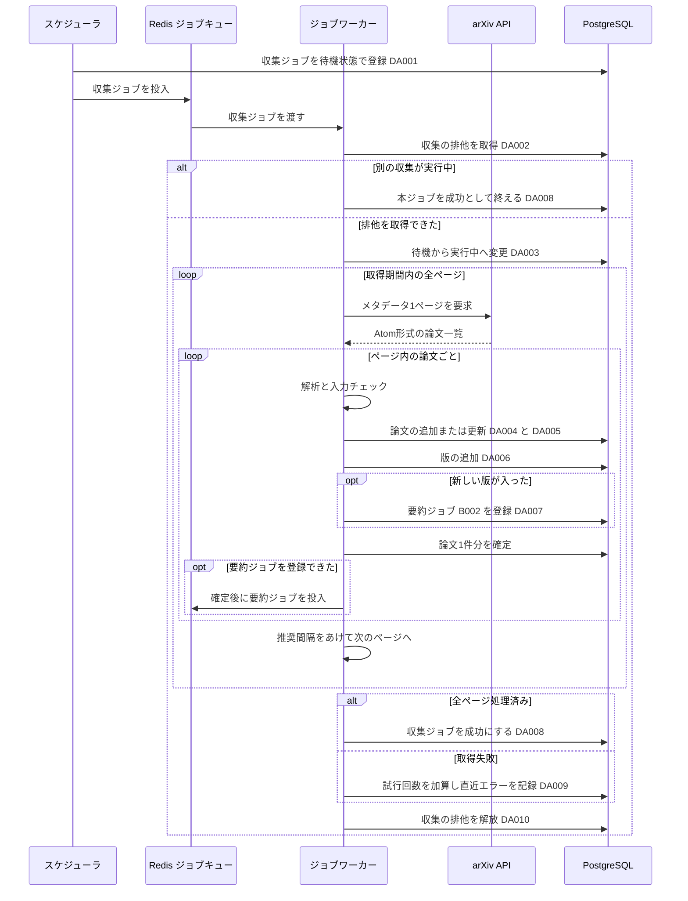

# BE詳細設計書 — F01 新着論文取得（論文収集）

## 0. 文書情報

| 項目 | 値 |
| :--- | :--- |
| 設計書ID | F01-BE |
| 親ID | F01 |
| 親設計書 | `基本設計書_概要.md` §4.1 機能一覧 |
| 機能名 | 新着論文取得（上流 §4 機能一覧のカテゴリ「論文収集」、資料上のID F-01） |
| 版 | 1.0 |
| 作成日 / 更新日 | 2026-10-26 / 2026-10-26 |
| 作成方法 | creating-backend-detailed-design v1.5.0 準拠。上流の確定設計書と `source/` の企画資料からの新規設計 |
| インプット | (a) `source/02_機能要求定義.md:6,45-50,57-58`、`source/03_システム構成.md:11,19-23,35-36,43,57`、`source/04_収益化とロードマップ.md:27`／(b) `docs/基本設計書_概要.md` §2 BF01・EX01、§4 F01・B001・B002・バッチ共通の方針、§6 T001・T002・T009・CRUD図、§7 IF01、§8、§9 環境変数、§11 ARC001・ARC005・ARC006・ARC007、付録 Q18・Q19・Q36／DB物理設計書 `docs/db/DB.T001.DB物理設計.md`・`DB.T002.DB物理設計.md`・`DB.T009.DB物理設計.md`／(c) `legacy/`（空） |

* **インプットの性質**: `source/` に入っているのは企画・初期設計案のMarkdown 6ファイルだけで、アプリのソースコード・ジョブ定義・設定ファイルは1つもありません（`source/` 配下の実ファイル数6件を確認）。このため本書は**リバースエンジニアリングではなく新規設計**です。本書の関数・データアクセス・SQLは、上流で確定した処理の流れ（BF01・EX01・B001）とDB物理設計書の制約を実装に落としたもので、実装済みであることは意味しません。資料と上流に無い値（関数名、ファイル配置、接続先URL、時刻、件数、上限値）は「※推測」を付けています。
* **既存版**: `docs/detail/be/BE.F01.BE詳細設計.md` の旧版はありません（`docs/detail/` 自体が無く、本書が初版です）。消さずに残すべき既存記述はありません。
* **legacy/ との突合**: `legacy/` は空ディレクトリです（ファイル0件）。突合する既存仕様・業務意図・非機能の記述はありません。
* **F01 の範囲**: 上流 §4 で F01 は「arXiv APIから新着論文のメタデータを定期的に集め、arXiv IDと版で重複を除いて保存する」機能で、実体はバッチ B001（論文メタデータ収集）です。上流 BF01 の流れのうち、B002（要約生成）以降の処理は F04 の責務で、F01 は**新しく入った版ごとに B002 のジョブを登録するところまで**を受け持ちます（上流 §4 B001「新しく入った版ごとに要約ジョブ（B002）を登録する」、CRUD図 F01 の jobs「C」）。
* **バッチ詳細設計書との分担**: 起動スケジュール・運用手順・監視はバッチ詳細設計書 `docs/detail/batch/BT.B001.バッチ詳細設計.md`（未作成）の責務とし、本書はサーバ側の処理ロジック・データアクセス・外部連携・例外とトランザクションを扱います。

## 1. バックエンド構成・モジュール設計

* **対象ドメイン**: 論文収集 — arXiv APIからの新着論文メタデータの定期取得、arXiv IDと版での重複排除、論文（`papers`）と論文バージョン（`paper_versions`）への保存、新しい版ごとの要約ジョブ（B002）の登録、収集ジョブ自体の状態管理（上流 F01・B001・BF01・EX01）。
* **対象APIエンドポイント**: なし。F01 は利用者や画面から呼ばれるHTTP APIを持たず、定期実行のスケジューラから起動されるジョブとして動きます（上流 §7 内部API一覧の全8件 API01〜API08 に F01 のものは無い。§2 で根拠を示す）。
* **実行基盤**: Pythonワーカー上のジョブ（Redis + Celery または RQ。どちらにするかは未決定、上流 Q02）。DBは Supabase 上の PostgreSQL に、行単位アクセス制御を通らないサーバ側のサービスロールで接続します（DB物理設計書 T001・T002・T009 §7 の Row Level Security の注記）。
* **ディレクトリ/ファイル構造**（※推測: 実装時のディレクトリ構成は未定義。上流 §9 の想定 `worker/` に置く）:

```
worker/
├── jobs/
│   ├── scheduler.py            # enqueue_collect_metadata（定期実行の起点）
│   ├── collect_metadata.py     # run_collect_metadata / resolve_window / iter_entries / validate_record / upsert_paper_version
│   └── job_state.py            # mark_job_succeeded / record_job_failure / sanitize_error / dispatch_job（ARC006 のジョブ共通処理）
├── integrations/
│   └── arxiv_client.py         # ArxivClient.fetch_page / parse_entry（IF01 arXiv API）
├── db/
│   └── session.py              # PostgreSQL 接続（直接接続。§6 の注意を参照）
└── config.py                   # ARXIV_REQUEST_INTERVAL_SEC ほか設定値の読み込み
```

* **処理シーケンス図**（上流 BF01 のうち F01 の範囲と EX01 を実装の単位で展開。※推測を含む）:



## 2. API・インターフェース詳細設計

* **APIエンドポイント一覧（全数ロースター）**:

| API ID | メソッド | エンドポイント | 概要 | 定義状況 | 詳細の所在 |
| :--- | :--- | :--- | :--- | :--- | :--- |
| — | — | 該当なし | — | — | — |

**総件数: 0件。根拠**: 上流 `docs/基本設計書_概要.md` §7 内部API一覧の全8件（API01〜API08。`source/03_システム構成.md:46-54` の API設計案8行と1対1）を確認し、F01 に属するものは0件でした。F01 は上流 §4 で「システム機能」、起点は「定期ジョブ（B001）」と定義されており（上流 §2 業務フロー一覧 BF01）、画面からも外部からもHTTPで呼ばれません。スケジューラからの起動はジョブキューへの投入で行い、HTTPの受け口は設けません（※推測: スケジューラをHTTPで起動する方式、例えば外部のcronサービスから呼ぶ受け口を設けるかは §6 の確認事項 No.1 で確認）。

* **外部サービス連携一覧（全数ロースター）**: 上流 §7 外部連携一覧の全9件に対し、F01 で使うかを示します。

| IF ID | 連携先 | F01 での利用 | 概要 | 定義状況 | 詳細の所在 |
| :--- | :--- | :--- | :--- | :--- | :--- |
| IF01 | arXiv API | 利用する | 新着論文のメタデータを期間とカテゴリを指定して取得する | 詳細 | 本節 連携仕様表、§4 `ArxivClient.fetch_page` |
| IF02 | arXiv（論文本文PDF） | 利用しない | 本文PDFの取得は本文解析 B005（F04）の責務 | - | `docs/detail/be/BE.F04.BE詳細設計.md`（未作成） |
| IF03 | arXiv 原文ページ | 利用しない | 画面からのリンク遷移で、サーバ処理を伴わない。F01 は遷移先URLを `papers.original_url` として保存するだけ | - | - |
| IF04 | LLM API | 利用しない | 要約生成は B002 以降（F04）の責務で、F01 はジョブ登録まで | - | `docs/detail/be/BE.F04.BE詳細設計.md`（未作成） |
| IF05 | Supabase Auth | 利用しない | 利用者の認証は F01 に関係しない。DBへはサービスロールで接続する | - | - |
| IF06 | Stripe（決済セッション） | 利用しない | 課金（F12）の責務 | - | - |
| IF07 | Stripe（契約状態の通知） | 利用しない | 課金（F12）の責務 | - | - |
| IF08 | GitHub | 利用しない | GitHub関連付け（F14）の責務 | - | - |
| IF09 | 通知配信手段 | 利用しない | 通知・ダイジェスト（F10）の責務 | - | - |

**総件数: 9件（F01 で利用するもの1件）。根拠**: 上流 §7 外部連携一覧の IF01〜IF09 の全9行と1対1で対応します。上流 §2 BF01 のシーケンスで F01 の範囲（B001）に登場する外部の相手は arXiv API だけです。Redis（ジョブキュー）と PostgreSQL は上流 §7 で「本システムの構成要素（内部）」と定義されているため外部連携に含めません。

* **外部サービス連携仕様**（F01 で利用する IF01 の1件）:

| IF ID | 連携先 | 連携方式 | エンドポイント / 接続先 | 認証方式 | タイムアウト | リトライ方針 | エラー時の挙動 |
| :--- | :--- | :--- | :--- | :--- | :--- | :--- | :--- |
| IF01 | arXiv API | REST API（HTTP GET。応答は Atom 形式のXML）（※推測: 上流 IF01 は「arXiv公式APIのHTTP GET」を※推測としている） | `https://export.arxiv.org/api/query`（※推測）。問い合わせ条件は「収集対象カテゴリのいずれかに属し、かつ最終更新日時が取得期間に入る論文」を最終更新日時の古い順で求める形にし、取得位置と1ページの件数でページを送る（`search_query=(cat:cs.LG OR …) AND lastUpdatedDate:[開始 TO 終了]&sortBy=lastUpdatedDate&sortOrder=ascending&start=N&max_results=200`。1ページ200件は※推測） | 認証なし（上流 IF01、※推測） | 1リクエスト30秒（※推測） | arXivの推奨に従い、リクエストとリクエストの間を設定値の秒数（`ARXIV_REQUEST_INTERVAL_SEC`。※推測: 3秒以上）だけ必ずあける。失敗したときは個々のリクエストでは再試行せず、収集ジョブ全体を失敗として試行回数を1増やし、上限未満ならジョブごと再実行する（上流 EX01。上限は※推測で3回、上流 Q19）。再実行しても取り込みは冪等なので、同じ論文が二重に入ることはない（§3 DA004・DA006） | 応答が無い・接続できない・サーバ側の一時的な失敗（HTTP 5xx）・アクセス過多の応答（HTTP 429、または応答本文が空のページ）のときは、再試行できる失敗として扱い、上流 EX01 のとおり試行回数を加算して再実行を待つ。問い合わせ条件の誤り（HTTP 429 を除く 400〜499）は再実行しても直らないため、試行回数にかかわらずその場で失敗にして失敗キューへ送る（※推測）。どの場合もエラー内容から接続先の認証情報や長い応答本文を取り除いて直近エラーに残す（§4 `sanitize_error`） |

* **IF01 の受信データと保存先の対応**（※推測: arXiv API の Atom 応答の要素名。資料に定義なし）:

| Atom の要素 | 意味 | 保存先 | 変換のしかた |
| :--- | :--- | :--- | :--- |
| `entry/id` | 版番号つきの論文URL（例: `http://arxiv.org/abs/2401.12345v2`） | `papers.arxiv_id`、`paper_versions.version`、`papers.latest_version` | URLの `/abs/` より後ろを取り出し、末尾の「v＋数字」を版番号として切り離す。残りをarXiv IDにする。旧形式のID（例: `hep-th/9901001v1`）も同じ規則で切り離す（DB物理設計書 T001 §4.3 (1)、T002 §4.3 (2)） |
| `entry/title` | 原題 | `papers.title`、スナップショット | 改行と連続する空白を1つの空白にまとめ、前後の空白を取る（T001 §4.3 (2)） |
| `entry/summary` | Abstract | `papers.abstract`、スナップショット | 原題と同じ整形だけを行い、LaTeX記法やHTMLに見える文字列はそのまま保存する（無害化は画面側。上流 §8 XSS） |
| `entry/author/name`（複数） | 著者名 | `papers.authors`、スナップショット | 記載の順番のまま文字列の配列にする（T001 §4.3 (3)） |
| `entry/arxiv:primary_category` と `entry/category`（複数） | 主カテゴリと全カテゴリ | `papers.categories`、スナップショット | 主カテゴリを先頭に置き、残りを応答の順で後ろに並べ、重複を除く（T001 §4.3 (4)） |
| `entry/published` | v1 の投稿日時 | `papers.submitted_at` | UTCの日時として保存する |
| `entry/updated` | この版の公開日時 | `papers.updated_at`、スナップショット | UTCの日時として保存する |
| （ライセンス） | 利用許諾 | `paper_versions.license_type` | arXiv API の検索応答にはライセンスが含まれないことがある（※推測）。含まれない場合は空のまま保存し、本文の利用は許可されていないものとして扱う。値の補完は本文解析 B005 の前に別の手段で行う（DB物理設計書 T002 §4.3 (5)。※上流要確認: ライセンスの取得手段。§6 確認事項 No.4） |

* **API詳細仕様**: 該当なし（APIエンドポイント0件のため。根拠は上の一覧の直後に記載）。ジョブとしての入出力（キューへ投入するメッセージの内容）は §4 の `run_collect_metadata` と §5 に記載します。

## 3. データアクセス（ORM / クエリ）設計

* **データアクセス一覧（全数ロースター）**:

| DA-ID | 処理名 | 呼出元（関数/API） | テーブルID | 対象物理テーブル | 種別 (SELECT/INSERT/UPDATE/DELETE) | 定義状況 (詳細/簡易) | 詳細の所在 |
| :--- | :--- | :--- | :--- | :--- | :--- | :--- | :--- |
| DA001 | 収集ジョブの登録 | `enqueue_collect_metadata` | T009 | jobs | INSERT | 詳細 | §3 詳細定義 DA001・発行SQL DA001 |
| DA002 | 収集の排他取得 | `run_collect_metadata` | — | （テーブルなし。PostgreSQL のアドバイザリロック） | SELECT | 詳細 | §3 詳細定義 DA002・発行SQL DA002 |
| DA003 | 収集ジョブの着手 | `run_collect_metadata` | T009 | jobs | UPDATE | 詳細 | §3 詳細定義 DA003・発行SQL DA003 |
| DA004 | 論文の追加または最新版での上書き | `upsert_paper_version` | T001 | papers | INSERT（衝突時 UPDATE） | 詳細 | §3 詳細定義 DA004・発行SQL DA004 |
| DA005 | arXiv IDでの論文ID取得 | `upsert_paper_version` | T001 | papers | SELECT | 簡易 | 発行SQL DA005 |
| DA006 | 論文の版の追加 | `upsert_paper_version` | T002 | paper_versions | INSERT（衝突時は何もしない） | 詳細 | §3 詳細定義 DA006・発行SQL DA006 |
| DA007 | 要約ジョブ（B002）の登録 | `upsert_paper_version` | T009 | jobs | INSERT（衝突時は何もしない） | 詳細 | §3 詳細定義 DA007・発行SQL DA007 |
| DA008 | 収集ジョブの成功記録 | `mark_job_succeeded`（`run_collect_metadata` から呼ぶ） | T009 | jobs | UPDATE | 詳細 | §3 詳細定義 DA008・発行SQL DA008 |
| DA009 | 収集ジョブの失敗記録 | `record_job_failure`（`run_collect_metadata` から呼ぶ） | T009 | jobs | UPDATE | 詳細 | §3 詳細定義 DA009・発行SQL DA009 |
| DA010 | 収集の排他解放 | `run_collect_metadata` | — | （テーブルなし。PostgreSQL のアドバイザリロック） | SELECT | 簡易 | 発行SQL DA010 |

**総件数: 10件（詳細8件・簡易2件）。全数である根拠**: §4 関数一覧の全12関数のうちDBへ問い合わせる5関数（`enqueue_collect_metadata`・`run_collect_metadata`・`upsert_paper_version`・`mark_job_succeeded`・`record_job_failure`）の処理フローに現れるDB操作を、§4 IPO定義の各ステップから1件ずつ拾ったものです（`enqueue_collect_metadata`→DA001、`run_collect_metadata`→DA002・DA003・DA010、`upsert_paper_version`→DA004〜DA007、`mark_job_succeeded`→DA008、`record_job_failure`→DA009）。残りの7関数（`resolve_window`・`iter_entries`・`ArxivClient.fetch_page`・`parse_entry`・`validate_record`・`sanitize_error`・`dispatch_job`）はDBに触れません。F01 は DELETE を発行しません。
**上流 CRUD図との突合**: 上流 §6 CRUD図の F01 行は papers「CRU」、paper_versions「CR」、jobs「C」です。papers の C・U は DA004、R は DA005 と一致します。paper_versions の C は DA006、R は DA006 の一意制約の衝突判定（同じ版がすでにあるかを読む動作）に当たります。jobs の C は DA001・DA007 と一致しますが、**収集ジョブ自身の状態を変える DA003・DA008・DA009 の U が上流 CRUD図にありません**。上流 EX01 は「jobs の attempts を加算し last_error を記録」「jobs の status を失敗にする」と収集ジョブの更新を求めているため、※上流要確認: CRUD図の F01 の jobs を「CU」にするか（§6 確認事項 No.2）。
**定義状況の判定**（completeness 3-1）: DA001・DA003・DA004・DA006・DA007・DA008・DA009 は永続データを書き換える（3-1 の2）ため「詳細」です。DA002 はロックの取得結果で処理が分かれ（3-1 の1）、同時実行を防ぐ非自明な仕組み（3-1 の5）のため「詳細」です。DA005 は arXiv ID で1行を引くだけの単純な取得、DA010 はロックを外すだけの定型操作で、どちらも 3-1 の基準に当たらないため「簡易」です（DA005 を呼ぶかどうかの分岐は呼び出し元 `upsert_paper_version` の側にあり、§4 に記載）。

* **データアクセス詳細定義**（定義状況＝詳細の8件）:

| DA-ID | 処理名 | 対象物理テーブル | JOIN / Include | 抽出条件 (Where) / ソート | トランザクション境界 | N+1対策・性能上の注意 |
| :--- | :--- | :--- | :--- | :--- | :--- | :--- |
| DA001 | 収集ジョブの登録 | jobs | なし | 抽出条件なし。種別を「論文メタデータ収集」、版を空にして1行追加し、払い出されたジョブIDを受け取る。状態は初期値の待機、試行回数は初期値の0のまま（`job_type='collect_metadata'`, `paper_version_id=NULL`。DB物理設計書 T009 §6） | 1文で自動確定する。確定したあとにジョブキューへ投入する（確定前に投入すると、ワーカーがまだ見えない行を探して着手に失敗するため） | 版の無いジョブは重複実行を防ぐ一意インデックス（`uq_jobs_active_per_version`）の対象外のため、ここでは重複を止めない。同時に2つ動くことは DA002 の排他で防ぐ（T009 §5.2） |
| DA002 | 収集の排他取得 | （テーブルなし） | なし | 収集専用に決めた1つの鍵で、待たずに取れるかだけを試す。取れたら真、他の接続が持っていたら偽が返る（`pg_try_advisory_lock(<収集用の固定キー>)`。キーの値は※推測で文字列「collect_metadata」のハッシュ） | トランザクションの外でセッション単位に取る。収集の処理の間ずっと同じDB接続で保持し、DA010 で明示的に外す。ワーカーが異常終了して接続が切れた場合はDBが自動で外す | セッション単位のロックは、接続をトランザクションごとに付け替える接続プール（Supabase のトランザクションモードのプーラー）を通すと保持できない。収集ジョブはDBへ直接つなぐ接続（またはセッションモード）を使う（※推測） |
| DA003 | 収集ジョブの着手 | jobs | なし | 指定のジョブIDで、状態が待機の行だけを実行中に変える（`WHERE id = :job_id AND status = 'pending'`）。変えた行が1行なら処理を続け、0行なら他のワーカーが着手済みか終わっているため何もせずに終える | 1文で自動確定する | ジョブキューは同じジョブを別のワーカーへもう一度渡すことがあり（T009 §4.3 (4)「実行の取り合い」）、この条件付き更新で1つのワーカーだけが処理するようにする。主キーで1行を引くだけで性能上の問題はない |
| DA004 | 論文の追加または最新版での上書き | papers | なし | arXiv IDが未登録なら1行追加する。登録済みなら、取り込んだ版番号が登録済みの最新版以上で、かつ原題・Abstract・著者・カテゴリ・更新日時・最新版のどれかが登録済みの値と違うときだけ、その6列を上書きする。投稿日時・原文URL・arXiv IDは上書きしない。追加または上書きした行の論文IDを受け取る（`INSERT … ON CONFLICT (arxiv_id) DO UPDATE … WHERE EXCLUDED.latest_version >= papers.latest_version AND (…) IS DISTINCT FROM (…) RETURNING id`。発行SQL DA004） | 論文1件の取り込みトランザクション（DA004〜DA007）の1文目。後続が失敗したら一緒に取り消す | 上書きの条件で古い版の取得結果が新しい内容を戻すのを防ぐ（T001 §4.3 (1)(2)(6)）。毎回の収集で取得期間が重なる（§4 `resolve_window`）ため、同じ内容の論文を何度も受け取る。値が変わらないときは更新しない条件を付けて、無駄な行の書き換え（不要な行バージョンの発生）を避ける。条件に当たらず更新しなかったときは論文IDが返らないため、DA005 で引き直す |
| DA006 | 論文の版の追加 | paper_versions | なし | 論文IDと版番号の組がまだ無ければ、取り込み時点のメタデータ（スナップショット）とライセンス種別を付けて1行追加する。本文取得状況は初期値の「Abstractのみ」のまま。すでにあれば何もしない。追加できたときだけ新しい版の論文バージョンIDが返る（`INSERT … ON CONFLICT (paper_id, version) DO NOTHING RETURNING id`） | 論文1件の取り込みトランザクションの2文目（DA005 を呼んだ場合は3文目） | 一意制約 `uq_paper_versions_paper_id_version` の衝突で重複を判定するため、並行して取り込んでも行は2つにならない（T002 §4.3 (2)、ARC001）。返った行の有無で「新しい版が入ったか」を判断し、入ったときだけ DA007 を発行する。スナップショットは一度書いたら変えない（T002 §4.3 (3)） |
| DA007 | 要約ジョブ（B002）の登録 | jobs | なし | DA006 で新しく入った版について、種別を「Abstractベース日本語要約生成」として待機状態の行を1行追加する。同じ版・同じ種別のジョブがすでに待機中か実行中なら何もしない（`job_type='summarize_abstract'`、`ON CONFLICT (paper_version_id, job_type) WHERE status IN ('pending','running') AND paper_version_id IS NOT NULL DO NOTHING RETURNING id`） | 論文1件の取り込みトランザクションの最後の文。確定したあとに、返ったジョブIDをジョブキューへ投入する（§4 `dispatch_job`） | 重複実行を防ぐ一意インデックス `uq_jobs_active_per_version` は部分インデックスのため、衝突の判定先として同じ条件を ON CONFLICT に書かないとDBが使うインデックスを決められずエラーになる（T009 §5.2）。版と要約ジョブを同じトランザクションで書くことで、版だけが入って要約ジョブが無い状態を作らない |
| DA008 | 収集ジョブの成功記録 | jobs | なし | 指定のジョブIDで、状態が実行中の行だけを成功に変える（`WHERE id = :job_id AND status = 'running'`）。排他を取れずに処理を省いたとき（§4 `run_collect_metadata` 手順3）は、状態が待機の行を成功に変える（`AND status = 'pending'`） | 1文で自動確定する | 状態の条件を付けて、他のワーカーの結果を上書きしない（T009 §4.3 (4)）。直近エラーは消さない（T009 §4.3 (6)） |
| DA009 | 収集ジョブの失敗記録 | jobs | なし | 指定のジョブIDで、状態が実行中の行について、試行回数を1増やし、認証情報を取り除いたエラーの要約を直近エラーに書く。増やした結果が上限に達したか、再実行しても直らない失敗なら状態を失敗にし、そうでなければ待機に戻す。変更後の状態と試行回数を受け取る（`SET attempts = attempts + 1, last_error = :error, status = CASE WHEN :non_retryable OR attempts + 1 >= :max_attempts THEN 'failed' ELSE 'pending' END WHERE id = :job_id AND status = 'running' RETURNING status, attempts`） | 1文で自動確定する。論文の取り込みトランザクションとは別に書く（取り込みの取り消しに巻き込まれないため） | 上限と比べる処理を読む文と書く文に分けず1文で行い、読んでから書くまでの間に値が変わる問題を避ける。上限の値は※推測で3回（上流 Q19、T009 §4.3 (5)）。待機に戻した場合は、呼び出し元が再実行の遅延を付けてジョブキューへ再投入する |

* **発行SQL**: 全10件。すべて PostgreSQL 15 以上の文で、ORMを使う場合もこの文と同じ意味になるように書きます（※推測: ORMを使うかは未定）。プレースホルダは `:名前` で示します。

**DA001 収集ジョブの登録**
```sql
INSERT INTO jobs (job_type, paper_version_id)
VALUES ('collect_metadata', NULL)
RETURNING id;
```

**DA002 収集の排他取得**
```sql
SELECT pg_try_advisory_lock(hashtext('collect_metadata')) AS acquired;
```

**DA003 収集ジョブの着手**
```sql
UPDATE jobs
   SET status = 'running'
 WHERE id = :job_id
   AND status = 'pending';
-- 更新件数が1なら処理を続け、0なら何もせず終える
```

**DA004 論文の追加または最新版での上書き**
```sql
INSERT INTO papers (
    arxiv_id, title, abstract, authors, categories,
    submitted_at, updated_at, latest_version, original_url
) VALUES (
    :arxiv_id, :title, :abstract, :authors::jsonb, :categories::text[],
    :submitted_at, :updated_at, :version, :original_url
)
ON CONFLICT (arxiv_id) DO UPDATE
   SET title          = EXCLUDED.title,
       abstract       = EXCLUDED.abstract,
       authors        = EXCLUDED.authors,
       categories     = EXCLUDED.categories,
       updated_at     = EXCLUDED.updated_at,
       latest_version = EXCLUDED.latest_version
 WHERE EXCLUDED.latest_version >= papers.latest_version
   AND (papers.title, papers.abstract, papers.authors, papers.categories,
        papers.updated_at, papers.latest_version)
       IS DISTINCT FROM
       (EXCLUDED.title, EXCLUDED.abstract, EXCLUDED.authors, EXCLUDED.categories,
        EXCLUDED.updated_at, EXCLUDED.latest_version)
RETURNING id;
-- 返る行が無い場合（登録済みで、古い版か内容が同じ）は DA005 で論文IDを引く
```
組み立ての分岐: 文の形は固定で、動的な組み立てはありません。生成され得る結果は「新規追加して論文IDが返る」「上書きして論文IDが返る」「何もせず行が返らない」の3通りです。

**DA005 arXiv IDでの論文ID取得**
```sql
SELECT id
  FROM papers
 WHERE arxiv_id = :arxiv_id;
-- 一意制約 uq_papers_arxiv_id のインデックスで1行を引く
```

**DA006 論文の版の追加**
```sql
INSERT INTO paper_versions (paper_id, version, metadata_snapshot, license_type)
VALUES (:paper_id, :version, :metadata_snapshot::jsonb, :license_type)
ON CONFLICT (paper_id, version) DO NOTHING
RETURNING id;
-- 行が返ったときだけ新しい版が入ったと判断し、DA007 を発行する
```

**DA007 要約ジョブ（B002）の登録**
```sql
INSERT INTO jobs (job_type, paper_version_id)
VALUES ('summarize_abstract', :paper_version_id)
ON CONFLICT (paper_version_id, job_type)
    WHERE status IN ('pending', 'running') AND paper_version_id IS NOT NULL
    DO NOTHING
RETURNING id;
-- 行が返ったときだけ、確定後にジョブキューへ投入する
```

**DA008 収集ジョブの成功記録**
```sql
-- 通常の終了（実行中から成功へ）
UPDATE jobs
   SET status = 'succeeded'
 WHERE id = :job_id
   AND status = 'running';

-- 排他を取れずに処理を省いたとき（待機から成功へ）
UPDATE jobs
   SET status = 'succeeded'
 WHERE id = :job_id
   AND status = 'pending';
```
組み立ての分岐: 呼び出し元が「着手したか（DA003 で実行中にしたか）」で2つの文のどちらかを選びます。生成され得る形は上の2通りだけです。

**DA009 収集ジョブの失敗記録**
```sql
UPDATE jobs
   SET attempts   = attempts + 1,
       last_error = :sanitized_error,
       status     = CASE
                        WHEN :non_retryable OR attempts + 1 >= :max_attempts THEN 'failed'
                        ELSE 'pending'
                    END
 WHERE id = :job_id
   AND status = 'running'
RETURNING status, attempts;
```

**DA010 収集の排他解放**
```sql
SELECT pg_advisory_unlock(hashtext('collect_metadata'));
```

## 4. サーバー側機能・処理ロジック設計（IPO設計）

* **関数一覧（全数ロースター）**:

| 関数名 | 所属モジュール（※推測） | 概要 | 定義状況 | 詳細の所在 |
| :--- | :--- | :--- | :--- | :--- |
| `enqueue_collect_metadata` | `worker/jobs/scheduler.py` | 定期実行の起点。収集ジョブをDBに登録し、ジョブキューへ投入する | 詳細 | §4 IPO定義 |
| `run_collect_metadata` | `worker/jobs/collect_metadata.py` | 収集ジョブの本体。排他を取り、取得期間内の論文を全ページ取り込み、ジョブの成否を記録する | 詳細 | §4 IPO定義 |
| `resolve_window` | `worker/jobs/collect_metadata.py` | 取得する最終更新日時の期間を決める | 詳細 | §4 IPO定義 |
| `iter_entries` | `worker/jobs/collect_metadata.py` | 取得期間の論文をページを送りながら1件ずつ取り出す | 詳細 | §4 IPO定義 |
| `ArxivClient.fetch_page` | `worker/integrations/arxiv_client.py` | arXiv API に1ページ分を問い合わせ、推奨間隔を守る | 詳細 | §4 IPO定義 |
| `parse_entry` | `worker/integrations/arxiv_client.py` | Atom の1件を、保存用の論文レコードに変換する | 詳細 | §4 IPO定義 |
| `validate_record` | `worker/jobs/collect_metadata.py` | 保存前にDBの制約に合うかを確かめ、合わない論文を除外する | 詳細 | §4 IPO定義 |
| `upsert_paper_version` | `worker/jobs/collect_metadata.py` | 論文1件を1トランザクションで保存し、新しい版なら要約ジョブを登録する | 詳細 | §4 IPO定義 |
| `dispatch_job` | `worker/jobs/job_state.py` | 登録済みのジョブをジョブキューへ投入する | 詳細 | §4 IPO定義 |
| `mark_job_succeeded` | `worker/jobs/job_state.py` | ジョブを成功として記録する | 詳細 | §4 IPO定義 |
| `record_job_failure` | `worker/jobs/job_state.py` | ジョブの失敗を記録し、再実行か失敗キュー行きかを決める | 詳細 | §4 IPO定義 |
| `sanitize_error` | `worker/jobs/job_state.py` | エラー内容から認証情報を除き、保存できる長さの要約にする | 詳細 | §4 IPO定義 |

**総件数: 12関数（全件 詳細）。全数である根拠**: 上流 §2 BF01（F01 の範囲）と EX01 のシーケンス、上流 §4 B001 の処理内容、DB物理設計書 T001・T002・T009 が F01（B001）に課した書き込みの規則を、処理の段階ごとに1関数ずつ割り当てたものです（起動→`enqueue_collect_metadata`、ジョブ本体と排他→`run_collect_metadata`、取得期間→`resolve_window`、arXivへの問い合わせ→`ArxivClient.fetch_page`・`iter_entries`、メタデータの解釈→`parse_entry`・`validate_record`、重複判定と保存と要約ジョブ登録→`upsert_paper_version`、ジョブの投入と状態→`dispatch_job`・`mark_job_succeeded`・`record_job_failure`・`sanitize_error`）。ソースコードが無いため実在の関数との突合はできず、関数名と分け方は※推測です。`dispatch_job`・`mark_job_succeeded`・`record_job_failure`・`sanitize_error` はジョブ実行基盤（ARC006）として他のバッチと共用する想定ですが、F01 での使い方を本書で定義します（共通部分の正は方式設計書 `docs/arch/方式.ARC006.方式設計.md`（未作成））。
**定義状況の判定**（completeness 3-1）: 12関数とも、永続データや外部への送信を伴う（3-1 の2: `enqueue_collect_metadata`・`run_collect_metadata`・`upsert_paper_version`・`dispatch_job`・`mark_job_succeeded`・`record_job_failure`）、外部との通信と失敗時の扱いを含む（3-1 の5・6: `ArxivClient.fetch_page`・`iter_entries`）、条件による分岐を含む（3-1 の1: `resolve_window`・`validate_record`）、非自明な業務ルールを含む（3-1 の7: `parse_entry`・`sanitize_error`）のいずれかに当たるため「詳細」です。

* **入力・処理・出力（IPO）定義**:

| 関数名 | 所属モジュール | 引数 (型) | 処理フロー (ステップ単位で具体的に) | 戻り値 | 発生しうるエラー |
| :--- | :--- | :--- | :--- | :--- | :--- |
| `enqueue_collect_metadata` | `worker/jobs/scheduler.py` | window_from: datetime または None（指定しないときは None）, window_to: datetime または None（指定しないときは None） | 1. スケジューラ（※推測: Celery beat または rq-scheduler。1日1回、arXivの新着公開後の時刻にUTCで定義。上流 Q18）から引数なしで呼ばれる。運用者が取りこぼした期間を取り直すときは、期間を指定して手動で呼ぶ（※推測）。<br>2. 収集ジョブを待機状態で1行登録し、ジョブIDを受け取る（DA001）。<br>3. 登録が確定したあとで、ジョブID・指定期間を引数にして `run_collect_metadata` をジョブキューへ投入する（`dispatch_job`）。<br>4. 登録したジョブIDをログに出す（INFO）。 | 登録したジョブID（int） | DB接続失敗: 例外をそのまま上げ、スケジューラのログに残す（ジョブは作られない。次回の定期実行で再び登録される）。ジョブキューへの投入失敗: ジョブの行は待機のまま残る。ERRORログを出して例外を上げる（※上流要確認: 投入されなかった待機ジョブを拾い直す仕組み。§6 確認事項 No.3） |
| `run_collect_metadata` | `worker/jobs/collect_metadata.py` | job_id: int, window_from: datetime または None, window_to: datetime または None | 1. 収集専用のDB接続（直接接続）を開く。<br>2. 収集の排他を待たずに取りにいく（DA002）。<br>3. 取れなかったときは、別の収集が実行中で同じ期間を取り込むため、本ジョブの処理を省く。ジョブを待機から成功に変え（DA008 の2文目）、INFOログに「他の収集が実行中のため処理を省いた」と出して終える。<br>4. 取れたときは、ジョブを待機から実行中に変える（DA003）。変えた行が0行なら、他のワーカーが着手済みか終わっているため、排他を外して（DA010）何もせず終える。<br>5. `resolve_window` で取得期間を決める。<br>6. `iter_entries` から論文を1件ずつ受け取り、`parse_entry` で変換し、`validate_record` で確かめる。確かめて不合格の論文は取り込まずに件数を数え、WARNログに arXiv ID と理由を出して次へ進む。<br>7. 合格した論文は `upsert_paper_version` で保存する。保存の結果（新規の論文・上書きした論文・新しい版・変化なし）を数える。DBの制約違反で1件の保存が取り消されたときは、その論文だけを除外として数え、WARNログを出して次へ進む。<br>8. 全ページを最後まで処理したら、ジョブを成功にする（`mark_job_succeeded` → DA008 の1文目）。取得件数・新規論文数・新しい版の数・除外数をINFOログに出す。<br>9. arXiv への問い合わせ、またはDB接続が失敗したときは、そこで処理を打ち切り `record_job_failure` を呼ぶ。手順7までに確定した論文はそのまま残す（1件ごとに確定しているため）。<br>10. 成否にかかわらず最後に排他を外し（DA010）、接続を閉じる。 | なし（結果はジョブの状態とログに残す） | arXiv 取得失敗（タイムアウト・接続失敗・HTTP 5xx・HTTP 429・空のページ）: 再試行できる失敗として `record_job_failure`。arXiv の問い合わせ条件の誤り（HTTP 429 を除く 400〜499）: 再試行しても直らない失敗として `record_job_failure`（すぐ失敗にする）。DB接続失敗: 再試行できる失敗として `record_job_failure`（記録自体ができない場合はERRORログだけ残し、ジョブは実行中のまま。§6 確認事項 No.5）。1件の論文の解釈・制約違反: その1件を除外して続行。予期しない例外: 再試行できる失敗として扱い、スタックトレースはログにだけ出す |
| `resolve_window` | `worker/jobs/collect_metadata.py` | window_from: datetime または None, window_to: datetime または None, now: datetime（UTC） | 1. 期間が引数で指定されていればそれを使う（運用者による取り直し）。開始が終了より後なら、指定の誤りとして例外を上げる。<br>2. 指定が無ければ、終了を現在時刻、開始を現在時刻から設定値の日数（`ARXIV_LOOKBACK_DAYS`。※推測: 3日）さかのぼった時刻にする。前回の実行が成功したかどうかに関係なく毎回同じ幅で取り込み、取り込みは冪等（DA004・DA006）なので、前回分と重なっても重複は起きない。数日止まっていても、この幅の中なら次の実行で取り戻せる。<br>3. 期間の幅が設定値を超えて取りこぼしが出るおそれがあるとき（ジョブが設定日数より長く止まった場合）は自動では補わず、運用者が手順1の指定で取り直す（※推測）。 | （開始日時, 終了日時）の組（UTC） | 期間の指定誤り（開始が終了より後）: 再試行しても直らない失敗として扱う |
| `iter_entries` | `worker/jobs/collect_metadata.py` | client: ArxivClient, categories: list[str], window: （開始, 終了） | 1. 収集対象のカテゴリ（設定値 `ARXIV_CATEGORIES`。※推測・※上流未定義: 上流は収集範囲を定義していない。§6 確認事項 No.6）のいずれかに属し、最終更新日時が期間内の論文を、最終更新日時の古い順に求める問い合わせ条件を作る。新規投稿だけでなく、既存論文の新しい版も最終更新日時で拾える。<br>2. 取得位置0から、1ページの件数（※推測: 200件）ずつ `ArxivClient.fetch_page` を呼ぶ。<br>3. 1ページ目の応答に含まれる全件数が、arXiv API で1つの問い合わせから取り出せる上限（※推測: 30,000件）を超える場合は、期間を1日ずつに分けて手順1から問い合わせ直す。<br>4. ページ内の論文を1件ずつ呼び出し元へ返す。<br>5. 取得位置が全件数に達するか、論文が0件のページが返ったら終える。全件数に達していないのに論文が0件のページが返ったときは、arXiv 側の一時的な取りこぼしとみなし、再試行できる失敗として例外を上げる（※推測）。 | 論文のAtom要素を1件ずつ返す反復子 | arXiv 取得失敗（`ArxivClient.fetch_page` の例外をそのまま上げる）。全件数に満たない空ページ: 再試行できる失敗 |
| `ArxivClient.fetch_page` | `worker/integrations/arxiv_client.py` | query: str, start: int, max_results: int | 1. 前回の問い合わせから設定値の秒数（`ARXIV_REQUEST_INTERVAL_SEC`。※推測: 3秒以上）が経っていなければ、経つまで待つ（ワーカー1つの中で前回時刻を持つ。収集は DA002 の排他で同時に1つしか動かないため、プロセスをまたいだ間隔の管理は不要）。<br>2. IF01 の接続先へ、問い合わせ条件・取得位置・件数を付けて GET を送る。タイムアウトは30秒（※推測）。<br>3. 応答の状態コードを確かめる。200 以外なら、状態コードに応じて再試行できる失敗か直らない失敗かを区別した例外を上げる（§2 IF01 のエラー時の挙動）。<br>4. 応答のXMLを解釈し、全件数・取得位置・論文の要素の並びを取り出す。XMLとして読めなければ再試行できる失敗とする。<br>5. 問い合わせた時刻を記録する。 | ページ（全件数: int, 論文のAtom要素の並び） | 接続失敗・タイムアウト・HTTP 5xx・HTTP 429・XMLの解釈失敗: 再試行できる失敗。HTTP 429 を除く 400〜499 のすべて: 再試行しても直らない失敗 |
| `parse_entry` | `worker/integrations/arxiv_client.py` | entry: Atom要素 | 1. 版番号つきの論文URLから、arXiv IDと版番号を切り離す（§2 IF01 の受信データと保存先の対応）。版番号が付いていなければ解釈できない論文として例外を上げる。<br>2. 原題・Abstractの空白を整える。<br>3. 著者名を記載順の文字列の配列にする。<br>4. 主カテゴリを先頭にしたカテゴリの配列を作り、重複を除く。<br>5. v1 の投稿日時と、この版の公開日時をUTCの日時に変換する。<br>6. 原文URLを版番号なしの形で組み立てる（`https://arxiv.org/abs/{arXiv ID}`。T001 §4.3 (7)）。<br>7. ライセンスを応答から取れれば取り、取れなければ空にする。<br>8. 取り込み時点の記録（スナップショット）を作る。中身は、この版の原題・Abstract・著者・カテゴリ・この版の公開日時・取り込み時点のライセンス（空を含む）・取り込んだ日時・取り込んだ処理が定期収集であることを示す値（※推測: `"source": "B001"`）（T002 §4.3 (3)）。 | 論文レコード（arXiv ID, 版番号, 原題, Abstract, 著者, カテゴリ, 投稿日時, 更新日時, 原文URL, ライセンス, スナップショット） | 必須の要素が無い・論文URLから版番号を切り離せない・日時を解釈できない: 解釈できない論文として例外を上げる（呼び出し元が1件だけ除外する） |
| `validate_record` | `worker/jobs/collect_metadata.py` | record: 論文レコード | 1. arXiv IDが新形式（年月4桁.連番4〜5桁）か旧形式（分野名/年月連番7桁）で、版番号を含まないかを確かめる（DB の `ck_papers_arxiv_id_format` と同じ規則。T001 §4.3 (1)）。<br>2. 版番号が1以上かを確かめる。<br>3. 原題・Abstractが空でないかを確かめる。<br>4. 著者が1人以上いて、すべて文字列かを確かめる（`ck_papers_authors_array` と同じ規則）。<br>5. カテゴリが1件以上あるかを確かめる（`ck_papers_categories_not_empty` と同じ規則）。<br>6. 更新日時があるときは投稿日時より前でないかを確かめる（`ck_papers_updated_after_submitted` と同じ規則）。<br>7. 1つでも外れたら、外れた規則の名前を理由として返す。DBの制約で止まる前にアプリ側で除外し、どの規則で外れたかをログで追えるようにする。 | 合否（bool）と、不合格の理由（str または None） | なし（不合格は戻り値で返す） |
| `upsert_paper_version` | `worker/jobs/collect_metadata.py` | conn: DB接続, record: 論文レコード | 1. トランザクションを始める。<br>2. 論文を追加するか、取り込んだ版が登録済みの最新版以上で内容が変わったときだけ上書きし、論文IDを受け取る（DA004）。<br>3. 論文IDが返らなかった（登録済みで、古い版か内容が同じ）ときは、arXiv IDで論文IDを引く（DA005）。<br>4. 版がまだ無ければ追加する（DA006）。版が返らなかった（すでにある）ときは、生成済みの要約を使い回すため、要約ジョブは登録せずに確定して終える（上流 BF01「登録済みの同じ版」、ARC001）。<br>5. 版が新しく入ったときは、その版の要約ジョブ（B002）を登録する（DA007）。同じ版の要約ジョブがすでに待機中か実行中なら何もしない。<br>6. 確定する。<br>7. 手順5でジョブIDが返っていれば、確定のあとで `dispatch_job` でジョブキューへ投入する。<br>8. 古い版を後から受け取った場合（取り込んだ版番号が登録済みの最新版より小さい）も、その版が未登録なら手順4で版を追加し、手順5で要約ジョブを登録する（※推測: 古い版にも要約を作るか、最新版だけに作るかは §6 確認事項 No.7）。 | 結果の種別（新規の論文 / 上書きした論文 / 新しい版のみ / 変化なし）と、登録した要約ジョブID（int または None） | 制約違反（CHECK・外部キー）: トランザクションを取り消し、その論文を除外として例外を上げる（呼び出し元が1件だけ除外する）。DB接続失敗: トランザクションを取り消し、再試行できる失敗として例外を上げる |
| `dispatch_job` | `worker/jobs/job_state.py` | job_id: int, job_type: str, args: dict（指定は任意） | 1. ジョブ種別に対応するキューの処理（収集なら `run_collect_metadata`、要約生成なら B002 の処理）を、ジョブIDと引数を付けてジョブキューへ投入する。<br>2. DBの行は書き換えない（行は呼び出し元が先に確定済み）。 | なし | ジョブキュー（Redis）への接続失敗: ERRORログを出し例外を上げる。DBの行は待機のまま残る（§6 確認事項 No.3） |
| `mark_job_succeeded` | `worker/jobs/job_state.py` | job_id: int, claimed: bool | 1. 着手済み（実行中に変えた）なら、実行中の行を成功に変える（DA008 の1文目）。<br>2. 着手していない（排他を取れずに省いた）なら、待機の行を成功に変える（DA008 の2文目）。<br>3. 変えた行が0行なら、他の処理が状態を変えたものとしてWARNログを出し、何もしない。 | なし | DB接続失敗: ERRORログを出し例外を上げる（ジョブは実行中のまま残る。§6 確認事項 No.5） |
| `record_job_failure` | `worker/jobs/job_state.py` | job_id: int, error: Exception, non_retryable: bool | 1. `sanitize_error` でエラーの要約を作る。<br>2. 試行回数を1増やし、直近エラーを書き、上限に達したか直らない失敗なら失敗、そうでなければ待機にする（DA009）。<br>3. 待機に戻したときは、再実行の遅延（※推測: 試行回数に応じて 5分・15分・45分 と伸ばす）を付けて、同じジョブIDで `dispatch_job` に再投入する。arXiv のアクセス制限を受けた直後に間を置かずに問い合わせ直さないためです（上流 EX01「推奨間隔以上あけて再試行」）。<br>4. 失敗にしたときは、失敗キューへ送る（ジョブキューの失敗キューにジョブIDを入れる。上流 EX01「失敗キューへ移す」）。ERRORログを出す（監視の対象）。<br>5. 変えた行が0行なら、他の処理が状態を変えたものとしてWARNログを出し、何もしない。 | 変更後の状態（pending / failed） | DB接続失敗: ERRORログに元のエラーとあわせて出し、例外を上げる |
| `sanitize_error` | `worker/jobs/job_state.py` | error: Exception | 1. エラーの種類と短い説明を「arXiv API がタイムアウトした」のような1文にまとめる。<br>2. URLに含まれる認証情報（ユーザー名・パスワード・トークンを含む問い合わせパラメータ）と、APIキー・接続文字列に見える値を伏せ字に置き換える（T009 §4.3 (6)）。<br>3. 長さを上限（※推測: 2,000文字）で切る。スタックトレースは含めない（ログにだけ出す）。 | 保存用のエラー要約（str） | なし |

## 5. バッチ処理・非同期タスク設計

* **非同期処理一覧（全数ロースター）**: F01 が起動・登録・実行する非同期処理を挙げます。

| バッチID | 名称 | F01 との関係 | 概要 | 定義状況 | 詳細の所在 |
| :--- | :--- | :--- | :--- | :--- | :--- |
| B001 | 論文メタデータ収集 | F01 の実体。登録・実行とも F01 | 定期実行で arXiv から新着論文のメタデータを取得し、重複を除いて論文と版を保存し、新しい版ごとに要約ジョブを登録する | 詳細 | 本書 §4 `enqueue_collect_metadata`・`run_collect_metadata`、`docs/detail/batch/BT.B001.バッチ詳細設計.md`（未作成） |
| B002 | Abstractベース日本語要約生成 | F01 はジョブの登録（DA007）と投入だけを行う。実行は F04 | 新しく入った版ごとに、Abstractを材料に30秒要約と3分要約を作る | 簡易（本書での扱い。登録の仕様は DA007 で定義済み） | `docs/detail/be/BE.F04.BE詳細設計.md`（未作成）、`docs/detail/batch/BT.B002.バッチ詳細設計.md`（未作成） |

**総件数: 2件。根拠**: 上流 §4 バッチ処理設計の全11件（B001〜B011）のうち、F01 に関わるものは、F01 の実体である B001 と、上流 §4 B001 の処理内容で「新しく入った版ごとに要約ジョブ（B002）を登録する」とされる B002 の2件です。残りの9件（B003〜B011）は F01 が登録も実行もしません（上流 §6 CRUD図の F01 行と、各バッチの起動契機で確認）。B002 は登録の仕方（DA007）だけが F01 の責務で、処理の中身は F04 の責務のため、本書では簡易としています。

* **ジョブ実行定義**:

| バッチID | ジョブ名 | 実行タイミング | 対象テーブル | 処理概要 | タイムアウト |
| :--- | :--- | :--- | :--- | :--- | :--- |
| B001 | 論文メタデータ収集 | 1日1回、arXivの新着公開の後（※推測: UTC 02:00。arXivは米国東部時間20:00に新着を公開するため、その数時間後に置く。上流 Q18 で確認待ち）。取りこぼした期間を取り直すときは運用者が期間を指定して手動で起動する（※推測） | papers（追加・上書き・参照）、paper_versions（追加）、jobs（収集ジョブの追加・状態変更、要約ジョブの追加） | 直近の設定日数（※推測: 3日）に最終更新された、収集対象カテゴリの論文をすべて取得し、arXiv IDと版で重複を除いて保存する。新しい版が入ったときだけ要約ジョブ（B002）を登録し、同じ版はスキップして生成済みの要約を使い回す（上流 BF01、ARC001）。失敗したときはジョブ全体を再実行し、上限に達したら失敗キューへ送る（上流 EX01） | 60分（※推測: 1日分の新着が数千件、1ページ200件・3秒間隔で問い合わせ時間は数分の見込み。期間の取り直しで数日分を取るときも収まる幅をとる）。超えたときはジョブキューが処理を止め、再試行できる失敗として扱う |
| B002 | Abstractベース日本語要約生成（F01 は登録のみ） | F01 の取り込みで新しい版が入り、その確定の直後にジョブキューへ投入される | jobs（F01 が要約ジョブを1行追加） | F01 は版ごとに待機状態の要約ジョブを1行登録して投入するだけ。要約の生成・保存・状態の変更は F04 が行う | F04 の設計書で定める（F01 では定めない） |

## 6. 例外処理・セキュリティ設計

* **エラーハンドリング**: F01 は利用者へ応答を返さないため、「クライアント応答」には、失敗が画面や運用者からどう見えるかを書きます。ログは構造化ログ（※推測: JSON形式で、ジョブID・ジョブ種別・arXiv ID・試行回数を項目として持つ）で出します。

| 例外種別 | 対応方法 | ログ出力 | クライアント応答 |
| :--- | :--- | :--- | :--- |
| arXiv API の接続失敗・タイムアウト | 処理を打ち切り、再試行できる失敗として試行回数を加算する。上限未満なら遅延を付けて再実行、上限に達したら失敗にして失敗キューへ送る（`record_job_failure`、上流 EX01） | 上限未満はWARN、上限到達はERROR（監視の対象） | 利用者への応答なし。それまでに確定した論文は新着一覧に出る。失敗したジョブは処理状況（F17）と失敗キューで運用者が確認する |
| arXiv API のサーバ側の失敗（HTTP 5xx）・アクセス過多（HTTP 429）・全件数に満たない空ページ | 接続失敗と同じく再試行できる失敗として扱う。再実行の遅延で推奨間隔より長く間を置く（上流 EX01、ARC007） | 上限未満はWARN、上限到達はERROR（監視の対象）。HTTP 429 のときは応答の待ち時間の指示（Retry-After）があれば併記する（※推測） | 利用者への応答なし。それまでに確定した論文は新着一覧に出る。失敗したジョブは処理状況（F17）と失敗キューで運用者が確認する |
| arXiv API の問い合わせ条件の誤り（HTTP 429 を除く 400〜499 のすべて） | 再試行しても直らないため、試行回数にかかわらずすぐ失敗にして失敗キューへ送る（※推測） | ERROR（問い合わせ条件を含める。認証情報は含まれない） | 運用者が設定値（カテゴリ・期間）を直してから失敗ジョブの再処理（B010）で戻す |
| 応答のXMLを解釈できない | 再試行できる失敗として扱う（一時的な不完全な応答とみなす） | WARN（上限到達はERROR） | 利用者への応答なし。それまでに確定した論文は新着一覧に出る。失敗したジョブは処理状況（F17）と失敗キューで運用者が確認する |
| 論文1件の解釈失敗・入力チェック不合格 | その1件だけを取り込まずに除外し、残りの論文の処理を続ける。ジョブ全体は失敗にしない | WARN（arXiv ID と外れた規則の名前） | その論文は一覧に出ない。除外数はジョブの終了ログで運用者が確認する |
| 論文1件の保存でのDB制約違反（CHECK・外部キー） | その論文のトランザクションを取り消し、1件だけ除外して続ける | WARN（arXiv ID と制約名） | その論文は一覧に出ない。除外数はジョブの終了ログで運用者が確認する |
| 一意制約の衝突（同じ論文・同じ版・同じ要約ジョブ） | 例外にしない。衝突したら上書きしないか何もしない文で書いており、重複の正常な結果として扱う（DA004・DA006・DA007） | なし（件数だけを終了ログに出す） | 生成済みの要約がそのまま使われる |
| DB接続失敗（取り込みの途中） | その論文のトランザクションを取り消し、処理を打ち切る。再試行できる失敗として記録する。記録もできない場合はジョブが実行中のまま残る（※上流要確認: 実行中のまま止まったジョブの検出。DB物理設計書 T009 §9 No.1。§6 確認事項 No.5） | ERROR | 運用者が監視で検出する |
| ジョブキュー（Redis）への投入失敗 | DBの行は確定済みで待機のまま残る。取り込みは続け、投入できなかったジョブIDをERRORログに残す（※上流要確認: 待機のまま残ったジョブを拾い直す仕組み。§6 確認事項 No.3） | ERROR（ジョブID） | その版の要約が作られず、論文は速報なしのまま一覧に出る（上流 ARC002 の「未処理論文」の表示） |
| 収集の排他を取れない（別の収集が実行中） | 本ジョブの処理を省き、成功として記録する（実行中の収集が同じ期間を取り込むため） | INFO | なし |
| 着手できない（他のワーカーが着手済み） | 何もせずに終える（DA003 の更新件数0） | INFO | なし |
| ジョブのタイムアウト | ジョブキューが処理を止める。再試行できる失敗として扱う。止められた時点までに確定した論文は残り、再実行は冪等 | ERROR | 止められた時点までに確定した論文は新着一覧に出る。残りは再実行で取り込まれる。上限に達したジョブは処理状況（F17）と失敗キューで運用者が確認する |
| 予期しない例外 | 再試行できる失敗として記録する。直近エラーには要約だけを入れ、スタックトレースはログにだけ出す | ERROR（スタックトレース付き） | 利用者への応答なし。それまでに確定した論文は新着一覧に出る。失敗したジョブは処理状況（F17）と失敗キューで運用者が確認する |

* **トランザクション制御**:

| 処理名 | トランザクション範囲 | ロールバック条件 |
| :--- | :--- | :--- |
| 収集ジョブの登録 | jobs への1行追加（DA001）だけ。1文で確定し、確定のあとでジョブキューへ投入する | 追加の失敗（DB接続失敗）。ロールバックするものは無く、ジョブは作られない |
| 論文1件の取り込み | papers の追加または上書き（DA004、必要なら DA005 の参照）、paper_versions の追加（DA006）、jobs への要約ジョブの追加（DA007）を1つのトランザクションにする。論文だけ入って版が無い状態や、版だけ入って要約ジョブが無い状態を作らないため（DB物理設計書 T002 §4.3 (1)、上流 BF01） | いずれかの文が制約違反かDB接続失敗で失敗した場合、その論文の3文をまとめて取り消す。一意制約の衝突は文の中で「何もしない」として処理するため、ロールバックの原因にならない |
| 収集全体 | 1つのトランザクションにはしない（意図した設計）。論文1件ごとに確定するため、途中で失敗しても確定済みの論文は残り、再実行は冪等な書き込みで同じ結果になる | — |
| ジョブの状態変更 | 着手（DA003）・成功（DA008）・失敗（DA009）はそれぞれ1文で確定する。論文の取り込みのトランザクションとは分ける | 1文のため部分的な失敗は無い。DB接続失敗なら状態は変わらない |
| 収集の排他 | トランザクションではなく、DB接続（セッション）に結びつくロック（DA002〜DA010）。収集の間ずっと同じ接続を使う | 接続が切れたらDBが自動で外す |

* **セキュリティ設計**（上流 §8 のうち F01 に関わるもの）:
  * **外部APIの規約遵守**: arXiv の推奨間隔を守り（`ArxivClient.fetch_page` 手順1）、検索のたびに arXiv を呼ばず定期同期した結果を自前DBに置きます（上流 §8「外部APIの規約違反・遮断」、ARC007、`source/03_システム構成.md:57`）。
  * **外部由来テキスト**: 原題・Abstract・著者名は加工せずに保存し、画面側で無害化して表示します（上流 §8「XSS」、T001 §4.3 (2)）。DBへの書き込みはすべてプレースホルダで値を渡し、SQLを文字列連結で組み立てません。
  * **機密情報**: DB接続文字列（`DATABASE_URL`）・サービスロールの鍵（`SUPABASE_SERVICE_ROLE_KEY`）・ジョブキューの接続先（`REDIS_URL`）はワーカーの環境変数にだけ置きます（上流 §8 機密情報管理、§9 環境変数一覧）。直近エラーとログに認証情報を残しません（`sanitize_error`）。
  * **権限**: 論文・版・ジョブの書き込みは、行単位アクセス制御を通らないサーバ側のサービスロールだけが行います。ブラウザのロールには論文・版の読み取りだけが許され、ジョブは読み書きとも許されません（DB物理設計書 T001・T002・T009 §7）。

* **設定値一覧**（F01 が使うもの。※推測を含む）:

| 設定値 | 上流での定義 | 用途 | 既定値（※推測） |
| :--- | :--- | :--- | :--- |
| ARXIV_REQUEST_INTERVAL_SEC | 上流 §9 環境変数一覧に定義あり | arXiv API への問い合わせ間隔 | 3 |
| DATABASE_URL | 上流 §9 に定義あり | PostgreSQL への接続。収集は直接接続（セッション単位のロックを保持できる接続）を使う | — |
| REDIS_URL | 上流 §9 に定義あり | ジョブキューの接続先 | — |
| ARXIV_CATEGORIES | ※上流未定義 | 収集対象のカテゴリの並び | 未定（例: `cs.LG`。§6 確認事項 No.6） |
| ARXIV_LOOKBACK_DAYS | ※上流未定義 | 毎回の取得期間の日数 | 3 |
| JOB_MAX_ATTEMPTS | ※上流未定義（値は上流 Q19） | 再試行の上限回数 | 3 |

* **確認事項**（本書で※推測・※上流要確認とした事項）:

| No | 確認事項 | 本書での仮置き | 関連する上流の確認事項 |
| :--- | :--- | :--- | :--- |
| 1 | 定期実行の起動方式（ワーカー側のスケジューラか、外部の cron サービスからHTTPで起動するか） | ワーカー側のスケジューラ（Celery beat または rq-scheduler）。HTTPの受け口は設けない | Q02・Q18 |
| 2 | 上流 CRUD図の F01 の jobs を「C」から「CU」にするか（収集ジョブ自身の着手・成功・失敗の記録） | 本書は U を行う（DA003・DA008・DA009）（※上流要確認） | —（※上流未定義） |
| 3 | DBに登録済みでジョブキューへの投入に失敗した待機ジョブを拾い直す仕組み（登録日時の列が無く、古い待機ジョブを見分けられない） | 拾い直さない。ERRORログで運用者が検出する（※上流要確認。DB物理設計書 T009 §9 No.1 と同じ根） | Q36 |
| 4 | ライセンスの取得手段（arXiv API の検索応答にライセンスが含まれない場合） | 空のまま保存し、本文解析 B005 の前に補う（※上流要確認） | Q13 |
| 5 | 実行中のまま止まったジョブ（ワーカーの異常終了・DB接続失敗）の検出と復旧 | 収集は排他がDBで自動に外れるため次回の実行は止まらない。止まった行は運用者が失敗ジョブの再処理（B010）で扱う（※上流要確認。T009 §9 No.1） | Q36 |
| 6 | 収集対象のカテゴリの範囲（全カテゴリか、AI・IT系に絞るか） | 設定値で指定。値は未定 | Q18 |
| 7 | 古い版を後から受け取ったとき（最新版より小さい版が未登録だった場合）に、その版にも要約ジョブを登録するか | 登録する（版ごとに要約を持つ方針に合わせる）（※推測） | —（※上流未定義） |
| 8 | 実行時刻・取得期間の日数・1ページの件数・タイムアウト・再試行の上限と遅延 | §5・§6 設定値一覧のとおり | Q18・Q19 |
| 9 | arXiv API の検索条件で、最終更新日時（`lastUpdatedDate`）による期間指定が使えるか。使えない場合は、投稿日時（`submittedDate`）で新規投稿を取り、既存論文の新しい版は別の手段（※推測: OAI-PMH の更新日指定での取得）で取る方式に切り替える | 最終更新日時で期間指定できる前提（※推測） | Q02 |

## 7. 利用する方式（共通基盤）

| 方式ID | 名称 | 本書での利用箇所 |
| :--- | :--- | :--- |
| ARC001 | 生成物キャッシュ・重複排除方式 | 論文をarXiv IDで、版を論文IDと版番号の組で一意にし、同じ版を受け取ったときは何もしない書き込み（DA004・DA006）で重複を除く。新しい版が入ったときだけ要約ジョブを登録し（DA007）、同じ版の要約を二度作らない（`upsert_paper_version` 手順4・5） |
| ARC005 | ライセンス・権利ゲート | 収集時に版ごとのライセンス種別を保存する（DA006。取れないときは空）。F01 はゲートの判断材料を用意する側で、本文解析・全文翻訳公開の可否の判断そのものは F04・F05 が行う |
| ARC006 | ジョブ実行基盤（キュー・リトライ・失敗キュー・監視） | 収集ジョブと要約ジョブを jobs に登録してジョブキューへ投入し（DA001・DA007・`dispatch_job`）、着手の取り合い（DA003）、試行回数と直近エラーの記録、上限到達時の失敗キュー送り（DA009・`record_job_failure`）を行う |
| ARC007 | 外部APIアクセス制御（レート制限遵守・同期キャッシュ） | arXiv API への問い合わせ間隔を設定値で守り（`ArxivClient.fetch_page` 手順1）、収集を排他で同時に1つに限ることで間隔の管理を1か所にする（DA002）。取得結果を自前DBに保存し、検索・一覧の画面は arXiv を呼ばずに済むようにする |

**総件数: 4件。根拠**: 上流 §11 方式設計一覧の全10件（ARC001〜ARC010）の「適用範囲」を確認し、F01・B001・T001・T002・T009・IF01 のいずれかを含むもの（ARC001: F01・B001〜B005・T002、ARC005: T002.license_type、ARC006: B001〜B011・T009、ARC007: B001・F01・IF01）を挙げました。ARC002（段階的生成）・ARC003（要約スキーマ）・ARC004（LLM出力検証）は B002 以降の要約処理、ARC008（プラン別機能制御）は Pro 機能、ARC009（表示・編集ポリシー）は画面、ARC010（個人データ最小化）は利用者データに適用され、F01 は利用しません。
