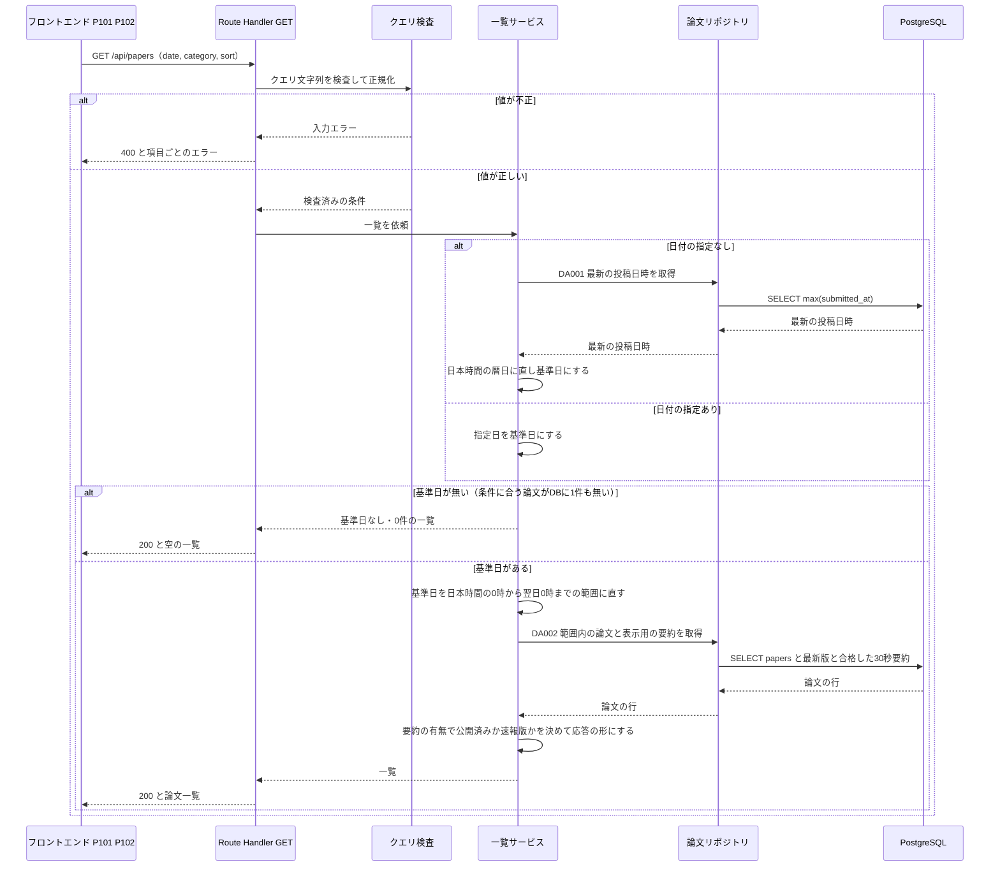

# BE詳細設計書 — F02 日付・カテゴリ検索

## 0. 文書情報

| 項目 | 値 |
| :--- | :--- |
| 設計書ID | F02-BE |
| 親ID | F02 |
| 親設計書 | `基本設計書_概要.md` §4.1 機能一覧 |
| 機能名 | 日付・カテゴリ検索（資料上のID F-02。Must / Phase 1） |
| 版 | 1.0（新規作成） |
| 作成日 | 2026-10-26 |
| 更新日 | 2026-10-26 |
| 作成方法 | `source/` 配下の企画資料と確定済みの上流設計書からの設計（creating-backend-detailed-design v1.5.0 準拠） |
| インプット | (a) `source/02_機能要求定義.md:7,23-29,31-35,45,58`、`source/03_システム構成.md:6-8,35-37,47,57-61`、`source/01_企画概要.md:25,33-37`、`source/04_収益化とロードマップ.md:4` ／ (b) `docs/基本設計書_概要.md`（§2 BF03・EX04、§4 F02・オンライン処理設計、§6 T001〜T003・CRUD図、§7 API01、§8、§9、§11 ARC001〜ARC010、付録 Q08・Q11・Q12・Q21・Q24・Q26・Q31）／ 関連: `docs/db/DB.T001.DB物理設計.md`・`DB.T002.DB物理設計.md`・`DB.T003.DB物理設計.md`、`docs/screens/画面.P101.画面基本設計.md`・`画面.P102.画面基本設計.md` ／ (c) `legacy/` |
| インプットの性質 | `source/` にあるのは企画・初期設計案のMarkdown 6ファイル（計227行）だけで、アプリのソースコードは存在しない（上流 §前提）。そのため本書のエンドポイント・関数・データアクセスは、上流で確定した API01 の定義と企画資料の定義行から導いた**計画上の実体**であり、実装済みであることは意味しない（実装状況: 未着手）。資料に書かれていない値は※推測と明記する |
| 既存資料の突合 | 本書の既存版は無い（`docs/detail/` 配下は本書の作成前に存在しなかった）。`legacy/` は空ディレクトリで、突合する既存設計は0件。業務意図・非機能の一次情報は `source/` と上流設計書だけである |

## 1. バックエンド構成・モジュール設計
* **対象ドメイン**: 検索系（search）— 新着論文を日付・カテゴリで絞り込み、新着順または関連度順に並べた一覧を返す。自前DBだけを検索し、arXiv API・LLM API は呼ばない（`source/02_機能要求定義.md:7,34-35,45`、上流 §4 F02・§7 API01）。キーワード・著者による自由検索（API02）は F03 の範囲であり本書では扱わない。
* **対象APIエンドポイント**: GET /api/papers（API01）の1件。

* **APIエンドポイント一覧（全数ロースター）**:

| API-ID | メソッド | エンドポイント | 概要 | 呼出元（画面ID・イベントID） | 認証 | 定義状況 | 詳細の所在 |
| :--- | :--- | :--- | :--- | :--- | :--- | :--- | :--- |
| API01 | GET | /api/papers | 指定した日付・カテゴリに当てはまる論文の一覧を、指定した並び順で返す。日付を指定しないときは最も新しい投稿日の一覧を返す | P102 新着論文（E01・E02・E03・E04・E06）、P101 ホーム（E02・E13） | 不要（※推測。上流 §7 API01） | 詳細 | §2 「GET /api/papers」 |

**総件数: 1件。全数である根拠**: 上流 §7 内部API一覧の全8件（API01〜API08）のうち、F02 が担うものは API01 だけである。上流 §2 BF03（F02 のフロー）が呼ぶAPIは GET /api/papers の1本で、上流 §6 CRUD図の F02 行も参照（R）だけで書き込みAPIを持たない。API02 は F03、API03・API04 は F05/F04、API05 は F08、API06・API07 は F07、API08 は F12 に属する。画面側でも、API01 を呼ぶのは P101 と P102 の2画面だけである（`docs/screens/画面.P101.画面基本設計.md` §5、`画面.P102.画面基本設計.md` §5）。

* **ディレクトリ/ファイル構造**（※推測: 上流 §9 ディレクトリ構成の仮置き「`web/`（Next.js の画面と画面向けAPI）」に従う。BF03 で API01 は Next.js API が受ける）:

```
web/
├── app/api/papers/
│   └── route.ts                      # API01 の受け口（Route Handler）。GET だけを公開する
├── server/papers/
│   ├── papersQuery.ts                # クエリ文字列の検査と正規化
│   ├── papersListService.ts          # 基準日の決定、一覧の取得、応答への変換
│   ├── papersRepository.ts           # papers・paper_versions・summaries への参照SQL（DA001・DA002）
│   └── jstDate.ts                    # 日本時間の暦日と時刻範囲の変換
└── server/http/
    └── apiError.ts                   # 例外から HTTP 応答への変換
```

* **処理シーケンス図**（上流 §2 BF03 を本書の関数単位に展開したもの）:



## 2. API・インターフェース詳細設計
* **外部サービス連携仕様**: 該当なし。

| 連携先 | 連携方式 | エンドポイント / 接続先 | 認証方式 | タイムアウト | リトライ方針 | エラー時の挙動 |
| :--- | :--- | :--- | :--- | :--- | :--- | :--- |
| — | 該当なし | — | — | — | — | — |

**総件数: 0件。根拠**: 本機能は自前DBだけを検索し、arXiv API（IF01）を呼ばない（`source/02_機能要求定義.md:35`、上流 §7 API01「arXiv APIは呼びません」）。画面表示のたびに LLM API（IF04）を呼ばない（`source/02_機能要求定義.md:45`、上流 §4 オンライン処理設計「事前生成優先」）。認証は不要（上流 API01）なので Supabase Auth（IF05）でセッションを検証しない。上流 §7 外部連携一覧の全9件（IF01〜IF09）を確認し、F02 が使うものは0件だった。PostgreSQL は本システムの構成要素（内部）であり外部連携に含めない（上流 §7 総件数の根拠と同じ扱い）。

---

### GET /api/papers
* **API-ID**: API01（上流 §7 内部API一覧）
* **概要**: 指定した日付（日本時間の暦日）に投稿された論文のうち、指定したカテゴリを含むものを、新着順または関連度順に並べて返す。論文ごとに、検証に合格した30秒要約と日本語タイトルがあればそれを添え、無ければ速報版（原題と処理中の旨）として返す（上流 BF03、ARC002）。日付を指定しないときは、条件に合う論文の中で最も新しい投稿日を基準日にして返し、その基準日を応答に含める（P101 の新着研究領域と P102 の日付欄の初期値に使う）。自前DBだけを読み、arXiv API・LLM API は呼ばない。
* **認証要否**: 不要（ゲスト・会員 Free・会員 Pro のどれでも同じ結果を返す。新着検索は Free の提供範囲 — `source/04_収益化とロードマップ.md:4`、上流 付録 Q08 の仮置き。認証不要の扱いは※推測）。プランによる出し分けは無い（P102 §7「プランによる差は無い」）。
* **リクエストパラメータ**:

| 種別(Path/Query/Body) | 項目名 | 型 | 必須 | 制約・バリデーション | 説明 |
| :--- | :--- | :--- | :--- | :--- | :--- |
| Query | date | string | 任意（※推測。上流 API01） | `YYYY-MM-DD` 形式で、暦の上で実在する日付で、今日（日本時間）以前であること。どれかを満たさなければ 400（形式と実在は上流 §4 入力チェック、未来日の拒否は※推測で P102 §6 と合わせる）。項目が無いとき、または値が空文字のときは「指定なし」として扱う | 一覧の基準日。日本時間のその日の0時から翌日0時までに投稿された論文を返す。絞り込みに使う日付は投稿日時（`papers.submitted_at`）とする（※推測・※上流要確認: 上流 付録 Q11 で確定待ち。P102 の画面設計書は「新着公開日」で絞り込む仮置きだが、新着公開日を保存する列が T001 に無いため本書は投稿日時を使う。§6 末尾の確認事項 No.1） |
| Query | category | string | 任意（※推測。上流 API01） | arXiv のカテゴリ表記であること（英小文字で始まる分野名に、任意でピリオドと英字の小分類が続く形。例 `cs.LG`・`math.CO`・`hep-th`。正規表現 `^[a-z][a-z-]*(\.[A-Za-z-]+)?$`、64文字以内 ※推測）。形式に合わなければ 400。項目が無いとき、または値が空文字のときは「すべてのカテゴリ」として扱う | 指定したカテゴリを含む論文だけに絞り込む（論文は複数のカテゴリを持つため、主カテゴリに限らず含まれていれば対象にする）。形式は正しいが収集対象に無いカテゴリは 400 にせず、0件の一覧を返す（※上流要確認: 上流 API01 は「存在しないカテゴリ」を 400 とするが、収集対象カテゴリの一覧が資料に無く存在を判定できない。§6 末尾の確認事項 No.3） |
| Query | sort | string | 任意（※推測。上流 API01） | `newest` または `relevance` のどちらか。それ以外は 400。指定が無いときは `newest`（※推測: P102 H13 の初期値「新着順」に合わせる）。`relevance` という値名は※推測（上流 付録 Q12 で未定義） | 並び順。`newest` は投稿日時の新しい順（`source/02_機能要求定義.md:34`、`source/03_システム構成.md:47`）。`relevance` の意味は §3 発行SQL DA002 の組み立て規則（分岐 (c)・(d)）に記載した仮の定義に従う（※推測・※上流要確認） |
| Query | 上記以外 | — | — | 受け付けない項目名は無視する（400 にしない ※推測: 画面側がキャッシュ回避のための値を付けても失敗させないため） | — |

* **レスポンス（成功時）**（※推測: 上流 §7 API01 の応答項目「arXiv ID、原題、日本語タイトル、著者、カテゴリ、投稿日、30秒要約、解析範囲、要約の処理状況」をキー名に落としたもの。`baseDate`・`dateBasis`・`timeZone`・`displayVersion`・`latestVersion`・`primaryCategory`・`total` は※上流未定義。画面側が必要とする項目として追加した — P101 H25 基準日の注記、P102 H10 初期値・H11 日付の種類とタイムゾーンの注記・H18 主カテゴリ・H19 版）:

```json
{
  "status": "success",
  "data": {
    "baseDate": "2026-10-23",
    "dateBasis": "submitted",
    "timeZone": "Asia/Tokyo",
    "category": "cs.LG",
    "sort": "newest",
    "total": 2,
    "papers": [
      {
        "arxivId": "2610.12345",
        "title": "Scaling Laws for Sparse Mixture-of-Experts",
        "titleJa": "疎な専門家混合モデルのスケーリング則",
        "authors": ["Taro Yamada", "Jane Smith", "Wei Chen"],
        "categories": ["cs.LG", "cs.CL"],
        "primaryCategory": "cs.LG",
        "submittedAt": "2026-10-23T09:12:00+09:00",
        "latestVersion": 2,
        "displayVersion": 1,
        "summaryStatus": "published",
        "shortSummary": "専門家の数を増やすと、計算量を保ったまま性能が対数的に伸びることを示した。",
        "sourceScope": "abstract_only"
      },
      {
        "arxivId": "2610.12399",
        "title": "A Benchmark for Long-Context Retrieval",
        "titleJa": null,
        "authors": ["Alice Brown"],
        "categories": ["cs.LG"],
        "primaryCategory": "cs.LG",
        "submittedAt": "2026-10-23T08:40:00+09:00",
        "latestVersion": 1,
        "displayVersion": 1,
        "summaryStatus": "processing",
        "shortSummary": null,
        "sourceScope": null
      }
    ]
  }
}
```

  * 応答項目の意味（※推測。値の出どころは §3 DA002）:

| 項目 | 型 | 意味 |
| :--- | :--- | :--- |
| baseDate | string（`YYYY-MM-DD`）／null | 一覧の基準日（日本時間の暦日）。日付を指定したときはその日。指定しないときは条件に合う論文の最新の投稿日。DBに条件に合う論文が1件も無いときは null |
| dateBasis | string | 絞り込みに使った日付の種類。本書では投稿日を表す固定値 `submitted`。上流 Q11 で新着公開日に決まれば値を変える。画面が「どの日付で絞り込んでいるか」を注記するために返す（ARC009） |
| timeZone | string | 基準日と各日時の解釈に使ったタイムゾーン。固定値 `Asia/Tokyo`（※推測。上流 §4 バッチ共通の方針「画面表示は日本時間」） |
| category / sort | string／null | 実際に適用した絞り込みと並び順。指定されなかった値は既定値（category は null、sort は `newest`）で返し、画面が条件の表示を応答に合わせられるようにする |
| total | integer | papers の件数 |
| papers[].arxivId | string | 論文の業務キー（`papers.arxiv_id`）。画面は表示せず P104 への遷移先の特定に使う |
| papers[].title | string | 英語の原題（`papers.title`） |
| papers[].titleJa | string／null | AIが生成した日本語タイトル。合格した30秒要約が無い論文は null |
| papers[].authors | string[] | 著者名の並び（`papers.authors`）。人数が多いときに縮めて表示する処理は画面側で行う |
| papers[].categories / primaryCategory | string[] / string | 論文の全カテゴリと、その先頭要素（主カテゴリ。T001 §4.2 の扱い ※推測） |
| papers[].submittedAt | string（ISO 8601、`+09:00`） | 投稿日時を日本時間で表した値 |
| papers[].latestVersion | integer | arXiv上の最新の版番号（`papers.latest_version`） |
| papers[].displayVersion | integer | 表示する要約の対象になった版の番号。合格した要約が無いときは最新の版番号。最新版の要約がまだ無く過去の版の要約を出すとき、latestVersion より小さくなる |
| papers[].summaryStatus | string | `published`（合格した30秒要約を返している）か `processing`（速報版。要約は準備中）のどちらか。値の判定規則は §4 toPaperListItem |
| papers[].shortSummary | string／null | 合格した30秒要約の本文。`processing` のときは null |
| papers[].sourceScope | string／null | 30秒要約の材料の範囲。`abstract_only`（画面に「Abstractベース」を出す）か `full_text`。`processing` のときは null |

* **レスポンス（エラー時）**（※推測。上流 §4 オンライン処理設計「エラー応答」）:

```json
{
  "status": "error",
  "error": {
    "code": "INVALID_PARAMETER",
    "message": "リクエストの値が正しくありません。",
    "details": [
      { "field": "date", "reason": "INVALID_FORMAT" }
    ]
  }
}
```

  * `details[].reason` の値（全5件 ※推測）: `INVALID_FORMAT`（date が `YYYY-MM-DD` でない）、`NONEXISTENT_DATE`（暦の上で存在しない日付）、`FUTURE_DATE`（今日より後の日付）、`INVALID_CATEGORY`（カテゴリの表記に合わない）、`INVALID_SORT`（並び順が2値のどちらでもない）。500 の応答は `code` を `INTERNAL_ERROR` とし、`details` を返さない。
* **レスポンスヘッダー**: `Content-Type: application/json; charset=utf-8`。`Cache-Control: public, s-maxage=300, stale-while-revalidate=60`（※推測: 一覧は全利用者で同じ内容で、新しい要約の公開は数分遅れても困らないため、Vercel の配信網で5分間共有する。200 のときだけ付け、400・500 には `Cache-Control: no-store` を付ける）。
* **ステータスコード**:

| コード | 条件 |
| :--- | :--- |
| 200 | 正常終了。条件に合う論文が0件のときも 200 で空の一覧を返す（土日のように投稿の少ない日や、収集対象外のカテゴリを指定したとき） |
| 400 | リクエスト不正。日付の形式が違う・存在しない日付・未来の日付、カテゴリの表記が違う、並び順が新着順・関連度順のどちらでもないとき（上流 API01・§4 入力チェック） |
| 405 | GET 以外のメソッドで呼ばれたとき（Route Handler が GET だけを公開するため、Next.js が自動で返す ※推測） |
| 500 | サーバー内部エラー。DBに接続できない、問い合わせが時間切れになった、予期しない例外が起きたとき（上流 API01「500（DB障害）」） |

* **ビジネスロジック・副作用**:
  1. クエリ文字列から date・category・sort を読み、前後の空白を除いてから検査する（§4 parsePapersQuery）。不正な値が1つでもあれば、すべての不正項目を `details` に並べて 400 を返し、DBには問い合わせない。
  2. 日付が指定されていなければ、条件に合う論文の最新の投稿日時を取り出し（§3 DA001。カテゴリの指定があればそのカテゴリを含む論文に限る）、日本時間の暦日に直して基準日にする。論文が1件も無ければ基準日を null とし、DA002 を呼ばずに空の一覧で 200 を返す。
  3. 基準日を、日本時間のその日の0時（含む）から翌日の0時（含まない）までの時刻範囲に直す（§4 toJstDayRange）。
  4. 時刻範囲・カテゴリ・並び順で論文の一覧を取り出す（§3 DA002）。各論文について、最新版の行と、検証に合格した日本語の30秒要約のうち最も新しいものを同じ問い合わせで結びつける。最新版に合格した要約が無いときは、過去の版の合格した要約のうち版番号が最も大きいものを使う（※推測: 新しい版の要約ができるまで一覧から要約が消えないようにするため）。
  5. 各行を応答の形に変える（§4 toPaperListItem）。合格した要約があれば `published`、無ければ `processing`（速報版）にする。要約が無い論文も一覧から外さない（上流 BF03、ARC002）。
  6. 200 と一覧を返す。本APIは参照だけを行い、DBへの書き込み・ジョブの登録・閲覧記録（view_events）の記録を一切しない（上流 §6 CRUD図 F02 行が R だけであること、P102 §7「閲覧履歴は記録しない」）。

## 3. データアクセス（ORM / クエリ）設計

* **データアクセス一覧（全数ロースター）**:

| DA-ID | 処理名 | 呼出元（関数/API） | 対象物理テーブル | 種別 (SELECT/INSERT/UPDATE/DELETE) | 定義状況 (詳細/簡易) | 詳細の所在 |
| :--- | :--- | :--- | :--- | :--- | :--- | :--- |
| DA001 | 最新投稿日時の取得 | findLatestSubmittedAt ← resolveBaseDate ← listPapers（API01、日付の指定が無いとき） | papers | SELECT | 詳細 | §3 詳細定義 DA001、発行SQL DA001 |
| DA002 | 指定日の論文一覧と表示用要約の取得 | findPapersByDay ← listPapers（API01） | papers, paper_versions, summaries | SELECT | 詳細 | §3 詳細定義 DA002、発行SQL DA002 |

**総件数: 2件（SELECT 2件、INSERT・UPDATE・DELETE 0件）。全数である根拠**: ソースコードが無いため、上流 §2 BF03 の DB アクセス（「自前DBから該当論文を取得」「論文一覧と要約の有無」）と、§2 のビジネスロジック手順 2・4 を、1回の問い合わせを1件として数えた。§4 関数ロースターの全9関数のうち DB に触れるのはリポジトリの2関数（findLatestSubmittedAt・findPapersByDay）だけで、それぞれが1回ずつ問い合わせる。上流 §6 CRUD図の F02 行（papers R、paper_versions R、summaries R、他は操作なし）と、対象テーブル・種別が一致する。T001〜T003 の DB物理設計書 §4.6 で F02 の操作として挙がっている内容（T001「投稿日時とカテゴリで絞り込み、投稿日時の新しい順に並べて読む」、T002「一覧に出す論文の版を読み、要約の有無と結びつける」、T003「合格した30秒要約と日本語タイトルを読む。無ければ速報版として原題を出す」）も、この2件ですべて満たす。

**定義状況の判定**: DA001 はカテゴリ指定の有無で抽出条件が変わる（3-1 の1・4）。DA002 は3テーブルにまたがり（3-1 の3）、カテゴリと並び順で SQL を組み立て（3-1 の4）、1日分の全件を返し（3-1 の6）、表示する要約の選び方という業務ルールを含む（3-1 の7）。よって2件とも「詳細」とした。

* **データアクセス詳細定義**:

| DA-ID | 処理名 | 対象物理テーブル | JOIN / Include | 抽出条件 (Where) / ソート | トランザクション境界 | N+1対策・性能上の注意 |
| :--- | :--- | :--- | :--- | :--- | :--- | :--- |
| DA001 | 最新投稿日時の取得 | papers | なし | 投稿日時が最も新しい論文1件の投稿日時を返す。カテゴリの指定があるときは、そのカテゴリを含む論文に限る（`categories @> ARRAY[$1]::text[]`）。指定が無いときは全論文が対象。論文が無ければ null が返る（`max(submitted_at)`）。ソートは無い | なし（参照のみ。単一の SELECT 文で自動コミット） | カテゴリの指定が無いときは `idx_papers_submitted_at`（submitted_at DESC, id DESC）の先頭1件を読むだけで済む。カテゴリの指定があるときは `idx_papers_categories`（GIN）でそのカテゴリの論文を絞ってから最大値を求めるため、論文の多いカテゴリでは該当行をすべて読む（※推測: 1カテゴリで年に数万行の規模。T001 想定件数「年に約25万〜30万行」）。時間がかかる場合は、投稿日時の新しい順に並べて先頭1件を取る書き方（`ORDER BY submitted_at DESC LIMIT 1`）へ切り替え、`idx_papers_submitted_at` を逆順にたどらせて比較する（※推測） |
| DA002 | 指定日の論文一覧と表示用要約の取得 | papers, paper_versions, summaries | papers を起点に、(1) 最新版の行を横断結合で1件結ぶ（`LEFT JOIN LATERAL`。最新の版番号 `papers.latest_version` と一致する行を優先し、無ければ版番号が最も大きい行 — T002 §4.3 の最新版の引き方）、(2) 表示する要約を横断結合で1件結ぶ（`LEFT JOIN LATERAL`。同じ論文の版のうち、言語が日本語・種別が30秒要約・検証状態が合格の要約を、版番号の大きい順、同じ版の中では生成日時の新しい順に並べた先頭1件 — T003 §4.3 (6)） | 投稿日時が基準日の日本時間0時以上かつ翌日0時未満であること（`submitted_at >= $1 AND submitted_at < $2`）。カテゴリの指定があるときは、そのカテゴリを含むこと（`categories @> ARRAY[$3]::text[]`）。ソートは並び順で変わる。新着順は投稿日時の新しい順、同じ投稿日時なら論文IDの大きい順（`ORDER BY submitted_at DESC, id DESC`）。関連度順は、指定カテゴリを主カテゴリ（先頭要素）に持つ論文を先に並べ、その中で新着順と同じ並び（※推測。§3 発行SQL DA002 の組み立て規則） | なし（参照のみ。単一の SELECT 文で自動コミット）。DA001 と同じトランザクションにはしない（間に論文が追加されても、基準日の一覧が後から増えるだけで矛盾は起きないため ※推測） | 論文ごとに版・要約を別の問い合わせで引くと、1日数百件で数百回の往復になる（N+1）。横断結合で1回の問い合わせにまとめてこれを避ける。日付の範囲は `idx_papers_submitted_at` で引く。要約の横断結合は `idx_summaries_lookup`（paper_version_id, summary_type, language, generated_at DESC）で版ごとに数件へ絞ってから検証状態を確かめる（T003 §5.2）。版の横断結合は `uq_paper_versions_paper_id_version` で引く。件数の上限を設けないため、1日分の全件（※推測: 全カテゴリで1日に数百〜千数百件）を返す。ページ送りの指定が上流に無いため（P102 §7 ※上流要確認）、上限は設けず、文の時間切れ（5秒 ※推測）で過大な問い合わせを止める |

* **発行SQL**: 2件とも PostgreSQL の生SQLをパラメータ付きで発行する（※推測: 横断結合を ORM・Supabase のクエリビルダでは書けないため、`DATABASE_URL` への接続で node-postgres を使う。値はすべてプレースホルダーで渡し、文字列連結で SQL に埋め込まない）。

**DA001 最新投稿日時の取得** — 組み立ての分岐はカテゴリ指定の有無の1つで、生成され得る SQL は次の2形。

(a) カテゴリの指定なし

```sql
SELECT max(p.submitted_at) AS latest_submitted_at
FROM papers p;
```

(b) カテゴリの指定あり（`$1` = カテゴリ。例 `cs.LG`）

```sql
SELECT max(p.submitted_at) AS latest_submitted_at
FROM papers p
WHERE p.categories @> ARRAY[$1]::text[];
```

**DA002 指定日の論文一覧と表示用要約の取得** — 組み立ての分岐は2つ（カテゴリ指定の有無 × 並び順）で、生成され得る SQL は次の4形。共通部分を先に示し、分岐で変わる箇所 `{カテゴリ条件}` `{並び順}` を後に示す。`$1` = 基準日の日本時間0時（UTCの時刻として渡す）、`$2` = 翌日の日本時間0時、`$3` = カテゴリ。

```sql
SELECT
  p.id,
  p.arxiv_id,
  p.title,
  p.authors,
  p.categories,
  p.submitted_at,
  p.latest_version,
  lv.version                          AS latest_row_version,
  s.version                           AS summary_version,
  s.json_content ->> 'title_ja'       AS title_ja,
  s.json_content ->> 'summary'        AS short_summary,
  s.source_scope                      AS source_scope
FROM papers p
LEFT JOIN LATERAL (
  SELECT pv.version
  FROM paper_versions pv
  WHERE pv.paper_id = p.id
  ORDER BY (pv.version = p.latest_version) DESC, pv.version DESC
  LIMIT 1
) lv ON TRUE
LEFT JOIN LATERAL (
  SELECT pv2.version, sm.json_content, sm.source_scope
  FROM paper_versions pv2
  JOIN summaries sm
    ON sm.paper_version_id = pv2.id
   AND sm.summary_type      = 'short'
   AND sm.language          = 'ja'
   AND sm.validation_status = 'passed'
  WHERE pv2.paper_id = p.id
  ORDER BY pv2.version DESC, sm.generated_at DESC
  LIMIT 1
) s ON TRUE
WHERE p.submitted_at >= $1
  AND p.submitted_at <  $2
  {カテゴリ条件}
ORDER BY {並び順};
```

| 分岐 | 条件 | `{カテゴリ条件}` | `{並び順}` |
| :--- | :--- | :--- | :--- |
| (a) | カテゴリの指定なし・新着順 | （何も入れない） | `p.submitted_at DESC, p.id DESC` |
| (b) | カテゴリの指定あり・新着順 | `AND p.categories @> ARRAY[$3]::text[]` | `p.submitted_at DESC, p.id DESC` |
| (c) | カテゴリの指定なし・関連度順 | （何も入れない） | `p.submitted_at DESC, p.id DESC`（※推測: 絞り込みのカテゴリが無いと関連度を測る基準が無いため、新着順と同じ並びにする） |
| (d) | カテゴリの指定あり・関連度順 | `AND p.categories @> ARRAY[$3]::text[]` | `(p.categories[1] = $3) DESC, p.submitted_at DESC, p.id DESC`（※推測: 指定カテゴリが主カテゴリの論文を、副カテゴリとして含むだけの論文より前に出す） |

* **組み立ての注意**:
  * `{カテゴリ条件}` と `{並び順}` は上表の固定文字列からだけ選び、利用者の入力を SQL の文字列に連結しない。カテゴリの値は必ず `$3` で渡す。
  * 要約本文のキー名 `title_ja`（日本語タイトル）・`summary`（30秒要約の本文）は※推測。要約スキーマ（ARC003。`docs/arch/方式.ARC003.方式設計.md` 未作成）で確定したキー名に合わせる（§6 末尾の確認事項 No.4）。
  * 関連度順の定義（分岐 (c)・(d)）は※推測・※上流要確認（上流 付録 Q12「関連度順の並び替えの値名と算出方法」）。検索語の無い一覧での「関連度」の意味が上流で決まった時点で、分岐 (c)・(d) の `{並び順}` を差し替える。
  * 合格した要約の選び方は「最新版を優先」ではなく「合格した要約を持つ版のうち最も新しい版」である。最新版の要約が検証待ちの間は、過去の版の要約と、その版番号（`displayVersion`）を返す（※推測）。

## 4. サーバー側機能・処理ロジック設計（IPO設計）

* **関数一覧（全数ロースター）**:

| FN-ID | 関数名 | 所属モジュール | 概要 | 呼出元 | 定義状況 | 詳細の所在 |
| :--- | :--- | :--- | :--- | :--- | :--- | :--- |
| FN01 | GET | app/api/papers/route.ts（Route Handler） | API01 の受け口。クエリの検査、一覧の取得、応答の組み立てを順に呼び、例外を HTTP 応答へ変える | Next.js（GET /api/papers） | 詳細 | §4 IPO定義 FN01 |
| FN02 | parsePapersQuery | server/papers/papersQuery.ts | クエリ文字列の date・category・sort を検査し、既定値を補った条件に直す。不正な項目をすべて集めて入力エラーにする | FN01 | 詳細 | §4 IPO定義 FN02 |
| FN03 | listPapers | server/papers/papersListService.ts | 基準日を決め、その日の論文一覧を取り出して応答の形に変える | FN01 | 詳細 | §4 IPO定義 FN03 |
| FN04 | resolveBaseDate | server/papers/papersListService.ts | 日付の指定があればその日、無ければ条件に合う論文の最新の投稿日を基準日にする | FN03 | 詳細 | §4 IPO定義 FN04 |
| FN05 | toJstDayRange | server/papers/jstDate.ts | 日本時間の暦日を、その日の0時から翌日0時までの UTC 時刻の範囲に直す | FN03 | 詳細 | §4 IPO定義 FN05 |
| FN06 | findLatestSubmittedAt | server/papers/papersRepository.ts | DA001 を発行し、最新の投稿日時を返す | FN04 | 詳細 | §4 IPO定義 FN06、§3 DA001 |
| FN07 | findPapersByDay | server/papers/papersRepository.ts | DA002 を組み立てて発行し、論文の行を返す | FN03 | 詳細 | §4 IPO定義 FN07、§3 DA002 |
| FN08 | toPaperListItem | server/papers/papersListService.ts | DB の1行を応答の論文1件に変える。合格した要約の有無で公開済みか速報版かを決める | FN03 | 詳細 | §4 IPO定義 FN08 |
| FN09 | toErrorResponse | server/http/apiError.ts | 入力エラー・DB障害・予期しない例外を、HTTP ステータスと共通のエラー応答に変え、ログを出す | FN01 | 詳細 | §4 IPO定義 FN09、§6 |

**総件数: 9件（コントローラー1件、入力検査1件、サービス層4件、データアクセス層2件、例外変換1件）。全数である根拠**: ソースコードが無いため（実装状況: 未着手）、§2 のビジネスロジック手順 1〜6 と §6 のエラーハンドリングを、1つの責務を1関数として分けた設計上の全数である。手順1→FN02、手順2→FN04・FN06、手順3→FN05、手順4→FN07、手順5→FN08、手順6と全体の流れ→FN01・FN03、例外の変換→FN09 で、どの手順も関数が1つ以上対応し、どの関数も手順のどれかに対応する。FN-ID は本書内で関数を指すための番号で、上流の採番対象ではない。
**定義状況の判定**: 9件とも completeness 3-1 のいずれかに当たるため「詳細」とした（FN01・FN02・FN04・FN08・FN09 は分岐あり（1）、FN05 はタイムゾーンの扱いという非自明な業務ルール（7）、FN06・FN07 は DB を参照し動的に組み立てる（4）・性能上の注意（6）、FN03 は複数の対象を順に呼ぶ（3））。

* **入力・処理・出力（IPO）定義**:

| 関数名 | 所属モジュール | 引数 (型) | 処理フロー (ステップ単位で具体的に) | 戻り値 | 発生しうるエラー |
| :--- | :--- | :--- | :--- | :--- | :--- |
| FN01 GET | app/api/papers/route.ts | request: NextRequest | 1. リクエストの URL からクエリ文字列を取り出す。<br>2. FN02 に渡して検査済みの条件を得る。入力エラーなら手順5へ進む。<br>3. FN03 に条件を渡して一覧を得る。<br>4. 200、`{ status: "success", data: 一覧 }`、§2 の `Cache-Control`（共有キャッシュ5分）を付けて返す。<br>5. どこかで例外が起きたら FN09 に渡し、返ってきたステータスと本文、`Cache-Control: no-store` で返す。<br>※推測: Next.js がこの API を静的に事前生成しないよう、動的な Route Handler として扱う（`export const dynamic = "force-dynamic"`）。結果の共有は手順4の応答ヘッダーで行う | NextResponse（200・400・500） | 入力エラー（400）、DB障害（500）、予期しない例外（500）。いずれも FN09 で応答に変えるため、この関数の外へ例外は出さない |
| FN02 parsePapersQuery | server/papers/papersQuery.ts | params: URLSearchParams, now: Date（現在時刻。試験で差し替えるため引数で受ける） | 1. date・category・sort の値を取り出し、前後の空白を除く。空文字は「指定なし」とみなす。<br>2. date があれば、形が `YYYY-MM-DD` でなければ「形式不正」、暦の上で存在しない日（2月30日、平年の2月29日）なら「存在しない日付」、今日（`now` を日本時間に直した暦日）より後なら「未来の日付」として不正項目に加える。<br>3. category があれば、arXiv のカテゴリ表記（§2 の制約）に合わなければ「カテゴリ不正」として加える。<br>4. sort があれば、新着順・関連度順の2値（`newest`・`relevance`）のどちらでもなければ「並び順不正」として加える。無ければ新着順にする。<br>5. 不正項目が1つ以上あれば、すべてを並べた入力エラーを投げる（最初の1件で止めず、画面が全項目を一度に直せるようにする）。<br>6. 正しければ、日付（指定なしは null）・カテゴリ（指定なしは null）・並び順を返す | PapersQuery { date: string \| null, category: string \| null, sort: "newest" \| "relevance" } | 入力エラー（不正項目の一覧つき。§2 の `details[].reason` 5種のどれか） |
| FN03 listPapers | server/papers/papersListService.ts | query: PapersQuery | 1. FN04 で基準日を決める。<br>2. 基準日が null（条件に合う論文が DB に1件も無い）なら、DB をそれ以上読まず、基準日 null・論文0件の一覧を返す。<br>3. FN05 で基準日を時刻の範囲に直す。<br>4. FN07 に時刻の範囲・カテゴリ・並び順を渡し、論文の行を得る。<br>5. 各行を FN08 で応答の論文1件に変える（DB が返した順を変えない）。<br>6. 基準日・日付の種類（`submitted`）・タイムゾーン（`Asia/Tokyo`）・適用したカテゴリと並び順・件数・論文の並びをまとめて返す | PapersListResult { baseDate, dateBasis, timeZone, category, sort, total, papers: PaperListItem[] } | DB障害（FN06・FN07 から伝わる。ここでは捕まえない） |
| FN04 resolveBaseDate | server/papers/papersListService.ts | date: string \| null, category: string \| null | 1. 日付の指定があれば、その日付をそのまま基準日として返す（DB を読まない）。<br>2. 指定が無ければ FN06 にカテゴリを渡し、条件に合う論文の最新の投稿日時を得る。<br>3. 最新の投稿日時が null なら null を返す。<br>4. 最新の投稿日時を日本時間に直し、その暦日（`YYYY-MM-DD`）を基準日として返す（※推測: 上流 API01 は日付を指定しないときの動作を定めていない。P101 E02・P102 H10 の「APIが返す最新の日付」に合わせた。P102 §7 ※上流要確認） | string（`YYYY-MM-DD`）\| null | DB障害（FN06 から伝わる） |
| FN05 toJstDayRange | server/papers/jstDate.ts | baseDate: string（`YYYY-MM-DD`） | 1. 基準日の日本時間0時を求める（日本時間は UTC より9時間進んでおり夏時間が無いため、基準日の UTC 0時から9時間引いた時刻になる）。<br>2. その24時間後を翌日の日本時間0時とする。<br>3. 開始（含む）と終了（含まない）の組を返す。終了を含まない半開区間にするのは、翌日0時ちょうどの投稿が2日に重複して出ないようにするため | { from: Date, to: Date }（UTC の時刻） | なし（FN02 で検査済みの日付だけを受け取る） |
| FN06 findLatestSubmittedAt | server/papers/papersRepository.ts | category: string \| null | 1. カテゴリの指定があれば §3 DA001 (b)、無ければ (a) の SQL を選ぶ。<br>2. 接続プールから接続を借り、文の時間切れ（5秒 ※推測）を設定して発行する。<br>3. 1行1列の結果（最新の投稿日時、または null）を返し、接続を返却する | Date \| null | DB接続失敗、文の時間切れ、SQL 実行エラー（いずれも DB障害として呼出元へ投げる） |
| FN07 findPapersByDay | server/papers/papersRepository.ts | from: Date, to: Date, category: string \| null, sort: "newest" \| "relevance" | 1. §3 DA002 の共通部分に、カテゴリの指定の有無と並び順で決まる `{カテゴリ条件}`・`{並び順}` を分岐表 (a)〜(d) の固定文字列から選んで差し込む。<br>2. 値（時刻の範囲、カテゴリ）はプレースホルダーで渡す。<br>3. 接続プールから接続を借り、文の時間切れ（5秒 ※推測）を設定して発行する。<br>4. 返ってきた行を DB の並びのまま返し、接続を返却する | PaperRow[]（0件以上） | DB接続失敗、文の時間切れ、SQL 実行エラー（いずれも DB障害として呼出元へ投げる） |
| FN08 toPaperListItem | server/papers/papersListService.ts | row: PaperRow | 1. 論文の識別子・原題・著者・カテゴリ・最新の版番号を写す。カテゴリの先頭要素を主カテゴリにする。<br>2. 投稿日時を日本時間（`+09:00`）の ISO 8601 文字列にする。<br>3. 合格した30秒要約が結びついていて、本文が空でなければ「公開済み」とし、日本語タイトル・要約本文・解析範囲と、要約の対象版の番号を表示する版にする（`summary_version != null && short_summary` が空でない）。<br>4. 結びついていなければ、または本文が空なら「速報版（処理中）」とし、日本語タイトル・要約本文・解析範囲を null、表示する版を最新版の番号にする。最新版の行が無い場合（取り込みの途中）は論文の最新版番号を使う。<br>5. 日本語タイトルだけが空の場合は null のまま返し、画面が原題を見出しに使う（P102 H15） | PaperListItem（§2 応答の `papers[]` の1要素） | なし |
| FN09 toErrorResponse | server/http/apiError.ts | error: unknown | 1. 入力エラーなら、WARN でクエリ文字列と不正項目をログに出し、400 と `INVALID_PARAMETER`・不正項目の一覧を返す。<br>2. DB障害（接続失敗・時間切れ・SQL 実行エラー）なら、ERROR で例外の種類・SQL の識別子（DA001 / DA002）・所要時間・スタックトレースをログに出し、500 と `INTERNAL_ERROR`・汎用の文言を返す。SQL 本文・接続先・DB のエラー文は応答に含めない。<br>3. それ以外の例外も2と同じ扱いにする（※推測） | { status: 400 \| 500, body: エラー応答 } | なし |

## 5. バッチ処理・非同期タスク設計
* **ジョブ実行定義**: 該当なし。

| ジョブ名 | 実行タイミング | 対象テーブル | 処理概要 | タイムアウト |
| :--- | :--- | :--- | :--- | :--- |
| — | 該当なし | — | — | — |

**総件数: 0件。根拠**: 本機能は利用者の操作を受けてその場で応答する参照だけの API であり、ジョブの登録も定期実行も行わない。上流 §4 バッチ処理設計の全11件（B001〜B011）のうち、F02 が起動するものは無い（arXiv との同期 B006 を起動するのは F03 の自由検索だけ — 上流 BF04）。上流 §6 CRUD図の F02 行でも jobs への操作は無い。
* **本機能が前提にするジョブの出力**（起動はしない。読み取る値の作り手を示す）:
  * 一覧に出る論文と版は、論文メタデータ収集（B001）・arXivオンデマンド同期（B006）が papers・paper_versions に書いたものである。
  * 一覧に出る30秒要約は、要約生成（B002）が作り、根拠・数値チェック（B003）が合格にしたもの（validation_status が合格）である。T003 の DB物理設計書 §4.3 に従い、合格を公開対象とみなす。
  * 検索インデックス更新（B011）の完了は待たない。上流 B011 は「検索と新着一覧から見つかるようにする」とするが、上流 BF03 は要約の無い論文も速報版で一覧に出すことを求めているため、本機能は papers を直接読み、検索インデックスに依存しない（※上流要確認: B011 の説明から「新着一覧」を外すか。§6 末尾の確認事項 No.5）。

## 6. 例外処理・セキュリティ設計
* **エラーハンドリング**: 例外はすべて FN01 で受け止め、FN09 で応答に変える。DB の詳細・SQL 本文・スタックトレースはクライアントへ返さず、ログにだけ残す。要約が無いこと・該当が0件であることはエラーにしない（速報版として 200 で返す。上流 EX04 の「画面全体を落とさない」を API 側で支える）。

| 例外種別 | 対応方法 | ログ出力 | クライアント応答 |
| :--- | :--- | :--- | :--- |
| 入力エラー（日付の形式不正・存在しない日付・未来の日付・カテゴリ表記の不正・並び順の不正） | FN02 が不正項目をすべて集めて投げ、FN01 が受けて FN09 で変換する。DB には問い合わせない | WARN（クエリ文字列、不正項目の一覧） | 400 + `INVALID_PARAMETER` と不正項目ごとの理由 |
| DB接続失敗（接続プールから接続を借りられない、DB が応答しない） | FN06・FN07 から DB障害として投げ、FN09 で変換する。API 内では再試行しない（※推測: 画面側に再読み込みボタンがあり、利用者の操作でやり直せるため — P102 H26・P101 H30） | ERROR（例外の種類、SQL の識別子、所要時間、スタックトレース） | 500 + `INTERNAL_ERROR` と汎用メッセージ |
| 文の時間切れ（5秒 ※推測） | DB 側で問い合わせを打ち切り、DB障害として扱う | ERROR（上と同じ項目に加え、基準日・カテゴリ・並び順） | 500 + `INTERNAL_ERROR` と汎用メッセージ |
| SQL 実行エラー（列名の不一致、型の不一致） | DB障害として扱う。実装の誤りなので監視で気づけるようにする | ERROR（上と同じ項目） | 500 + `INTERNAL_ERROR` と汎用メッセージ |
| 要約本文の項目欠落（合格した要約の JSON に30秒要約の本文が無い） | 例外にせず、その論文を速報版（`processing`）として返す（FN08 手順4） | WARN（arXiv ID、要約の対象版） | 200（その論文だけ速報版で返す） |
| 予期しない例外 | FN01 の最上位で捕まえ、FN09 で 500 に変える | ERROR + スタックトレース | 500 + `INTERNAL_ERROR` と汎用メッセージ |

* **トランザクション制御**: 本機能は参照だけで、明示的なトランザクションを張らない。

| 処理名 | トランザクション範囲 | ロールバック条件 |
| :--- | :--- | :--- |
| 最新投稿日時の取得（DA001） | なし（単一の SELECT 文。自動コミット） | 該当なし（書き込みが無いため） |
| 指定日の論文一覧と表示用要約の取得（DA002） | なし（単一の SELECT 文。自動コミット）。1文で版と要約を結びつけるため、同じ応答の中で論文と要約の時点がずれることは無い | 該当なし（書き込みが無いため） |

* **セキュリティ**（※推測を含む。上流 §8）:
  * **SQLインジェクション**: カテゴリ・日付は検査済みの値をプレースホルダーで渡し、SQL の可変部分（§3 DA002 の `{カテゴリ条件}`・`{並び順}`）は固定文字列からだけ選ぶ。
  * **公開してよいデータだけを返す**: 検証に合格した要約だけを返し、未検証・不合格の要約は返さない（上流 ARC004）。応答には論文の公開メタデータと合格した要約だけを含め、利用者データ（T005〜T010）には触れない。
  * **DB の権限**（※推測）: サーバ側から `DATABASE_URL` で接続する場合は、papers・paper_versions・summaries の参照だけを許したロールを使う。Supabase の行単位アクセス制御を通す接続にする場合は、summaries の参照を検証状態が合格の行に限る規則を置く（T001 §7 の papers の参照規則と同じ考え方）。
  * **過大な問い合わせ**: 認証不要の API のため、短時間の大量呼び出しには Vercel の配信網での共有キャッシュ（5分）で DB への到達を減らす。1呼び出しは1日分に限られ、文の時間切れで打ち切る（※推測）。
  * **XSS**: 原題・Abstract 由来のテキストと要約は JSON の文字列として返すだけで、HTML へは組み立てない。無害化は画面側の標準エスケープで行う（上流 §8）。

* **確認事項（本書で生じたもの・※推測と※上流要確認の集約）**:

| No | 区分 | 確認事項 | 本書での仮置き | 関連箇所 | 上流の確認事項 |
| :--- | :--- | :--- | :--- | :--- | :--- |
| 1 | 日付 | 絞り込みに使う日付（投稿日・更新日・新着公開日）。P102 は新着公開日の仮置き、T001 は新着公開日の列を持たず投稿日時で絞り込む前提で、両者が食い違う（※上流要確認） | 投稿日時（`submitted_at`）を日本時間の暦日で絞り込む。応答の `dateBasis` は `submitted` | §2 date、§3 DA002 | Q11 |
| 2 | 並び順 | 関連度順の値名と、検索語の無い一覧での関連度の意味（※上流要確認） | 値名 `relevance`。カテゴリ指定時は主カテゴリ一致を優先、未指定時は新着順と同じ | §2 sort、§3 DA002 (c)(d) | Q12 |
| 3 | カテゴリ | 「存在しないカテゴリ」を 400 にするための収集対象カテゴリの一覧（※上流要確認） | 表記の形式だけを検査し、形式が正しく収集対象に無いものは0件で返す | §2 category | Q26 |
| 4 | 要約 | 要約本文の JSON のキー名（日本語タイトル・30秒要約の本文） | `title_ja`・`summary` | §3 DA002 | —（要約スキーマの方式設計書 ARC003 が未作成） |
| 5 | バッチ | B011 の説明「検索と新着一覧から見つかるようにする」と、要約の無い論文も一覧に出す BF03 の整合（※上流要確認） | 新着一覧は検索インデックスに依存しない | §5 | Q21 |
| 6 | 応答 | 日付を指定しないときの動作と、応答項目 `baseDate`・`dateBasis`・`timeZone`・`displayVersion`・`latestVersion`・`primaryCategory`・`total` の追加（※上流未定義） | 最新の投稿日を基準日にし、上記の項目を返す | §2 応答 | Q26 |
| 7 | 件数 | 1回で返す件数の上限とページ送り（※上流要確認。P102 §7 と同じ） | 上限なし（1日分の全件）。文の時間切れ5秒 | §3 DA002 | Q26・Q31 |
| 8 | 性能 | 応答時間の目標値とキャッシュの保持時間 | 共有キャッシュ5分 | §2 応答ヘッダー | Q31 |

## 7. 利用する方式（共通基盤）

| 方式ID | 名称 | 本書での利用箇所 |
| :--- | :--- | :--- |
| ARC001 | 生成物キャッシュ・重複排除方式 | 一覧の30秒要約は、事前に生成して保存した要約を読むだけで、API の呼び出しのたびに LLM を呼ばない（§2 手順4、§3 DA002）。※上流要確認: 上流 §11 の適用範囲（F01, F04, F05）に F02 の記載が無い |
| ARC002 | 段階的生成・公開方式（速報版→詳細版） | 合格した要約がまだ無い論文も一覧から外さず、原題だけの速報版（`summaryStatus` が `processing`）として返す（§4 FN08 手順4）。上流の適用範囲 P102 に該当する |
| ARC003 | 要約スキーマ（構造化要約の出力仕様） | 応答の日本語タイトルと30秒要約は、要約本文の JSON から要約スキーマで定めた項目を取り出して返す（§3 DA002。キー名は※推測）。※上流要確認: 上流の適用範囲は API04 までで API01 の記載が無い（P102 §7 と同じ指摘） |
| ARC004 | LLM出力検証方式（事実と推測の区別） | 検証状態が合格の要約だけを結びつけ、未検証・不合格の要約は返さない（§3 DA002 の要約の横断結合、§6 セキュリティ）。※上流要確認: 上流の適用範囲（F04, F09, F11）に F02 の記載が無い |
| ARC007 | 外部APIアクセス制御（レート制限遵守・同期キャッシュ） | 一覧は自前DBだけを検索し、arXiv API を呼ばない（§2 外部サービス連携仕様「該当なし」）。arXiv との同期を起動するのは F03 だけである。※上流要確認: 上流の適用範囲（F01, F03）に F02 の記載が無い |
| ARC009 | 表示・編集ポリシー（出典・版・日付・ブランド表記） | 画面が日付の種類とタイムゾーン（`dateBasis`・`timeZone`）、論文の版（`displayVersion`）、Abstractベースかどうか（`sourceScope`）を表示できるよう、応答にこれらを含める（§2 応答）。上流の適用範囲「API01〜API05」に該当する |

**利用しない方式**: ARC005（本文の利用可否を判断する処理が無い）、ARC006（ジョブを登録・実行しない — §5）、ARC008（プランによる出し分けが無い — §2 認証要否）、ARC010（利用者データ・閲覧記録を扱わない — §2 手順6）。上流 §11.1 の全10件（ARC001〜ARC010）を確認し、利用するもの6件・利用しないもの4件に分けた。
