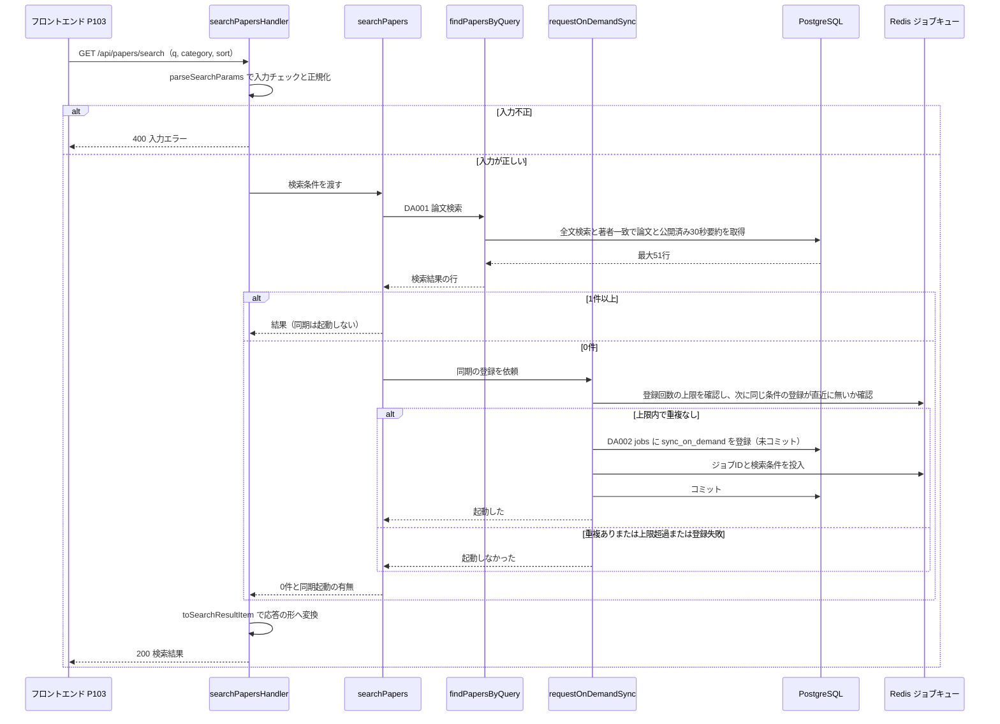

# BE詳細設計書 — F03 自由検索

## 0. 文書情報

| 項目 | 値 |
| :--- | :--- |
| 設計書ID | F03-BE |
| 親ID | F03 |
| 親設計書 | `基本設計書_概要.md` §4.1 機能一覧（F03 自由検索） |
| 版 | 1.1（第1回セルフレビュー `docs/reviews/be_F03_review_applied.md` の Major 2件・Minor 3件・Info 1件を反映） |
| 作成日 / 更新日 | 2026-10-26 / 2026-10-26 |
| 作成方法 | creating-backend-detailed-design v1.5.0 準拠。上流の確定設計書と `source/` の企画資料から作成 |
| インプット | (a) `source/01_企画概要.md:26`、`source/02_機能要求定義.md:8,21-29,32-35,45-49,58`、`source/03_システム構成.md:7-11,22,27,35-38,43,48,57-61`（全6ファイルを確認。ファイル数6件）／(b) `docs/基本設計書_概要.md` §2 BF04・EX04、§4 F03・オンライン処理設計・B006・B011、§6 T001〜T003・T009・CRUD図、§7 API02・IF01、§8、§9、§11 ARC001〜ARC004・ARC006・ARC007・ARC009・ARC010、付録 Q08・Q10・Q12・Q19・Q21・Q26／関連する確定設計書 `docs/db/DB.T001〜T003・T009.DB物理設計.md`、`docs/screens/画面.P103.画面基本設計.md`／(c) `legacy/`（空ディレクトリ） |
| 前版 | なし（`docs/detail/be/` に既存の本書は無く、本版が初版） |

* **インプットの性質**: `source/` にあるのは企画・初期設計案のMarkdown 6ファイルだけで、APIのソースコード・ルーティング定義・ORM定義・SQLは1つもありません。そのため本書のエンドポイント・関数・データアクセス・SQLは、企画資料の定義行と上流の確定設計書から導いた**計画上の実体（設計案）**であり、実装済みであることは意味しません。関数名・ファイルパス・SQL・タイムアウト値のうち資料と上流に無いものは、すべて※推測です。
* **legacy/ との突合結果**: `legacy/` は空ディレクトリで、既存の設計資料はありません。突合の対象が0件のため、既存仕様との食い違いはありません。
* **上流との食い違い（※上流要確認）**: 本書で見つかった上流との食い違いは、該当する章の本文に「※上流要確認」として書きます（並び順パラメータの欠落 §2、ページ送りの未定義 §2、ジョブの検索条件の保存先 §3、方式の適用範囲 §7）。

## 1. バックエンド構成・モジュール設計

* **対象ドメイン**: 検索系（論文） — 自由検索。キーワード（タイトル・著者・概要）とカテゴリで自前DBの論文を探し、自前DBに該当が無いときだけ arXiv からのオンデマンド同期（B006）を登録する（`source/02_機能要求定義.md:8,35`、上流 F03・BF04）。
* **対象APIエンドポイント**: GET /api/papers/search（API02）の1件。
* **処理の置き場所**: 上流 §1 システム全体構成図の「Next.js API（画面向けAPI）」に置きます。検索は自前DB（PostgreSQL）の読み取りだけで完結し、Python側（FastAPI）を経由しません。オンデマンド同期は、ジョブテーブル `jobs` への登録とジョブキュー（Redis）への投入をNext.js APIから直接行います（※推測。上流 §9 の環境変数 `REDIS_URL` の利用者に「API」が含まれることを根拠にした案。上流構成図は Next.js API → FastAPI → Redis の経路を描いているため、FastAPI 経由で投入するかは※上流要確認）。
* **ディレクトリ/ファイル構造**（※推測: 上流 §9 の想定構成 `web/`・`worker/` に合わせた案。実装は未着手）:

```
web/
├── app/api/papers/search/
│   └── route.ts                 # GET /api/papers/search のルートハンドラー（searchPapersHandler）
├── lib/search/
│   ├── searchParams.ts          # 入力チェックと正規化（parseSearchParams）
│   ├── searchService.ts         # 検索の進行と同期起動の判断（searchPapers）
│   ├── paperSearchRepository.ts # 論文検索SQLの組み立てと発行（findPapersByQuery）
│   ├── onDemandSync.ts          # 同期ジョブの登録（requestOnDemandSync）
│   └── searchResultMapper.ts    # DBの行を応答の形へ変換（toSearchResultItem）
└── lib/infra/
    ├── db.ts                    # PostgreSQL 接続（サーバ側の接続文字列 DATABASE_URL）
    └── queue.ts                 # Redis 接続とジョブキュー投入（REDIS_URL）
worker/
└── jobs/sync_on_demand.py       # B006 本体（本書の対象外。BT.B006 で設計）
```

* **処理シーケンス図**（上流 BF04 を本書の関数単位に展開）:



## 2. API・インターフェース詳細設計

* **APIエンドポイント一覧（全数ロースター）**:

| API-ID | メソッド | エンドポイント | 概要 | 認証 | 出典 | 定義状況 | 詳細の所在 |
| :--- | :--- | :--- | :--- | :--- | :--- | :--- | :--- |
| API02 | GET | /api/papers/search | キーワードとカテゴリで自前DBの論文を検索し、該当が無いときだけ arXiv からのオンデマンド同期（B006）を登録して、その有無を応答に含める | 不要（※推測。上流 API02） | `source/03_システム構成.md:48`、上流 §7 API02 | 詳細 | §2 GET /api/papers/search |

**総件数: 1件。全数である根拠**: 上流 §7 内部API一覧の全8件（API01〜API08、`source/03_システム構成.md:46-54` の全8行と1対1）のうち、F03 自由検索に属するのは API02 だけです（API01 は F02、API03・API04 は F05、API05 は F08、API06・API07 は F07、API08 は F12）。画面 P103 の呼出APIロースターも API02 の1件です（`docs/screens/画面.P103.画面基本設計.md` §5）。オンデマンド同期の完了を知らせるAPIや、同期状況を問い合わせるAPIは上流に定義が無く、本書でも設けません（※上流要確認: 取り込み完了を画面に知らせる手段の要否。P103 §7 と同じ確認事項）。
**定義状況の判定**: API02 は件数による分岐（同期の起動）、ジョブの登録という状態の変更、複数テーブルの結合、並び順による動的なSQLを含むため「詳細」です（completeness 3-1 の1・2・3・4）。

* **外部・内部連携一覧（全数ロースター）**:

| ID | 連携先 | 本機能との関係 | 定義状況 | 詳細の所在 |
| :--- | :--- | :--- | :--- | :--- |
| IF01 | arXiv API | API02 は直接呼ばない。0件のときに登録するオンデマンド同期（B006）のジョブワーカーが、arXiv APIへ問い合わせる（上流 BF04・ARC007） | 詳細（B006 側） | `docs/detail/batch/BT.B006.バッチ詳細設計.md`（未作成のため `-`） |
| ※上流未定義 | Redis ジョブキュー（内部構成要素） | 同期ジョブの投入と、同じ条件の重複登録・登録回数の上限の判定に使う。上流では外部連携ではなく内部構成要素（上流 §7 外部連携一覧の根拠欄） | 詳細 | §2 下表、§5、§6 |

**総件数: 2件（外部サービス1件・内部構成要素1件）。全数である根拠**: 上流 §7 外部連携一覧の全9件（IF01〜IF09）のうち、F03 の業務フロー BF04 に現れるのは IF01（B006 経由）だけです。IF05 Supabase Auth は API02 が認証不要のため使いません。PostgreSQL は §3 で扱います。Redis は上流で外部連携に数えない内部構成要素ですが、本機能の失敗時の扱いに関わるため併記しています（上流のIDが無いため※上流未定義とし、仮採番はしません）。

* **外部サービス連携仕様**: API02 が同期処理の中で直接呼び出す外部サービスは**該当なし**です。根拠: 検索は自前DBだけで行い、arXiv API への問い合わせは非同期のオンデマンド同期（B006）がジョブワーカー側で行います（`source/02_機能要求定義.md:35`、上流 BF04・ARC007）。参考として、API02 が同期の中で使う内部構成要素 Redis の接続仕様を示します。

| 連携先 | 連携方式 | エンドポイント / 接続先 | 認証方式 | タイムアウト | リトライ方針 | エラー時の挙動 |
| :--- | :--- | :--- | :--- | :--- | :--- | :--- |
| Redis ジョブキュー（内部） | Redis クライアントによるキー操作とキュー投入（※推測: Celery/RQ のどちらにするかは上流 Q02 で未定。キューのメッセージ形式はそれに従う） | 環境変数 `REDIS_URL` の接続先（上流 §9） | 接続文字列に含めたパスワード（※推測） | 1操作あたり1秒（※推測: 検索の応答を待たせないため短くする） | リトライしない（※推測: 利用者が検索し直せば再度判定されるため） | 同期の登録を諦めて「起動しなかった」として検索結果を返す。検索自体は 200 で成功させ、WARN ログを出す（§6） |

---

### GET /api/papers/search
* **API-ID**: API02（上流 §7 内部API一覧）
* **概要**: 入力された語でタイトル・Abstract・著者名を探し、カテゴリで絞り込んだ論文を、関連度順または投稿日の新しい順で返します。各論文には、検証に合格して公開済みの30秒要約と日本語タイトルを添え、まだ要約が公開されていない論文は速報版（原題のみ）として返します。自前DBに1件も該当しないときだけ、arXiv からのオンデマンド同期（B006）を登録し、登録したかどうかを応答に含めます（`source/02_機能要求定義.md:8,33-35,45`、上流 F03・BF04・API02）。画面表示のたびに LLM は呼びません（上流 ARC001）。
* **認証要否**: 不要（※推測。上流 API02・付録 Q08 の仮置き「ゲストも検索を利用可」）。ログイン中でもセッションは参照せず、Free・Pro・ゲストで応答は変わりません（P103 §7「プランによる差は無い」）。検索語を利用者に結びつけて保存せず、閲覧イベント（`view_events`）も記録しません（上流 ARC010。※推測）。
* **リクエストパラメータ**:

| 種別(Path/Query/Body) | 項目名 | 型 | 必須 | 制約・バリデーション | 説明 |
| :--- | :--- | :--- | :--- | :--- | :--- |
| Query | q | string | 必須 | 前後の空白を取り除いた後で1文字以上200文字以内（上限は※推測。P103 H10 の仮置きに合わせる）。途中の連続した空白は1つにまとめる（※推測） | 検索語。タイトル・Abstract・著者名をまとめて探す。著者専用のパラメータは無く、著者名もこの語で探す（`source/02_機能要求定義.md:8`、P103 §7） |
| Query | category | string | 任意 | arXiv のカテゴリ表記の形であること。英小文字とハイフンからなる分野名に、任意でピリオドと英字の小区分が続く形（例 `cs.LG`、`hep-th`。`^[a-z-]+(\.[A-Za-z-]+)?$`。※推測）。未指定または空文字のときはカテゴリで絞り込まない | 指定したカテゴリを含む論文だけに絞り込む。収集対象のカテゴリ一覧は上流に無いため、形が正しければ一覧に無い値も受け付け、該当0件として扱う（※上流要確認。P103 H12 と同じ確認事項） |
| Query | sort | string | 任意 | `relevance`（関連度順）または `newest`（投稿日の新しい順）。未指定時は `relevance`（※推測。P103 H13 の初期値に合わせる） | 並び順。※上流未定義: 上流 API02 にこのパラメータは無いが、`source/02_機能要求定義.md:34` が検索結果を「投稿日降順と関連度順」で並べると定めているため、ソースを優先して設ける。値名 `newest` は API01 と同じ、`relevance` は本書の※推測（上流 Q12） |

* **件数の上限とページ送り**: 1回の応答で返す論文は最大50件です（※推測）。ページ送りのパラメータは上流 API02 にも P103 にも無いため設けず、51件目があるかどうかだけを `hasMore` で返します（※上流要確認: 件数とページ送りの指定。P103 §7 と同じ確認事項）。上限を設けるのは、短い語で数十万件に一致したときに全件を返して応答が遅くなるのを防ぐためです（completeness 3-1 の6）。
* **レスポンス（成功時）**（※推測: 上流 API02「GET /api/papers と同じ要素構成と、arXivとの同期を起動したかどうか」を具体化した案。キー名は本書で決めた案）:
```json
{
  "status": "success",
  "data": {
    "query": { "q": "diffusion model", "category": "cs.LG", "sort": "relevance" },
    "items": [
      {
        "arxivId": "2401.12345",
        "title": "Scalable Diffusion Models for ...",
        "titleJa": "拡散モデルの大規模化に関する研究",
        "authors": ["Alice Smith", "Bob Lee", "Carol Wu"],
        "categories": ["cs.LG", "stat.ML"],
        "primaryCategory": "cs.LG",
        "submittedAt": "2024-01-22T18:00:00Z",
        "updatedAt": "2024-02-03T10:15:00Z",
        "latestVersion": 2,
        "summaryVersion": 2,
        "summaryStatus": "published",
        "summaryShort": "拡散モデルを……で大規模化し、……で従来手法を上回った。",
        "sourceScope": "abstract_only"
      },
      {
        "arxivId": "2410.00001",
        "title": "A New Benchmark for ...",
        "titleJa": null,
        "authors": ["Dan Kim"],
        "categories": ["cs.LG"],
        "primaryCategory": "cs.LG",
        "submittedAt": "2024-10-01T17:30:00Z",
        "updatedAt": null,
        "latestVersion": 1,
        "summaryVersion": null,
        "summaryStatus": "processing",
        "summaryShort": null,
        "sourceScope": null
      }
    ],
    "count": 2,
    "hasMore": false,
    "syncTriggered": false
  }
}
```

  応答項目の意味:

| 項目 | 型 | 説明 |
| :--- | :--- | :--- |
| data.query | object | 正規化した後の検索条件。画面が「どの条件の結果か」を表示し、古い応答を取り違えないために返す（P103 H16・§7「古い応答で上書きしない」） |
| items[].arxivId | string | 論文の業務キー（版番号なし）。論文詳細 P104 への遷移に使う（`papers.arxiv_id`） |
| items[].title | string | 英語の原題（`papers.title`） |
| items[].titleJa | string または null | 公開済み30秒要約に含まれる日本語タイトル。要約が未公開なら null で、画面は原題を表示する（P103 H18。要約JSON内のキー名は要約スキーマ ARC003 が未作成のため※推測で `title_ja`） |
| items[].authors | string[] | 著者名を論文の記載順に並べたもの（`papers.authors`） |
| items[].categories | string[] | 論文のカテゴリすべて（`papers.categories`） |
| items[].primaryCategory | string | 主カテゴリ。カテゴリの並びの先頭要素（`papers.categories[1]`。DB.T001 §4.3 (4)） |
| items[].submittedAt | string（ISO 8601、UTC） | v1 の投稿日時。新着順の基準。画面で「投稿日」とタイムゾーンを明記して表示する（上流 ARC009） |
| items[].updatedAt | string または null | 最新版が arXiv で公開された日時。投稿日とは別の日付として返す（`source/02_機能要求定義.md:32`） |
| items[].latestVersion | integer | arXiv 上の最新の版番号（`papers.latest_version`） |
| items[].summaryVersion | integer または null | 添えた30秒要約が対象にした版の番号。画面の版表示に使う（P103 H22、上流 ARC009）。要約が未公開なら null で、画面は最新版の番号を出す |
| items[].summaryStatus | string | 要約の公開状況。検証に合格した30秒要約があれば `published`、無ければ `processing`（速報版）（上流 ARC002・F17） |
| items[].summaryShort | string または null | 公開済み30秒要約の本文。要約が未公開なら null（P103 H25） |
| items[].sourceScope | string または null | 30秒要約の材料の範囲。`abstract_only` なら画面に「Abstractベース」と表示する（`summaries.source_scope`、上流 ARC009） |
| count | integer | items の件数（最大50） |
| hasMore | boolean | 上限の50件を超えて該当があるか |
| syncTriggered | boolean | 今回の検索で arXiv からのオンデマンド同期（B006）を登録したか。true のとき画面は取り込み中の案内（P103 H32）を出す。0件でも同期を登録しなかったときは false で、画面は該当なし表示（P103 H31）を出す |

* **レスポンス（エラー時）**（※推測。上流 §4「エラー応答」の方針に従う）:
```json
{
  "status": "error",
  "error": { "code": "INVALID_PARAMETER", "message": "検索キーワードを入力してください。", "field": "q" }
}
```
* **レスポンスヘッダー**: `Content-Type: application/json; charset=utf-8`。`Cache-Control: public, s-maxage=60, stale-while-revalidate=60`（※推測: 認証不要で利用者ごとに応答が変わらないため、同じ条件の検索を Vercel のエッジで60秒使い回し、DBと同期登録の負荷を抑える）。エラー応答には `Cache-Control: no-store` を付けます（※推測: 一時的な障害の応答を使い回さないため）。
* **ステータスコード**:

| コード | 条件 |
| :--- | :--- |
| 200 | 検索が正常に終わったとき。0件の場合も、同期を登録したかどうかにかかわらず 200 を返す。同期の登録に失敗した場合も検索自体は成功として 200 を返す（`syncTriggered` は false） |
| 400 | 入力が不正なとき。検索語が無い・空白だけ・200文字を超える、カテゴリの形がarXivのカテゴリ表記でない、並び順が `relevance`・`newest` 以外のいずれか（エラーコード `INVALID_PARAMETER`） |
| 500 | 論文検索のSQLが失敗したとき（DB接続の失敗、文のタイムアウトを含む）。原因の詳細は応答に含めず、汎用メッセージだけを返す（エラーコード `INTERNAL_ERROR`） |

* **ビジネスロジック・副作用**:
  1. クエリ文字列から検索語・カテゴリ・並び順を取り出し、検索語の前後の空白を取り除き途中の連続した空白を1つにまとめる。検索語が空・200文字超、カテゴリの形が不正、並び順が2値以外のいずれかなら 400 を返して終える（`parseSearchParams`）。
  2. 自前DBで論文を検索する（DA001）。検索語は「原題とAbstractを合わせた英語全文への一致」または「著者名の完全一致」のどちらかを満たせば該当とする。カテゴリが指定されていれば、そのカテゴリを含む論文だけに絞る。並び順が関連度順なら一致の強さの高い順、新着順なら投稿日時の新しい順に並べ、51件まで取り出す。各論文には、検証に合格した日本語の30秒要約のうち最も新しい版・最も新しい生成日時の1件を添える（無ければ空）。
  3. 取り出した行が51件なら `hasMore` を true にし、先頭50件だけを返す対象にする。
  4. 該当が1件以上なら、同期は登録せずに手順 6 へ進む。
  5. 該当が0件なら、オンデマンド同期の登録を試みる（`requestOnDemandSync`。発動条件「自前DBに該当が無いとき」は上流 Q10 の仮置き）。
     1. 全利用者を合わせた同期の登録の試行回数を、分単位のカウンターで1増やし、1分あたり30回を超えていれば登録しない（Redis の分単位カウンター。※推測: 30回）。認証不要のAPIから arXiv への問い合わせを無制限に起こさせないための上限で、arXiv の推奨間隔を守る方針（`source/03_システム構成.md:57`、上流 ARC007）に沿う。この判定を重複防止キーの作成より先に行うのは、上限で登録を諦めたときに重複防止キーが残り、その条件の同期が10分間一度も登録されないまま抑止されるのを防ぐためである。
     2. 同じ検索条件（正規化した検索語を小文字にしたものとカテゴリの組）の重複防止キーを10分の有効期限付きで作る。既にキーがあれば、直近10分以内に同じ条件を登録済みとして登録しない（Redis の重複防止キー。※推測: 10分）。
     3. 上の2つを通過したら、トランザクションを開始して `jobs` に種別 `sync_on_demand`・状態 `pending`・試行回数0・版なしの行を追加し（DA002）、採番されたジョブIDと検索条件をジョブキューへ投入し、ただちにコミットする（投入からコミットまでの間に他の処理を入れない）。追加または投入が失敗したらロールバックし、手順2で作った重複防止キーを削除して登録しなかったものとして扱う。コミットより先にメッセージが投入されるため、B006 は受け取ったジョブIDの行が見えないとき、1秒間隔で最大3回読み直してから処理する（コミット待ちの吸収）。3回読み直しても行が無いメッセージは、コミットが失敗して取り残されたものとみなして捨てる（※推測。B006 側の規則で、BT.B006 で確定する）。
     4. 登録できたら `syncTriggered` を true、登録しなかった・できなかったときは false にする。
  6. 各行を応答の形に変換する（`toSearchResultItem`）。公開済みの30秒要約がある行は `summaryStatus` を `published` とし日本語タイトル・要約本文・解析範囲・要約の版を入れる。無い行は `processing` とし、それらを null にする。
  7. 200 で応答を返す。

## 3. データアクセス（ORM / クエリ）設計

* **データアクセス一覧（全数ロースター）**:

| DA-ID | 処理名 | 呼出元（関数/API） | 対象物理テーブル（テーブルID） | 種別 (SELECT/INSERT/UPDATE/DELETE) | 定義状況 (詳細/簡易) | 詳細の所在 |
| :--- | :--- | :--- | :--- | :--- | :--- | :--- |
| DA001 | 論文の自由検索（公開済み30秒要約つき） | findPapersByQuery（API02） | papers（T001）, paper_versions（T002）, summaries（T003） | SELECT | 詳細 | §3 詳細定義 DA001、発行SQL DA001 |
| DA002 | オンデマンド同期ジョブの登録 | requestOnDemandSync（API02） | jobs（T009） | INSERT | 詳細 | §3 詳細定義 DA002、発行SQL DA002 |

**総件数: 2件。全数である根拠**: 上流 §6 CRUD図の F03 行は「papers R、paper_versions R、summaries R、jobs C」で、他の6テーブルは「-」です。参照（R）の3テーブルは検索結果1件ごとに論文・版・要約をまとめて引く必要があり、1文で結合して取得するため DA001 の1件にまとめています（版や要約を論文ごとに別の文で引くと、結果件数ぶん問い合わせが増えるため）。作成（C）は jobs への同期ジョブ登録の DA002 の1件です。`papers`・`paper_versions` への追加・更新は、F03 が登録した後に B006 が行う処理で、本書の対象外です（DB.T001 §4.6・DB.T002 §4.6 の※上流要確認と同じ整理）。ソースコードが無いため、件数は上流 CRUD図と本書の設計案の対応で数えています。
**定義状況の判定**: DA001 は複数テーブルの結合（3-1 の3）、検索条件と並び順で変わる動的なSQL（3-1 の4）、大量件数を相手にする性能上の注意（3-1 の6）に該当します。DA002 は永続データの書き換え（3-1 の2）と、キュー投入との組み合わせで失敗時の扱いが自明でない（3-1 の5）ことに該当します。

* **データアクセス詳細定義**:

| DA-ID | 処理名 | 対象物理テーブル | JOIN / Include | 抽出条件 (Where) / ソート | トランザクション境界 | N+1対策・性能上の注意 |
| :--- | :--- | :--- | :--- | :--- | :--- | :--- |
| DA001 | 論文の自由検索（公開済み30秒要約つき） | papers, paper_versions, summaries | 論文ごとに、その論文の版と要約を結合した副問い合わせを1回だけ引く横方向の外部結合（LEFT JOIN LATERAL）。要約が無い論文も結果から外さない | 抽出: 検索語が「原題とAbstractを合わせた英語全文」に一致するか、著者名の並びに検索語と完全に同じ名前があること（`to_tsvector('english', title \|\| ' ' \|\| abstract) @@ websearch_to_tsquery('english', :q)` または `authors @> jsonb_build_array(:q)`）。カテゴリ指定時は、論文のカテゴリにその値が含まれること（`categories @> ARRAY[:category]`）。添える要約は、30秒要約で、日本語で、検証に合格したもののうち、版番号の大きい順・生成日時の新しい順で先頭の1件（`summary_type='short' AND language='ja' AND validation_status='passed'`）。ソート: 関連度順なら一致の強さ（全文の一致度に、著者名が完全一致したときの加点1.0を足した値）の高い順、同点は投稿日時の新しい順・論文IDの大きい順。新着順なら投稿日時の新しい順・論文IDの大きい順。51件まで | 読み取り専用のトランザクションを1つ張り、その中だけで文のタイムアウトを3秒に設定してから1文を発行し、終わればコミットする（`BEGIN READ ONLY; SET LOCAL statement_timeout = '3s'; … COMMIT;`。※推測）。書き込みは無い | 全文の一致は式インデックス `idx_papers_fulltext` を使うため、SQLの式をインデックスの式（`to_tsvector('english', title \|\| ' ' \|\| abstract)`）と一字一句同じにする（DB.T001 §5.2）。著者の一致は `idx_papers_authors`、カテゴリは `idx_papers_categories` を使う。版の絞り込みは一意制約 `uq_paper_versions_paper_id_version`、要約の取得は `idx_summaries_lookup` を使う。要約の結合は上限51行の論文ごとに1回なので、結果件数に比例して問い合わせ回数が増える問題は起きない。関連度順は該当した全行の一致度を計算してから並べるため、短い語で大量に一致すると遅くなる。文のタイムアウトを3秒（※推測）にして長時間の走査を打ち切る。新着順は該当行を投稿日時で並べ替える処理が要る（全文条件で先に絞るため `idx_papers_submitted_at` は使われない想定）。検索語が英語の語幹に分解できない語（日本語だけ、英語の不要語だけ）のときは全文の条件が何にも一致せず、著者名の完全一致だけで判定される（※上流要確認: 日本語の検索語で日本語タイトル・要約を探すかは上流 Q21 の検索方式とあわせて決める） |
| DA002 | オンデマンド同期ジョブの登録 | jobs | なし | なし（1行の追加。種別 `sync_on_demand`・状態 `pending`・試行回数0・版なし）。採番されたジョブIDを返させる | 開始: 追加の直前。終了: ジョブキューへの投入が成功した直後にコミット（間に他の処理を入れない）。追加または投入が失敗したらロールバックし、ジョブの行を残さない。投入がコミットより先になるため、B006 はジョブIDの行が見えないとき1秒間隔で最大3回読み直してから処理し、それでも無ければ捨てる（※推測。BT.B006 で確定） | 同じ版・同じ種別の重複を防ぐ部分一意インデックス `uq_jobs_active_per_version` は版が空の行を対象外にしているため（DB.T009 §7）、同じ検索条件の重複登録はDBでは防げない。重複は Redis の重複防止キーで防ぐ（§2 手順5）。※上流要確認: `jobs` には検索語とカテゴリを保存する列が無い（上流 §6 T009、DB.T009 §4.1 の全6列）。本書では検索条件をキューのメッセージだけで B006 に渡す案とするが、失敗キューから再処理（B010）するときに検索条件が失われるため、`jobs` に処理の入力を持つ列を設けるかの確認が必要 |

* **発行SQL**:

  **DA001 論文の自由検索** — 並び順（2通り）とカテゴリ指定の有無（2通り）で、次の4つの形のどれかを発行します（※推測: PostgreSQL の全文検索を使う案。上流 Q21 で別の検索エンジンを採用した場合は書き換える）。プレースホルダーにはすべてパラメータを結合し、検索語を文字列として連結しません（SQLインジェクション対策）。
  * 組み立ての分岐条件:
    * カテゴリが指定されている → 抽出条件に「カテゴリを含む」を加える（下の `[カテゴリ条件]` を差し込む）。指定が無い → 差し込まない。
    * 並び順が `relevance` → 一致度を計算する `[一致度の列]` と `[関連度順]` の ORDER BY。`newest` → 一致度を計算しない `[一致度の列]` と `[新着順]` の ORDER BY（新着順では一致度を並べ替えに使わないため、計算を省いて負荷を減らす）。
  * 共通の本体:

```sql
-- DA001 論文の自由検索（$1 = 検索語 q、$2 = カテゴリ ※カテゴリ条件を差し込む形のときだけ）
WITH query AS (
    SELECT websearch_to_tsquery('english', $1::text) AS tsq
)
SELECT
    p.id,
    p.arxiv_id,
    p.title,
    p.authors,
    p.categories,
    p.submitted_at,
    p.updated_at,
    p.latest_version,
    [一致度の列],
    s.summary_version,
    s.json_content ->> 'title_ja'  AS title_ja,
    s.json_content ->> 'summary'   AS summary_short,
    s.source_scope
FROM papers p
CROSS JOIN query q
LEFT JOIN LATERAL (
    SELECT pv.version AS summary_version, sm.json_content, sm.source_scope
    FROM paper_versions pv
    JOIN summaries sm
      ON sm.paper_version_id = pv.id
     AND sm.summary_type = 'short'
     AND sm.language = 'ja'
     AND sm.validation_status = 'passed'
    WHERE pv.paper_id = p.id
    ORDER BY pv.version DESC, sm.generated_at DESC
    LIMIT 1
) s ON true
WHERE (
        to_tsvector('english', p.title || ' ' || p.abstract) @@ q.tsq
     OR p.authors @> jsonb_build_array($1::text)
      )
  [カテゴリ条件]
[ORDER BY]
LIMIT 51;
```

  * 差し込む部品:

```sql
-- [一致度の列]（sort = relevance）
    ts_rank_cd(to_tsvector('english', p.title || ' ' || p.abstract), q.tsq)
      + CASE WHEN p.authors @> jsonb_build_array($1::text) THEN 1.0 ELSE 0 END AS score,

-- [一致度の列]（sort = newest。並べ替えに使わないため計算しない）
    NULL::real AS score,

-- [カテゴリ条件]（カテゴリ指定ありのときだけ）
  AND p.categories @> ARRAY[$2::text]

-- [関連度順]（sort = relevance）
ORDER BY score DESC, p.submitted_at DESC, p.id DESC

-- [新着順]（sort = newest）
ORDER BY p.submitted_at DESC, p.id DESC
```

  * 生成され得るSQLの形（全4通り）:

| No | 並び順 | カテゴリ指定 | 生成されるSQL |
| :--- | :--- | :--- | :--- |
| 1 | relevance | なし | 本体の `[カテゴリ条件]` を削除し、`[一致度の列]` と `[ORDER BY]` を関連度順の部品に置き換えた文。パラメータは $1 のみ |
| 2 | relevance | あり | 本体の `[カテゴリ条件]` を差し込み、`[一致度の列]` と `[ORDER BY]` を関連度順の部品に置き換えた文。パラメータは $1・$2 |
| 3 | newest | なし | 本体の `[カテゴリ条件]` を削除し、`[一致度の列]` と `[ORDER BY]` を新着順の部品に置き換えた文。パラメータは $1 のみ |
| 4 | newest | あり | 本体の `[カテゴリ条件]` を差し込み、`[一致度の列]` と `[ORDER BY]` を新着順の部品に置き換えた文。パラメータは $1・$2 |

  * 補足: 要約JSON内の日本語タイトルと30秒要約本文のキー名（`title_ja`・`summary`）は、要約スキーマ（上流 ARC003、`docs/arch/方式.ARC003.方式設計.md` 未作成）が確定するまでの※推測です。検索語が全文検索の語に分解できない場合（`websearch_to_tsquery` の結果が空）、全文の条件は偽になり、著者名の完全一致だけで判定されます。

  **DA002 オンデマンド同期ジョブの登録**（※推測）:

```sql
-- DA002 オンデマンド同期ジョブの登録（トランザクション内で実行し、キュー投入の成功後にコミット）
BEGIN;
INSERT INTO jobs (paper_version_id, job_type, status, attempts, last_error)
VALUES (NULL, 'sync_on_demand', 'pending', 0, NULL)
RETURNING id;
-- ここでジョブキューへ { jobId, q, category } を投入する
COMMIT;   -- 投入に失敗した場合は ROLLBACK
```

## 4. サーバー側機能・処理ロジック設計（IPO設計）

* **関数一覧（全数ロースター）**（※推測: ソースコードが無いため、§1 のファイル構成案に置く関数の全数）:

| 関数名 | 所属モジュール | 概要 | 呼出元 | 定義状況 | 詳細の所在 |
| :--- | :--- | :--- | :--- | :--- | :--- |
| searchPapersHandler | web/app/api/papers/search/route.ts（Controller） | API02 の入口。入力チェックを呼び、検索を進め、応答とエラーを組み立てる | Next.js のルーティング（GET /api/papers/search） | 詳細 | §4 IPO searchPapersHandler |
| parseSearchParams | web/lib/search/searchParams.ts | クエリ文字列の検索語・カテゴリ・並び順を検査し、正規化した検索条件を返す | searchPapersHandler | 詳細 | §4 IPO parseSearchParams |
| searchPapers | web/lib/search/searchService.ts（Service） | 論文検索を行い、0件のときだけ同期の登録を依頼して、結果と同期の有無をまとめる | searchPapersHandler | 詳細 | §4 IPO searchPapers |
| findPapersByQuery | web/lib/search/paperSearchRepository.ts（Repository） | 検索条件から DA001 のSQLを組み立てて発行する | searchPapers | 詳細 | §4 IPO findPapersByQuery |
| requestOnDemandSync | web/lib/search/onDemandSync.ts（Service） | 重複と回数上限を確かめ、DA002 のジョブ登録とキュー投入を1つのトランザクションで行う | searchPapers | 詳細 | §4 IPO requestOnDemandSync |
| toSearchResultItem | web/lib/search/searchResultMapper.ts | DA001 の1行を応答の論文要素に変換し、要約の公開状況を決める | searchPapersHandler | 詳細 | §4 IPO toSearchResultItem |

ロースターのIDは関数名そのものとします（F03 内で重複せず、他の設計書から関数を指すキーになる。関数は上流に採番対象が無いため、本書で番号は振りません）。

**総件数: 6件。全数である根拠**: §2「ビジネスロジック・副作用」の手順1〜7を担う処理を、入口（手順1・7）、入力チェック（手順1）、検索の進行（手順3・4）、SQLの組み立て（手順2）、同期の登録（手順5）、応答への変換（手順6）に1つずつ割り当てた数で、§1 のファイル構成案に置いた関数と一致します。DB接続とRedis接続（`web/lib/infra/db.ts`・`queue.ts`）は全APIで共通の基盤部品で、F03 固有の処理を持たないため本ロースターに含めません。
**定義状況の判定**: 6件とも分岐（3-1 の1）を持ち、加えて findPapersByQuery は動的なSQL（3-1 の4）、requestOnDemandSync は状態の変更と失敗時の扱い（3-1 の2・5）、toSearchResultItem は非自明な業務ルール（速報版の扱い、3-1 の7）を含むため、全件「詳細」です。

* **入力・処理・出力（IPO）定義**:

| 関数名 | 所属モジュール | 引数 (型) | 処理フロー (ステップ単位で具体的に) | 戻り値 | 発生しうるエラー |
| :--- | :--- | :--- | :--- | :--- | :--- |
| searchPapersHandler | route.ts（Controller） | request: NextRequest | 1. クエリ文字列を parseSearchParams に渡す。不正なら、不正だった項目名と利用者向けの文言を入れたエラー応答を 400 で返し、キャッシュさせない<br>2. 正規化した検索条件で searchPapers を呼ぶ<br>3. 返ってきた各行を toSearchResultItem で変換する<br>4. 正規化した検索条件・論文の配列・件数・続きの有無・同期の有無を成功応答にまとめ、エッジで60秒使い回せるヘッダーを付けて 200 で返す（※推測）<br>5. searchPapers が DB の失敗を投げたら、ERROR ログ（検索条件・エラー内容・スタックトレース）を出し、汎用メッセージのエラー応答を 500 で返す | Response（200: 検索結果、400: 入力エラー、500: 内部エラー） | 入力不正（400）、DB障害・文のタイムアウト（500） |
| parseSearchParams | searchParams.ts | searchParams: URLSearchParams | 1. 検索語を取り出し、前後の空白を取り除き、途中の連続した空白を1つにまとめる<br>2. 検索語が空なら「検索キーワードを入力してください。」、200文字を超えるなら「検索キーワードは200文字以内で入力してください。」として不正を返す（文言は※推測。P103 §6 に合わせる）<br>3. カテゴリが空または未指定なら「絞り込みなし」とする。値があれば arXiv のカテゴリ表記の形か確かめ、違えば不正を返す<br>4. 並び順が未指定なら関連度順とする。関連度順・新着順のどちらでもなければ不正を返す<br>5. 正規化した検索語・カテゴリ（または無し）・並び順を返す | { ok: true, value: { q: string, category: string または null, sort: 'relevance' または 'newest' } } または { ok: false, field: string, message: string } | 例外は投げない（不正は戻り値で返す） |
| searchPapers | searchService.ts（Service） | cond: { q, category, sort } | 1. findPapersByQuery で最大51行を取得する<br>2. 51行あれば続きありとし、先頭50行だけを残す<br>3. 1行以上あれば、同期は登録せずに結果を返す<br>4. 0行なら requestOnDemandSync を呼び、その結果（登録した／しなかった）を同期の有無とする<br>5. 行の配列・続きの有無・同期の有無を返す | { rows: SearchRow[], hasMore: boolean, syncTriggered: boolean } | findPapersByQuery の DB 障害をそのまま上へ投げる。requestOnDemandSync は例外を投げない設計のため、同期の失敗で検索が失敗することはない |
| findPapersByQuery | paperSearchRepository.ts（Repository） | cond: { q, category, sort }, limit: number（固定 51） | 1. §3 DA001 の本体に、カテゴリがあればカテゴリ条件を差し込む<br>2. 並び順が関連度順なら一致の強さの高い順、新着順なら投稿日時の新しい順の並べ替えを付ける<br>3. 検索語を $1、カテゴリを $2 に結合する（文字列連結はしない）<br>4. 読み取り専用のトランザクションを開始し、その中だけで文のタイムアウトを3秒（※推測）に設定してから発行し、コミットする（接続プールの他の利用者へタイムアウト設定が残らないよう、トランザクション内だけで有効な設定にする）<br>5. 取得した行を返す | SearchRow[]（論文の列、一致の強さ、添える要約の版・日本語タイトル・本文・解析範囲。要約が無い行は要約の列が null） | DB接続の失敗、文のタイムアウト（いずれも例外を上へ投げる） |
| requestOnDemandSync | onDemandSync.ts（Service） | cond: { q, category } | 1. 現在の分の登録試行回数カウンターを1増やし、30回を超えたら「登録しない」で終える（※推測: `sync_on_demand:rate:{年月日時分}`、INCR と有効期限120秒）。重複防止キーを作る前に判定し、上限で諦めたときにキーを残さない<br>2. 検索語を小文字にしたものとカテゴリから重複防止キーを作り、Redis にキーが無ければ10分の有効期限付きで作る（既にあれば「登録しない」で終える）（※推測: `sync_on_demand:dedupe:{検索語}:{カテゴリ}`、SET NX EX 600）<br>3. DB のトランザクションを開始し、DA002 で同期ジョブを1行追加してジョブIDを得る<br>4. ジョブID・検索語・カテゴリをジョブキューへ投入する<br>5. 投入が成功したら、間に他の処理を入れずにコミットし「登録した」を返す（B006 はコミット前にメッセージを受け取ることがあるため、行が見えなければ1秒間隔で最大3回読み直す。※推測、BT.B006 で確定）<br>6. 手順3〜5のどこかで失敗したらロールバックし、手順2で作った重複防止キーを削除して、WARN ログ（検索条件の長さ・カテゴリ・失敗した操作・エラー内容）を出し「登録しない」を返す<br>7. 手順1・2で Redis に接続できないときも、WARN ログを出し「登録しない」を返す | boolean（true: 登録した、false: 登録しなかった） | 例外は投げない。DB・Redis の失敗はすべて false とログで表す |
| toSearchResultItem | searchResultMapper.ts | row: SearchRow | 1. arXiv ID・原題・著者・カテゴリ・投稿日時・更新日時・最新版を写す。日時は UTC の ISO 8601 文字列にする<br>2. 主カテゴリとしてカテゴリの並びの先頭を入れる<br>3. 添える要約があれば、要約の公開状況を「公開済み」とし、日本語タイトル・30秒要約・解析範囲・要約の版を入れる<br>4. 添える要約が無ければ、要約の公開状況を「処理中（速報版）」とし、日本語タイトル・30秒要約・解析範囲・要約の版を null にする（画面は原題と処理中の表示に切り替える。上流 ARC002） | SearchResultItem（§2 応答項目の items[] の1要素） | なし |

## 5. バッチ処理・非同期タスク設計

* **本機能が登録・起動する非同期処理（全数ロースター）**:

| バッチID | 名称 | 本機能との関係 | 定義状況 | 詳細の所在 |
| :--- | :--- | :--- | :--- | :--- |
| B006 | arXivオンデマンド同期 | API02 が該当0件のときに `jobs` へ登録し、ジョブキューへ投入する。取り込みの本体はジョブワーカーが行う | 詳細 | `docs/detail/batch/BT.B006.バッチ詳細設計.md`（未作成のため `-`。本書は登録側だけを扱う） |

**総件数: 1件。全数である根拠**: 上流 §4 バッチ処理設計の全11件（B001〜B011）のうち、起動契機に「検索時」とあるのは B006 だけです（上流 B006「起動契機: 検索時」、BF04）。B011 検索インデックス更新は検索の前提となるインデックスを整えるバッチですが、起動契機は公開反映（B004）の完了で、F03 は起動しません（※上流要確認: 検索インデックスの実体が PostgreSQL の式インデックスであれば、行の追加・更新と同時に自動で更新されるため B011 の処理内容が無くなる。上流 Q20・Q21）。定期実行のジョブを F03 は持ちません。

* **ジョブ実行定義**（本機能が登録する B006 について、登録側から見た定義。本体の設計は BT.B006 の責務）:

| ジョブ名 | 実行タイミング | 対象テーブル | 処理概要 | タイムアウト |
| :--- | :--- | :--- | :--- | :--- |
| B006 arXivオンデマンド同期（登録） | API02 の検索結果が0件で、同じ検索条件の登録が直近10分以内に無く、全体の登録回数が1分あたり30回以内のとき（※推測。発動条件は上流 Q10 の仮置き「自前DBに該当が無いとき」） | jobs（登録時。種別 `sync_on_demand`・状態 `pending`）。取り込み時に B006 が papers・paper_versions を追加・更新する（B006 側） | 検索語とカテゴリを arXiv API への問い合わせ条件として渡し、自前DBに無い論文を取り込ませる。取り込み後の要約生成（B002）以降は通常の流れに乗る（上流 BF01）。完了を画面に知らせる手段は無く、利用者は時間をおいて検索し直す（P103 §7）。ジョブキューへの投入がDBのコミットより先になるため、B006 は受け取ったジョブIDの行が見えないとき1秒間隔で最大3回読み直してから処理し、それでも無ければ捨てる（※推測。§6 トランザクション制御） | 登録処理は Redis 1操作1秒・DB の文のタイムアウト3秒（※推測）。B006 本体のタイムアウト・リトライ回数は BT.B006 で定める（上流 Q19） |

## 6. 例外処理・セキュリティ設計

* **エラーハンドリング**:

| 例外種別 | 対応方法 | ログ出力 | クライアント応答 |
| :--- | :--- | :--- | :--- |
| 入力不正（検索語なし・空白だけ・200文字超、カテゴリの形が不正、並び順が2値以外） | parseSearchParams が不正を戻り値で返し、searchPapersHandler が検索せずに終える | INFO（不正だった項目名だけ。検索語の本文は残さない ※推測: 行動ログを最小限にする上流 ARC010 のため） | 400 + エラーコード `INVALID_PARAMETER`、項目名、利用者向けの文言 |
| DB接続の失敗・文のタイムアウト（DA001） | searchPapersHandler で捕捉し、検索を失敗として終える | ERROR + エラー内容・スタックトレース・検索条件の長さとカテゴリ・並び順（検索語の本文は残さない ※推測） | 500 + エラーコード `INTERNAL_ERROR`、汎用メッセージ「検索結果を取得できませんでした。時間をおいて再度お試しください。」（DBのエラー内容は返さない） |
| 同期ジョブの登録失敗（DA002 の失敗、ジョブキュー投入の失敗、Redis 接続の失敗） | requestOnDemandSync で捕捉し、トランザクションをロールバックして「登録しない」を返す。検索自体は成功として続ける（上流 EX04「失敗しても画面全体は落とさない」の考え方に合わせる） | WARN + 失敗した操作・エラー内容 | 200 + `syncTriggered: false`（画面は該当なし表示 P103 H31 を出す） |
| 同期登録の抑止（重複・回数上限） | requestOnDemandSync が登録せずに「登録しない」を返す。異常ではない | 回数上限による抑止だけ INFO（監視で頻発を検知するため ※推測）。重複による抑止はログを出さない | 200 + `syncTriggered: false` |
| 予期しない例外 | Next.js のルートハンドラーで最後に捕捉する | ERROR + スタックトレース | 500 + エラーコード `INTERNAL_ERROR`、汎用メッセージ |

* **セキュリティ上の対策**（※推測を含む。上流 §8 の方針を本APIへ当てはめたもの）:
  * **SQLインジェクション**: 検索語とカテゴリはすべてプレースホルダーに結合し、SQL文字列へ連結しません。並び順は2値のどちらかを入力チェックで確かめたうえで、本書で決めた固定の並べ替え句を選ぶだけにし、入力値をSQLに埋め込みません（§3 発行SQL）。
  * **認証不要APIの濫用**: 認証不要のため誰でも呼べます。arXiv への問い合わせを起こす同期の登録には、同じ条件の重複防止と全体の回数上限を設けます（§2 手順5）。検索そのものの回数制限は上流に定義が無く、本書では設けません（※上流要確認: Vercel 側のレート制限を使うか）。
  * **DB権限**: 本APIはサーバ側の接続（環境変数 `DATABASE_URL`）でDBへつなぎます。`jobs` はブラウザ向けのロールから読み書きできない設定のため（DB.T009 §7）、ブラウザから直接ジョブを登録することはできません。`summaries` を読む条件に「検証に合格」を必ず入れ、行単位アクセス制御を通らない接続でも未検証・不合格の要約を返さないようにします（上流 ARC004、DB.T003 §7）。
  * **XSS**: 原題・Abstract・著者名・要約は外部由来またはLLM生成の文字列のため、APIでは加工せずJSONとして返し、画面側で無害化して表示します（上流 §8「XSS」）。
  * **個人データ**: 検索語を利用者に結びつけて保存せず、ログにも検索語の本文を残しません（上流 ARC010、`source/02_機能要求定義.md:48`）。ジョブキューのメッセージには検索語が入りますが、利用者の識別子は入れません。

* **トランザクション制御**:

| 処理名 | トランザクション範囲 | ロールバック条件 |
| :--- | :--- | :--- |
| 論文の自由検索（DA001） | 読み取り専用のトランザクション1つ（文のタイムアウトの設定と1文の発行だけを含む。§3 DA001） | 文のタイムアウト・DB接続の失敗。書き込みが無いため、ロールバックで戻すデータは無い |
| オンデマンド同期ジョブの登録（DA002 ＋ ジョブキュー投入） | `jobs` への1行追加から、ジョブキューへの投入の成功までを1つのトランザクションにし、投入の成功直後にコミットする（間に他の処理を入れない） | `jobs` への追加の失敗、ジョブキューへの投入の失敗（タイムアウトを含む）のいずれか。ロールバック後は重複防止キーも削除する。投入がコミットより先になるため、B006 がコミット前にメッセージを受け取ることがある。B006 はジョブIDの行が見えないとき1秒間隔で最大3回読み直し、見えた時点で処理する。投入は成功したがコミットが失敗した場合は、DBに無いジョブIDのメッセージがキューに残るため、3回読み直しても行が無いメッセージは WARN ログを出して捨てる（※推測。BT.B006 で定める） |

## 7. 利用する方式（共通基盤）

| 方式ID | 名称 | 本書での利用箇所 |
| :--- | :--- | :--- |
| ARC007 | 外部APIアクセス制御（レート制限遵守・同期キャッシュ） | 検索は自前DBだけを引き、0件のときだけ B006 を登録する（§2 手順2・5）。arXiv への問い合わせを増やしすぎないよう、同期の登録に重複防止と1分あたりの回数上限をかける（§2 手順5、§6）。上流の適用範囲「B006 / F03」に該当する |
| ARC006 | ジョブ実行基盤（キュー・リトライ・失敗キュー・監視） | 同期ジョブを `jobs` に状態 `pending` で登録し、ジョブキューへ投入する（DA002、§5）。リトライと失敗キューは B006 側でこの基盤に従う。上流の適用範囲「B001〜B011 / T009」のうち B006・T009 に該当する |
| ARC001 | 生成物キャッシュ・重複排除方式 | 検索結果に添える30秒要約は事前に生成・保存したものだけを読み、検索のたびに LLM を呼ばない（DA001）。同じ条件の同期登録を10分間まとめる重複防止も、同じ処理を繰り返さないという本方式の考え方に沿う（※上流要確認: 上流の適用範囲は F01・F04・F05 で F03 の記載が無い） |
| ARC002 | 段階的生成・公開方式（速報版→詳細版） | 要約が未公開の論文も検索結果から外さず、要約の公開状況「処理中」として原題だけで返す（toSearchResultItem）（※上流要確認: 上流の適用範囲は F04・F05・F17 で F03 の記載が無い） |
| ARC003 | 要約スキーマ（構造化要約の出力仕様） | 要約本文のJSONから日本語タイトルと30秒要約の本文を取り出して返す（DA001。キー名はスキーマ未確定のため※推測）（※上流要確認: 上流の適用範囲は API04 までで API02 の記載が無い） |
| ARC004 | LLM出力検証方式（事実と推測の区別） | 検証に合格した要約だけを返す条件を DA001 に必ず入れる（※上流要確認: 上流の適用範囲は F04・F09・F11 で F03 の記載が無い） |
| ARC009 | 表示・編集ポリシー（出典・版・日付・ブランド表記） | 画面が版・解析範囲・日付の種類を表示できるよう、要約の版・最新版・解析範囲・投稿日時・更新日時を区別して応答に含める（§2 応答項目）。上流の適用範囲「API01〜API05」に該当する |
| ARC010 | 個人データ最小化・削除方針 | 検索語を利用者に結びつけて保存せず、ログにも検索語の本文を残さず、閲覧イベントも記録しない（§2 認証要否、§6）（※上流要確認: 上流の適用範囲は F08・F15・F16 で F03 の記載が無い） |

**総件数: 8件。根拠**: 上流 §11.1 の全10件（ARC001〜ARC010）を1件ずつ照合し、本書の処理が使うものを挙げました。ARC005 ライセンス・権利ゲート（本文解析と全文翻訳公開の可否。F03 は本文を扱わない）と ARC008 プラン別機能制御・利用量上限（検索はプランによる差が無い。上流 付録 Q08）は利用しません。
