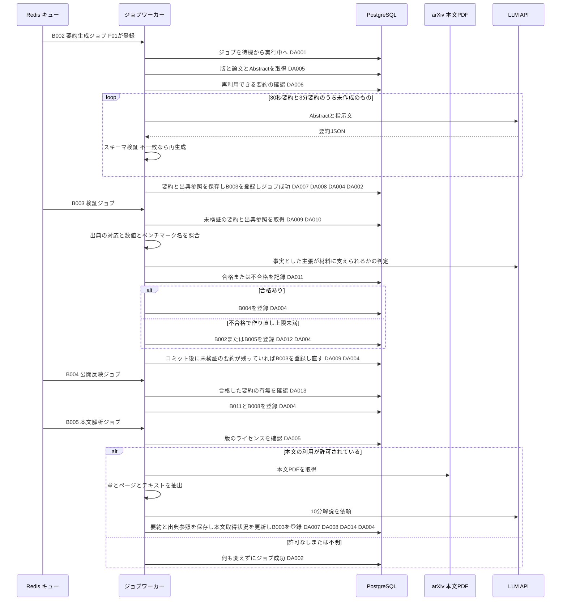

# BE詳細設計書 — F04 日本語構造化要約

## 0. 文書情報

| 項目 | 値 |
| :--- | :--- |
| 設計書ID | F04-BE |
| 親ID | F04 |
| 親設計書 | `基本設計書_概要.md` §4.1 機能一覧（`docs/基本設計書_概要.md` §4 機能一覧の F04「日本語構造化要約」。カテゴリ「要約」、区分「システム機能」） |
| 文書名 | BE詳細設計書 F04 日本語構造化要約 |
| 対象システム | Kaine personal pj — arXiv日本語研究ダイジェスト Webアプリ |
| 版 | 1.1（第1回セルフレビュー `docs/reviews/be_F04_review_applied.md` の Major 4件・Minor 1件を反映） |
| 作成日 / 更新日 | 2026-10-26 / 2026-10-26 |
| 作成方法 | creating-backend-detailed-design v1.5.0 準拠。上流の確定設計書と `source/` の企画資料から作成した新規設計（リバースエンジニアリング対象のコードは無い） |
| インプット | (a) `source/02_機能要求定義.md:9,21-29,45-50,57-58`、`source/03_システム構成.md:11-13,19-32,36-38,43,50,56-61`、`source/01_企画概要.md:33-37`、`source/04_収益化とロードマップ.md:25-28`／(b) `docs/基本設計書_概要.md` §1 用語集、§2（BF01・BF02・BF05・EX01〜EX03）、§4（機能一覧 F04、バッチ B002〜B005・B008・B011、バッチ共通の方針）、§6（T001〜T004・T009、CRUD図 F04 行）、§7（IF02・IF04、API04）、§8、§9（環境変数）、§11（ARC001〜ARC010）、付録 Q02・Q13・Q19・Q20・Q22〜Q24・Q29／DB物理設計 `docs/db/DB.T001`〜`T004`・`T009.DB物理設計.md`／隣接する BE詳細設計 `docs/detail/be/BE.F01.BE詳細設計.md`（B002 の登録）・`docs/detail/be/BE.F05.BE詳細設計.md`（API04 の定義）／(c) `legacy/`（空） |
| 既存版との関係 | 着手時点で既存の本書（`docs/detail/be/BE.F04.BE詳細設計.md`）はありませんでした（`docs/detail/` ディレクトリ自体が未作成）。引き継ぐ既存の記述・ID はありません |
| source/ の性質 | `source/` は企画・初期設計案の Markdown 6ファイルだけで、アプリのソースコード・ルーティング・ジョブ定義・SQL はありません（`source/README.md:4-10`、実ファイル数6件）。このため本書のファイル構成・関数名・SQL 本文はすべて実装のための設計案（※推測）です。挙動の要件は企画資料と上流設計書の定義行に従います |
| legacy/ との突合 | `legacy/` は空ディレクトリ（ファイル0件）です。突合すべき既存仕様・業務背景・非機能の記述はありません |

* **対象とする上流の要素**（ID はすべて上流の採番をそのまま使用）:
  * 機能: F04 日本語構造化要約（Must / Phase 1、10分解説は Phase 3）
  * バッチ・ジョブ: B002 Abstractベース日本語要約生成、B003 要約の根拠・数値チェック、B004 公開反映、B005 本文解析・詳細解説生成（DB物理設計 T009 §4.6 の F04 行「B002〜B005」と一致）
  * 業務フロー: BF01（要約生成以降）、BF02、EX01（ジョブの再試行）、EX02、EX03
  * 外部連携: IF02 arXiv（本文PDF取得）、IF04 LLM API
  * テーブル: T001 `papers`、T002 `paper_versions`、T003 `summaries`、T004 `summary_citations`、T009 `jobs`
  * 内部API: API04 は F05 の BE詳細設計書へ委譲（§2。本書は API04 が読む要約データを作る側）
  * 方式: ARC001〜ARC007・ARC009（§7）
* **確認事項（※推測・※上流要確認の集約）**:

| No | 区分 | 確認事項 | 本書での仮置き | 関連箇所 | 上流の確認事項 |
| :--- | :--- | :--- | :--- | :--- | :--- |
| 1 | API の帰属 | 上流 §7 内部API一覧には機能ID列が無く、API04（カテゴリ「要約」）を F04 と F05 のどちらが持つかが上流で明記されていない（※上流要確認） | DB物理設計 T003 §4.6 が API04 を F05 の行に置き、上流 §2 一覧が BF05 を F05 に対応させていることに合わせ、API04 の仕様は `docs/detail/be/BE.F05.BE詳細設計.md` §2 を正とする。本書は API04 が読むデータを作る側の保証事項だけを書く | §1、§2 | Q26 |
| 2 | CRUD の差分 | 上流 CRUD図の F04 行は `summary_citations` が C のみ、`jobs` が RU。本書の設計では、B003 による出典参照の読み取り（R）と、後続ジョブの登録（jobs の C）が加わる（※上流要確認。T004 §9 No.4、T009 §9 No.5 と同じ事項） | 本書の設計どおり R・C を加える | §3 DA004・DA010 | — |
| 3 | 検証ジョブの対象の特定 | `jobs` は版（paper_version_id）しか持たず、どの要約を検証するかを指せない（※上流要確認） | B003 は、その版の未検証の要約をすべて対象にする | §4 No.12、§3 DA009 | Q22 |
| 4 | 本文解析結果の保存先 | 本文PDFから取り出したテキストを保存するテーブルが上流に無く、B003 が10分解説の根拠を照合する材料を持てない（※上流要確認） | B003 は10分解説を検証するときだけ本文PDFを取り直して解析する（費用と arXiv へのアクセスが増える） | §4 No.12、§2 外部連携 IF02 | Q23 |
| 5 | 公開反映の内容 | `summaries` に公開を表す列が無く、B004 が何を書くかが決まっていない（T003 §9 No.3）（※上流要確認） | 検証に合格した要約を公開対象とみなし、B004 はテーブルを書き換えず、後続の検索インデックス更新（B011）と論文Embedding生成（B008）のジョブを登録する | §4 No.16 | Q20 |
| 6 | 検証不合格の理由 | 不合格の理由を保存する列が無い（※上流要確認） | アプリのログに出すだけにする | §4 No.13 | Q22 |
| 7 | 再試行・作り直しの上限 | ジョブの再試行上限、スキーマ不一致時の再生成上限、検証不合格時の作り直し上限（※推測） | ジョブ再試行3回（T009 の仮置き）、スキーマ再生成2回、検証不合格からの作り直し2回 | §4、§6 | Q19 |
| 8 | LLM の提供元・モデル・タイムアウト | 使う LLM とその呼び出し条件（※推測） | 環境変数 `LLM_MODEL_ID` のモデル。タイムアウトは §2 外部連携のとおり | §2 外部連携 IF04 | Q29 |
| 9 | ライセンスの後埋め | T002 §4.6 は「B005 が空のライセンスを埋める」としているが、ライセンスを取得する手段が上流に無い（※上流要確認） | B005 はライセンスを埋めない。空の版は本文の利用が許可されていないものとして扱う（上流 EX03） | §4 No.17 | Q13 |
| 10 | 検証待ちのまま残った要約 | 検証ジョブ（B003）が再試行の上限に達して失敗で終わると、要約は未検証のまま残る。未検証の要約があると要約生成は「作り直し不要」と判定するため、その深さの要約は作られないままになる（※推測） | 回復は失敗ジョブの再処理（B010。運用者が手動で起動）で B003 を待機に戻すことで行う。自動での回復は設けない | §4 No.7、§5 | Q36 |
| 11 | キュー投入の取りこぼし | ジョブ行の登録後、Redis への投入に失敗すると、待機のまま誰にも実行されない行が残る（※推測） | 待機のまま一定時間を過ぎた行を Redis へ入れ直す仕組みが必要。ジョブ実行基盤（ARC006）の方式設計書で決める | §6 トランザクション制御 | Q19 |

---

## 1. バックエンド構成・モジュール設計

* **対象ドメイン**: 要約系（summary） — 論文の版ごとに、Abstract を材料にした30秒要約・3分要約と、本文を材料にした10分解説を LLM で生成し、スキーマ検証と根拠・数値チェックに合格したものを公開対象にする。処理はすべてジョブワーカー上の非同期ジョブで行い、画面を開くたびに LLM を呼ばない（`source/02_機能要求定義.md:45`）。
* **対象APIエンドポイント**: F04 が所有する API は0件です。要約を画面へ返す API04 `GET /api/papers/{arxivId}/summary` は F05 の BE詳細設計書で定義します（§2 API ロースター、§0 確認事項 No.1）。
* **非同期ジョブ**: B002・B003・B004・B005 の4件（§5）。
* **ディレクトリ/ファイル構造**（※推測: 上流 §9「`web/`・`worker/`・`supabase/` の3つに分ける構成を想定」に従った配置案。F04 は `worker/` だけを持つ。`source/` に実装は無い）:

```
worker/                                      … Python（FastAPI と Celery/RQ ワーカー）
├── jobs/
│   ├── runner.py                            … ジョブ共通の実行枠（ARC006）
│   ├── summarize_abstract.py                … B002
│   ├── validate_summary.py                  … B003
│   ├── publish_summary.py                   … B004
│   └── analyze_full_text.py                 … B005
├── summary/
│   ├── reuse.py                             … 生成物の使い回し確認・作り直し判定（ARC001）
│   ├── schema.py                            … 要約スキーマ検証（ARC003）
│   └── checker.py                           … 根拠・数値チェック（ARC004）
├── llm/
│   ├── client.py                            … LLM API 呼び出し（IF04）
│   └── prompts.py                           … 深さ別の指示文の組み立て
├── license/gate.py                          … 本文利用の可否判定（ARC005）
├── arxiv/pdf_client.py                      … 本文PDF取得（IF02、ARC007）
├── pdf/parser.py                            … PDF解析（PyMuPDF / Docling / GROBID のいずれか。上流 Q02）
└── repositories/
    ├── job_repository.py                    … DA001〜DA004
    ├── paper_version_repository.py          … DA005・DA014
    ├── summary_repository.py                … DA007・DA009・DA011・DA013
    └── citation_repository.py               … DA008・DA010
```

* **処理シーケンス図（B002〜B005: 要約の生成・検証・公開）**:



* **画面との関係**: 論文詳細（P104）は API04（F05）を通じて、本書のジョブが作った要約のうち合格したものだけを読みます。本書のジョブと API04 の間に直接の呼び出しは無く、`summaries`・`summary_citations` の行を介してつながります（§2「F04 が API04 に保証する事項」）。

---

## 2. API・インターフェース詳細設計

* **外部サービス連携仕様**:

| No（上流ID） | 連携先 | 連携方式 | エンドポイント / 接続先 | 認証方式 | タイムアウト | リトライ方針 | エラー時の挙動 | 利用箇所 | 定義状況 | 詳細の所在 |
| :--- | :--- | :--- | :--- | :--- | :--- | :--- | :--- | :--- | :--- | :--- |
| IF04 | LLM API | REST API（※推測） | 提供元は未定（上流 Q29）。モデルは環境変数 `LLM_MODEL_ID` | APIキー（環境変数 `LLM_API_KEY`。※推測） | 30秒要約・3分要約は60秒、10分解説は180秒、根拠判定は60秒（※推測） | 通信のタイムアウト・接続失敗・提供元の混雑（HTTP 429）・提供元の障害（HTTP 5xx）のときだけ、2秒・4秒・8秒と間隔を倍にして最大3回まで再試行する。それ以外の 4xx（指示文の不備・認証失敗）は再試行しない（※推測） | 再試行しても失敗したら例外を上げ、ジョブ共通の失敗処理（DA003）でジョブの試行回数を1増やす。上限未満ならジョブごと後で再実行される（上流 EX01 と同じ扱い）。出力が要約スキーマに合わないときは保存せず、最大2回まで作り直しを依頼する（上流 EX02。回数は※推測） | B002・B003・B005（§4 No.9 generate_structured） | 詳細 | §4 No.9 |
| IF02 | arXiv（論文本文PDF） | HTTPダウンロード（※推測） | `https://arxiv.org/pdf/{arxiv_id}v{version}`（※推測: 版番号付きで取得し、要約した版と本文を一致させる） | 認証なし（※推測） | 60秒（※推測） | 問い合わせの前に、前回の問い合わせから環境変数 `ARXIV_REQUEST_INTERVAL_SEC`（※推測: 3秒）以上あける。通信失敗・HTTP 5xx・HTTP 429 は、ジョブ内では再試行せず、ジョブ共通の失敗処理で後から再実行する（arXiv に短時間で問い合わせを重ねないため。上流 ARC007） | 取得できなければ例外を上げてジョブを失敗扱いにする（DA003）。HTTP 404（版が無い）は再試行しても変わらないため、試行回数によらずジョブを失敗にする（※推測） | B005・B003（§4 No.19 fetch_pdf） | 詳細 | §4 No.19 |

**総件数: 2件。全数である根拠**: 上流 §7 外部連携一覧の全9件（IF01〜IF09）のうち、F04 の処理（B002〜B005）が呼び出すものを数えたものです。IF04 は要約・解説の生成と根拠判定（上流 IF04「送信: Abstract・本文、受信: 要約JSON・解説」）、IF02 は B005 の本文取得（上流 BF02）と B003 の本文の取り直し（§0 確認事項 No.4）に使います。IF01 は論文メタデータ収集（F01・B001）、IF03 は画面からのリンク遷移（F05）、IF05 は認証（API04 を含む画面向けAPI。F05 ほか）、IF06・IF07 は課金（F12）、IF08 は GitHub 関連付け（F14）、IF09 は通知（F10）の連携のため本書の対象外です。PDF解析ライブラリ・PostgreSQL・Redis は本システムの内部構成要素で、外部連携に含めません（上流 §7 の根拠と同じ）。定義状況は2件とも、外部への送信と失敗時の扱い（completeness 3-1 の2・5）に当たるため「詳細」です。

* **API ロースター**:

| API-ID（上流ID） | メソッド | エンドポイント | 概要 | 本書との関係 | 定義状況 | 詳細の所在 |
| :--- | :--- | :--- | :--- | :--- | :--- | :--- |
| API04 | GET | /api/papers/{arxivId}/summary | 指定した深さの、検証に合格した日本語構造化要約と出典参照を画面へ返す | 本書のジョブ（B002〜B005）が作った要約を読む側の API。仕様（入力チェック・表示する版の決め方・エラーコード・Pro 判定）は F05 が持つ。本書は下の「F04 が API04 に保証する事項」を守る | 詳細（F05 へ委譲） | `docs/detail/be/BE.F05.BE詳細設計.md` §2「GET /api/papers/{arxivId}/summary」 |

**総件数: 1件（F04 が所有する API 0件・委譲1件）。全数である根拠**: 上流 §7 内部API一覧の全8件（API01〜API08）のうち、要約を扱うのはカテゴリ「要約」の API04 だけです（API01〜API03 は論文、API05 は推薦、API06・API07 はブックマーク、API08 は課金）。要約の生成・検証・公開は利用者の操作ではなくジョブで行うため、F04 には画面向けの書き込み API がありません（`source/02_機能要求定義.md:45`）。API04 の仕様は二重に定義しないよう F05 の BE詳細設計書に一本化しています（§0 確認事項 No.1）。

* **API詳細仕様**: F04 が所有する API は0件のため、API記述テンプレートによる記述はありません（根拠は上の API ロースター）。API04 の詳細は委譲先（`docs/detail/be/BE.F05.BE詳細設計.md` §2）の責務です。
* **F04 が API04 に保証する事項**（API04 が `summaries`・`summary_citations` を読むときの前提。F04 のジョブはこれを破る行を作らない）:
  1. **公開してよい要約は合格したものだけ**: 要約は必ず未検証で保存し（DA007）、根拠・数値チェック（B003）が合格と記録したものだけが公開対象になる（DA011）。合格・不合格から他の値へは戻さない（T003 §6）。
  2. **要約本文は要約スキーマに合っている**: 保存前にスキーマ検証（§4 No.10）を通したものだけを保存する。日本語タイトルと原題、深さに応じた項目、主張ごとの主張ID・事実か推測かの区分を必ず持つ（ARC003・ARC004）。保存後に要約本文を書き換えない。
  3. **出典参照は要約と同時に全件そろう**: 要約と、その主張の出典参照を同じトランザクションで保存する（TX02・TX05）。出典参照の主張IDは要約本文の主張に実在する。
  4. **解析範囲は材料と一致する**: Abstract だけから作った要約は「Abstractのみ」、本文から作った10分解説は「本文取得済み」で保存する。10分解説は本文取得済みの版についてだけ作られ、そのとき版の本文取得状況も同じトランザクションで「本文取得済み」に進める（TX05）。このため API04 は「版が Abstract のみ」なら10分解説が無いと判断できる。
  5. **生成日時と生成モデルを記録する**: 同じ版・深さで合格した要約が複数あるとき、API04 は生成日時の最も新しいものを選ぶ（T003 §4.3 (6)）。作り直しは新しい行で保存するため、この選び方で新しい要約に切り替わる。
  6. **新しい版にも要約を作る**: 新しい版が取り込まれると F01 が B002 を登録し、本書がその版の要約を作る。新しい版の要約が合格するまでの表示（前の版の要約を出すか）は API04 側の決め方に従う（F05 §3 DA002「合格した要約を持つ最も新しい版」）。

---

## 3. データアクセス（ORM / クエリ）設計

* **アクセス方式**（※推測）: `worker/` は環境変数 `DATABASE_URL` で PostgreSQL に直接つなぎ、ドライバ（psycopg を想定）でパラメータを埋め込まないプレースホルダ付きのSQLを発行する。ORM の採否は上流で未定義のため、発行するSQLを本章で確定させる。Row Level Security を通らないサービスロールの接続で実行する（T003 §7「書き込みはサーバ側のサービスロール（ジョブワーカー）だけ」）。
* **データアクセス一覧（全数ロースター）**:

| DA-ID | 処理名 | 概要 | 呼出元（関数/API） | 対象物理テーブル | 種別 (SELECT/INSERT/UPDATE/DELETE) | 定義状況 (詳細/簡易) | 詳細の所在 |
| :--- | :--- | :--- | :--- | :--- | :--- | :--- | :--- |
| DA001 | ジョブの実行開始 | 待機中のジョブだけを実行中へ変え、取り合いに勝ったワーカーだけが処理する | No.2 claim / B002〜B005 | jobs | UPDATE | 詳細 | §3 詳細定義 DA001 |
| DA002 | ジョブの成功記録 | 実行中のジョブを成功にする | No.3 mark_succeeded / B002〜B005 | jobs | UPDATE | 詳細 | §3 詳細定義 DA002 |
| DA003 | ジョブの失敗記録 | 試行回数を1増やして直近エラーを記録し、上限未満なら待機へ戻し、上限に達したら失敗にする | No.4 mark_failed_or_retry / B002〜B005 | jobs | UPDATE | 詳細 | §3 詳細定義 DA003 |
| DA004 | 後続ジョブの登録 | 次の処理のジョブを登録する。同じ版・同じ種別が待機中か実行中なら登録しない | No.5 enqueue / B002〜B005 | jobs | INSERT | 詳細 | §3 詳細定義 DA004 |
| DA005 | 対象の版と論文の取得 | ジョブが指す版の版番号・本文取得状況・ライセンスと、論文の arXiv ID・原題・Abstract をまとめて読む | No.21 find_with_paper / B002・B003・B005 | paper_versions, papers | SELECT | 詳細 | §3 詳細定義 DA005 |
| DA006 | 再利用できる要約の確認 | 同じ版・深さ・言語・解析範囲で、合格済みか検証待ちの要約がすでにあるかを確かめる | No.7 find_reusable_summary / B002・B005 | summaries | SELECT | 詳細 | §3 詳細定義 DA006 |
| DA007 | 要約の保存 | 生成した要約を未検証として1行追加する | No.11 save_with_citations / B002・B005 | summaries | INSERT | 詳細 | §3 詳細定義 DA007 |
| DA008 | 出典参照の保存 | 保存した要約の主張ごとの出典を複数行まとめて追加する | No.11 save_with_citations / B002・B005 | summary_citations | INSERT | 詳細 | §3 詳細定義 DA008 |
| DA009 | 未検証の要約の取得 | 版に属する未検証の要約を古い順に全件読む | No.23 find_pending_by_version / B003 | summaries | SELECT | 簡易 | - |
| DA010 | 出典参照の取得（検証） | 検証する要約の出典参照を全件読む | No.24 find_by_summary_ids / B003 | summary_citations | SELECT | 簡易 | - |
| DA011 | 検証結果の記録 | 未検証の要約を合格か不合格に書き換える | No.14 mark_validation_result / B003 | summaries | UPDATE | 詳細 | §3 詳細定義 DA011 |
| DA012 | 不合格回数の集計 | 版・深さごとに不合格になった要約の件数を数え、作り直してよいかを決める | No.15 count_failed_attempts / B003 | summaries | SELECT | 詳細 | §3 詳細定義 DA012 |
| DA013 | 合格した要約の有無確認 | 版に合格した要約が1件でもあるかを確かめる | No.25 exists_passed / B004 | summaries | SELECT | 簡易 | - |
| DA014 | 本文取得状況の更新 | 10分解説の保存と同時に、版の本文取得状況を「本文取得済み」へ進める | No.22 mark_full_text / B005 | paper_versions | UPDATE | 詳細 | §3 詳細定義 DA014 |

**総件数: 14件（SELECT 6件・INSERT 3件・UPDATE 5件・DELETE 0件。詳細11件・簡易3件）。全数である根拠**: §4 関数ロースター25件のうち、DB へ問い合わせる関数13件が発行する問い合わせを1件1行で数えたものです。対応は DA001→No.2、DA002→No.3、DA003→No.4、DA004→No.5、DA005→No.21、DA006→No.7、DA007・DA008→No.11、DA009→No.23、DA010→No.24、DA011→No.14、DA012→No.15、DA013→No.25、DA014→No.22 で、残りの12関数（No.1・6・8〜10・12・13・16〜20）は DB へ直接問い合わせず、これらの関数を呼び出すだけです。テーブル別では、上流 CRUD図の F04 行（papers R、paper_versions RU、summaries CRU、summary_citations C、jobs RU）のすべての操作に1件以上が対応し、加えて §0 確認事項 No.2 の2つ（summary_citations の R、jobs の C）を含みます。DELETE は0件です（要約は書き換えずに残し、不合格も誤り率の集計のため消さない。T003 §6）。画面向けの読み取り（API04 の要約・出典参照の取得）は F05 の BE詳細設計書 §3 にあり、本書には含めません。
**定義状況の判定**（completeness 3-1）: 複数テーブルの結合（DA005）は3、状態の書き換え・追加（DA001〜DA004・DA007・DA008・DA011・DA014）は2、生成の判断に使う業務ルールを含む抽出（DA006・DA012）は7に当たるため「詳細」です。キー1つで行を読むだけの DA009・DA010・DA013 は「簡易」です。

* **データアクセス詳細定義**（ロースターは上表。本表は定義状況＝詳細の11件）:

| DA-ID | 処理名 | 対象物理テーブル | JOIN / Include | 抽出条件 (Where) / ソート | トランザクション境界 | N+1対策・性能上の注意 |
| :--- | :--- | :--- | :--- | :--- | :--- | :--- |
| DA001 | ジョブの実行開始 | jobs | なし | 指定のジョブで、状態が待機のもの（`id = $1 AND status = 'pending'`） | 単独で即時コミット（TX01）。他のワーカーに実行中であることを早く見せるため、本処理のトランザクションに含めない | 更新できた行が0件なら、他のワーカーが実行中か完了済みなので何もせずに終える（T009 §4.3 (4)「実行の取り合い」）。主キーで1行 |
| DA002 | ジョブの成功記録 | jobs | なし | 指定のジョブで、状態が実行中のもの（`id = $1 AND status = 'running'`） | 呼び出し側の保存処理と同じトランザクション（TX02〜TX06）。保存と成功記録を同時に確定し、保存したのにジョブが待機へ戻って二重に生成することを防ぐ | 状態が実行中の行だけを対象にし、他のワーカーの結果を上書きしない |
| DA003 | ジョブの失敗記録 | jobs | なし | 指定のジョブで、状態が実行中のもの（`id = $1 AND status = 'running'`） | 単独で即時コミット（TX01）。本処理のトランザクションはロールバックした後に実行する | 試行回数を1増やした結果が上限（環境変数 `JOB_MAX_ATTEMPTS`。※推測: 3）以上なら失敗、未満なら待機に戻す。直近エラーは APIキーや認証付きURLを取り除いた要約文だけを書く（T009 §4.3 (6)） |
| DA004 | 後続ジョブの登録 | jobs | なし | —（登録のみ）。同じ版・同じ種別で待機中か実行中の行があれば登録しない（一意インデックス `uq_jobs_active_per_version` に当たったら何もしない） | 呼び出し側の保存処理と同じトランザクション。コミットした後に、登録できた行のジョブIDだけを Redis のキューへ入れる | 登録できなかった（既存の待機・実行中ジョブがある）場合は Redis へ入れない。キューへの投入に失敗した場合の取りこぼしは §0 確認事項 No.11。F01 の B002 登録（`docs/detail/be/BE.F01.BE詳細設計.md` §3 DA007）と同じ書き方 |
| DA005 | 対象の版と論文の取得 | paper_versions, papers | 版の論文IDで論文を内部結合する（`paper_versions.paper_id = papers.id`） | ジョブが指す版1件（`paper_versions.id = $1`）。ソートなし | なし（参照のみ） | 主キーで1行。Abstract は長文（text）だが1行なので問題にならない |
| DA006 | 再利用できる要約の確認 | summaries | なし | 指定の版・深さ・解析範囲で、日本語かつ合格済みか検証待ちのもの（`paper_version_id = $1 AND summary_type = $2 AND source_scope = $3 AND language = 'ja' AND validation_status IN ('passed', 'pending')`）。1件でもあれば足りる（`LIMIT 1`） | なし（参照のみ） | 合格済みなら作り直さない（ARC001）。検証待ちがあるときも、二重に費用をかけないため作らない（※推測。検証待ちのまま残った場合は §0 確認事項 No.10）。不合格だけのときは作る。`idx_summaries_lookup` の先頭2列で絞れる |
| DA007 | 要約の保存 | summaries | なし | —（1行追加）。検証状態は未検証、言語は日本語、生成日時は保存時刻（いずれも列の初期値）。追加した行の要約IDを返す（`RETURNING id`） | トランザクション TX02（B002）・TX05（B005）。出典参照（DA008）・後続ジョブ（DA004）・ジョブ成功（DA002）と同時に確定する | 深さと解析範囲の組み合わせは CHECK 制約で守られる（10分解説は本文取得済みだけ。`ck_summaries_deep_requires_full_text`） |
| DA008 | 出典参照の保存 | summary_citations | なし | —（複数行追加）。要約本文の主張ごとに1行 | DA007 と同じトランザクション。要約だけが保存されて出典参照が無い状態を作らない（T004 §4.3 (1)） | 主張の数だけ1回ずつ発行せず、1文で複数行を追加する（N+1 を避ける）。同じ要約で主張IDが重なると一意制約 `uq_summary_citations_summary_id_claim_id` に当たるため、保存前のスキーマ検証で重複を除いておく |
| DA011 | 検証結果の記録 | summaries | なし | 指定の要約で、状態が未検証のもの（`id = $1 AND validation_status = 'pending'`） | トランザクション TX03。同じ版の今回の対象の要約すべての結果と、後続ジョブの登録（DA004）、ジョブ成功（DA002）を同時に確定する | 未検証以外の行は書き換えない（合格・不合格からは他の値へ移らない。T003 §6）。0件更新なら他のワーカーが記録済みとして扱う |
| DA012 | 不合格回数の集計 | summaries | なし | 指定の版・深さで不合格のもの（`paper_version_id = $1 AND summary_type = $2 AND validation_status = 'failed'`）の件数 | TX03 の中で、DA011 の直後に実行する（今回の不合格を数えに含める） | `idx_summaries_lookup` の先頭2列で絞れる。件数が上限（環境変数 `SUMMARY_MAX_REGENERATIONS`。※推測: 2）以上なら作り直しのジョブを登録しない |
| DA014 | 本文取得状況の更新 | paper_versions | なし | 指定の版で、まだ Abstract のみのもの（`id = $1 AND content_status = 'abstract_only'`） | トランザクション TX05。10分解説の保存（DA007・DA008）と同時に確定する（T002 §4.3 (4)「10分解説を保存したときだけ進める」） | 0件更新（すでに本文取得済み）でもエラーにしない。ライセンスが空の版は CHECK 制約 `ck_paper_versions_full_text_requires_license` で本文取得済みにできないが、B005 はライセンスで許された版だけを処理するため通常は当たらない |

* **発行SQL**: 全14件とも、プレースホルダ（`$1` から始まる番号付きの引数）にパラメータを渡す静的なSQLです。実行時にSQLの構造を組み立てる動的SQLはありません（深さや解析範囲は値としてプレースホルダに渡すだけで、条件句の有無は変わらない）。

DA001 ジョブの実行開始
```sql
UPDATE jobs
SET status = 'running'
WHERE id = $1
  AND status = 'pending'
RETURNING id, paper_version_id, job_type, attempts;
```

DA002 ジョブの成功記録
```sql
UPDATE jobs
SET status = 'succeeded'
WHERE id = $1
  AND status = 'running';
```

DA003 ジョブの失敗記録（`$2` は直近エラーの要約文、`$3` は試行回数の上限）
```sql
UPDATE jobs
SET attempts   = attempts + 1,
    last_error = $2,
    status     = CASE WHEN attempts + 1 >= $3 THEN 'failed' ELSE 'pending' END
WHERE id = $1
  AND status = 'running'
RETURNING status, attempts;
```

DA004 後続ジョブの登録（`$2` は `validate_summary`・`publish_summary`・`summarize_abstract`・`analyze_full_text`・`update_search_index`・`generate_embedding` のどれか）
```sql
INSERT INTO jobs (paper_version_id, job_type)
VALUES ($1, $2)
ON CONFLICT (paper_version_id, job_type)
  WHERE status IN ('pending', 'running') AND paper_version_id IS NOT NULL
  DO NOTHING
RETURNING id;
```

DA005 対象の版と論文の取得
```sql
SELECT pv.id AS paper_version_id, pv.version, pv.content_status, pv.license_type,
       p.id AS paper_id, p.arxiv_id, p.title, p.abstract
FROM paper_versions pv
JOIN papers p
  ON p.id = pv.paper_id
WHERE pv.id = $1;
```

DA006 再利用できる要約の確認
```sql
SELECT id, validation_status
FROM summaries
WHERE paper_version_id = $1
  AND summary_type = $2
  AND source_scope = $3
  AND language = 'ja'
  AND validation_status IN ('passed', 'pending')
LIMIT 1;
```

DA007 要約の保存
```sql
INSERT INTO summaries (paper_version_id, summary_type, json_content, model_id, source_scope)
VALUES ($1, $2, $3::jsonb, $4, $5)
RETURNING id;
```

DA008 出典参照の保存（主張の配列を4つの配列パラメータで渡し、1文で追加する）
```sql
INSERT INTO summary_citations (summary_id, claim_id, source_section, source_page, source_url)
SELECT $1, c.claim_id, c.source_section, c.source_page, c.source_url
FROM unnest($2::varchar[], $3::text[], $4::int[], $5::text[])
     AS c(claim_id, source_section, source_page, source_url);
```

DA009 未検証の要約の取得
```sql
SELECT id, summary_type, json_content, source_scope
FROM summaries
WHERE paper_version_id = $1
  AND validation_status = 'pending'
ORDER BY id;
```

DA010 出典参照の取得（検証）
```sql
SELECT summary_id, claim_id, source_section, source_page, source_url
FROM summary_citations
WHERE summary_id = ANY($1::bigint[])
ORDER BY summary_id, id;
```

DA011 検証結果の記録（`$2` は `passed` か `failed`）
```sql
UPDATE summaries
SET validation_status = $2
WHERE id = $1
  AND validation_status = 'pending';
```

DA012 不合格回数の集計
```sql
SELECT count(*) AS failed_count
FROM summaries
WHERE paper_version_id = $1
  AND summary_type = $2
  AND validation_status = 'failed';
```

DA013 合格した要約の有無確認
```sql
SELECT EXISTS (
  SELECT 1
  FROM summaries
  WHERE paper_version_id = $1
    AND validation_status = 'passed'
) AS has_passed;
```

DA014 本文取得状況の更新
```sql
UPDATE paper_versions
SET content_status = 'full_text'
WHERE id = $1
  AND content_status = 'abstract_only';
```

---

## 4. サーバー側機能・処理ロジック設計（IPO設計）

* **関数ロースター（全数）**（※推測: 実装が無いため、関数名・所属モジュールは §1 のファイル構成案に合わせた命名案）:

| No | 関数名 | 所属モジュール | 概要 | 定義状況 | 詳細の所在 |
| :--- | :--- | :--- | :--- | :--- | :--- |
| 1 | run | worker/jobs/runner.py（JobRunner） | B002〜B005 共通の実行枠。ジョブの取り合い、本処理の呼び出し、失敗時の記録と再投入を受け持つ | 詳細 | §4 IPO No.1 |
| 2 | claim | worker/repositories/job_repository.py（JobRepository） | 待機中のジョブを実行中に変え、取り合いに勝ったときだけジョブの内容を返す（DA001） | 詳細 | §4 IPO No.2 |
| 3 | mark_succeeded | worker/repositories/job_repository.py（JobRepository） | 保存処理と同じトランザクションの中で、実行中のジョブを成功にする（DA002） | 詳細 | §4 IPO No.3 |
| 4 | mark_failed_or_retry | worker/repositories/job_repository.py（JobRepository） | 失敗した回数を数え、上限未満なら待機へ戻し、上限に達したら失敗にする（DA003） | 詳細 | §4 IPO No.4 |
| 5 | enqueue | worker/repositories/job_repository.py（JobRepository） | 次の処理のジョブを重複なく登録し、コミット後に Redis のキューへ入れる（DA004） | 詳細 | §4 IPO No.5 |
| 6 | summarize_abstract | worker/jobs/summarize_abstract.py | B002 の本処理。Abstract から30秒要約と3分要約を作って保存する | 詳細 | §4 IPO No.6 |
| 7 | find_reusable_summary | worker/summary/reuse.py | 同じ版・深さで合格済みか検証待ちの要約があるかを調べ、作り直しが不要かを判定する（DA006） | 詳細 | §4 IPO No.7 |
| 8 | build_prompt | worker/llm/prompts.py | 深さと材料（Abstract か本文）に応じた LLM への指示文を組み立てる | 詳細 | §4 IPO No.8 |
| 9 | generate_structured | worker/llm/client.py（LlmClient） | LLM API を呼んで JSON を受け取る。通信の再試行を受け持つ | 詳細 | §4 IPO No.9 |
| 10 | validate_schema | worker/summary/schema.py | LLM の出力が要約スキーマに合うかを確かめ、保存用の要約と出典参照に分ける | 詳細 | §4 IPO No.10 |
| 11 | save_with_citations | worker/repositories/summary_repository.py（SummaryRepository） | 要約を未検証として追加し、その主張の出典参照をまとめて追加する（DA007・DA008） | 詳細 | §4 IPO No.11 |
| 12 | validate_summary | worker/jobs/validate_summary.py | B003 の本処理。版の未検証の要約を根拠・数値チェックし、結果に応じて次のジョブを登録する | 詳細 | §4 IPO No.12 |
| 13 | check_grounding | worker/summary/checker.py | 1件の要約が材料（Abstract か本文）を超えた断定や数値の不一致を含まないかを調べる | 詳細 | §4 IPO No.13 |
| 14 | mark_validation_result | worker/repositories/summary_repository.py（SummaryRepository） | 未検証の要約を合格か不合格に書き換える（DA011） | 詳細 | §4 IPO No.14 |
| 15 | count_failed_attempts | worker/summary/reuse.py | 版・深さごとの不合格の件数を数え、作り直してよいかを判定する（DA012） | 詳細 | §4 IPO No.15 |
| 16 | publish_summary | worker/jobs/publish_summary.py | B004 の本処理。合格した要約がある版について、検索インデックス更新と Embedding 生成のジョブを登録する | 詳細 | §4 IPO No.16 |
| 17 | analyze_full_text | worker/jobs/analyze_full_text.py | B005 の本処理。ライセンスで許された版の本文PDFを解析し、10分解説を作って保存する | 詳細 | §4 IPO No.17 |
| 18 | is_full_text_allowed | worker/license/gate.py | 版のライセンスで本文の解析が許されるかを判定する | 詳細 | §4 IPO No.18 |
| 19 | fetch_pdf | worker/arxiv/pdf_client.py（ArxivPdfClient） | arXiv の問い合わせ間隔を守って本文PDFを取得する | 詳細 | §4 IPO No.19 |
| 20 | parse_pdf | worker/pdf/parser.py | 本文PDFから章・ページごとのテキストを取り出す | 詳細 | §4 IPO No.20 |
| 21 | find_with_paper | worker/repositories/paper_version_repository.py（PaperVersionRepository） | ジョブが指す版と、その論文の原題・Abstract・ライセンスをまとめて読む（DA005） | 詳細 | §4 IPO No.21 |
| 22 | mark_full_text | worker/repositories/paper_version_repository.py（PaperVersionRepository） | 10分解説の保存と同じトランザクションで、版の本文取得状況を「本文取得済み」に進める（DA014） | 詳細 | §4 IPO No.22 |
| 23 | find_pending_by_version | worker/repositories/summary_repository.py（SummaryRepository） | 版に属する未検証の要約を古い順に全件読む（DA009） | 簡易 | - |
| 24 | find_by_summary_ids | worker/repositories/citation_repository.py（CitationRepository） | 指定した要約すべての出典参照をまとめて読む（DA010） | 簡易 | - |
| 25 | exists_passed | worker/repositories/summary_repository.py（SummaryRepository） | 版に合格した要約が1件でもあるかを返す（DA013） | 簡易 | - |

**総件数: 25件（詳細22件・簡易3件）。全数である根拠**: 実装が無いため、§5 の4ジョブの処理手順（上流 BF01 の要約生成以降・BF02・EX01〜EX03 の各メッセージ）を、1つの責務につき1関数として割り当てた結果です。ジョブ共通の状態管理は No.1〜5、B002 は No.6〜11、B003 は No.12〜15、B004 は No.16、B005 は No.17〜22、検証・公開用の読み取りは No.23〜25 です。§3 の DA001〜DA014 は、それぞれちょうど1つの関数から発行されます（DA007・DA008 は No.11）。画面向け API04 の関数は F05 の BE詳細設計書 §4 にあり、本書には含めません（§2 API ロースター）。
**定義状況の判定**（completeness 3-1）: 分岐を持つもの（No.1・6〜10・12・13・15〜20）、状態を書き換えるもの（No.2〜5・11・14・22）、複数テーブルを結合するもの（No.21）を「詳細」としました。キー1つで行を読んで返すだけの No.23〜25 は「簡易」です。

* **入力・処理・出力（IPO）定義**（ロースターは上表。本表は定義状況＝詳細の22件）:

| No | 関数名 | 所属モジュール | 引数 (型) | 処理フロー (ステップ単位で具体的に) | 戻り値 | 発生しうるエラー |
| :--- | :--- | :--- | :--- | :--- | :--- | :--- |
| 1 | run | JobRunner | job_id: int, handler: 本処理の関数 | 1. claim で待機中のジョブを実行中にする。取り合いに負けた（null）なら INFO ログを残して終える（他のワーカーが実行中か完了済み）。<br>2. 本処理（summarize_abstract・validate_summary・publish_summary・analyze_full_text のどれか）を呼ぶ。本処理は自身のトランザクションで保存・後続ジョブ登録・ジョブ成功を確定する。<br>3. 本処理が例外を上げたら、トランザクションをロールバックしてから mark_failed_or_retry を呼ぶ。ただし再試行しても結果が変わらない例外（版が無い・PDF が無い・PDF からテキストが取れない）は、試行回数の上限によらず失敗にする（§6 例外 No.8〜10）。<br>4. 戻ってきた状態が待機なら、試行回数に応じた間隔（※推測: 1分・5分・15分）をあけて同じジョブIDを Redis へ再投入する。失敗なら失敗キューへ送り、ERROR ログを残す（上流 EX01、ARC006） | なし | なし（本処理の例外はここで受け止め、ジョブの状態として残す） |
| 2 | claim | JobRepository | job_id: int | 1. DA001 を発行し、即時にコミットする。<br>2. 更新できた行があればジョブの内容を、無ければ null を返す | { id, paperVersionId, jobType, attempts } または null | DB の接続・問い合わせ失敗（ジョブはキューに残り、Celery/RQ の再配送で再実行される） |
| 3 | mark_succeeded | JobRepository | conn: トランザクション中の接続, job_id: int | 1. 呼び出し側のトランザクションの中で DA002 を発行する。<br>2. 更新が0件なら（他のワーカーが状態を変えた）例外を上げて、保存ごとロールバックさせる | なし | JobStateConflict（→ 保存を取り消し、run が WARN ログを残して終える） |
| 4 | mark_failed_or_retry | JobRepository | job_id: int, error: Exception, force_fail: bool | 1. エラーの種類と要約から直近エラーの文を作る。APIキー・認証付きURL・長いスタックトレースは取り除く（スタックトレースはアプリのログへ出す。T009 §4.3 (6)）。<br>2. 上限を決める。再試行しても変わらない例外（force_fail が真）なら上限を今の試行回数＋1にして必ず失敗にし、それ以外は環境変数 `JOB_MAX_ATTEMPTS` を使う。<br>3. DA003 を発行し、即時にコミットする。<br>4. 更新後の状態と試行回数を返す | { status: 'pending' または 'failed', attempts: int } または null（実行中でなかった） | DB の接続・問い合わせ失敗（ERROR ログ。ジョブは実行中のまま残る。§0 確認事項 No.11 と同じく ARC006 で回収する） |
| 5 | enqueue | JobRepository | conn: トランザクション中の接続, paper_version_id: int, job_type: str | 1. 呼び出し側のトランザクションの中で DA004 を発行する。<br>2. 登録できたジョブIDを、コミット後に Redis へ入れる予約リストに積む。登録されなかった（同じジョブが待機中か実行中）ときは何もしない。<br>3. 呼び出し側のコミットが成功したら、予約リストのジョブIDを Redis のキューへ投入する。種別が本文解析なら本文解析用のキューへ入れる（§5 ジョブ共通の方針） | 登録したジョブID または null | Redis への投入失敗（WARN ログ。ジョブ行は待機のまま残る。§0 確認事項 No.11） |
| 6 | summarize_abstract | worker/jobs/summarize_abstract.py | job: { id, paperVersionId } | 1. find_with_paper で版・論文・Abstract を得る。<br>2. 30秒要約と3分要約のそれぞれについて、find_reusable_summary（解析範囲は Abstract のみ）で作り直しが不要か確かめ、不要なものは飛ばす（ARC001）。<br>3. 作るものごとに build_prompt で指示文を作り、generate_structured で LLM を呼び（タイムアウト60秒）、validate_schema で確かめる。合わなければ最大2回まで作り直しを依頼する（上流 EX02。※推測）。3回とも合わなければ例外（失敗扱い）。<br>4. 1つのトランザクション（TX02）で、作った要約ごとに save_with_citations（解析範囲は Abstract のみ）、enqueue で検証ジョブ（B003）、mark_succeeded を行いコミットする。<br>5. 作るものが1つも無かったときは、要約の保存と検証ジョブの登録をせずにジョブを成功にする（TX06） | なし | PaperVersionNotFound、LlmTransientError、LlmPermanentError、SchemaMismatchError（いずれも run が失敗記録へ回す）、DB 障害 |
| 7 | find_reusable_summary | worker/summary/reuse.py | conn, paper_version_id: int, summary_type: str, source_scope: str | 1. DA006 を発行する。<br>2. 合格済みか検証待ちの要約があれば「作り直し不要」を返す。不合格の要約しか無い、または要約が無ければ「作る」を返す。<br>3. 検証待ちを「作り直し不要」とするのは、検証の途中で同じ要約を二重に作って費用をかけないため。検証ジョブが失敗で終わって検証待ちが残った場合は、作り直しが止まる。回復は失敗ジョブの再処理（B010）で検証ジョブを待機に戻して行う（§0 確認事項 No.10） | boolean（作り直し不要なら true） | DB 障害 |
| 8 | build_prompt | worker/llm/prompts.py | summary_type: str, material: { title, abstract } または { title, sections: 章ごとのテキスト } | 1. 深さに応じて求める項目を決める。30秒要約は結論中心、3分要約は背景・手法・主要結果・限界、10分解説は技術的詳細・数式・比較実験（`source/02_機能要求定義.md:24-26`）。<br>2. 共通の指示として、日本語で書くこと・原題を併記すること・主張ごとに主張IDと出典（章・ページ）を付けること・材料に書かれていないことを事実として断定しないこと・推測は推測と明示すること・数値とベンチマーク名を原文の表記のまま残すことを加える（`source/01_企画概要.md:33-35`、`source/03_システム構成.md:60`）。<br>3. 出力形式として要約スキーマ（ARC003）の JSON Schema を付ける。<br>4. 材料が本文のときは、章の見出しとページ番号を付けたテキストを渡す。<br>5. 材料（Abstract・本文）は指示文と区切って渡し、材料の中の文を指示として扱わないよう明記する（§6 指示文への割り込み） | { system: str, user: str, json_schema: dict } | なし |
| 9 | generate_structured | LlmClient | prompt: build_prompt の戻り値, timeout_sec: int | 1. 環境変数 `LLM_MODEL_ID`・`LLM_API_KEY` で LLM API を呼ぶ（IF04）。<br>2. タイムアウト・接続失敗・HTTP 429・HTTP 5xx のときは2秒・4秒・8秒と間隔をあけて最大3回まで再試行する。<br>3. それ以外の失敗、または再試行を使い切ったら例外を上げる。<br>4. 応答の本文を JSON として読み取り、読めなければスキーマ不一致として扱う。<br>5. 使ったモデル名を戻り値に含める（要約の生成モデル列に記録するため） | { content: dict, model_id: str } | LlmTransientError（再試行を使い切った）、LlmPermanentError（認証失敗・指示文の不備）、SchemaMismatchError（JSON として読めない） |
| 10 | validate_schema | worker/summary/schema.py | content: dict, summary_type: str | 1. 要約スキーマ（ARC003）の JSON Schema で項目の有無と型を確かめる。<br>2. 日本語タイトルと原題があるか、深さに必要な項目がそろっているかを確かめる。<br>3. 主張ごとに主張IDがあり、同じ要約の中で重複していないか、64文字以内かを確かめる（T004 一意制約・桁数）。<br>4. 主張ごとに事実か推測かの区分があるかを確かめる（ARC004）。<br>5. 出典のページは1以上の整数か空、出典URLは https または http で始まるかを確かめる（T004 CHECK 制約）。<br>6. 1つでも外れたら理由を付けてスキーマ不一致とする。<br>7. 通ったら、要約本文（主張の一覧を含む）と、主張ごとの出典参照の配列に分けて返す | { content: dict, citations: [{ claim_id, source_section, source_page, source_url }] } | SchemaMismatchError（理由の一覧付き） |
| 11 | save_with_citations | SummaryRepository | conn, paper_version_id: int, summary_type: str, source_scope: str, content: dict, model_id: str, citations: 出典参照の配列 | 1. DA007 で要約を未検証として追加し、要約IDを得る。<br>2. 出典参照が1件以上あれば、DA008 で全件を1文で追加する。<br>3. コミットは呼び出し側（TX02・TX05）が行う | 要約ID | DB の制約違反（深さと解析範囲の組み合わせ違反・主張IDの重複・URL形式違反）、DB 障害 |
| 12 | validate_summary | worker/jobs/validate_summary.py | job: { id, paperVersionId } | 1. find_with_paper で版・論文・Abstract を得る。<br>2. find_pending_by_version で版の未検証の要約を全件得る。0件ならジョブを成功にして終える（TX06）。<br>3. find_by_summary_ids で、それらの出典参照をまとめて得る。<br>4. 未検証の要約に本文取得済みのもの（10分解説）があれば、fetch_pdf と parse_pdf で本文を取り直して材料にする（本文の保存先が無いため。§0 確認事項 No.4）。<br>5. 要約ごとに check_grounding で調べる。手順4・5の外部呼び出しはトランザクションの外で行う。<br>6. 1つのトランザクション（TX03）で、要約ごとに mark_validation_result で合格・不合格を記録し、不合格のものは count_failed_attempts で作り直してよいかを判定する。合格が1件でもあれば enqueue で公開反映（B004）を登録する。作り直してよい不合格があれば、深さが30秒・3分なら要約生成（B002）、10分解説なら本文解析（B005）を enqueue で登録する。最後に mark_succeeded を行いコミットする。<br>7. コミットの後で find_pending_by_version をもう一度呼び、手順2の後に新しく保存された未検証の要約が残っていれば、enqueue で検証ジョブ（B003）を登録し直してコミットする。自身はすでに成功なので登録は重複にならない。B002 と B005 の保存が重なったとき、その検証ジョブの登録が実行中の本ジョブに当たって取りこぼされるのを防ぐためである（※推測） | なし | PaperVersionNotFound、LlmTransientError（根拠判定の通信失敗）、PdfFetchError、PdfParseError、DB 障害（いずれも run が失敗記録へ回す。検証結果は1件も記録されずに取り消され、再試行で全件やり直す） |
| 13 | check_grounding | worker/summary/checker.py | summary: { summaryType, jsonContent, sourceScope }, citations: 出典参照の配列, material: Abstract または本文の章ごとのテキスト | 1. 出典の対応: 主張がすべて出典参照を持ち、出典参照の主張IDがすべて要約本文に実在するかを確かめる（T004 §4.3 (2)）。<br>2. 数値の照合: 要約に出てくる数値（整数・小数・百分率）を取り出し、全角半角・桁区切り・百分率表記の揺れをそろえたうえで、材料に同じ数値があるかを確かめる。<br>3. 固有名の照合: ベンチマーク名・データセット名・比較対象の手法名（英字の固有名）が材料に出てくるかを確かめる（`source/01_企画概要.md:34`）。<br>4. 断定の照合: 事実と区分された主張について、LLM に「材料だけから言えるか」を判定させ（IF04、タイムアウト60秒）、言えないものがあれば不合格の理由にする。推測と区分された主張は対象にしない（ARC004）。<br>5. 出典の範囲: 本文由来の要約では、出典ページが本文のページ数の範囲に収まるかを確かめる。Abstract のみの要約では、出典ページが空で章が「Abstract」であることを確かめる（T004 §4.3 (3)）。<br>6. 1つでも外れたら不合格とし、理由の一覧を INFO ログに残す（理由を保存する列が無いため。§0 確認事項 No.6）。<br>※推測: 各照合の具体的な方法と閾値は ARC004 の方式設計書で確定する | { passed: bool, reasons: list[str] } | LlmTransientError・LlmPermanentError（断定の照合の通信失敗） |
| 14 | mark_validation_result | SummaryRepository | conn, summary_id: int, result: 'passed' または 'failed' | 1. DA011 を発行する。<br>2. 更新が0件なら（すでに検証済み）その要約は記録済みとして扱い、後続の判定から外す | 更新できたか（boolean） | DB 障害 |
| 15 | count_failed_attempts | worker/summary/reuse.py | conn, paper_version_id: int, summary_type: str | 1. DA012 を発行する。<br>2. 不合格の件数が上限（環境変数 `SUMMARY_MAX_REGENERATIONS`。※推測: 2）未満なら「作り直してよい」、以上なら「作り直さない」を返す。作り直さない場合は WARN ログを残し、運用者が原因を調べられるようにする（上流 Q19） | boolean（作り直してよいなら true） | DB 障害 |
| 16 | publish_summary | worker/jobs/publish_summary.py | job: { id, paperVersionId } | 1. exists_passed で版に合格した要約があるか確かめる。<br>2. 無ければ何も登録せずにジョブを成功にする（TX06）。B004 は B003 が合格を記録したトランザクションの中でだけ登録されるため通常は起きず、失敗ジョブの再処理（B010）で手動で起動された場合の備えである。<br>3. あれば1つのトランザクション（TX04）で、enqueue で検索インデックス更新（B011。`update_search_index`）を登録し、設定値 `EMBEDDING_ENABLED`（※推測: 既定 false。推薦の Embedding は将来機能のため）が有効なら論文Embedding生成（B008。`generate_embedding`）も登録し、mark_succeeded を行いコミットする。<br>4. `summaries` の列は書き換えない。合格した要約は API04 からすぐ返せる状態にあり、公開反映は検索や推薦から見つかるようにする後続処理の起点と位置づける（§0 確認事項 No.5） | なし | DB 障害（run が失敗記録へ回す） |
| 17 | analyze_full_text | worker/jobs/analyze_full_text.py | job: { id, paperVersionId } | 1. find_with_paper で版・論文・ライセンスを得る。<br>2. is_full_text_allowed で本文の解析が許されるかを判定する。許されなければ、本文を取得せず、本文取得状況も変えず、INFO ログを残してジョブを成功にする（TX06。上流 EX03。失敗にしないのは、再試行しても結果が変わらず失敗キューを無駄に増やすため）。<br>3. find_reusable_summary で10分解説（解析範囲は本文取得済み）の作り直しが不要か確かめ、不要ならジョブを成功にする（TX06）。<br>4. fetch_pdf で版番号付きの本文PDFを取得し、parse_pdf で章・ページごとのテキストにする。<br>5. build_prompt（10分解説・本文）と generate_structured（タイムアウト180秒）で解説を作り、validate_schema で確かめる。合わなければ最大2回まで作り直す。<br>6. 1つのトランザクション（TX05）で、save_with_citations（深さは10分解説、解析範囲は本文取得済み）、mark_full_text、enqueue で検証ジョブ（B003）、mark_succeeded を行いコミットする（上流 BF02） | なし | PaperVersionNotFound、PdfFetchError、PdfParseError、LlmTransientError、LlmPermanentError、SchemaMismatchError、DB 障害（いずれも run が失敗記録へ回す） |
| 18 | is_full_text_allowed | worker/license/gate.py | license_type: str または None | 1. ライセンスが空なら許可しない（上流 EX03「許可なしまたは不明」）。<br>2. 判定表（※推測: T002 §6 の案。CC BY・CC BY-SA・CC0 は許可、arXiv への配布許諾だけのもの・CC BY-NC-SA・CC BY-NC-ND は顧客確認まで許可しない）でライセンスのURLを引く。<br>3. 判定表に無い値は許可しない（T002 §6「判定表に無い値は許可されていないものとして扱う」）。<br>※推測: 判定表は権利に関わるため、運用前に顧客の確認が要る（上流 ARC005・Q13） | boolean | なし |
| 19 | fetch_pdf | ArxivPdfClient | arxiv_id: str, version: int | 1. 前回の arXiv への問い合わせから環境変数 `ARXIV_REQUEST_INTERVAL_SEC` 以上たっていなければ待つ。間隔はワーカー間で共有するため Redis に最後の問い合わせ時刻を置く（※推測。上流 ARC007）。<br>2. 版番号付きのURLで本文PDFを取得する（タイムアウト60秒）。<br>3. HTTP 200 で PDF の形式であれば本文を返す。HTTP 404 は版が無いものとして再試行しない例外、それ以外の失敗は再試行できる例外を上げる | bytes（PDF） | PdfFetchError（再試行できるか否かの区別付き） |
| 20 | parse_pdf | worker/pdf/parser.py | pdf: bytes | 1. PDF解析ライブラリ（PyMuPDF / Docling / GROBID のいずれか。上流 Q02）でページごとのテキストを取り出す。<br>2. 章の見出しを判定し、章ごと・ページごとのテキストに分ける。見出しが取れない論文は章を空にする（T004 §4.3 (3)）。<br>3. 数式はテキストとして残す（10分解説で数式を扱うため）。<br>4. テキストが取れない（画像だけのPDF・壊れたPDF）ときは例外を上げる | { page_count: int, sections: [{ heading, page, text }] } | PdfParseError（再試行しても変わらないため、run は試行回数によらず失敗にする。※推測） |
| 21 | find_with_paper | PaperVersionRepository | conn, paper_version_id: int | 1. DA005 を発行する。<br>2. 0行なら例外を上げる（ジョブが存在しない版を指している） | { paperVersionId, version, contentStatus, licenseType, paperId, arxivId, title, abstract } | PaperVersionNotFound、DB 障害 |
| 22 | mark_full_text | PaperVersionRepository | conn, paper_version_id: int | 1. 呼び出し側のトランザクションの中で DA014 を発行する。<br>2. 0件更新（すでに本文取得済み）でもエラーにしない | なし | DB の制約違反（ライセンスが空。通常は起きない）、DB 障害 |

---

## 5. バッチ処理・非同期タスク設計

* **ジョブ実行定義**（バッチID は上流 §4 バッチ処理設計の採番をそのまま使用。各ジョブの運用面の詳細はバッチ詳細設計書へ委譲する）:

| バッチID | ジョブ名 | 実行タイミング | 対象テーブル | 処理概要 | タイムアウト | 定義状況 | 詳細の所在 |
| :--- | :--- | :--- | :--- | :--- | :--- | :--- | :--- |
| B002 | Abstractベース日本語要約生成（`summarize_abstract`） | 論文メタデータ収集（B001。F01）が新しい版を保存したとき、または検証（B003）が30秒・3分要約の作り直しを決めたときに登録されたジョブを、Redis のキューから取り出して実行する | papers（R）, paper_versions（R）, summaries（RC）, summary_citations（C）, jobs（CU） | 版の Abstract から、まだ合格済み・検証待ちの要約が無い深さ（30秒要約・3分要約）だけを LLM で作り、スキーマ検証に通ったものを未検証として保存して検証ジョブを登録する（§4 No.6） | 5分（※推測: LLM 呼び出し60秒×深さ2つ×作り直し最大3回に余裕を加えた値） | 詳細 | §4 No.6、`docs/detail/batch/BT.B002.バッチ詳細設計.md`（未作成） |
| B003 | 要約の根拠・数値チェック（`validate_summary`） | B002・B005 が要約を保存したとき、または B003 自身がコミット後に未検証の要約の残りを見つけたときに登録されたジョブを実行する | papers（R）, paper_versions（R）, summaries（RU）, summary_citations（R）, jobs（CU） | 版の未検証の要約をすべて、出典の対応・数値・固有名・断定・出典の範囲の5観点で調べて合格・不合格を記録する。合格があれば公開反映を、作り直してよい不合格があれば生成ジョブを登録する（§4 No.12） | 10分（※推測: 10分解説の検証で本文PDFを取り直す場合を含む） | 詳細 | §4 No.12、`docs/detail/batch/BT.B003.バッチ詳細設計.md`（未作成） |
| B004 | 公開反映（`publish_summary`） | B003 が合格を記録したときに登録されたジョブを実行する | summaries（R）, jobs（CU） | 版に合格した要約があることを確かめ、検索インデックス更新（B011）と、設定が有効なら論文Embedding生成（B008）のジョブを登録する（§4 No.16） | 1分（※推測） | 詳細 | §4 No.16、`docs/detail/batch/BT.B004.バッチ詳細設計.md`（未作成） |
| B005 | 本文解析・詳細解説生成（`analyze_full_text`） | 人気論文の判定か利用者のリクエストで登録されたジョブ（登録の契機と判定基準は上流 Q13 で未定義）、または B003 が10分解説の作り直しを決めたときに登録されたジョブを実行する | papers（R）, paper_versions（RU）, summaries（RC）, summary_citations（C）, jobs（CU） | ライセンスで本文の解析が許される版に限り、本文PDFを取得・解析して10分解説を作り、未検証として保存し、版の本文取得状況を「本文取得済み」に進めて検証ジョブを登録する（§4 No.17） | 15分（※推測: PDF取得60秒・解析・LLM 呼び出し180秒×作り直し最大3回に余裕を加えた値） | 詳細 | §4 No.17、`docs/detail/batch/BT.B005.バッチ詳細設計.md`（未作成） |

**総件数: 4件。全数である根拠**: 上流 §4 バッチ処理設計の全11件（B001〜B011）のうち、F04 が関与する業務フロー BF01・BF02 で要約の生成・検証・公開を担うものです（DB物理設計 T009 §4.6 の F04 行「B002〜B005」と一致）。B001（収集）は F01、B006（オンデマンド同期）は F03、B007（通知）は F10、B008（Embedding）は F08、B009（GitHub）は F14、B010（失敗ジョブの再処理）と B011（検索インデックス更新）は上流 CRUD図で独立した行を持つため、本書の対象外です。本書は B004 から B008・B011 のジョブを登録するところまでを受け持ちます。定期実行（cron）のジョブは F04 にはありません。4件とも状態を書き換え（completeness 3-1 の2）、失敗時の扱いが自明でない（同5）ため「詳細」です。
* **ジョブ共通の方針**（上流 ARC006、T009 §4.3）:
  * 実行の取り合い: ワーカーは処理の前に、待機中の行だけを実行中に変える更新（DA001）を行い、1行変えられたときだけ処理する。Celery/RQ が同じジョブを別のワーカーへもう一度渡しても、LLM の費用を二重にかけない。
  * 再試行: 失敗するたびに試行回数を1増やし、上限（※推測: 3回）未満なら待機に戻して間隔をあけて再投入する。上限に達したら失敗にして失敗キューへ送り、失敗ジョブの再処理（B010。運用者が手動で起動）に任せる（上流 EX01・B010）。
  * 重複登録の防止: 同じ版・同じ種別のジョブは、待機中と実行中を合わせて1件までしか登録しない（DA004、`uq_jobs_active_per_version`）。
  * キュー: キュー名は未定義（上流 §4）。※推測: 本文解析（B005）は1件が重く時間がかかるため、B002〜B004 とは別のキュー（例 `fulltext`）に分け、本文解析が詰まっても速報要約の公開が遅れないようにする（上流 ARC002）。
  * 監視: 失敗に移ったジョブ、作り直しの上限に達した要約、ジョブのタイムアウトを ERROR または WARN ログに出し、監視の対象にする（監視の手段・通知先は上流 Q35 で未定義）。

---

## 6. 例外処理・セキュリティ設計

* **エラーハンドリング**:
  * 方針: 例外は JobRunner（§4 No.1）で受け止め、ジョブの状態と直近エラーに残す。直近エラーには APIキー・認証付きURLを含めない（T009 §4.3 (6)）。F04 は利用者へ直接応答しないため、クライアント応答は持たない。利用者から見える影響は「要約がまだ公開されない」ことだけで、API04 が要約未生成として扱う（F05 §2 API04 の 404）。
  * ログ: 1行ごとに、ジョブID・ジョブ種別・版ID・試行回数・例外の種類を出す（※推測）。

| No | 例外種別 | 発生箇所 | 対応方法 | ログ出力 | クライアント応答 |
| :--- | :--- | :--- | :--- | :--- | :--- |
| 1 | ジョブの取り合いに負けた（実行開始の更新が0件） | run（claim） | 何もせずに終える | INFO | —（ジョブのため応答なし） |
| 2 | JobStateConflict（成功記録の更新が0件） | mark_succeeded | 保存ごとロールバックして終える。他のワーカーの結果を優先する | WARN | —（ジョブのため応答なし） |
| 3 | LlmTransientError（LLM の通信失敗・混雑・障害で再試行を使い切った） | generate_structured | ジョブ全体を失敗記録へ回し、上限までジョブごと再試行する | WARN（上限到達時は ERROR） | —（ジョブのため応答なし） |
| 4 | LlmPermanentError（認証失敗・指示文の不備） | generate_structured | ジョブを失敗記録へ回す。※推測: 設定の誤りのため再試行しても変わらないが、運用者が直したあとの再処理（B010）で回復できるよう、ほかの失敗と同じく試行回数で扱う | ERROR | —（ジョブのため応答なし） |
| 5 | SchemaMismatchError（要約スキーマ不一致） | validate_schema | 保存せずに最大2回まで作り直す。それでも合わなければジョブを失敗記録へ回す（上流 EX02） | WARN（理由の一覧） | —（ジョブのため応答なし） |
| 6 | 根拠・数値チェックで不合格 | check_grounding | 例外にせず、要約を不合格として記録して残す。作り直しの上限未満なら生成ジョブを登録する（上流 EX02） | INFO（不合格の理由）。作り直しの上限に達したら WARN | —（ジョブのため応答なし） |
| 7 | 本文の利用が許可されていない | is_full_text_allowed | 例外にせず、何も変えずにジョブを成功にする（上流 EX03） | INFO | —（ジョブのため応答なし） |
| 8 | PdfFetchError（本文PDFの取得失敗） | fetch_pdf | 版が無い（HTTP 404）なら試行回数によらず失敗にする。それ以外はジョブを失敗記録へ回して再試行する | WARN（上限到達時は ERROR） | —（ジョブのため応答なし） |
| 9 | PdfParseError（本文PDFからテキストが取れない） | parse_pdf | 試行回数によらずジョブを失敗にする（※推測） | ERROR | —（ジョブのため応答なし） |
| 10 | PaperVersionNotFound（ジョブが指す版が無い） | find_with_paper | 試行回数によらずジョブを失敗にする | ERROR | —（ジョブのため応答なし） |
| 11 | DB の接続・問い合わせ失敗、保存時の制約違反 | 全リポジトリ関数 | トランザクションをロールバックし、ジョブを失敗記録へ回す。制約違反は保存前の検証で防いでいるため、起きたら実装の誤りとして扱う | ERROR ＋スタックトレース | —（ジョブのため応答なし） |
| 12 | Redis への投入失敗 | enqueue | DB のコミットは取り消さない。ジョブ行は待機のまま残る（§0 確認事項 No.11） | WARN | —（ジョブのため応答なし） |

**総件数: 12件。全数である根拠**: §4 IPO の「発生しうるエラー」列に現れる例外・結果の種類をすべて拾い、同じ扱いのもの（各リポジトリの DB 障害と制約違反）を1件にまとめたものです。

* **セキュリティ対策**（上流 §8 のうち F04 に関わるもの）:
  * 不正な値の混入: SQL にはすべてプレースホルダで値を渡す（SQLインジェクション対策）。LLM の出力は保存前にスキーマで検証し、型と桁が合わない値を DB に入れない。
  * 誤情報: 要約は未検証で保存し、根拠・数値チェックに合格したものだけを公開対象にする。未検証・不合格の要約は、行単位アクセス制御でブラウザから読めない（上流 ARC004、T003 §7）。
  * 権利侵害: 本文の取得・解析は、ライセンスで許された版に限る（is_full_text_allowed、上流 ARC005）。
  * 外部APIの規約違反: arXiv への本文PDFの問い合わせは、ワーカー全体で間隔を守る（fetch_pdf、上流 ARC007）。
  * 機密情報: `LLM_API_KEY`・`DATABASE_URL`・`SUPABASE_SERVICE_ROLE_KEY` はワーカーの環境変数だけに置き、ログ・直近エラーに出さない（上流 §8 機密情報管理）。
  * 指示文への割り込み（※推測）: Abstract・本文は外部の文章であり、LLM への指示を書き換える文が含まれうる。材料は指示文と区切って渡し（build_prompt）、出力はスキーマ検証と根拠チェックを通ったものだけを使う。
  * 表示時の無害化: 要約本文は LLM の出力をそのまま文字列で保存し、HTML へ変換しない。画面側で標準のエスケープを通して表示する（上流 §8 XSS 対策）。

* **トランザクション制御**:

| ID | 処理名 | トランザクション範囲 | ロールバック条件 |
| :--- | :--- | :--- | :--- |
| TX01 | ジョブの実行開始・失敗記録 | jobs UPDATE 1件（DA001 または DA003）。それぞれ単独で即時にコミットする | 更新が0件でもロールバックはしない（取り合いに負けた、または他のワーカーが記録済みとして扱う） |
| TX02 | B002 要約の保存 | summaries INSERT（作った深さの数だけ。最大2件）＋ summary_citations INSERT（要約ごとに1文）＋ jobs INSERT（検証ジョブ）＋ jobs UPDATE（自身を成功） | いずれかが失敗したら全体を取り消す。要約と出典参照の片方だけが残る状態や、保存したのにジョブが待機へ戻って二重に生成する状態を作らない。取り消し後は TX01 で失敗を記録する |
| TX03 | B003 検証結果の記録 | summaries UPDATE（今回の対象の未検証の要約の数だけ）＋ summaries SELECT（不合格回数）＋ jobs INSERT（公開反映・作り直し）＋ jobs UPDATE（自身を成功）。コミット後に、未検証の要約の残りがあれば jobs INSERT（検証ジョブの登録し直し）だけを別の短いトランザクションで行う | いずれかが失敗したら全体を取り消す。一部の要約だけが検証済みになり、残りが後続ジョブの無いまま残る状態を作らない。コミット後の登録し直しが失敗しても、TX03 の結果は取り消さない（WARN ログ。残った要約は §0 確認事項 No.10 と同じく再処理で回収する） |
| TX04 | B004 後続ジョブの登録 | jobs INSERT（B011、設定が有効なら B008）＋ jobs UPDATE（自身を成功） | いずれかが失敗したら全体を取り消す |
| TX05 | B005 10分解説の保存 | summaries INSERT 1件 ＋ summary_citations INSERT ＋ paper_versions UPDATE（本文取得状況）＋ jobs INSERT（検証ジョブ）＋ jobs UPDATE（自身を成功） | いずれかが失敗したら全体を取り消す。本文取得済みなのに10分解説が無い版を作らない |
| TX06 | 何も作らずに終えるジョブ | jobs UPDATE（自身を成功）だけ。B002 で作るものが無いとき、B003 で未検証の要約が無いとき、B004 で合格した要約が無いとき、B005 で本文の利用が許可されないとき・10分解説がすでにあるとき | 失敗したら取り消し、TX01 で失敗を記録する |

* **外部呼び出しとトランザクションの関係**: LLM API・arXiv への呼び出しはトランザクションの外で行い、結果がそろってから短いトランザクションで保存する。長い外部呼び出しの間 DB の接続とロックを持ち続けないためである（※推測）。Redis へのジョブ投入は、DB のコミットが成功した後に行う（コミット前に投入すると、ワーカーがまだ見えないジョブ行を取りに行くため）。

---

## 7. 利用する方式（共通基盤）

| 方式ID | 名称 | 本書での利用箇所 |
| :--- | :--- | :--- |
| ARC001 | 生成物キャッシュ・重複排除方式 | 要約を作る前に、同じ版・深さ・言語・解析範囲で合格済みか検証待ちの要約があれば作らない（DA006、find_reusable_summary）。作った要約は版ごとに保存して API04 から使い回され、画面表示のたびに LLM を呼ばない |
| ARC002 | 段階的生成・公開方式（速報版→詳細版） | B002 が Abstract だけで30秒・3分要約を先に作って公開対象にし、B005 が許された版だけ本文から10分解説を作る。本文解析を別キューに分け、速報の公開を遅らせない（§5 ジョブ共通の方針） |
| ARC003 | 要約スキーマ（構造化要約の出力仕様） | LLM への出力形式の指定（build_prompt）と保存前のスキーマ検証（validate_schema）がこのスキーマに従い、API04 が項目を決めた形で読めるようにする（§2「F04 が API04 に保証する事項」2） |
| ARC004 | LLM出力検証方式（事実と推測の区別） | B003 の根拠・数値チェック（check_grounding）と検証状態の記録（DA011）。主張ごとに事実か推測かの区分を必須にし（validate_schema）、事実の主張だけを断定の照合にかける |
| ARC005 | ライセンス・権利ゲート | B005 が本文PDFを取得する前に、版のライセンスで本文の解析が許されるかを判定する（is_full_text_allowed） |
| ARC006 | ジョブ実行基盤（キュー・リトライ・失敗キュー・監視） | B002〜B005 の実行の取り合い・成功と失敗の記録・再試行・失敗キューへの移動・後続ジョブの登録（JobRunner、DA001〜DA004、§5 ジョブ共通の方針） |
| ARC007 | 外部APIアクセス制御（レート制限遵守・同期キャッシュ） | B005・B003 が arXiv から本文PDFを取得するとき、ワーカー全体で問い合わせ間隔を守る（fetch_pdf） |
| ARC009 | 表示・編集ポリシー（出典・版・日付・ブランド表記） | 画面が「Abstractベース」・対象の版・主張ごとの出典・生成日時を表示できるよう、解析範囲を材料どおりに記録し、主張ごとの出典参照を必ず保存し、原題を要約本文に併記させる（§2「F04 が API04 に保証する事項」） |

**総件数: 8件。全数である根拠**: 上流 §11.1 の方式 ARC001〜ARC010 の全10件を1件ずつ確かめ、本書のジョブ・関数・データアクセスから使っているものを挙げました。上流の適用範囲に F04 を含む ARC001〜ARC005 に加え、ARC006（B002〜B005 を含む）・ARC007（IF02）・ARC009（画面に出す要約の出典・版の表記）が該当します。ARC008（プラン別機能制御）は10分解説の Pro 判定を API04 側（F05）で行うため、ARC010（個人データ最小化）は F04 が利用者の情報を扱わないため、本書では利用しません。
