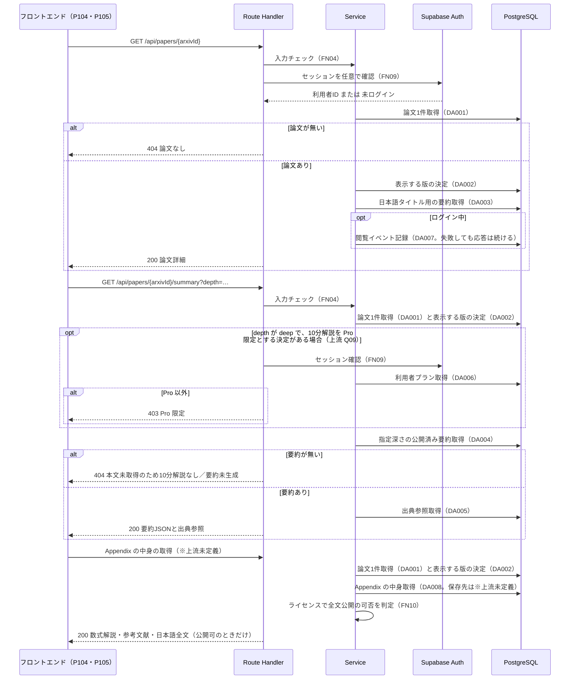

## 0. 文書情報

| 項目 | 値 |
| :--- | :--- |
| 設計書ID | F05-BE |
| 親ID | F05 |
| 親設計書 | `基本設計書_概要.md` §4.1 機能一覧（F05 論文詳細・Appendix。カテゴリ「論文閲覧」） |
| 文書名 | BE詳細設計書 — F05 論文閲覧（論文詳細・Appendix） |
| 版 | 1.0（新規作成） |
| 作成日 | 2026-10-26 |
| 更新日 | 2026-10-26 |
| 作成方法 | `source/` の企画資料と確定済みの上流設計書からのリバースエンジニアリング（creating-backend-detailed-design v1.5.0 準拠） |
| インプット | (a) `source/` 全6ファイル（`README.md`、`01_企画概要.md`〜`05_ネーミング候補.md`）、(b) `docs/基本設計書_概要.md`（§2 BF02・BF05・EX03・EX04、§4 F05・F15・F17、§6 T001〜T005・T008、§7 API03・API04・IF03・IF05、§8、§11、付録）、`docs/screens/画面.P104.画面基本設計.md`、`docs/screens/画面.P105.画面基本設計.md`、`docs/db/DB.T001`〜`T005`・`T008` の DB物理設計書、(c) `legacy/` |
| インプットの性質 | `source/` にあるのは企画・初期設計案の Markdown 6ファイルだけで、バックエンドのソースコード（ルート定義・ハンドラ・ORM 定義・SQL）は1行も無い（`source/README.md:5-10`、上流 §前提）。このため本書のエンドポイント・関数・データアクセスは、企画資料の定義行と上流設計書の定義から導いた**計画上の実体**であり、実装済みであることは意味しない。関数名・モジュール名・ファイルパス・SQL 文・エラーコード・応答の項目名は、資料に無いためすべて※推測（実装時の命名案）とする |
| 既存版・既存資料との突合 | 本書の既存版（`docs/detail/be/BE.F05.BE詳細設計.md`）は無く、今回が新規作成である（`docs/detail/` ディレクトリ自体が未作成だった）。`legacy/` は空ディレクトリで、突合する既存設計・業務意図・非機能の一次情報は無い（上流 §4 バッチID命名規則「`legacy/` は空ディレクトリ」と一致） |

## 1. バックエンド構成・モジュール設計

* **対象ドメイン**: 論文閲覧（content 系）— 論文1本の詳細情報の取得、指定した深さ（30秒要約・3分要約・10分解説）の日本語構造化要約と出典参照の取得、Appendix（数式解説・参考文献・許諾がある論文の日本語全文）の取得。いずれも事前に生成・検証済みのデータを読み出すだけで、表示のたびに LLM を呼ばない（`source/02_機能要求定義.md:45`、上流 ARC001）。ログイン中の利用者が論文詳細を開いたときの閲覧記録（T008 `view_events`）は、本機能の API の中で起動するが、記録の責務は F15 閲覧履歴にある（上流 BF05・§6 CRUD図 F15 行）。
* **対象APIエンドポイント**（全3件。内訳と全数の根拠は §2 API ロースター）:
  * `GET /api/papers/{arxivId}`（上流 API03）
  * `GET /api/papers/{arxivId}/summary`（上流 API04）
  * Appendix の中身の取得（※上流未定義。メソッド・パスは上流で決まっておらず、本書でも仮のパスを置かない。上流 §7 への追加が必要 — P105 §5 呼出APIロースター No.2 と同じ扱い）
* **実行基盤**: 画面向け API は Next.js の API（Route Handler）として Vercel 上で動き、PostgreSQL（Supabase）へ直接読みに行く（上流 §1 システム構成図「Next.js API → DB」、`source/03_システム構成.md:7-8,16`）。Python 側（FastAPI・ジョブワーカー）は本機能では呼ばない。ログイン状態は Supabase Auth のセッションから読む（上流 IF05）。
* **ディレクトリ/ファイル構造**（※推測: 上流 §9 の想定構成 `web/`・`worker/`・`supabase/` のうち、本機能が置かれる `web/` 配下の案。実装は未着手）:

```
web/
├── app/api/papers/[arxivId]/
│   ├── route.ts                    … GET /api/papers/{arxivId}（API03）のハンドラ
│   └── summary/
│       └── route.ts                … GET /api/papers/{arxivId}/summary（API04）のハンドラ
│   （Appendix の中身を返すハンドラは、パスが上流で未定義のため置き場所も未定 ※上流未定義）
├── lib/server/papers/
│   ├── validators.ts               … arXiv ID と要約の深さの入力チェック
│   ├── paperRepository.ts          … papers・paper_versions の読み出し
│   ├── summaryRepository.ts        … summaries・summary_citations の読み出し
│   ├── paperService.ts             … 表示する版の決定、応答の組み立て
│   ├── summaryService.ts           … 公開済み要約の選択、10分解説の利用可否判定
│   └── appendixService.ts          … Appendix の中身の組み立てと全文公開可否の判定
├── lib/server/auth/
│   └── session.ts                  … Supabase Auth のセッションを任意で読み、利用者IDとプランを返す
├── lib/server/history/
│   └── viewEventRecorder.ts        … 閲覧イベントの記録（責務は F15。本機能から呼ぶ）
└── lib/server/http/
    └── errors.ts                   … エラー応答の形と HTTP ステータスの対応
```

* **処理シーケンス図**（上流 BF05 を本書の関数・データアクセスへ分解したもの。関数名・DA-ID は §3・§4 のロースターと対応）:



## 2. API・インターフェース詳細設計

* **外部サービス連携仕様**:

**外部連携ロースター**（総件数: 2件。全数である根拠: 上流 §7 外部連携一覧の全9件（IF01〜IF09）のうち、本機能のエンドポイントがやり取りするもの、または本機能の応答が行き先を返すものを数えた。IF01 arXiv API・IF02 arXiv 本文PDF・IF04 LLM API は収集・要約ジョブ（B001〜B006）側の連携で、本機能は事前生成されたデータを読むだけのため使わない（`source/02_機能要求定義.md:45`、上流 ARC001）。IF06・IF07 Stripe、IF08 GitHub、IF09 通知配信手段は別機能（F12・F14・F10）の連携である）

| IF-ID | 連携先 | 本機能での使い方 | 定義状況 | 詳細の所在 |
| :--- | :--- | :--- | :--- | :--- |
| IF05 | Supabase Auth | リクエストに付いたセッションを任意で確かめ、ログイン中なら利用者IDを得る。API03 では閲覧記録のために毎回確かめる。API04 では10分解説を Pro 限定とする決定がある場合に、10分解説を求められたときだけ確かめる。Appendix の中身の取得では確かめない（応答がログイン状態で変わらないため）。ログインしていなくてもエラーにしない | 詳細 | 本節 下表、§4 FN09 |
| IF03 | arXiv 原文ページ | サーバからの通信は無い。API03 の応答に原文URL（`papers.original_url`）を入れて返し、利用者のブラウザが直接開く | 簡易 | 本節 下表 |

| 連携先 | 連携方式 | エンドポイント / 接続先 | 認証方式 | タイムアウト | リトライ方針 | エラー時の挙動 |
| :--- | :--- | :--- | :--- | :--- | :--- | :--- |
| Supabase Auth（IF05） | SDK によるセッション検証（※推測: サーバ側の Supabase クライアントで、リクエストの Cookie に入ったアクセストークンを検証する） | 環境変数 `NEXT_PUBLIC_SUPABASE_URL` の Supabase プロジェクト（上流 §9 環境変数） | 利用者のセッション（※推測: JWT）。サーバ側は公開キー `NEXT_PUBLIC_SUPABASE_ANON_KEY` で検証する | 3秒（※推測。閲覧の応答を認証の遅れで待たせないため短くする） | リトライしない（※推測。閲覧はゲストでもできるため、失敗時は未ログインとして続ける方が利用者への影響が小さい） | トークンが無い・期限切れ・検証失敗・タイムアウトのいずれも、エラー応答にせず未ログインとして処理を続ける。WARN ログを残す（§6）。ただし10分解説を Pro 限定とする場合（上流 Q09）は、未ログイン扱いになった結果 403 を返す |
| arXiv 原文ページ（IF03） | 画面からのリンク遷移（サーバ通信なし） | 論文ごとの原文URL（`papers.original_url`。例 `https://arxiv.org/abs/{arxivId}` ※推測） | なし | — | — | サーバは URL を返すだけで通信しないため、本機能で起きるエラーは無い |

* **API詳細仕様**:

**API ロースター**（総件数: 3件。全数である根拠: 上流 §7 内部API一覧の全8件（API01〜API08）のうち、上流 BF05 のシーケンスで論文詳細（P104）が呼ぶ API03・API04 の2件が本機能に属する（API01 は F02、API02 は F03、API05 は F08、API06・API07 は F07、API08 は F12 の API）。これに、Appendix（P105）が中身を取るために必要だが上流 §7 に定義が無い1件（P105 §5 呼出APIロースター No.2）を加えた。`source/03_システム構成.md:46-54` の API 設計案8行にも、これ以外に F05 の API は無い）

| API-ID | メソッド | エンドポイント | 概要 | 呼出元画面 | 認証 | 定義状況 | 詳細の所在 |
| :--- | :--- | :--- | :--- | :--- | :--- | :--- | :--- |
| API03 | GET | /api/papers/{arxivId} | 論文1本のメタデータ・表示する版・最新版・原文URL・ライセンス・本文取得状況を返す。ログイン中なら閲覧を記録する | P104 E01、P105 E01 | 不要（ログイン中なら利用者を特定する） | 詳細 | §2 「GET /api/papers/{arxivId}」 |
| API04 | GET | /api/papers/{arxivId}/summary | 指定した深さの、検証に合格した日本語構造化要約と出典参照を返す | P104 E01・E02・E08 | 不要。10分解説は Pro 限定になる可能性がある（上流 Q09） | 詳細 | §2 「GET /api/papers/{arxivId}/summary」 |
| — ※上流未定義 | GET（※推測） | 未定義（※上流未定義。上流 §7 への追加が必要） | 数式解説・参考文献・日本語全文と、日本語全文を公開できるかどうか（できないときはその理由）を返す | P105 E01・E05 | 不要（※推測。上流 Q08 の仮置き） | 詳細 | §2 「GET （パス未定義 ※上流未定義）Appendix の中身の取得」 |

**API 共通仕様**（※推測: 上流 §4 オンライン処理設計「エラー応答」と上流 Q26 の仮置きに合わせた）:
* 成功時は `{"status":"success","data":{...}}`、失敗時は `{"status":"error","error":{"code":"…","message":"…"}}` の形で返す。`message` は利用者向けの日本語で、内部の例外内容・SQL・スタックトレースは含めない（§6）。
* 日時はすべて ISO 8601 形式・UTC（`Z` 付き）で返し、日本時間への変換は画面側で行う（上流 §4 バッチ共通の方針「画面表示は日本時間に変換」※推測、上流 ARC009 の「日付の意味とタイムゾーンを区別」）。
* `{arxivId}` は版番号の接尾辞（`v1` のような末尾）を含まない arXiv ID とする。旧形式の ID（`hep-th/9901001` のように分野名とスラッシュを含む形）はスラッシュを `%2F` にエンコードしてパスに入れる（※推測。パスの区切りと衝突するため）。
* 失敗応答（4xx・5xx）には常に `Cache-Control: no-store` を付ける（※推測: 要約未生成の 404 が共有キャッシュに残ると、要約が公開された後もしばらく「準備中」と表示されてしまうため）。

**エラーコード・理由コード ロースター**（総件数: 11件（失敗応答のエラーコード7件、Appendix の全文非公開の理由コード4件）。全数である根拠: 上流 §4 オンライン処理設計「エラー応答」の HTTP ステータス（400・401・403・404・429・500）のうち本機能の3つのエンドポイントで起きるもの（400・403・404・500。401 は認証必須の API が無いため、429 は利用量制限の対象機能が無いため起きない）を、§2 各 API のステータスコード表の条件ごとに1コードとして数えた7件と、§2「GET （パス未定義 ※上流未定義）Appendix の中身の取得」の手順5（FN10）で公開不可となる分岐ごとに1コードとして数えた4件。コード名はすべて※推測（上流 Q26））

| コード | 区分 | HTTP ステータス | 意味 | 発生する API | 画面での扱い | 定義状況 | 詳細の所在 |
| :--- | :--- | :--- | :--- | :--- | :--- | :--- | :--- |
| INVALID_ARXIV_ID | エラーコード | 400 | arXiv ID が新形式・旧形式のどちらにも一致しない、32文字を超える、または版番号の接尾辞が付いている | API03・API04・Appendix | 論文が見つからない表示に切り替える（P104・P105 様式③。※推測: 画面は URL 由来の ID しか送らないため、利用者が URL を手で書き換えたときだけ起きる） | 簡易 | §4 FN04 |
| INVALID_DEPTH | エラーコード | 400 | 要約の深さが30秒要約・3分要約・10分解説の3つの値のどれでもない | API04 | 要約欄のエラー表示（P104 様式②。画面のタブからは起きない） | 簡易 | §4 FN04 |
| PRO_PLAN_REQUIRED | エラーコード | 403 | 10分解説を Pro 限定とする決定があり、ゲストまたは Free 会員が10分解説を求めた | API04 | Pro 案内（P104 H35・H36） | 詳細 | §4 FN07 |
| PAPER_NOT_FOUND | エラーコード | 404 | arXiv ID の形式は正しいが、その論文が自前 DB に取り込まれていない | API03・API04・Appendix | 論文が見つからない表示（P104・P105 様式③） | 簡易 | §2 各 API ステータスコード |
| DEEP_SUMMARY_UNAVAILABLE | エラーコード | 404 | 10分解説を求めたが、表示する版の本文が未取得のため10分解説が作られていない | API04 | 10分解説なしの案内（P104 H34） | 詳細 | §4 FN06 |
| SUMMARY_NOT_READY | エラーコード | 404 | 指定した深さの公開済み要約がまだ無い（生成待ち・検証待ち・不合格で作り直し待ち） | API04 | 要約の処理状況表示（P104 H37） | 詳細 | §4 FN06 |
| INTERNAL_ERROR | エラーコード | 500 | DB 障害、版の不整合、想定外の例外。内部の内容は応答に含めない | API03・API04・Appendix | API03・Appendix の論文情報なら全体のエラー表示（様式③）、API04・Appendix の中身なら該当区画だけのエラー表示（様式②） | 詳細 | §4 FN11、§6 |
| LICENSE_NOT_PERMITTED | 全文非公開の理由 | 200（応答の中の値） | ライセンスが翻訳の公開を許さない、またはライセンスが不明 | Appendix | 日本語全文の非公開の案内（P105 H24） | 詳細 | §4 FN10 |
| LICENSE_NEEDS_REVIEW | 全文非公開の理由 | 200（応答の中の値） | 非営利条件付きのライセンス（CC BY-NC-SA 4.0）で、有料プランのある本サービスで公開してよいか確認が済んでいない | Appendix | 日本語全文の非公開の案内（P105 H24） | 詳細 | §4 FN10 |
| NOT_TRANSLATED | 全文非公開の理由 | 200（応答の中の値） | ライセンス上は公開できるが、本文が未取得、または日本語全文の翻訳がまだ無い | Appendix | 日本語全文の非公開の案内（P105 H24） | 詳細 | §4 FN10 |
| NOT_AVAILABLE_YET | 全文非公開の理由 | 200（応答の中の値） | 全文翻訳の機能が Phase 3 の提供前で、どの論文でも全文を返さない | Appendix | 日本語全文の非公開の案内（P105 H24） | 詳細 | §4 FN10 |

### GET /api/papers/{arxivId}
* **API-ID**: API03
* **概要**: 論文1本について、原題・日本語タイトル・著者・カテゴリ・日付・最新版・表示する版・原文URL・ライセンス種別・本文取得状況を返す。P104 論文詳細と P105 Appendix が、画面を開いたときに見出しと基本情報を描くために呼ぶ。自前 DB だけを読み、arXiv API は呼ばない（`source/03_システム構成.md:49`、上流 §7 API03）。ログイン中の利用者が呼んだときは、閲覧イベントを1件記録する（上流 BF05「ログイン中なら view_events に閲覧を記録」、記録の責務は F15）。
* **認証要否**: 不要（上流 §7 API03「不要（※推測）」、上流 Q08 の仮置きでゲストも論文詳細を見られる）。ログインしていれば Supabase Auth のセッションから利用者を特定し、閲覧記録にだけ使う。ロールによる応答の違いは無い。
* **リクエストパラメータ**:

| 種別(Path/Query/Body) | 項目名 | 型 | 必須 | 制約・バリデーション | 説明 |
| :--- | :--- | :--- | :--- | :--- | :--- |
| Path | arxivId | string | 必須 | 32文字以内。新形式（年月4桁・ピリオド・連番4〜5桁。例 `2401.12345`）か旧形式（分野名・スラッシュ・年月連番7桁。例 `hep-th/9901001`）のどちらかに一致すること。版番号の接尾辞は付けない（T001 `ck_papers_arxiv_id_format` と同じ判定。※推測） | 表示する論文を arXiv の識別子で指定する。DB の `papers.arxiv_id` と突き合わせる |
| Header | Cookie（Supabase のセッション） | string | 任意 | — | ログイン中かどうかの判定にだけ使う。無くてもエラーにしない |

* **レスポンス（成功時）**（項目名は※推測。項目の範囲は上流 §7 API03 の「レスポンス（成功時）」に合わせた）:
```json
{
  "status": "success",
  "data": {
    "arxivId": "2401.12345",
    "titleOriginal": "An Example Paper Title",
    "titleJa": "例示用の論文タイトル（日本語）",
    "authors": ["Alice Example", "Bob Sample"],
    "categories": ["cs.LG", "cs.AI"],
    "submittedAt": "2024-01-22T18:00:00Z",
    "updatedAt": "2024-02-05T10:00:00Z",
    "latestVersion": 2,
    "displayedVersion": 1,
    "originalUrl": "https://arxiv.org/abs/2401.12345",
    "licenseType": "http://creativecommons.org/licenses/by/4.0/",
    "contentStatus": "abstract_only"
  }
}
```
  * `titleJa` は、表示する版に公開済み（検証に合格した）要約が1件も無いときは `null` にする。画面はそのとき原題を見出しにする（P104 H09）。
  * `updatedAt` は arXiv 上の改訂日時で、改訂が無い論文では `null` になる（T001 `updated_at` は任意列）。
  * `displayedVersion` は、要約を表示する対象の版。`latestVersion` より小さいとき、画面は「新しい版がある」旨を出す（P104 H15、上流 ARC009「論文の版を表示」）。
  * Abstract の本文は応答に含めない（上流 §7 API03 の応答項目に無いため）。未処理論文で速報版として Abstract を見せるには応答への追加が要る（※上流要確認。P104 §7 の確認事項と同じ）。
* **レスポンスヘッダー**: `Content-Type: application/json; charset=utf-8`。`Cache-Control: private, no-store`（※推測: ログイン中は閲覧記録という副作用があるため、CDN や共有キャッシュに応答を保存させると、2回目以降の閲覧が記録されなくなる。ゲストへの応答も、同じ URL でログイン中の利用者の記録を取りこぼさないよう共有キャッシュさせない）。
* **ステータスコード**:

| コード | 条件 |
| :--- | :--- |
| 200 | 論文が見つかり、基本情報を返したとき。閲覧記録に失敗した場合も 200 を返す（記録は付随処理で、画面の表示を止めないため） |
| 400 | arXiv ID の形式が正しくないとき（新形式・旧形式のどちらにも一致しない、32文字を超える、版番号の接尾辞が付いている）。エラーコード `INVALID_ARXIV_ID`（※推測） |
| 404 | arXiv ID の形式は正しいが、その論文がまだ自前 DB に取り込まれていないとき（DA001 が0件）。エラーコード `PAPER_NOT_FOUND`（※推測）。arXiv への取り込みはこの API からは起動しない（オンデマンド同期 B006 は自由検索 F03 の契機。上流 Q10） |
| 500 | DB への接続失敗、クエリの失敗、想定外の例外。エラーコード `INTERNAL_ERROR`（※推測）。画面は全体のエラー表示に切り替える（P104・P105 様式③） |

* **ビジネスロジック・副作用**:
  1. パスの arXiv ID を入力チェックする（FN04）。形式が合わなければ 400 を返して終える。
  2. リクエストのセッションを任意で確かめ、ログイン中なら利用者IDを得る（FN09 / IF05）。確かめられなければ未ログインとして続ける。
  3. arXiv ID で論文を1件読む（DA001）。無ければ 404 を返して終える。
  4. 表示する版を決める（FN05 / DA002）。その論文の版のうち、検証に合格した日本語の要約を1件以上持つ最も新しい版を選ぶ。合格した要約を持つ版が1つも無ければ、arXiv 上の最新版（`papers.latest_version`）を選ぶ（※推測。新しい版の要約がまだ出来ていない間も、旧版の要約を出し続けるため）。
  5. 表示する版の公開済み要約から日本語タイトルを読む（DA003）。3分要約を優先し、無ければ30秒要約、さらに無ければ10分解説の日本語タイトルを使う（※推測。どの深さでも日本語タイトルは同じ論文タイトルの訳で、作られる順が30秒・3分 → 10分のため）。1件も無ければ `titleJa` を `null` にする。
  6. ログイン中なら閲覧イベントを1件記録する（FN08 / DA007）。同じ利用者が同じ論文を直近30分以内に記録済みのときは、DB のトリガーが黙って追加を取りやめる（T008 §4.3 (3)、`trg_view_events_before_insert`）。記録が失敗しても WARN ログを残すだけで、手順7へ進む。
  7. 応答を組み立てて 200 を返す。応答の内容はログイン状態によって変わらない。

### GET /api/papers/{arxivId}/summary
* **API-ID**: API04
* **概要**: 指定した深さ（30秒要約・3分要約・10分解説）の日本語構造化要約と、要約の主張ごとの出典参照を返す。検証（根拠・数値チェック）に合格した要約だけを返し、未検証・不合格の要約は存在しないものとして扱う（`source/03_システム構成.md:50`、`source/02_機能要求定義.md:21-29,47`、上流 ARC004）。要約がまだ無いときと、本文が未取得で10分解説が作れないときを、エラーコードで分けて返す（上流 BF05 の分岐、P104 H34・H37）。
* **認証要否**: 不要（上流 §7 API04）。ただし10分解説（`depth=deep`）を Pro 限定にすると決まった場合（上流 Q09、`source/04_収益化とロードマップ.md:5`「専門的な詳細解説」は Pro）は、10分解説の要求に限り Pro 会員であることを確かめる。ゲストと Free 会員には 403 を返す。決定までは本書では判定の手順を「Pro 限定とする決定がある場合」の分岐として定義し、設定値で有効・無効を切り替えられるようにする（※推測）。
* **リクエストパラメータ**:

| 種別(Path/Query/Body) | 項目名 | 型 | 必須 | 制約・バリデーション | 説明 |
| :--- | :--- | :--- | :--- | :--- | :--- |
| Path | arxivId | string | 必須 | API03 と同じ（32文字以内、新形式か旧形式、版番号の接尾辞なし） | 要約を読む論文を arXiv の識別子で指定する |
| Query | depth | string | 任意 | `short`・`standard`・`deep` のどれか。指定しないときは `standard`（上流 §7 API04「未指定時は standard」※推測）。大文字小文字は区別し、それ以外の値は 400 | 要約の深さ。`short` は30秒要約、`standard` は3分要約、`deep` は10分解説を指す。DB の `summaries.summary_type` と同じ値（T003 §6） |
| Header | Cookie（Supabase のセッション） | string | 任意 | — | 10分解説を Pro 限定とする場合にだけ、プランの確認に使う |

* **レスポンス（成功時）**（項目名は※推測。項目の範囲は `source/02_機能要求定義.md:23-29` と上流 §7 API04、要約の中身の構成は要約スキーマ ARC003 に従う）:
```json
{
  "status": "success",
  "data": {
    "arxivId": "2401.12345",
    "version": 1,
    "depth": "standard",
    "language": "ja",
    "titleJa": "例示用の論文タイトル（日本語）",
    "titleOriginal": "An Example Paper Title",
    "sourceScope": "abstract_only",
    "content": {
      "conclusion": [{ "claimId": "c1", "text": "…", "basis": "paper" }],
      "problem":    [{ "claimId": "c2", "text": "…", "basis": "paper" }],
      "method":     [{ "claimId": "c3", "text": "…", "basis": "paper" }],
      "results":    [{ "claimId": "c4", "text": "…", "basis": "paper" }],
      "limitations":[{ "claimId": "c5", "text": "…", "basis": "ai_inference" }],
      "applications":[{ "claimId": "c6", "text": "…", "basis": "ai_inference" }]
    },
    "citations": [
      { "claimId": "c1", "sourceSection": "Abstract", "sourcePage": null, "sourceUrl": "https://arxiv.org/abs/2401.12345v1" }
    ],
    "generatedAt": "2024-01-23T03:10:00Z",
    "modelId": "example-llm-model"
  }
}
```
  * `content` は `summaries.json_content` の要約項目を、要約スキーマ（ARC003）の形のまま返す。各主張の `basis` は、論文に書かれた事実か AI の推測かの区別で、画面はこれで見た目を分ける（`source/01_企画概要.md:33`、上流 ARC004）。30秒要約は結論の項目だけを持つ（P104 E02「30秒要約は H23 だけ」）。
  * `sourceScope` が `abstract_only` のとき、画面は「Abstractベース」と表示する（`source/01_企画概要.md:36`、上流 ARC009）。
  * `citations` は要約の主張IDの順に並べる。Abstract だけを材料にした要約では `sourcePage` が `null` になる（T004 `source_page`）。
  * `version`・`generatedAt`・`modelId` は「処理日時・モデル・対象論文バージョン」の表示に使う（`source/02_機能要求定義.md:29`）。
* **レスポンスヘッダー**: `Content-Type: application/json; charset=utf-8`。`Cache-Control` は、10分解説を Pro 限定とする場合の `depth=deep` の応答だけ `private, no-store`（利用者のプランで結果が変わるため）。それ以外は `public, s-maxage=300, stale-while-revalidate=60`（※推測: 公開済み要約は同じ版・同じ深さなら誰にでも同じ内容で、表示のたびに DB を読まなくて済むようにする。新しい要約の公開が最大5分遅れて見える点は許容する）。
* **ステータスコード**:

| コード | 条件 |
| :--- | :--- |
| 200 | 指定した深さの公開済み要約が見つかり、要約と出典参照を返したとき |
| 400 | arXiv ID の形式が正しくないとき（`INVALID_ARXIV_ID`）、または深さに3つの値以外が指定されたとき（`INVALID_DEPTH`）（エラーコードは※推測） |
| 403 | 10分解説を Pro 限定とする決定があり、10分解説を求めたのがゲストまたは Free 会員だったとき（`PRO_PLAN_REQUIRED` ※推測）。上流 §7 API04「403（Free利用者が deep を要求した場合。Pro限定とするかは未確定）」。決定が無い間は返さない |
| 404 | 論文が自前 DB に無いとき（`PAPER_NOT_FOUND`）。10分解説を求めたが表示する版の本文が未取得のとき（`DEEP_SUMMARY_UNAVAILABLE`。画面は「本文を取得していないため10分解説はない」と案内する — 上流 BF05・P104 H34）。それ以外で指定した深さの公開済み要約がまだ無いとき（`SUMMARY_NOT_READY`。画面は処理状況を出す — 上流 F17・P104 H37）（エラーコードは※推測） |
| 500 | DB への接続失敗、クエリの失敗、想定外の例外（`INTERNAL_ERROR`）。画面は要約欄だけにエラーと再読み込みを出し、他の領域は表示を続ける（上流 EX04、P104 様式②） |

* **ビジネスロジック・副作用**:
  1. パスの arXiv ID と深さを入力チェックする（FN04）。深さが指定されていなければ3分要約（`standard`）とする。不正なら 400 を返して終える。
  2. arXiv ID で論文を1件読む（DA001）。無ければ 404（`PAPER_NOT_FOUND`）を返して終える。
  3. 表示する版を決める（FN05 / DA002）。API03 と同じ規則で選ぶため、論文詳細の見出しに出た版と要約の版は一致する。
  4. 深さが10分解説で、かつ10分解説を Pro 限定とする決定がある場合だけ、利用可否を確かめる（FN07）。セッションから利用者を特定し（FN09）、利用者のプランを読む（DA006）。ゲスト、または Pro 以外のプランなら 403 を返して終える（上流 ARC008）。
  5. 表示する版について、指定した深さ・日本語・検証合格の要約のうち、生成日時が最も新しい1件を読む（FN06 / DA004。T003 §4.3 (6) の選び方）。
  6. 要約が無ければ、理由を見分けて 404 を返して終える。深さが10分解説で、表示する版の本文取得状況が「Abstractのみ」なら `DEEP_SUMMARY_UNAVAILABLE`、それ以外は `SUMMARY_NOT_READY` とする（T002 `content_status`、T003 `ck_summaries_deep_requires_full_text`: 10分解説は本文を材料にした場合しか作れない）。
  7. 要約の出典参照を全件、主張IDの順に読む（DA005）。
  8. 要約本文・出典参照・生成情報をまとめて 200 を返す。DB への書き込みは行わない。

### GET （パス未定義 ※上流未定義）Appendix の中身の取得
* **API-ID**: —（※上流未定義。上流 §7 内部API一覧に該当行が無い。本書では仮採番しない）
* **エンドポイント**: メソッドは GET（※推測）。パスは上流で未定義のため本書でも置かない（P105 §5 呼出APIロースター No.2 と同じ扱い。上流 §7 と付録 Q27 への追加が必要）。
* **概要**: P105 Appendix に出す、数式解説・参考文献・日本語全文の3つの中身を返す。日本語全文は、論文のライセンスで翻訳の公開が許され、かつ翻訳が済んでいる場合にだけ本文を含める。許されない論文の全文はサーバが応答から外し、画面には公開できない理由だけを返す（`source/01_企画概要.md:28`、`source/02_機能要求定義.md:50`、`source/03_システム構成.md:59`、上流 ARC005・EX03）。数式解説と参考文献は本文を解析した論文（本文解析 B005 の対象）にだけある（上流 BF02）。全文翻訳は Phase 3 の機能のため、それまではすべての論文で全文を返さない（上流 §4 F05「全文翻訳は Phase 3」）。
* **認証要否**: 不要（※推測。上流 Q08 の仮置きでゲストも Appendix を見られる）。
* **リクエストパラメータ**:

| 種別(Path/Query/Body) | 項目名 | 型 | 必須 | 制約・バリデーション | 説明 |
| :--- | :--- | :--- | :--- | :--- | :--- |
| Path（※推測） | arxivId | string | 必須 | API03 と同じ（32文字以内、新形式か旧形式、版番号の接尾辞なし） | Appendix を読む論文を arXiv の識別子で指定する |

* **レスポンス（成功時）**（項目名・構造はすべて※推測。P105 §4 H17〜H24 の表示内容から逆算した）:
```json
{
  "status": "success",
  "data": {
    "arxivId": "2401.12345",
    "version": 1,
    "formulaExplanations": [
      { "latex": "L = -\\sum_i y_i \\log p_i", "explanationJa": "…", "sourceSection": "3.2", "sourcePage": 4 }
    ],
    "references": [
      { "number": 1, "authors": ["A. Example"], "title": "…", "year": 2023, "arxivId": "2301.00001", "url": null }
    ],
    "fullText": {
      "publishable": false,
      "reason": "LICENSE_NOT_PERMITTED",
      "sections": []
    }
  }
}
```
  * `formulaExplanations` と `references` は、本文を解析していない論文では空の配列になる。画面は空のとき「本文を解析していないため表示できない」旨を出す（P105 H18・H21）。
  * `fullText.publishable` が `false` のとき `sections` は必ず空で、`reason` に理由を入れる。理由は `LICENSE_NOT_PERMITTED`（ライセンスが翻訳公開を許さない、またはライセンス不明）、`LICENSE_NEEDS_REVIEW`（非営利条件付きで、有料プランのある本サービスで公開してよいか確認が要る）、`NOT_TRANSLATED`（公開は許されるが翻訳がまだ無い）、`NOT_AVAILABLE_YET`（全文翻訳の機能が Phase 3 で、まだ提供していない）の4つ（※推測）。
* **レスポンスヘッダー**: `Content-Type: application/json; charset=utf-8`。`Cache-Control: public, s-maxage=300`（※推測: 利用者によって内容が変わらないため）。
* **ステータスコード**:

| コード | 条件 |
| :--- | :--- |
| 200 | 論文が見つかり、Appendix の中身を返したとき。数式解説・参考文献・日本語全文がすべて無い場合も 200 で空の配列を返す |
| 400 | arXiv ID の形式が正しくないとき（`INVALID_ARXIV_ID` ※推測） |
| 404 | 論文が自前 DB に無いとき（`PAPER_NOT_FOUND` ※推測） |
| 500 | DB への接続失敗、クエリの失敗、想定外の例外（`INTERNAL_ERROR` ※推測）。画面は中身の3区画の位置だけにエラーと再読み込みを出す（P105 様式②） |

* **ビジネスロジック・副作用**:
  1. パスの arXiv ID を入力チェックする（FN04）。不正なら 400 を返して終える。
  2. arXiv ID で論文を1件読む（DA001）。無ければ 404 を返して終える。
  3. 表示する版を決める（FN05 / DA002）。版のライセンス種別と本文取得状況もここで得る。
  4. 表示する版の数式解説・参考文献・日本語全文を読む（DA008。保存先のテーブルは※上流未定義）。
  5. 日本語全文を公開してよいかを判定する（FN10）。全文翻訳の機能が未提供なら「未提供」、ライセンスが CC BY 4.0・CC BY-SA 4.0・CC0 のどれでもなければ「許諾なし」または「要確認」、本文取得状況が「本文取得済み」でないか翻訳が無ければ「未翻訳」とし、すべて満たしたときだけ公開可とする（T002 §6 ライセンス種別の判定表。※推測）。
  6. 公開不可なら全文の章を応答から外し、理由だけを入れて 200 を返す。DB への書き込みは行わない。

## 3. データアクセス（ORM / クエリ）設計

* **データアクセス一覧（全数ロースター）**:

| DA-ID | 処理名 | 呼出元（関数/API） | 対象物理テーブル（テーブルID） | 種別 (SELECT/INSERT/UPDATE/DELETE) | 定義状況 (詳細/簡易) | 詳細の所在 |
| :--- | :--- | :--- | :--- | :--- | :--- | :--- |
| DA001 | 論文1件取得（arXiv ID 指定） | FN01・FN02・FN03 / API03・API04・Appendix の中身の取得 | papers（T001） | SELECT | 簡易 | - |
| DA002 | 表示する版の決定 | FN05 / API03・API04・Appendix の中身の取得 | paper_versions（T002）、summaries（T003） | SELECT | 詳細 | §3 詳細定義 DA002 |
| DA003 | 日本語タイトル用の要約取得 | FN01 / API03 | summaries（T003） | SELECT | 詳細 | §3 詳細定義 DA003 |
| DA004 | 指定深さの公開済み要約取得 | FN06 / API04 | summaries（T003） | SELECT | 詳細 | §3 詳細定義 DA004 |
| DA005 | 要約の出典参照取得 | FN02 / API04 | summary_citations（T004） | SELECT | 簡易 | - |
| DA006 | 利用者プラン取得 | FN07 / API04（10分解説を Pro 限定とする場合だけ） | users（T005） | SELECT | 簡易 | - |
| DA007 | 閲覧イベント記録 | FN08 / API03（ログイン中だけ） | view_events（T008） | INSERT | 詳細 | §3 詳細定義 DA007 |
| DA008 | Appendix の中身取得 | FN03 / Appendix の中身の取得 | 未定義（※上流未定義。数式解説・参考文献・日本語全文の保存先テーブルが上流 §6 に無い） | SELECT | 詳細 | §3 詳細定義 DA008 |

**総件数: 8件。全数である根拠**: 上流 §6 CRUD図の F05 行で「R」となっている4テーブル（papers・paper_versions・summaries・summary_citations）を、§2 の3つのエンドポイントの処理手順で読む単位に分けたものが DA001〜DA005 である（summaries は「版の決定」「日本語タイトル」「指定深さの要約」の3つの目的で条件が違うため3件に分けた）。これに、上流 CRUD図の F05 行は「-」だが本機能の API の中で発行される2件（上流 BF05 の閲覧記録 → DA007、上流 §7 API04 の 403 判定 → DA006）と、上流にテーブルが無い Appendix の中身の読み出し（DA008）を加えた。上流 §6 の T006 user_interests・T007 bookmarks・T009 jobs・T010 subscriptions は本機能では読み書きしない（ブックマーク状態は F07 の API06・API07、処理状況は F17 の責務）。

**判定の補足**（completeness 3-1）: DA001 は一意キー1件の取得、DA005 は外部キー1つでの全件取得、DA006 は主キー1件の取得で、いずれも分岐・書き込み・結合・動的組み立てを含まないため簡易とした。DA002 は2テーブルにまたがり（3-1 の3）「合格した要約を持つ版が無ければ最新版」という分岐と業務ルールを含む（3-1 の1・7）。DA003・DA004 は「合格した要約だけ・最も新しい1件」という非自明な業務ルールを含む（3-1 の7）。DA007 は書き込みで（3-1 の2）、失敗しても応答を止めない扱い（3-1 の5）を持つ。DA008 はライセンスで返す範囲が変わる（3-1 の1・7）。

**CRUD図との不整合**（※上流要確認）: 上流 §6 CRUD図の F05 行は view_events と users が「-」である。DA007（閲覧記録）は上流 BF05 のシーケンスで本機能の API が記録する形になっており、記録の責務は F15 行の「C」として載っている（T008 §4.6 の総件数根拠と同じ解釈）。DA006（プラン確認）は上流 §7 API04 の 403 から必要になるが、F05 行の users 列は「-」である。上流 CRUD図の F05 行に users「R」を加えるか、プラン判定を F18 の責務として分けるかの確認が要る。

* **データアクセス詳細定義**（ロースターのうち定義状況＝詳細の DA002・DA003・DA004・DA007・DA008 の全5件）:

| DA-ID | 処理名 | 対象物理テーブル | JOIN / Include | 抽出条件 (Where) / ソート | トランザクション境界 | N+1対策・性能上の注意 |
| :--- | :--- | :--- | :--- | :--- | :--- | :--- |
| DA002 | 表示する版の決定 | paper_versions, summaries | 版ごとに、合格した日本語の要約が1件でもあるかを相関副問い合わせで確かめる（`EXISTS (SELECT 1 FROM summaries s WHERE s.paper_version_id = pv.id AND s.language = 'ja' AND s.validation_status = 'passed')`） | DA001 で得た論文の版のうち、合格した日本語の要約を持つ版を版番号の大きい順に並べて先頭1件を取る（`pv.paper_id = ? ORDER BY pv.version DESC LIMIT 1`）。0件なら、同じ論文で版番号が `papers.latest_version` と等しい1件を取り直す（`pv.paper_id = ? AND pv.version = ?`）。取り直しても0件なら、収集が版を書き込む前の不整合として 500 にする（T002 §4.2: 論文と版は同じトランザクションで書かれるため通常は起きない） | なし（参照のみ。自動コミット） | 論文あたりの版は数件、版あたりの要約は数件のため、版の絞り込みは `uq_paper_versions_paper_id_version`、要約の存在確認は `idx_summaries_lookup` の先頭列（paper_version_id）で引ける。1回のリクエストで最大2回の SELECT |
| DA003 | 日本語タイトル用の要約取得 | summaries | なし | 表示する版の、日本語で検証に合格した要約のうち、深さを3分要約・30秒要約・10分解説の優先順で並べ、同じ深さの中では生成日時の新しい順にして先頭1件の要約本文から日本語タイトルだけを取り出す（`paper_version_id = ? AND language = 'ja' AND validation_status = 'passed' ORDER BY CASE summary_type WHEN 'standard' THEN 1 WHEN 'short' THEN 2 ELSE 3 END, generated_at DESC LIMIT 1`、取り出す値は `json_content->>'title_ja'` ※推測: キー名は ARC003 で確定） | なし（参照のみ） | 要約本文全体を読まず、日本語タイトルの値だけを取り出して転送量を抑える。`idx_summaries_lookup` で版の要約数件に絞ってから並べ替える |
| DA004 | 指定深さの公開済み要約取得 | summaries | なし | 表示する版・指定した深さ・日本語で、検証に合格した要約のうち生成日時が最も新しい1件（`paper_version_id = ? AND summary_type = ? AND language = 'ja' AND validation_status = 'passed' ORDER BY generated_at DESC LIMIT 1`）。未検証・不合格の要約は対象にしない（T003 §6 `validation_status`） | なし（参照のみ） | `idx_summaries_lookup`（paper_version_id, summary_type, language, generated_at DESC）の並びのまま先頭を取れるため、並べ替えが発生しない。検証状態の絞り込みは索引で引いた数件に対して行う |
| DA007 | 閲覧イベント記録 | view_events | なし | ログイン中の利用者ID・DA001 で得た論文ID・現在時刻で1行を追加する（`INSERT INTO view_events (user_id, paper_id, viewed_at) VALUES (?, ?, now())`）。同じ利用者・同じ論文で30分以内の行があれば、DB のトリガー（T008 `trg_view_events_before_insert`）が追加を取りやめ、エラーにはしない | 単独の INSERT（自動コミット）。読み出し（DA001〜DA003）とは同じトランザクションにしない。記録の失敗で論文詳細の応答を失敗させないため | 利用者IDはセッションから得た値だけを使い、リクエストの値を使わない（行単位アクセス制御で本人の行だけ追加できる — T008 §7）。日本語タイトルの読み出し（DA003）の後に逐次で実行し、完了（成功・失敗とも）を待ってから応答を組み立てる（※推測: Vercel の関数は応答後に処理を続けられない場合があるため、応答前に完了させる。追加の待ち時間は INSERT 1文分） |
| DA008 | Appendix の中身取得 | 未定義（※上流未定義） | 未定義 | 表示する版の数式解説・参考文献・日本語全文を読む。保存先のテーブルが上流 §6 に無いため、条件・並び順は保存先の決定後に定める（数式解説は原文に出てくる順、参考文献は原文の番号順に返す ※推測 — P105 H17・H19）。日本語全文の本文は、FN10 で公開可と判定したときだけ読む（※推測: 公開できない全文をアプリのメモリにも載せないため） | なし（参照のみ） | 日本語全文は論文1本分の長文になるため、公開不可のときは読まない。保存先の追加は上流付録 Q23 に含めて確認が要る（※上流要確認） |

* **発行SQL**: バックエンドのソースコードが無いため、実装で確定した発行 SQL は無い（ORM を使うか SQL を直接書くかも未定。上流 Q02）。以下は、§3 の抽出条件を実装するときに想定する SQL（※推測）を、動的に組み立てるもの・分岐で形が変わるものを含めて DA ごとにすべて示す。プレースホルダ `$1`… はすべてバインド変数で渡し、文字列連結で SQL を組み立てない。

DA001（論文1件取得）:
```sql
SELECT id, arxiv_id, title, authors, categories, submitted_at, updated_at,
       latest_version, original_url
  FROM papers
 WHERE arxiv_id = $1;            -- $1: arXiv ID（入力チェック済み）
```

DA002（表示する版の決定）— 1本目で0件のときだけ2本目を発行する:
```sql
-- 1本目: 合格した日本語の要約を持つ最も新しい版
SELECT pv.id, pv.version, pv.content_status, pv.license_type
  FROM paper_versions pv
 WHERE pv.paper_id = $1          -- $1: DA001 の papers.id
   AND EXISTS (SELECT 1 FROM summaries s
                WHERE s.paper_version_id = pv.id
                  AND s.language = 'ja'
                  AND s.validation_status = 'passed')
 ORDER BY pv.version DESC
 LIMIT 1;

-- 2本目（1本目が0件のとき）: arXiv 上の最新版
SELECT pv.id, pv.version, pv.content_status, pv.license_type
  FROM paper_versions pv
 WHERE pv.paper_id = $1          -- $1: DA001 の papers.id
   AND pv.version = $2;          -- $2: DA001 の papers.latest_version
```

DA003（日本語タイトル用の要約取得）:
```sql
SELECT json_content->>'title_ja' AS title_ja   -- キー名は ARC003 で確定（※推測）
  FROM summaries
 WHERE paper_version_id = $1     -- $1: DA002 の paper_versions.id
   AND language = 'ja'
   AND validation_status = 'passed'
 ORDER BY CASE summary_type WHEN 'standard' THEN 1 WHEN 'short' THEN 2 ELSE 3 END,
          generated_at DESC
 LIMIT 1;
```

DA004（指定深さの公開済み要約取得）— 深さはバインド変数で渡し、SQL の形は変わらない:
```sql
SELECT id, summary_type, language, json_content, model_id, generated_at, source_scope
  FROM summaries
 WHERE paper_version_id = $1     -- $1: DA002 の paper_versions.id
   AND summary_type = $2         -- $2: 'short' / 'standard' / 'deep'（入力チェック済み）
   AND language = 'ja'
   AND validation_status = 'passed'
 ORDER BY generated_at DESC
 LIMIT 1;
```

DA005（要約の出典参照取得）:
```sql
SELECT claim_id, source_section, source_page, source_url
  FROM summary_citations
 WHERE summary_id = $1           -- $1: DA004 の summaries.id
 ORDER BY claim_id;
```

DA006（利用者プラン取得）— 10分解説を Pro 限定とする決定があり、深さが `deep` で、ログイン中のときだけ発行する:
```sql
SELECT plan
  FROM users
 WHERE user_id = $1;             -- $1: セッションから得た利用者ID
```

DA007（閲覧イベント記録）— ログイン中のときだけ発行する:
```sql
INSERT INTO view_events (user_id, paper_id, viewed_at)
VALUES ($1, $2, now());          -- $1: セッションの利用者ID、$2: DA001 の papers.id
-- 直近30分以内に同じ利用者・同じ論文の行があれば、トリガー trg_view_events_before_insert が追加を取りやめる（エラーにはならない）
```

DA008（Appendix の中身取得）: 保存先のテーブルが上流で未定義のため、SQL は示せない（※上流未定義。保存先の決定後に本書へ追加する）。

## 4. サーバー側機能・処理ロジック設計（IPO設計）

**関数ロースター**（総件数: 11件。全数である根拠: バックエンドのソースコードが無いため関数名はすべて※推測（実装時の命名案）である。数え方は、§2 の3つのエンドポイントにハンドラを1つずつ（FN01〜FN03）、3つのエンドポイントが共通に使う処理（入力チェック FN04、表示する版の決定 FN05、任意のセッション確認 FN09）、§2 の手順のうち業務判断を持つもの（公開済み要約の選択 FN06、10分解説の利用可否 FN07、閲覧記録 FN08、全文公開可否 FN10）、エラー応答の共通変換（FN11）を1処理1関数で数えた。データアクセスは §3 の DA001〜DA008 を各関数が呼ぶ形で、別関数としては数えない）

| FN-ID | 関数名（※推測） | 所属モジュール（※推測） | 概要 | 呼出元 | 定義状況 | 詳細の所在 |
| :--- | :--- | :--- | :--- | :--- | :--- | :--- |
| FN01 | getPaperDetail | `app/api/papers/[arxivId]/route.ts` | API03 のハンドラ。論文の基本情報を返し、ログイン中なら閲覧を記録する | API03 | 詳細 | §4 IPO FN01 |
| FN02 | getPaperSummary | `app/api/papers/[arxivId]/summary/route.ts` | API04 のハンドラ。指定した深さの公開済み要約と出典参照を返す | API04 | 詳細 | §4 IPO FN02 |
| FN03 | getPaperAppendix | 未定（パスが※上流未定義のため置き場所も未定） | Appendix の中身を返すハンドラ。全文はライセンスで許された場合だけ含める | Appendix の中身の取得 | 詳細 | §4 IPO FN03 |
| FN04 | validatePaperRequest | `lib/server/papers/validators.ts` | arXiv ID の形式と要約の深さの値を確かめ、深さを指定しないときは3分要約にする | FN01・FN02・FN03 | 詳細 | §4 IPO FN04 |
| FN05 | resolveDisplayVersion | `lib/server/papers/paperService.ts` | 要約を表示する版を決める。合格した要約を持つ最も新しい版、無ければ arXiv 上の最新版 | FN01・FN02・FN03 | 詳細 | §4 IPO FN05 |
| FN06 | findPublishedSummary | `lib/server/papers/summaryService.ts` | 表示する版・深さの公開済み要約を1件選び、無ければその理由を見分ける | FN02 | 詳細 | §4 IPO FN06 |
| FN07 | assertDeepSummaryAccess | `lib/server/papers/summaryService.ts` | 10分解説を Pro 限定とする決定がある場合に、利用者が Pro かを確かめる | FN02 | 詳細 | §4 IPO FN07 |
| FN08 | recordViewEvent | `lib/server/history/viewEventRecorder.ts` | ログイン中の利用者の閲覧を1件記録する。失敗しても呼出元へ例外を伝えない（責務は F15） | FN01 | 詳細 | §4 IPO FN08 |
| FN09 | getOptionalSession | `lib/server/auth/session.ts` | リクエストのセッションを任意で確かめ、ログイン中なら利用者IDを返す。確かめられなければ未ログインとして返す | FN01・FN07 | 詳細 | §4 IPO FN09 |
| FN10 | judgeFullTextPublishable | `lib/server/papers/appendixService.ts` | 版のライセンス・本文取得状況・翻訳の有無・機能の提供状況から、日本語全文を公開してよいかと、だめな理由を決める | FN03 | 詳細 | §4 IPO FN10 |
| FN11 | toErrorResponse | `lib/server/http/errors.ts` | 業務エラーと想定外の例外を、共通の失敗応答と HTTP ステータスに変換する。想定外の例外は内容を隠して 500 にする | FN01・FN02・FN03 | 詳細 | §4 IPO FN11 |

**判定の補足**（completeness 3-1）: 11件すべてが、条件で応答や挙動が変わる分岐（3-1 の1）を持つため詳細とした。FN08 はさらに書き込み（3-1 の2）と失敗時に例外を伝えない扱い（3-1 の5）、FN09 は外部サービス（IF05）の呼び出しと失敗時の扱い（3-1 の3・5）、FN10 はライセンスの業務ルール（3-1 の7）、FN11 は例外の隠蔽方針（3-1 の5）を含む。

* **入力・処理・出力（IPO）定義**（ロースターのうち定義状況＝詳細の FN01〜FN11 の全11件）:

| FN-ID | 関数名 | 所属モジュール | 引数 (型) | 処理フロー (ステップ単位で具体的に) | 戻り値 | 発生しうるエラー |
| :--- | :--- | :--- | :--- | :--- | :--- | :--- |
| FN01 | getPaperDetail | `app/api/papers/[arxivId]/route.ts` | request: Request, params: { arxivId: string } | 1. FN04 で arXiv ID を確かめる。<br>2. FN09 でセッションを任意で確かめ、利用者IDまたは未ログインを得る。<br>3. DA001 で論文を1件読む。無ければ「論文なし」の業務エラーを投げる。<br>4. FN05 で表示する版を決める。<br>5. DA003 で表示する版の日本語タイトルを読む。無ければ日本語タイトルを空（null）にする。<br>6. ログイン中なら FN08 で閲覧を記録する（FN08 は失敗しても例外を投げない）。<br>7. 論文の列と表示する版から応答を組み立て、`Cache-Control: private, no-store` を付けて 200 で返す。<br>8. 手順1〜7で起きた例外は FN11 で失敗応答に変える | 200 応答（§2 API03 の成功時 JSON） | 入力不正（400 `INVALID_ARXIV_ID`）、論文なし（404 `PAPER_NOT_FOUND`）、版の不整合・DB 障害・想定外の例外（500 `INTERNAL_ERROR`） |
| FN02 | getPaperSummary | `app/api/papers/[arxivId]/summary/route.ts` | request: Request, params: { arxivId: string }, query: { depth?: string } | 1. FN04 で arXiv ID と深さを確かめ、深さが指定されていなければ3分要約にする。<br>2. DA001 で論文を1件読む。無ければ「論文なし」の業務エラーを投げる。<br>3. FN05 で表示する版を決める。<br>4. 深さが10分解説なら FN07 で利用可否を確かめる（Pro 限定の決定が無ければ何もしない）。<br>5. FN06 で公開済み要約を選ぶ。無ければ FN06 が返す理由（本文未取得・未生成）で業務エラーを投げる。<br>6. DA005 で要約の出典参照を主張IDの順に全件読む。<br>7. 要約本文・出典参照・版・生成日時・モデル・解析範囲を応答にまとめ、深さとプラン判定の有無に応じた `Cache-Control` を付けて 200 で返す（§2 API04 レスポンスヘッダー）。<br>8. 手順1〜7で起きた例外は FN11 で失敗応答に変える | 200 応答（§2 API04 の成功時 JSON） | 入力不正（400 `INVALID_ARXIV_ID`・`INVALID_DEPTH`）、Pro 限定（403 `PRO_PLAN_REQUIRED`）、論文なし・本文未取得・要約未生成（404 `PAPER_NOT_FOUND`・`DEEP_SUMMARY_UNAVAILABLE`・`SUMMARY_NOT_READY`）、DB 障害・想定外の例外（500 `INTERNAL_ERROR`） |
| FN03 | getPaperAppendix | 未定（※上流未定義） | request: Request, params: { arxivId: string } | 1. FN04 で arXiv ID を確かめる。<br>2. DA001 で論文を1件読む。無ければ「論文なし」の業務エラーを投げる。<br>3. FN05 で表示する版を決め、ライセンス種別と本文取得状況を得る。<br>4. DA008 で数式解説と参考文献を読む。<br>5. FN10 で日本語全文を公開してよいかを判定する。<br>6. 公開可なら DA008 で日本語全文の章を読み、公開不可なら章を空にして理由を入れる。<br>7. 応答を組み立てて 200 で返す。<br>8. 手順1〜7で起きた例外は FN11 で失敗応答に変える | 200 応答（§2 「GET （パス未定義 ※上流未定義）Appendix の中身の取得」の成功時 JSON） | 入力不正（400 `INVALID_ARXIV_ID`）、論文なし（404 `PAPER_NOT_FOUND`）、DB 障害・想定外の例外（500 `INTERNAL_ERROR`） |
| FN04 | validatePaperRequest | `lib/server/papers/validators.ts` | arxivId: string, depth?: string（API04 のときだけ） | 1. arXiv ID を URL デコードする（旧形式のスラッシュを戻すため）。<br>2. 32文字以内で、新形式（年月4桁・ピリオド・連番4〜5桁）か旧形式（分野名・スラッシュ・年月連番7桁）に一致するかを確かめる。版番号の接尾辞が付いていれば不一致とする（判定式は T001 `ck_papers_arxiv_id_format` と同じ。※推測: `^[0-9]{4}\.[0-9]{4,5}$` または `^[a-z-]+(\.[A-Z]{2})?/[0-9]{7}$`）。一致しなければ入力不正を投げる。<br>3. 深さが渡されていれば、短い要約・標準要約・10分解説を表す3つの値のどれかであることを確かめる（`short` / `standard` / `deep`）。どれでもなければ入力不正を投げる。指定されていなければ標準要約（`standard`）を入れる | { arxivId: string, depth?: 'short' \| 'standard' \| 'deep' } | arXiv ID の形式不正（400 `INVALID_ARXIV_ID`）、深さの値不正（400 `INVALID_DEPTH`） |
| FN05 | resolveDisplayVersion | `lib/server/papers/paperService.ts` | paperId: number, latestVersion: number | 1. DA002 の1本目で、合格した日本語の要約を持つ版のうち最も新しい版を読む。<br>2. 見つかればその版を返す。<br>3. 見つからなければ DA002 の2本目で、arXiv 上の最新版（論文の最新版番号と等しい版）を読む。<br>4. それも無ければ、論文はあるのに版が無い不整合として例外を投げる（ERROR ログに論文IDを残す） | { versionId: number, version: number, contentStatus: 'abstract_only' \| 'full_text', licenseType: string \| null } | 版の不整合（500 `INTERNAL_ERROR`）、DB 障害（500） |
| FN06 | findPublishedSummary | `lib/server/papers/summaryService.ts` | version: FN05 の戻り値, depth: 'short' \| 'standard' \| 'deep' | 1. DA004 で、表示する版・指定した深さ・日本語で、検証に合格した最も新しい要約を1件読む。<br>2. 見つかれば要約を返す。<br>3. 見つからず、深さが10分解説で、版の本文取得状況が「Abstractのみ」なら、「本文未取得のため10分解説なし」の業務エラーを投げる（10分解説は本文を材料にしたときしか作れないため — T003 `ck_summaries_deep_requires_full_text`）。<br>4. それ以外で見つからなければ、「要約未生成」の業務エラーを投げる（要約の生成待ち、検証待ち、または検証で不合格になり作り直し待ちの状態。上流 F17 の処理状況の表示に使う） | { summaryId, summaryType, language, jsonContent, modelId, generatedAt, sourceScope } | 本文未取得（404 `DEEP_SUMMARY_UNAVAILABLE`）、要約未生成（404 `SUMMARY_NOT_READY`）、DB 障害（500） |
| FN07 | assertDeepSummaryAccess | `lib/server/papers/summaryService.ts` | request: Request, depth: string | 1. 10分解説を Pro 限定とする設定が無効なら、何もせず戻る（上流 Q09 の決定待ちの間の既定。※推測: 環境変数で切り替える）。<br>2. 深さが10分解説でなければ何もせず戻る。<br>3. FN09 でセッションを確かめる。未ログインなら Pro 限定の業務エラーを投げる。<br>4. DA006 で利用者のプランを読む。Pro（`pro`）でなければ Pro 限定の業務エラーを投げる。利用者の行が無い場合も Free と同じに扱う（※推測: 会員登録直後で利用者レコードがまだ作られていない場合。上流 Q27） | なし（Pro 会員なら正常に戻る） | Pro 限定（403 `PRO_PLAN_REQUIRED`）、DB 障害（500） |
| FN08 | recordViewEvent | `lib/server/history/viewEventRecorder.ts` | userId: string（uuid）, paperId: number | 1. DA007 で閲覧イベントを1件追加する。直近30分以内に同じ論文を記録済みなら DB のトリガーが追加を取りやめるが、アプリ側ではそれを区別しない。<br>2. 追加が失敗したら（DB 障害、外部キー違反 — 利用者の行がまだ無い場合）、利用者ID・論文ID・エラー内容を WARN ログに残し、例外は呼出元へ伝えずに戻る（閲覧記録は付随処理で、論文詳細の表示を止めないため。上流 EX04・ARC010） | なし | なし（失敗はログだけに残し、呼出元へは伝えない） |
| FN09 | getOptionalSession | `lib/server/auth/session.ts` | request: Request | 1. リクエストの Cookie から Supabase のセッショントークンを取り出す。無ければ未ログインを返す。<br>2. Supabase Auth でトークンを検証する（IF05。3秒で打ち切る ※推測）。<br>3. 有効なら利用者IDを返す。期限切れ・検証失敗・タイムアウト・通信失敗なら WARN ログを残して未ログインを返す（閲覧はゲストでもできるため、認証の不調で表示を失敗させない） | { userId: string } または 未ログインを表す null | なし（失敗はすべて未ログインとして扱う） |
| FN10 | judgeFullTextPublishable | `lib/server/papers/appendixService.ts` | licenseType: string \| null, contentStatus: string, hasTranslation: boolean | 1. 全文翻訳の機能が未提供（Phase 3 より前）なら「未提供」で公開不可とする（※推測: 機能フラグで切り替える）。<br>2. ライセンス種別が空なら「許諾なし」で公開不可とする（ライセンス不明は許可されていないものとして扱う — 上流 EX03、T002 §6）。<br>3. ライセンスが CC BY 4.0・CC BY-SA 4.0・CC0 のどれかなら次へ進む。CC BY-NC-SA 4.0 なら「要確認」で公開不可とする（非営利条件と有料プランの関係が未確認のため）。arXiv への配布許諾だけのもの、CC BY-NC-ND 4.0、判定表に無い値は「許諾なし」で公開不可とする（T002 §6 ライセンス種別の判定表）。<br>4. 本文取得状況が「本文取得済み」でないか、翻訳が無ければ「未翻訳」で公開不可とする。<br>5. ここまでを通れば公開可とする | { publishable: boolean, reason: 'LICENSE_NOT_PERMITTED' \| 'LICENSE_NEEDS_REVIEW' \| 'NOT_TRANSLATED' \| 'NOT_AVAILABLE_YET' \| null } | なし（判定だけで例外は投げない） |
| FN11 | toErrorResponse | `lib/server/http/errors.ts` | error: unknown | 1. 業務エラー（入力不正・Pro 限定・論文なし・本文未取得・要約未生成）なら、そのエラーコードと利用者向けの日本語メッセージを、対応する HTTP ステータス（400・403・404）で返す。業務エラーはログに出さない（※推測: 利用者の通常操作で起きるため）。<br>2. それ以外の例外は、エラーの種類・メッセージ・スタックトレース・リクエストのパス・リクエストIDを ERROR ログに残し、利用者には内部の内容を含まない汎用メッセージを `INTERNAL_ERROR` として 500 で返す | 失敗応答（`{"status":"error","error":{"code","message"}}`） | なし |

## 5. バッチ処理・非同期タスク設計

* **ジョブ実行定義**:

| ジョブ名 | 実行タイミング | 対象テーブル | 処理概要 | タイムアウト |
| :--- | :--- | :--- | :--- | :--- |
| 該当なし | — | — | — | — |

**総件数: 0件。根拠**: 上流 §4 バッチ処理設計の全11件（B001〜B011）は、いずれも論文の収集・要約・検証・公開・本文解析・同期・通知・Embedding・GitHub 関連付け・再処理・検索インデックスの処理で、F05 が起動・所有するものは無い。本機能が返す要約・数式解説・参考文献は、B002〜B005 が事前に生成・検証・公開したものを読むだけである（上流 BF01・BF02、`source/02_機能要求定義.md:45`）。上流 BF02 の関与機能に F05 が入っているのは、本文解析の結果（10分解説・Appendix の中身）を表示する側としてであり、ジョブを登録する側ではない。本文解析（B005）の起動契機の「利用者のリクエスト」をどの画面・API で受けるかは上流で未定義で（上流 Q13）、P104・P105 にもリクエストの操作は無いため、本機能のジョブ登録としては数えない（※上流要確認: 利用者が10分解説を求めたことを本文解析のリクエストとして扱うかは上流 Q13 で決める）。閲覧記録の短時間の重複を取りやめる処理は DB のトリガー（T008）で、非同期処理ではない。

## 6. 例外処理・セキュリティ設計

* **エラーハンドリング**: 3つのハンドラ（FN01〜FN03）は処理全体を1つの例外捕捉で囲み、捕まえた例外をすべて FN11 で共通の失敗応答に変える。利用者の操作で普通に起きる業務エラー（入力不正・論文なし・要約未生成・Pro 限定）は 4xx で理由のコードを返し、ログには出さない。それ以外の例外は ERROR ログに詳しく残し、利用者には内部の内容（例外メッセージ・SQL・テーブル名・スタックトレース）を見せない汎用メッセージで 500 を返す。閲覧記録（FN08）と任意のセッション確認（FN09）の失敗は、論文の表示を止めないため応答をエラーにせず WARN ログだけに残す（上流 EX04「画面全体を落とさない」、`source/02_機能要求定義.md:58`）。ログの出力先と監視の手段は上流で未定義（上流 Q35）。※推測: Vercel の関数ログに JSON 形式で出す。

| 例外種別 | 対応方法 | ログ出力 | クライアント応答 |
| :--- | :--- | :--- | :--- |
| 入力不正（arXiv ID の形式不正、深さの値不正） | FN04 が業務エラーを投げ、FN11 で変換する | 出さない（※推測） | 400 + `INVALID_ARXIV_ID` または `INVALID_DEPTH` と、入力を見直すよう促すメッセージ |
| Pro 限定（10分解説を Pro 限定とする決定があり、ゲスト・Free 会員が求めた） | FN07 が業務エラーを投げ、FN11 で変換する | 出さない（※推測） | 403 + `PRO_PLAN_REQUIRED` と、Pro プランで使える旨のメッセージ |
| 論文なし（自前 DB に該当の arXiv ID が無い） | FN01〜FN03 が業務エラーを投げ、FN11 で変換する | 出さない（※推測） | 404 + `PAPER_NOT_FOUND` |
| 本文未取得のため10分解説なし | FN06 が業務エラーを投げ、FN11 で変換する | 出さない（※推測） | 404 + `DEEP_SUMMARY_UNAVAILABLE` |
| 要約未生成（生成待ち・検証待ち・不合格で作り直し待ち） | FN06 が業務エラーを投げ、FN11 で変換する | 出さない（※推測。処理の遅れは F17・ジョブ監視の側で把握する） | 404 + `SUMMARY_NOT_READY` |
| 版の不整合（論文はあるのに版が1つも無い） | FN05 が例外を投げ、FN11 で変換する | ERROR（論文ID・arXiv ID） | 500 + `INTERNAL_ERROR` と汎用メッセージ |
| DB 接続失敗・クエリ失敗・タイムアウト（読み出し） | FN11 で変換する。リトライしない（※推測: 画面側に再読み込みの導線があるため — P104・P105 様式②③） | ERROR + スタックトレース、リクエストのパス、DA-ID | 500 + `INTERNAL_ERROR` と汎用メッセージ |
| 閲覧記録の失敗（DB 障害、利用者の行が未作成による外部キー違反） | FN08 の中で捕まえて握りつぶし、応答は続ける | WARN（利用者ID・論文ID・エラー内容） | 応答に影響しない（200 のまま） |
| セッション検証の失敗（期限切れ、Supabase Auth のタイムアウト・通信失敗） | FN09 の中で捕まえ、未ログインとして続ける | WARN（失敗の種類。トークンの値は出さない） | 応答に影響しない。10分解説を Pro 限定とする場合は、未ログイン扱いの結果として 403 |
| 予期しない例外 | FN11 で変換する | ERROR + スタックトレース | 500 + `INTERNAL_ERROR` と汎用メッセージ |

* **セキュリティ**（上流 §8 のうち本機能に関わるもの）:
  * **SQL インジェクション**: arXiv ID・深さはすべてバインド変数で渡し、SQL を文字列連結で組み立てない（§3 発行SQL）。入力チェック（FN04）で形式も限定する。
  * **XSS**: 要約・Abstract 由来の文字列や数式は外部（LLM・arXiv）由来のため、API はそのまま JSON の値として返し、HTML として組み立てない。無害化と KaTeX での描画は画面側で行う（上流 §8 XSS 対策 ※推測）。
  * **権利侵害の防止**: 日本語全文はサーバ側でライセンスを判定し、許されない論文の本文は応答に含めない（FN10。画面側の非表示だけに頼ると、API の応答を直接見れば全文が読めてしまうため。上流 ARC005）。
  * **誤情報の公開防止**: 検証に合格していない要約は API から返さない（DA003・DA004 の抽出条件。上流 ARC004）。
  * **個人データ**: 閲覧記録の利用者IDはセッションから得た値だけを使い、リクエストの値を受け付けない。記録は必要最小限にとどめ、短時間の開き直しは DB 側で記録しない（上流 ARC010、T008）。
  * **Pro 機能の不正利用**: 10分解説を Pro 限定とする場合、プランの判定はサーバ側で DB の値（`users.plan`）を読んで行い、画面やリクエストの申告を信用しない（上流 §8 Pro 機能の不正利用）。

* **トランザクション制御**:

| 処理名 | トランザクション範囲 | ロールバック条件 |
| :--- | :--- | :--- |
| 論文詳細の取得（API03 / FN01） | 読み出し（DA001〜DA003）は自動コミットの単発 SELECT で、明示的なトランザクションを張らない（※推測: 参照だけで、読み出し間の一貫性は「版の決定」と「要約の取得」が同じ版IDを使うことで保つ）。閲覧記録（DA007）は読み出しとは別の単独 INSERT | 閲覧記録の INSERT が失敗した場合はその1文だけが取り消される（自動コミットのため）。読み出しと応答には影響しない |
| 要約の取得（API04 / FN02） | 自動コミットの単発 SELECT（DA001・DA002・DA004・DA005、条件付きで DA006）。書き込みなし | 該当なし（書き込みが無いため） |
| Appendix の中身の取得（FN03） | 自動コミットの単発 SELECT（DA001・DA002・DA008）。書き込みなし | 該当なし（書き込みが無いため） |

* **読み出しの間に公開データが変わる場合**（※推測）: 要約の取得の途中で新しい要約が公開されても、DA004 と DA005 は同じ要約IDで結びついているため、要約本文と出典参照が別の要約から混ざることは無い（出典参照は要約と同じトランザクションで書かれ、後から書き換えられない — T004 §4.6「更新・削除する機能は無い」）。

## 7. 利用する方式（共通基盤）

| 方式ID | 名称 | 本書での利用箇所 |
| :--- | :--- | :--- |
| ARC001 | 生成物キャッシュ・重複排除方式 | 3つのエンドポイントは、事前に生成・保存された要約と Appendix の中身を読むだけで、表示のたびに LLM を呼ばない（§1、§2 外部連携ロースターで IF04 を使わない根拠）。上流の適用範囲「F05」に該当する |
| ARC002 | 段階的生成・公開方式（速報版→詳細版） | 要約がまだ無い論文は 404 `SUMMARY_NOT_READY` で処理中であることを返し、10分解説は本文を解析した版にだけあるため、本文未取得なら 404 `DEEP_SUMMARY_UNAVAILABLE` で区別して返す（FN06）。上流の適用範囲「F05」に該当する |
| ARC003 | 要約スキーマ（構造化要約の出力仕様） | API04 の応答の要約本文は、要約スキーマの項目（結論・課題・手法・結果・限界・応用、主張ID、事実と推測の区別）の形のまま返し、出典参照は主張IDで結びつける（§2 API04、DA003 の日本語タイトルのキー）。上流の適用範囲「F05 / API04」に該当する |
| ARC004 | LLM出力検証方式（事実と推測の区別） | 検証に合格した要約だけを返す抽出条件（DA003・DA004 の検証状態の条件）と、主張ごとの事実・推測の区別を応答に残すこと（§2 API04）。上流の適用範囲は「F04, F09, F11 / B003 / T003.validation_status」で F05 は挙がっていないが、本機能は T003.validation_status を読んで公開範囲を決めている（※上流要確認: ARC004 の適用範囲に F05 を加えるか） |
| ARC005 | ライセンス・権利ゲート | 日本語全文はサーバ側でライセンスを判定し、許されない論文の本文を応答に含めない（FN10、DA008）。上流の適用範囲「F05 / T002.license_type / P105」に該当する |
| ARC008 | プラン別機能制御・利用量上限 | 10分解説を Pro 限定とする決定がある場合、API04 でゲスト・Free 会員の10分解説の要求に 403 を返す（FN07、DA006。上流 Q09 の決定待ち）。上流の適用範囲「API04」に該当する |
| ARC009 | 表示・編集ポリシー（出典・版・日付・ブランド表記） | 応答に表示する版と最新版を分けて返す（API03）、解析範囲（Abstractベースか）と主張ごとの出典を返す（API04）、日時を UTC の ISO 8601 で返して表示側でタイムゾーンを明記できるようにする（§2 API 共通仕様）。上流の適用範囲「API01〜API05」に該当する |
| ARC010 | 個人データ最小化・削除方針 | ログイン中の論文詳細の閲覧記録を1回のリクエストにつき最大1件とし、短時間の開き直しは DB 側で記録しない（DA007、FN08）。上流の適用範囲「F15」の記録を本機能の API から起動している |

**総件数: 8件。根拠**: 上流 §11.1 の全10件（ARC001〜ARC010）のうち、本書の関数・データアクセス・応答の仕様が依存しているものを数えた。ARC006 ジョブ実行基盤と ARC007 外部APIアクセス制御は、収集・要約・同期のジョブ（B001〜B011）と arXiv への問い合わせの仕組みで、本機能はジョブを登録せず（§5）arXiv にも問い合わせない（§2）ため使わない。

**確認事項（※上流要確認・※上流未定義の集約）**:

| No | 区分 | 内容 | 本書での仮置き | 関連箇所 |
| :--- | :--- | :--- | :--- | :--- |
| 1 | ※上流未定義 | Appendix の中身（数式解説・参考文献・日本語全文と全文公開可否）を返す API が上流 §7 に無い。メソッド・パス・API-ID の追加が要る（上流 Q27 への追加） | GET。パスは置かない。API-ID は「—」 | §2、FN03 |
| 2 | ※上流未定義 | 数式解説・参考文献・日本語全文の保存先テーブルが上流 §6 に無い（上流 Q23 への追加） | DA008 の対象テーブルを「未定義」とした | §3 DA008 |
| 3 | ※上流要確認 | 上流 CRUD図の F05 行が view_events・users ともに「-」だが、API03 の中で閲覧を記録し（上流 BF05）、API04 の 403 判定でプランを読む（上流 §7 API04） | 閲覧記録は F15 の責務として本機能から呼ぶ。プランの読み出しは本機能で行う | §3 DA006・DA007 |
| 4 | ※上流要確認 | API03 の応答に Abstract が無く、未処理論文で速報版を表示できない（P104 §7 と同じ確認事項） | 応答に含めない | §2 API03 |
| 5 | ※上流要確認 | 10分解説を Pro 限定にするか（上流 Q09） | 判定の手順を定義し、設定で有効・無効を切り替える。既定は無効 | §2 API04、FN07 |
| 6 | ※上流要確認 | 表示する版の決め方（新しい版の要約ができるまで旧版の要約を見せるか）は上流に定義が無い | 合格した要約を持つ最も新しい版。無ければ最新版 | FN05、DA002 |
| 7 | ※上流要確認 | ARC004 の適用範囲に F05 が無いが、本機能は検証状態で公開範囲を決めている | 本書では ARC004 を利用する方式に挙げた | §7 |
| 8 | ※上流要確認 | 利用者が10分解説を求めたことを本文解析（B005）のリクエストとして扱うか（上流 Q13） | 本機能からジョブは登録しない | §5 |
| 9 | ※上流要確認 | 認証不要の3つのエンドポイントに対するレート制限（同じ接続元からの大量取得で DB に負荷がかかる場合の上限）が上流 §8 に無い | 本書では定めない。共有キャッシュ（§2 API04・Appendix の `s-maxage`）で DB への到達を減らす | §2、§6 |
