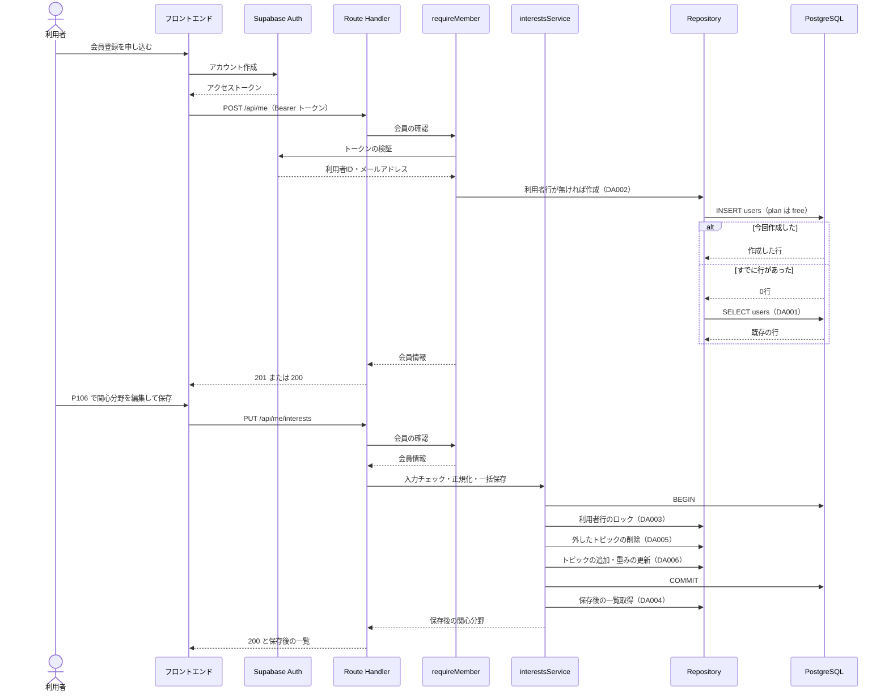

# BE詳細設計書 — F06 会員（認証・プロフィール）

## 0. 文書情報

| 項目 | 値 |
| :--- | :--- |
| 設計書ID | F06-BE |
| 親ID | F06 |
| 親設計書 | `基本設計書_概要.md` §4.1 機能一覧 |
| 文書名 | BE詳細設計書 F06 会員（認証・プロフィール） |
| 対象システム | Kaine personal pj — arXiv日本語研究ダイジェスト Webアプリ |
| 版 | 1.0（初版） |
| 作成日 / 更新日 | 2026-10-26 / 2026-10-26 |
| 作成方法 | creating-backend-detailed-design v1.5.0 準拠。上流の確定設計書と `source/` の企画資料から作成 |
| インプット | (a) `source/02_機能要求定義.md:11,38,48`、`source/03_システム構成.md:7,10,39-40`、`source/04_収益化とロードマップ.md:4-5,35`／(b) `docs/基本設計書_概要.md` §2（BF06・EX05）、§4（F06、オンライン処理設計の入力チェック・エラー応答）、§6（T005・T006、CRUD図 F06 行）、§7（IF05、内部API一覧の注記）、§8（認証・認可設計、セキュリティ対策）、§9（環境変数・ディレクトリ構成）、§11（ARC008・ARC010）、付録 Q04・Q22・Q27・Q32／関連する確定済み設計書: `docs/db/DB.T005.DB物理設計.md`、`docs/db/DB.T006.DB物理設計.md`、`docs/screens/画面.P106.画面基本設計.md`／(c) `legacy/` |
| 既存版との関係 | `docs/detail/be/BE.F06.BE詳細設計.md` の旧版はありません（`docs/detail/` 自体が存在しなかった）。本書が初版で、消さずに残すべき既存記述はありません |
| source/ との突合 | `source/` は企画・初期設計案の Markdown 6ファイル（計227行）だけで、アプリのソースコード・ルーティング定義・スキーマ定義はありません。F06 について資料にあるのは「アカウント登録、関心領域を保存」（`source/02_機能要求定義.md:11`）、認証に Supabase Auth を使うこと（`source/03_システム構成.md:10`）、API層は Next.js API と FastAPI であること（`:7`）、`users`・`user_interests` の列名（`:39-40`）、会員登録・興味設定が Phase 2 であること（`source/04_収益化とロードマップ.md:35`）だけです。**したがって本書のエンドポイント・関数・クエリはすべて実装前の設計案（※推測）であり、実装済みであることは意味しません** |
| legacy/ との突合 | `legacy/` は空ディレクトリ（ファイル0件）です。突合する既存仕様・業務意図・非機能の記述はありません |
| 上流APIとの対応 | 上流 §7 内部API一覧（API01〜API08 の全8件）に F06 のAPIは1件もありません。上流は「関心分野の保存…利用者レコード作成のAPI」を未定義として付録 Q27 に挙げています。本書の4エンドポイントはすべて **※上流未定義** で、APIの番号は振りません（上流 §7 への追加を求めます）。パスは実装の目安として置いた仮のもの（※推測）です |

**本書で使う上流ID**: 機能 F06／業務フロー BF06・EX05／画面 P106（イベント E01・E07・E17）／テーブル T005 `users`・T006 `user_interests`／外部連携 IF05／方式 ARC008・ARC010／顧客確認事項 Q04・Q22・Q27・Q32。

**確認事項（※推測・※上流要確認の集約）**:

| No | 区分 | 確認事項 | 本書での仮置き | 関連箇所 | 上流の確認事項 |
| :--- | :--- | :--- | :--- | :--- | :--- |
| 1 | API | F06 の4エンドポイント（利用者レコード作成、アカウント情報取得、関心分野取得、関心分野保存）を上流 §7 内部API一覧に追加し、番号を振るか（※上流未定義） | 本書ではパスだけを仮置きし、番号は振らない | §2 | Q27 |
| 2 | 認証 | ログイン方式（メール・ソーシャル）、メール確認の要否、セッション有効期限 | Supabase Auth 標準のメール＋パスワード。メール確認の有無に関わらず、初めて会員向けAPIを呼んだ時点で利用者の行を作る | §2 POST /api/me、§4 requireMember | Q32 |
| 3 | 画面 | ログイン・会員登録画面を設けるか（※上流未定義） | 画面側の責務とし、本書は登録直後に呼ばれるAPIだけを扱う | §1 | Q04 |
| 4 | CRUD | 上流 CRUD図は F06 の `users` を「CRU」としているが、利用者が変えられる列が `users` に無い（※上流要確認。T005 §9 No.4） | F06 は `users` を作成・参照するだけで更新しない | §3 | Q27 |
| 5 | 並び順 | 関心分野を「追加した順」に返すか。`user_interests` に登録日時の列が無いため、追加順は保てない（※上流要確認。P106 H19、T006 §9 No.5） | トピックの文字列の昇順で返す | §3 DA004 | Q22 |
| 6 | 件数・長さ | 関心分野の上限件数、キーワードの最大文字数 | 合計20件まで、キーワードは50文字まで（P106 §6 の値に合わせる。T006 §9 No.3 では DB 側の上限なし） | §2 PUT /api/me/interests | — |
| 7 | 重み | 重みを利用者が指定するか（※上流要確認。T006 §9 No.2） | 本文で重みを任意項目として受け付ける。省略時、新しいトピックは 1.00、残したトピックは保存済みの値を変えない（P106 は重みを送らない） | §2 PUT /api/me/interests、§3 DA006 | Q27 |
| 8 | 分類名一覧 | カテゴリかキーワードかを判定する arXiv 分類名の一覧の持ち方（T006 §9 No.9） | アプリの定数として持ち、画面（P106 H21 の選択肢）と同じ一覧を使う | §4 classifyTopic | — |
| 9 | 障害時応答 | Supabase Auth に問い合わせられないときの応答コード | 500（上流 §4 のエラー応答の一覧と、P106 の失敗時の挙動「500・通信失敗」に合わせる） | §6 | — |

---

## 1. バックエンド構成・モジュール設計

* **対象ドメイン**: 会員（認証・プロフィール） — 会員登録直後の利用者レコード作成、ログイン中の利用者の確認（会員向けAPI共通の認証）、アカウント情報（プラン・登録日）の取得、関心分野（カテゴリ・キーワード）の取得と一括保存（上流 F06・BF06、`source/02_機能要求定義.md:11`）。
  * アカウントの作成・ログイン・ログアウトそのものは、ブラウザから Supabase Auth を直接呼んで行います（上流 BF06「FE→AUTH: アカウント作成」、IF05、P106 E19）。本システムのAPIは、Supabase Auth が発行したセッションを受け取って検証する側です。
  * 退会（`users` の削除）は F16、プランの書き換えは F12 の責務で、本書の対象外です（上流 §6 CRUD図、T005 §4.6）。
* **対象APIエンドポイント**（すべて※上流未定義・パスは※推測）: POST /api/me、GET /api/me、GET /api/me/interests、PUT /api/me/interests
* **実行基盤**: 画面向けAPIは Next.js API（Route Handler、TypeScript）で実装します（上流 BF06 の参加者「Next.js API」、`source/03_システム構成.md:6-7`）。FastAPI（Python）はジョブ・PDF解析側の責務で、F06 は使いません ※推測。DBは Supabase の PostgreSQL で、サーバ側からは接続文字列（`DATABASE_URL`、上流 §9）で直接接続し、トランザクションを張れるようにします ※推測。
* **ディレクトリ/ファイル構造**（※推測: 上流 §9「`web/`・`worker/`・`supabase/` の3つに分ける構成」に沿った案。実装は未着手）:

```
web/
├── app/api/me/
│   ├── route.ts                    # POST /api/me（利用者レコード作成）、GET /api/me（アカウント情報取得）
│   └── interests/
│       └── route.ts                # GET /api/me/interests、PUT /api/me/interests
├── lib/auth/
│   ├── requireMember.ts            # 会員向けAPI共通の認証（会員向けAPIすべてが使う。他機能の対象は §4 関数ロースター No.5）
│   └── verifyAccessToken.ts        # Supabase Auth へのセッション検証（IF05）
├── lib/interests/
│   ├── interestsService.ts         # 関心分野の取得・一括保存（トランザクション）
│   ├── validateInterestsRequest.ts # 保存リクエストの入力チェック
│   ├── normalizeTopic.ts           # トピックの正規化（空白・大小文字）
│   ├── classifyTopic.ts            # カテゴリかキーワードかの判定
│   └── arxivCategories.ts          # arXiv 分類名の一覧（定数。画面の選択肢と共用）
├── lib/repositories/
│   ├── usersRepository.ts          # users へのアクセス（DA001〜DA003）
│   └── userInterestsRepository.ts  # user_interests へのアクセス（DA004〜DA006）
└── lib/http/
    └── errorResponse.ts            # エラー応答の共通形式
supabase/
└── migrations/                     # T005・T006 の DDL と行単位アクセス制御（DB物理設計書 §7）
```

* **処理シーケンス図**（会員登録〜関心分野の保存。上流 BF06 を本書の構成で展開したもの）:



---

## 2. API・インターフェース詳細設計

* **外部サービス連携仕様**:

| 上流ID | 連携先 | 連携方式 | エンドポイント / 接続先 | 認証方式 | タイムアウト | リトライ方針 | エラー時の挙動 |
| :--- | :--- | :--- | :--- | :--- | :--- | :--- | :--- |
| IF05 | Supabase Auth（アクセストークンの検証） | Supabase SDK（`supabase.auth.getUser(token)`。内部は Supabase Auth の REST API への HTTPS 呼び出し）（※推測） | `{NEXT_PUBLIC_SUPABASE_URL}/auth/v1/user`（※推測。上流 §9 の環境変数） | 送られてきた利用者のアクセストークン（JWT）と Supabase の公開キー（※推測） | 5秒（※推測） | リトライしない。利用者の操作に対する同期応答で待たせないため、失敗はそのまま返し、画面側の再読み込み・再保存に任せる（P106 E17・E07）（※推測） | トークンが無効・期限切れと返されたら 401。通信失敗・タイムアウト・Supabase 側の 5xx は 500 とし、ERROR ログを残す（※推測） |

**総件数: 1件。全数である根拠**: 上流 §7 外部連携一覧の全9件（IF01〜IF09）のうち、上流 §4・§7 で F06 に結び付くのは IF05 だけです（IF05 の備考「会員登録・ログイン・退会時のアカウント削除」）。このうち退会時のアカウント削除は F16 の責務で、本書ではサーバ側から呼ぶトークン検証だけを扱います。アカウント作成・ログイン・ログアウトはブラウザから Supabase Auth を直接呼ぶため（上流 BF06、P106 E19）、本システムのサーバからの連携には含めません。Stripe（IF06・IF07）は F12、LLM API（IF04）は要約・チャット系の機能の責務です。

* **APIエンドポイント一覧（全数ロースター）**:

| No | 上流API-ID | メソッド | エンドポイント（※推測） | 概要 | 呼出元（画面・イベント） | 関連業務フロー | 認証 | 定義状況 | 詳細の所在 |
| :--- | :--- | :--- | :--- | :--- | :--- | :--- | :--- | :--- | :--- |
| 1 | — ※上流未定義 | POST | /api/me | 会員登録の直後に、ログイン中の利用者の行（プラン Free）を作る。すでにあれば何もしない | ログイン・会員登録画面（※上流未定義。Q04）の登録完了時 | BF06 | 必要 | 詳細 | §2「POST /api/me」 |
| 2 | — ※上流未定義 | GET | /api/me | ログイン中の利用者のプランと会員登録日、ログインに使っているメールアドレスを返す | P106 E01・E17（P106 呼出APIロースター No.3「アカウント情報の取得」） | BF06 | 必要 | 詳細 | §2「GET /api/me」 |
| 3 | — ※上流未定義 | GET | /api/me/interests | ログイン中の利用者の関心分野を全件返す | P106 E01・E17（P106 呼出APIロースター No.4「関心分野の取得」） | BF06 | 必要 | 詳細 | §2「GET /api/me/interests」 |
| 4 | — ※上流未定義 | PUT | /api/me/interests | 関心分野の一式を受け取り、保存済みの内容をまるごと置き換える | P106 E07（P106 呼出APIロースター No.5「関心分野の保存」） | BF06 | 必要 | 詳細 | §2「PUT /api/me/interests」 |

**総件数: 4件。全数である根拠**: 上流 §7 内部API一覧（全8件）に F06 のAPIは0件で、F06 用のAPIは上流で1件も定義されていません。本書の4件は、上流が F06 に求める処理を1処理1エンドポイントで数えたものです。内訳は、上流 BF06 の「利用者レコード作成（※推測: APIは未定義）」→ No.1、「関心分野の保存（※推測: APIは未定義）」→ No.4、P106 の呼出APIロースター全10件のうち F06 の対象テーブル（T005・T006）を読む No.3・No.4 → 本書 No.2・No.3 です。P106 呼出APIロースターの残り7件は、ブックマーク（API07・ブックマーク一覧の取得）が F07、閲覧履歴の取得が F15、通知設定の取得・保存が F10、退会が F16、Supabase Auth のセッション取得・ログアウト（IF05）がブラウザ内の処理で、F06 のサーバAPIではありません。定義状況は、4件とも認証の分岐（completeness 3-1 の1）を持つため「詳細」です。

* **API共通仕様**（4エンドポイント共通。※推測）:
  * **認証**: リクエストヘッダー `Authorization: Bearer <Supabase のアクセストークン>` でログイン中の利用者を特定します。状態を変えるAPIでトークンを Cookie ではなくヘッダーで送るのは、上流 §8 の CSRF 対策（「POST/DELETE ではセッショントークンをヘッダーで送る」）に合わせるためです。利用者IDはトークンから取り出した値だけを使い、リクエスト本文やURLで受け取りません（他人の利用者IDを指定させないため。上流 §8「他人のデータの閲覧・改ざん」）。
  * **利用者行の補完**: 認証に成功した利用者の `users` 行が無いとき（会員登録の途中で POST /api/me が失敗した場合）は、どのエンドポイントでも Free で作り直してから処理を続けます（T005 §4.3 (1)「会員向けのAPIは、本テーブルに行が無い利用者を見つけたら Free で作り直します」）。
  * **応答形式**: 成功時は `{"status":"success","data":{...}}`、エラー時は `{"status":"error","error":{"code":"<エラーコード>","message":"<利用者向けの文言>"}}` とします。エラーの内部原因（SQL文、スタックトレース、Supabase の応答本文）は応答に含めません（§6）。
  * **文字コード・日時**: 応答は UTF-8 の JSON。日時は UTC のオフセット付き ISO 8601（例 `2026-10-26T03:00:00Z`）で返し、日本時間への変換と表示は画面側で行います（上流 §4「日付の扱い」、ARC009 の表示ルールは画面側の責務）。
  * **キャッシュ**: 本人専用のデータのため、応答ヘッダーに `Cache-Control: no-store` を付け、CDN・ブラウザに保存させません（※推測）。

### POST /api/me
* **概要**: 会員登録で Supabase Auth のアカウントができた直後に、本システムの利用者の行を作ります。プランは Free、登録日時は作った時刻です（上流 BF06「users を作成（plan は Free）」）。すでに行がある利用者が呼んでも行を作り直さず、既存の行を返します。登録画面の二重送信や、メール確認後の再ログインで何度呼ばれても結果が変わらないようにするためです（※推測）。
* **認証要否**: 必要（ログイン中の利用者本人。プランは問わない）
* **リクエストパラメータ**:

| 種別(Path/Query/Body) | 項目名 | 型 | 必須 | 制約・バリデーション | 説明 |
| :--- | :--- | :--- | :--- | :--- | :--- |
| Header | Authorization | string | 必須 | `Bearer ` に続けて Supabase のアクセストークンを置く形式 | 利用者を特定する唯一の手段。利用者IDはここから取り出す |
| Body | （なし） | — | — | 本文は受け取らない。送られても読まずに無視する（※推測） | 作る行の値（利用者ID・プラン・登録日時）はすべてサーバ側で決めるため、利用者が指定できる項目は無い |

* **レスポンス（成功時）**:
```json
{
  "status": "success",
  "data": {
    "userId": "6f1c2a3e-0000-4000-8000-000000000000",
    "email": "user@example.com",
    "plan": "free",
    "createdAt": "2026-10-26T03:00:00Z",
    "created": true
  }
}
```
  * `created` は、今回の呼び出しで行を作ったときは `true`、すでにあったときは `false` です（※推測）。
* **レスポンスヘッダー**: `Content-Type: application/json; charset=utf-8`、`Cache-Control: no-store`
* **ステータスコード**:

| コード | 条件 |
| :--- | :--- |
| 201 | 今回の呼び出しで利用者の行を新しく作ったとき |
| 200 | 利用者の行がすでにあり、作らずに既存の行を返したとき |
| 401 | Authorization ヘッダーが無い、形式が違う、またはトークンが無効・期限切れと Supabase Auth が判定したとき（エラーコード `UNAUTHORIZED`） |
| 500 | Supabase Auth に問い合わせられなかったとき（`AUTH_UNAVAILABLE`）、またはDBの障害で行を作れなかったとき（`INTERNAL_ERROR`） |

* **ビジネスロジック・副作用**:
  1. 共通の認証（§4 requireMember）でアクセストークンを Supabase Auth に問い合わせ、利用者IDとメールアドレスを得る。ただし本APIでは、requireMember の「行が無ければ作る」処理の結果（作ったかどうか）を応答の `created` とステータスコードに使う。
  2. 利用者の行を「無ければ作る」書き方で作る（DA002）。利用者IDはトークンから得た値、プランは `free`、登録日時はDBの現在時刻。主キーが重なったときは何もしない。
  3. 2で行を作った場合はその行を、作らなかった場合は既存の行を取得して（DA001）、プランと登録日時を応答に入れる。
  4. メールアドレスはDBに保存せず、Supabase Auth の応答の値をそのまま返す（`users` にメールアドレスの列は無い。上流 T005。個人データを重複して持たないため。ARC010）。
  5. 関心分野の行は作らない。関心分野が0件の利用者には、ホームのおすすめが新着論文で代わりに出る（上流 BF08、T006 §4.6 No.2）。
### GET /api/me
* **概要**: ログイン中の利用者のアカウント情報（プラン・会員登録日・メールアドレス）を返します。マイページのアカウント欄（P106 H12〜H14）と、ヘッダーのプラン表示（P106 H07）の材料です。
* **認証要否**: 必要（ログイン中の利用者本人。プランは問わない）
* **リクエストパラメータ**:

| 種別(Path/Query/Body) | 項目名 | 型 | 必須 | 制約・バリデーション | 説明 |
| :--- | :--- | :--- | :--- | :--- | :--- |
| Header | Authorization | string | 必須 | `Bearer ` に続けて Supabase のアクセストークンを置く形式 | 利用者を特定する唯一の手段 |
| Query | （なし） | — | — | — | — |

* **レスポンス（成功時）**:
```json
{
  "status": "success",
  "data": {
    "userId": "6f1c2a3e-0000-4000-8000-000000000000",
    "email": "user@example.com",
    "plan": "free",
    "createdAt": "2026-10-26T03:00:00Z"
  }
}
```
  * `plan` は `free` か `pro` のどちらかです（T005 §6）。`email` はメールアドレスを持たないログイン方式では `null` になります（P106 H12 は表示名に置き換える。※推測）。
* **レスポンスヘッダー**: `Content-Type: application/json; charset=utf-8`、`Cache-Control: no-store`
* **ステータスコード**:

| コード | 条件 |
| :--- | :--- |
| 200 | 正常終了。利用者の行が無かったため Free で作り直した場合も 200 |
| 401 | Authorization ヘッダーが無い、形式が違う、またはトークンが無効・期限切れのとき（`UNAUTHORIZED`）。P106 は様式①（ログインが切れた旨のダイアログ）を出す |
| 500 | Supabase Auth に問い合わせられなかったとき（`AUTH_UNAVAILABLE`）、またはDB障害のとき（`INTERNAL_ERROR`）。P106 はアカウント欄だけに「読み込めませんでした。」を出す（様式②） |

* **ビジネスロジック・副作用**:
  1. 共通の認証（§4 requireMember）でログイン中の利用者を特定し、利用者の行を取得する（DA001）。行が無ければ Free で作り直してから取得する（DA002 → DA001）。
  2. 利用者の行のプランと登録日時、Supabase Auth の応答にあるメールアドレスを返す。
  3. 副作用は、行が無かった場合の行の作成（1）だけです。利用者がプランを変える手段は本APIに無く、プランは F12 が Stripe の通知を受けて書き換えます（T005 §4.3 (2)）。
### GET /api/me/interests
* **概要**: ログイン中の利用者が登録した関心分野（カテゴリとキーワード）を全件返します。マイページの関心分野の節（P106 H17〜H19）の材料です。各関心分野に、カテゴリかキーワードかの種類を付けて返します。
* **認証要否**: 必要（ログイン中の利用者本人。プランは問わない）
* **リクエストパラメータ**:

| 種別(Path/Query/Body) | 項目名 | 型 | 必須 | 制約・バリデーション | 説明 |
| :--- | :--- | :--- | :--- | :--- | :--- |
| Header | Authorization | string | 必須 | `Bearer ` に続けて Supabase のアクセストークンを置く形式 | 利用者を特定する唯一の手段 |
| Query | （なし） | — | — | 件数の指定・ページ送りは受け付けない | 関心分野は1人20件までのため（確認事項 No.6）、全件を一度に返す |

* **レスポンス（成功時）**:
```json
{
  "status": "success",
  "data": {
    "interests": [
      { "topic": "cs.LG", "kind": "category", "weight": 1.00 },
      { "topic": "diffusion model", "kind": "keyword", "weight": 1.00 }
    ],
    "total": 2,
    "limit": 20
  }
}
```
  * `kind` は `category`（arXiv の分類名）か `keyword`（自由入力の語）のどちらかで、DBには持たず、返すたびに分類名の一覧と照らして決めます（T006 §4.3 (2)「種類の見分け方」）。
  * `weight` は推薦で使う関心の強さです。P106 は画面に出しません（P106 §7）が、F08 の挙動を確かめられるよう応答には含めます（※推測）。
  * `limit` は登録できる上限件数で、画面が追加ボタンを止める判定に使えます（※推測）。
  * 0件のときは `interests` を空の配列、`total` を 0 にして 200 で返します。P106 は未登録の案内（H18）を出します。
* **レスポンスヘッダー**: `Content-Type: application/json; charset=utf-8`、`Cache-Control: no-store`
* **ステータスコード**:

| コード | 条件 |
| :--- | :--- |
| 200 | 正常終了（0件のときも 200） |
| 401 | Authorization ヘッダーが無い、形式が違う、またはトークンが無効・期限切れのとき（`UNAUTHORIZED`） |
| 500 | Supabase Auth に問い合わせられなかったとき（`AUTH_UNAVAILABLE`）、またはDB障害のとき（`INTERNAL_ERROR`）。P106 は関心分野の節だけに「読み込めませんでした。」を出す |

* **ビジネスロジック・副作用**:
  1. 共通の認証（§4 requireMember）でログイン中の利用者を特定する。利用者の行が無ければ Free で作り直す。
  2. その利用者の関心分野を、トピックの文字列の昇順で全件取得する（DA004）。上流 P106 H19 は「追加した順」を想定していますが、`user_interests` に登録日時の列が無く追加順を保てないため、並び順を固定する目的で昇順にしています（※上流要確認。確認事項 No.5）。
  3. 各トピックを分類名の一覧と照らし、カテゴリかキーワードかを付ける（§4 classifyTopic）。
  4. 副作用は、利用者の行が無かった場合の作成（1）だけです。
### PUT /api/me/interests
* **概要**: マイページで編集した関心分野の一式を受け取り、保存済みの内容をまるごと置き換えます（P106 E07「保存済みの内容をまるごと置き換える」、P106 §7「関心分野はまとめて保存する」）。一覧から外したトピックは削除し、新しいトピックは追加し、残したトピックは重みを保ちます。途中で失敗したときに一部だけが保存された状態を残さないよう、1つのトランザクションで行います（T006 §4.6「関心分野の保存の進め方」）。保存した関心分野は、次にホームを開いたときのおすすめ（F08）の材料になります。
* **認証要否**: 必要（ログイン中の利用者本人。Free・Pro どちらも使える。`source/04_収益化とロードマップ.md:4` で関心に基づく基本推薦は Free の機能）
* **リクエストパラメータ**:

| 種別(Path/Query/Body) | 項目名 | 型 | 必須 | 制約・バリデーション | 説明 |
| :--- | :--- | :--- | :--- | :--- | :--- |
| Header | Authorization | string | 必須 | `Bearer ` に続けて Supabase のアクセストークンを置く形式 | 利用者を特定する唯一の手段 |
| Header | Content-Type | string | 必須 | `application/json` | — |
| Body | interests | array | 必須 | 配列であること。0件以上20件以下（※推測。P106 §6 の上限と同じ値） | 保存後に残したい関心分野の一式。空の配列を送ると、関心分野をすべて消す |
| Body | interests[].topic | string | 必須 | 文字列であること。正規化（前後の空白の除去と、続いた空白を1つにまとめる処理）の後で1文字以上。キーワードと判定されたものは正規化後50文字以内（※推測。P106 §6）。正規化後に同じ値になるものが配列内に2つ以上あってはならない（キーワードは英字の大小を区別せずに比べる） | カテゴリ（arXiv の分類名）またはキーワード。どちらかはサーバが分類名の一覧と照らして決め、利用者には指定させない（T006 §4.3 (2)） |
| Body | interests[].weight | number | 任意 | 0より大きく 999.99 以下。小数第3位で四捨五入して小数第2位までにする（※推測。T006 の型 NUMERIC(5,2) と CHECK 制約 `ck_user_interests_weight_positive` に合わせる） | 推薦で使う関心の強さ。省略したとき、新しく加えるトピックは 1.00、すでに保存済みのトピックは保存済みの値のままにする。P106 は送らない（P106 §7「残したものの重みは変えない」） |

  * 本文の例:
```json
{
  "interests": [
    { "topic": "cs.LG" },
    { "topic": "  Diffusion   Model " },
    { "topic": "quant-ph", "weight": 2.5 }
  ]
}
```
  * 上の例は正規化の後、`cs.LG`（カテゴリ）、`diffusion model`（キーワード）、`quant-ph`（カテゴリ、重み 2.50）として保存されます。
* **レスポンス（成功時）**:
```json
{
  "status": "success",
  "data": {
    "interests": [
      { "topic": "cs.LG", "kind": "category", "weight": 1.00 },
      { "topic": "diffusion model", "kind": "keyword", "weight": 1.00 },
      { "topic": "quant-ph", "kind": "category", "weight": 2.50 }
    ],
    "total": 3,
    "limit": 20
  }
}
```
  * 保存後にDBから読み直した一覧を返します（GET /api/me/interests と同じ形と並び順）。画面は保存済みの内容をこの一覧に合わせます（P106 E07 成功時の挙動）。
* **レスポンスヘッダー**: `Content-Type: application/json; charset=utf-8`、`Cache-Control: no-store`
* **ステータスコード**:

| コード | 条件 |
| :--- | :--- |
| 200 | 正常終了。保存前と同じ内容を送った場合も、何も変えずに 200 を返す |
| 400 | 本文が JSON として読めない、または `interests` が配列でないとき（`INVALID_BODY`）。21件以上を送ったとき（`TOO_MANY_INTERESTS`）。正規化した結果が空になるトピックがあるとき（`TOPIC_EMPTY`）。キーワードが50文字を超えるとき（`TOPIC_TOO_LONG`）。正規化後に同じになるトピックが2つ以上あるとき（`DUPLICATE_TOPIC`）。重みが数値でない、0以下、または 999.99 を超えるとき（`INVALID_WEIGHT`）。応答の `error` には違反した配列の位置（何件目か）を含める（※推測）。P106 は「関心分野を保存できませんでした。」のダイアログを出し、編集中の内容を残す |
| 401 | Authorization ヘッダーが無い、形式が違う、またはトークンが無効・期限切れのとき（`UNAUTHORIZED`）。P106 は様式①を出し、編集中の内容を残す |
| 500 | Supabase Auth に問い合わせられなかったとき（`AUTH_UNAVAILABLE`）、またはDB障害・トランザクションの失敗のとき（`INTERNAL_ERROR`）。保存前の内容のまま変わっていない（ロールバック済み） |

* **ビジネスロジック・副作用**:
  1. 共通の認証（§4 requireMember）でログイン中の利用者を特定する。利用者の行が無ければ Free で作り直す（関心分野は利用者の行への外部キーを持つため、行が無いと保存できない。T006 §4.3 (1)）。
  2. 本文を入力チェックし（§4 validateInterestsRequest）、各トピックを正規化してカテゴリかキーワードかを判定する（§4 normalizeTopic・classifyTopic）。ここで1件でもルールに反すれば 400 を返し、DBには触れない。
  3. トランザクションを始める。
  4. 同じ利用者の保存が同時に2つ走ったときに結果が混ざらないよう、その利用者の `users` 行をロックする（DA003）。後から来た保存は、先の保存が終わるまで待つ。
  5. 保存済みの関心分野のうち、今回の一式に含まれないトピックの行を削除する（DA005）。一式が空なら、その利用者の関心分野を全件削除する。
  6. 今回の一式のトピックを追加する（DA006）。すでに保存済みのトピックは行を増やさず、重みが指定されていればその値に更新し、指定されていなければ保存済みの値のままにする。一式が空なら本手順は行わない。
  7. コミットする。4〜6のどれかが失敗したらロールバックし、保存前の内容に戻して 500 を返す。
  8. 保存後の関心分野を読み直し（DA004）、種類を付けて返す。
  9. ほかの機能への通知やジョブの登録は行わない。おすすめはホームを開いたときに計算されるため（P106 §7）、ここで再計算を起動しない。
---

## 3. データアクセス（ORM / クエリ）設計

* **データアクセス一覧（全数ロースター）**:

| DA-ID | 処理名 | 呼出元（関数/API） | テーブルID | 対象物理テーブル | 種別 (SELECT/INSERT/UPDATE/DELETE) | 概要 | 定義状況 (詳細/簡易) | 詳細の所在 |
| :--- | :--- | :--- | :--- | :--- | :--- | :--- | :--- | :--- |
| DA001 | 利用者1件取得 | usersRepository.findById ← requireMember（全4API）、POST /api/me、GET /api/me | T005 | users | SELECT | 利用者IDで利用者の行を1件読み、プランと登録日時を得る | 簡易 | - |
| DA002 | 利用者の行が無ければ作成 | usersRepository.insertIfAbsent ← requireMember（全4API）、POST /api/me | T005 | users | INSERT | 利用者IDの行が無いときだけ、プラン Free で行を作る。あれば何もしない | 詳細 | §3 詳細定義 DA002 |
| DA003 | 利用者の行のロック | usersRepository.lockById ← interestsService.replaceInterests（PUT /api/me/interests） | T005 | users | SELECT（FOR UPDATE） | 関心分野の一括保存の間、同じ利用者の別の保存を待たせる | 詳細 | §3 詳細定義 DA003 |
| DA004 | 関心分野の全件取得 | userInterestsRepository.listByUser ← interestsService.getInterests（GET /api/me/interests）、interestsService.replaceInterests（PUT /api/me/interests の保存後） | T006 | user_interests | SELECT | 利用者の関心分野をトピックの昇順で全件読む | 簡易 | - |
| DA005 | 外した関心分野の削除 | userInterestsRepository.deleteExcept ← interestsService.replaceInterests（PUT /api/me/interests） | T006 | user_interests | DELETE | 今回の一式に含まれないトピックの行を消す。一式が空なら全件消す | 詳細 | §3 詳細定義 DA005 |
| DA006 | 関心分野の追加・重みの更新 | userInterestsRepository.upsertMany ← interestsService.replaceInterests（PUT /api/me/interests） | T006 | user_interests | INSERT（重なったら UPDATE） | 一式のトピックを1文でまとめて追加し、保存済みのものは重みの指定があるときだけ更新する | 詳細 | §3 詳細定義 DA006 |

**総件数: 6件（SELECT 3件・INSERT 2件（うち1件は重なったら UPDATE）・DELETE 1件）。全数である根拠**: 本書 §4 の関数ロースター全18件のうち、DBを操作するのはリポジトリ層の6関数（usersRepository の3関数、userInterestsRepository の3関数）だけで、6関数がそれぞれ1文ずつを発行します。上流 §6 CRUD図の F06 行（`users` CRU、`user_interests` CRUD）と照らすと、`users` の C は DA002、R は DA001・DA003、`user_interests` の C・U は DA006、R は DA004、D は DA005 に当たります。`users` の U に当たる処理は F06 にありません（利用者が変えられる列が無い。※上流要確認、確認事項 No.4）。他のテーブル（`papers`〜`summary_citations`、`bookmarks`、`view_events`、`jobs`、`subscriptions`）は CRUD図の F06 行が「-」で、F06 からは操作しません。

* **データアクセス詳細定義**（ロースターは本章冒頭の一覧。定義状況＝詳細の DA002・DA003・DA005・DA006 の全4件を展開する）:

| DA-ID | 処理名 | 対象物理テーブル | JOIN / Include | 抽出条件 (Where) / ソート | トランザクション境界 | N+1対策・性能上の注意 |
| :--- | :--- | :--- | :--- | :--- | :--- | :--- |
| DA002 | 利用者の行が無ければ作成 | users | なし | 主キー（利用者ID）が重なったら何もしない（`ON CONFLICT (user_id) DO NOTHING`）。プランと登録日時はDBの初期値（`free`、現在時刻）に任せ、アプリから値を渡さない（T005 §4.2）。作ったかどうかは返ってきた行の有無で判断する（`RETURNING`） | 単独の文で自動コミット。同じ利用者の作成が同時に2つ来ても、主キーで1行だけになる | 主キーの索引だけで判定するため件数に関わらず一定。Supabase 環境では `auth.users` への外部キー（T005 `fk_users_user_id_auth`）があるため、認証アカウントに無い利用者IDでは外部キー違反になる（トークンを検証済みの値しか使わないため通常は起きない） |
| DA003 | 利用者の行のロック | users | なし | 利用者IDが一致する1行（`WHERE user_id = $1 FOR UPDATE`） | PUT /api/me/interests のトランザクションの最初の文。コミットまたはロールバックまでロックを持つ | ロックの範囲は本人の1行だけで、他の利用者の保存は待たない。行が無い場合は0行になるが、手順1で作り直してあるため通常は起きない。0行だったときは保存を中止して 500 にする（退会処理と競合した場合 ※推測） |
| DA005 | 外した関心分野の削除 | user_interests | なし | 利用者IDが一致し、トピックが今回の一式に含まれない行（`WHERE user_id = $1 AND NOT (topic = ANY($2::varchar[]))`）。一式が空なら利用者IDの一致だけで全件（`WHERE user_id = $1`） | PUT /api/me/interests のトランザクション内。DA003 の後、DA006 の前 | 1人20件までのため件数は小さい。主キー（user_id, topic）の索引の先頭列で利用者の行を絞る |
| DA006 | 関心分野の追加・重みの更新 | user_interests | なし | 対象は今回の一式のトピック全件（条件で絞らない）。重みを指定しなかったトピックは、主キーが重なったら何もしない書き方で追加し、新規は初期値 1.00、保存済みは値を変えない（`ON CONFLICT (user_id, topic) DO NOTHING`）。重みを指定したトピックは、重なったら重みだけを指定値に更新する書き方で追加する（`ON CONFLICT (user_id, topic) DO UPDATE SET weight = EXCLUDED.weight`）。どちらも配列をまとめて渡す1文で、トピックごとに文を発行しない | PUT /api/me/interests のトランザクション内。DA005 の後 | トピックを1件ずつ発行すると最大20往復になるため、配列で渡して1文（指定の有無で最大2文）にまとめる。CHECK 制約（空白だけのトピック、0以下の重み）に反する値は入力チェックで先に弾くため、DBの制約違反は通常起きない |

* **発行SQL**:
  * F06 のDBアクセスは、サーバ側からの直接接続（`DATABASE_URL`）で、プレースホルダ付きのパラメータ化SQLとして発行します（※推測。ORM を使う場合も生成されるSQLは下記と同じ形にする）。値を文字列連結でSQLへ埋め込まないため、トピックにどんな文字が含まれてもSQLの構造は変わりません。
  * 接続はサーバ側の権限（行単位アクセス制御を通らない権限。上流 §9 `SUPABASE_SERVICE_ROLE_KEY` と同じ扱いのDBロール）で行います。`users` はブラウザからの書き込みを行単位アクセス制御ですべて拒否しているため（T005 §7）、行の作成はサーバ側の権限でしかできないからです。その代わり、**すべての文の条件に、トークンから取り出した利用者IDを必ず入れます**。T006 の行単位アクセス制御（本人の行だけ読み書きできる。T006 §7）は、ブラウザから直接DBへアクセスされた場合の二重の守りとして残します。

**DA001 利用者1件取得**
```sql
SELECT user_id, plan, created_at
  FROM users
 WHERE user_id = $1;   -- $1: トークンから取り出した利用者ID（uuid）
```

**DA002 利用者の行が無ければ作成**
```sql
INSERT INTO users (user_id)
VALUES ($1)                 -- $1: 利用者ID（uuid）。plan・created_at はDBの初期値
ON CONFLICT (user_id) DO NOTHING
RETURNING user_id, plan, created_at;
-- 1行返れば今回作成した、0行なら既存の行があった（その場合は DA001 で読み直す）
```

**DA003 利用者の行のロック**
```sql
SELECT user_id
  FROM users
 WHERE user_id = $1
   FOR UPDATE;
```

**DA004 関心分野の全件取得**
```sql
SELECT topic, weight
  FROM user_interests
 WHERE user_id = $1
 ORDER BY topic ASC;
```

**DA005 外した関心分野の削除**（一式の件数で2通りに組み立てる）

* 一式が1件以上のとき（`$2` は正規化後のトピックの配列）:
```sql
DELETE FROM user_interests
 WHERE user_id = $1
   AND NOT (topic = ANY($2::varchar[]));
```
* 一式が0件のとき（関心分野をすべて消す）:
```sql
DELETE FROM user_interests
 WHERE user_id = $1;
```

**DA006 関心分野の追加・重みの更新**（重みの指定の有無で2通りに組み立てる。一式が0件のときはどちらも発行しない）

* 重みの指定の有無で2つの文に分けて組み立てます。どちらも PUT /api/me/interests のトランザクション内で発行し、対象のトピックが0件の文は発行しません。P106 からの保存は重みを送らないため、通常は (a) だけが発行されます。
* (a) 重みを指定しなかったトピック（新規は DB の初期値 1.00 で追加し、保存済みのものは変えない）:
```sql
INSERT INTO user_interests (user_id, topic)
SELECT $1::uuid, t
  FROM unnest($2::varchar(128)[]) AS x(t)   -- $2: 重みの指定が無いトピックの配列
ON CONFLICT (user_id, topic) DO NOTHING;
```
* (b) 重みを指定したトピック（新規・保存済みとも指定した値にする）:
```sql
INSERT INTO user_interests (user_id, topic, weight)
SELECT $1::uuid, t, w
  FROM unnest($2::varchar(128)[], $3::numeric(5,2)[]) AS x(t, w)   -- $2: トピック、$3: 同じ順の重み
ON CONFLICT (user_id, topic) DO UPDATE
   SET weight = EXCLUDED.weight;
```
* 配列で渡すため、件数が変わってもSQLの文そのものは変わりません（動的に変わるのは「(a)・(b) のどちらを発行するか」だけです）。

---

## 4. サーバー側機能・処理ロジック設計（IPO設計）

* **関数一覧（全数ロースター）**（すべて※推測: 実装前の設計案）:

| No | 関数名 | 所属モジュール | 層 | 概要 | 呼出元 | 定義状況 | 詳細の所在 |
| :--- | :--- | :--- | :--- | :--- | :--- | :--- | :--- |
| 1 | POST（createMe） | app/api/me/route.ts | コントローラー | 会員登録直後に利用者の行を作り、作ったかどうかで 201・200 を返す | フロントエンド | 詳細 | §4 IPO定義 |
| 2 | GET（getMe） | app/api/me/route.ts | コントローラー | ログイン中の利用者のプラン・登録日・メールアドレスを返す | フロントエンド（P106 E01・E17） | 簡易 | - |
| 3 | GET（getInterests） | app/api/me/interests/route.ts | コントローラー | 関心分野の全件を種類付きで返す | フロントエンド（P106 E01・E17） | 簡易 | - |
| 4 | PUT（putInterests） | app/api/me/interests/route.ts | コントローラー | 本文を読み、入力チェックと一括保存を呼び、保存後の一覧を返す | フロントエンド（P106 E07） | 詳細 | §4 IPO定義 |
| 5 | requireMember | lib/auth/requireMember.ts | 共通（認証） | トークンを検証して利用者を特定し、利用者の行が無ければ作る。会員向けAPIすべての入口 | 本書 No.1〜4。他機能では、上流 §7 の認証必須API（API06・API07・API08）と認証任意の API05（ログイン中のときだけ使う）、上流 §4 で会員を対象にする F09・F11・F15・F16・F18 の会員向けAPI（※推測。各機能のBE詳細設計書で確定）。F10 は定期実行（B007）で利用者のトークンを持たず、F12 の契約状態の通知（IF07）は Stripe からの呼び出しのため対象外 | 詳細 | §4 IPO定義 |
| 6 | verifyAccessToken | lib/auth/verifyAccessToken.ts | 共通（外部連携） | Supabase Auth にアクセストークンを問い合わせ、利用者IDとメールアドレスを得る（IF05） | No.5 | 詳細 | §4 IPO定義 |
| 7 | getInterests | lib/interests/interestsService.ts | サービス | 関心分野を全件読み、種類を付ける | No.3 | 簡易 | - |
| 8 | replaceInterests | lib/interests/interestsService.ts | サービス | 1トランザクションで、ロック・外したトピックの削除・追加と重みの更新を行う | No.4 | 詳細 | §4 IPO定義 |
| 9 | validateInterestsRequest | lib/interests/validateInterestsRequest.ts | サービス（入力チェック） | 本文の形・件数・トピック・重みを確かめ、正規化済みの一式を返す | No.4 | 詳細 | §4 IPO定義 |
| 10 | normalizeTopic | lib/interests/normalizeTopic.ts | サービス（業務ルール） | 空白の除去・分類名の表記への統一・キーワードの小文字化を行う | No.9 | 詳細 | §4 IPO定義 |
| 11 | classifyTopic | lib/interests/classifyTopic.ts | サービス（業務ルール） | トピックが arXiv の分類名の一覧にあればカテゴリ、無ければキーワードと判定する | No.7、No.10 | 詳細 | §4 IPO定義 |
| 12 | usersRepository.findById | lib/repositories/usersRepository.ts | データアクセス | 利用者の行を1件読む（DA001） | No.1、No.5 | 簡易 | §3 DA001 |
| 13 | usersRepository.insertIfAbsent | lib/repositories/usersRepository.ts | データアクセス | 利用者の行が無ければ作る（DA002） | No.5 | 詳細 | §3 DA002、§4 IPO定義 |
| 14 | usersRepository.lockById | lib/repositories/usersRepository.ts | データアクセス | 利用者の行をロックする（DA003） | No.8 | 詳細 | §3 DA003、§4 IPO定義 |
| 15 | userInterestsRepository.listByUser | lib/repositories/userInterestsRepository.ts | データアクセス | 関心分野を昇順で全件読む（DA004） | No.7、No.8 | 簡易 | §3 DA004 |
| 16 | userInterestsRepository.deleteExcept | lib/repositories/userInterestsRepository.ts | データアクセス | 一式に無いトピックを消す（DA005。一式が空かどうかで2通りの文を組み立てる） | No.8 | 詳細 | §3 DA005、§4 IPO定義 |
| 17 | userInterestsRepository.upsertMany | lib/repositories/userInterestsRepository.ts | データアクセス | トピックを追加し、指定があれば重みを更新する（DA006。重みの指定の有無で2通りの文を組み立てる） | No.8 | 詳細 | §3 DA006、§4 IPO定義 |
| 18 | errorResponse | lib/http/errorResponse.ts | 共通（応答） | 例外の種類から応答コードとエラー本文を決め、ログを出す | No.1〜4 | 詳細 | §4 IPO定義、§6 |

**総件数: 18件（コントローラー4件・共通3件・サービス5件・データアクセス6件）。全数である根拠**: 実装のソースは無いため、§2 の4エンドポイントを実現するのに要る処理を、1つの責務につき1関数として数えたものです。コントローラーはエンドポイントと1対1（4件）、データアクセスは §3 データアクセス一覧の6件と1対1、共通は認証の入口・外部連携・エラー応答の3件、サービスは関心分野の取得・保存・入力チェック・正規化・種類判定の5件です。定義状況は completeness 3-1 で判定し、分岐を持たず1文を発行するだけのデータアクセス（No.12・No.15）、認証の後に1つのサービスを呼んで結果を返すだけのコントローラー（No.2・No.3）、1つのリポジトリを呼んで種類を付けるだけのサービス（No.7）を「簡易」、それ以外を「詳細」としています。

* **入力・処理・出力（IPO）定義**（ロースターのうち定義状況＝詳細の13件。発行するSQLの本文は §3 に置く）:

| 関数名 | 所属モジュール | 引数 (型) | 処理フロー (ステップ単位で具体的に) | 戻り値 | 発生しうるエラー |
| :--- | :--- | :--- | :--- | :--- | :--- |
| POST（createMe） | app/api/me/route.ts | request: Request | 1. requireMember を「作ったかどうかを返す」指定で呼び、利用者と作成の有無を受け取る<br>2. 作成した場合はステータス 201、既存だった場合は 200 にする<br>3. 利用者ID・メールアドレス・プラン・登録日時と作成の有無を応答本文に入れ、`Cache-Control: no-store` を付けて返す<br>4. 例外が出たら errorResponse に渡して応答を作る | Response（201 / 200） | 未認証（401 UNAUTHORIZED）、認証基盤に届かない（500 AUTH_UNAVAILABLE）、DB障害（500 INTERNAL_ERROR） |
| PUT（putInterests） | app/api/me/interests/route.ts | request: Request | 1. requireMember でログイン中の利用者を特定する（行が無ければ作られる）<br>2. 本文を JSON として読む。読めなければ入力エラー（INVALID_BODY）にする<br>3. validateInterestsRequest に本文を渡し、正規化済みの一式を受け取る<br>4. replaceInterests に利用者IDと一式を渡し、保存後の一覧を受け取る<br>5. 一覧・件数・上限件数を応答本文に入れ、200 で返す<br>6. 例外が出たら errorResponse に渡す | Response（200） | 未認証（401）、入力エラー（400 INVALID_BODY / TOO_MANY_INTERESTS / TOPIC_EMPTY / TOPIC_TOO_LONG / DUPLICATE_TOPIC / INVALID_WEIGHT）、認証基盤に届かない（500 AUTH_UNAVAILABLE）、DB障害（500 INTERNAL_ERROR） |
| requireMember | lib/auth/requireMember.ts | request: Request、options: { reportCreated?: boolean } | 1. Authorization ヘッダーを読み、`Bearer ` で始まらない・トークンが空なら未認証エラーにする（Supabase Auth は呼ばない）<br>2. verifyAccessToken でトークンを検証し、利用者IDとメールアドレスを得る<br>3. usersRepository.insertIfAbsent で利用者の行が無ければ作る（会員登録の途中で行の作成に失敗した利用者を救うため。T005 §4.3 (1)）<br>4. 3で行が返れば（今回作った）それを使い、返らなければ（既存）usersRepository.findById で読む<br>5. 4で行が見つからない場合（作成と同時に退会で消えたとき ※推測）は未認証エラーにする<br>6. 利用者ID・メールアドレス・プラン・登録日時をまとめて返す。reportCreated の指定があれば今回作ったかどうかも返す<br>※ 2回目以降の呼び出しでも3の INSERT を毎回発行する。行がある利用者では何も書き込まず主キーの確認だけで終わるため負荷は小さいが、気になる場合は先に4の読み取りを行い、無いときだけ3を行う順にしてもよい（※推測） | Member { userId: string(uuid), email: string \| null, plan: 'free' \| 'pro', createdAt: Date, created?: boolean } | 未認証（UnauthorizedError → 401）、認証基盤に届かない（AuthUnavailableError → 500）、DB障害（DatabaseError → 500） |
| verifyAccessToken | lib/auth/verifyAccessToken.ts | token: string | 1. サーバ側の Supabase クライアント（公開キーで作る）で、トークンに対応する利用者を Supabase Auth に問い合わせる（IF05。タイムアウト5秒 ※推測）<br>2. 利用者が返れば、その利用者IDとメールアドレスを返す<br>3. 「トークンが無効・期限切れ」と返されたら未認証エラーにする<br>4. 通信失敗・タイムアウト・Supabase 側の5xx は認証基盤エラーにする。リトライはしない<br>※ ローカルでJWTの署名だけを確かめる方式（Supabase の JWT 秘密鍵で検証）にすると問い合わせが減るが、退会・無効化されたアカウントのトークンを有効期限まで受け入れてしまうため採らない（※推測） | { userId: string(uuid), email: string \| null } | 未認証（UnauthorizedError）、認証基盤に届かない（AuthUnavailableError） |
| replaceInterests | lib/interests/interestsService.ts | userId: string(uuid)、items: Array<{ topic: string, kind: 'category' \| 'keyword', weight: number \| null }>（正規化済み） | 1. DB接続を1本取り、トランザクションを始める<br>2. usersRepository.lockById で本人の利用者行をロックする（DA003）。0行なら保存を中止してロールバックし、DB障害として扱う<br>3. userInterestsRepository.deleteExcept に一式のトピックの配列を渡し、一式に無い行を消す（DA005。一式が空なら全件）<br>4. 一式が1件以上なら userInterestsRepository.upsertMany に渡し、追加と重みの更新を行う（DA006）<br>5. コミットする<br>6. 2〜5のどこかで例外が出たらロールバックし、例外をそのまま上へ投げる（保存前の内容に戻る）<br>7. 接続を返したあと、userInterestsRepository.listByUser で保存後の一覧を読み（DA004）、classifyTopic で種類を付けて返す | Array<{ topic: string, kind: 'category' \| 'keyword', weight: number }> | DB障害・ロックの待ち時間切れ（DatabaseError → 500） |
| validateInterestsRequest | lib/interests/validateInterestsRequest.ts | body: unknown | 【本文全体の検査。違反した時点で即時に入力エラーを投げ、以降は調べない】<br>1. 本文がオブジェクトで、`interests` が配列であることを確かめる（違えば INVALID_BODY）<br>2. 件数が20件以下であることを確かめる（超えれば TOO_MANY_INTERESTS）<br>【要素ごとの検査。違反を全件集めてから、1件以上あればまとめて入力エラーを投げる（画面がまとめて直せるように ※推測）】<br>3. 各要素について、`topic` が文字列であることを確かめ（違えば その位置に INVALID_BODY）、normalizeTopic で正規化と種類の判定を行う。結果が空なら TOPIC_EMPTY<br>4. キーワードと判定したものは正規化後の長さが50文字以内であることを確かめる（超えれば TOPIC_TOO_LONG）。カテゴリは分類名の一覧にある表記なので長さを確かめない<br>5. `weight` があれば、数値で、0より大きく 999.99 以下であることを確かめ（違えば INVALID_WEIGHT）、小数第2位に丸める。無ければ「指定なし」として扱う<br>6. 正規化後のトピックが配列内で重なっていないことを確かめる（重なれば、2件目以降の位置に DUPLICATE_TOPIC。黙ってまとめると、どちらの重みを採るかが利用者に分からないため）<br>7. 3〜6で集めた違反（位置とエラーコードの組）が1件以上あれば入力エラーとして投げ、0件なら正規化済みの一式を返す | Array<{ topic: string, kind: 'category' \| 'keyword', weight: number \| null }> | 入力エラー（ValidationError → 400。手順1・2は1件のエラーコード、手順3〜6は違反した位置とエラーコードの一覧を持つ） |
| normalizeTopic | lib/interests/normalizeTopic.ts | raw: string | 1. 前後の空白（全角空白を含む ※推測）を取り除き、続けて並んだ空白を1つの半角空白にまとめる<br>2. classifyTopic で、分類名の一覧と大小文字を区別せずに照らす<br>3. 一致したら、一覧にある表記（例 `cs.LG`）に置き換えてカテゴリとする。小文字化より先に照らすのは、小文字にしてから照らすと一覧に無い表記（`cs.lg`）で保存され、論文のカテゴリとの突き合わせが外れるため（T006 §4.3 (2)）<br>4. 一致しなければキーワードとし、英字を小文字にそろえる（`Transformer` と `transformer` を同じ関心として扱うため）<br>5. 結果が空なら空文字を返す（呼出元が TOPIC_EMPTY にする） | { topic: string, kind: 'category' \| 'keyword' } | なし（空の判定は呼出元が行う） |
| classifyTopic | lib/interests/classifyTopic.ts | topic: string | 1. arXiv の分類名の一覧（アプリの定数。画面のカテゴリ選択肢と同じもの）を、大小文字を区別しない比較用の表にしておく（起動時に1回だけ作る）<br>2. 渡されたトピックが表にあれば、カテゴリと一覧上の正しい表記を返す<br>3. 無ければキーワードとして返す<br>※ 値の形（ピリオドの有無）では判定しない。`hep-th`・`quant-ph` のようにピリオドを含まない分類名があり、形で判定するとキーワードと取り違えるため（T006 §4.3 (2)） | { kind: 'category' \| 'keyword', canonical: string } | なし |
| usersRepository.insertIfAbsent | lib/repositories/usersRepository.ts | userId: string(uuid) | 1. §3 DA002 の文を、利用者IDを値に渡して発行する<br>2. 行が1件返れば作成した行として返し、0件なら「既存あり」として null を返す | { userId, plan, createdAt } \| null | DB障害（DatabaseError）。Supabase 環境で認証アカウントに無い利用者IDを渡した場合の外部キー違反も DatabaseError |
| usersRepository.lockById | lib/repositories/usersRepository.ts | client: トランザクション中の接続、userId: string(uuid) | 1. §3 DA003 の文を、呼出元のトランザクションの中で発行する<br>2. 本人の利用者行が1件返ればロックを取れたとして true を返す。0件（行が無い）なら false を返す<br>3. ほかの保存がロックを持っている間は待つ。待ち時間の上限（§6 `lock_timeout` 3秒 ※推測）を超えたら DB障害として投げる<br>4. 自分ではコミットしない（ロックはトランザクションの終わりまで続く） | boolean | ロックの待ち時間切れ・DB障害（DatabaseError） |
| userInterestsRepository.deleteExcept | lib/repositories/userInterestsRepository.ts | client: トランザクション中の接続、userId: string(uuid)、keepTopics: string[]（正規化済み） | 1. 残すトピックが1件以上なら、§3 DA005 の「一式が1件以上のとき」の文を、残すトピックの配列を値に渡して発行する<br>2. 残すトピックが0件なら、§3 DA005 の「一式が0件のとき」の文（その利用者の関心分野を全件消す）を発行する<br>3. 消した件数を返す（ログ・テスト用 ※推測）<br>4. 自分ではコミットしない | number（削除した件数） | DB障害（DatabaseError） |
| userInterestsRepository.upsertMany | lib/repositories/userInterestsRepository.ts | client: トランザクション中の接続、userId: string(uuid)、items: Array<{ topic: string, weight: number \| null }> | 1. items を重みの指定なしのものと指定ありのものに分ける<br>2. 指定なしが1件以上なら §3 DA006 (a) の文を発行する（新規は 1.00、既存は変えない）<br>3. 指定ありが1件以上なら §3 DA006 (b) の文を発行する（新規・既存とも指定値にする）<br>4. 両方0件なら何も発行しない<br>5. 呼出元のトランザクションの中で動き、自分ではコミットしない | なし | DB障害・制約違反（DatabaseError） |
| errorResponse | lib/http/errorResponse.ts | error: unknown、context: { method: string, path: string, userId?: string } | 1. 例外の種類を見分ける（入力エラー・未認証・認証基盤エラー・それ以外）<br>2. 入力エラーは 400、未認証は 401、認証基盤エラーと想定外の例外は 500 にする<br>3. 本文は `status: "error"` と、エラーコード・利用者向けの文言（入力エラーは違反した位置の一覧も）にする。SQL文・スタックトレース・Supabase の応答本文は入れない<br>4. ログを出す（§6 の表の水準）。ログには利用者IDとエラーコードを入れ、トピックの値・メールアドレス・トークンは入れない（個人の嗜好・連絡先を残さないため。ARC010） | Response | なし |

---

## 5. バッチ処理・非同期タスク設計

* **ジョブ実行定義**:

| バッチID | ジョブ名 | 実行タイミング | 対象テーブル | 処理概要 | タイムアウト |
| :--- | :--- | :--- | :--- | :--- | :--- |
| — | 該当なし | — | — | — | — |

**総件数: 0件。根拠**: 上流 §4 バッチ処理設計の全11件（B001〜B011）のうち、F06 の対象テーブル（T005 `users`・T006 `user_interests`）を書き換えるジョブはありません（`user_interests` を読むのは B007 通知・ダイジェスト配信で、F10 の責務。T006 §4.6 No.3）。F06 の4エンドポイントはどれも利用者の操作に対してその場で応答し、ジョブキューへの登録も行いません（§2 PUT /api/me/interests 手順9）。重みを閲覧履歴やブックマークからシステムが自動で調整するジョブは、上流に定義がありません（T006 §9 No.2。※上流要確認、確認事項 No.7）。

---

## 6. 例外処理・セキュリティ設計

* **エラーハンドリング**（方針: 4エンドポイントとも、コントローラーで例外を1か所に集めて errorResponse に渡し、応答の形をそろえます。利用者に見せるのはエラーコードと短い文言だけで、内部の原因は隠してログにだけ残します。※推測）:

| 例外種別 | 対応方法 | ログ出力 | クライアント応答 |
| :--- | :--- | :--- | :--- |
| 入力エラー（ValidationError: 本文が読めない、件数超過、空のトピック、長すぎるキーワード、重複、重みの範囲外） | validateInterestsRequest が投げ、コントローラーで受けて errorResponse へ渡す。DBには触れない | INFO（利用者ID・エラーコード・違反の位置。トピックの値は出さない） | 400 + エラーコードと違反した位置の一覧 |
| 未認証（UnauthorizedError: ヘッダーなし、形式違い、トークンが無効・期限切れ） | requireMember・verifyAccessToken が投げる | WARN（メソッド・パス・理由の種類。トークンの値は出さない） | 401 + `UNAUTHORIZED`。画面はログインを促す（上流 EX05、P106 様式①） |
| 認証基盤エラー（AuthUnavailableError: Supabase Auth への通信失敗・タイムアウト・5xx） | verifyAccessToken が投げる。リトライしない | ERROR（メソッド・パス・Supabase 側の応答コードまたは通信エラーの種類） | 500 + `AUTH_UNAVAILABLE`（確認事項 No.9） |
| DB障害（DatabaseError: 接続失敗、ロックの待ち時間切れ、制約違反） | リポジトリが投げる。トランザクション中ならロールバックしてから上へ投げる | ERROR + スタックトレース（発行したSQLの種類＝DA-ID。パラメータの値は出さない） | 500 + `INTERNAL_ERROR` + 汎用の文言 |
| 想定外の例外 | コントローラーの最外部で受ける | ERROR + スタックトレース | 500 + `INTERNAL_ERROR` + 汎用の文言 |

* **トランザクション制御**:

| 処理名 | トランザクション範囲 | ロールバック条件 |
| :--- | :--- | :--- |
| 関心分野の一括保存（PUT /api/me/interests） | 利用者行のロック（DA003）＋ 外したトピックの削除（DA005）＋ トピックの追加・重みの更新（DA006）を1つのトランザクションにまとめる。入力チェックはトランザクションの前、保存後の読み直し（DA004）はコミットの後 | ロックが取れない（待ち時間切れ）・利用者行が無い・削除または追加の失敗・コミットの失敗のいずれか。ロールバック後は保存前の内容のまま（P106 E07 の失敗時は編集中の内容を残して再保存できる） |
| 利用者の行の作成（requireMember、POST /api/me） | DA002 の1文だけ。トランザクションは張らず、文単位で確定する | 文の失敗時のみ（DBが文単位で取り消す）。同時に2つ来ても主キーで1行に収まるため、補償処理は要らない |

* **ロックの待ち時間**: 関心分野の保存のトランザクションには、ロックを待つ上限（`lock_timeout` 3秒 ※推測）と文の実行時間の上限（`statement_timeout` 5秒 ※推測）を設けます。同じ利用者が保存ボタンを連打した場合でも、後の保存は先の保存を待ってから実行され、最後に届いた一式が保存結果になります。
* **認可**: 4エンドポイントとも、操作の対象は「トークンから取り出した利用者本人」に限ります。URL・本文で利用者IDを受け取らないため、他人の関心分野やプランを読む・書く手段がありません（上流 §8「他人のデータの閲覧・改ざん」）。プラン（Free・Pro）による制限は F06 にはありません（会員登録・関心分野はどちらのプランでも使える。`source/04_収益化とロードマップ.md:4`）。
* **プランの改ざん防止**: F06 のAPIはプランを書き換える入力を一切受け付けず、利用者の行を作るときもプランはDBの初期値（`free`）に任せます。これにより、会員登録の本文に `plan: "pro"` を混ぜて Pro になりすます経路を断ちます（上流 §8「Pro機能の不正利用」、T005 §4.3 (2)）。
* **入力の無害化**: トピックはパラメータ化SQLで渡すため、SQLの構造に影響しません（§3 発行SQL）。画面への表示時の無害化（HTMLとして埋め込まない）は画面側の責務です（上流 §8 XSS）。
* **個人データの扱い**: F06 が持つ個人データは、プラン・登録日時（`users`）と関心分野（`user_interests`）だけです。メールアドレスは Supabase Auth にだけ置き、本システムのDBとログに複写しません（ARC010）。退会時の削除は F16 の責務で、`user_interests` は `users` の行の削除に連動して消えます（T006 §4.5 No.1）。

---

## 7. 利用する方式（共通基盤）

| 方式ID | 名称 | 本書での利用箇所 |
| :--- | :--- | :--- |
| ARC008 | プラン別機能制御・利用量上限 | 会員登録で作る利用者の行のプランを必ず Free にし（DB の初期値に任せる）、F06 のAPIからプランを書き換えられないようにしている（§2 POST /api/me、§6 プランの改ざん防止）。requireMember が返すプランは、Pro 限定の機能（上流 ARC008 の適用範囲のうち F09 AIチャット・F11 複数論文比較・F10 のカスタム通知・F18 利用量制限）がプランを判定する材料になる（§4 requireMember）。上流の適用範囲「T005」に該当する |
| ARC010 | 個人データ最小化・削除方針 | メールアドレスを本システムのDBに複写せず Supabase Auth の値を都度返すこと、ログにトピックの値・メールアドレス・トークンを残さないこと（§4 errorResponse、§6 個人データの扱い）。関心分野が利用者の行の削除に連動して消える前提で、F06 側に削除の手順を持たないこと（§6）。上流の適用範囲「T005〜T008」に該当する |

**総件数: 2件。根拠**: 上流 §11.1 の全10件（ARC001〜ARC010）のうち、適用範囲に F06 の対象（T005・T006、または F06 の処理）を含み、本書の処理が実際にその決まりに従っているものを挙げました。ARC001〜ARC007 は論文・要約・ジョブ・外部APIの仕組みで、F06 の処理は関係しません。ARC009（表示・編集ポリシー）の適用範囲は画面と API01〜API05 で、F06 のAPIは含まれません。日時をオフセット付きで返すこと（§2 API共通仕様）は、画面側が ARC009 のタイムゾーン表示を守るための前提ですが、表示の決まりそのものは画面基本設計書（P106 §8）の責務です。
