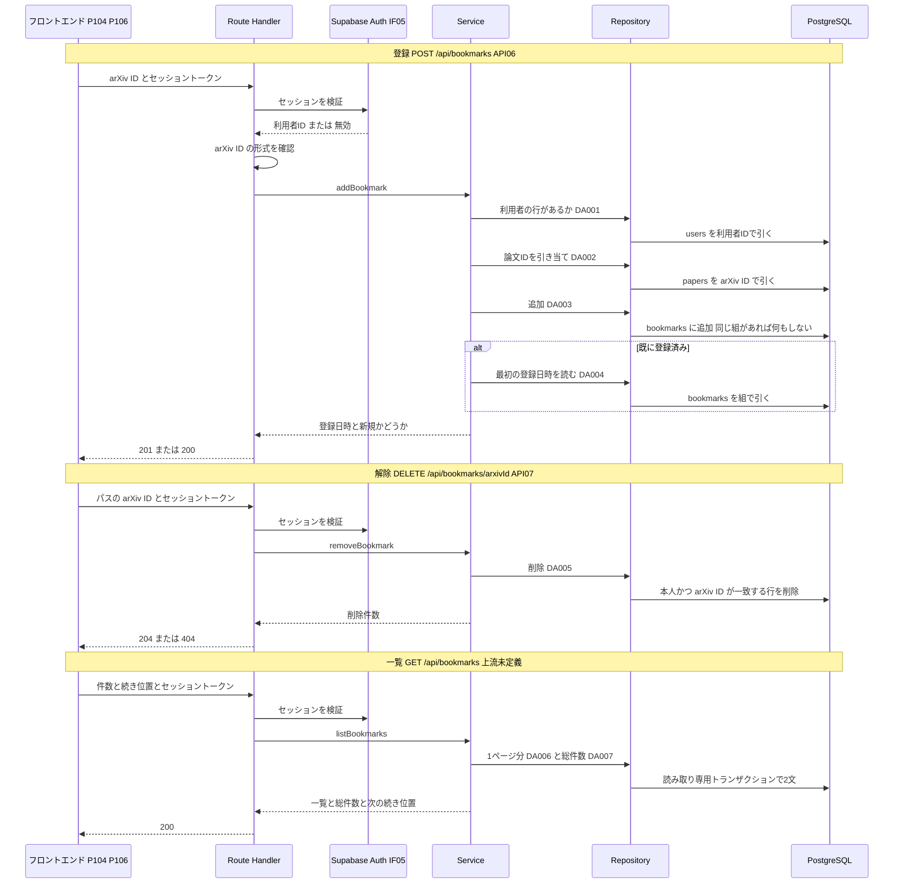

# BE詳細設計書 — F07 ブックマーク（区分: 会員）

## 0. 文書情報

| 項目 | 値 |
| :--- | :--- |
| 設計書ID | F07-BE |
| 親ID | F07 |
| 親設計書 | `基本設計書_概要.md` §4.1 機能一覧 |
| 文書名 | BE詳細設計書 F07 ブックマーク |
| 対象システム | Kaine personal pj — arXiv日本語研究ダイジェスト Webアプリ |
| 版 | 1.1（第1回セルフレビュー `docs/reviews/be_F07_review_applied.md` の Major 2件・Minor 3件を反映） |
| 作成日 / 更新日 | 2026-10-26 / 2026-10-26 |
| 作成方法 | creating-backend-detailed-design v1.5.0 準拠。上流の確定設計書と `source/` の企画資料から作成（新規設計） |
| インプット | (a) `source/03_システム構成.md:8,10,41,46-54`、`source/02_機能要求定義.md:12,13,48`、`source/01_企画概要.md:29`、`source/04_収益化とロードマップ.md:4,35,45`／(b) `docs/基本設計書_概要.md` §2（BF07・BF13・EX04・EX05）、§4（F07 行、オンライン処理設計の入力チェック・エラー応答）、§6（T001・T002・T003・T005・T007、CRUD図 F07 行）、§7（IF05、内部API一覧 API03・API06・API07、API詳細定義）、§8（認証・認可、セキュリティ対策）、§9（環境変数・ディレクトリ構成）、§11（ARC002〜ARC004・ARC009・ARC010）、付録 Q17・Q22・Q26・Q27・Q32／関連する確定済みの下位設計書: `docs/db/DB.T007.DB物理設計.md`（bookmarks）、`docs/db/DB.T001.DB物理設計.md`（papers）、`docs/db/DB.T002.DB物理設計.md`（paper_versions）、`docs/db/DB.T003.DB物理設計.md`（summaries）、`docs/screens/画面.P104.画面基本設計.md`（E03）、`docs/screens/画面.P106.画面基本設計.md`（E01・E09・E10・E17）／(c) `legacy/`（空） |
| インプットの性質 | `source/` は企画・初期設計案のMarkdown 6ファイルだけで、ルーティング定義・コントローラ・ORM定義・SQLは1つもありません（`source/README.md:5-10`、作業開始時の実ファイル数6件）。そのため本書のエンドポイント・関数・データアクセスはすべて「上流の定義から導いた計画上の実体」であり、実装済みであることは意味しません。ファイル名・関数名・JSONのキー名・SQL本文は実装時の命名案で、すべて※推測です |
| 既存版との関係 | `docs/detail/be/BE.F07.BE詳細設計.md` の旧版はありません（本書が初版）。残すべき既存の記述はありません |
| legacy/ との突合 | `legacy/` は空ディレクトリ（ファイル0件）です。突合する既存仕様・業務意図・非機能の記述はありません |

**確認事項（※推測・※上流要確認・※上流未定義の集約）**:

| No | 区分 | 確認事項 | 本書での仮置き | 関連箇所 | 上流の確認事項 |
| :--- | :--- | :--- | :--- | :--- | :--- |
| 1 | API | ブックマーク一覧を取得するAPI（マイページ P106 が使う）のパス・パラメータ・ページ送りの方式（※上流未定義） | `GET /api/bookmarks`、20件ずつ、続き位置を表す文字列（カーソル）で続きを引く（※推測）。API ID は振らない | §2「GET /api/bookmarks」 | Q27 |
| 2 | API | 論文詳細（API03）の応答に「ログイン中の利用者が登録済みか」を含めるか（※上流要確認。P104 H19 の初期表示に必要） | 含める案。判定のデータアクセス DA008 を本書で用意し、API03 の詳細は F05 の BE詳細設計で決める | §3 DA008、§4 isBookmarked | Q26 |
| 3 | CRUD | 一覧で日本語タイトル・最新版を出すため、F07 が `paper_versions`・`summaries` を参照（R）する（※上流要確認。上流 §6 CRUD図の F07 行は papers・users・bookmarks だけ） | 参照する。上流 CRUD図の F07 行に paper_versions「R」、summaries「R」の追加を提案する | §3 DA006 | —（※上流未定義） |
| 4 | API | 利用者テーブル（users）に行が無いままログインしている利用者がブックマークしようとしたときの応答（※上流未定義。利用者の行を作るAPIは上流 Q27 で未定義） | 403 を返し、行を作らない（※推測） | §2 API06、§6 | Q27 |
| 5 | API | 登録済みの論文を再登録したときの応答コード | 新規は 201、登録済みは 200。どちらも成功（上流 API06「登録済みの場合も成功として扱う」の範囲内） | §2 API06 | Q26 |
| 6 | API | arXiv ID に版番号の接尾辞（`v2` のような末尾の版指定）が付いて送られた場合の扱い | 400 で拒否する（papers.arxiv_id は接尾辞を含まない。T001 `ck_papers_arxiv_id_format`）（※推測） | §4 parseArxivId | Q26 |
| 7 | 業務 | 機能「論文の保存・整理」の「整理」にフォルダ分け・タグ・メモを含めるか（※上流要確認） | 含めない。一覧の新しい順の表示と解除だけ（T007 §9 No.1 と同じ） | §1 対象ドメイン | —（※上流未定義） |
| 8 | 業務 | 利用者1人あたりのブックマーク上限件数 | 上限なし（※推測。T007 §9 No.7 と同じ） | §2 API06 | —（※上流未定義） |
| 9 | CRUD | 論文詳細（API03、F05）が DA008 で bookmarks を参照する（※上流要確認。上流 §6 CRUD図の F05 行の bookmarks は「-」） | 参照する。上流 CRUD図の F05 行に bookmarks「R」の追加を提案する（No.2 が「含める」で確定した場合） | §3 DA008 | Q26 |

---

## 1. バックエンド構成・モジュール設計

* **対象ドメイン**: 会員系（機能ID F07 ブックマーク）— ログイン中の利用者が論文を保存（登録）し、保存を外し（解除）、マイページで保存した論文を新しい順に一覧する（上流 §4 F07「論文を保存し、マイページで一覧・整理する」、`source/02_機能要求定義.md:12`）。Free プランで使える機能で、プランによる利用制限はありません（`source/04_収益化とロードマップ.md:4`）。「整理」はフォルダ分け・タグを含まない解釈で設計しています（§0 確認事項 No.7）。
* **対象APIエンドポイント**: POST /api/bookmarks（API06）、DELETE /api/bookmarks/{arxivId}（API07）、GET /api/bookmarks（ブックマーク一覧の取得。※上流未定義、パスは※推測）。全数と根拠は §2 のエンドポイントロースターを参照。
* **実行基盤**: 画面向けAPIは Next.js の API（Route Handler）として Vercel 上で動きます（`source/03_システム構成.md:9,16`、上流 §9）。DBへは環境変数 `DATABASE_URL` の接続文字列で PostgreSQL（Supabase）に直接つなぎ、SQLを発行します（上流 §9 環境変数一覧。※推測: ドライバは `postgres`（postgres.js）か `pg`（node-postgres）のどちらかのSQLクライアント）。
  * この接続は行単位アクセス制御（Row Level Security）を通らないロールで動くため（※推測）、**本機能のすべてのSQLに「利用者IDが本人と一致する」条件を付け、利用者IDはセッションの検証結果からだけ取ります**（ブラウザから送られた値を使わない）。T007 の行単位アクセス制御（`docs/db/DB.T007.DB物理設計.md` §7）は、ブラウザから Supabase へ直接アクセスされた場合の二重目の防御として働きます（上流 §8「他人のデータの閲覧・改ざん」）。
  * 直接接続にした理由: 登録時の「同じ組があれば何もしない」書き込み（`INSERT … ON CONFLICT DO NOTHING`）と、一覧での論文・版・要約の結合を1文で書くためです（※推測）。
* **ディレクトリ/ファイル構造**（上流 §9「`web/`（Next.js の画面と画面向けAPI）」の想定に従う。ファイル名はすべて※推測）:

```
web/
├── app/api/bookmarks/
│   ├── route.ts                    # POST（API06 登録）・GET（一覧の取得 ※上流未定義）
│   └── [...arxivId]/route.ts       # DELETE（API07 解除）。旧形式の arXiv ID に含まれる「/」も受け取るため全セグメントを受ける
├── lib/auth/
│   └── session.ts                  # requireUser: Supabase Auth のセッション検証（F06 と共用 ※推測）
├── lib/bookmarks/
│   ├── validation.ts               # parseArxivId / parseCreateBody / parseListQuery / encodeCursor
│   ├── service.ts                  # addBookmark / removeBookmark / listBookmarks / isBookmarked
│   └── repository.ts               # DA001〜DA008 のSQL発行
├── lib/db/
│   └── client.ts                   # DATABASE_URL による接続（全機能共通 ※推測）
└── lib/http/
    └── errors.ts                   # toErrorResponse: 例外を応答コードとエラー本文へ変換（全機能共通 ※推測）
```

* **処理シーケンス図**（3つのエンドポイントの正常系と主な分岐。上流 BF07・EX05 を展開）:



---

## 2. API・インターフェース詳細設計

* **外部サービス連携仕様**: 本機能が呼ぶ外部サービスは Supabase Auth（上流 IF05）の1件だけです。**全数である根拠**: 上流 §7 外部連携一覧の全9件（IF01〜IF09）のうち、上流 §2 BF07・EX05 と §7 API06・API07「認証: 必要」に関わるのは IF05 だけです。arXiv（IF01〜IF03）・LLM（IF04）・Stripe（IF06・IF07）・GitHub（IF08）・通知（IF09）はブックマークの登録・解除・一覧のどの手順にも現れません。

| IF-ID | 連携先 | 連携方式 | エンドポイント / 接続先 | 認証方式 | タイムアウト | リトライ方針 | エラー時の挙動 | 定義状況 | 詳細の所在 |
| :--- | :--- | :--- | :--- | :--- | :--- | :--- | :--- | :--- | :--- |
| IF05 | Supabase Auth | SDKによる認証連携（※推測: `@supabase/supabase-js` の `auth.getUser(トークン)`） | 環境変数 `NEXT_PUBLIC_SUPABASE_URL` が指す Supabase プロジェクトの認証API（上流 §9） | 利用者のセッショントークン（JWT）をそのまま渡して検証する（上流 IF05 ※推測） | 5秒（※推測） | リトライしない（利用者が操作をやり直せば済み、待ち時間を延ばさないため ※推測） | トークンが無い・期限切れ・改ざんされている場合は 401 を返し、ログインを促す（上流 EX05）。認証サービスに届かない・タイムアウトした場合は、利用者の誤りではないため 500 を返し、ERROR ログを残す（※推測） | 詳細 | §4 requireUser |

* **エンドポイントロースター（全数）**:

| No | API ID | メソッド | パス | 概要 | 認証 | 定義状況 | 詳細の所在 |
| :--- | :--- | :--- | :--- | :--- | :--- | :--- | :--- |
| 1 | API06 | POST | /api/bookmarks | ログイン中の利用者のブックマークに論文を加える。登録済みなら何もせず成功を返す | 必要 | 詳細 | §2「POST /api/bookmarks」 |
| 2 | API07 | DELETE | /api/bookmarks/{arxivId} | ログイン中の利用者のブックマークから論文を外す | 必要 | 詳細 | §2「DELETE /api/bookmarks/{arxivId}」 |
| 3 | —（※上流未定義） | GET | /api/bookmarks（※推測） | ログイン中の利用者が保存した論文を、保存した日時の新しい順に1ページ分と総件数を返す | 必要 | 詳細 | §2「GET /api/bookmarks」 |

**総件数: 3件（上流定義2件・上流未定義1件）。全数である根拠**: 上流 §7 内部API一覧の全8件（API01〜API08）のうち、カテゴリ「ブックマーク」の行は API06・API07 の2件です（`source/03_システム構成.md:52-53` の2行と一致）。これに、上流 F07「マイページで一覧」と画面設計 P106 の E01・E10・E17（ブックマーク一覧の取得、※上流未定義）で必要とされながら上流 API 一覧に無い一覧取得の1件を加えています（上流 §7 注記「ブックマーク一覧の取得は…APIが定義されていない」、付録 Q27）。一覧取得には API ID を振っていません（上流での追加を提案。§0 確認事項 No.1）。論文詳細（API03）の応答にブックマーク状態を含める件は F05 のエンドポイントのため本ロースターに含めず、判定のデータアクセスだけを本書 §3 DA008 で用意しています。定義状況は3件とも状態の変更（API06・API07）または分岐とページ送り（一覧）を含むため「詳細」です（completeness 3-1 の1・2）。

* **全エンドポイント共通の決まり**（※推測。上流 §4 オンライン処理設計のエラー応答、§8 を具体化）:
  * **認証**: リクエストヘッダー `Authorization: Bearer <Supabase のアクセストークン>` で受け取ります。Cookie だけでは受け付けません。状態を変える操作でトークンをヘッダーで送らせることで、他サイトからの成りすまし送信（CSRF）を防ぐためです（上流 §8 CSRF の対策）。
  * **応答の形**: 成功時は `{"status":"success","data":{…}}`、失敗時は `{"status":"error","error":{"code":"<エラーコード>","message":"<利用者向けの文言>"}}` とします（エラーコードは §6 の一覧）。204 のときは本文を返しません。
  * **キャッシュ**: すべての応答に `Cache-Control: no-store` を付けます。どの論文を保存したかは個人の行動データで、共有キャッシュや CDN に残してはならないためです（上流 ARC010）。
  * **利用者IDの出どころ**: どのエンドポイントも利用者IDを引数で受け取りません。セッションの検証結果（requireUser の戻り値）だけを使います（T007 §4.3 (1)）。

### POST /api/bookmarks
* **概要**: ログイン中の利用者のブックマークに、arXiv ID で指定した論文を加えます（上流 API06、BF07）。すでに保存済みの論文なら行を作り直さず、最初に保存した日時のまま成功を返します。論文詳細（P104）のブックマークボタン（E03）から呼ばれます。
* **API ID**: API06
* **認証要否**: 必要（ログイン中の会員。Free・Pro とも利用可。`source/04_収益化とロードマップ.md:4`）
* **リクエストパラメータ**:

| 種別(Path/Query/Body) | 項目名 | 型 | 必須 | 制約・バリデーション | 説明 |
| :--- | :--- | :--- | :--- | :--- | :--- |
| Header | Authorization | string | 必須 | 「Bearer」の後に Supabase のアクセストークンを付けた形 | ログイン中の利用者を特定する。無い・無効なら 401 |
| Body | arxivId | string | 必須 | 前後の空白を除いて1〜32文字。新形式（年月4桁・ピリオド・連番4〜5桁。例 `2401.01234`）か旧形式（分野名・スラッシュ・年月連番7桁。例 `hep-th/9901001`）のどちらかで、版番号の接尾辞（末尾の `v2` のような版指定）を含まないこと（`^\d{4}\.\d{4,5}$` または `^[a-z]+(-[a-z]+)*(\.[A-Z]{2})?/\d{7}$`）（※推測: T001 `ck_papers_arxiv_id_format` に合わせる） | 保存する論文の arXiv 上の識別子。キー名 `arxivId` は上流で未定義（上流 Q26。※推測） |

* **レスポンス（成功時）**:
```json
{
  "status": "success",
  "data": {
    "arxivId": "2401.01234",
    "bookmarkedAt": "2026-10-26T01:23:45.678Z",
    "alreadyBookmarked": false
  }
}
```
  * `bookmarkedAt` は保存した日時（`bookmarks.created_at`、UTC の ISO 8601 形式）です。登録済みだった場合は最初に保存した日時を返し、`alreadyBookmarked` を `true` にします（T007 §4.3 (3)）。
* **レスポンスヘッダー**: `Content-Type: application/json`、`Cache-Control: no-store`
* **ステータスコード**:

| コード | 条件 |
| :--- | :--- |
| 201 | 新しく保存した（行を追加した） |
| 200 | すでに保存済みだったため何もしなかった（上流 API06「登録済みの場合も成功として扱う」。コードの区別は※推測） |
| 400 | リクエスト本文が JSON として読めない、`arxivId` が無い・文字列でない・形式に合わない（エラーコード `INVALID_REQUEST`） |
| 401 | トークンが無い・無効・期限切れ、または保存の途中で利用者が退会して消えていた（`UNAUTHORIZED`。上流 EX05） |
| 403 | ログインは有効だが利用者テーブルに本人の行が無い（会員登録が完了していない）（`USER_NOT_REGISTERED`。※上流未定義、§0 確認事項 No.4） |
| 404 | 指定の arXiv ID の論文が自前DBに無い、または保存の途中で論文が消えた（`PAPER_NOT_FOUND`。上流 API06 エラー時） |
| 500 | DBまたは認証サービスの障害、想定外の例外（`INTERNAL_ERROR`） |

* **ビジネスロジック・副作用**:
  1. セッションを検証し、利用者IDを得る（requireUser。無効なら 401 で終了）。
  2. リクエスト本文を検証し、arXiv ID を取り出す（parseCreateBody → parseArxivId。不正なら 400 で終了）。
  3. 利用者テーブルに本人の行があるか確かめる（DA001）。無ければ 403 で終了する。外部キー違反を待たずに確かめるのは、会員登録が済んでいない状態を利用者に分かる理由で返すためです（上流 CRUD図 F07 の users「R」）。
  4. arXiv ID から論文IDを引き当てる（DA002）。無ければ 404 で終了する。arXiv API への問い合わせ（オンデマンド同期 B006）は起動しない（ブックマークは画面に表示された論文に対する操作で、自前DBに無い論文が渡るのは不正な呼び出しだけのため ※推測）。
  5. ブックマークを追加する（DA003）。同じ利用者・同じ論文の行がすでにあれば何もしない。行を追加できたら、その登録日時を返して 201 で終了する。
  6. 行が追加されなかった（登録済みだった）場合は、既存の行の登録日時を読む（DA004）。読めたら 200 で終了する。
  7. 手順5と6の間に別の操作（別の端末からの解除）で行が消え、手順6で読めなかった場合は、手順5をもう一度だけ行う。2回目も追加も読み取りもできなかった場合は 500 とする（※推測。実際にはほぼ起きない競合への備え）。
  8. 副作用は `bookmarks` への1行の追加だけです。外部サービスへの送信、ジョブの登録はありません。件数の上限は設けません（§0 確認事項 No.8）。

### DELETE /api/bookmarks/{arxivId}
* **概要**: ログイン中の利用者のブックマークから、arXiv ID で指定した論文を外します（上流 API07、BF07）。論文詳細（P104）のブックマークボタン（E03）と、マイページ（P106）の解除ボタン（E09）から呼ばれます。
* **API ID**: API07
* **認証要否**: 必要（ログイン中の会員）
* **リクエストパラメータ**:

| 種別(Path/Query/Body) | 項目名 | 型 | 必須 | 制約・バリデーション | 説明 |
| :--- | :--- | :--- | :--- | :--- | :--- |
| Header | Authorization | string | 必須 | 「Bearer」の後に Supabase のアクセストークンを付けた形 | ログイン中の利用者を特定する。無い・無効なら 401 |
| Path | arxivId | string | 必須 | POST /api/bookmarks の `arxivId` と同じ形式。旧形式の ID はスラッシュを含むため、パスの残りの区切りをすべて受け取り、スラッシュでつなぎ直して1つの ID とする。`%2F` で符号化されて届いた場合も復号して同じ ID として扱う（※推測） | 外す論文の arXiv 上の識別子 |

* **レスポンス（成功時）**: 本文なし（204 No Content）
* **レスポンスヘッダー**: `Cache-Control: no-store`
* **ステータスコード**:

| コード | 条件 |
| :--- | :--- |
| 204 | 本人のブックマークから1行を消した |
| 400 | パスの arXiv ID が形式に合わない（`INVALID_REQUEST`） |
| 401 | トークンが無い・無効・期限切れ（`UNAUTHORIZED`。上流 EX05） |
| 404 | 本人のブックマークにその論文が無い。論文そのものが自前DBに無い場合も同じ扱いにする（`BOOKMARK_NOT_FOUND`。上流 API07「ブックマークに無い」）。画面側は 404 を「目的の状態になった」とみなして表示を合わせる（P104 E03、P106 E09） |
| 500 | DBまたは認証サービスの障害、想定外の例外（`INTERNAL_ERROR`） |

* **ビジネスロジック・副作用**:
  1. セッションを検証し、利用者IDを得る（requireUser。無効なら 401 で終了）。
  2. パスの arXiv ID を組み立て直して検証する（parseArxivId。不正なら 400 で終了）。
  3. 本人の行のうち、arXiv ID が一致する論文の行を1文で消す（DA005）。論文IDの引き当てと削除を1文にまとめるのは、往復を減らし、引き当てと削除の間に状態が変わる隙をなくすためです。
  4. 消した件数が1件なら 204、0件なら 404 で終了する。主キーが利用者と論文の組なので、2件以上消えることはありません。
  5. 副作用は `bookmarks` からの1行の削除だけです。利用者テーブルの存在確認（DA001）は行いません。本人の行しか消さないため、利用者の行が無ければ結果は0件（404）になり、害が無いためです。

### GET /api/bookmarks
* **概要**: ログイン中の利用者が保存した論文を、保存した日時の新しい順に1ページ分返し、あわせて保存の総件数と続きの取得位置を返します。マイページ（P106）を開いたとき（E01）、「さらに表示」（E10）、節の再読み込み（E17）から呼ばれます。**※上流未定義**: 上流 §7 内部API一覧に無いAPIで、パス・パラメータ・応答はすべて※推測です（上流 付録 Q27、§0 確認事項 No.1）。API ID は振っていません。
* **API ID**: —（※上流未定義）
* **認証要否**: 必要（ログイン中の会員）
* **リクエストパラメータ**:

| 種別(Path/Query/Body) | 項目名 | 型 | 必須 | 制約・バリデーション | 説明 |
| :--- | :--- | :--- | :--- | :--- | :--- |
| Header | Authorization | string | 必須 | 「Bearer」の後に Supabase のアクセストークンを付けた形 | ログイン中の利用者を特定する。無い・無効なら 401 |
| Query | limit | integer | 任意 | 1以上50以下の整数。指定が無いときは 20（※推測: P106 H34「最初に表示するのも20件」） | 1回に返す件数 |
| Query | cursor | string | 任意 | 前回の応答の `nextCursor` をそのまま渡す。形が壊れている・中身が読めない場合は 400 | 続きを取る位置。指定が無いときは先頭から返す。中身は最後に返した行の保存日時（DBの値をマイクロ秒まで保った文字列）と論文IDの組で、利用者には中身の意味を持たせない。保存日時をミリ秒に丸めると、同じミリ秒内に保存したより古い行が次のページから漏れるため、精度を落とさずに持つ |

* **レスポンス（成功時）**:
```json
{
  "status": "success",
  "data": {
    "items": [
      {
        "arxivId": "2401.01234",
        "titleJa": "大規模言語モデルの推論効率を高める新手法",
        "titleOriginal": "An Efficient Inference Method for Large Language Models",
        "categories": ["cs.LG", "cs.CL"],
        "latestVersion": 2,
        "bookmarkedAt": "2026-10-26T01:23:45.678Z"
      }
    ],
    "totalCount": 12,
    "nextCursor": "eyJ0IjoiMjAyNi0xMC0yNlQwMToyMzo0NS42NzhaIiwicCI6MTIzNDV9"
  }
}
```
  * `titleJa` は論文の最新版について検証に合格した30秒要約の日本語タイトルです。まだ無い論文は `null` を返し、画面は原題（`titleOriginal`）を出します（P106 H29、上流 ARC002・ARC004）。
  * `latestVersion` は保存時ではなく現時点の最新版です（P106 H31、T007 §4「版の扱い」）。
  * `nextCursor` は続きが無いとき `null` です。
* **レスポンスヘッダー**: `Content-Type: application/json`、`Cache-Control: no-store`
* **ステータスコード**:

| コード | 条件 |
| :--- | :--- |
| 200 | 正常終了（0件のときも `items` を空配列、`totalCount` を 0 として返す） |
| 400 | `limit` が整数でない・範囲外、`cursor` が読めない（`INVALID_REQUEST`） |
| 401 | トークンが無い・無効・期限切れ（`UNAUTHORIZED`）。P106 はログインが切れた旨のダイアログを出す（P106 E01・E10） |
| 500 | DBまたは認証サービスの障害、想定外の例外（`INTERNAL_ERROR`）。P106 はブックマークの節だけにエラーと再読み込みを出す（上流 EX04 の考え方） |

* **ビジネスロジック・副作用**:
  1. セッションを検証し、利用者IDを得る（requireUser。無効なら 401 で終了）。
  2. 件数と続き位置を検証する（parseListQuery。不正なら 400 で終了）。続き位置は「保存日時（マイクロ秒までの文字列）」と「論文ID」の組を復元したものです。
  3. 読み取り専用のトランザクションを開き、1ページ分の取得（DA006）と総件数の取得（DA007）を同じ時点のデータで行う。別の端末で同時に登録・解除しても、一覧と総件数が食い違わないようにするためです。
  4. DA006 は指定件数より1件多く読み、1件多く取れたら続きがあると判断して最後の1件を捨て、残りの最後の行の「保存日時（DBが返したマイクロ秒までの文字列をそのまま使う）・論文ID」から次の続き位置を作る（encodeCursor）。取れた件数が指定件数以下なら続きは無い。
  5. 一覧・総件数・次の続き位置を返す。利用者テーブルの存在確認は行わない（行が無ければ0件が返るだけで害が無いため）。
  6. 副作用はありません（参照のみ）。利用者が一覧を見たことは記録しません（上流 ARC010 の個人データ最小化）。

---

## 3. データアクセス（ORM / クエリ）設計

* **データアクセス一覧（全数ロースター）**:

| DA-ID | 処理名 | 呼出元（関数/API） | テーブルID | 対象物理テーブル | 種別 (SELECT/INSERT/UPDATE/DELETE) | 定義状況 (詳細/簡易) | 詳細の所在 |
| :--- | :--- | :--- | :--- | :--- | :--- | :--- | :--- |
| DA001 | 利用者の登録確認 | userExists ← addBookmark ← POST /api/bookmarks（API06） | T005 | users | SELECT | 簡易 | §3 発行SQL DA001 |
| DA002 | 論文IDの引き当て | findPaperIdByArxivId ← addBookmark ← POST /api/bookmarks（API06） | T001 | papers | SELECT | 簡易 | §3 発行SQL DA002 |
| DA003 | ブックマークの追加（登録済みなら何もしない） | insertBookmark ← addBookmark ← POST /api/bookmarks（API06） | T007 | bookmarks | INSERT | 詳細 | §3 詳細定義 DA003 |
| DA004 | 既存ブックマークの登録日時の取得 | findBookmarkCreatedAt ← addBookmark ← POST /api/bookmarks（API06） | T007 | bookmarks | SELECT | 簡易 | §3 発行SQL DA004 |
| DA005 | arXiv ID 指定でのブックマーク削除 | deleteBookmarkByArxivId ← removeBookmark ← DELETE /api/bookmarks/{arxivId}（API07） | T007, T001 | bookmarks, papers | DELETE | 詳細 | §3 詳細定義 DA005 |
| DA006 | ブックマーク一覧の1ページ取得 | selectBookmarkPage ← listBookmarks ← GET /api/bookmarks（※上流未定義） | T007, T001, T002, T003 | bookmarks, papers, paper_versions, summaries | SELECT | 詳細 | §3 詳細定義 DA006 |
| DA007 | ブックマーク総件数の取得 | countBookmarks ← listBookmarks ← GET /api/bookmarks（※上流未定義） | T007 | bookmarks | SELECT | 簡易 | §3 発行SQL DA007 |
| DA008 | 登録済みかの判定 | existsBookmark ← isBookmarked ← GET /api/papers/{arxivId}（API03。F05 の担当、※上流要確認） | T007 | bookmarks | SELECT | 簡易 | §3 発行SQL DA008 |

**総件数: 8件（SELECT 6件・INSERT 1件・DELETE 1件。詳細3件・簡易5件）。全数である根拠**: §2 の3エンドポイントのビジネスロジックの手順に現れるDBアクセスをすべて数えたもの（API06: DA001〜DA004 の4件、API07: DA005 の1件、一覧: DA006・DA007 の2件）に、論文詳細でブックマーク状態を出すための判定 DA008 の1件（T007 §4.6 No.1「論文詳細を開いたときに保存済みかを表示するため、利用者と論文の組で行の有無を読む」）を加えたものです。§4 の関数ロースターのうち repository.ts の8関数と1対1で対応します。上流 §6 CRUD図の F07 行（papers「R」・users「R」・bookmarks「CRD」）の各操作はすべていずれかの DA に現れます（papers R → DA002・DA005・DA006、users R → DA001、bookmarks C → DA003、R → DA004・DA006〜DA008、D → DA005）。CRUD図に無い paper_versions・summaries の参照（DA006）は ※上流要確認 です（§0 確認事項 No.3）。テーブルID列は上流 §6 テーブル一覧のIDをそのまま引き継いでいます（users=T005、papers=T001、paper_versions=T002、summaries=T003、bookmarks=T007）。本機能に UPDATE はありません（T007 §4.6「本テーブルを更新（U）する機能はありません」）。
**定義状況の判定**（completeness 3-1）: DA003 は永続データを書き換え、二重登録時の冪等性の扱いがある（3-1 の2・5）。DA005 は書き換えと2テーブルにまたがる条件を含む（3-1 の2・3）。DA006 は4テーブルの結合・続き位置の有無による SQL の組み立ての分岐・件数の多い利用者での性能配慮を含む（3-1 の3・4・6）。残る5件は1テーブルを主キーか一意キーで引く単純な取得のため「簡易」とし、SQL 本文は「発行SQL」に示します。

* **データアクセス詳細定義**（ロースターは本節冒頭の表。本表は定義状況＝詳細の3件を展開する）:

| DA-ID | 処理名 | テーブルID | 対象物理テーブル | JOIN / Include | 抽出条件 (Where) / ソート | トランザクション境界 | N+1対策・性能上の注意 |
| :--- | :--- | :--- | :--- | :--- | :--- | :--- | :--- |
| DA003 | ブックマークの追加（登録済みなら何もしない） | T007 | bookmarks | なし | 抽出条件なし（1行の追加）。利用者IDはセッションの値、論文IDは DA002 で引き当てた値を入れる。登録日時は列の初期値（現在時刻）に任せ、アプリからは渡さない。同じ利用者・同じ論文の行がすでにあれば何もせず、追加した行の登録日時だけを返す（`INSERT … ON CONFLICT (user_id, paper_id) DO NOTHING RETURNING created_at`） | 1文の自動コミット（明示的なトランザクションは張らない）。DA001・DA002 の読み取りとはトランザクションを分ける。読み取りと追加の間に状態が変わっても、主キーと外部キーが整合を守るため（§6 トランザクション制御） | 主キー `pk_bookmarks` の一意性で二重登録をDBが防ぐため、事前の存在確認 SELECT は行わない（往復を1回減らし、並行した二重押しでも行が2つにならない）。外部キー違反（論文または利用者がその間に消えた）は SQLSTATE 23503 として受け、違反した制約名で 404 か 401 に振り分ける（§6） |
| DA005 | arXiv ID 指定でのブックマーク削除 | T007, T001 | bookmarks, papers | papers を arXiv ID で結合して削除対象の論文IDを決める（`DELETE … USING papers`） | 本人の行（利用者IDが一致）で、かつ結合した論文の arXiv ID が指定の値に一致する行を消す。消した行の論文IDを返し、件数で 204 か 404 かを決める | 1文の自動コミット | papers は一意制約 `uq_papers_arxiv_id` の索引で1件に絞られ、bookmarks は主キー `pk_bookmarks`（利用者ID・論文ID）で1件に絞られるため、全件走査は起きない。論文が存在しない場合も結合で0件になり、別の問い合わせは要らない |
| DA006 | ブックマーク一覧の1ページ取得 | T007, T001, T002, T003 | bookmarks, papers, paper_versions, summaries | bookmarks と papers を論文IDで内部結合。paper_versions を「論文ID と papers の最新版番号」で外部結合（版の行がまだ無い論文も一覧に残す）。summaries を版ごとの横断サブクエリ（LATERAL）で外部結合し、30秒要約・日本語・検証合格のうち生成日時が最も新しい1件の日本語タイトルだけを取る（版や要約が無い論文は日本語タイトルが空になる） | 本人の行（利用者IDが一致）だけを対象に、保存日時の新しい順、同じ日時のときは論文IDの大きい順に並べる。続き位置が指定されたときは、その「保存日時・論文ID」の組より後ろ（並び順で先に来ない行）だけに絞る。続き位置の保存日時はマイクロ秒まで保った文字列で受け取り、DB側で日時型に戻して比較する（JavaScript の日時型はミリ秒までしか持てず、丸めると同じミリ秒内のより古い行を取りこぼすため）。続き位置を作るため、保存日時を UTC・マイクロ秒までの文字列にしたものも併せて返す。指定件数より1件多く読む | 読み取り専用・REPEATABLE READ のトランザクションで DA007 と同じ時点を読む（§6） | 1回の SQL で論文情報と日本語タイトルまで取り、論文ごとの追加の問い合わせ（N+1）をしない。並びは索引 `idx_bookmarks_user_id_created_at`（利用者ID・保存日時の降順）に沿うため、件数の多い利用者でも先頭から必要な分だけ読む。同じ保存日時の行どうしの並べ替え（論文ID）は索引に無いが、同時刻の行はごく少数のため影響は無い（※推測）。日本語タイトルは索引 `idx_summaries_lookup`（版・種別・言語・生成日時の降順）で1件だけ引く。件数指定ではなく続き位置で続きを引くため、ページが進んでも先頭から読み飛ばす（OFFSET）負荷が増えない |

* **発行SQL**: 本機能のデータアクセスは ORM を使わず、すべて SQL クライアントからパラメータ付きの SQL を発行します（§1 実行基盤）。値はすべて番号付きのプレースホルダ（`$1`・`$2`・`$3`・`$4`）で渡し、文字列の連結で SQL を作りません（SQL インジェクション対策）。8件すべての SQL 本文を示します。動的に組み立てるのは DA006 の1件だけで、その分岐と生成され得る2つの形を示します。

**DA001 利用者の登録確認**（簡易）— 利用者テーブルに本人の行があるかだけを確かめます。主キーで1件を引きます。
```sql
-- $1: 利用者ID（uuid。セッションの検証結果）
SELECT 1
  FROM users
 WHERE user_id = $1;
-- 1行返れば登録済み、0行なら未登録（API06 は 403）
```

**DA002 論文IDの引き当て**（簡易）— arXiv ID から論文テーブルの論文IDを引きます。一意制約 `uq_papers_arxiv_id` の索引で1件を引きます。
```sql
-- $1: arXiv ID（版番号の接尾辞なし）
SELECT id
  FROM papers
 WHERE arxiv_id = $1;
-- 0行なら論文なし（API06 は 404）
```

**DA003 ブックマークの追加（登録済みなら何もしない）**（詳細）
```sql
-- $1: 利用者ID（uuid）、$2: 論文ID（bigint。DA002 の結果）
INSERT INTO bookmarks (user_id, paper_id)
VALUES ($1, $2)
ON CONFLICT (user_id, paper_id) DO NOTHING
RETURNING created_at;
-- 1行返れば新規追加（201）。0行なら登録済み（DA004 で既存の登録日時を読む）
-- created_at は列の初期値とトリガー trg_bookmarks_created_at により現在時刻になる（T007 §7）
```

**DA004 既存ブックマークの登録日時の取得**（簡易）— 登録済みだったときに、最初に保存した日時を読みます。主キーで1件を引きます。
```sql
-- $1: 利用者ID（uuid）、$2: 論文ID（bigint）
SELECT created_at
  FROM bookmarks
 WHERE user_id  = $1
   AND paper_id = $2;
```

**DA005 arXiv ID 指定でのブックマーク削除**（詳細）
```sql
-- $1: 利用者ID（uuid）、$2: arXiv ID
DELETE FROM bookmarks AS b
 USING papers AS p
 WHERE b.paper_id = p.id
   AND b.user_id  = $1
   AND p.arxiv_id = $2
RETURNING b.paper_id;
-- 1行返れば削除済み（204）、0行ならブックマークに無い（404）
```

**DA006 ブックマーク一覧の1ページ取得**（詳細・動的）— 続き位置（`cursor`）の有無で、続き位置の条件を付けるかだけが変わります。それ以外の部分は固定です。取り出す件数には指定件数に1を足した値を渡します。

* 分岐1: 続き位置が無い（最初のページ。P106 E01・E17）→ 形A
* 分岐2: 続き位置がある（2ページ目以降。P106 E10）→ 形B（形Aに「保存日時・論文IDの組が続き位置より後ろ」の条件を足したもの）

形A（最初のページ）:
```sql
-- $1: 利用者ID（uuid）、$2: 取り出す件数（limit + 1）
SELECT p.arxiv_id                   AS arxiv_id,
       s.title_ja                   AS title_ja,
       p.title                      AS title_original,
       p.categories                 AS categories,
       p.latest_version             AS latest_version,
       b.created_at                 AS bookmarked_at,
       to_char(b.created_at AT TIME ZONE 'UTC',
               'YYYY-MM-DD"T"HH24:MI:SS.US"Z"') AS bookmarked_at_text,  -- 続き位置用。マイクロ秒まで保つ
       b.paper_id                   AS paper_id   -- 続き位置を作るためだけに使い、応答には出さない
  FROM bookmarks AS b
  JOIN papers    AS p  ON p.id = b.paper_id
  LEFT JOIN paper_versions AS pv
         ON pv.paper_id = p.id
        AND pv.version  = p.latest_version
  LEFT JOIN LATERAL (
        SELECT sm.json_content ->> 'title_ja' AS title_ja   -- キー名は ARC003 要約スキーマで確定（※推測）
          FROM summaries AS sm
         WHERE sm.paper_version_id  = pv.id
           AND sm.summary_type      = 'short'
           AND sm.language          = 'ja'
           AND sm.validation_status = 'passed'
         ORDER BY sm.generated_at DESC
         LIMIT 1
       ) AS s ON TRUE
 WHERE b.user_id = $1
 ORDER BY b.created_at DESC, b.paper_id DESC
 LIMIT $2;
```

形B（2ページ目以降）: 形Aの `WHERE b.user_id = $1` を次に置き換えます。パラメータは `$1` 利用者ID、`$2` 取り出す件数、`$3` 続き位置の保存日時（形Aの `bookmarked_at_text` と同じマイクロ秒までの文字列）、`$4` 続き位置の論文ID（bigint）です。
```sql
 WHERE b.user_id = $1
   AND (b.created_at, b.paper_id) < ($3::timestamptz, $4::bigint)
```
行値の比較（保存日時が古い、または同じ保存日時で論文IDが小さい行）で、並び順 `created_at DESC, paper_id DESC` の続きだけを取ります。

**DA007 ブックマーク総件数の取得**（簡易）— マイページの件数表示（P106 H28）に使います。索引 `idx_bookmarks_user_id_created_at` の先頭列で本人の行だけを数えます。
```sql
-- $1: 利用者ID（uuid）
SELECT COUNT(*) AS total_count
  FROM bookmarks
 WHERE user_id = $1;
```

**DA008 登録済みかの判定**（簡易）— 論文詳細（API03）でボタンの初期表示（P104 H19）に使います。呼び出す API03 は F05 の担当で、応答にこの値を含めるかは ※上流要確認 です（§0 確認事項 No.2）。未ログインの閲覧では呼びません。
```sql
-- $1: 利用者ID（uuid）、$2: 論文ID（bigint。API03 が論文を引いたときの値）
SELECT EXISTS (
         SELECT 1
           FROM bookmarks
          WHERE user_id  = $1
            AND paper_id = $2
       ) AS bookmarked;
```

---

## 4. サーバー側機能・処理ロジック設計（IPO設計）

* **関数ロースター（全数）**: 関数名・ファイル名はすべて実装時の命名案です（※推測）。

| No | ID（関数名） | 所属モジュール | 概要 | 対応DA | 定義状況 | 詳細の所在 |
| :--- | :--- | :--- | :--- | :--- | :--- | :--- |
| 1 | POST（登録ハンドラ） | app/api/bookmarks/route.ts | API06 の受け口。認証・入力検証・サービス呼び出し・応答コードの振り分けを行う | — | 詳細 | §4 IPO定義 No.1 |
| 2 | GET（一覧ハンドラ） | app/api/bookmarks/route.ts | 一覧取得（※上流未定義）の受け口。認証・クエリ検証・サービス呼び出しを行う | — | 詳細 | §4 IPO定義 No.2 |
| 3 | DELETE（解除ハンドラ） | app/api/bookmarks/[...arxivId]/route.ts | API07 の受け口。パスから arXiv ID を組み立て直し、サービスを呼んで 204 か 404 を返す | — | 詳細 | §4 IPO定義 No.3 |
| 4 | requireUser | lib/auth/session.ts | リクエストのトークンを Supabase Auth で検証し、利用者IDを返す（F06 と共用 ※推測） | — | 詳細 | §4 IPO定義 No.4 |
| 5 | parseArxivId | lib/bookmarks/validation.ts | arXiv ID の空白除去・長さ・形式を検証し、正規の形で返す | — | 詳細 | §4 IPO定義 No.5 |
| 6 | parseCreateBody | lib/bookmarks/validation.ts | 登録のリクエスト本文を JSON として読み、`arxivId` を取り出して検証する | — | 詳細 | §4 IPO定義 No.6 |
| 7 | parseListQuery | lib/bookmarks/validation.ts | 一覧の `limit` と `cursor` を検証し、件数と続き位置（マイクロ秒までの保存日時の文字列・論文ID）に変換する | — | 詳細 | §4 IPO定義 No.7 |
| 8 | encodeCursor | lib/bookmarks/validation.ts | 最後の行の保存日時（DBが返したマイクロ秒までの文字列をそのまま）と論文IDを、URL に載せられる文字列（JSON を base64url 化）にする | — | 簡易 | — |
| 9 | addBookmark | lib/bookmarks/service.ts | 利用者の確認・論文の引き当て・追加・登録済みの判定を順に行う | DA001〜DA004 | 詳細 | §4 IPO定義 No.9 |
| 10 | removeBookmark | lib/bookmarks/service.ts | arXiv ID 指定で本人のブックマークを1件消し、消えたかを返す | DA005 | 詳細 | §4 IPO定義 No.10 |
| 11 | listBookmarks | lib/bookmarks/service.ts | 読み取り専用トランザクションで1ページと総件数を取り、次の続き位置を作る | DA006, DA007 | 詳細 | §4 IPO定義 No.11 |
| 12 | isBookmarked | lib/bookmarks/service.ts | 利用者と論文の組で登録済みかを返す（F05 の API03 から呼ばれる。※上流要確認） | DA008 | 簡易 | — |
| 13 | userExists | lib/bookmarks/repository.ts | DA001 を発行し、行があれば真を返す | DA001 | 簡易 | §3 発行SQL DA001 |
| 14 | findPaperIdByArxivId | lib/bookmarks/repository.ts | DA002 を発行し、論文IDか「無し」を返す | DA002 | 簡易 | §3 発行SQL DA002 |
| 15 | insertBookmark | lib/bookmarks/repository.ts | DA003 を発行し、追加できたら登録日時、登録済みなら「無し」を返す。外部キー違反を業務エラーに変える | DA003 | 詳細 | §4 IPO定義 No.15 |
| 16 | findBookmarkCreatedAt | lib/bookmarks/repository.ts | DA004 を発行し、登録日時か「無し」を返す | DA004 | 簡易 | §3 発行SQL DA004 |
| 17 | deleteBookmarkByArxivId | lib/bookmarks/repository.ts | DA005 を発行し、消した件数を返す | DA005 | 詳細 | §4 IPO定義 No.17 |
| 18 | selectBookmarkPage | lib/bookmarks/repository.ts | 続き位置の有無で DA006 の形A・形Bを選んで発行し、行の配列を返す | DA006 | 詳細 | §4 IPO定義 No.18 |
| 19 | countBookmarks | lib/bookmarks/repository.ts | DA007 を発行し、総件数を数値で返す | DA007 | 簡易 | §3 発行SQL DA007 |
| 20 | existsBookmark | lib/bookmarks/repository.ts | DA008 を発行し、真偽値を返す | DA008 | 簡易 | §3 発行SQL DA008 |
| 21 | toErrorResponse | lib/http/errors.ts | 業務エラー・想定外の例外を、応答コードとエラー本文へ変換し、ログを出す（全機能共通 ※推測） | — | 詳細 | §4 IPO定義 No.21 |

**総件数: 21件（ハンドラ3件・認証1件・検証4件・サービス4件・リポジトリ8件・エラー変換1件。詳細14件・簡易7件）。全数である根拠**: §1 のディレクトリ構造に挙げた本機能が使う7ファイルの関数をすべて数えたものです。ハンドラは §2 のエンドポイントロースター3件と1対1、リポジトリ関数は §3 のデータアクセスロースター8件と1対1、サービス関数は呼び出し元の3エンドポイントと API03 の1件に対応します。DB接続（lib/db/client.ts）は接続を作るだけで業務の処理を持たず全機能共通のため、本機能の関数に数えていません（※推測）。
**定義状況の判定**（completeness 3-1）: 分岐（入力不正・未認証・未登録・該当なし）を持つもの、状態を変えるもの、トランザクションや SQL の組み立てを持つものを「詳細」としました。値を変換するだけの encodeCursor と、1文を発行して結果をそのまま返すだけの関数は「簡易」です。

* **入力・処理・出力（IPO）定義**（ロースターは本節冒頭の表。本表は定義状況＝詳細の14件を展開する）:

| No | 関数名 | 所属モジュール | 引数 (型) | 処理フロー (ステップ単位で具体的に) | 戻り値 | 発生しうるエラー |
| :--- | :--- | :--- | :--- | :--- | :--- | :--- |
| 1 | POST（登録ハンドラ） | app/api/bookmarks/route.ts | request: Request | 1. requireUser でトークンを検証し、利用者IDを得る<br>2. parseCreateBody で本文から arXiv ID を取り出す<br>3. addBookmark(利用者ID, arXiv ID) を呼ぶ<br>4. 新しく追加した場合は 201、登録済みだった場合は 200 で、arXiv ID・保存日時・登録済みだったかを返す<br>5. 途中で投げられた例外はすべて toErrorResponse に渡して応答にする | Response（201 / 200 と成功本文） | 400 入力不正、401 未認証、403 利用者未登録、404 論文なし、500 障害（すべて toErrorResponse 経由） |
| 2 | GET（一覧ハンドラ） | app/api/bookmarks/route.ts | request: Request | 1. requireUser でトークンを検証し、利用者IDを得る<br>2. parseListQuery で URL の `limit`・`cursor` を件数と続き位置に変える<br>3. listBookmarks(利用者ID, 件数, 続き位置) を呼ぶ<br>4. 一覧・総件数・次の続き位置を 200 で返す<br>5. 例外は toErrorResponse で応答にする | Response（200 と一覧本文） | 400 入力不正、401 未認証、500 障害 |
| 3 | DELETE（解除ハンドラ） | app/api/bookmarks/[...arxivId]/route.ts | request: Request, params: { arxivId: string[] } | 1. requireUser でトークンを検証し、利用者IDを得る<br>2. パスの区切りの配列を、各要素を URL 復号したうえでスラッシュでつなぎ、1つの arXiv ID にする（旧形式 `hep-th/9901001` は2区切りで届くため）<br>3. parseArxivId で形式を検証する<br>4. removeBookmark(利用者ID, arXiv ID) を呼ぶ<br>5. 消えたなら本文なしの 204、消えなかったなら 404（`BOOKMARK_NOT_FOUND`）を返す<br>6. 例外は toErrorResponse で応答にする | Response（204） | 400 入力不正、401 未認証、404 ブックマークに無い、500 障害 |
| 4 | requireUser | lib/auth/session.ts | request: Request | 1. `Authorization` ヘッダーを読み、「Bearer 」で始まらない・トークンが空なら未認証の業務エラーを投げる<br>2. Supabase Auth にトークンを渡して利用者を問い合わせる（IF05。5秒で打ち切る ※推測）<br>3. 期限切れ・署名不正・利用者なしの応答なら未認証の業務エラーを投げる<br>4. 通信失敗・タイムアウトなら、利用者の誤りではないため想定外の例外として投げる（500 になる）<br>5. 利用者IDを返す | 利用者ID（uuid の文字列） | 未認証（401）、認証サービス障害（500） |
| 5 | parseArxivId | lib/bookmarks/validation.ts | raw: unknown | 1. 文字列でなければ入力不正を投げる<br>2. 前後の空白を除く<br>3. 空、または32文字を超えるなら入力不正を投げる（papers.arxiv_id の桁に合わせる）<br>4. 新形式（年月4桁・ピリオド・連番4〜5桁）にも旧形式（分野名・スラッシュ・年月連番7桁）にも当てはまらなければ入力不正を投げる。版番号の接尾辞が付いたものもここで拒否する（`^\d{4}\.\d{4,5}$` / `^[a-z]+(-[a-z]+)*(\.[A-Z]{2})?/\d{7}$`）（※推測）<br>5. 空白を除いた値を返す（大文字小文字は変えない） | arXiv ID（string） | 入力不正（400、`INVALID_REQUEST`） |
| 6 | parseCreateBody | lib/bookmarks/validation.ts | request: Request | 1. 本文を JSON として読む。読めなければ入力不正を投げる<br>2. 読めた値がオブジェクトでなければ入力不正を投げる<br>3. `arxivId` を parseArxivId で検証して返す。ほかのキーは無視する | arXiv ID（string） | 入力不正（400） |
| 7 | parseListQuery | lib/bookmarks/validation.ts | searchParams: URLSearchParams | 1. `limit` が無ければ 20 とする。あれば整数として読み、整数でない・1未満・50超なら入力不正を投げる<br>2. `cursor` が無ければ続き位置なしとする<br>3. `cursor` があれば base64url を復号して JSON として読み、保存日時（UTC・マイクロ秒6桁までの日時文字列。`^\d{4}-\d{2}-\d{2}T\d{2}:\d{2}:\d{2}\.\d{6}Z$`）と論文ID（正の整数）の両方がそろわなければ入力不正を投げる。保存日時は Date 型に変換せず文字列のまま持つ（ミリ秒への丸めで行を取りこぼさないため）<br>4. 件数と続き位置を返す | { limit: number, cursor: { bookmarkedAtText: string, paperId: bigint } \| null } | 入力不正（400） |
| 9 | addBookmark | lib/bookmarks/service.ts | userId: string, arxivId: string | 1. userExists(利用者ID)（DA001）。偽なら利用者未登録の業務エラーを投げる<br>2. findPaperIdByArxivId(arXiv ID)（DA002）。無ければ論文なしの業務エラーを投げる<br>3. insertBookmark(利用者ID, 論文ID)（DA003）。登録日時が返れば「新規・その日時」を返して終わる<br>4. 「無し」なら登録済みとみなし findBookmarkCreatedAt(利用者ID, 論文ID)（DA004）。日時が返れば「登録済み・その日時」を返して終わる<br>5. 手順4で「無し」（手順3と4の間に別の操作で解除された）なら、手順3と4をもう一度だけ行う。2回目も日時が得られなければ想定外の例外を投げる | { arxivId: string, bookmarkedAt: Date, alreadyBookmarked: boolean } | 利用者未登録（403）、論文なし（404）、外部キー違反の変換結果（404 / 401。No.15）、DB障害（500） |
| 10 | removeBookmark | lib/bookmarks/service.ts | userId: string, arxivId: string | 1. deleteBookmarkByArxivId(利用者ID, arXiv ID)（DA005）を呼ぶ<br>2. 消した件数が1以上なら真、0なら偽を返す | boolean（消えたか） | DB障害（500） |
| 11 | listBookmarks | lib/bookmarks/service.ts | userId: string, limit: number, cursor: { bookmarkedAtText: string, paperId: bigint } \| null | 1. 読み取り専用・REPEATABLE READ のトランザクションを開く<br>2. selectBookmarkPage(利用者ID, 件数＋1, 続き位置)（DA006）で行を読む<br>3. countBookmarks(利用者ID)（DA007）で総件数を読む<br>4. トランザクションを閉じる<br>5. 読めた行が件数より多ければ、最後の1行を捨て、残りの最後の行のマイクロ秒までの保存日時の文字列（`bookmarked_at_text`）と論文IDから encodeCursor で次の続き位置を作る。多くなければ次の続き位置は無し<br>6. 各行を応答の形（arXiv ID・日本語タイトル・原題・カテゴリ・最新版・保存日時）に変える。論文IDは応答に含めない | { items: BookmarkItem[], totalCount: number, nextCursor: string \| null } | DB障害（500） |
| 15 | insertBookmark | lib/bookmarks/repository.ts | userId: string, paperId: bigint | 1. DA003 を発行する<br>2. 1行返れば登録日時を返す。0行なら「無し」を返す<br>3. 外部キー違反（SQLSTATE 23503）のうち、論文側の制約（`fk_bookmarks_paper_id`）なら論文なしの業務エラーを投げる（引き当て後に論文が消えた）<br>4. 利用者側の制約（`fk_bookmarks_user_id`）なら未認証の業務エラーを投げる（確認後に退会して利用者が消えた）<br>5. それ以外の DB エラーはそのまま投げる | Date \| null | 論文なし（404）、未認証（401）、DB障害（500） |
| 17 | deleteBookmarkByArxivId | lib/bookmarks/repository.ts | userId: string, arxivId: string | 1. DA005 を発行する<br>2. 返った行数（消した件数）を返す | number（0 または 1） | DB障害（500） |
| 18 | selectBookmarkPage | lib/bookmarks/repository.ts | userId: string, fetchCount: number, cursor: { bookmarkedAtText: string, paperId: bigint } \| null | 1. 続き位置が無ければ DA006 形A を、利用者ID・取り出す件数を渡して発行する<br>2. 続き位置があれば DA006 形B を、利用者ID・取り出す件数・続き位置の保存日時の文字列（変換せずそのまま）・論文IDを渡して発行する<br>3. 行の配列をそのまま返す（日本語タイトルが無い行は空のまま） | BookmarkRow[] | DB障害（500） |
| 21 | toErrorResponse | lib/http/errors.ts | error: unknown | 1. 業務エラー（入力不正・未認証・利用者未登録・論文なし・ブックマークなし）なら、§6 の対応表のとおりの応答コードとエラーコード・利用者向けの文言を返す。ログは WARN で、エラーコードとリクエストIDだけを出す<br>2. それ以外の例外は 500 と汎用の文言を返し、ERROR ログにリクエストID・例外の種類・スタックトレースを出す<br>3. どちらの場合も、利用者ID・arXiv ID・SQL本文・DB接続先は応答にもログにも出さない（個人の行動データと内部構成を漏らさないため。上流 ARC010） | Response（エラー本文） | — |

---

## 5. バッチ処理・非同期タスク設計

* **ジョブ実行定義**: **該当なし**。根拠: 上流 §4 バッチ処理設計の全11件（B001〜B011）に、ブックマークを読み書きするものはありません。上流 §6 CRUD図でもバッチの行（B010・B011）の `bookmarks` 列は「-」です。本機能の3エンドポイントは、いずれも利用者の操作の中で処理を終え、ジョブキューへの登録や後続の非同期処理を持ちません（§2 各APIのビジネスロジック手順8・5・6）。退会時のブックマーク削除は F16（上流 BF13）の担当で、本機能のジョブではありません。

| ジョブ名 | 実行タイミング | 対象テーブル | 処理概要 | タイムアウト |
| :--- | :--- | :--- | :--- | :--- |
| —（該当なし） | — | — | 本機能に定期実行・非同期のジョブはありません | — |

---

## 6. 例外処理・セキュリティ設計

* **エラーハンドリング**: 例外はハンドラで1か所に集め、toErrorResponse（§4 No.21）で応答に変えます。利用者に原因がある失敗（業務エラー）は WARN、サーバ側の障害は ERROR とし、障害の詳細（SQL・スタックトレース・接続先）はログにだけ出して応答には出しません。ログにはリクエストごとの識別子を付け、利用者ID・arXiv ID は出しません（どの論文を保存したかは個人の行動データのため。上流 ARC010）。

| No | 例外種別 | 発生箇所 | 対応方法 | ログ出力 | クライアント応答 |
| :--- | :--- | :--- | :--- | :--- | :--- |
| 1 | 入力不正 | parseArxivId、parseCreateBody、parseListQuery | 業務エラーとして投げ、処理を止める | WARN（エラーコードのみ） | 400 `INVALID_REQUEST` +「入力内容に誤りがあります。」 |
| 2 | 未認証（トークン無し・無効・期限切れ） | requireUser | 業務エラーとして投げ、DBには触れない | WARN（エラーコードのみ） | 401 `UNAUTHORIZED` +「ログインが必要です。」（画面はログインを促す。上流 EX05） |
| 3 | 処理中に利用者が消えた（利用者側の外部キー違反 SQLSTATE 23503） | insertBookmark（DA003） | 未認証として扱う（退会と同時に操作した場合だけ起きる） | WARN | 401 `UNAUTHORIZED` |
| 4 | 利用者未登録（利用者テーブルに行が無い） | addBookmark（DA001 の結果） | 業務エラーとして投げ、行を作らない（※上流未定義） | WARN | 403 `USER_NOT_REGISTERED` +「会員登録を完了してください。」 |
| 5 | 論文なし（arXiv ID に一致する論文が無い） | addBookmark（DA002 の結果） | 業務エラーとして投げる | WARN | 404 `PAPER_NOT_FOUND` +「論文が見つかりません。」 |
| 6 | 処理中に論文が消えた（論文側の外部キー違反 SQLSTATE 23503） | insertBookmark（DA003） | 論文なしとして扱う | WARN | 404 `PAPER_NOT_FOUND` |
| 7 | ブックマークなし（消す行が無い） | DELETE ハンドラ（DA005 の件数0） | 業務エラーとして応答する | WARN | 404 `BOOKMARK_NOT_FOUND` +「ブックマークに登録されていません。」 |
| 8 | 二重登録（主キーの重複） | DA003 | 例外にしない。`ON CONFLICT DO NOTHING` で何もせず、登録済みとして成功を返す | 出さない | 200（成功） |
| 9 | 認証サービス障害（Supabase Auth に届かない・5秒で応答なし） | requireUser | 想定外の例外として投げる。リトライしない | ERROR + スタックトレース | 500 `INTERNAL_ERROR` +「時間をおいて再度お試しください。」 |
| 10 | DB障害（接続できない・タイムアウト・その他の SQL エラー） | repository の全関数 | 想定外の例外として投げる。トランザクション中ならロールバックする | ERROR + スタックトレース | 500 `INTERNAL_ERROR` |
| 11 | 予期しない例外 | 全関数 | toErrorResponse でまとめて受ける | ERROR + スタックトレース | 500 `INTERNAL_ERROR` |

**総件数: 11件。全数である根拠**: §4 IPO定義の「発生しうるエラー」列に現れるエラーを重複を除いて数えたもの（入力不正・未認証・利用者未登録・論文なし・ブックマークなし・外部キー違反2種・認証サービス障害・DB障害）に、例外にしない二重登録（No.8）と、どこにも当てはまらない予期しない例外（No.11）を加えたものです。応答コードは上流 §4 オンライン処理設計のエラー応答（400・401・404・500）と上流 API06・API07 のエラー時に合わせ、403（No.4）だけは上流に無い ※上流未定義 です。DBの文の打ち切り時間は接続設定で5秒とします（※推測。上流 Q31 で応答時間の目標が決まれば見直す）。

* **セキュリティ設計**（上流 §8 を本機能に当てはめたもの）:
  * **他人のデータへのアクセス防止**: 利用者IDはセッションの検証結果だけから取り、すべての SQL の条件に入れます（§1 実行基盤）。ブラウザが他人の利用者IDを送っても使われません。ブラウザから Supabase へ直接アクセスされた場合は T007 の行単位アクセス制御が本人の行以外を拒否します（上流 §8、Q32）。
  * **成りすまし送信（CSRF）**: 登録・解除はトークンを `Authorization` ヘッダーで受け取り、Cookie だけでは受け付けません（上流 §8 CSRF）。
  * **SQL インジェクション**: すべての値をプレースホルダで渡します（§3 発行SQL）。arXiv ID は形式の検証も通します（parseArxivId）。
  * **列挙による探り**: 解除で「論文が無い」と「保存していない」を同じ 404 にし、ブックマーク操作から自前DBに論文があるかを探られにくくしています。登録の 404 は画面に表示された論文の操作でしか起きないため、区別して返します（※推測）。
  * **個人データの保持**: ブックマークは退会時に F16 が削除し、利用者の行を消したときも外部キーで一緒に消えます（上流 BF13、ARC010、T007 §4.5 No.1）。本機能は閲覧やエラーの記録に利用者IDと論文の組を残しません。

* **トランザクション制御**:

| 処理名 | トランザクション範囲 | ロールバック条件 |
| :--- | :--- | :--- |
| ブックマーク登録（API06） | 明示的なトランザクションは張らず、DA001〜DA004 をそれぞれ1文ごとの自動コミットで実行する。書き込みは DA003 の1文だけで、読み取り（DA001・DA002）と書き込みの間に利用者や論文が消えても、外部キーが追加を拒否し（§6 No.3・No.6）、二重押しは主キーで1行に保たれるため、まとめる必要が無い | DA003 の1文が失敗した場合はその文だけが取り消される（自動コミットの単位）。行は追加されない |
| ブックマーク解除（API07） | DA005 の1文（自動コミット）。論文の引き当てと削除を1文にまとめている | DA005 が失敗した場合はその文だけが取り消され、行は残る |
| ブックマーク一覧（※上流未定義） | DA006・DA007 を1つの読み取り専用トランザクション（REPEATABLE READ）にまとめる。一覧と総件数を同じ時点のデータで返すため | どちらかの文が失敗した場合はトランザクションを取り消し、500 を返す（読み取りだけなのでデータへの影響は無い） |
| 登録済みかの判定（DA008） | 1文（自動コミット）。呼び出し元の API03（F05）のトランザクションに入れるかは F05 の BE詳細設計で決める | 失敗した場合は API03 側で扱う（※推測: 未登録として表示を続ける） |

---

## 7. 利用する方式（共通基盤）

| 方式ID | 名称 | 本書での利用箇所 |
| :--- | :--- | :--- |
| ARC002 | 段階的生成・公開方式（速報版→詳細版） | 一覧（DA006）は、要約がまだ作られていない論文も一覧から外さず、日本語タイトルを空で返す。画面はその論文を原題で表示する（速報版を先に見せる考え方を、保存した論文の一覧にも当てはめる） |
| ARC003 | 要約スキーマ（構造化要約の出力仕様） | 一覧（DA006）は日本語タイトルを要約本文のJSONから取り出す。取り出すキー名はこのスキーマの定義に従う（本書では `title_ja` と仮置き ※推測） |
| ARC004 | LLM出力検証方式（事実と推測の区別） | 一覧（DA006）で日本語タイトルを取るのは、検証に合格した要約（`validation_status = 'passed'`）だけに限る。不合格・未検証の要約のタイトルを利用者に見せないため |
| ARC009 | 表示・編集ポリシー（出典・版・日付・ブランド表記） | 一覧は論文の最新版の番号と、保存日時を UTC の ISO 8601 形式で返し、表示するタイムゾーンへの変換は画面に任せる（版と日付の表記を全画面でそろえるため。P106 H31・H32） |
| ARC010 | 個人データ最小化・削除方針 | ブックマークは本人だけが読み書きでき、すべての SQL を本人の利用者IDで絞る。応答は共有キャッシュに残さず（`Cache-Control: no-store`）、ログに利用者IDと論文の組を残さない。退会時の削除は F16 が担い、外部キーの連動削除でも消える |

**全数である根拠**: 上流 §11.1 の全10件（ARC001〜ARC010）を、本書の §2〜§6 の処理に効いているかで1件ずつ判定しました。上表の5件以外は利用していません。ARC001（生成物キャッシュ）・ARC006（ジョブ実行基盤）・ARC007（外部APIアクセス制御）はジョブと要約の生成の仕組みで、本機能はジョブを持たず（§5）、arXiv にも問い合わせません。ARC005（ライセンス・権利ゲート）は本文の解析・全文翻訳の可否で、本機能は本文を扱いません。ARC008（プラン別機能制御）はブックマークが Free でも使える機能のため（`source/04_収益化とロードマップ.md:4`）、プランの確認をしません。
