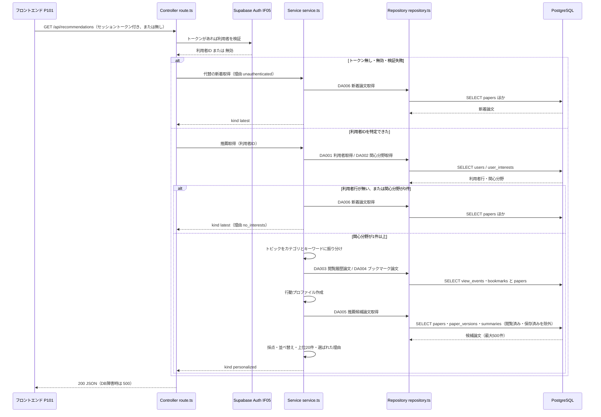

# BE詳細設計書 — F08 レコメンド（推薦）

## 0. 文書情報

| 項目 | 値 |
| :--- | :--- |
| 設計書ID | F08-BE |
| 親ID | F08 |
| 親設計書 | `基本設計書_概要.md` §4.1 機能一覧 |
| 版 | 1.0（新規作成） |
| 作成日 | 2026-10-26 |
| 更新日 | 2026-10-26 |
| 作成方法 | `source/` 配下の企画資料と確定済みの上流設計書からの設計（creating-backend-detailed-design v1.5.0 準拠） |
| インプット | (a) `source/`（全6ファイル。F08 に関わる行は `source/01_企画概要.md:11,24`、`source/02_機能要求定義.md:13,37-42,45,48`、`source/03_システム構成.md:8-10,35-42,51`、`source/04_収益化とロードマップ.md:4,35`）／(b) `docs/基本設計書_概要.md`（§2 BF08・EX04・EX05、§4 機能一覧 F08・オンライン処理設計、§6 T001〜T008・CRUD図、§7 IF05・API05、§8、§9、§11 ARC001・ARC003・ARC004・ARC009・ARC010、付録 Q11・Q23・Q25・Q27・Q29・Q31・Q32）／関連する確定済み設計書 `docs/db/DB.T001`・`T002`・`T003`・`T005`・`T006`・`T007`・`T008` の DB物理設計書、`docs/screens/画面.P101.画面基本設計.md`／(c) `legacy/` |
| インプットの性質 | `source/` にあるのは企画・初期設計案の Markdown 6ファイルだけで、アプリのソースコード（ルーティング・コントローラ・SQL）は1行もない（上流 §前提）。このため本書は**新規設計**であり、本書の関数・SQL・定数は企画資料と上流設計書から導いた計画上の実体である。資料に値が無いもの（件数・期間・係数・キー名）は実装できる具体値を置いたうえで※推測と明記し、付録ではなく各表の該当行で確認事項を示す |
| 既存資料の突合 | `legacy/` は空ディレクトリ（ファイル0件）で、突合する既存設計・業務資料は無い。本書の既存版（`docs/detail/be/BE.F08.BE詳細設計.md`）も無かったため、引き継ぐ記述・ID は上流設計書で採番済みのもの（F08、API05、BF08、EX04、EX05、T001〜T008、IF05、ARC001・ARC003・ARC004・ARC009・ARC010、B008、P101、P106）だけである |

## 1. バックエンド構成・モジュール設計

* **対象ドメイン**: 推薦系（recommendation） — ホーム画面（P101）に出すおすすめ論文の選定。ログイン中で関心分野を登録済みの利用者には、関心カテゴリ・キーワードとの一致、行動履歴（閲覧・ブックマーク）、新しさから点数を付けた論文を返し、それ以外の利用者には新着論文を代わりに返す（上流 F08、BF08、`source/02_機能要求定義.md:13,38`）。初期（Phase 2）はルールベースの採点で、Embedding と pgvector による照合（`source/02_機能要求定義.md:40-42`）は将来の切り替え先として §4 に方針だけを置く。
* **対象APIエンドポイント**: GET /api/recommendations（API05）の1件。
  * **全数である根拠**: 上流 §7 内部API一覧の全8件（API01〜API08）のうち、カテゴリが「推薦」の行は API05 だけで、`source/03_システム構成.md:46-54` の API設計案にも推薦のパスは `:51` の1行しかない。関心分野の保存（BF06）は F06、閲覧の記録は F15、ブックマークの登録・解除（API06・API07）は F07 の責務であり、本書の対象外とする。
* **ディレクトリ/ファイル構造**（※推測: 実装時の構成は上流 §9 で未定義。上流 §9 の想定「`web/` に Next.js の画面と画面向けAPI」に合わせ、上流 BF08 の図のとおり Next.js API（Route Handler, TypeScript）で実装する。FastAPI 側には F08 の処理を置かない）:

```
web/
├── app/api/recommendations/
│   └── route.ts                 … API05 の受け口（GET ハンドラ）
├── lib/recommendations/
│   ├── service.ts               … 推薦の手順全体（分岐・代替の新着返却）
│   ├── topics.ts                … 関心トピックをカテゴリとキーワードに振り分ける
│   ├── behavior.ts              … 閲覧・ブックマークから行動プロファイルを作る
│   ├── scoring.ts               … 点数計算と並べ替え・選ばれた理由の組み立て
│   ├── mapper.ts                … DBの行を応答の論文要素へ変換する
│   ├── repository.ts            … DA001〜DA006 の SQL 発行
│   └── constants.ts             … 件数・期間・係数の定数（§4 定数・区分値ロースター）
├── lib/auth/
│   └── session.ts               … セッション検証（F06 と共用。※上流未定義の共通部品）
├── lib/db/
│   └── client.ts                … PostgreSQL 接続（DATABASE_URL。全機能で共用）
└── lib/arxiv/
    └── categories.ts            … arXiv の分類名一覧（DB.T006 §9 No.9 の確認待ち。アプリ定数として持つ案）
```

* **処理シーケンス図**（上流 BF08 を詳細化したもの。DA番号は §3 のデータアクセス一覧）:



## 2. API・インターフェース詳細設計

* **外部サービス連携仕様**（全数ロースター）:

| ID | 連携先 | 連携方式 | エンドポイント / 接続先 | 認証方式 | タイムアウト | リトライ方針 | エラー時の挙動 | 定義状況 | 詳細の所在 |
| :--- | :--- | :--- | :--- | :--- | :--- | :--- | :--- | :--- | :--- |
| IF05 | Supabase Auth | SDK 経由の HTTPS 呼び出し（※推測: `@supabase/supabase-js` の `auth.getUser(token)`） | 環境変数 `NEXT_PUBLIC_SUPABASE_URL` が指す Supabase プロジェクトの認証エンドポイント（上流 §9） | 利用者のアクセストークン（JWT）を渡して検証する。サーバ側は公開キー `NEXT_PUBLIC_SUPABASE_ANON_KEY` でクライアントを作る（※推測） | 3秒（※推測） | リトライしない（※推測）。ホーム画面の表示を待たせないため、失敗したら未ログインとして扱って先へ進む | トークンが無効・期限切れのとき、または認証サービスに3秒以内につながらないときは、エラーを返さず未ログインとして新着論文を返す（kind latest・理由 unauthenticated）。前者は INFO、後者は WARN でログに残す（§6） | 詳細 | §4 resolveSessionUser |

**総件数: 1件。全数である根拠**: 上流 §7 外部連携一覧の全9件（IF01〜IF09）のうち、F08 の処理が呼ぶのはセッション検証の IF05 だけである。IF04 LLM API は、画面表示のたびに LLM を呼ばない方針（`source/02_機能要求定義.md:45`、上流 ARC001）により初期の推薦では呼ばない。将来の Embedding 照合で使う論文 Embedding はバッチ B008 が事前に作る（上流 §4 バッチ処理設計）ため、API05 から LLM API を呼ぶことは将来も無い想定である（※推測: 利用者プロフィール側の Embedding の作り方は上流 Q29 で未定）。IF01〜IF03・IF06〜IF09 は F08 と関わらない。

* **API詳細仕様**（全数ロースター）:

| ID | メソッド | エンドポイント | 概要 | 認証 | 定義状況 | 詳細の所在 |
| :--- | :--- | :--- | :--- | :--- | :--- | :--- |
| API05 | GET | /api/recommendations | ログイン中で関心分野を登録済みの利用者には採点したおすすめ論文を、それ以外には代わりの新着論文を返す | 任意（※推測。上流 §7 API05） | 詳細 | §2「GET /api/recommendations」 |

**総件数: 1件。全数である根拠**: §1「対象APIエンドポイント」のとおり、上流 §7 内部API一覧で推薦カテゴリに属するのは API05 だけである。

### GET /api/recommendations

* **概要**: ホーム画面（P101）のおすすめ領域に出す論文を返す。ログイン中で関心分野が1件以上ある利用者には、関心カテゴリ・キーワードとの一致・行動履歴・新しさで採点した論文を点数の高い順に最大20件返す（`source/02_機能要求定義.md:13,38`）。未ログインの利用者と、関心分野を1件も登録していない利用者には、エラーにせず新着論文を投稿日の新しい順に最大20件返す（上流 BF08・API05「未ログイン時は 401 ではなく新着論文を返す」）。どちらを返したかは応答の `kind` で示し、画面はこれを見ておすすめ一覧と案内表示を出し分ける。要約は事前に生成・検証済みのものだけを読み、LLM は呼ばない（`source/02_機能要求定義.md:45`）。
* **認証要否**: 任意（※推測。上流 §7 API05）。ログインしていれば会員 Free・会員 Pro のどちらでも同じ結果を返す。推薦は Free に含まれる「基本推薦」であり、プランによる差を設けない（`source/04_収益化とロードマップ.md:4`、上流 §8 認証・認可設計）。
* **リクエストパラメータ**:

| 種別(Path/Query/Body/Header) | 項目名 | 型 | 必須 | 制約・バリデーション | 説明 |
| :--- | :--- | :--- | :--- | :--- | :--- |
| Header | Authorization | string | 任意 | `Bearer ` に続けて Supabase Auth のアクセストークン（JWT）を置く形式（※推測） | 利用者を特定するための値。無い・形式が違う・検証に失敗した場合は未ログインとして扱い、400 や 401 は返さない |
| Header | Cookie | string | 任意 | Supabase Auth のセッション Cookie（※推測: `@supabase/ssr` が発行する Cookie 名に従う） | Authorization ヘッダーが無いときに、ブラウザが自動で送る Cookie からトークンを取り出す。両方あれば Authorization ヘッダーを優先する（※推測） |
| Query | （なし） | — | — | 件数・ページの指定は受け付けない。クエリ文字列が付いていても読まずに無視する（※推測） | 上流 API05「リクエストパラメータ: なし。件数指定は未定義」をそのまま引き継ぐ。返却件数は §4 定数 K01・K09 で固定する |

* **レスポンス（成功時）**（※推測: 上流 API05 の応答は「GET /api/papers と同じ要素構成と、各論文が選ばれた理由」までしか決まっていないため、キー名・構造は本書で定める。`kind` と `fallbackReason` は※上流未定義の項目で、P101 §7「おすすめと代わりの新着のどちらを返したか見分ける手段が未定義」への回答として置く）:

```json
{
  "status": "success",
  "data": {
    "kind": "personalized",
    "fallbackReason": null,
    "generatedAt": "2026-10-26T03:15:00Z",
    "items": [
      {
        "arxivId": "2410.01234",
        "version": 2,
        "titleOriginal": "Efficient Transformers for Long Documents",
        "titleJa": "長文書向けの効率的なTransformer",
        "authors": ["Taro Yamada", "Jane Doe"],
        "categories": ["cs.LG", "cs.CL"],
        "primaryCategory": "cs.LG",
        "submittedAt": "2026-10-24T17:59:00Z",
        "updatedAt": null,
        "summaryShort": "長い文書でも計算量を抑えたまま精度を保つ注意機構を提案し、3種のベンチマークで既存手法を上回った。",
        "sourceScope": "abstract_only",
        "summaryStatus": "published",
        "score": 0.8125,
        "reasons": [
          { "type": "category", "topic": "cs.LG" },
          { "type": "keyword", "topic": "transformer" }
        ]
      }
    ]
  }
}
```

  代わりの新着論文を返すときの形（`items` の各要素の構成は同じで、`score` は null、`reasons` は空配列）:

```json
{
  "status": "success",
  "data": {
    "kind": "latest",
    "fallbackReason": "unauthenticated",
    "generatedAt": "2026-10-26T03:15:00Z",
    "items": [
      {
        "arxivId": "2410.05678",
        "version": 1,
        "titleOriginal": "A Survey of Diffusion Models",
        "titleJa": null,
        "authors": ["Hanako Sato"],
        "categories": ["cs.CV"],
        "primaryCategory": "cs.CV",
        "submittedAt": "2026-10-25T18:00:00Z",
        "updatedAt": null,
        "summaryShort": null,
        "sourceScope": null,
        "summaryStatus": "not_published",
        "score": null,
        "reasons": []
      }
    ]
  }
}
```

  応答項目の定義:

| 項目 | 型 | 値の決め方 | 説明 |
| :--- | :--- | :--- | :--- |
| data.kind | string（`personalized` / `latest`） | 区分値 V01 | 利用者向けに採点したおすすめか、代わりに返した新着論文かを示す。P101 はこの値でおすすめ一覧（H10・H11）と案内（H22・H23）を出し分ける |
| data.fallbackReason | string または null（`unauthenticated` / `no_interests`） | 区分値 V02。kind が personalized のときは null | 代わりの新着を返した理由。P101 の案内文（未ログイン向けか関心分野未登録向けか）の出し分けに使える（※推測: P101 は自前のログイン状態で出し分ける設計のため、使うかは FE 詳細設計で決める） |
| data.generatedAt | string（ISO 8601、UTC） | 応答を組み立てた時刻 | 新しさの点数をどの時点で計算したかを示す。画面には出さない |
| data.items | array | 0〜20件 | おすすめ論文、または代わりの新着論文の並び。並び順は kind ごとに §4 scoreCandidates・getLatestPapers の定めに従う |
| items[].arxivId | string | `papers.arxiv_id` | 論文詳細（P104）の URL に使う業務キー |
| items[].version | integer | `papers.latest_version` | 表示中の版。版を区別して表示する決まり（上流 ARC009）に使う |
| items[].titleOriginal | string | `papers.title` | 英語の原題 |
| items[].titleJa | string または null | 合格済み30秒要約の `json_content` 内の日本語タイトル（※推測: キー名 `title_ja`。キー名は要約スキーマ ARC003 の方式設計書で確定する） | 合格済みの30秒要約が無い論文は null。画面は原題を代わりに出す |
| items[].authors | array of string | `papers.authors` | 著者名の並び |
| items[].categories | array of string | `papers.categories` | arXiv の分類名の並び |
| items[].primaryCategory | string | `papers.categories` の先頭要素 | 先頭要素を主カテゴリとして扱う決まり（DB.T001 §4.2 categories） |
| items[].submittedAt | string（ISO 8601、UTC） | `papers.submitted_at` | 投稿日時。新しさの点数の基準（※推測: どの日付を新しさに使うかは上流 Q11 で未確定） |
| items[].updatedAt | string または null | `papers.updated_at` | arXiv 上の改訂日時。投稿日と区別して表示する |
| items[].summaryShort | string または null | 合格済み30秒要約の `json_content` 内の結論文（※推測: キー名 `conclusion`。ARC003 で確定する） | カードに出す30秒要約。合格済みのものが無ければ null |
| items[].sourceScope | string または null（`abstract_only` / `full_text`） | 合格済み30秒要約の `summaries.source_scope` | 「Abstractベース」の表示に使う。要約が無ければ null |
| items[].summaryStatus | string（`published` / `not_published`） | 区分値 V03 | 30秒要約を表示できるかを示す。`not_published` のとき画面は処理状況と速報版である旨を出す（P101 H21） |
| items[].score | number または null | 0.0000〜1.0000、小数4桁に丸める | 推薦の点数。kind が latest のときは null。画面には出さず、並び順の根拠の確認に使う |
| items[].reasons | array | 0〜3件。kind が latest のときは空配列 | 選ばれた理由。各要素は `type`（区分値 V04）と `topic`（一致した関心トピックの文字列。type が history のときは一致したカテゴリ名）を持つ |

* **レスポンスヘッダー**:
  * `Content-Type: application/json; charset=utf-8`
  * `Cache-Control: private, no-store`（※推測）。利用者ごとに中身が変わるため、CDN や共有キャッシュに保存させない。kind が latest の応答も、同じ URL で利用者向けの応答と混ざらないよう同じ値にする。
* **ステータスコード**:

| コード | 条件 |
| :--- | :--- |
| 200 | 正常終了。利用者向けのおすすめ（0件を含む）か、代わりの新着論文を返したとき。未ログイン・トークンの無効・期限切れ・認証サービスの応答なしも、新着論文を返して 200 とする（上流 API05） |
| 405 | GET 以外のメソッドで呼ばれたとき。Next.js の Route Handler が GET だけを公開するため、フレームワークが自動で返す（※推測） |
| 500 | DB への接続失敗・SQL の実行失敗・応答の組み立て中の想定外の例外が起きたとき。本文は `{"status":"error","error":{"code":"INTERNAL_ERROR","message":"おすすめ論文を取得できませんでした。"}}` とし、例外の詳細は返さない（※推測。§6） |

  400 と 401 は返さない。リクエストパラメータを受け付けないため入力不正が起きず、未ログインは新着論文を返す決まりのためである（上流 §4 オンライン処理設計のエラー応答のうち、API05 に当てはまるのは 500 だけ）。

* **ビジネスロジック・副作用**:
  1. リクエストからアクセストークンを取り出す。Authorization ヘッダーを優先し、無ければセッション Cookie から取り出す（resolveSessionUser）。
  2. トークンがあれば Supabase Auth（IF05）で検証し、利用者IDを得る。トークンが無い・検証に失敗した・3秒以内に応答が無いときは未ログインとして扱い、手順8へ進む（理由 unauthenticated）。
  3. 利用者テーブルから本人の行を読む（DA001）。行が無いとき（会員登録の途中で利用者レコードが作られていない状態。上流 BF06）は手順8へ進む（理由 no_interests）。
  4. 本人の関心分野を全件読む（DA002）。0件なら手順8へ進む（理由 no_interests）。
  5. 関心トピックを、arXiv の分類名一覧に含まれるものはカテゴリ、含まれないものはキーワードに振り分ける（classifyTopics。DB.T006 §4.3 (2) の判定方法）。
  6. 本人が最近開いた論文（最新100件、DA003）と、最近ブックマークした論文（最新100件、DA004）のカテゴリから行動プロファイルを作る（buildBehaviorProfile）。
  7. 投稿日時が直近30日以内で、関心カテゴリのどれかを含むかタイトル・Abstract に関心キーワードのどれかを含み、本人がまだ開いておらずブックマークもしていない論文を、投稿日の新しい順に最大500件読む（DA005）。各候補を採点し（scoreCandidates）、点数の高い順に最大20件を選んで選ばれた理由を付け、kind personalized で返す。候補が0件なら空の配列を返す（P101 は該当なし表示 H31 を出す）。
  8. 代わりの新着論文として、投稿日の新しい順に最大20件を読み（DA006）、kind latest と手順2〜4で決まった理由を付けて返す。
  9. DB を書き換える処理は無い。閲覧イベントも記録しない（閲覧の記録は論文詳細を開いたときの F15 の責務。上流 BF05、ARC010、P101 §7）。

## 3. データアクセス（ORM / クエリ）設計

* **データアクセス一覧（全数ロースター）**:

| DA-ID | 処理名 | 概要 | 呼出元（関数/API） | 対象物理テーブル | 種別 (SELECT/INSERT/UPDATE/DELETE) | 定義状況 (詳細/簡易) | 詳細の所在 |
| :--- | :--- | :--- | :--- | :--- | :--- | :--- | :--- |
| DA001 | 利用者1件取得 | セッションで特定した利用者の行があるかを確かめる | findUserById ← getRecommendations ← GET /api/recommendations | users | SELECT | 簡易 | §3 発行SQL DA001 |
| DA002 | 関心分野全件取得 | 利用者が登録した関心トピックと重みを全件読む | findInterestsByUserId ← getRecommendations | user_interests | SELECT | 簡易 | §3 発行SQL DA002 |
| DA003 | 閲覧履歴論文取得 | 利用者が最近開いた論文のカテゴリを、閲覧の新しい順に最大100件読む | findRecentViewedPapers ← getRecommendations | view_events, papers | SELECT | 詳細 | §3 詳細定義 DA003 |
| DA004 | ブックマーク論文取得 | 利用者が最近ブックマークした論文のカテゴリを、保存の新しい順に最大100件読む | findRecentBookmarkedPapers ← getRecommendations | bookmarks, papers | SELECT | 詳細 | §3 詳細定義 DA004 |
| DA005 | 推薦候補論文取得 | 直近30日の論文から関心に一致し未読・未保存のものを、要約付きで最大500件読む | findCandidatePapers ← getRecommendations | papers, paper_versions, summaries, bookmarks, view_events | SELECT | 詳細 | §3 詳細定義 DA005 |
| DA006 | 新着論文取得（代替） | 投稿日の新しい論文を要約付きで最大20件読む | findLatestPapers ← getLatestPapers ← GET /api/recommendations | papers, paper_versions, summaries | SELECT | 詳細 | §3 詳細定義 DA006 |

**総件数: 6件（SELECT 6件、INSERT・UPDATE・DELETE 0件）。全数である根拠**: 上流 §6 CRUD図の F08 行で操作のあるテーブル6つ（papers R、summaries R、users R、user_interests R、bookmarks R、view_events R）を、§2 ビジネスロジックの手順3・4・6・7・8で読む単位に割り当てたものである。DB物理設計書側で F08 の操作として登録済みの行（DB.T001 §4.6 No.7「カテゴリと投稿日時で候補を読む」→ DA005・DA006、DB.T003 §4.6 No.5「おすすめ論文に添える30秒要約を読む」→ DA005・DA006、DB.T005 §4.6 No.3「おすすめを返す利用者を特定する」→ DA001、DB.T006 の F08 行 → DA002、DB.T007 §4.6 No.2 → DA004、DB.T008 §4.6 No.1 → DA003）がすべてどれかの DA に対応する。repository.ts に置く関数は DA ごとに1つで、6関数と一致する。
* **paper_versions の参照について（※上流要確認）**: 上流 CRUD図の F08 行は `paper_versions` を「-」としているが、30秒要約（summaries）は版（`summaries.paper_version_id`）にひも付くため、論文の最新版の要約を引くには `paper_versions` を経由して読む必要がある（DA005・DA006）。同じく要約を表示する F02 の行は R になっており、F08 も R とするよう上流の CRUD図と DB.T002 §4.6 への追記を求める。
* **定義状況の判定**（completeness 3-1）: DA001・DA002 は1テーブルを主キーの先頭列で引くだけの単純な取得で、分岐・状態変更・性能上の注意が無いため簡易とした。DA003・DA004 は2テーブルの結合（3-1 の3）と件数の上限（3-1 の6）があるため詳細、DA005 は5テーブルにまたがり（3-1 の3）、関心の種類で SQL の形が変わり（3-1 の4）、除外の業務ルールを含む（3-1 の7）ため詳細、DA006 は3テーブルの結合（3-1 の3）があるため詳細とした。
* **実装方式**（※推測: ORM の採否は上流で未定義）: 配列の重なり判定・LATERAL 結合・LIKE のエスケープを使うため、ORM ではなく PostgreSQL クライアント（`pg`）でプレースホルダ付きの SQL を発行する。値はすべてバインド変数で渡し、SQL 文字列へ連結しない。接続は `DATABASE_URL`（上流 §9）を使うサーバ側の接続であり、Row Level Security を経由しないため、利用者IDでの絞り込みは各 SQL の WHERE 句で必ず行う。

* **データアクセス詳細定義**（ロースターのうち定義状況＝詳細の4件）:

| DA-ID | 処理名 | 対象物理テーブル | JOIN / Include | 抽出条件 (Where) / ソート | トランザクション境界 | N+1対策・性能上の注意 |
| :--- | :--- | :--- | :--- | :--- | :--- | :--- |
| DA003 | 閲覧履歴論文取得 | view_events, papers | 閲覧イベントを先に利用者で絞って最新100件にしてから、論文IDで papers と内部結合する（INNER JOIN papers ON papers.id = view_events.paper_id） | 本人の閲覧だけを対象にし（view_events.user_id = 利用者ID）、閲覧日時の新しい順（viewed_at DESC）に100件で打ち切る。同じ論文を複数回開いた行はそのまま返し、論文単位への集約は buildBehaviorProfile が行う | なし（参照のみ。§6 トランザクション制御） | 索引 `idx_view_events_user_id_viewed_at`（user_id, viewed_at DESC）で利用者の最新行から順に読むため、並べ替えは発生しない。結合は100件以下の主キー引き（`pk_papers`）で、ループの中で論文を1件ずつ引くことはしない。読む列は id と categories だけにし、Abstract のような大きい列は読まない |
| DA004 | ブックマーク論文取得 | bookmarks, papers | ブックマークを先に利用者で絞って最新100件にしてから、論文IDで papers と内部結合する（INNER JOIN papers ON papers.id = bookmarks.paper_id） | 本人のブックマークだけを対象にし（bookmarks.user_id = 利用者ID）、保存日時の新しい順（created_at DESC）に100件で打ち切る | なし（参照のみ） | 索引 `idx_bookmarks_user_id_created_at` で並べ替えなしに読む。読む列は id と categories だけ。100件で打ち切るのは、長く使った利用者でもこの処理の読み取り量を一定に保つため（※推測） |
| DA005 | 推薦候補論文取得 | papers, paper_versions, summaries, bookmarks, view_events | 論文の最新版を左外部結合（LEFT JOIN paper_versions ON paper_versions.paper_id = papers.id AND paper_versions.version = papers.latest_version）し、その版の合格済み30秒要約の最新1件を LATERAL 副問い合わせで左外部結合する。bookmarks と view_events は「本人の行が存在しない」ことの確認（NOT EXISTS）にだけ使う | (1) 投稿日時が基準時刻（現在時刻から30日前）以降の論文に限る（submitted_at >= 基準時刻）。(2) 論文のカテゴリが関心カテゴリのどれかと重なるか（categories && 関心カテゴリ配列）、タイトルか Abstract が関心キーワードのどれかを大文字小文字を区別せず部分一致で含む（title ILIKE / abstract ILIKE）。(3) 本人がブックマーク済みの論文を除く。(4) 本人が開いたことのある論文を除く。並びは投稿日時の新しい順、同時刻は論文IDの大きい順（submitted_at DESC, id DESC）で、500件で打ち切る。要約は、要約種別が30秒（summary_type = 'short'）、言語が日本語（language = 'ja'）、検証に合格（validation_status = 'passed'）のうち生成日時が最新の1件 | なし（参照のみ） | カテゴリ条件は GIN 索引 `idx_papers_categories`、期間条件は `idx_papers_submitted_at` が効く。キーワードの部分一致は索引が効かないため、期間条件で直近30日に絞った行だけを対象にする（※推測: arXiv の新着は1日あたり数百〜千件規模のため、30日で数万行の走査を見込む。応答時間の目標は上流 Q31 で未定）。要約は `idx_summaries_lookup`（paper_version_id, summary_type, language, generated_at DESC）で1件ずつ引くが、結合は1本の SQL の中で行われ、アプリ側のループから SQL を繰り返し発行しない。除外の NOT EXISTS は主キー `pk_bookmarks`・`pk_view_events` の先頭列（user_id, paper_id）で引く。500件で打ち切るため、30日以内でも古い候補は採点の対象から外れる（新しさの点数が低い論文なので、上位20件への影響は小さいと見込む ※推測）。読む列から Abstract を外し、キーワードの一致結果だけを SQL 側で配列にして返す |
| DA006 | 新着論文取得（代替） | papers, paper_versions, summaries | DA005 と同じく最新版と合格済み30秒要約を左外部結合する | 条件は付けず、投稿日時の新しい順、同時刻は論文IDの大きい順（submitted_at DESC, id DESC）で20件で打ち切る | なし（参照のみ） | `idx_papers_submitted_at`（submitted_at DESC, id DESC）の並び順どおりに先頭20件だけを読む。要約の結合は20件分だけ行われる |

* **発行SQL**（全6件。すべてバインド変数付きの生SQLで、ORM は使わない）:

**DA001 利用者1件取得**（呼出元: findUserById。`$1` = 利用者ID）

```sql
SELECT user_id, plan
FROM users
WHERE user_id = $1;
```

**DA002 関心分野全件取得**（呼出元: findInterestsByUserId。`$1` = 利用者ID）

```sql
SELECT topic, weight
FROM user_interests
WHERE user_id = $1
ORDER BY weight DESC, topic ASC;
```

**DA003 閲覧履歴論文取得**（呼出元: findRecentViewedPapers。`$1` = 利用者ID、`$2` = 件数上限 K05 = 100）

```sql
SELECT p.id AS paper_id, p.categories, v.viewed_at
FROM (
    SELECT paper_id, viewed_at
    FROM view_events
    WHERE user_id = $1
    ORDER BY viewed_at DESC
    LIMIT $2
) AS v
INNER JOIN papers AS p ON p.id = v.paper_id
ORDER BY v.viewed_at DESC;
```

**DA004 ブックマーク論文取得**（呼出元: findRecentBookmarkedPapers。`$1` = 利用者ID、`$2` = 件数上限 K06 = 100）

```sql
SELECT p.id AS paper_id, p.categories, b.created_at
FROM (
    SELECT paper_id, created_at
    FROM bookmarks
    WHERE user_id = $1
    ORDER BY created_at DESC
    LIMIT $2
) AS b
INNER JOIN papers AS p ON p.id = b.paper_id
ORDER BY b.created_at DESC;
```

**DA005 推薦候補論文取得**（呼出元: findCandidatePapers。動的SQL）

  バインド変数: `$1` = 利用者ID、`$2` = 基準時刻（現在時刻 − K03 = 30日）、`$3` = 関心カテゴリの配列（text[]）、`$4` = 関心キーワードの配列（text[]、正規化済みの小文字）、`$5` = `$4` と同じ順に並べた LIKE パターンの配列（text[]。各キーワードの `\`・`%`・`_` を `\` でエスケープし、前後に `%` を付けたもの。escapeLikePattern で作る）、`$6` = 件数上限 K04 = 500。

  組み立ての分岐は、classifyTopics の結果で次の3通りに決まる。関心分野が1件以上ある場合だけ呼ばれ、各トピックはカテゴリかキーワードのどちらかに必ず振り分けられるため、両方が空になる形は無い。分岐の対象は「関心一致の条件」と「一致キーワードの列」の2か所だけで、残りは共通である。

| 形 | 選ぶ条件 | 関心一致の条件 `{MATCH}` | 一致キーワードの列 `{MATCHED_KEYWORDS}` | 使うバインド変数 |
| :--- | :--- | :--- | :--- | :--- |
| A | 関心カテゴリが1件以上、関心キーワードが0件 | `p.categories && $3::text[]` | `'{}'::text[]` | 発行時の番号は $1 利用者ID・$2 基準時刻・$3 関心カテゴリ配列・$4 件数上限（骨格の $4・$5 は渡さず、$6 を $4 に詰める） |
| B | 関心カテゴリが0件、関心キーワードが1件以上 | `EXISTS (SELECT 1 FROM unnest($5::text[]) AS pat(pattern) WHERE p.title ILIKE pat.pattern ESCAPE '\' OR p.abstract ILIKE pat.pattern ESCAPE '\')` | `ARRAY(SELECT kw.keyword FROM unnest($4::text[], $5::text[]) AS kw(keyword, pattern) WHERE p.title ILIKE kw.pattern ESCAPE '\' OR p.abstract ILIKE kw.pattern ESCAPE '\')` | 発行時の番号は $1 利用者ID・$2 基準時刻・$3 キーワード配列・$4 パターン配列・$5 件数上限（骨格の $3 は渡さず、$4〜$6 を $3〜$5 に詰める。左の列の式も詰めた番号で発行する。全文は下の形B） |
| C | 関心カテゴリ・関心キーワードともに1件以上 | `(p.categories && $3::text[] OR EXISTS (SELECT 1 FROM unnest($5::text[]) AS pat(pattern) WHERE p.title ILIKE pat.pattern ESCAPE '\' OR p.abstract ILIKE pat.pattern ESCAPE '\'))` | 形B と同じ（ただし番号は骨格のまま $4・$5） | 発行時の番号は骨格のまま $1 利用者ID・$2 基準時刻・$3 関心カテゴリ配列・$4 キーワード配列・$5 パターン配列・$6 件数上限 |

  共通の骨格（`{MATCH}` と `{MATCHED_KEYWORDS}` に上表の文字列を差し込む。差し込むのはコード内の固定文字列だけで、利用者の入力値は差し込まない）:

```sql
SELECT
    p.id,
    p.arxiv_id,
    p.title,
    p.authors,
    p.categories,
    p.submitted_at,
    p.updated_at,
    p.latest_version,
    {MATCHED_KEYWORDS} AS matched_keywords,
    s.json_content,
    s.source_scope
FROM papers AS p
LEFT JOIN paper_versions AS pv
       ON pv.paper_id = p.id
      AND pv.version  = p.latest_version
LEFT JOIN LATERAL (
    SELECT su.json_content, su.source_scope
    FROM summaries AS su
    WHERE su.paper_version_id  = pv.id
      AND su.summary_type      = 'short'
      AND su.language          = 'ja'
      AND su.validation_status = 'passed'
    ORDER BY su.generated_at DESC
    LIMIT 1
) AS s ON TRUE
WHERE p.submitted_at >= $2
  AND {MATCH}
  AND NOT EXISTS (SELECT 1 FROM bookmarks   AS b  WHERE b.user_id  = $1 AND b.paper_id  = p.id)
  AND NOT EXISTS (SELECT 1 FROM view_events AS ve WHERE ve.user_id = $1 AND ve.paper_id = p.id)
ORDER BY p.submitted_at DESC, p.id DESC
LIMIT $6;
```

  生成され得る SQL の全形（上の骨格に差し込んだ結果。形A・形B ではバインド変数の番号を詰めて発行する）:

  形A（カテゴリだけ）:

```sql
SELECT p.id, p.arxiv_id, p.title, p.authors, p.categories, p.submitted_at, p.updated_at, p.latest_version,
       '{}'::text[] AS matched_keywords,
       s.json_content, s.source_scope
FROM papers AS p
LEFT JOIN paper_versions AS pv ON pv.paper_id = p.id AND pv.version = p.latest_version
LEFT JOIN LATERAL (
    SELECT su.json_content, su.source_scope FROM summaries AS su
    WHERE su.paper_version_id = pv.id AND su.summary_type = 'short' AND su.language = 'ja' AND su.validation_status = 'passed'
    ORDER BY su.generated_at DESC LIMIT 1
) AS s ON TRUE
WHERE p.submitted_at >= $2
  AND p.categories && $3::text[]
  AND NOT EXISTS (SELECT 1 FROM bookmarks   AS b  WHERE b.user_id  = $1 AND b.paper_id  = p.id)
  AND NOT EXISTS (SELECT 1 FROM view_events AS ve WHERE ve.user_id = $1 AND ve.paper_id = p.id)
ORDER BY p.submitted_at DESC, p.id DESC
LIMIT $4;
```

  形B（キーワードだけ）:

```sql
SELECT p.id, p.arxiv_id, p.title, p.authors, p.categories, p.submitted_at, p.updated_at, p.latest_version,
       ARRAY(SELECT kw.keyword FROM unnest($3::text[], $4::text[]) AS kw(keyword, pattern)
             WHERE p.title ILIKE kw.pattern ESCAPE '\' OR p.abstract ILIKE kw.pattern ESCAPE '\') AS matched_keywords,
       s.json_content, s.source_scope
FROM papers AS p
LEFT JOIN paper_versions AS pv ON pv.paper_id = p.id AND pv.version = p.latest_version
LEFT JOIN LATERAL (
    SELECT su.json_content, su.source_scope FROM summaries AS su
    WHERE su.paper_version_id = pv.id AND su.summary_type = 'short' AND su.language = 'ja' AND su.validation_status = 'passed'
    ORDER BY su.generated_at DESC LIMIT 1
) AS s ON TRUE
WHERE p.submitted_at >= $2
  AND EXISTS (SELECT 1 FROM unnest($4::text[]) AS pat(pattern)
              WHERE p.title ILIKE pat.pattern ESCAPE '\' OR p.abstract ILIKE pat.pattern ESCAPE '\')
  AND NOT EXISTS (SELECT 1 FROM bookmarks   AS b  WHERE b.user_id  = $1 AND b.paper_id  = p.id)
  AND NOT EXISTS (SELECT 1 FROM view_events AS ve WHERE ve.user_id = $1 AND ve.paper_id = p.id)
ORDER BY p.submitted_at DESC, p.id DESC
LIMIT $5;
```

  形C（カテゴリとキーワードの両方）:

```sql
SELECT p.id, p.arxiv_id, p.title, p.authors, p.categories, p.submitted_at, p.updated_at, p.latest_version,
       ARRAY(SELECT kw.keyword FROM unnest($4::text[], $5::text[]) AS kw(keyword, pattern)
             WHERE p.title ILIKE kw.pattern ESCAPE '\' OR p.abstract ILIKE kw.pattern ESCAPE '\') AS matched_keywords,
       s.json_content, s.source_scope
FROM papers AS p
LEFT JOIN paper_versions AS pv ON pv.paper_id = p.id AND pv.version = p.latest_version
LEFT JOIN LATERAL (
    SELECT su.json_content, su.source_scope FROM summaries AS su
    WHERE su.paper_version_id = pv.id AND su.summary_type = 'short' AND su.language = 'ja' AND su.validation_status = 'passed'
    ORDER BY su.generated_at DESC LIMIT 1
) AS s ON TRUE
WHERE p.submitted_at >= $2
  AND (p.categories && $3::text[]
       OR EXISTS (SELECT 1 FROM unnest($5::text[]) AS pat(pattern)
                  WHERE p.title ILIKE pat.pattern ESCAPE '\' OR p.abstract ILIKE pat.pattern ESCAPE '\'))
  AND NOT EXISTS (SELECT 1 FROM bookmarks   AS b  WHERE b.user_id  = $1 AND b.paper_id  = p.id)
  AND NOT EXISTS (SELECT 1 FROM view_events AS ve WHERE ve.user_id = $1 AND ve.paper_id = p.id)
ORDER BY p.submitted_at DESC, p.id DESC
LIMIT $6;
```

**DA006 新着論文取得（代替）**（呼出元: findLatestPapers。`$1` = 件数上限 K09 = 20）

```sql
SELECT p.id, p.arxiv_id, p.title, p.authors, p.categories, p.submitted_at, p.updated_at, p.latest_version,
       s.json_content, s.source_scope
FROM papers AS p
LEFT JOIN paper_versions AS pv ON pv.paper_id = p.id AND pv.version = p.latest_version
LEFT JOIN LATERAL (
    SELECT su.json_content, su.source_scope FROM summaries AS su
    WHERE su.paper_version_id = pv.id AND su.summary_type = 'short' AND su.language = 'ja' AND su.validation_status = 'passed'
    ORDER BY su.generated_at DESC LIMIT 1
) AS s ON TRUE
ORDER BY p.submitted_at DESC, p.id DESC
LIMIT $1;
```

## 4. サーバー側機能・処理ロジック設計（IPO設計）

* **関数ロースター（全数）**:

| ID（関数名） | 所属モジュール | 概要 | 層 | 定義状況 | 詳細の所在 |
| :--- | :--- | :--- | :--- | :--- | :--- |
| GET | `web/app/api/recommendations/route.ts` | API05 の受け口。セッションを確かめて推薦か代替の新着かを呼び分け、応答とステータスコードを組み立てる | コントローラ | 詳細 | §4 IPO GET |
| resolveSessionUser | `web/lib/auth/session.ts`（※上流未定義の共通部品。F06 と共用） | リクエストのトークンを Supabase Auth で検証し、利用者IDか未ログインかを返す | 共通（認証） | 詳細 | §4 IPO resolveSessionUser |
| getRecommendations | `web/lib/recommendations/service.ts` | 利用者ID を受け取り、関心分野の有無で推薦と代替の新着を分け、推薦の全手順を進める | サービス | 詳細 | §4 IPO getRecommendations |
| getLatestPapers | `web/lib/recommendations/service.ts` | 代替の新着論文を読み、kind latest の結果にする | サービス | 簡易 | §4 簡易定義 |
| classifyTopics | `web/lib/recommendations/topics.ts` | 関心トピックをカテゴリとキーワードに振り分ける | サービス（業務ルール） | 詳細 | §4 IPO classifyTopics |
| buildBehaviorProfile | `web/lib/recommendations/behavior.ts` | 閲覧・ブックマークした論文のカテゴリから、カテゴリごとの行動の強さを作る | サービス（業務ルール） | 詳細 | §4 IPO buildBehaviorProfile |
| scoreCandidates | `web/lib/recommendations/scoring.ts` | 候補論文を採点し、点数の高い順に20件を選ぶ | サービス（業務ルール） | 詳細 | §4 IPO scoreCandidates |
| buildReasons | `web/lib/recommendations/scoring.ts` | 1件の候補に付ける選ばれた理由を最大3件組み立てる | サービス（業務ルール） | 詳細 | §4 IPO buildReasons |
| toPaperItem | `web/lib/recommendations/mapper.ts` | DB の1行を応答の論文要素に変換し、要約の有無で表示状態を決める | サービス（変換） | 詳細 | §4 IPO toPaperItem |
| escapeLikePattern | `web/lib/recommendations/topics.ts` | キーワードを部分一致検索用の LIKE パターンに変える | ユーティリティ | 簡易 | §4 簡易定義 |
| findUserById | `web/lib/recommendations/repository.ts` | DA001 を発行する | データアクセス | 簡易 | §3 DA001 |
| findInterestsByUserId | `web/lib/recommendations/repository.ts` | DA002 を発行する | データアクセス | 簡易 | §3 DA002 |
| findRecentViewedPapers | `web/lib/recommendations/repository.ts` | DA003 を発行する | データアクセス | 詳細 | §3 詳細定義 DA003 |
| findRecentBookmarkedPapers | `web/lib/recommendations/repository.ts` | DA004 を発行する | データアクセス | 詳細 | §3 詳細定義 DA004 |
| findCandidatePapers | `web/lib/recommendations/repository.ts` | 関心の種類で DA005 の形A〜C を選び、組み立てて発行する | データアクセス | 詳細 | §3 詳細定義 DA005 |
| findLatestPapers | `web/lib/recommendations/repository.ts` | DA006 を発行する | データアクセス | 詳細 | §3 詳細定義 DA006 |

**総件数: 16件（コントローラ1・共通1・サービス8・データアクセス6）。全数である根拠**: 本機能のソースコードは無いため、すべて※推測の実装案である。数え方は、API05 の受け口1件、§2 ビジネスロジックの手順1〜2（セッション検証）・手順3〜8（推薦の進行と代替）・手順5（振り分け）・手順6（行動プロファイル）・手順7（採点と理由）・応答要素への変換を1関数ずつ、LIKE パターンの作成を1件、§3 データアクセス一覧の DA001〜DA006 を1関数ずつとした。関数名は本書で付ける識別子で、上流に関数の採番は無い。DB 接続（`web/lib/db/client.ts`）と arXiv 分類名一覧（`web/lib/arxiv/categories.ts`）は全機能で共用する部品で、F08 として関数を持たないため数えない。
**定義状況の判定**（completeness 3-1）: 分岐・業務ルール・複数対象を持つものを詳細とした。getLatestPapers は DA006 を呼んで結果を包むだけ、escapeLikePattern は3種類の文字を置き換えるだけの定型処理のため簡易とした。データアクセス関数の詳細は §3 に置く。

* **入力・処理・出力（IPO）定義**（定義状況＝詳細のうち §3 に置くもの以外の8件）:

| 関数名 | 所属モジュール | 引数 (型) | 処理フロー (ステップ単位で具体的に) | 戻り値 | 発生しうるエラー |
| :--- | :--- | :--- | :--- | :--- | :--- |
| GET | route.ts（コントローラ） | request: NextRequest | 1. 処理開始時刻を控え、相関ID（リクエストごとに発行する UUID）を作る（※推測）。<br>2. resolveSessionUser を呼んで利用者IDを得る。<br>3. 利用者IDが得られなければ getLatestPapers を理由 unauthenticated で呼ぶ。得られれば getRecommendations を呼ぶ。<br>4. 結果を `{"status":"success","data":{...}}` の形に包み、`Cache-Control: private, no-store` を付けて 200 で返す。<br>5. 手順2〜4で例外が起きたら、相関ID・利用者ID（未ログインなら無し）・例外の種類とスタックトレースを ERROR でログに出し、例外の詳細を含まない汎用メッセージで 500 を返す（§6）。<br>6. 正常終了時は、kind・件数・処理時間を INFO でログに出す。関心トピックの文字列や論文IDの一覧は個人の嗜好にあたるためログに出さない（上流 ARC010） | NextResponse（200 または 500） | DB 障害・SQL 実行失敗・想定外の例外（500） |
| resolveSessionUser | session.ts（共通） | request: NextRequest | 1. Authorization ヘッダーが `Bearer ` で始まれば、その後ろをトークンとする。無ければ Supabase Auth のセッション Cookie からアクセストークンを取り出す（※推測）。<br>2. どちらにもトークンが無ければ「未ログイン」を返す。<br>3. Supabase Auth（IF05）にトークンを渡して利用者を検証する。3秒で打ち切る（K10）。<br>4. 検証に成功すれば、利用者ID（Supabase Auth の利用者ID。`users.user_id` と同じ値 — DB.T005）を返す。<br>5. トークンが無効・期限切れなら INFO、通信失敗・3秒超過なら WARN をログに出し、どちらも「未ログイン」を返す。例外を呼び出し元へ投げない | 利用者ID（string, UUID）または null（未ログイン） | 外へは投げない（失敗は null に変える） |
| getRecommendations | service.ts | userId: string（UUID）, now: Date | 1. findUserById（DA001）で利用者の行を読む。行が無ければ WARN（認証済みなのに利用者レコードが無い不整合）をログに出し、getLatestPapers を理由 no_interests で呼んで返す。<br>2. findInterestsByUserId（DA002）で関心分野を全件読む。0件なら getLatestPapers を理由 no_interests で呼んで返す。<br>3. classifyTopics で関心をカテゴリとキーワードに振り分ける。<br>4. findRecentViewedPapers（DA003）と findRecentBookmarkedPapers（DA004）を並行して呼び、buildBehaviorProfile で行動プロファイルを作る。<br>5. 基準時刻（now − 30日、K03）を求め、findCandidatePapers（DA005）で候補を最大500件読む。<br>6. scoreCandidates で採点し、上位20件を選ぶ。<br>7. 各候補を toPaperItem で応答要素に変換し、buildReasons の結果を reasons に入れる。<br>8. kind personalized、fallbackReason null、generatedAt に now を入れて返す。候補が0件なら items は空配列 | RecommendationResult（kind, fallbackReason, generatedAt, items） | DB 障害（例外をそのまま呼び出し元へ伝える） |
| classifyTopics | topics.ts | interests: { topic: string, weight: number }[] | 1. 各トピックを、arXiv の分類名一覧（`web/lib/arxiv/categories.ts`）と大文字小文字を区別せずに照らし合わせる。<br>2. 一覧にあればカテゴリとし、一覧の表記（例 `cs.LG`）にそろえる。一覧に無ければキーワードとし、英字を小文字にそろえる（DB.T006 §4.3 (2) の正規化と同じ規則。保存時に正規化済みのはずだが、規則の変更前に保存された値にも備えて読み出し時にも行う）。<br>3. 同じカテゴリまたは同じキーワードが2件以上できた場合は1件にまとめ、重みは大きい方を採る。<br>4. キーワードごとに escapeLikePattern で LIKE パターンを作る。<br>5. 全トピックの重みの合計を求める | { categories: { name, weight }[], keywords: { word, pattern, weight }[], totalWeight: number } | なし（分類名一覧に無いものはキーワードとして扱うため失敗しない） |
| buildBehaviorProfile | behavior.ts | viewed: { paperId, categories }[], bookmarked: { paperId, categories }[] | 1. 閲覧した論文を論文ID で重複を除き、1論文につき1回だけ数える。<br>2. 閲覧した論文のカテゴリごとに 1点（K07）、ブックマークした論文のカテゴリごとに 2点（K08）を足し、カテゴリ別の行動点を作る。ブックマークを重く見るのは、手元に残す操作は開くだけより関心が強いと見込むため（※推測）。<br>3. 最も大きいカテゴリ別の行動点（最大値）を求める。<br>4. 閲覧もブックマークも0件なら、空のプロファイル（最大値0）を返す | { categoryPoints: Map<string, number>, maxPoint: number } | なし |
| scoreCandidates | scoring.ts | candidates: 候補行の配列（DA005 の結果）, topics: classifyTopics の結果, behavior: buildBehaviorProfile の結果, now: Date | 1. 関心の点数（0〜1）を求める。論文のカテゴリに含まれる関心カテゴリの重みと、SQL が返した一致キーワード（matched_keywords）の重みを足し、全トピックの重みの合計で割る。<br>2. 行動の点数（0〜1）を求める。論文のカテゴリそれぞれの行動点のうち最も大きいものを、プロファイルの最大値で割る。プロファイルが空なら0とする。<br>3. 新しさの点数（0〜1）を求める。投稿から経った日数を30日（K03）で割った値を1から引き、0未満は0とする。<br>4. 総合点を、関心の点数×0.60（K11）＋新しさの点数×0.25（K12）＋行動の点数×0.15（K13）とし、小数4桁に丸める。<br>5. 関心の点数が0の候補（SQL の部分一致と大文字小文字の扱いがずれた場合に起こり得る）は外す。<br>6. 総合点の高い順に並べ、同点は投稿日時の新しい順、さらに同じなら arXiv ID の昇順とする。<br>7. 先頭から20件（K01）を返す | 採点済み候補の配列（最大20件。各要素に score・関心の点数・行動の点数・一致カテゴリ・一致キーワードを持つ） | なし |
| buildReasons | scoring.ts | candidate: 採点済み候補1件, behavior: buildBehaviorProfile の結果 | 1. 一致した関心カテゴリと一致したキーワードを、関心の重みの大きい順に並べる（同じ重みならカテゴリを先、その中は文字列の昇順）。<br>2. カテゴリは type category、キーワードは type keyword として理由に入れる。<br>3. 理由が3件（K02）に満たず、行動の点数が0.5以上（K14）なら、行動点が最も大きいカテゴリを type history の理由として加える（「最近よく読む分野」として画面に出せるようにするため ※推測）。<br>4. 先頭から3件までを返す | { type: 'category' \| 'keyword' \| 'history', topic: string }[]（0〜3件） | なし |
| toPaperItem | mapper.ts | row: DA005 または DA006 の1行 | 1. arXiv ID・版・原題・著者・カテゴリ・投稿日時・更新日時を論文の列からそのまま移す。主カテゴリはカテゴリの並びの先頭とする。<br>2. 合格済み30秒要約が結合できた行（json_content がある）では、日本語タイトルと30秒要約の本文を JSON から取り出し、解析範囲を移し、表示状態を published とする。<br>3. JSON に日本語タイトルまたは本文のキーが無い場合（要約スキーマの改訂前の行で起こり得る）は、その値を null にし、WARN をログに出す。本文が取れなければ表示状態を not_published とする。<br>4. 要約が結合できなかった行では、日本語タイトル・30秒要約・解析範囲を null、表示状態を not_published とする | PaperItem（§2 応答項目の items[] の1要素。score と reasons は呼出元が入れる） | なし（キー欠落は null に変える） |

* **簡易定義**（定義状況＝簡易のうち、§3 に置かない2件）:
  * **getLatestPapers**（service.ts）: 引数は代替の理由（`unauthenticated` か `no_interests`）と現在時刻。findLatestPapers（DA006）で20件（K09）を読み、各行を toPaperItem で変換して score を null・reasons を空配列にし、kind latest・fallbackReason に引数の理由を入れて返す。DB 障害は呼び出し元へそのまま伝える。
  * **escapeLikePattern**（topics.ts）: 引数はキーワード1件。部分一致検索で特別な意味を持つ3文字（`\`・`%`・`_`）の前に `\` を付けて文字どおりに一致させ、前後に `%` を付けた文字列を返す。利用者が `%` や `_` を含むキーワードを登録しても、すべての論文に一致してしまわないようにするため。

* **定数・区分値ロースター（全数）**: 本機能が持つ件数・期間・係数の定数と、応答で使う区分値。資料に値の定めが無いものはすべて※推測で、`web/lib/recommendations/constants.ts` に置き、検証データで調整する（`source/02_機能要求定義.md:42`「検証データで調整する」）。

| ID | 名称 | 値 | 概要（なぜその値か） | 定義状況 | 詳細の所在 |
| :--- | :--- | :--- | :--- | :--- | :--- |
| K01 | おすすめの返却件数 | 20件（※推測） | ホーム画面のおすすめ領域（デスクトップ3列）で数行分を出せる量。件数指定は上流で未定義のため固定する | 簡易 | 本表 |
| K02 | 選ばれた理由の最大件数 | 3件（※推測） | カードの1行に収まる数に抑える（P101 H12） | 簡易 | 本表 |
| K03 | 候補期間 | 30日（※推測） | 「新しさ」を推薦の要素にする要求（`source/02_機能要求定義.md:38`）から、1か月より古い論文はおすすめに出さない。新しさの点数もこの日数で0になる | 簡易 | 本表 |
| K04 | 候補の最大件数 | 500件（※推測） | 1回の採点で読む量の上限。応答時間を一定に保つため | 簡易 | 本表 |
| K05 | 閲覧履歴の読み取り件数 | 100件（※推測） | 行動プロファイルに使う直近の閲覧の量。閲覧イベントの保持期間（DB.T008 で180日を仮置き）より短い範囲で十分な量 | 簡易 | 本表 |
| K06 | ブックマークの読み取り件数 | 100件（※推測） | 行動プロファイルに使う直近のブックマークの量 | 簡易 | 本表 |
| K07 | 閲覧1件の行動点 | 1点（※推測） | 開いただけの論文の分野への関心の強さ | 簡易 | 本表 |
| K08 | ブックマーク1件の行動点 | 2点（※推測） | 保存した論文の分野は、開いただけより関心が強いとみなす | 簡易 | 本表 |
| K09 | 代替の新着の返却件数 | 20件（※推測） | K01 とそろえる。現時点で API05 を呼ぶのは P101 だけで、P101 は代替の新着を表示に使わない（P101 H22）。それでも新着を返すのは、未ログイン時に新着論文を返すことが上流 API05・BF08 で確定した仕様であり、画面側の使い方で API の契約を変えないため | 簡易 | 本表 |
| K10 | セッション検証のタイムアウト | 3秒（※推測） | 認証サービスの遅れでホーム画面全体を待たせないため | 簡易 | 本表 |
| K11 | 関心の点数の係数 | 0.60（※推測） | 将来の重み付け例（類似度50%・新しさ25%・関連性15%・多様性10% — `source/02_機能要求定義.md:42`）のうち、初期に持たない「多様性10%」を類似度にあたる関心の一致へ寄せた値 | 簡易 | 本表 |
| K12 | 新しさの点数の係数 | 0.25（※推測） | 将来の重み付け例の「新しさ25%」をそのまま使う | 簡易 | 本表 |
| K13 | 行動の点数の係数 | 0.15（※推測） | 将来の重み付け例の「内容との関連性15%」の位置に、初期の行動履歴（`source/02_機能要求定義.md:13`）を当てた値 | 簡易 | 本表 |
| K14 | 行動を理由に出す下限 | 0.5（※推測） | 行動の点数がこれ未満の弱い一致は理由に出さず、利用者が納得しにくい理由を見せないため | 簡易 | 本表 |
| V01 | 応答の種別 kind | `personalized`（利用者向けに採点したおすすめ）／`latest`（代わりに返した新着論文） | personalized は利用者IDを特定でき、利用者の行があり、関心分野が1件以上あるときだけ返す。それ以外はすべて latest。1回の応答の中で値が変わることは無く、状態の遷移は持たない | 詳細 | §2 応答項目、§4 getRecommendations |
| V02 | 代替の理由 fallbackReason | `unauthenticated`（トークンが無い・無効・期限切れ・検証できない）／`no_interests`（ログイン中だが利用者の行が無い、または関心分野が0件）／null（kind が personalized のとき） | 利用者の行が無い状態は会員登録の途中で起こり得るもので、画面上は「関心分野を設定してください」の案内と同じ扱いでよいため no_interests にまとめる | 詳細 | §2 応答項目、§4 GET・getRecommendations |
| V03 | 要約の表示状態 summaryStatus | `published`（検証に合格した最新版の30秒要約がある）／`not_published`（まだ無い。生成待ち・検証待ち・不合格のどれか） | 生成待ちか不合格かの区別はジョブの状態（jobs）を読まないと分からず、CRUD図で F08 は jobs を読まないため区別しない。区別して見せたい場合は処理状況の確認（F17）の責務とする（※推測） | 詳細 | §4 toPaperItem |
| V04 | 理由の種類 reasons[].type | `category`（関心カテゴリが論文のカテゴリに含まれた）／`keyword`（関心キーワードがタイトルか Abstract に含まれた）／`history`（最近閲覧・保存した論文と同じ分野） | 画面は category・keyword を「関心分野「cs.LG」に一致」の形で、history を「最近よく読む分野「cs.LG」」の形で出す想定（※推測: 文言は P101・FE 詳細設計で決める） | 詳細 | §4 buildReasons |

**総件数: 18件（定数14件・区分値4件）。全数である根拠**: §4 IPO と §3 発行SQL の中で、件数・期間・係数として現れる値（K01〜K14）と、§2 応答項目で値の種類が決まっている項目（kind・fallbackReason・summaryStatus・reasons[].type → V01〜V04）を数えた。`sourceScope` の値（`abstract_only`・`full_text`）は DB.T003 の区分値をそのまま返すため本書では数えない。

* **将来の切り替え（Embedding 照合）の方針**: `source/02_機能要求定義.md:40-42` の将来仕様（論文 Embedding と利用者プロフィールを pgvector で照合し、類似度50%・新しさ25%・内容との関連性15%・多様性10%で重み付け）は Phase 2 では作らない。切り替えるときは、API05 の入出力（§2）を変えずに、scoreCandidates の中の関心の点数を Embedding の類似度に、行動の点数を内容との関連性に置き換え、上位を選ぶ際に同じカテゴリが続きすぎないよう多様性の点数を加える（※推測）。論文 Embedding はバッチ B008 が作り、保存先テーブルは上流で未定義（上流 Q23）であるため、本書の §3 には載せない。切り替えの時期と利用者プロフィールの Embedding の作り方は上流 Q29 の決定を待つ。

## 5. バッチ処理・非同期タスク設計

* **ジョブ実行定義**:

| ジョブ名 | 実行タイミング | 対象テーブル | 処理概要 | タイムアウト |
| :--- | :--- | :--- | :--- | :--- |
| 該当なし | — | — | — | — |

**総件数: 0件。根拠**: 初期の推薦は、リクエストのたびに DB の事前生成データ（論文・合格済み要約）を読んで採点するだけで、事前の集計や非同期の処理を持たない（§2 ビジネスロジック手順9）。上流 §4 バッチ処理設計の全11件（B001〜B011）のうち推薦に関わるのは B008「論文Embedding生成」だけで、これは将来の Embedding 照合のための処理であり、責務はバッチ詳細設計（`detail/batch/BT.B008.バッチ詳細設計.md`、未作成）にある。おすすめの事前計算（利用者ごとの結果を夜間に作り置く方式）は、利用者数の規模（上流 §8: 月間1,000〜30,000人の見込み）と候補期間30日の範囲ではリクエスト時の計算で足りると見込み、採らない（※推測。応答時間の目標が決まった時点で上流 Q31 とあわせて見直す）。

## 6. 例外処理・セキュリティ設計

* **エラーハンドリング**（全数ロースター。総件数: 7件。根拠: §4 IPO の「発生しうるエラー」列と、§2 外部サービス連携仕様の「エラー時の挙動」に現れる失敗の種類を重複を除いて数えた）:

| 例外種別 | 対応方法 | ログ出力 | クライアント応答 |
| :--- | :--- | :--- | :--- |
| トークンが無い | resolveSessionUser が未ログインとして扱い、代替の新着を返す | 出さない（ゲストの通常の利用のため） | 200（kind latest、fallbackReason unauthenticated） |
| トークンが無効・期限切れ（Supabase Auth が拒否） | resolveSessionUser が例外を握りつぶして未ログインとして扱う | INFO（相関ID、失敗の種類。トークンの値は出さない） | 200（kind latest、fallbackReason unauthenticated） |
| Supabase Auth への通信失敗・3秒超過 | resolveSessionUser が未ログインとして扱う。ログイン中の利用者にも一時的に新着が出るが、ホーム画面全体は止めない（上流 EX04 の方針） | WARN（相関ID、通信先、所要時間） | 200（kind latest、fallbackReason unauthenticated） |
| 認証済みなのに利用者の行が無い | getRecommendations が代替の新着を返す。会員登録の手順（F06）の途中か、利用者レコードの作成漏れの可能性がある | WARN（相関ID、利用者ID） | 200（kind latest、fallbackReason no_interests） |
| 要約 JSON に必要なキーが無い | toPaperItem がその項目を null にし、要約が無い論文と同じ表示にする | WARN（相関ID、arXiv ID、欠けたキー名） | 200（該当論文の summaryStatus は not_published） |
| DB への接続失敗・SQL 実行失敗（タイムアウトを含む） | 例外をコントローラまで伝え、コントローラが 500 に変える。部分的な結果は返さない | ERROR（相関ID、利用者ID、DA-ID、例外の種類とメッセージ、スタックトレース。バインド変数の値は出さない） | 500（汎用メッセージ「おすすめ論文を取得できませんでした。」。P101 は様式②でおすすめ領域だけにエラーを出す） |
| 上記以外の想定外の例外 | コントローラの最上位で捕まえて 500 に変える | ERROR（相関ID、例外の種類とメッセージ、スタックトレース） | 500（汎用メッセージ「おすすめ論文を取得できませんでした。」。例外の詳細・SQL・スタックトレースは返さない） |

  * **ログに出さない情報**: 関心トピックの文字列、閲覧・ブックマークした論文の一覧、トークンの値。個人の嗜好と行動にあたるため、行動ログを必要最小限にする方針（`source/02_機能要求定義.md:48`、上流 ARC010）に従う（※推測）。
  * **DB の文タイムアウト**: 1本の SQL が長く走り続けて接続を占有しないよう、接続ごとに5秒の文タイムアウト（`statement_timeout`）を設定する（※推測。応答時間の目標は上流 Q31 で未定）。

* **セキュリティ設計**（※推測を含む）:
  * **他人のデータを読まない**: 利用者IDはリクエストの値ではなく、Supabase Auth が検証したトークンからだけ取り出す。サーバ側の DB 接続は Row Level Security を経由しないため（§3 実装方式）、DA001〜DA005 はすべて WHERE 句で本人の利用者IDに絞る（上流 §8「他人のデータの閲覧・改ざん」）。
  * **SQL インジェクション**: 関心キーワードは利用者が登録した自由入力の文字列だが、SQL へはバインド変数としてだけ渡す。DA005 の形の差し込み（`{MATCH}`・`{MATCHED_KEYWORDS}`）はコード内の固定文字列だけで行う。
  * **LIKE の特殊文字**: キーワード中の `%`・`_`・`\` は escapeLikePattern で文字どおりに一致させ、意図しない全件一致を防ぐ。
  * **応答のキャッシュ**: `Cache-Control: private, no-store` で、ある利用者のおすすめが共有キャッシュから別の利用者へ返る事故を防ぐ。
  * **呼び出し回数の制限**: 本機能では設けない（※推測）。参照だけで外部の有料 API を呼ばないためである。濫用対策が必要になった場合は全 API 共通の方式として上流 §11 に追加する。

* **トランザクション制御**:

| 処理名 | トランザクション範囲 | ロールバック条件 |
| :--- | :--- | :--- |
| 該当なし | — | — |

**総件数: 0件。根拠**: 本機能のデータアクセスは DA001〜DA006 の SELECT だけで、書き込みが無い（§3 データアクセス一覧の種別が全件 SELECT）。DA001〜DA006 は明示的なトランザクションを張らず、自動コミットのまま1文ずつ実行する。文ごとに読み取る時点が少しずれる（例: DA003 の後に利用者が論文を開くと、DA005 の除外に反映されることがある）が、おすすめの並びが1件変わる程度で業務上の問題は無いため、読み取りの一貫性をそろえる REPEATABLE READ は使わない（※推測）。

## 7. 利用する方式（共通基盤）

| 方式ID | 名称 | 本書での利用箇所 |
| :--- | :--- | :--- |
| ARC001 | 生成物キャッシュ・重複排除方式 | おすすめに添える日本語タイトルと30秒要約は、要約生成バッチが事前に作り置いたものを DA005・DA006 で読むだけで、API05 は LLM を呼ばない（§2 外部サービス連携仕様、`source/02_機能要求定義.md:45`）。※上流要確認: 上流 §11 ARC001 の適用範囲に F08・API05 の記載が無い |
| ARC003 | 要約スキーマ（構造化要約の出力仕様） | toPaperItem が要約 JSON から日本語タイトルと30秒要約の本文を取り出すときのキー名は、この方式で定める項目に従う（§2 応答項目 titleJa・summaryShort）。※上流要確認: 上流 §11 ARC003 の適用範囲は API04 までで、API05 が要約の一部を返すことは記載が無い（P101 §8 と同じ指摘） |
| ARC004 | LLM出力検証方式（事実と推測の区別） | 検証に合格した要約（validation_status が passed）だけを応答に含め、未検証・不合格の要約は表示しない（§3 DA005・DA006 の要約の結合条件）。※上流要確認: 上流 §11 ARC004 の適用範囲に F08 の記載が無い |
| ARC009 | 表示・編集ポリシー（出典・版・日付・ブランド表記） | 画面が版・投稿日と更新日の区別・Abstractベースかどうかを表示できるよう、応答に version・submittedAt・updatedAt・sourceScope を含める（§2 応答項目）。上流 §11 ARC009 の適用範囲に API05 が含まれる |
| ARC010 | 個人データ最小化・削除方針 | 閲覧履歴とブックマークは直近100件ずつに限って読み、カテゴリだけを使う（DA003・DA004）。本機能は閲覧イベントを記録せず、関心トピックや行動の内容をログに出さない（§6）。退会時は利用者の行の削除に連動して関心分野・ブックマーク・閲覧イベントが消えるため、本機能が保持する個人データは無い。上流 §11 ARC010 の適用範囲に F08 が含まれる |

**総件数: 5件。全数である根拠**: 上流 §11.1 の全10件（ARC001〜ARC010）のうち、本書の処理が依存するものを挙げた。ARC002（段階的生成・公開）は要約の生成側の決まりで、本機能は合格済みの要約が無い論文を not_published として返すだけで速報版の生成には関わらない。ARC005（ライセンス・権利ゲート）は本文の解析・翻訳公開の可否で、本機能は本文を扱わない。ARC006（ジョブ実行基盤）・ARC007（外部APIアクセス制御）は本機能にジョブも arXiv への問い合わせも無いため使わない。ARC008（プラン別機能制御・利用量上限）は、推薦が Free の基本推薦に含まれプランで挙動を変えないため使わない（`source/04_収益化とロードマップ.md:4`）。
