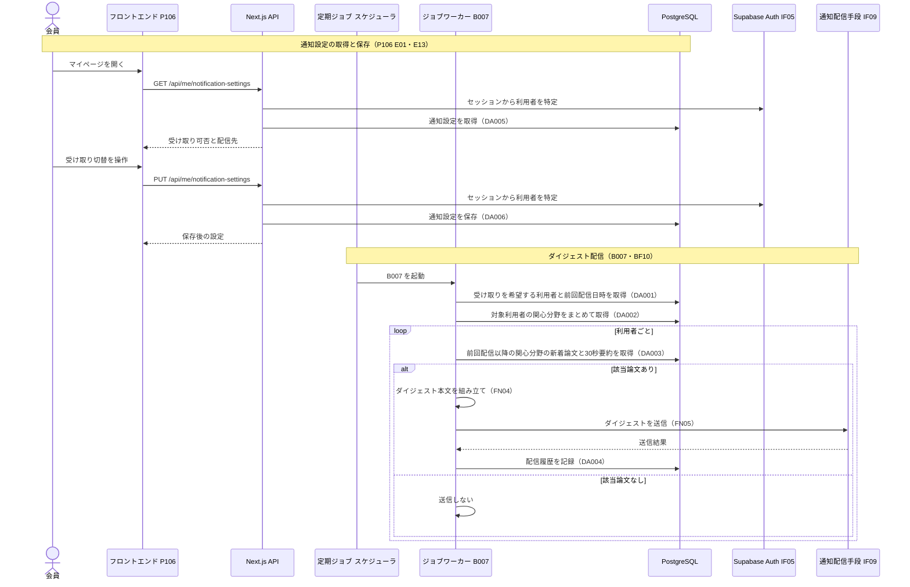

# BE詳細設計書 — F10 通知・ダイジェスト

## 0. 文書情報

| 項目 | 値 |
| :--- | :--- |
| 設計書ID | F10-BE |
| 親ID | F10 |
| 親設計書 | `基本設計書_概要.md` §4.1 機能一覧 |
| 機能名 | 通知・ダイジェスト（資料上のID F-10。優先度 Later／※推測: Phase 3。上流 §4 機能一覧 F10） |
| 版 | 1.0（新規作成。前版なし） |
| 作成日 | 2026-10-26 |
| 更新日 | 2026-10-26 |
| 作成方法 | `source/` 配下の企画資料と、確定済みの上流設計書からのリバースエンジニアリング（creating-backend-detailed-design v1.5.0 準拠） |
| インプット | (a) `source/02_機能要求定義.md:15,44-50`、`source/01_企画概要.md:29`、`source/03_システム構成.md:4-16,34-44`、`source/04_収益化とロードマップ.md:5,28`／(b) `docs/基本設計書_概要.md` §2 BF10、§4 F10・バッチ B007、§6 T001・T003・T005・T006・CRUD図、§7 IF05・IF09・内部API一覧、§8 認証・認可、§11 ARC004・ARC006・ARC008〜ARC010、付録 Q15・Q17・Q23・Q27・Q32／関連する下流資料: `docs/screens/画面.P106.画面基本設計.md`（H40〜H43、E01・E13・E17、呼出APIロースター No.8・9）、`docs/db/DB.T001〜T006.DB物理設計.md` |
| インプットの性質 | `source/` にあるのは企画・初期設計案の Markdown 6ファイルだけで、通知機能のソースコード（ジョブ・APIルート・メール送信処理・テーブル定義）は1つもない（`source/README.md:5-10`、上流 §前提）。そのため本書の関数・データアクセス・SQL・APIはすべて、上流で定義された計画上の実体（BF10 のシーケンス、B007、IF09、P106 の通知設定）から導いた**実装の設計案**であり、実装済みであることは意味しない。資料に無い値（URL、関数名、時刻、件数上限、リトライ回数）は※推測と明記する |
| 既存資料の突合 | `legacy/` は空ディレクトリで、突合できる既存設計書・既存仕様は無い（上流 §4 バッチID命名規則「`legacy/` は空ディレクトリ」と同じ）。本書の既存版（`docs/detail/be/BE.F10.BE詳細設計.md`）も無かったため新規作成とした |

## 1. バックエンド構成・モジュール設計

* **対象ドメイン**: 通知系（notification）— 利用者の関心分野に一致する新着論文を、利用者ごとに1通のダイジェストにまとめて定期配信する処理（上流 B007・BF10）と、その受け取り可否を利用者自身がマイページ（P106）で確認・変更するための通知設定の取得・保存（P106 H42・E13）。
* **対象APIエンドポイント**: GET /api/me/notification-settings（※上流未定義。パスは※推測）、PUT /api/me/notification-settings（※上流未定義。パスは※推測）。上流 §7 内部API一覧の全8件（API01〜API08）に F10 のAPIは無い。2件は P106 の呼出APIロースター No.8「通知設定の取得」・No.9「通知設定の保存」で必要とされたもので、上流 付録 Q27 への追加を要する。
* **対象バッチ**: B007 通知・ダイジェスト配信（上流 §4 バッチ処理設計。定期実行）。
* **対象外部連携**: IF09 通知配信手段（※推測: メール送信サービス）、IF05 Supabase Auth（配信先メールアドレスの取得と、設定APIでの利用者特定）。
* **ディレクトリ/ファイル構造**（実装は未着手。上流 §9 の想定構成 `web/`・`worker/`・`supabase/` に沿ったファイル配置案。すべて※推測）:

```
web/                                         … Next.js（画面と画面向けAPI。Vercel）
└── app/api/me/notification-settings/
    └── route.ts                             … 通知設定の取得（GET）・保存（PUT）の受け口
└── lib/notification/
    └── settings-repository.ts               … 通知設定テーブルの読み書き（DA005・DA006）
worker/                                      … Pythonワーカー（ジョブ・定期実行）
├── jobs/
│   └── digest_delivery.py                   … B007 本体。配信対象の抽出から送信・記録まで（FN01〜FN06）
├── notification/
│   ├── digest_repository.py                 … 配信対象・関心分野・新着論文・配信履歴のデータアクセス（DA001〜DA004）
│   ├── digest_composer.py                   … ダイジェスト本文の組み立て（FN04）
│   └── mail_client.py                       … IF09 通知配信手段の呼び出し（FN05）
└── scheduler/
    └── schedule.py                          … B007 を1日1回起動する定期実行の登録
supabase/
└── migrations/                              … 通知設定・配信履歴テーブルのDDL（テーブル未定義のため未作成。上流 付録 Q23）
```

* **処理シーケンス図**（上流 BF10 の流れに、P106 の通知設定の保存と、本書で補った配信履歴の記録を加えたもの。配信履歴の記録と送信失敗時の扱いは※推測）:



* **前提・上流との差異**（本書で判明したもの。上流側の追記・訂正を要する）:
  1. **通知設定と配信履歴の保存先テーブルが無い**（※上流要確認）: 上流 §6 のテーブル一覧（T001〜T010）に、受け取り可否を持つ通知設定と、前回の配信日時を持つ配信履歴の保存先が無い（上流 §6 テーブル一覧の注記、付録 Q15・Q23）。BF10 の「前回配信以降の新着論文を取得」は前回の配信日時が無いと実行できないため、本書では両テーブルを※上流未定義として扱い、物理名は付けずに `{通知設定テーブル}`・`{配信履歴テーブル}` と書く（仮採番しない）。
  2. **CRUD図の F10 行に paper_versions が無い**（※上流要確認）: 上流 §6 CRUD図の F10 行は paper_versions を「-」としているが、30秒要約（summaries）は版（paper_versions）にぶら下がるため、論文から要約へたどるには paper_versions の参照（R）が必要になる（`docs/db/DB.T003.DB物理設計.md` の FK `fk_summaries_paper_version_id`）。あわせて、上流 CRUD図には通知設定・配信履歴の列も無く、F10 の通知設定の保存（C/U）と配信履歴の記録（C）が表せない。
  3. **F10 のAPIが上流に無い**（※上流未定義）: 通知設定の取得・保存APIは上流 §7 内部API一覧にも、同一覧の注記・付録 Q27 にも挙がっていない（P106 §呼出APIロースターの注記と同じ）。
  4. **Pro の「カスタム通知」の中身が無い**（※上流要確認）: Pro の特典に「カスタム通知」が挙がっており（`source/04_収益化とロードマップ.md:5`）、上流 ARC008 は F10 をプラン別機能制御の対象としている。しかし、Free の通知と何が違うのか（頻度・条件・件数）はどこにも定義が無い。本書では Free と Pro に同じダイジェストを送り、プランは読み出すだけにとどめる（FN02）。
  5. **退会時の削除範囲**（※上流要確認）: 通知設定・配信履歴は利用者に紐づく個人データであり、退会（F16）で消すべきだが、上流 CRUD図の F16 行には載っていない（上流 ARC010、付録 Q17）。
  6. **新着の判定に使う日付**（※上流要確認）: 「前回配信以降の新着」を投稿日時（papers.submitted_at）で判定すると、オンデマンド同期（B006）で後から取り込んだ古い論文は新着にならず、逆に取込が遅れた論文は配信から漏れるおそれがある（`docs/db/DB.T001.DB物理設計.md` §9 No.4「取込日時の監査列」）。本書では取込日時の列が無いため投稿日時で判定する（※推測）。

## 2. API・インターフェース詳細設計

* **外部サービス連携仕様**: 本機能が使う外部連携は、上流 §7 外部連携一覧の全9件（IF01〜IF09）のうち IF05 と IF09 の2件。IF01〜IF04・IF06〜IF08 は論文収集・要約・決済・GitHub の連携で、通知・ダイジェストでは使わない。

| IF-ID | 連携先 | 連携方式 | エンドポイント / 接続先 | 認証方式 | タイムアウト | リトライ方針 | エラー時の挙動 | 定義状況 | 詳細の所在 |
| :--- | :--- | :--- | :--- | :--- | :--- | :--- | :--- | :--- | :--- |
| IF09 | 通知配信手段 | ※推測: メール送信サービスの REST API（配信手段がメールかプッシュかは未定義。上流 付録 Q15） | ※推測: 送信サービスのメール送信API（サービスは未選定） | ※推測: APIキー（環境変数 `MAIL_API_KEY` ※推測・上流 §9 の環境変数一覧に無いため ※上流未定義） | ※推測: 1通あたり10秒 | ※推測: 一時的な失敗（送信サービスの混雑・通信断）のときだけ、間隔を空けて最大3回まで送り直す（指数バックオフ 1秒・2秒・4秒） | 一時的な失敗を3回繰り返したとき、または宛先不正・認証失敗のような送り直しても直らない失敗のときは、その利用者の配信を失敗として配信履歴に残し、次の利用者の処理へ進む（1人の失敗でジョブ全体を止めない）。認証失敗は全員に影響するため、その時点でジョブを打ち切って監視へ知らせる（※推測） | 詳細 | §4 FN05、§6 |
| IF05 | Supabase Auth | ※推測: DB上の認証スキーマの参照（ワーカー）と、SDKによるセッション確認（Next.js API） | ※推測: `auth.users`（同一 Supabase プロジェクトの認証スキーマ）、Supabase Auth のセッション検証 | Supabase サービスロールキー（ワーカー。上流 §9 `SUPABASE_SERVICE_ROLE_KEY`）、利用者セッション（API。※推測: JWT） | ※推測: DB接続のタイムアウトに従う | 送り直さない（ワーカーは次回の定期実行で取り直す。APIは利用者が操作をやり直す） | ワーカーでメールアドレスが取れない利用者は配信対象から外す。APIでセッションが無効なときは 401 を返す | 詳細 | §4 FN02・FN07・FN08 |

**総件数: 2件（全件 詳細）。全数である根拠**: 上流 §7 外部連携一覧の全9件を、上流 BF10 のシーケンスに現れる外部の参加者（通知配信手段＝IF09）と、P106 の通知設定API・配信先表示（H43）で必要になる認証連携（IF05）で照合した結果。IF09 は外部への送信、IF05 は配信先の取得と失敗時の分岐を伴うため、どちらも completeness 3-1 の基準（状態を変える・失敗時の扱いが自明でない）に当てはまり「詳細」とした。

* **APIロースター（全数）**:

| API-ID | メソッド | エンドポイント | 概要 | 呼出元 | 認証 | 定義状況 | 詳細の所在 |
| :--- | :--- | :--- | :--- | :--- | :--- | :--- | :--- |
| — ※上流未定義 | GET | /api/me/notification-settings（※推測） | ログイン中の本人の通知の受け取り設定と配信先を返す | P106 E01・E17 | 必要 | 詳細 | §2 GET /api/me/notification-settings |
| — ※上流未定義 | PUT | /api/me/notification-settings（※推測） | ログイン中の本人の通知の受け取り設定を保存する | P106 E13 | 必要 | 詳細 | §2 PUT /api/me/notification-settings |

**総件数: 2件（上流定義済み 0件・※上流未定義 2件）。全数である根拠**: 上流 §7 内部API一覧の全8件（API01〜API08）を確認し、F10 を担うものが0件であること、および F10 の画面側の利用箇所である P106 の呼出APIロースター全10件のうち通知に関わるのが No.8「通知設定の取得」・No.9「通知設定の保存」の2件だけであることを確かめた。配信（B007）はジョブワーカーが直接DBを読むため、APIを経由しない（上流 BF10）。上流にIDが無いため API-ID は振らない。取得は利用者の有無・提供開始前かどうかで応答が分かれ、保存は状態を変えるため、2件とも「詳細」とした。

---

### GET /api/me/notification-settings
* **概要**: マイページ（P106）を開いたとき（E01）と、通知設定の節の再読み込み（E17）で呼ばれ、ログイン中の本人の「新着ダイジェストを受け取るかどうか」と配信先（メールアドレス）を返す。設定がまだ保存されていない利用者には「受け取らない」を返す（P106 H42 の初期値「設定がまだ無い利用者は受け取らない」に合わせる。※推測）。※上流未定義（パスは※推測）。
* **認証要否**: 必要。会員（Free・Pro のどちらも）。本人のデータだけを返し、他人の利用者IDを指定する手段は設けない（上流 §8 「本人だけが読み書きできる」）。
* **リクエストパラメータ**:

| 種別(Path/Query/Body) | 項目名 | 型 | 必須 | 制約・バリデーション | 説明 |
| :--- | :--- | :--- | :--- | :--- | :--- |
| — | — | — | — | — | パラメータは持たない。利用者はログインのセッションから特定する（※推測） |

* **レスポンス（成功時）**（※推測: 形式は上流で未定義。上流 付録 Q26）:
```json
{
  "status": "success",
  "data": {
    "digestEnabled": true,
    "channel": "email",
    "destination": "user@example.com",
    "frequency": "daily"
  }
}
```

| 項目 | 型 | 説明 |
| :--- | :--- | :--- |
| digestEnabled | boolean | 新着ダイジェストを受け取るかどうか。P106 H42 の初期表示に使う。設定が無い利用者は false |
| channel | string | 配信手段。現時点の仮置きはメールだけで、固定値 `email`（※推測。上流 付録 Q15） |
| destination | string | 配信先。Supabase Auth に登録されたメールアドレスで、P106 H43 に表示する。本画面からは変えられない |
| frequency | string | 配信頻度。仮置きの1日1回を示す固定値 `daily`（※推測。上流 付録 Q15）。利用者が選べる項目ではない |

* **レスポンスヘッダー**: `Cache-Control: no-store`（本人の設定を中継サーバやブラウザに残さないため。※推測）
* **ステータスコード**:

| コード | 条件 |
| :--- | :--- |
| 200 | 本人の設定を返せたとき。設定がまだ保存されていない利用者も、受け取らない状態として 200 で返す |
| 401 | ログインしていない、またはログインの有効期限が切れているとき（上流 EX05。P106 は様式①のダイアログを出す） |
| 404 | 通知・ダイジェストの提供を始める前のとき（※推測: 提供開始の切替が無効な間は機能が存在しない扱いにし、P106 は通知設定の節を出さない。P106 H40） |
| 500 | DB・認証基盤の障害で設定またはメールアドレスを読めなかったとき（P106 は様式②で通知設定の節だけに再読み込みを出す） |

* **ビジネスロジック・副作用**:
  1. 提供開始の切替（※推測: 環境変数 `NOTIFICATION_ENABLED`。上流 §9 環境変数一覧に無いため ※上流未定義）が無効なら、何も読まずに 404 を返す。
  2. Supabase Auth のセッションから利用者IDを特定する（IF05）。特定できなければ 401 を返す。
  3. 通知設定テーブルから本人の行を読む（DA005）。行が無ければ「受け取らない」とみなす。
  4. 配信先として、セッションに含まれるメールアドレスを使う（※推測: Supabase Auth のセッション情報にメールアドレスが含まれる前提）。
  5. 読み取りだけで、DBへの書き込みや外部への送信は行わない。

---

### PUT /api/me/notification-settings
* **概要**: マイページ（P106）の「新着ダイジェストの受け取り切替」（H42）を操作した時点（E13）で呼ばれ、本人の受け取り設定を保存する。保存した設定は、次回以降のダイジェスト配信（B007）から効く。※上流未定義（パスは※推測）。
* **認証要否**: 必要。会員（Free・Pro のどちらも）。Free でも新着ダイジェストは受け取れる（※推測: Free の提供範囲 `source/04_収益化とロードマップ.md:4` に通知は無いが、Pro の特典は「カスタム通知」であり、関心分野の新着通知そのものは Free でも使える前提。※上流要確認 §1 前提 4）。
* **リクエストパラメータ**:

| 種別(Path/Query/Body) | 項目名 | 型 | 必須 | 制約・バリデーション | 説明 |
| :--- | :--- | :--- | :--- | :--- | :--- |
| Body | digestEnabled | boolean | 必須 | true か false のどちらか。文字列の "true" や数値の 1 は受け付けず 400 にする（※推測） | 受け取るなら true、受け取らないなら false。配信手段・頻度・配信先は本APIでは変えない（P106 H43「配信先を本画面で変える手段は置かない」） |

* **レスポンス（成功時）**（※推測）:
```json
{
  "status": "success",
  "data": {
    "digestEnabled": false,
    "channel": "email",
    "destination": "user@example.com",
    "frequency": "daily",
    "updatedAt": "2026-10-26T03:00:00Z"
  }
}
```
（各項目の意味は GET と同じ。updatedAt は設定を保存した日時）

* **レスポンスヘッダー**: `Cache-Control: no-store`（※推測）
* **ステータスコード**:

| コード | 条件 |
| :--- | :--- |
| 200 | 保存できたとき。保存済みの値と同じ値を送った場合も、書き換えずに 200 で返す（同じ操作を何度送っても結果が変わらないようにするため。※推測） |
| 400 | 本文に digestEnabled が無い、または真偽値でないとき |
| 401 | ログインしていない、またはログインの有効期限が切れているとき（上流 EX05） |
| 403 | 送り主を確かめられないとき（※推測: 上流 §8 CSRF 対策の「状態を変えるAPIで送り主を確かめる」に従い、セッショントークンのヘッダーが無い要求を拒否する） |
| 404 | 通知・ダイジェストの提供を始める前のとき（※推測。GET と同じ） |
| 500 | DB障害で保存できなかったとき（P106 は様式①のダイアログを出し、トグルを切り替える前の値に戻す） |

* **ビジネスロジック・副作用**:
  1. 提供開始の切替が無効なら 404 を返す（GET の手順1と同じ判定）。
  2. セッションから利用者IDを特定する（IF05）。特定できなければ 401 を返す。
  3. 本文の digestEnabled が真偽値かを確かめ、違えば 400 を返す。
  4. 通知設定テーブルに本人の行が無ければ作り、あれば受け取り可否と更新日時を書き換える（DA006。1文で行う追加または更新）。
  5. 保存後の設定を返す。メールの送信（購読開始の確認メール）は行わない（※推測: 配信先は Supabase Auth で確認済みのメールアドレスのため）。

## 3. データアクセス（ORM / クエリ）設計

* **データアクセス一覧（全数ロースター）**:

| DA-ID | 処理名 | 呼出元（関数/API） | 対象物理テーブル | 種別 (SELECT/INSERT/UPDATE/DELETE) | 定義状況 (詳細/簡易) | 詳細の所在 |
| :--- | :--- | :--- | :--- | :--- | :--- | :--- |
| DA001 | 配信対象利用者の取得 | FN02（B007） | {通知設定テーブル}（※上流未定義）, T005 users, auth.users（※上流未定義。Supabase Auth の管理表。IF05）, {配信履歴テーブル}（※上流未定義） | SELECT | 詳細 | §3 詳細定義 DA001、発行SQL DA001 |
| DA002 | 配信対象者の関心分野の一括取得 | FN02（B007） | T006 user_interests | SELECT | 詳細 | §3 詳細定義 DA002、発行SQL DA002 |
| DA003 | 利用者ごとの新着論文と30秒要約の取得 | FN03（B007） | T001 papers, T002 paper_versions, T003 summaries | SELECT | 詳細 | §3 詳細定義 DA003、発行SQL DA003 |
| DA004 | 配信履歴の記録 | FN06（B007） | {配信履歴テーブル}（※上流未定義） | INSERT | 詳細 | §3 詳細定義 DA004、発行SQL DA004 |
| DA005 | 本人の通知設定の取得 | FN07（GET /api/me/notification-settings） | {通知設定テーブル}（※上流未定義） | SELECT | 簡易 | - |
| DA006 | 本人の通知設定の保存 | FN08（PUT /api/me/notification-settings） | {通知設定テーブル}（※上流未定義） | INSERT/UPDATE | 詳細 | §3 詳細定義 DA006、発行SQL DA006 |

**総件数: 6件（詳細5件・簡易1件）。全数である根拠**: ソースコードが無いため、上流 BF10 のシーケンスで DB に向かう矢印2本（「通知を希望する利用者と関心分野を取得」「前回配信以降の関心分野の新着論文を取得」）と、P106 の呼出APIロースター No.8・No.9 が求めるDB操作を、1操作1件に分けて数えた。BF10 の1本目は、利用者（DA001）と関心分野（DA002）で対象テーブルも取得単位（全員分か利用者ごとか）も違うため2件に分けた。「前回配信以降」を判定するための前回配信日時の読み出しは DA001 に含め、配信の結果を残す書き込み（DA004）は、次回の「前回配信以降」を成り立たせるために本書で補った（※推測）。上流 CRUD図 F10 行の R（papers・summaries・users・user_interests）は DA001〜DA003 ですべて使っている。DA005 だけは単一テーブルから本人の1行を読むだけで、completeness 3-1 のどの基準にも当たらないため「簡易」とした。

* **データアクセス詳細定義**:

| DA-ID | 処理名 | 対象物理テーブル | JOIN / Include | 抽出条件 (Where) / ソート | トランザクション境界 | N+1対策・性能上の注意 |
| :--- | :--- | :--- | :--- | :--- | :--- | :--- |
| DA001 | 配信対象利用者の取得 | {通知設定テーブル}（※上流未定義）, T005 users, auth.users（※上流未定義）, {配信履歴テーブル}（※上流未定義） | 受け取りを希望する通知設定の行に、利用者（プラン）と認証基盤のメールアドレスを内部結合し、配信に成功した直近の履歴を外部結合する（通知設定.user_id = users.user_id、users.user_id = auth.users.id、成功履歴は user_id ごとの最大の配信日時） | 受け取りを希望していて（通知設定.digest_enabled が真 ※推測列名）、メールアドレスが登録済みで確認も済んでいて（auth.users.email と auth.users.email_confirmed_at が空でない ※推測。確認していない宛先へ送ると、他人のアドレスへの誤送信や迷惑メール扱いにつながるため）、今回の配信日にまだ成功の履歴が無い利用者だけを選ぶ（同じ日に二重送信しないため）。利用者IDの昇順に並べ、ページ単位（※推測: 500人ずつ）で読む | なし（参照のみ） | 利用者を1人ずつ読む繰り返しにせず、1回の問い合わせで配信対象者をまとめて読む。人数が増えたときに一度に読みすぎないよう、利用者IDで区切って続きを読む（※推測: キーセット方式）。前回配信日時は相関副問い合わせではなく集約して結合する |
| DA002 | 配信対象者の関心分野の一括取得 | T006 user_interests | なし | DA001 で読んだ1ページ分の利用者IDのどれかに一致する行を読む（user_id = ANY(利用者IDの配列)）。利用者ID、重みの降順に並べる | なし（参照のみ） | 利用者ごとに問い合わせると利用者数だけ往復が増えるため、1ページ分をまとめて読む（主キー `pk_user_interests` の先頭列 user_id で引ける）。関心分野が0件の利用者は、この結果に現れないため配信対象から外す |
| DA003 | 利用者ごとの新着論文と30秒要約の取得 | T001 papers, T002 paper_versions, T003 summaries | 論文の最新版（paper_versions.version = papers.latest_version）を内部結合し、その版の30秒要約のうち検証に合格した最新のもの（summary_type = 'short' かつ validation_status = 'passed' かつ language = 'ja'）を外部結合する | 前回配信の日時より後に投稿された論文のうち（papers.submitted_at > 前回配信日時。初回は今回の実行時刻の24時間前 ※推測。前回の成功配信が7日より前のときは7日前を始まりとし、それより古い論文は新着として扱わない ※推測）、利用者の関心分野に一致するものを選ぶ。カテゴリの関心は論文のカテゴリにどれか1つでも含まれれば一致（papers.categories && カテゴリの配列）、キーワードの関心はタイトルまたは Abstract に大文字小文字を区別せず含まれれば一致（ILIKE）。一致した関心分野の重みの合計が大きい順、同点なら投稿日時の新しい順に並べ、上位20件（※推測）だけを返す | なし（参照のみ） | カテゴリの一致は配列の要素で引ける転置索引 `idx_papers_categories`（GIN）を使い、投稿日時の範囲は `idx_papers_submitted_at` を使う。キーワードの部分一致は索引が効かず、投稿日時の範囲で絞った後に照合するため、1日分の新着件数に比例して重くなる（※推測: 1日の新着が数千件規模なら許容）。要約は `idx_summaries_lookup`（paper_version_id, summary_type, language, generated_at DESC）で1件ずつ引ける。利用者ごとに1回発行するため、利用者数が多くなった場合は、先に当日の新着論文を一括で読み、ワーカー側で利用者の関心分野と突き合わせる方式に切り替える（`docs/db/DB.T006.DB物理設計.md` §9 No.8 の組み立て方の検討と同じ論点。※推測） |
| DA004 | 配信履歴の記録 | {配信履歴テーブル}（※上流未定義） | なし | 1人分の送信が終わるたびに、利用者ID・配信日・配信日時・結果（成功または失敗）・掲載件数・失敗理由を1行追加する。同じ利用者・同じ配信日・成功の行がすでにあれば何もしない（ON CONFLICT DO NOTHING） | 1行の追加ごとに自動確定（送信と同じトランザクションにはできないため。§6 トランザクション制御） | 利用者ごとに1回の追加で済む。履歴は1人1日1行のため年間で利用者数×365行に増える。保持期間は未定義（※推測: 90日を過ぎた行は削除。上流 ARC010 の最小化方針） |
| DA006 | 本人の通知設定の保存 | {通知設定テーブル}（※上流未定義） | なし | 本人の利用者IDの行が無ければ追加し、あれば受け取り可否と更新日時を書き換える（INSERT … ON CONFLICT (user_id) DO UPDATE）。値が同じときは書き換えない（WHERE で値の変化を条件にする） | 1文で自動確定 | 1行だけの操作。行単位アクセス制御を使う場合は、本人の行だけに書けるようポリシーで利用者IDを照合する（user_id = auth.uid()。上流 §8、`docs/db/DB.T006.DB物理設計.md` と同じ考え方） |

* **発行SQL**: ORM は未選定のため、全DA-IDについて発行するSQLの形を示す（DA005 は簡易のため本文のみ）。`{通知設定テーブル}`・`{配信履歴テーブル}` と、その列名（digest_enabled・delivery_date・delivered_at・status・paper_count・error_reason・updated_at）はテーブルが上流で未定義のための置き場所で、名前はすべて※推測である。`:name` は実行時に渡す値。

**DA001 配信対象利用者の取得**（1ページ分。2ページ目以降は直前のページの最後の利用者IDを `:after_user_id` に渡す）
```sql
SELECT ns.user_id,
       u.plan,
       au.email,
       last_ok.last_delivered_at
FROM   {通知設定テーブル} ns
JOIN   users u        ON u.user_id = ns.user_id
JOIN   auth.users au  ON au.id = ns.user_id
LEFT JOIN (
         SELECT user_id, MAX(delivered_at) AS last_delivered_at
         FROM   {配信履歴テーブル}
         WHERE  status = 'sent'
         GROUP  BY user_id
       ) last_ok ON last_ok.user_id = ns.user_id
WHERE  ns.digest_enabled = TRUE
  AND  au.email IS NOT NULL
  AND  au.email_confirmed_at IS NOT NULL
  AND  NOT EXISTS (
         SELECT 1
         FROM   {配信履歴テーブル} h
         WHERE  h.user_id = ns.user_id
           AND  h.delivery_date = :delivery_date
           AND  h.status = 'sent'
       )
  AND  ns.user_id > :after_user_id
ORDER  BY ns.user_id
LIMIT  :page_size;
```

**DA002 配信対象者の関心分野の一括取得**
```sql
SELECT user_id, topic, weight
FROM   user_interests
WHERE  user_id = ANY(:user_ids)
ORDER  BY user_id, weight DESC;
```

**DA003 利用者ごとの新着論文と30秒要約の取得**（動的SQL）

関心分野（user_interests.topic）はカテゴリ名かキーワードのどちらかで（`docs/db/DB.T006.DB物理設計.md` の topic の説明）、arXiv のカテゴリ表記（英字の分野名に「.」と小区分が続く形 ※推測: 正規表現 `^[a-z\-]+(\.[A-Za-z\-]+)?$`）に当てはまるものをカテゴリ、それ以外をキーワードとして振り分ける（FN03）。一致条件はこの振り分けの結果で次の3通りに組み立てる。カテゴリもキーワードも0件の利用者は DA002 の時点で配信対象から外れるため、このSQLは発行しない。

| 組み立ての分岐 | 一致条件の部分（`{一致条件}`） | 重みの算出（`{重み}`） |
| :--- | :--- | :--- |
| (A) カテゴリだけを持つ | `p.categories && :categories` | カテゴリごとの重みを、論文のカテゴリに含まれるものだけ合計する |
| (B) キーワードだけを持つ | `(p.title ILIKE :kw1 OR p.abstract ILIKE :kw1 OR … OR p.title ILIKE :kwN OR p.abstract ILIKE :kwN)`（キーワードの数 N だけ OR を並べる。値は前後に `%` を付け、`%`・`_`・`\` はエスケープする） | 一致したキーワードの重みを合計する |
| (C) 両方を持つ | `(p.categories && :categories OR (キーワード条件 (B) と同じ))` | (A) と (B) の合計 |

生成されるSQLの形（(C) の場合。(A) はキーワード部分を、(B) はカテゴリ部分を取り除いた形になる）:
```sql
WITH interest_cat(topic, weight) AS (
       SELECT * FROM unnest(:categories::text[], :category_weights::numeric[])
     ),
     interest_kw(pattern, weight) AS (
       SELECT * FROM unnest(:kw_patterns::text[], :kw_weights::numeric[])
     ),
     candidates AS (
       SELECT p.id, p.arxiv_id, p.title, p.abstract, p.categories, p.submitted_at,
              p.latest_version, p.original_url
       FROM   papers p
       WHERE  p.submitted_at >  :since
         AND  p.submitted_at <= :until
         AND  (
                p.categories && :categories
                OR p.title    ILIKE ANY(:kw_patterns)
                OR p.abstract ILIKE ANY(:kw_patterns)
              )
     )
SELECT c.arxiv_id,
       c.title,
       c.categories,
       c.submitted_at,
       c.latest_version,
       c.original_url,
       s.json_content  AS short_summary,
       s.source_scope,
       ( COALESCE((SELECT SUM(ic.weight) FROM interest_cat ic
                   WHERE ic.topic = ANY(c.categories)), 0)
       + COALESCE((SELECT SUM(ik.weight) FROM interest_kw ik
                   WHERE c.title ILIKE ik.pattern OR c.abstract ILIKE ik.pattern), 0)
       ) AS match_score
FROM   candidates c
JOIN   paper_versions pv
       ON pv.paper_id = c.id
      AND pv.version  = c.latest_version
LEFT JOIN LATERAL (
       SELECT json_content, source_scope
       FROM   summaries
       WHERE  paper_version_id  = pv.id
         AND  summary_type      = 'short'
         AND  language          = 'ja'
         AND  validation_status = 'passed'
       ORDER  BY generated_at DESC
       LIMIT  1
     ) s ON TRUE
ORDER  BY match_score DESC, c.submitted_at DESC
LIMIT  :max_papers;
```
（`:since` は DA001 の last_delivered_at。履歴が無い利用者は `:until` の24時間前、last_delivered_at が `:until` の7日前より古い利用者は7日前とする ※推測。`:until` は今回のジョブの開始時刻で、実行中に入った論文は次回へ回す。`ILIKE ANY` は (B)・(C) で使う配列による書き方で、N 個の OR と同じ意味になる）

**DA004 配信履歴の記録**
```sql
INSERT INTO {配信履歴テーブル}
       (user_id, delivery_date, delivered_at, status, paper_count, error_reason)
VALUES (:user_id, :delivery_date, CURRENT_TIMESTAMP, :status, :paper_count, :error_reason)
ON CONFLICT (user_id, delivery_date, status) DO NOTHING;
```
（`:status` は送信成功が `sent`、送信失敗が `failed`（※推測）。一意制約 (user_id, delivery_date, status) を前提とし、同じ日の成功を二重に残さない）

**DA005 本人の通知設定の取得**
```sql
SELECT digest_enabled, updated_at
FROM   {通知設定テーブル}
WHERE  user_id = :user_id;
```

**DA006 本人の通知設定の保存**
```sql
INSERT INTO {通知設定テーブル} (user_id, digest_enabled, updated_at)
VALUES (:user_id, :digest_enabled, CURRENT_TIMESTAMP)
ON CONFLICT (user_id) DO UPDATE
   SET digest_enabled = EXCLUDED.digest_enabled,
       updated_at     = EXCLUDED.updated_at
 WHERE {通知設定テーブル}.digest_enabled IS DISTINCT FROM EXCLUDED.digest_enabled
RETURNING digest_enabled, updated_at;
```
（値が同じで書き換えなかったときは行が返らないため、FN08 は DA005 で現在の値を読み直して返す）

## 4. サーバー側機能・処理ロジック設計（IPO設計）

* **関数ロースター（全数）**（関数名・所属モジュールはすべて※推測の実装案）:

| FN-ID | 関数名 | 所属モジュール | 概要 | 呼出元 | 定義状況 | 詳細の所在 |
| :--- | :--- | :--- | :--- | :--- | :--- | :--- |
| FN01 | run_digest_delivery | worker/jobs/digest_delivery.py | B007 の入口。配信対象者をページ単位で読み、利用者ごとに論文の選定・送信・記録を進め、最後に件数を集計して記録する | 定期ジョブ スケジューラ（B007） | 詳細 | §4 IPO FN01 |
| FN02 | fetch_digest_recipients | worker/notification/digest_repository.py | 受け取りを希望する利用者を、プラン・メールアドレス・前回配信日時・関心分野と一緒に1ページ分読む | FN01 | 詳細 | §4 IPO FN02 |
| FN03 | select_new_papers_for_user | worker/notification/digest_repository.py | 1人の利用者について、前回配信以降の新着論文のうち関心分野に一致するものを、30秒要約と一緒に上位から選ぶ | FN01 | 詳細 | §4 IPO FN03 |
| FN04 | compose_digest | worker/notification/digest_composer.py | 選んだ論文から、件名・本文（論文ごとの日本語要約・原文へのリンク・配信停止の案内）を組み立てる | FN01 | 詳細 | §4 IPO FN04 |
| FN05 | send_digest | worker/notification/mail_client.py | 組み立てたダイジェストを通知配信手段（IF09）へ送り、一時的な失敗なら送り直す | FN01 | 詳細 | §4 IPO FN05 |
| FN06 | record_delivery | worker/notification/digest_repository.py | 1人分の配信結果（成功・失敗、掲載件数、失敗理由）を配信履歴に残す | FN01 | 詳細 | §4 IPO FN06 |
| FN07 | getNotificationSettings | web/app/api/me/notification-settings/route.ts（GET） | ログイン中の本人の通知設定と配信先を返す | GET /api/me/notification-settings | 詳細 | §4 IPO FN07 |
| FN08 | updateNotificationSettings | web/app/api/me/notification-settings/route.ts（PUT） | ログイン中の本人の受け取り設定を確かめてから保存する | PUT /api/me/notification-settings | 詳細 | §4 IPO FN08 |

**総件数: 8件（全件 詳細）。全数である根拠**: ソースコードが無いため、上流 BF10 のシーケンスの処理（起動・利用者と関心分野の取得・新着論文の取得・送るか送らないかの分岐と送信）と、§2 のAPI 2件を、1処理1関数に分けて数えた（起動→FN01、利用者と関心分野→FN02、新着論文→FN03、送信→FN04 組み立てと FN05 送信、送信結果の記録→FN06、API→FN07・FN08）。送信を FN04 と FN05 に分けたのは、本文の組み立て（外部に出ない処理）と外部への送信（失敗時に送り直す処理）で失敗の扱いが違うため。FN01〜FN06 は分岐・外部送信・複数テーブル・失敗時の扱いのどれかに当たり、FN07 は提供開始前・未ログイン・設定なしで応答が分かれ、FN08 は状態を変えるため、全件が completeness 3-1 の基準で「詳細」となる。DA005 は簡易だが、それを呼ぶ FN07 は分岐を持つため詳細とした。

* **入力・処理・出力（IPO）定義**:

| FN-ID | 関数名 | 所属モジュール | 引数 (型) | 処理フロー (ステップ単位で具体的に) | 戻り値 | 発生しうるエラー |
| :--- | :--- | :--- | :--- | :--- | :--- | :--- |
| FN01 | run_digest_delivery | worker/jobs/digest_delivery.py | run_at: datetime（ジョブの開始時刻。スケジューラが渡す）、delivery_date: date（配信日。日本時間の日付 ※推測） | 1. 提供開始の切替（`NOTIFICATION_ENABLED` ※推測）が無効なら、何もせず「対象外」として終わる。<br>2. 同じ配信日の B007 がすでに実行中なら、二重に走らないよう起動せずに終わる（※推測: ジョブ実行基盤の重複排除 ARC006。Redis のロックを配信日をキーに取る）。<br>3. FN02 を呼び、配信対象者を1ページ分（※推測: 500人）読む。0人なら手順7へ進む。<br>4. ページ内の利用者1人ずつについて、FN03 で論文を選ぶ。0件ならその利用者には送らず、履歴も残さない（上流 BF10「該当なし→送信しない」。次回も同じ前回配信日時から探すことになる）。<br>5. 1件以上なら、FN04 で本文を組み立て、FN05 で送り、FN06 で結果を残す。送信失敗は FN06 で失敗として残し、次の利用者へ進む。<br>6. ページの最後の利用者IDを次の読み出し位置にして手順3へ戻る。<br>7. 対象者数・送信成功数・送信失敗数・該当なし数を集計してログに出し、送信失敗が1件以上あれば監視へ知らせる（ARC006）。<br>8. 実行時間の上限（※推測: 30分）を超えた場合は、処理中の利用者までで打ち切る。未処理の利用者には成功の履歴が無いため、同じ配信日のうちに再実行すれば続きから送られる | 実行結果の集計（対象者数、送信成功数、送信失敗数、該当なし数: int） | 配信手段の認証失敗（FN05 から。全員に影響するためジョブを打ち切り、監視へ知らせる）、DB接続の失敗（ジョブを失敗で終え、ジョブ実行基盤のリトライに任せる ※推測: 最大3回）、実行時間の上限超過（打ち切り、残りは再実行で補う） |
| FN02 | fetch_digest_recipients | worker/notification/digest_repository.py | delivery_date: date、after_user_id: uuid（前のページの最後の利用者ID。最初は最小値）、page_size: int | 1. DA001 で、受け取りを希望していて、メールアドレスがあり、その配信日にまだ成功の履歴が無い利用者を、利用者IDの順に page_size 人まで読む。<br>2. 読んだ利用者IDの配列で DA002 を呼び、関心分野をまとめて読む。<br>3. 関心分野をカテゴリとキーワードに振り分ける（arXiv のカテゴリ表記に当てはまる topic をカテゴリ、それ以外をキーワードとする。§3 DA003 の振り分け規則）。<br>4. 関心分野が0件の利用者は、送る論文を選べないため結果から外す。<br>5. プラン（free・pro）は結果に含めるが、現時点では配信内容を変えない（Pro のカスタム通知の中身が未定義のため。※上流要確認 §1 前提 4） | 配信対象者の配列（利用者ID、プラン、メールアドレス、前回配信日時、カテゴリの関心と重み、キーワードの関心と重み）と、次の読み出し位置 | DB接続の失敗（FN01 へそのまま伝える） |
| FN03 | select_new_papers_for_user | worker/notification/digest_repository.py | recipient: 配信対象者（FN02 の1要素）、until: datetime（ジョブの開始時刻）、max_papers: int（※推測: 20） | 1. 探す期間の始まりを決める。前回配信日時があればそれ、無ければ（初回）ジョブ開始時刻の24時間前とする。ただし始まりはジョブ開始時刻の7日前より古くしない（長く配信が無かった利用者に古い論文をまとめて送らないためと、探す範囲の広がりで問い合わせが重くなるのを防ぐため）（※推測）。<br>2. 持っている関心分野の種類（カテゴリだけ・キーワードだけ・両方）に応じて一致条件を組み立てる（§3 DA003 の分岐 (A)〜(C)）。キーワードは前後に部分一致の記号を付け、記号として扱われる文字（`%`・`_`・`\`）は文字として照合されるよう打ち消す。<br>3. DA003 を発行し、一致した関心分野の重みの合計が大きい順・投稿日の新しい順に max_papers 件まで受け取る。<br>4. 検証に合格した30秒要約がまだ無い論文は、要約の代わりに「日本語要約は準備中です」と示す印を付けて残す（要約の生成待ちで配信から漏れると、次回は「前回配信以降」に入らず二度と届かないため。※推測）。<br>5. 一致件数が max_papers を超えた場合は、超えた件数を結果に添える（本文に「ほか N 件」と出すため） | 掲載する論文の配列（arXiv ID、原題、カテゴリ、投稿日時、最新版、原文URL、30秒要約または準備中の印、解析範囲）と、掲載しきれなかった件数 | DB接続の失敗・問い合わせのタイムアウト（※推測: 1回 10秒。その利用者を失敗として FN06 で残し、次の利用者へ進む） |
| FN04 | compose_digest | worker/notification/digest_composer.py | recipient: 配信対象者、papers: 掲載する論文の配列、overflow_count: int、delivery_date: date | 1. 件名を「【サービス名】{配信日} の新着論文 {件数}件」の形で作る（サービス名は未決定。上流 付録 Q01。文言は※推測）。<br>2. 論文ごとに、30秒要約の日本語タイトル（原題を併記）、30秒要約の本文、カテゴリ、投稿日と版（v1/v2）、論文詳細画面（P104）へのリンク、arXiv の原文ページへのリンクを並べる（上流 ARC009 の版・日付の表示ルールに合わせる）。<br>3. Abstract だけで作った要約には「Abstractベース」と添える（解析範囲が Abstract のみのとき。上流 ARC009、`source/01_企画概要.md:36`）。要約が準備中の論文は原題とリンクだけを載せる。<br>4. 掲載しきれなかった件数があれば「ほか N 件は新着論文画面で」と添えて新着論文画面（P102）へのリンクを置く。<br>5. 末尾に、配信停止の方法（マイページ P106 の通知設定へのリンク）、送り主の名称と連絡先、arXiv と本サービスの関係を誤解させない注記を置く（配信停止方法と送り主の表示は、広告宣伝メールに関する法令上の表示義務を想定したもの ※推測。arXiv との関係の注記は `source/03_システム構成.md:61`）。<br>6. 要約やタイトルに含まれる記号は、HTMLメールの中でタグとして働かないよう無害化する（上流 §8 XSS対策と同じ考え方 ※推測） | ダイジェスト（件名、HTML本文、テキスト本文、宛先メールアドレス） | 要約JSONの形が要約スキーマ（ARC003）と合わないとき（その論文を準備中の扱いに切り替えて続ける ※推測） |
| FN05 | send_digest | worker/notification/mail_client.py | digest: ダイジェスト（FN04 の戻り値）、idempotency_key: string（利用者IDと配信日をつないだ値 ※推測） | 1. 通知配信手段（IF09）の送信APIへ、宛先・件名・本文と、同じ送信を二重に受け付けないための鍵（idempotency_key）を送る（送信サービスが鍵による重複排除に対応する場合 ※推測）。<br>2. 応答が成功なら、送信サービス側の受付番号を返す。<br>3. 一時的な失敗（混雑・通信断・タイムアウト）のときは、1秒・2秒・4秒と間隔を空けて最大3回まで送り直す（※推測）。<br>4. 宛先不正・送信拒否のときは送り直さず、失敗として返す。<br>5. 認証失敗のときは送り直さず、認証失敗であることを区別して返す（FN01 がジョブを打ち切るため） | 送信結果（成功・失敗・認証失敗、受付番号、失敗理由） | 一時的な失敗の再試行切れ、宛先不正、送信拒否、認証失敗（いずれも戻り値で区別して返し、例外としては投げない） |
| FN06 | record_delivery | worker/notification/digest_repository.py | user_id: uuid、delivery_date: date、result: 送信結果（FN05 の戻り値、または FN03 の失敗）、paper_count: int | 1. 送信が成功なら結果を「成功」、それ以外なら「失敗」とし、失敗理由（受付番号や本文は含めない）を添えて DA004 で1行追加する。<br>2. 同じ利用者・同じ配信日の成功の行がすでにあれば何もしない（再実行で二重に記録しないため）。<br>3. 記録に失敗した場合はログに残して次の利用者へ進む。成功の記録が残らないと次回の「前回配信日時」が更新されず、同じ論文がもう一度届くおそれがあるため、警告として監視へ知らせる | なし | DB書き込みの失敗（ログと監視に残し、ジョブは続ける） |
| FN07 | getNotificationSettings | web/app/api/me/notification-settings/route.ts | request: HTTPリクエスト（ログインのセッションを含む） | 1. 提供開始の切替が無効なら 404 を返す。<br>2. Supabase Auth のセッションから利用者IDとメールアドレスを得る（IF05）。得られなければ 401 を返す。<br>3. DA005 で本人の通知設定を読む。行が無ければ受け取らない設定とみなす。<br>4. 受け取り可否、配信手段（email 固定）、配信先（メールアドレス）、頻度（daily 固定）を返す | 200 と通知設定（§2 GET のレスポンス） | 401（未ログイン）、404（提供開始前）、500（DB・認証基盤の障害。詳細は利用者に見せずログに残す） |
| FN08 | updateNotificationSettings | web/app/api/me/notification-settings/route.ts | request: HTTPリクエスト（本文 digestEnabled: boolean とログインのセッションを含む） | 1. 提供開始の切替が無効なら 404 を返す。<br>2. セッショントークンのヘッダーが無い要求は 403 で拒否する（上流 §8 CSRF 対策 ※推測）。<br>3. セッションから利用者IDを得る。得られなければ 401 を返す。<br>4. 本文の digestEnabled が真偽値でなければ 400 を返す。<br>5. DA006 で本人の行を追加または更新する。値が変わらず更新されなかったときは DA005 で現在の値を読み直す。<br>6. 保存後の設定を返す | 200 と保存後の通知設定（§2 PUT のレスポンス） | 400（入力不正）、401（未ログイン）、403（送り主不明）、404（提供開始前）、500（DB障害） |

## 5. バッチ処理・非同期タスク設計

* **ジョブ実行定義**:

| バッチID | ジョブ名 | 実行タイミング | 対象テーブル | 処理概要 | タイムアウト | 定義状況 | 詳細の所在 |
| :--- | :--- | :--- | :--- | :--- | :--- | :--- | :--- |
| B007 | 通知・ダイジェスト配信 | 1日1回の定期実行（頻度・時刻は上流で未定義。※推測: 論文メタデータ収集 B001 と、その日の要約生成・検証・公開 B002〜B004 が一巡した後になるよう、日本時間 12:00（UTC 03:00）に起動。上流 付録 Q15・Q18） | 読み取り: {通知設定テーブル}（※上流未定義）, T005 users, auth.users（※上流未定義）, T006 user_interests, T001 papers, T002 paper_versions, T003 summaries、書き込み: {配信履歴テーブル}（※上流未定義） | 受け取りを希望する利用者ごとに、前回の配信以降に投稿された論文のうち関心分野（カテゴリ・キーワード）に一致するものを、関心の強さの順に最大20件（※推測）選び、30秒要約を添えた1通のダイジェストにまとめて送る。一致する論文が無い利用者には送らない。送信の結果は利用者ごとに配信履歴へ残し、同じ日に同じ人へ二度送らない。1人の送信失敗では止めず、配信手段の認証失敗のように全員に影響する失敗のときだけ打ち切る（FN01〜FN06） | ※推測: 30分（超えた場合は打ち切り、同じ配信日のうちの再実行で未送信の利用者だけに送る） | 詳細 | §4 FN01〜FN06、バッチ詳細設計書 `detail/batch/BT.B007.バッチ詳細設計.md`（未作成） |

**総件数: 1件。全数である根拠**: 上流 §4 バッチ処理設計の全11件（B001〜B011）のうち、F10 を担うのは B007 だけである（B007 の出典 `source/02_機能要求定義.md:15` が F10 と同じで、上流 §2 BF10 の起点が「定期ジョブ（B007）」）。ほかの10件は論文の収集・要約・検証・公開・本文解析・同期・Embedding・GitHub関連付け・失敗ジョブの再処理・検索インデックスで、通知には関わらない。B007 は利用者を単位に送る処理のため、論文の版を単位とするジョブ管理テーブル jobs（T009）の種別には含まれない（`docs/db/DB.T009.DB物理設計.md` の「含めない処理」）。そのため B007 の実行状況は jobs ではなく、ジョブ実行基盤のログと配信履歴で追う（※推測）。ジョブとしての詳細（スケジュール定義、リトライ、監視の閾値）はバッチ詳細設計書の責務とし、本書は F10 の業務ロジック（§4）までを扱う。

* **B007 の再実行と失敗キューの扱い**（※推測）:
  * 同じ配信日に B007 を再実行すると、成功の履歴がある利用者は DA001 の時点で外れるため、未送信と失敗の利用者だけに送られる。再実行は運用者が手動で起動する（失敗ジョブの再処理 B010 と同じく手動起動の仮置き。上流 付録 Q36）。
  * 配信日をまたいで再実行した場合、前日の失敗者には翌日の配信で前日分の論文もまとめて届く（「前回の成功以降」で探すため）。
  * ジョブ実行基盤の失敗キュー（ARC006）には、B007 全体が失敗したとき（DB接続の失敗・認証失敗・実行時間の上限超過）の実行記録を入れる。利用者1人ごとの送信失敗は配信履歴の失敗の行で追い、失敗キューには入れない。

## 6. 例外処理・セキュリティ設計

* **エラーハンドリング**:

| 例外種別 | 発生箇所 | 対応方法 | ログ出力 | クライアント応答 |
| :--- | :--- | :--- | :--- | :--- |
| 未ログイン・セッション切れ | FN07・FN08 | 処理を始める前にセッションを確かめ、無効ならDBに触れずに打ち切る | INFO（利用者IDは出さない） | 401 と「ログインが必要です」（※推測。P106 様式①のダイアログでログイン画面へ） |
| 入力不正（digestEnabled が無い・真偽値でない） | FN08 | 保存前に型を確かめて打ち切る | INFO（受け取った値の型だけを出す） | 400 と項目名を含む汎用メッセージ |
| 送り主不明（セッショントークンのヘッダーが無い状態変更要求） | FN08 | 保存せずに拒否する（※推測: 上流 §8 CSRF 対策） | WARN（接続元IPと要求経路） | 403 と汎用メッセージ |
| 提供開始前の要求 | FN07・FN08 | 機能が無い扱いで打ち切る（※推測） | 出さない | 404 |
| DB障害（接続失敗・タイムアウト） | FN07・FN08 | 例外を受け止めて処理を中止する | ERROR とスタックトレース（SQLの値と利用者のメールアドレスは出さない） | 500 と汎用メッセージ（内部の原因は利用者に見せない） |
| DB障害（ジョブの開始時・ページの読み出し時） | FN01・FN02 | ジョブを失敗で終え、ジョブ実行基盤のリトライに任せる（※推測: 最大3回。上流 付録 Q19） | ERROR とスタックトレース、失敗キューへ記録 | —（バッチのため応答なし） |
| 新着論文の取得の失敗・タイムアウト（1人分） | FN03 | その利用者を失敗として残し、次の利用者へ進む | WARN（利用者IDと失敗理由） | —（バッチのため応答なし） |
| 要約JSONの形の不一致 | FN04 | その論文を要約準備中の扱いに切り替えて送信を続ける（※推測） | WARN（arXiv ID と要約ID） | —（バッチのため応答なし） |
| 配信手段の一時的な失敗 | FN05 | 間隔を空けて最大3回送り直し、それでも失敗ならその利用者を失敗として残す（※推測） | 送り直しのたびに WARN、最後の失敗で ERROR（宛先メールアドレスは伏せ字にする） | —（バッチのため応答なし） |
| 配信手段の宛先不正・送信拒否 | FN05 | 送り直さず、その利用者を失敗として残す。宛先不正が続く利用者の扱い（自動で受け取り停止にするか）は未定義（※推測: 3日連続で失敗したら運用者に知らせる） | ERROR（利用者IDと失敗理由） | —（バッチのため応答なし） |
| 配信手段の認証失敗 | FN05 → FN01 | 全員に影響するため、その時点でジョブを打ち切る | ERROR、監視へ即時に知らせる | —（バッチのため応答なし） |
| 配信履歴の記録の失敗 | FN06 | 次の利用者へ進む。成功の記録が残らないと翌日に同じ論文が重ねて届くおそれがあるため、警告として監視へ知らせる | ERROR（利用者IDと配信日） | —（バッチのため応答なし） |
| 実行時間の上限超過 | FN01 | 処理中の利用者までで打ち切り、未処理の利用者は再実行に回す（※推測: 30分） | ERROR（処理済み人数と未処理人数） | —（バッチのため応答なし） |
| 予期しない例外 | 全関数 | API は共通のエラー処理で受け止めて 500 を返す。ジョブは1人分の処理で起きたものはその利用者を失敗として残して続け、ページ単位の処理で起きたものはジョブを失敗で終える | ERROR とスタックトレース | API は 500 と汎用メッセージ |

* **セキュリティ上の考慮**（※推測。上流 §8 の方針を本機能に当てはめたもの）:
  * 通知設定は本人だけが読み書きできるようにする。API は利用者IDをセッションからだけ取り、リクエストで受け取らない。テーブルに行単位アクセス制御を掛ける場合は、本人の利用者IDと一致する行だけを許可する（上流 §8「他人のデータの閲覧・改ざん」）。
  * B007 は全利用者のメールアドレスを読むため、行単位アクセス制御を通らないサービスロールで動かす。サービスロールキーはワーカーの環境変数だけに置く（上流 §8 機密情報管理）。
  * ログ・失敗キュー・配信履歴にはメールアドレスとメール本文を残さない（上流 ARC010 の個人データ最小化）。
  * 配信手段のAPIキーはワーカーの環境変数だけに置き、ブラウザへ渡さない。
* **トランザクション制御**:

| 処理名 | トランザクション範囲 | ロールバック条件 |
| :--- | :--- | :--- |
| 通知設定の保存（FN08・DA006） | 本人の通知設定1行の追加または更新を1文で行い、その場で確定する | 文の実行に失敗したとき（DB障害。同じ利用者の行がすでにある場合は追加ではなく更新に切り替わるため、一意制約違反は起きない）。失敗時は何も書かれず、P106 はトグルを元の値に戻す |
| 配信対象・関心分野・新着論文の読み出し（FN02・FN03、DA001〜DA003） | トランザクションを張らない（参照だけで、読み出しの途中に設定が変わっても、次回の配信から反映されれば足りるため） | — |
| 1人分の配信（FN04〜FN06、DA004） | 送信（外部）と配信履歴の追加（DB）は同じトランザクションにできないため、送信の後に履歴の追加だけを単独で確定する。送信と記録の間で止まった場合に備え、同じ送信を二重に受け付けないための鍵（利用者IDと配信日）を送信サービスに渡す（FN05。※推測） | 履歴の追加に失敗したときは、その1行だけが書かれない。送信済みのメールは取り消せないため、ロールバックではなく警告で知らせる（FN06） |
| B007 全体（FN01） | 利用者ごとに独立して確定し、ジョブ全体をまとめる1つのトランザクションは張らない（1人の失敗で他の人の配信結果を消さないため） | —（打ち切られた場合も、それまでに送った利用者の履歴は残る） |
| 退会時の通知設定・配信履歴の削除（F16 の処理） | 退会処理（F16）のトランザクションに、通知設定と配信履歴の利用者IDによる削除を含める（※推測。テーブルが未定義で、上流 CRUD図の F16 行にも無いため ※上流要確認 §1 前提 5） | 退会処理のどれかの削除が失敗したとき（F16 の詳細設計で扱う） |

## 7. 利用する方式（共通基盤）

| 方式ID | 名称 | 本書での利用箇所 |
| :--- | :--- | :--- |
| ARC006 | ジョブ実行基盤（キュー・リトライ・失敗キュー・監視） | B007 はこの基盤の定期実行として起動され、同じ配信日の二重起動の防止（重複排除）、DB障害時のジョブ全体のリトライ、ジョブ全体が失敗したときの失敗キューへの記録、送信失敗の件数の監視をこの基盤に任せる（§4 FN01、§5）。上流 ARC006 の関連先 B001〜B011 に B007 が含まれる。ただし状態の記録先は jobs（T009）ではなく配信履歴とする（§5 の注記） |
| ARC008 | プラン別機能制御・利用量上限 | 上流 ARC008 の関連先に F10 が挙がっている。本書では配信対象者を読むときにプラン（users.plan）を一緒に読み（FN02・DA001）、Pro の「カスタム通知」の分岐を入れる位置を用意している。カスタム通知の中身と、Free との違いが未定義のため、現時点では Free・Pro に同じダイジェストを送る（※上流要確認 §1 前提 4） |
| ARC004 | LLM出力検証方式（事実と推測の区別） | ダイジェストに載せる30秒要約は、根拠・数値チェックに合格したもの（summaries.validation_status = 'passed'）だけに限り、未検証・不合格の要約はメールに出さない（§3 DA003）。上流 ARC004 の関連先に F10 は無いが、検証に合格したものだけを公開するという方式の規則をメール配信にも当てはめた（※推測） |
| ARC009 | 表示・編集ポリシー（出典・版・日付・ブランド表記） | ダイジェスト本文に、Abstractベースの表示、論文の版、投稿日、原文へのリンク、arXiv と本サービスの関係を誤解させない注記を載せる（§4 FN04）。上流 ARC009 の関連先は画面（P101〜P107）と API01〜API05 で F10 は無いが、利用者が要約を読む場所であるメールにも同じ表記ルールを当てはめた（※推測） |
| ARC010 | 個人データ最小化・削除方針 | 配信履歴にはメールアドレスと本文を残さず、利用者ID・配信日・結果・件数だけを持たせ、保持期間を区切る（§3 DA004）。退会時は通知設定と配信履歴も削除の対象にする（§6 トランザクション制御）。上流 ARC010 の関連先に F10 は無いが、通知設定・配信履歴は利用者に紐づく個人データのため当てはめた（※推測。※上流要確認 §1 前提 5） |

**利用する方式の総件数: 5件。根拠**: 上流 §11.1 方式設計一覧の全10件（ARC001〜ARC010）を本書の処理と照合した。上流で関連先に F10・B007 が挙がっているのは ARC006（B007）と ARC008（F10）の2件で、残る3件（ARC004・ARC009・ARC010）は本書の処理が方式の規則に従うと判断して加えた（いずれも※推測。上流 §11.1 の関連先への F10 の追記を要する）。ARC001（生成物キャッシュ）・ARC002（段階的生成）・ARC003（要約スキーマ）・ARC005（ライセンスゲート）・ARC007（外部APIアクセス制御）は要約の生成・本文解析・arXiv への問い合わせに関する方式で、生成済みの要約を読むだけの本機能では使わない（ARC003 は FN04 で要約JSONの形を読むときに前提とするが、方式の規則を本書の処理が担うわけではないため含めない）。
