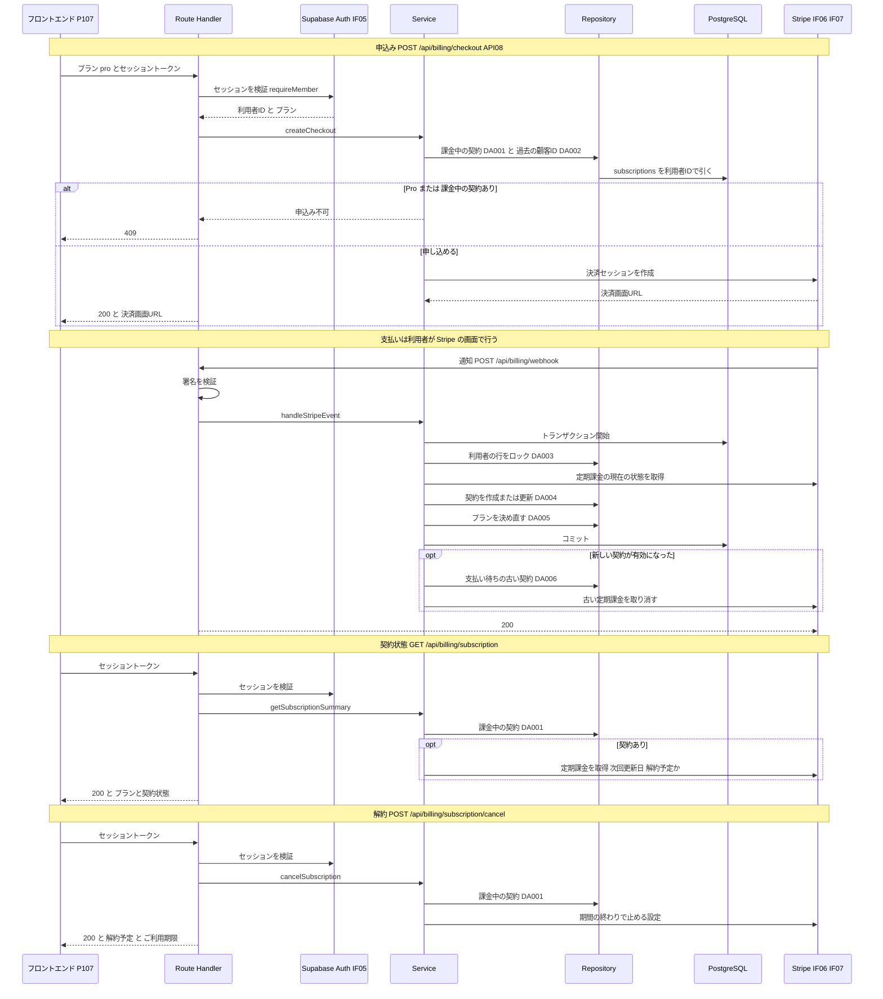

# BE詳細設計書 — F12 課金（区分: 課金）

## 0. 文書情報

| 項目 | 値 |
| :--- | :--- |
| 設計書ID | F12-BE |
| 親ID | F12 |
| 親設計書 | `基本設計書_概要.md` §4.1 機能一覧 |
| 文書名 | BE詳細設計書 F12 課金 |
| 対象システム | Kaine personal pj — arXiv日本語研究ダイジェスト Webアプリ |
| 版 | 1.1（第1回セルフレビュー `docs/reviews/be_F12_review_applied.md` の Major 4件・Minor 3件を反映） |
| 作成日 / 更新日 | 2026-10-26 / 2026-10-26 |
| 作成方法 | creating-backend-detailed-design v1.5.0 準拠。上流の確定設計書と `source/` の企画資料から作成（新規設計） |
| インプット | (a) `source/02_機能要求定義.md:17`、`source/03_システム構成.md:7,15,39,44,54`、`source/04_収益化とロードマップ.md:4-8,28,41,46`、`source/01_企画概要.md:30`／(b) `docs/基本設計書_概要.md` §1（技術スタック「決済 Stripe」、用語 Free / Pro）、§2（BF12・BF13・EX05・EX06）、§3.1（P107）、§4（F12 行、F16・F18 行、オンライン処理設計のエラー応答）、§6（T005・T010、CRUD図 F12 行）、§7（IF05・IF06・IF07、内部API一覧 API08、API詳細定義「POST /api/billing/checkout」）、§8（認証・認可設計、セキュリティ対策「Pro機能の不正利用」「決済通知の偽装」、機密情報管理）、§9（環境変数 `STRIPE_SECRET_KEY`・`STRIPE_WEBHOOK_SECRET`）、§10（Phase 4、バックアップ）、§11（ARC008・ARC009・ARC010）、付録 Q03・Q17・Q24・Q26・Q27・Q28・Q33／関連する確定済みの下位設計書: `docs/db/DB.T010.DB物理設計.md`（subscriptions）、`docs/db/DB.T005.DB物理設計.md`（users）、`docs/screens/画面.P107.画面基本設計.md`（E01・E03・E05・E07・E09、呼出APIロースター）、`docs/screens/画面.P106.画面基本設計.md`（H10、E15）、`docs/detail/be/BE.F06.BE詳細設計.md`（共通認証 requireMember、共通エラー応答 errorResponse）、`docs/detail/be/BE.F09.BE詳細設計.md`（Pro判定と契約状態の対応）／(c) `legacy/`（空） |
| インプットの性質 | `source/` は企画・初期設計案のMarkdown 6ファイルだけで、ルーティング定義・コントローラ・ORM定義・SQL・Stripe連携のコードは1つもありません（`source/README.md:5-10`、作業開始時の実ファイル数6件）。課金について資料にあるのは「Stripeによる有料プラン管理」（`source/02_機能要求定義.md:17`）、決済に Stripe を使うこと（`source/03_システム構成.md:15`）、`subscriptions` の列名（`:44`）、申込みのAPI `POST /api/billing/checkout`（`:54`）、Free／Pro（月額980円・仮）の2プラン（`source/04_収益化とロードマップ.md:4-5`）、Phase 4 の Stripe 連携とプラン管理（`:41`）、料金画面の「課金・プラン管理」（`source/01_企画概要.md:30`）だけです。**したがって本書のエンドポイント・関数・データアクセスはすべて上流の定義から導いた実装前の設計案（※推測）であり、実装済みであることは意味しません**。ファイル名・関数名・JSONのキー名・SQL本文・Stripe API の呼び出し方は実装時の命名案です |
| 既存版との関係 | `docs/detail/be/BE.F12.BE詳細設計.md` の旧版はありません（本書が初版）。残すべき既存の記述はありません |
| legacy/ との突合 | `legacy/` は空ディレクトリ（ファイル0件）です。突合する既存仕様・業務意図・非機能の記述はありません |
| 上流APIとの対応 | 上流 §7 内部API一覧（API01〜API08 の全8件）のうち F12 に属するのは API08 の1件です。Stripe Webhook の受け口、契約状態の取得、解約の3件は上流で「機能として必要だがAPIが未定義」（上流 §7 注記、付録 Q27・Q28）とされているもの、または画面設計 P107 で必要とされたもので、本書では **※上流未定義** とし、API の番号は振りません（上流 §7 への追加を求めます） |

**本書で使う上流ID**: 機能 F12（関連: F06・F09・F16・F18）／業務フロー BF12・BF13・EX05・EX06／画面 P107（イベント E01・E03・E05・E07・E09）・P106（H10）／テーブル T005 `users`・T010 `subscriptions`／内部API API08／外部連携 IF05・IF06・IF07／方式 ARC008・ARC009・ARC010／顧客確認事項 Q03・Q17・Q24・Q26・Q27・Q28・Q33。

**確認事項（※推測・※上流要確認・※上流未定義の集約）**:

| No | 区分 | 確認事項 | 本書での仮置き | 関連箇所 | 上流の確認事項 |
| :--- | :--- | :--- | :--- | :--- | :--- |
| 1 | API | Stripe Webhook の受け口、契約状態の取得、解約の3エンドポイントを上流 §7 内部API一覧に追加し、番号を振るか（※上流未定義） | パスだけを仮置きし（`POST /api/billing/webhook`、`GET /api/billing/subscription`、`POST /api/billing/subscription/cancel`）、番号は振らない | §2 エンドポイントロースター | Q27・Q28 |
| 2 | 外部IF | Stripe の通知（Webhook）で契約状態を更新する方式と、通知を受けたら Stripe API で定期課金の現在の状態を取り直して書く方式でよいか（T010 §9 No.3） | Webhook で受け、署名を検証し、現在の状態を取り直して書く。扱う通知は4種類（§2「POST /api/billing/webhook」） | §2、§4 syncSubscription | Q28 |
| 3 | プラン | 支払い遅延（`past_due`）の間を Pro のまま扱うか（T010 §9 No.2・T005 §9 No.3、F09 と共通） | 有効・試用中・支払い遅延の3つで Pro、それ以外は Free（F09 DA002 の Pro と扱う状態と同じ） | §4 isProStatus、§3 DA005 | Q28 |
| 4 | 業務 | 解約を「支払い済み期間の終わり」で反映するか、すぐに反映するか（P107 §7 で※上流要確認） | 期間の終わりで反映する。解約の操作では Stripe 側に「期間の終わりで止める」設定だけを入れ、プランが Free に戻るのは期間の終わりに届く通知による（P107 H29・H37 の仮置きと同じ） | §2「POST /api/billing/subscription/cancel」 | —（※上流未定義） |
| 5 | DB | 次回更新日（請求期間の終わり）と解約予定かどうかの列が T010 に無い（T010 §9 No.1、P107 H27 で※上流要確認） | 列を足さず、契約状態の取得と解約のたびに Stripe API から読む | §2「GET /api/billing/subscription」 | —（※上流未定義） |
| 6 | 環境変数 | Pro の料金を指す Stripe の価格ID（`STRIPE_PRICE_ID_PRO`）と、決済後の戻り先URLを組み立てるための本サービスの公開URL（`APP_BASE_URL`）が上流 §9 環境変数一覧に無い（※上流未定義） | 2つをサーバ側の環境変数として追加する（※推測） | §1 実行基盤 | Q33 |
| 7 | 画面 | 契約状態の取得と解約で Stripe と通信できなかったときに本書は 502 を返すが、P107 の失敗時の挙動（E01・E05・E07、様式①②）は「500・通信失敗」しか挙げていない（※上流要確認） | 502 を返す。P107 は 502 を 500 と同じ表示で扱う前提とし、P107 の失敗条件への 502 の追記を求める | §2、§6 | — |
| 8 | 業務 | 同じ利用者が2つの決済画面を開いて両方で支払った場合の二重課金の扱い（※上流未定義） | 後から届いた方の定期課金を Stripe 側ですぐに取り消し、返金は運用者が手動で行う（ERROR ログで知らせる ※推測） | §4 syncSubscription、§6 No.13 | —（※上流未定義） |
| 9 | 外部IF | 定期課金の取得・解約予約・取り消しといった Stripe API の呼び出しを上流 IF06（決済セッション）の範囲に含めるか（P107 §7 で※上流要確認） | IF06 に含める（同じ Stripe REST API とシークレットキーを使うため）。上流 IF06 の「主要データ内容」に、定期課金の取得・更新の追記を求める | §2 外部サービス連携仕様 | — |
| 10 | 業務 | 未払い（`unpaid`）・一時停止（`paused`）の契約がある利用者の申込みと、未払いの請求を支払う手段（※上流未定義） | 申込みは 409 で断り、Stripe から届くメールの案内で支払ってもらう（本サービスに支払い方法の変更画面を設けない。P107 H12 と同じ ※推測） | §2 API08、§4 createCheckout | Q27 |
| 11 | 画面 | 決済の戻り先URL（成功時 `/mypage?checkout=success`、中断時 `/pricing?checkout=canceled`）と、その印の名前（P106 H10・P107 H11 で※推測） | 左記のとおり（画面のURLは上流 Q03 の仮置き `/mypage`・`/pricing` に合わせる） | §4 createCheckout | Q03 |
| 12 | 区分値 | 試用期間を設けるか（T010 §9 No.4） | 設けない（決済セッションに試用期間を付けない）。試用中（`trialing`）の値が届いた場合も Pro として扱えるようにはしておく | §4 isProStatus | Q24 |
| 13 | 退会 | 退会（F16）で Stripe 側の顧客情報まで消すか | 本書の対象外（F16 の責務）。本書は、退会済みの利用者の定期課金の通知が届いた場合の扱いだけを定める（§4 syncSubscription 手順4） | §4 | Q17 |

---

## 1. バックエンド構成・モジュール設計

* **対象ドメイン**: 課金（機能ID F12）— Pro プラン（月額980円・仮）の申込み、Stripe からの契約状態の通知の受け取りと反映、ログイン中の利用者の契約状態の取得、定期課金の解約の予約（上流 §4 F12「Stripeで有料プランの申込み・契約状態の管理を行う」、`source/02_機能要求定義.md:17`、`source/04_収益化とロードマップ.md:4-5,41`）。
  * 本機能は、**利用者のプラン（`users.plan`）を書き換える唯一の機能**です（T005 §4.3 (2)「Stripe からの契約状態の通知を受けたサーバだけが書き換えます」）。Pro限定機能（F04 の10分解説・F09・F10・F11）を使えるかの判定は各機能がこのプランで行い（上流 §8 認証・認可設計、ARC008）、本機能はその判定には関わりません。
  * 支払い情報（カード番号）は本サービスで一切扱わず、Stripe の決済画面で入力してもらいます（上流 IF06、T010 §4「カード番号のような決済情報は本テーブルに持ちません」）。
  * 退会時の定期課金の解約と契約の行の削除は F16 の責務、Pro機能の利用量上限は F18 の責務で、本書の対象外です（上流 BF13、§4 F16・F18）。
* **対象APIエンドポイント**: POST /api/billing/checkout（API08）、POST /api/billing/webhook（Stripe の通知の受け口。※上流未定義）、GET /api/billing/subscription（契約状態の取得。※上流未定義）、POST /api/billing/subscription/cancel（解約。※上流未定義）。全数と根拠は §2 のエンドポイントロースターを参照。
* **実行基盤**: 4エンドポイントとも Next.js の API（Route Handler、TypeScript）として Vercel 上で動きます（上流 BF12 の参加者「Next.js API」、§1 システム全体構成図「Next.js API → Stripe」、`source/03_システム構成.md:7`）。FastAPI・ジョブワーカーは使いません。
  * **Stripe との通信**: Stripe 公式の Node.js 用ライブラリ（`stripe`）を使い、環境変数 `STRIPE_SECRET_KEY` で認証します（上流 §9）。APIのバージョンはコード内で固定し、Stripe 側の既定バージョンが変わっても応答の形が変わらないようにします（※推測）。Webhook の受け口は署名の検証に生の本文が要るため、Node.js 実行環境（Edge ではない）で動かします（※推測）。
  * **DB接続**: 環境変数 `DATABASE_URL` の接続文字列で PostgreSQL（Supabase）に直接つなぎ、SQLを発行します（上流 §9、F06・F07 と同じ ※推測）。この接続は行単位アクセス制御を通らないロールで動くため、本機能のSQLには必ず利用者IDまたは Stripe の定期課金IDの条件を付けます。`subscriptions` はブラウザからの読み書きを行単位アクセス制御で全面的に拒否しています（T010 §7）。
  * **追加の環境変数**（※上流未定義。§0 確認事項 No.6）: `STRIPE_PRICE_ID_PRO`（Pro の月額料金を表す Stripe の価格ID）、`APP_BASE_URL`（決済後の戻り先URLを組み立てる本サービスの公開URL）。
* **ディレクトリ/ファイル構造**（上流 §9「`web/`（Next.js の画面と画面向けAPI）」の想定に従う。ファイル名はすべて※推測）:

```
web/
├── app/api/billing/
│   ├── checkout/route.ts                 # POST（API08 Pro申込みの決済セッション作成）
│   ├── webhook/route.ts                  # POST（Stripe の通知の受け口 ※上流未定義）
│   └── subscription/
│       ├── route.ts                      # GET（契約状態の取得 ※上流未定義）
│       └── cancel/route.ts               # POST（解約の予約 ※上流未定義）
├── lib/auth/
│   └── requireMember.ts                  # 会員向けAPI共通の認証（F06 の定義を使う）
├── lib/billing/
│   ├── validation.ts                     # parseCheckoutBody
│   ├── planRules.ts                      # isProStatus / toDisplayStatus と状態の定数 PRO_STATUSES・BILLING_STATUSES
│   ├── billingService.ts                 # createCheckout / getSubscriptionSummary / cancelSubscription
│   ├── webhookService.ts                 # handleStripeEvent / syncSubscription / cancelStaleIncomplete
│   └── stripeGateway.ts                  # Stripe API の呼び出し（IF06）と通知の署名検証（IF07）
├── lib/repositories/
│   ├── subscriptionsRepository.ts        # DA001・DA002・DA004・DA006
│   └── usersRepository.ts                # DA003（F06 と共用）・DA005
├── lib/db/
│   └── client.ts                         # DATABASE_URL による接続とトランザクション（全機能共通 ※推測）
└── lib/http/
    └── errorResponse.ts                  # エラー応答の共通形式（F06 の定義を使い、Stripe の失敗を加える）
```

* **処理シーケンス図**（上流 BF12・EX06・IF06・IF07 を展開。4エンドポイントの正常系と主な分岐）:



---

## 2. API・インターフェース詳細設計

* **外部サービス連携仕様**: 本機能がやり取りする外部サービスは、上流 §7 外部連携一覧の IF05（Supabase Auth）・IF06（Stripe 決済セッション）・IF07（Stripe 契約状態の通知）の3件です。下表は呼び出しの単位（Stripe API の操作ごと）に分けて書きます。

| No | IF-ID | 連携先 | 連携方式 | エンドポイント / 接続先 | 認証方式 | タイムアウト | リトライ方針 | エラー時の挙動 | 定義状況 | 詳細の所在 |
| :--- | :--- | :--- | :--- | :--- | :--- | :--- | :--- | :--- | :--- | :--- |
| 1 | IF05 | Supabase Auth | SDKによる認証連携 | 環境変数 `NEXT_PUBLIC_SUPABASE_URL` が指す Supabase プロジェクトの認証API（上流 §9） | 利用者のアクセストークン（JWT）をそのまま渡して検証する（上流 IF05 ※推測） | 5秒（F06 と同じ ※推測） | リトライしない（F06 と同じ） | トークンが無い・無効・期限切れなら 401、認証サービスに届かなければ 500（F06 の requireMember の扱いのまま） | 詳細 | `docs/detail/be/BE.F06.BE詳細設計.md` §4 requireMember |
| 2 | IF06 | Stripe（決済セッションの作成） | REST API（Stripe ライブラリ経由） | `POST https://api.stripe.com/v1/checkout/sessions`（※推測: Stripe 公式API） | Stripe シークレットキー（`STRIPE_SECRET_KEY`。上流 IF06 ※推測） | 10秒（※推測） | 通信失敗と Stripe 側の5xxに限り1回だけ自動で再送する。再送には同じ冪等キーを付け、決済セッションが2つできないようにする（Stripe ライブラリの自動再送機能 ※推測） | 再送しても失敗したら 502 `STRIPE_UNAVAILABLE` を返す。Stripe が 4xx（価格IDの誤りのような設定の誤り）を返したら、利用者の誤りではないため 500 とし ERROR ログを残す | 詳細 | §4 createCheckout、createCheckoutSession |
| 3 | IF06（※上流要確認） | Stripe（定期課金の取得） | REST API | `GET https://api.stripe.com/v1/subscriptions/{定期課金ID}` | Stripe シークレットキー（`STRIPE_SECRET_KEY`。No.2 と同じ鍵を使う ※推測） | 10秒（※推測） | 通信失敗と5xxに限り1回だけ再送（取得なので冪等） | 契約状態の取得では 502 を返す。通知の処理では 500 を返して Stripe に通知を送り直させる。定期課金が Stripe に存在しない（404）ときは、通知の処理では何もせず成功とする | 詳細 | §4 retrieveSubscription |
| 4 | IF06（※上流要確認） | Stripe（期間の終わりでの解約の予約） | REST API | `POST https://api.stripe.com/v1/subscriptions/{定期課金ID}`（期間の終わりで止める指定を付けて更新） | Stripe シークレットキー（`STRIPE_SECRET_KEY`。No.2 と同じ鍵を使う ※推測） | 10秒（※推測） | 通信失敗と5xxに限り1回だけ再送する。同じ指定を何度送っても結果は同じため冪等 | 再送しても失敗したら 502。契約の状態は変わっていないため、利用者はやり直せる | 詳細 | §4 cancelSubscription、scheduleCancelAtPeriodEnd |
| 5 | IF06（※上流要確認） | Stripe（定期課金の即時の取り消し） | REST API | `DELETE https://api.stripe.com/v1/subscriptions/{定期課金ID}` | Stripe シークレットキー（`STRIPE_SECRET_KEY`。No.2 と同じ鍵を使う ※推測） | 10秒（※推測） | 通信失敗と5xxに限り1回だけ再送する。取り消し済みの定期課金への再実行は Stripe がエラーを返すが、取り消し済みなら成功とみなす | 支払い待ちの古い契約の取り消し（cancelStaleIncomplete）では WARN ログだけ残して処理を続ける（取り消さなくても Stripe が約1日で期限切れにするため。T010 §4.3 (2)）。二重課金の取り消し・退会済み利用者の課金の取り消しでは ERROR ログを残し、運用者に手動での対応を求める（§6） | 詳細 | §4 cancelSubscriptionNow |
| 6 | IF07 | Stripe（契約状態の通知） | Webhook（Stripe → 本サービスへの HTTPS POST。上流 IF07 ※推測） | 本サービスの `POST /api/billing/webhook`（※上流未定義）。Stripe のダッシュボードに登録する | 通知に付く署名（`Stripe-Signature` ヘッダー）を、環境変数 `STRIPE_WEBHOOK_SECRET` で検証する。署名の時刻が5分より古い通知は拒否する（Stripe ライブラリの既定 ※推測。上流 §8「決済通知の偽装」） | 通常は数秒で応答する（Stripe からの取り直し1回とDBの3文）。最も遅い場合はロック待ち5秒＋Stripe 呼び出し10秒×2回（再送を含む）で約25秒かかる。Stripe が待ちきれずに失敗とみなした場合は同じ通知を送り直してくるが、処理は冪等なので結果は変わらない（※推測。Stripe 側の待ち時間の上限は公開値を実装時に確認する） | Stripe 側が、2xx 以外の応答や応答なしの通知を最大3日間、間隔を広げながら送り直す（Stripe の仕様 ※推測）。本サービス側は送り直しに備えて、同じ通知を何度処理しても結果が変わらないようにする（§3 DA004） | 署名が不正なら 400 を返して何もしない（送り直されても同じ結果）。DB や Stripe API の一時的な失敗なら 500 を返して送り直させる | 詳細 | §2「POST /api/billing/webhook」、§4 verifyWebhookEvent |

**総件数: 6件（IF-ID 単位では IF05・IF06・IF07 の3件）。全数である根拠**: 上流 §7 外部連携一覧の全9件（IF01〜IF09）のうち、上流 §2 BF12・EX06 と §7 IF06・IF07 のシーケンスに登場するのは IF06・IF07 の2件で、会員向けのAPIでログイン中の利用者を特定するために IF05 を使います（API08「認証: 必要」）。IF06 は、§4 の Stripe 呼び出し関数（stripeGateway.ts の5関数（§4 No.15〜19）のうち、署名検証の verifyWebhookEvent を除く4操作 — 決済セッションの作成・定期課金の取得・解約の予約・即時の取り消し）に分けて No.2〜No.5 としました。No.3〜No.5 は上流 IF06 の「主要データ内容」（送信: 利用者・プラン、受信: 決済画面URL）に書かれていない操作のため ※上流要確認 です（§0 確認事項 No.9）。arXiv（IF01〜IF03）・LLM（IF04）・GitHub（IF08）・通知配信（IF09）は課金のどの手順にも現れません。定義状況は、6件とも外部への送信または外部からの受信で失敗時の扱いを持つため「詳細」です（completeness 3-1 の2・5）。

* **エンドポイントロースター（全数）**:

| No | API ID | メソッド | パス | 概要 | 認証 | 呼び出し元 | 定義状況 | 詳細の所在 |
| :--- | :--- | :--- | :--- | :--- | :--- | :--- | :--- | :--- |
| 1 | API08 | POST | /api/billing/checkout | Pro 申込みのために Stripe の決済セッションを作り、決済画面のURLを返す。すでに Pro 契約中なら断る | 必要（会員） | P107 E03 | 詳細 | §2「POST /api/billing/checkout」 |
| 2 | —（※上流未定義） | POST | /api/billing/webhook（※推測） | Stripe からの契約状態の通知を受け、契約の行とプランを Stripe の現在の状態に合わせる | 不要（利用者のセッションではなく、Stripe の署名で送り主を確かめる） | Stripe（IF07） | 詳細 | §2「POST /api/billing/webhook」 |
| 3 | —（※上流未定義） | GET | /api/billing/subscription（※推測） | ログイン中の利用者のプランと、課金中の契約の状態・次回更新日・解約予定かどうかを返す | 必要（会員） | P107 E01・E07・E09（P107 呼出APIロースター No.3「契約状態の取得」） | 詳細 | §2「GET /api/billing/subscription」 |
| 4 | —（※上流未定義） | POST | /api/billing/subscription/cancel（※推測） | ログイン中の利用者の定期課金を、支払い済み期間の終わりで止める設定にする | 必要（会員） | P107 E05（P107 呼出APIロースター No.4「解約」） | 詳細 | §2「POST /api/billing/subscription/cancel」 |

**総件数: 4件（上流定義1件・上流未定義3件）。全数である根拠**: 上流 §7 内部API一覧の全8件（API01〜API08）のうち、カテゴリ「課金」の行は API08 の1件です（`source/03_システム構成.md:54` の1行と一致）。これに、上流 §7 の注記で「機能として必要だがAPIが定義されていない」とされたもののうち課金に属する2件（Stripe Webhook の受け口 → No.2、プランの解約 → No.4。付録 Q27・Q28）と、画面設計 P107 の呼出APIロースターで必要とされた契約状態の取得（No.3。P107 呼出APIロースター No.3）を加えました。上流 §7 注記の「プランの変更」は、プランが Free と Pro の2つだけで Pro から別の有料プランへ移ることが無いため、申込み（No.1）と解約（No.4）で言い尽くされると判断し、別のエンドポイントを設けていません（※推測）。P106 のアカウント情報の取得（プランの表示）は F06 の `GET /api/me`、退会は F16 の責務で、本ロースターに含めません。定義状況は4件とも分岐（申込みの可否・通知の種類・契約の有無・解約の可否）を持ち、No.1・No.2・No.4 は外部への送信または永続データの書き換えを伴うため「詳細」です（completeness 3-1 の1・2）。

* **全エンドポイント共通の決まり**（※推測。上流 §4 オンライン処理設計のエラー応答、§8、F06 の共通の決まりに合わせる）:
  * **認証**: 会員向けの3エンドポイント（No.1・No.3・No.4）は、リクエストヘッダー `Authorization: Bearer <Supabase のアクセストークン>` で受け取り、F06 の共通認証（requireMember）で利用者を特定します。利用者の行が無い会員は、requireMember が Free で作ってから処理を続けます（F06 §4 requireMember 手順3）。Cookie だけでは受け付けません（上流 §8 CSRF の対策）。Webhook（No.2）だけは利用者のトークンを持たないため requireMember を通さず、Stripe の署名で送り主を確かめます。
  * **応答の形**: 成功時は `{"status":"success","data":{…}}`、失敗時は `{"status":"error","error":{"code":"<エラーコード>","message":"<利用者向けの文言>"}}` とします（F06 §2 応答形式と同じ。エラーコードは §6 の一覧）。Webhook の応答本文は Stripe が読まないため、成功時は `{"received":true}` だけを返します。
  * **キャッシュ**: すべての応答に `Cache-Control: no-store` を付けます。契約状態と決済画面のURLは本人だけの情報で、共有キャッシュに残してはならないためです（上流 ARC010）。
  * **利用者IDの出どころ**: 会員向けのエンドポイントは、利用者IDをリクエストで受け取りません。セッションの検証結果だけを使います。Webhook では、本サービスが決済セッションを作るときに Stripe 側に添えておいた利用者ID（決済セッションの `client_reference_id` と、定期課金のメタデータ `user_id`）だけを使います（T010 §4.3 (2)）。
  * **Stripe の識別子の扱い**: Stripe の顧客ID・定期課金IDは応答に含めません。Stripe のシークレットキーと組み合わせると契約を操作できる識別子のため、ブラウザに渡さない方針です（T010 §4「個人情報・機密の扱い」）。

### POST /api/billing/checkout
* **概要**: ログイン中の Free 会員が Pro に申し込むために、Stripe の決済セッションを作り、決済画面のURLを返します（上流 API08、BF12）。料金画面（P107）の「Pro に申し込む」ボタン（E03）から呼ばれます。本APIは契約の行もプランも書き換えません。契約の成立は、利用者が決済画面で支払いを終えた後に Stripe から届く通知で反映します（上流 BF12「STR-->>API: 契約成立の通知」、本書 No.2）。
* **API ID**: API08
* **認証要否**: 必要（ログイン中の会員。Free 会員だけが申し込める。上流 API08「認証: 必要」）
* **リクエストパラメータ**:

| 種別(Path/Query/Body) | 項目名 | 型 | 必須 | 制約・バリデーション | 説明 |
| :--- | :--- | :--- | :--- | :--- | :--- |
| Header | Authorization | string | 必須 | 「Bearer」の後に Supabase のアクセストークンを付けた形 | ログイン中の利用者を特定する。無い・無効なら 401 |
| Body | plan | string | 必須 | 値は `pro` だけを受け付ける（上流 API08「初期は pro のみ」） | 申し込むプラン。有料プランが増えたときに価格IDを選び分けられるよう、本文で受け取る（※推測） |

* **レスポンス（成功時）**:
```json
{
  "status": "success",
  "data": {
    "checkoutUrl": "https://checkout.stripe.com/c/pay/cs_test_...",
    "expiresAt": "2026-10-27T01:23:45Z"
  }
}
```
  * `checkoutUrl` は Stripe の決済画面のURLです。画面はこのURLへ移ります（P107 E03）。
  * `expiresAt` は決済セッションの有効期限（UTC の ISO 8601 形式）です。Stripe の既定の24時間のままにします（※推測）。期限を過ぎた決済画面では支払えず、利用者は申し込み直します。
* **レスポンスヘッダー**: `Content-Type: application/json`、`Cache-Control: no-store`
* **ステータスコード**:

| コード | 条件 |
| :--- | :--- |
| 200 | 決済セッションを作り、決済画面のURLを返した |
| 400 | 本文が JSON として読めない、`plan` が無い、または `pro` 以外の値だった（`INVALID_REQUEST`） |
| 401 | トークンが無い・無効・期限切れ（`UNAUTHORIZED`。上流 EX05） |
| 409 | 利用者のプランがすでに Pro か、試用中・有効・支払い遅延の契約がある（`ALREADY_SUBSCRIBED`。上流 API08「すでにPro契約中」）。または、未払い・一時停止の契約が残っていて、新しい申込みではなく未払いの支払いが必要（`SUBSCRIPTION_NEEDS_ATTENTION`。§0 確認事項 No.10） |
| 500 | DBまたは認証サービスの障害、Stripe の設定の誤り（価格IDが無い・無効）、想定外の例外（`INTERNAL_ERROR`・`AUTH_UNAVAILABLE`） |
| 502 | Stripe と通信できない、または Stripe が障害を返した（`STRIPE_UNAVAILABLE`。上流 API08「Stripeとの通信失敗」） |

* **ビジネスロジック・副作用**:
  1. 共通の認証（requireMember。F06）でセッションを検証し、利用者ID・メールアドレス・プランを得る。無効なら 401 で終了する。
  2. 本文を検証し、申し込むプランが `pro` であることを確かめる（parseCheckoutBody。不正なら 400 で終了）。
  3. 利用者のプランがすでに Pro なら 409（`ALREADY_SUBSCRIBED`）で終了する。
  4. 利用者に課金中の契約（試用中・有効・支払い遅延・未払い・一時停止のどれか）があるかを読む（DA001）。試用中・有効・支払い遅延なら 409（`ALREADY_SUBSCRIBED`）で終了する（プランの更新が通知の遅れでまだ Free のままの場合に当たる）。未払い・一時停止なら 409（`SUBSCRIPTION_NEEDS_ATTENTION`）で終了する。課金中の契約を1人1件に限る一意インデックス（T010 `uq_subscriptions_user_billing`）と同じ考え方で、二重に申し込ませないためです（T010 §4.3 (2)）。
  5. 過去の契約から Stripe の顧客IDを探す（DA002）。見つかればその顧客で決済セッションを作り、見つからなければ利用者のメールアドレスを決済画面の初期値に渡して Stripe 側で新しい顧客を作らせる（同じ利用者に Stripe の顧客が2つできないようにするため。T010 §4.3 (3)）。
  6. Stripe に決済セッションの作成を依頼する（IF06。createCheckoutSession）。依頼内容は、定期課金の申込みであること、価格が `STRIPE_PRICE_ID_PRO` の1口、利用者ID（`client_reference_id` と、決済セッション・定期課金の両方のメタデータ `user_id`）、成功時の戻り先 `{APP_BASE_URL}/mypage?checkout=success`、中断時の戻り先 `{APP_BASE_URL}/pricing?checkout=canceled`、決済画面の表示言語を日本語にすることです（§0 確認事項 No.11）。試用期間は付けません（§0 確認事項 No.12）。
  7. 決済画面のURLと有効期限を 200 で返す。
  8. 副作用は Stripe 側に決済セッションが1つできることだけです。DBには書き込みません。手順3〜4を通った後に別の端末からも申し込まれ、2つの決済画面の両方で支払われた場合は、後から届いた方の通知の処理で二重の契約を取り消します（§4 syncSubscription 手順7）。

### POST /api/billing/webhook
* **概要**: Stripe から届く契約状態の通知（上流 IF07）を受け、通知が示す定期課金の現在の状態を Stripe API で取り直して、契約の行（`subscriptions`）を作るか書き換え、同じトランザクションで利用者のプラン（`users.plan`）を決め直します（上流 BF12「subscriptions を作成し users の plan を Pro に更新」、EX06「subscriptions の status を失敗状態で保存し plan は Free のまま」、IF06・IF07「署名を検証」「subscriptions と users.plan を更新」）。通知の中の状態をそのまま書かないのは、通知が重複したり順番が入れ替わったりして、古い状態で新しい状態を上書きするのを防ぐためです（T010 §4.3 (4)）。
* **API ID**: —（※上流未定義。上流 §7 注記「Stripe Webhook の受け口」、付録 Q28）
* **認証要否**: 不要（利用者のセッションは使わない）。代わりに Stripe の署名を必ず検証する（上流 §8 セキュリティ対策「決済通知の偽装」）
* **リクエストパラメータ**:

| 種別(Path/Query/Body) | 項目名 | 型 | 必須 | 制約・バリデーション | 説明 |
| :--- | :--- | :--- | :--- | :--- | :--- |
| Header | Stripe-Signature | string | 必須 | Stripe が付ける署名ヘッダー。`STRIPE_WEBHOOK_SECRET` で検証でき、署名の時刻が5分以内であること | 通知が Stripe から送られ、途中で書き換えられていないことを確かめる |
| Body | （通知全体） | string（JSON の生の本文） | 必須 | 署名の検証が済むまで JSON として解釈しない。検証には受け取った文字列をそのまま使う | Stripe のイベント。種類（`type`）と対象のオブジェクト（`data.object`）を持つ |
| Body | type | string | 必須 | 下表の4種類なら処理し、それ以外は処理せずに 200 を返す | 通知の種類 |
| Body | data.object | object | 必須 | 種類ごとに、決済セッションか定期課金のオブジェクト | 処理の対象。ここから定期課金IDと利用者IDだけを取り出し、状態は使わない |

  * **処理する通知の種類（全数: 4種類）**（※推測。§0 確認事項 No.2）:

| No | 通知の種類 | 届く場面 | 本書での扱い |
| :--- | :--- | :--- | :--- |
| 1 | `checkout.session.completed` | 利用者が決済画面で申込みを終えたとき（上流 BF12「契約成立の通知」） | 決済セッションが定期課金の申込みのときだけ、セッションが作った定期課金IDと、セッションの `client_reference_id` の利用者IDで syncSubscription を行う。定期課金の申込みでなければ何もしない |
| 2 | `customer.subscription.created` | Stripe 側に定期課金ができたとき。最初の支払いに失敗した場合も、支払い待ち（`incomplete`）の状態で届く（上流 EX06） | 定期課金のIDとメタデータの利用者IDで syncSubscription を行う |
| 3 | `customer.subscription.updated` | 状態が変わったとき（支払い待ち→有効、有効→支払い遅延、支払い遅延→未払い）、および解約の予約を入れたとき | 定期課金のIDとメタデータの利用者IDで syncSubscription を行う。解約の予約だけの変更では、取り直した状態が有効のままのため、契約の状態もプランも変わらない |
| 4 | `customer.subscription.deleted` | 定期課金が終わったとき（期間の終わりの解約、支払いの再試行の失敗、即時の取り消し） | 定期課金のIDとメタデータの利用者IDで syncSubscription を行う。取り直した状態は解約済み（`canceled`）になり、課金中の契約が無くなった利用者のプランは Free に戻る |

  * **総件数: 4種類。全数である根拠**: 上流 IF07「契約成立・支払い失敗・解約の通知」の3つの場面を、契約の行と状態を変える Stripe の通知に対応させたものです。契約成立は No.1・No.2、支払いの失敗（申込み時は No.2 の支払い待ち、更新時は No.3 の支払い遅延・未払い）、解約は No.3（予約）・No.4（終了）に当たります。支払いに関する請求書の通知（`invoice.payment_failed` のような請求書の種類）は、支払いの失敗が定期課金の状態の変化（No.2・No.3）として必ず届くため扱いません（※推測）。Stripe のダッシュボードで本エンドポイントに送らせる通知も、この4種類だけに絞ります。

* **レスポンス（成功時）**:
```json
{ "received": true }
```
* **レスポンスヘッダー**: `Content-Type: application/json`、`Cache-Control: no-store`
* **ステータスコード**:

| コード | 条件 |
| :--- | :--- |
| 200 | 通知を処理し終えた。処理の対象外の種類だった、定期課金の申込みではない決済セッションだった、定期課金が Stripe に無かった、利用者IDが付いていない・退会済みだった、二重の契約を取り消した場合も、送り直されても結果が変わらないため 200 を返す |
| 400 | 署名ヘッダーが無い、署名が合わない、署名の時刻が古い、または署名は正しいが本文が JSON として読めない（`INVALID_SIGNATURE`）。送り直されても同じ結果になる |
| 500 | DB障害・ロックの待ち時間切れ・Stripe API との通信失敗といった一時的な失敗（`INTERNAL_ERROR`・`STRIPE_UNAVAILABLE`）。Stripe に通知を送り直させるため、あえて失敗を返す（Stripe には 502 と 500 の区別が意味を持たないため 500 にそろえる） |

* **ビジネスロジック・副作用**:
  1. 本文を文字列のまま読み、`Stripe-Signature` ヘッダーと `STRIPE_WEBHOOK_SECRET` で署名を検証してイベントを得る（verifyWebhookEvent。不正なら 400 で終了し、DB にも Stripe にも触れない）。
  2. イベントの種類で振り分ける（handleStripeEvent）。処理する4種類（上表）以外なら、INFO ログにイベントIDと種類だけを残して 200 で終了する。
  3. 種類に応じて、定期課金IDと利用者IDを取り出す（上表「本書での扱い」）。決済セッションが定期課金の申込みでなければ 200 で終了する。利用者IDが無い、または利用者IDの形（uuid）でない場合は、本サービスの決済セッション以外から作られた定期課金とみなし、WARN ログを残して 200 で終了する。
  4. 定期課金を同期する（syncSubscription）。手順は §4 syncSubscription のとおりで、要点は次のとおり。
     * トランザクションを始め、利用者の行をロックする（DA003）。同じ利用者への通知が同時に届いても、1件ずつ順番に処理させるためです。行が無ければ（退会済み）ロールバックし、定期課金がまだ課金中なら Stripe 側ですぐに取り消して ERROR ログを残し、200 で終了する（退会で解約されずに課金が続くのを止めるため ※推測）。課金中でなければ、F16 が解約してから利用者の行を消す正常な退会の流れで後から届いた通知なので、INFO ログだけで 200 で終了する。
     * ロックを持ったまま、Stripe API で定期課金の現在の状態を取り直す（retrieveSubscription）。ロックの後で取り直すので、後からロックを取った通知ほど新しい状態を書くことになり、遅れて届いた古い通知が新しい状態を上書きしない。
     * 取り直した状態・顧客IDで、契約の行を作るか書き換える（DA004。定期課金IDの一意制約で、同じ通知が重なっても行は1つ）。
     * 課金中の契約を1人1件に限る一意インデックス（`uq_subscriptions_user_billing`）に反した場合は、同じ利用者にすでに別の課金中の契約がある（二重の申込みで2回支払われた）ということなので、ロールバックし、今回の定期課金を Stripe 側ですぐに取り消し、返金の対応を運用者に求める ERROR ログを残して 200 で終了する（§0 確認事項 No.8）。
     * 利用者の課金中の契約の状態から、プランを決め直して書き込む（DA005。試用中・有効・支払い遅延なら Pro、それ以外または課金中の契約が無ければ Free）。
     * コミットする。
  5. 今回の定期課金が有効または試用中になった場合は、同じ利用者に残っている支払い待ちの古い契約（最初の支払いに失敗したもの）を探し（DA006）、Stripe 側で取り消す（cancelStaleIncomplete。失敗しても WARN ログだけで 200 を返す。T010 §4.3 (2)）。取り消した結果は、後から届く通知（No.4）で契約の行に反映される。
  6. 200 を返す。
  7. 副作用は、`subscriptions` の1行の作成または状態の書き換え、`users` の1行のプランの書き換え（値が変わらない場合も同じ値を書く）、条件によって Stripe 側の定期課金の取り消し（二重課金・退会済み・支払い待ちの古い契約）です。

### GET /api/billing/subscription
* **概要**: ログイン中の利用者のプランと、課金中の契約の状態・次回更新日・解約予定かどうかを返します（P107 呼出APIロースター No.3「契約状態の取得」）。料金画面（P107）を開いたとき（E01）、再読み込み（E07）、申込みで 409 が返った後のダイアログを閉じたとき（E09）に呼ばれ、画面はこの結果でカードの下端（H16・H23・H24）、ご契約中のプランの節（H25〜H28）、支払い遅延の案内（H12）を出し分けます。次回更新日と解約予定かどうかは T010 に列が無いため、Stripe API から読みます（§0 確認事項 No.5）。
* **API ID**: —（※上流未定義）
* **認証要否**: 必要（ログイン中の会員。Free・Pro とも）
* **リクエストパラメータ**:

| 種別(Path/Query/Body) | 項目名 | 型 | 必須 | 制約・バリデーション | 説明 |
| :--- | :--- | :--- | :--- | :--- | :--- |
| Header | Authorization | string | 必須 | 「Bearer」の後に Supabase のアクセストークンを付けた形 | ログイン中の利用者を特定する。無い・無効なら 401 |

* **レスポンス（成功時）**:
```json
{
  "status": "success",
  "data": {
    "plan": "pro",
    "subscription": {
      "status": "active",
      "displayStatus": "canceling",
      "currentPeriodEnd": "2026-11-26T01:23:45Z",
      "cancelAtPeriodEnd": true
    }
  }
}
```
  * `plan` は利用者のプラン（`free` か `pro`。T005 `users.plan`）です。Pro限定機能を使えるかはこの値で決まります（上流 §8）。
  * `subscription` は課金中の契約（試用中・有効・支払い遅延・未払い・一時停止）があるときだけ返し、無ければ `null` です。解約済み・期限切れ・支払い待ちの契約は返しません（料金画面では「契約が無い」と同じ扱いになるため）。
  * `status` は Stripe から取り直した定期課金の状態（T010 §6 の8値のうち課金中の5値）です。
  * `displayStatus` は料金画面の契約状態のラベル（P107 H26「有効」「支払い遅延」「解約予定」）に読み替えた値で、`active`（有効）・`past_due`（支払い遅延）・`canceling`（解約予定）・`unpaid`（未払い）・`paused`（一時停止）のどれかです。読み替えの規則は §4 toDisplayStatus のとおりです。`unpaid`・`paused` に当たるラベルは P107 に無いため、※上流要確認 とします（P107 H26 の3つのラベルに足すか、どれかに寄せるか）。
  * `currentPeriodEnd` は支払い済みの請求期間の終わり（UTC の ISO 8601 形式）です。料金画面は、解約予定でなければ「次回更新日」、解約予定なら「ご利用期限」として、日本時間で表示します（P107 H27）。
  * `cancelAtPeriodEnd` は、期間の終わりで止める設定（解約の予約）が入っているかどうかです。
* **レスポンスヘッダー**: `Content-Type: application/json`、`Cache-Control: no-store`
* **ステータスコード**:

| コード | 条件 |
| :--- | :--- |
| 200 | プランと契約状態を返した（契約が無い場合は `subscription: null`） |
| 401 | トークンが無い・無効・期限切れ（`UNAUTHORIZED`）。P107 は様式①（ログインが切れた旨のダイアログ）を出す |
| 500 | DBまたは認証サービスの障害、想定外の例外（`INTERNAL_ERROR`・`AUTH_UNAVAILABLE`）。P107 は様式②（カードの上にエラーと再読み込みボタン）を出す |
| 502 | 課金中の契約があるのに Stripe から定期課金を取得できなかった（`STRIPE_UNAVAILABLE`）。P107 は 500 と同じ様式②で扱う前提（※上流要確認。§0 確認事項 No.7） |

* **ビジネスロジック・副作用**:
  1. 共通の認証（requireMember。F06）でセッションを検証し、利用者IDとプランを得る。無効なら 401 で終了する。
  2. 課金中の契約を読む（DA001）。無ければ、プランと `subscription: null` を 200 で返して終了する。
  3. 課金中の契約があれば、Stripe API で定期課金を取得する（retrieveSubscription）。取得できなければ 502 で終了する。Stripe に定期課金が無かった（404）場合は、契約の行が古いまま残っているとみなして WARN ログを残し、`subscription: null` を返す（※推測）。
  4. 取得した定期課金の状態・請求期間の終わり・解約の予約の有無から、応答の `subscription` を作る（toDisplayStatus で `displayStatus` を決める）。請求期間の終わりは、Stripe API のバージョンによって定期課金の本体か、その明細の項目に入っているため、固定したバージョンに合わせて読む（※推測）。
  5. Stripe から取り直した状態が DB の契約の状態と違う場合は、通知がまだ届いていないか処理中とみなし、WARN ログ（イベントの遅れの調査用に、契約の行のIDだけ）を残す。DB は書き換えない（書き換えは通知の処理だけが行う。プランの書き換えの経路を1つに保つため）。
  6. 200 で返す。副作用はありません（DB は読むだけ）。

### POST /api/billing/subscription/cancel
* **概要**: ログイン中の利用者の定期課金を、支払い済みの請求期間の終わりで止める設定にします（P107 呼出APIロースター No.4「解約」、P107 E05）。すぐには止めず、期間の終わりまでは Pro を使えるようにします（P107 H29・H37 の仮置き。§0 確認事項 No.4）。本APIは DB を書き換えません。期間の終わりに Stripe が定期課金を終えると、通知（No.4 `customer.subscription.deleted`）が届き、そこで契約の状態が解約済みに、プランが Free に変わります（P107 E05「プランが Free に戻るのは期間の終わりに Stripe から届く通知による」）。
* **API ID**: —（※上流未定義。上流 §7 注記「プランの…解約」、付録 Q27）
* **認証要否**: 必要（ログイン中の会員で、解約できる契約を持つ人）
* **リクエストパラメータ**:

| 種別(Path/Query/Body) | 項目名 | 型 | 必須 | 制約・バリデーション | 説明 |
| :--- | :--- | :--- | :--- | :--- | :--- |
| Header | Authorization | string | 必須 | 「Bearer」の後に Supabase のアクセストークンを付けた形 | ログイン中の利用者を特定する。無い・無効なら 401 |
| Body | — | — | — | 本文は読まない（送られても無視する） | 解約する契約は、利用者の課金中の契約（1人1件まで）に決まるため指定が要らない |

* **レスポンス（成功時）**:
```json
{
  "status": "success",
  "data": {
    "displayStatus": "canceling",
    "currentPeriodEnd": "2026-11-26T01:23:45Z",
    "cancelAtPeriodEnd": true
  }
}
```
  * `currentPeriodEnd` は Pro を使える最後の日時（ご利用期限）です。P107 はこれを H27 の「ご利用期限」に表示し、解約受付完了メッセージ（H41）を出します。
* **レスポンスヘッダー**: `Content-Type: application/json`、`Cache-Control: no-store`
* **ステータスコード**:

| コード | 条件 |
| :--- | :--- |
| 200 | 解約の予約を入れた。すでに予約済みだった場合も、同じ内容で 200 を返す（二重押し・やり直しに備えて冪等にする） |
| 401 | トークンが無い・無効・期限切れ（`UNAUTHORIZED`） |
| 404 | 課金中の契約が無い（`SUBSCRIPTION_NOT_FOUND`。Free 会員、または期間の終わりを過ぎてすでに解約済み） |
| 409 | 課金中の契約はあるが、未払い・一時停止で解約の予約を受け付けない状態（`NOT_CANCELABLE`。P107 H28 は有効・支払い遅延のときだけ解約ボタンを出すため、画面からは通常起きない） |
| 500 | DBまたは認証サービスの障害、想定外の例外（`INTERNAL_ERROR`・`AUTH_UNAVAILABLE`） |
| 502 | Stripe と通信できない、または Stripe が障害を返した（`STRIPE_UNAVAILABLE`）。予約は入っていないため、利用者はやり直せる（P107 は 500 と同じ様式①で扱う前提。※上流要確認、§0 確認事項 No.7） |

* **ビジネスロジック・副作用**:
  1. 共通の認証（requireMember。F06）でセッションを検証し、利用者IDを得る。無効なら 401 で終了する。
  2. 課金中の契約を読む（DA001）。無ければ 404 で終了する。
  3. 契約の状態が有効・試用中・支払い遅延のどれでもなければ（未払い・一時停止）、409 で終了する。
  4. Stripe API で、その定期課金に「期間の終わりで止める」設定を入れる（IF06。scheduleCancelAtPeriodEnd）。すでに入っていても同じ設定を送る（結果は変わらない）。失敗したら 502 で終了する。
  5. Stripe が返した定期課金から、請求期間の終わりを取り出し、解約予定（`canceling`）として 200 で返す。
  6. 副作用は Stripe 側の定期課金の設定の変更だけで、DB は書き換えません。この変更に伴って Stripe から届く通知（No.3 `customer.subscription.updated`）は、取り直した状態が有効のままなので、契約の状態もプランも変わりません。
  7. 解約の予約を取り消す（解約をやめる）操作は、P107 に入口が無いため設けません（※推測）。

---

## 3. データアクセス（ORM / クエリ）設計

* **データアクセス一覧（全数ロースター）**:

| DA-ID | 処理名 | 呼出元（関数/API） | テーブルID | 対象物理テーブル | 種別 (SELECT/INSERT/UPDATE/DELETE) | 定義状況 (詳細/簡易) | 詳細の所在 |
| :--- | :--- | :--- | :--- | :--- | :--- | :--- | :--- |
| DA001 | 課金中の契約の取得 | subscriptionsRepository.findBillingByUser ← createCheckout（API08）、getSubscriptionSummary（契約状態の取得）、cancelSubscription（解約） | T010 | subscriptions | SELECT | 詳細 | §3 詳細定義 DA001、発行SQL DA001 |
| DA002 | 過去の契約の顧客IDの取得 | subscriptionsRepository.findLatestCustomerId ← createCheckout（API08） | T010 | subscriptions | SELECT | 簡易 | §3 発行SQL DA002 |
| DA003 | 利用者の行のロック | usersRepository.lockById ← syncSubscription ← handleStripeEvent（Webhook） | T005 | users | SELECT（行ロック付き） | 詳細 | §3 詳細定義 DA003、発行SQL DA003 |
| DA004 | 契約の作成または状態の更新 | subscriptionsRepository.upsertByStripeId ← syncSubscription（Webhook） | T010 | subscriptions | INSERT（定期課金IDが重なったら UPDATE） | 詳細 | §3 詳細定義 DA004、発行SQL DA004 |
| DA005 | プランの決め直し | usersRepository.recomputePlan ← syncSubscription（Webhook） | T005, T010 | users, subscriptions | UPDATE | 詳細 | §3 詳細定義 DA005、発行SQL DA005 |
| DA006 | 支払い待ちの古い契約の取得 | subscriptionsRepository.listIncompleteByUser ← cancelStaleIncomplete ← handleStripeEvent（Webhook） | T010 | subscriptions | SELECT | 簡易 | §3 発行SQL DA006 |

**総件数: 6件（SELECT 4件（うち1件は行ロック付き）・INSERT/UPDATE 1件・UPDATE 1件。詳細4件・簡易2件）。全数である根拠**: §2 の4エンドポイントのビジネスロジックの手順に現れるDBアクセスをすべて数えたもの（API08: DA001・DA002、Webhook: DA003〜DA006、契約状態の取得: DA001、解約: DA001）で、§4 の関数ロースターのうちリポジトリ層の6関数と1対1で対応します。会員向けの3エンドポイントの入口で共通の認証（requireMember）が発行する `users` の読み取りと行の作成（F06 の DA001・DA002）は F06 の定義で、本書では数えていません（F06 §3）。上流 §6 CRUD図の F12 行（`users`「RU」、`subscriptions`「CRU」）の各操作はすべていずれかの DA に現れます（users R → DA003（と requireMember 内の F06 DA001）、U → DA005、subscriptions C・U → DA004、R → DA001・DA002・DA005・DA006）。T010 §4.6 No.3（F12 は CRU）・T005 §4.6 No.7（F12 は RU）とも一致します。テーブルID列は上流 §6 テーブル一覧のIDをそのまま引き継いでいます（users=T005、subscriptions=T010）。本機能に DELETE はありません（契約の行は解約後も残し、転換率・解約率の集計に使う。T010 §4「解約しても行を残し」。行の削除は退会の F16 の責務）。DA003 は F06 の DA003（関心分野の保存で使う利用者の行のロック）と同じ SQL で、関数 `usersRepository.lockById` を共用します。
**定義状況の判定**（completeness 3-1）: DA001 は結果の状態によって申込み・解約の可否が分かれ（3-1 の1）、部分一意インデックスに沿った条件の書き方が要る（3-1 の6）。DA003 は外部APIの呼び出しをまたいでロックを持ち続けるトランザクション境界を作る（3-1 の3・5・6）。DA004 は永続データを書き換え、通知の重複に備えた冪等性と一意制約違反の振り分けがある（3-1 の2・5）。DA005 は2テーブルにまたがり、契約状態からプランを決める業務ルールを含む（3-1 の2・3・7）。DA002・DA006 は1テーブルを索引で引くだけの取得のため「簡易」とし、SQL 本文は「発行SQL」に示します。

* **データアクセス詳細定義**（ロースターは本節冒頭の表。本表は定義状況＝詳細の4件を展開する）:

| DA-ID | 処理名 | テーブルID | 対象物理テーブル | JOIN / Include | 抽出条件 (Where) / ソート | トランザクション境界 | N+1対策・性能上の注意 |
| :--- | :--- | :--- | :--- | :--- | :--- | :--- | :--- |
| DA001 | 課金中の契約の取得 | T010 | subscriptions | なし | 本人の契約のうち、課金が続いている、または続く見込みの5つの状態（試用中・有効・支払い遅延・未払い・一時停止）の行だけを読む（`user_id = $1 AND status IN ('trialing','active','past_due','unpaid','paused')`）。部分一意インデックスにより、条件に合う行は1人あたり最大1行のため並べ替えない。読む列は行のID・定期課金ID・状態の3つ | なし（参照のみ。1文の自動コミット） | 条件の状態の並びを、部分一意インデックス `uq_subscriptions_user_billing` の条件（T010 §7）と同じ5値にそろえることで、その小さな索引だけで1行を引ける。値を減らしたり増やしたりすると索引が使われず `idx_subscriptions_user_id` での読み取りになるため、変えるときは T010 の索引と合わせる |
| DA003 | 利用者の行のロック | T005 | users | なし | 利用者IDの行を1行、更新のためのロックを付けて読む（`WHERE user_id = $1 FOR UPDATE`）。行が無ければ0行（退会済み） | Webhook の同期処理（syncSubscription）のトランザクションの最初の文。ロックはコミットかロールバックまで続き、その間に Stripe API の呼び出し（最大10秒＋再送1回）と DA004・DA005 を行う | 同じ利用者への通知を1件ずつ処理させるためのロックで、別の利用者の通知は待たせない。ロックの待ち時間は5秒で打ち切る（トランザクションの初めに `SET LOCAL lock_timeout = '5s'` ※推測）。待ち切れなかった場合は 500 を返し、Stripe の送り直しで後からやり直す。外部APIの呼び出しの間ロックを持つため、アプリが文を発行しないまま待っている時間（Stripe の応答を待つ間）が30秒を超えたら、PostgreSQL が接続ごと切り、トランザクションを取り消してロックを外すようにする（`SET LOCAL idle_in_transaction_session_timeout = '30s'` ※推測）。この設定は文と文の間の待ちだけを測り、トランザクション全体の長さは打ち切らない。1つの文の実行時間は接続設定の文の打ち切り（5秒。§6）で抑える。Stripe の呼び出しは10秒で打ち切り、再送を含めても約20秒で終わるため、通常は30秒に届かない。届くのはアプリ側が止まった場合で、そのときにロックが残り続けないための備えである利用者1人あたりの通知は月に数件のため、待ちが生じることはまれ |
| DA004 | 契約の作成または状態の更新 | T010 | subscriptions | なし | 1行を追加する。同じ定期課金IDの行がすでにあれば、追加せずに状態と顧客IDだけを書き換える（`INSERT … ON CONFLICT (stripe_subscription_id) DO UPDATE SET status = EXCLUDED.status, stripe_customer_id = EXCLUDED.stripe_customer_id`）。利用者IDは書き換えない（定期課金は作られた時の利用者のもの）。書き込んだ行のIDと状態を返す | syncSubscription のトランザクション内（DA003 の後、DA005 の前） | 一意制約 `uq_subscriptions_stripe_subscription_id` で行を引くため、全件は読まない。同じ通知が2回届いても、2回目は同じ値で書き換えるだけで行は増えない（冪等）。課金中の状態で書き込もうとして、同じ利用者に別の課金中の行がある場合は、部分一意インデックス `uq_subscriptions_user_billing` の違反（SQLSTATE 23505、制約名で見分ける）になる。これは二重課金の印として syncSubscription が受け、ロールバックして補償の取り消しを行う（§4）。顧客ID・定期課金IDの形の CHECK 制約違反（23514）は Stripe の値の取り違えのため想定外の例外とする |
| DA005 | プランの決め直し | T005, T010 | users, subscriptions | subscriptions を相関サブクエリで読む（結合はしない） | 利用者IDの行のプランを、その利用者に試用中・有効・支払い遅延の契約が1件でもあれば Pro、無ければ Free に書き換える（`SET plan = CASE WHEN EXISTS (… status IN ('trialing','active','past_due')) THEN 'pro' ELSE 'free' END WHERE user_id = $1`）。書き換え後のプランを返す | syncSubscription のトランザクション内（DA004 の後、コミットの直前）。契約の行の更新とプランの更新を同じトランザクションにし、契約とプランが食い違う時間を作らない（T005 §4.3 (2)、T010 §4.3 (5)） | Pro にする3状態は課金中の5状態に含まれるため、サブクエリは部分一意インデックス `uq_subscriptions_user_billing` で最大1行を引く。プランの値が変わらない場合も書き込むが、1行の更新のため負荷は無視できる。DA003 で行をロック済みのため、他の通知の処理と同時に書き換わることは無い |

* **発行SQL**: 本機能のデータアクセスは ORM を使わず、すべて SQL クライアントからパラメータ付きの SQL を発行します（§1 実行基盤）。値はすべて番号付きのプレースホルダで渡し、文字列の連結で SQL を作りません（SQL インジェクション対策）。6件すべての SQL 本文を示します。実行時に構造を組み立てる SQL（動的SQL）はありません。

**DA001 課金中の契約の取得**（詳細）— 本人の課金中の契約を最大1行読みます。
```sql
-- $1: 利用者ID（uuid。セッションの検証結果）
SELECT id,
       stripe_subscription_id,
       status
  FROM subscriptions
 WHERE user_id = $1
   AND status IN ('trialing', 'active', 'past_due', 'unpaid', 'paused');
```

**DA002 過去の契約の顧客IDの取得**（簡易）— 再申込みのときに、同じ利用者の Stripe の顧客を使い回すため、最も新しい契約の顧客IDを読みます。解約済み・期限切れの契約も対象です。
```sql
-- $1: 利用者ID（uuid）
SELECT stripe_customer_id
  FROM subscriptions
 WHERE user_id = $1
 ORDER BY id DESC
 LIMIT 1;
```

**DA003 利用者の行のロック**（詳細）— Webhook の同期処理の最初に、利用者の行をロックします（F06 DA003 と同じ文）。
```sql
-- トランザクションの最初に実行する（※推測）
-- ロックを5秒待っても取れなければ、この文を失敗させる（500 で Stripe に送り直させる）
SET LOCAL lock_timeout = '5s';
-- 文と文の間（Stripe の応答を待つ間）が30秒を超えたら、接続を切ってトランザクションを取り消す
-- （トランザクション全体の長さを打ち切る設定ではない）
SET LOCAL idle_in_transaction_session_timeout = '30s';

-- $1: 利用者ID（uuid。決済セッションまたは定期課金のメタデータの値）
SELECT user_id
  FROM users
 WHERE user_id = $1
   FOR UPDATE;
```

**DA004 契約の作成または状態の更新**（詳細）— Stripe から取り直した状態で、定期課金1件につき1行を作るか書き換えます。
```sql
-- $1: 利用者ID（uuid）
-- $2: Stripe顧客ID（cus_ で始まる）
-- $3: Stripe定期課金ID（sub_ で始まる）
-- $4: 契約状態（Stripe から取り直した値。T010 §6 の8値のどれか）
INSERT INTO subscriptions (user_id, stripe_customer_id, stripe_subscription_id, status)
VALUES ($1, $2, $3, $4)
ON CONFLICT (stripe_subscription_id) DO UPDATE
   SET status             = EXCLUDED.status,
       stripe_customer_id = EXCLUDED.stripe_customer_id
RETURNING id, status;
```

**DA005 プランの決め直し**（詳細）— 利用者の契約の状態からプランを決め、書き込みます。
```sql
-- $1: 利用者ID（uuid）
UPDATE users
   SET plan = CASE
                WHEN EXISTS (
                       SELECT 1
                         FROM subscriptions AS s
                        WHERE s.user_id = users.user_id
                          AND s.status IN ('trialing', 'active', 'past_due')
                     )
                THEN 'pro'
                ELSE 'free'
              END
 WHERE user_id = $1
RETURNING plan;
```

**DA006 支払い待ちの古い契約の取得**（簡易）— 新しい契約が有効になった後に、同じ利用者に残っている最初の支払いに失敗した契約を読みます（今回の定期課金は除く）。
```sql
-- $1: 利用者ID（uuid）
-- $2: 今回有効になった Stripe定期課金ID（除外する）
SELECT stripe_subscription_id
  FROM subscriptions
 WHERE user_id = $1
   AND status = 'incomplete'
   AND stripe_subscription_id <> $2;
```

---

## 4. サーバー側機能・処理ロジック設計（IPO設計）

* **関数ロースター（全数）**: 関数名・ファイル名はすべて実装時の命名案です（※推測）。

| No | ID（関数名） | 所属モジュール | 概要 | 対応DA / 外部連携 | 定義状況 | 詳細の所在 |
| :--- | :--- | :--- | :--- | :--- | :--- | :--- |
| 1 | POST（申込みハンドラ） | app/api/billing/checkout/route.ts | API08 の受け口。認証・本文の検証・サービスの呼び出し・応答の組み立てを行う | — | 詳細 | §4 IPO定義 No.1 |
| 2 | POST（通知ハンドラ） | app/api/billing/webhook/route.ts | Stripe の通知の受け口。生の本文で署名を検証し、振り分けを呼び、Stripe に返す応答コードを決める | IF07 | 詳細 | §4 IPO定義 No.2 |
| 3 | GET（契約状態ハンドラ） | app/api/billing/subscription/route.ts | 契約状態の取得の受け口。認証・サービスの呼び出し・応答の組み立てを行う | — | 詳細 | §4 IPO定義 No.3 |
| 4 | POST（解約ハンドラ） | app/api/billing/subscription/cancel/route.ts | 解約の受け口。認証・サービスの呼び出し・応答の組み立てを行う | — | 詳細 | §4 IPO定義 No.4 |
| 5 | requireMember | lib/auth/requireMember.ts | トークンを検証して利用者を特定し、利用者の行が無ければ Free で作る。利用者ID・メールアドレス・プランを返す（F06 の定義をそのまま使う） | IF05（F06 DA001・DA002） | 詳細 | `docs/detail/be/BE.F06.BE詳細設計.md` §4 requireMember |
| 6 | parseCheckoutBody | lib/billing/validation.ts | 申込みの本文を JSON として読み、申し込むプランが `pro` であることを確かめる | — | 詳細 | §4 IPO定義 No.6 |
| 7 | isProStatus | lib/billing/planRules.ts | 契約状態が、利用者を Pro にする状態（試用中・有効・支払い遅延）かどうかを返す。申込みの可否・解約の可否・表示の読み替えで使う | — | 詳細 | §4 IPO定義 No.7 |
| 8 | toDisplayStatus | lib/billing/planRules.ts | Stripe の定期課金の状態と解約の予約の有無を、料金画面の契約状態のラベルの値に読み替える | — | 詳細 | §4 IPO定義 No.8 |
| 9 | createCheckout | lib/billing/billingService.ts | 申込みの可否を確かめ、過去の顧客IDを探し、決済セッションを作る | DA001, DA002 / IF06 | 詳細 | §4 IPO定義 No.9 |
| 10 | getSubscriptionSummary | lib/billing/billingService.ts | 課金中の契約を読み、あれば Stripe から次回更新日と解約の予約の有無を取って応答の形にする | DA001 / IF06 | 詳細 | §4 IPO定義 No.10 |
| 11 | cancelSubscription | lib/billing/billingService.ts | 課金中の契約の解約の可否を確かめ、Stripe に期間の終わりで止める設定を入れる | DA001 / IF06 | 詳細 | §4 IPO定義 No.11 |
| 12 | handleStripeEvent | lib/billing/webhookService.ts | 通知の種類で振り分け、定期課金IDと利用者IDを取り出して同期を呼び、必要なら支払い待ちの古い契約を取り消す | IF07 | 詳細 | §4 IPO定義 No.12 |
| 13 | syncSubscription | lib/billing/webhookService.ts | 1つのトランザクションで、利用者のロック・Stripe からの状態の取り直し・契約の作成または更新・プランの決め直しを行い、二重課金と退会済みの補償を行う | DA003, DA004, DA005 / IF06 | 詳細 | §4 IPO定義 No.13 |
| 14 | cancelStaleIncomplete | lib/billing/webhookService.ts | 新しい契約が有効になった利用者の、支払い待ちの古い定期課金を Stripe 側で取り消す | DA006 / IF06 | 詳細 | §4 IPO定義 No.14 |
| 15 | verifyWebhookEvent | lib/billing/stripeGateway.ts | 生の本文と署名ヘッダーを Stripe ライブラリで検証し、イベントを返す | IF07 | 詳細 | §4 IPO定義 No.15 |
| 16 | createCheckoutSession | lib/billing/stripeGateway.ts | Stripe に定期課金の決済セッションの作成を依頼し、URLと有効期限を返す | IF06 | 詳細 | §4 IPO定義 No.16 |
| 17 | retrieveSubscription | lib/billing/stripeGateway.ts | Stripe から定期課金の現在の状態・顧客ID・請求期間の終わり・解約の予約・利用者IDを取得する | IF06 | 詳細 | §4 IPO定義 No.17 |
| 18 | scheduleCancelAtPeriodEnd | lib/billing/stripeGateway.ts | 定期課金に期間の終わりで止める設定を入れ、更新後の定期課金を返す | IF06 | 詳細 | §4 IPO定義 No.18 |
| 19 | cancelSubscriptionNow | lib/billing/stripeGateway.ts | 定期課金をすぐに取り消す。取り消し済み・存在しない場合は成功とみなす | IF06 | 詳細 | §4 IPO定義 No.19 |
| 20 | subscriptionsRepository.findBillingByUser | lib/repositories/subscriptionsRepository.ts | DA001 を発行し、課金中の契約か「無し」を返す | DA001 | 簡易 | §3 発行SQL DA001 |
| 21 | subscriptionsRepository.findLatestCustomerId | lib/repositories/subscriptionsRepository.ts | DA002 を発行し、顧客IDか「無し」を返す | DA002 | 簡易 | §3 発行SQL DA002 |
| 22 | usersRepository.lockById | lib/repositories/usersRepository.ts | DA003 を発行し、行をロックできたかを返す（F06 と共用） | DA003 | 簡易 | §3 発行SQL DA003 |
| 23 | subscriptionsRepository.upsertByStripeId | lib/repositories/subscriptionsRepository.ts | DA004 を発行し、書き込んだ行を返す。課金中の契約の一意インデックス違反を、二重課金の業務エラーに変える | DA004 | 詳細 | §4 IPO定義 No.23 |
| 24 | usersRepository.recomputePlan | lib/repositories/usersRepository.ts | DA005 を発行し、書き換え後のプランを返す | DA005 | 簡易 | §3 発行SQL DA005 |
| 25 | subscriptionsRepository.listIncompleteByUser | lib/repositories/subscriptionsRepository.ts | DA006 を発行し、定期課金IDの配列を返す | DA006 | 簡易 | §3 発行SQL DA006 |
| 26 | errorResponse | lib/http/errorResponse.ts | 例外の種類から応答コードとエラー本文を決め、ログを出す（F06 の定義に、Stripe の失敗と課金の業務エラーの対応を加える） | — | 詳細 | §4 IPO定義 No.26、§6 |

**総件数: 26件（ハンドラ4件・認証1件・検証1件・業務規則2件・サービス6件・Stripe 呼び出し5件・リポジトリ6件・エラー変換1件。詳細21件・簡易5件）。全数である根拠**: §1 のディレクトリ構造に挙げた本機能が使う13ファイル（`lib/db/client.ts` を除く。ハンドラの route.ts 4ファイル、requireMember.ts、validation.ts、planRules.ts、billingService.ts、webhookService.ts、stripeGateway.ts、subscriptionsRepository.ts、usersRepository.ts、errorResponse.ts）の関数をすべて数えたものです。planRules.ts の2つの定数（`PRO_STATUSES`・`BILLING_STATUSES`）は関数ではないため数えず、isProStatus（No.7）の IPO 定義の中で定義しています。ハンドラは §2 のエンドポイントロースター4件と1対1、リポジトリ関数は §3 のデータアクセスロースター6件と1対1、Stripe 呼び出しは §2 外部サービス連携仕様の No.2〜No.6（IF06 の4操作と IF07 の署名検証）と1対1で対応します。requireMember（No.5）と errorResponse（No.26）は F06 で定義された共通の関数で、本機能の処理の中で呼ばれるため載せています（requireMember の中の関数 verifyAccessToken と、F06 の DA001・DA002 を発行するリポジトリ関数は F06 の定義のため数えていません）。DB接続（`lib/db/client.ts`）は接続とトランザクションを提供するだけで業務の処理を持たず全機能共通のため、本機能の関数に数えていません（※推測）。
**定義状況の判定**（completeness 3-1）: 分岐（入力不正・未認証・申込み不可・契約なし・通知の種類・状態の読み替え）を持つもの、状態を変えるもの（DB の書き換え・Stripe への送信）、トランザクション・外部API呼び出しをまたぐもの、失敗時の扱い（再送・補償）を持つものを「詳細」としました。requireMember は F06 で「詳細」と判定され、詳細は F06 にあります（委譲）。リポジトリ関数6件のうち、1文を発行して結果をそのまま返すだけの5件（No.20・21・22・24・25。No.22 lockById は F06 と同じ文を共用）は「簡易」です。DA003 そのものはトランザクション境界の観点で「詳細」とし §3 に展開済みで、DA005 のプランの規則も §3 に展開済みです。一意インデックス違反を業務エラーに変える分岐を持つ No.23 は「詳細」です。

* **入力・処理・出力（IPO）定義**（ロースターは本節冒頭の表。本表は定義状況＝詳細の21件のうち、本書に詳細を置く20件（No.1〜4・6〜19・23・26）を展開する。No.5 requireMember は F06 §4 に委譲）:

| No | 関数名 | 所属モジュール | 引数 (型) | 処理フロー (ステップ単位で具体的に) | 戻り値 | 発生しうるエラー |
| :--- | :--- | :--- | :--- | :--- | :--- | :--- |
| 1 | POST（申込みハンドラ） | app/api/billing/checkout/route.ts | request: Request | 1. requireMember でトークンを検証し、利用者ID・メールアドレス・プランを得る<br>2. parseCheckoutBody で本文から申し込むプランを取り出す<br>3. createCheckout(利用者, プラン) を呼ぶ<br>4. 決済画面のURLと有効期限を 200 で返す。`Cache-Control: no-store` を付ける<br>5. 途中で投げられた例外はすべて errorResponse に渡して応答にする | Response（200 と決済画面のURL） | 400 入力不正、401 未認証、409 申込み不可（2種類）、500 障害・Stripe の設定の誤り、502 Stripe との通信失敗（すべて errorResponse 経由） |
| 2 | POST（通知ハンドラ） | app/api/billing/webhook/route.ts | request: Request | 1. 本文を文字列のまま読む（JSON として先に解釈すると署名が合わなくなるため）<br>2. `Stripe-Signature` ヘッダーを読む。無ければ署名不正として 400 を返す<br>3. verifyWebhookEvent(本文, ヘッダー) でイベントを得る。署名不正なら 400 を返す<br>4. handleStripeEvent(イベント) を呼ぶ<br>5. 成功したら `{"received":true}` を 200 で返す<br>6. 一時的な失敗（DB障害・ロックの待ち時間切れ・Stripe との通信失敗）なら 500 を返し、Stripe に送り直させる。応答本文に内部の原因は入れない<br>7. ログには必ずイベントIDと種類を入れる（送り直しの追跡のため） | Response（200 / 400 / 500） | 署名不正（400）、一時的な失敗（500） |
| 3 | GET（契約状態ハンドラ） | app/api/billing/subscription/route.ts | request: Request | 1. requireMember でトークンを検証し、利用者IDとプランを得る<br>2. getSubscriptionSummary(利用者) を呼ぶ<br>3. プランと契約状態を 200 で返す。`Cache-Control: no-store` を付ける<br>4. 例外は errorResponse で応答にする | Response（200 と契約状態） | 401 未認証、500 障害、502 Stripe との通信失敗 |
| 4 | POST（解約ハンドラ） | app/api/billing/subscription/cancel/route.ts | request: Request | 1. requireMember でトークンを検証し、利用者IDを得る<br>2. 本文は読まない<br>3. cancelSubscription(利用者ID) を呼ぶ<br>4. 解約予定・ご利用期限を 200 で返す。`Cache-Control: no-store` を付ける<br>5. 例外は errorResponse で応答にする | Response（200 と解約予定） | 401 未認証、404 契約なし、409 解約できない状態、500 障害、502 Stripe との通信失敗 |
| 6 | parseCheckoutBody | lib/billing/validation.ts | request: Request | 1. 本文を JSON として読む。読めなければ入力不正を投げる<br>2. 読めた値がオブジェクトでなければ入力不正を投げる<br>3. `plan` が文字列の `pro` でなければ入力不正を投げる（大文字小文字の違いも不正とする）<br>4. ほかのキーは無視し、`pro` を返す | 'pro' | 入力不正（400、`INVALID_REQUEST`） |
| 7 | isProStatus | lib/billing/planRules.ts | status: string（T010 §6 の8値） | 1. 契約状態が、Pro にする3つの状態（定数 `PRO_STATUSES`: 試用中・有効・支払い遅延）のどれかなら真を返す。支払い遅延を含めるのは、Stripe が支払いを自動で再試行している間は Pro のまま使わせるため（T010 §4.3 (5)、§0 確認事項 No.3）<br>2. 残りの5つの状態（未払い・一時停止・支払い待ち・期限切れ・解約済み）なら偽を返す<br>3. 8値のどれでもない値なら想定外の例外を投げる（Stripe が新しい値を足したことに気づくため）<br>※ 同じファイルに、課金中の5つの状態の定数 `BILLING_STATUSES`（試用中・有効・支払い遅延・未払い・一時停止）も置く。DA001 の SQL の条件は `BILLING_STATUSES` と、DA005 の SQL の条件は `PRO_STATUSES` と同じ並びにし（T010 の部分一意インデックスの条件とも同じ）、規則を変えるときは定数・DA001・DA005・T010 の索引を同時に変える<br>※ 呼び出し元: createCheckout 手順3、cancelSubscription 手順2、toDisplayStatus 手順1・2 | boolean | 想定外の値（500） |
| 8 | toDisplayStatus | lib/billing/planRules.ts | status: string、cancelAtPeriodEnd: boolean | 1. 状態が支払い遅延なら、解約の予約の有無に関わらず `past_due` を返す（P107 H26「支払い遅延」、H12 の案内）。解約予定より優先するのは、支払いが無いまま再試行が尽きると期間の終わりより前に Pro を失うため、支払いの案内を必ず出すため<br>2. そうでなく、isProStatus(状態) が真（有効・試用中）で、期間の終わりで止める設定が入っていれば、解約予定（`canceling`）を返す（P107 H26「解約予定」。解約を受け付けて期間の終わりを待っている状態）<br>3. そうでなく、有効か試用中なら `active` を返す（P107 H26「有効」。試用期間は設けないため、試用中は有効と同じ表示にする ※推測）<br>4. 未払いなら `unpaid`、一時停止なら `paused` を返す（P107 に対応するラベルが無い。※上流要確認）<br>5. それ以外の状態は課金中の契約に含まれないため、呼ばれた場合は想定外の例外を投げる | 'active' \| 'past_due' \| 'canceling' \| 'unpaid' \| 'paused' | 想定外の値（500） |
| 9 | createCheckout | lib/billing/billingService.ts | member: { userId: string, email: string \| null, plan: 'free' \| 'pro' }、plan: 'pro' | 1. 利用者のプランが Pro なら、申込み不可（`ALREADY_SUBSCRIBED`）の業務エラーを投げる<br>2. findBillingByUser(利用者ID)（DA001）で課金中の契約を読む<br>3. 契約があれば、isProStatus(状態) が真（試用中・有効・支払い遅延）なら `ALREADY_SUBSCRIBED`、偽（未払い・一時停止）なら `SUBSCRIPTION_NEEDS_ATTENTION` の業務エラーを投げる<br>4. findLatestCustomerId(利用者ID)（DA002）で過去の顧客IDを読む<br>5. createCheckoutSession に、価格ID（環境変数 `STRIPE_PRICE_ID_PRO`）、利用者ID、顧客ID（あれば）またはメールアドレス（顧客IDが無く、メールアドレスがあるとき）、成功時と中断時の戻り先URL（`APP_BASE_URL` から組み立てる）を渡す<br>6. 返ってきた決済画面のURLと有効期限を返す<br>※ 環境変数 `STRIPE_PRICE_ID_PRO`・`APP_BASE_URL` が設定されていなければ、Stripe を呼ばずに想定外の例外を投げる（設定の誤りに早く気づくため） | { checkoutUrl: string, expiresAt: Date } | 申込み不可（409）、Stripe との通信失敗（502）、Stripe の設定の誤り・環境変数の未設定（500）、DB障害（500） |
| 10 | getSubscriptionSummary | lib/billing/billingService.ts | member: { userId: string, plan: 'free' \| 'pro' } | 1. findBillingByUser(利用者ID)（DA001）で課金中の契約を読む<br>2. 無ければ { プラン, 契約: 無し } を返す<br>3. retrieveSubscription(定期課金ID) で Stripe から現在の状態を取る。Stripe に無ければ（存在しない）、WARN ログを残して { プラン, 契約: 無し } を返す<br>4. Stripe の状態が DB の状態と違えば、契約の行のIDを付けて WARN ログを残す（DB は書き換えない）<br>5. toDisplayStatus(Stripe の状態, 解約の予約の有無) で表示用の値を決める<br>6. { プラン, 契約: { 状態, 表示用の値, 請求期間の終わり, 解約の予約の有無 } } を返す | { plan, subscription: { status, displayStatus, currentPeriodEnd: Date, cancelAtPeriodEnd: boolean } \| null } | Stripe との通信失敗（502）、DB障害（500） |
| 11 | cancelSubscription | lib/billing/billingService.ts | userId: string | 1. findBillingByUser(利用者ID)（DA001）で課金中の契約を読む。無ければ契約なし（`SUBSCRIPTION_NOT_FOUND`）の業務エラーを投げる<br>2. isProStatus(状態) が偽（未払い・一時停止）なら、解約できない（`NOT_CANCELABLE`）の業務エラーを投げる<br>3. scheduleCancelAtPeriodEnd(定期課金ID) で Stripe に期間の終わりで止める設定を入れる<br>4. 返ってきた定期課金の請求期間の終わりと、解約予定（`canceling`）を返す<br>5. DB は書き換えない（状態は有効のままで、期間の終わりの通知で解約済みになる） | { displayStatus: 'canceling', currentPeriodEnd: Date, cancelAtPeriodEnd: true } | 契約なし（404）、解約できない状態（409）、Stripe との通信失敗（502）、DB障害（500） |
| 12 | handleStripeEvent | lib/billing/webhookService.ts | event: Stripe.Event | 1. 種類が決済セッションの完了なら、決済セッションが定期課金の申込みでなければ何もせず終える。申込みなら、セッションが作った定期課金IDと、セッションの `client_reference_id` を利用者IDとして取り出す<br>2. 種類が定期課金の作成・更新・終了のどれかなら、定期課金のIDと、そのメタデータの `user_id` を利用者IDとして取り出す<br>3. それ以外の種類なら、INFO ログを残して何もせず終える<br>4. 利用者IDが無い、または uuid の形でなければ、WARN ログ（イベントIDと定期課金ID）を残して終える<br>5. syncSubscription(利用者ID, 定期課金ID) を呼び、同期後の状態を受け取る<br>6. 同期後の状態が有効か試用中なら、cancelStaleIncomplete(利用者ID, 定期課金ID) を呼ぶ<br>※ 1つの決済で、決済セッションの完了と定期課金の作成の両方の通知が届くが、どちらも同じ定期課金を同期するだけで、結果は同じになる | void | syncSubscription から上がる一時的な失敗（500 で送り直させる） |
| 13 | syncSubscription | lib/billing/webhookService.ts | userId: string、stripeSubscriptionId: string | 1. DB接続を1本取り、トランザクションを始める。ロックの待ち時間を5秒にし、文を発行しないまま待つ時間（Stripe の応答待ち）が30秒を超えたら接続ごと切られるようにする（DA003）<br>2. usersRepository.lockById(利用者ID)（DA003）で利用者の行をロックする<br>3. retrieveSubscription(定期課金ID) で Stripe から現在の状態・顧客ID・利用者ID（メタデータ）を取る。Stripe に無ければロールバックし、WARN ログを残して「同期なし」を返す<br>4. 手順2で行が無かった（退会済み）場合はロールバックする。取り直した状態が課金中（`BILLING_STATUSES` の5つ）なら、退会の際に解約されなかった課金が続いているため、cancelSubscriptionNow(定期課金ID) で課金を止め、運用者に確認を求める ERROR ログ（定期課金ID）を残す。課金中でなければ（解約済み・期限切れ・支払い待ち）、F16 が解約してから利用者の行を消す正常な退会の流れで後から届いた通知なので、INFO ログだけを残す。どちらも「同期なし」を返す<br>5. 取り直したメタデータの利用者IDが引数の利用者IDと違えば、ロールバックし、ERROR ログを残して「同期なし」を返す（取り違えた利用者のプランを変えないため ※推測）<br>6. subscriptionsRepository.upsertByStripeId(利用者ID, 顧客ID, 定期課金ID, 取り直した状態)（DA004）で契約の行を作るか書き換える<br>7. 手順6が二重課金の業務エラーになった場合は、ロールバックし、cancelSubscriptionNow(定期課金ID) で今回の定期課金をすぐに取り消し、返金の対応を求める ERROR ログ（利用者IDと定期課金ID）を残して「同期なし」を返す。取り消した結果は、後から届く終了の通知で解約済みの行として記録される（解約済みは一意インデックスの対象外のため書き込める）<br>8. usersRepository.recomputePlan(利用者ID)（DA005）でプランを決め直す<br>9. コミットする<br>10. 手順2〜9のどこかで一時的な失敗（DB障害・ロックの待ち時間切れ・Stripe との通信失敗）が起きたら、ロールバックして例外をそのまま投げる（ハンドラが 500 を返し、Stripe が送り直す）<br>11. 書き込んだ状態と、決め直したプランを返す | { status: string, plan: 'pro' \| 'free' } \| null（同期なし） | DB障害・ロックの待ち時間切れ（500）、Stripe との通信失敗（500）、補償の取り消しの失敗（500。Stripe に送り直させ、次の通知で再び取り消しを試みる） |
| 14 | cancelStaleIncomplete | lib/billing/webhookService.ts | userId: string、activeSubscriptionId: string | 1. listIncompleteByUser(利用者ID, 有効になった定期課金ID)（DA006）で支払い待ちの古い契約の定期課金IDを読む<br>2. 1件ずつ cancelSubscriptionNow で取り消す<br>3. 取り消しに失敗したものは WARN ログ（定期課金ID）を残して次へ進む（取り消さなくても Stripe が約1日で期限切れにし、課金は発生しないため。T010 §4.3 (2)）<br>4. 例外は外へ投げない（通知の処理全体を失敗させないため） | void | —（失敗はログだけ） |
| 15 | verifyWebhookEvent | lib/billing/stripeGateway.ts | rawBody: string、signatureHeader: string | 1. Stripe ライブラリの署名検証に、生の本文・署名ヘッダー・環境変数 `STRIPE_WEBHOOK_SECRET` を渡す<br>2. 署名が合わない、署名の時刻が5分より古い、本文が JSON として読めない場合は、署名不正の業務エラーを投げる<br>3. 検証できたイベントを返す<br>※ 環境変数 `STRIPE_WEBHOOK_SECRET` が未設定なら想定外の例外を投げる（設定漏れのまま署名を検証せずに通すことを防ぐ） | Stripe.Event | 署名不正（400）、環境変数の未設定（500） |
| 16 | createCheckoutSession | lib/billing/stripeGateway.ts | params: { priceId: string, userId: string, customerId: string \| null, email: string \| null, successUrl: string, cancelUrl: string } | 1. 定期課金の申込みとして、価格IDの1口、成功時と中断時の戻り先、表示言語の日本語、`client_reference_id` に利用者ID、決済セッションと定期課金の両方のメタデータに利用者IDを入れた依頼を作る<br>2. 顧客IDがあれば顧客として指定する。無ければメールアドレスがあるときだけ決済画面の初期値として渡す（Stripe が顧客を新しく作る）<br>3. タイムアウト10秒、通信失敗と5xxに限り1回だけ同じ冪等キーで再送する設定で、Stripe に送る<br>4. 通信失敗・5xx・Stripe の利用制限（429）なら、Stripe との通信失敗の業務エラーを投げる<br>5. それ以外の 4xx（価格IDが無い・無効といった設定の誤り）なら、想定外の例外として投げる<br>6. 決済画面のURLと有効期限を返す | { url: string, expiresAt: Date } | Stripe との通信失敗（502）、Stripe の設定の誤り（500） |
| 17 | retrieveSubscription | lib/billing/stripeGateway.ts | stripeSubscriptionId: string | 1. Stripe から定期課金を取得する（タイムアウト10秒、通信失敗と5xxに限り1回だけ再送）<br>2. Stripe が「存在しない」（404）と返したら「無し」を返す<br>3. 通信失敗・5xx・429 なら、Stripe との通信失敗の業務エラーを投げる<br>4. 状態・顧客ID・請求期間の終わり（固定した API バージョンに合わせて、定期課金の本体か明細の項目から読む ※推測）・解約の予約の有無・メタデータの利用者IDを取り出して返す | { status, customerId, currentPeriodEnd: Date, cancelAtPeriodEnd: boolean, userId: string \| null } \| null | Stripe との通信失敗（502 または 500） |
| 18 | scheduleCancelAtPeriodEnd | lib/billing/stripeGateway.ts | stripeSubscriptionId: string | 1. Stripe に、定期課金を期間の終わりで止める指定（`cancel_at_period_end: true`）を付けた更新を送る（タイムアウト10秒、通信失敗と5xxに限り1回だけ再送）<br>2. 通信失敗・5xx・429 なら、Stripe との通信失敗の業務エラーを投げる<br>3. 定期課金がすでに終わっている、または存在しないと Stripe が返したら、契約なしの業務エラーを投げる（通知の遅れで DB がまだ課金中のまま残っている場合に起きる）<br>4. 更新後の定期課金から、請求期間の終わりと解約の予約の有無を返す | { currentPeriodEnd: Date, cancelAtPeriodEnd: boolean } | Stripe との通信失敗（502）、契約なし（404） |
| 19 | cancelSubscriptionNow | lib/billing/stripeGateway.ts | stripeSubscriptionId: string | 1. Stripe に定期課金の即時の取り消しを送る（日割りの返金はしない。タイムアウト10秒、通信失敗と5xxに限り1回だけ再送）<br>2. すでに取り消し済み、または存在しないと Stripe が返したら成功とみなす<br>3. 通信失敗・5xx・429 なら、Stripe との通信失敗の業務エラーを投げる | void | Stripe との通信失敗（呼び出し元で扱いを決める） |
| 23 | subscriptionsRepository.upsertByStripeId | lib/repositories/subscriptionsRepository.ts | userId: string、stripeCustomerId: string、stripeSubscriptionId: string、status: string | 1. DA004 を発行する（呼び出し元のトランザクションの中で）<br>2. 書き込んだ行のIDと状態を返す<br>3. 一意制約の違反（SQLSTATE 23505）のうち、課金中の契約を1人1件に限るインデックス（`uq_subscriptions_user_billing`）の違反なら、二重課金の業務エラーを投げる<br>4. それ以外の DB エラー（定期課金IDの形の CHECK 違反を含む）はそのまま投げる | { id: bigint, status: string } | 二重課金（呼び出し元で補償）、DB障害（500） |
| 26 | errorResponse | lib/http/errorResponse.ts | error: unknown、context: { method: string, path: string, userId?: string } | 1. F06 の対応（入力エラー 400、未認証 401、認証基盤エラーと想定外の例外 500）はそのまま使う<br>2. 課金の業務エラーを加える: 申込み不可は 409（`ALREADY_SUBSCRIBED` / `SUBSCRIPTION_NEEDS_ATTENTION`）、契約なしは 404（`SUBSCRIPTION_NOT_FOUND`）、解約できない状態は 409（`NOT_CANCELABLE`）、Stripe との通信失敗は 502（`STRIPE_UNAVAILABLE`）<br>3. 本文は `status: "error"` と、エラーコード・利用者向けの文言にする。Stripe の応答本文・Stripe の識別子・SQL文・スタックトレースは応答に入れない<br>4. 業務エラーは WARN、Stripe との通信失敗と想定外の例外は ERROR でログを出す。ログに Stripe のシークレットキー・署名ヘッダー・メールアドレスは出さない<br>※ Webhook のハンドラは本関数を使わず、自分で 400 / 500 を決める（Stripe に返す応答は送り直しの要否だけが意味を持つため） | Response（エラー本文） | — |

---

## 5. バッチ処理・非同期タスク設計

* **ジョブ実行定義**: **該当なし**。根拠: 上流 §4 バッチ処理設計の全11件（B001〜B011）に、課金・契約を扱うものはありません。上流 §6 CRUD図でもバッチの行（B010・B011）の `users`・`subscriptions` 列は「-」です。本機能の4エンドポイントは、いずれもリクエストの中で処理を終え、ジョブキューへの登録や後続の非同期処理を持ちません（§2 各APIのビジネスロジック）。Stripe からの通知（IF07）は Stripe 側が非同期に送ってくるもので、本サービスの受け口（§2「POST /api/billing/webhook」）がその場で処理します。届かなかった・失敗した通知の送り直しは Stripe 側が行うため（§2 外部サービス連携仕様 No.6）、本サービスに再処理のジョブを置きません。Stripe と DB の契約状態の食い違いを定期的に突き合わせるジョブは上流に定義が無く、本書でも設けません（※上流未定義。通知が3日間届かなかった場合の備えとして、上流への追加を提案します）。

| ジョブ名 | 実行タイミング | 対象テーブル | 処理概要 | タイムアウト |
| :--- | :--- | :--- | :--- | :--- |
| —（該当なし） | — | — | 本機能に定期実行・非同期のジョブはありません | — |

---

## 6. 例外処理・セキュリティ設計

* **エラーハンドリング**: 会員向けの3エンドポイントは、例外をハンドラで1か所に集め、errorResponse（§4 No.26）で応答に変えます。Webhook のハンドラは、Stripe に送り直させるかどうか（400 か 500 か）だけを決めます。利用者に原因がある失敗（業務エラー）は WARN、サーバ側・Stripe 側の障害は ERROR とし、障害の詳細はログにだけ出して応答には出しません。ログにはリクエストごとの識別子（Webhook ではイベントID）を付けます。Stripe のシークレットキー・Webhook の署名鍵・署名ヘッダー・メールアドレスはログに出しません。

| No | 例外種別 | 発生箇所 | 対応方法 | ログ出力 | クライアント応答 |
| :--- | :--- | :--- | :--- | :--- | :--- |
| 1 | 入力不正（本文が読めない、プランが `pro` でない） | parseCheckoutBody | 業務エラーとして投げ、DB にも Stripe にも触れない | WARN（エラーコードのみ） | 400 `INVALID_REQUEST` +「入力内容に誤りがあります。」 |
| 2 | 未認証（トークン無し・無効・期限切れ） | requireMember（F06） | 業務エラーとして投げる（F06 の扱いのまま） | WARN（理由の種類のみ） | 401 `UNAUTHORIZED` +「ログインが必要です。」（P107 は様式①でログインを促す。上流 EX05） |
| 3 | 認証基盤エラー（Supabase Auth に届かない） | requireMember（F06） | 想定外の例外と同じく扱う。リトライしない | ERROR | 500 `AUTH_UNAVAILABLE` +「時間をおいて再度お試しください。」 |
| 4 | 申込み不可（すでに Pro、または試用中・有効・支払い遅延の契約がある） | createCheckout | 業務エラーとして投げ、Stripe を呼ばない | WARN | 409 `ALREADY_SUBSCRIBED` +「すでに Pro プランをご契約中です。」（P107 E03 の文言と同じ） |
| 5 | 申込み不可（未払い・一時停止の契約が残っている） | createCheckout | 業務エラーとして投げ、Stripe を呼ばない（※推測） | WARN | 409 `SUBSCRIPTION_NEEDS_ATTENTION` +「お支払いが確認できていない契約があります。Stripe から届くメールの案内をご確認ください。」（文言は※推測） |
| 6 | 契約なし（課金中の契約が無い、または Stripe 側ですでに終わっている） | cancelSubscription、scheduleCancelAtPeriodEnd | 業務エラーとして投げる | WARN | 404 `SUBSCRIPTION_NOT_FOUND` +「解約できるご契約がありません。」 |
| 7 | 解約できない状態（未払い・一時停止） | cancelSubscription | 業務エラーとして投げ、Stripe を呼ばない | WARN | 409 `NOT_CANCELABLE` +「現在のご契約の状態では解約を受け付けられません。」（文言は※推測） |
| 8 | Stripe との通信失敗（通信できない・10秒で応答なし・5xx・429） | stripeGateway の4関数 | 1回だけ自動で再送し、それでも失敗したら業務エラーとして投げる。Webhook では 500 にして Stripe に送り直させる | ERROR（Stripe のリクエストIDと応答コード。応答本文は出さない） | 会員向け: 502 `STRIPE_UNAVAILABLE` +「決済サービスに接続できませんでした。時間をおいて再度お試しください。」／Webhook: 500 |
| 9 | Stripe の設定の誤り（価格IDが無い・無効、環境変数の未設定） | createCheckout、createCheckoutSession、verifyWebhookEvent | 想定外の例外として投げる。運用者が設定を直すまで解消しない | ERROR + スタックトレース | 500 `INTERNAL_ERROR` +「時間をおいて再度お試しください。」 |
| 10 | 通知の署名不正（ヘッダー無し・署名が合わない・時刻が古い） | 通知ハンドラ、verifyWebhookEvent | 何もせずに拒否する。送り直されても同じ結果になるため、送り直させない | WARN（送り元のIPアドレスとイベントの種類が分かれば） | 400 `INVALID_SIGNATURE` |
| 11 | 通知の対象外（扱わない種類、定期課金の申込みでない決済セッション、利用者IDが付いていない、Stripe に定期課金が無い） | handleStripeEvent、syncSubscription | 何もせず成功とする（送り直されても結果が同じため） | INFO（種類のみ）／利用者IDなし・定期課金なしは WARN | 200 |
| 12 | 退会済みの利用者の通知（利用者の行が無い） | syncSubscription | ロールバックする。定期課金が課金中なら Stripe 側ですぐに取り消して課金を止め、取り消しに失敗したら 500 にして送り直させる。課金中でなければ（F16 が解約してから利用者の行を消す正常な退会の後に届いた終了の通知）何もしない | 課金中: ERROR（定期課金ID。運用者が Stripe 側を確かめる）／課金中でない: INFO | 200（取り消せたとき・課金中でないとき）／500（取り消せなかったとき） |
| 13 | 二重課金（同じ利用者に課金中の契約が2つ。`uq_subscriptions_user_billing` の違反 SQLSTATE 23505） | upsertByStripeId（DA004）→ syncSubscription | ロールバックし、後から届いた方の定期課金を Stripe 側ですぐに取り消す。返金は運用者が手動で行う（§0 確認事項 No.8） | ERROR（利用者IDと定期課金ID。返金の対応に要るため例外的に利用者IDを出す） | 200（取り消せたとき）／500（取り消せなかったとき。次の送り直しで再び取り消しを試みる） |
| 14 | メタデータの利用者IDの食い違い（通知の利用者IDと Stripe から取り直した利用者IDが違う） | syncSubscription | ロールバックし、何も書き換えない（※推測） | ERROR（定期課金ID） | 200 |
| 15 | 支払い待ちの古い契約の取り消しの失敗 | cancelStaleIncomplete | ログだけ残して続ける（Stripe が約1日で期限切れにする） | WARN（定期課金ID） | 200（通知の処理全体は成功） |
| 16 | DB障害（接続できない・ロックの待ち時間切れ・文と文の間の待ちが30秒を超えたことによる接続の切断・その他の SQL エラー） | リポジトリの全関数 | 想定外の例外として投げる。トランザクション中ならロールバックする | ERROR + スタックトレース（DA-ID。パラメータの値は出さない） | 会員向け: 500 `INTERNAL_ERROR`／Webhook: 500（Stripe が送り直す） |
| 17 | 想定外の契約状態（T010 §6 の8値に無い値が Stripe から届いた） | isProStatus、toDisplayStatus、DA004 の CHECK 制約違反 | 想定外の例外として投げる。Stripe の値の追加に気づき、T010 の CHECK 制約と本書の規則を更新する | ERROR + スタックトレース | 会員向け: 500／Webhook: 500（Stripe が送り直す間に設定を直す） |
| 18 | 予期しない例外 | 全関数 | ハンドラの最外部で受ける | ERROR + スタックトレース | 会員向け: 500 `INTERNAL_ERROR`／Webhook: 500 |

**総件数: 18件。全数である根拠**: §4 IPO定義の「発生しうるエラー」列に現れるエラーと、§2 各APIのステータスコード表に現れる失敗の条件を、重複を除いて数えたもの（入力不正・未認証・認証基盤エラー・申込み不可2種・契約なし・解約できない状態・Stripe との通信失敗・Stripe の設定の誤り・署名不正・通知の対象外・退会済み・二重課金・利用者IDの食い違い・古い契約の取り消しの失敗・DB障害・想定外の契約状態）に、どこにも当てはまらない予期しない例外（No.18）を加えたものです。応答コードは上流 §4 オンライン処理設計のエラー応答（400・401・404・500）と上流 API08 のエラー時（401・409・502）に合わせています。DBの文の打ち切り時間は接続設定で5秒（F07 と同じ ※推測）、Webhook のトランザクションは、ロック待ちを5秒、文と文の間の待ちを30秒で打ち切ります（DA003）。

* **セキュリティ設計**（上流 §8 を本機能に当てはめたもの）:
  * **決済通知の偽装**: Webhook は必ず署名を検証し、検証前の本文を使いません（上流 §8 セキュリティ対策「決済通知の偽装」）。さらに、通知の中の状態を信じず、Stripe API から取り直した状態だけを書きます。署名鍵が漏れて偽の通知を送られても、Stripe 側に実在する定期課金の本当の状態しか書き込まれません。
  * **Pro機能の不正利用**: プランを書き換える経路は Webhook の同期処理（DA005）だけで、会員向けのAPIはプランを書き換えません。利用者がブラウザから `users`・`subscriptions` を直接書き換えることは、行単位アクセス制御で拒否されています（T005 §7、T010 §7。上流 §8「Pro機能の不正利用」）。
  * **他人の契約の操作**: 会員向けの3エンドポイントは、セッションの利用者IDの契約だけを読み、解約します。定期課金IDをリクエストで受け取らないため、他人の定期課金を指定して解約させることはできません。
  * **成りすまし送信（CSRF）**: 申込み・解約はトークンを `Authorization` ヘッダーで受け取り、Cookie だけでは受け付けません（上流 §8 CSRF）。
  * **SQL インジェクション**: すべての値をプレースホルダで渡します（§3 発行SQL）。
  * **機密情報**: Stripe のシークレットキーと Webhook の署名鍵はサーバ側の環境変数だけに置き、応答にもログにも出しません（上流 §8 機密情報管理、§9）。Stripe の顧客ID・定期課金IDは応答に含めません（§2 共通の決まり）。カード番号は本サービスに一切届きません（Stripe の決済画面で入力する）。
  * **個人データの保持**: 契約の行は解約後も転換率・解約率の集計のために残し（T010 §4）、退会時は F16 が削除します（上流 BF13、ARC010）。本機能のログに利用者IDを残すのは、運用者の対応が要る二重課金（§6 No.13）だけです。

* **トランザクション制御**:

| 処理名 | トランザクション範囲 | ロールバック条件 |
| :--- | :--- | :--- |
| Pro 申込み（API08） | 明示的なトランザクションは張らず、DA001・DA002 をそれぞれ1文ごとの自動コミットで読む。DB への書き込みは無い。読んだ後に別の端末から申し込まれても、二重の契約は通知の処理（syncSubscription）の一意インデックスと補償の取り消しで防ぐため、まとめる必要が無い | 書き込みが無いため、取り消すものは無い。Stripe 側にできた決済セッションは、支払われなければ24時間で失効する |
| 通知の同期（Webhook、syncSubscription） | DA003（利用者の行のロック）→ Stripe からの状態の取り直し → DA004（契約の作成または更新）→ DA005（プランの決め直し）を1つのトランザクションにまとめる。契約の状態とプランを同時に変え、食い違う時間を作らないため（T005 §4.3 (2)）。ロックの待ちは5秒で打ち切り、文と文の間の待ち（Stripe の応答待ち）が30秒を超えたら PostgreSQL が接続を切ってトランザクションを取り消す（DA003） | DB障害・ロックの待ち時間切れ・Stripe との通信失敗・二重課金（一意インデックス違反）・退会済み・利用者IDの食い違いのどれかが起きた場合は、トランザクション全体を取り消す（契約の行もプランも通知の前のまま）。二重課金と退会済みでは、取り消した後に Stripe 側の定期課金の取り消し（補償）を行う |
| 支払い待ちの古い契約の取り消し（cancelStaleIncomplete） | 通知の同期のコミットの後に、DA006 を1文の自動コミットで読み、Stripe へ取り消しを送る。DB への書き込みは無い（取り消した結果は、後から届く終了の通知が同期のトランザクションで書く） | 書き込みが無いため、取り消すものは無い。Stripe への取り消しの失敗はログだけ |
| 契約状態の取得（※上流未定義） | DA001 の1文（自動コミット）。Stripe からの取得は DB のトランザクションの外 | 書き込みが無いため、取り消すものは無い |
| 解約（※上流未定義） | DA001 の1文（自動コミット）。Stripe への解約の予約は DB のトランザクションの外。DB への書き込みは無い | 書き込みが無いため、取り消すものは無い。Stripe への予約が失敗した場合は予約が入っていない状態のまま（502） |

---

## 7. 利用する方式（共通基盤）

| 方式ID | 名称 | 本書での利用箇所 |
| :--- | :--- | :--- |
| ARC008 | プラン別機能制御・利用量上限 | 本機能は、Free・Pro を決める利用者のプラン（`users.plan`）を書き換える唯一の機能で、Webhook の同期処理（§4 syncSubscription、§3 DA005）が契約状態からプランを決め直す（試用中・有効・支払い遅延なら Pro）。各機能が Pro限定機能を実行する前に行うプランの確認（上流 §8）は、この値に依る。申込み（API08）は Pro の利用者と課金中の契約がある利用者を断り、二重の契約を作らせない。上流 ARC008 の適用範囲「F12 / API08 / T005, T010」に当たる |
| ARC009 | 表示・編集ポリシー（出典・版・日付・ブランド表記） | 契約状態の取得と解約は、次回更新日・ご利用期限（請求期間の終わり）を UTC の ISO 8601 形式で返し、表示するタイムゾーン（日本時間）への変換は料金画面に任せる（P107 H27「表示タイムゾーン（JST）」）。日付の表記を全画面でそろえる方針を、課金の日付にも当てはめる |
| ARC010 | 個人データ最小化・削除方針 | カード番号を本サービスで扱わず、Stripe の顧客ID・定期課金IDも応答に出さない。応答は共有キャッシュに残さない（`Cache-Control: no-store`）。ログには利用者IDを原則として出さず、運用者の返金対応が要る二重課金だけに限る。退会した利用者の定期課金の通知が届いたら、課金を止める（§4 syncSubscription 手順4）。契約の行の削除は F16 が担い、外部キーの連動削除でも消える（T010 §4.5） |

**全数である根拠**: 上流 §11.1 の全10件（ARC001〜ARC010）を、本書の §2〜§6 の処理に効いているかで1件ずつ判定しました。上表の3件以外は利用していません。ARC001（生成物キャッシュ・重複排除）・ARC002（段階的生成・公開）・ARC003（要約スキーマ）・ARC004（LLM出力検証）・ARC005（ライセンス・権利ゲート）は論文と要約の生成・表示の仕組みで、本機能は論文も要約も扱いません。ARC006（ジョブ実行基盤）は、本機能がジョブを持たないため使いません（§5。Stripe の通知の送り直しは Stripe 側の仕組み）。ARC007（外部APIアクセス制御）は arXiv へのアクセスの決まりで、Stripe の呼び出しは対象外です（Stripe の利用制限 429 への備えは §2 外部サービス連携仕様の再送方針で扱う）。ARC009 は上流の適用範囲（P101〜P107 全画面 / API01〜API05）に本機能のAPIが含まれていませんが、本機能の応答は P107 の表示に使われるため、日付の扱いで利用しています（上流の適用範囲への追加を提案します。※上流要確認）。
