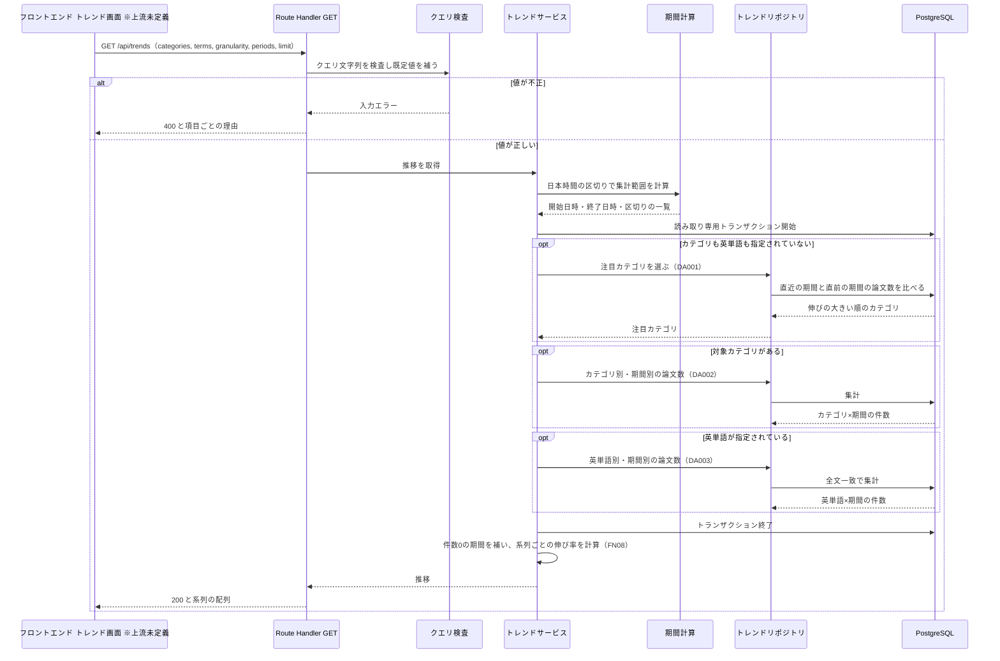

# BE詳細設計書 — F13 トレンド可視化（分析表示）

## 0. 文書情報

| 項目 | 値 |
| :--- | :--- |
| 設計書ID | F13-BE |
| 親ID | F13 |
| 親設計書 | `基本設計書_概要.md` §4.1 機能一覧 |
| 機能名 | トレンド可視化（カテゴリ「分析表示」・区分「利用者機能」。資料上のID F-13。優先度 Future。上流 §4 機能一覧 F13、業務フロー BF14） |
| 版 | 1.0（新規作成。前版なし） |
| 作成日 | 2026-10-26 |
| 更新日 | 2026-10-26 |
| 作成方法 | `source/` 配下の企画資料と確定済みの上流設計書からの設計（creating-backend-detailed-design v1.5.0 準拠） |
| インプット | (a) `source/02_機能要求定義.md:18,32,35,45,49`、`source/03_システム構成.md:6-8,35,46-54`、`source/04_収益化とロードマップ.md:4-5,41`、`source/01_企画概要.md:21-30` ／ (b) `docs/基本設計書_概要.md`（§2 業務フロー一覧 BF14、§3.1 画面一覧、§4 F13・オンライン処理設計の入力チェックとエラー応答・バッチ処理設計、§6 T001・CRUD図 F13 行、§7 外部連携一覧・内部API一覧、§8、§9 環境変数・ディレクトリ構成、§10 開発フェーズ、§11 ARC001〜ARC010、付録 Q04・Q08・Q11・Q21・Q26・Q27・Q31） ／ 関連する確定済みの下位設計書: `docs/db/DB.T001.DB物理設計.md`（§4.3 (4)(5)、§4.6 No.11、§5 インデックス）、`docs/detail/be/BE.F02.BE詳細設計.md`（共通のエラー応答の形） |
| インプットの性質 | `source/` にあるのは企画・初期設計案の Markdown 6ファイル（計227行）だけで、アプリのソースコードは無い（上流 §前提）。F13 について資料にあるのは「トレンド可視化 / Future / 注目研究キーワードの時間推移」の1行だけである（`source/02_機能要求定義.md:18`）。上流でも F13 は定義状況「簡易」で、APIも画面も専用テーブルも定義されていない（上流 §4 F13、§3.1、§7 内部API一覧、付録 Q04・Q27）。そのため本書のエンドポイント・関数・データアクセスは、上流の CRUD図 F13 行（papers の参照だけ）と T001 DB物理設計書 §4.6 No.11「カテゴリと投稿日時で論文数の推移を集計する」から導いた**実装の設計案**であり、実装済みであることは意味しない（実装状況: 未着手）。資料に無い値（パス、パラメータ名、件数上限、注目の判定方法、キャッシュ時間）はすべて※推測と明記する |
| 既存資料の突合 | 本書の既存版（`docs/detail/be/BE.F13.BE詳細設計.md`）は無かったため新規作成とした。`legacy/` は空ディレクトリで、突合できる既存設計・既存仕様は0件（上流 §4 バッチID命名規則「`legacy/` は空ディレクトリ」と同じ）。業務意図・非機能の一次情報は `source/` と上流設計書だけである |

## 1. バックエンド構成・モジュール設計

* **対象ドメイン**: 分析表示系（trend）— 収集済みの論文（papers）を投稿日時の月または週ごとに数え、研究テーマごとの論文数の推移をグラフ用の時系列として返す。テーマは、arXiv のカテゴリ（例: `cs.LG`）と、原題・Abstract に含まれる英単語（例: `diffusion`）の2種類で指定できる。指定が無いときは、直近の論文数が直前の期間より大きく伸びたカテゴリを「注目キーワード」として自動で選んで返す（`source/02_機能要求定義.md:18`「注目研究キーワードの時間推移」、上流 §4 F13）。自前DBだけを集計し、arXiv API・LLM API は呼ばない（`source/02_機能要求定義.md:35,45`）。
* **対象APIエンドポイント**: GET /api/trends（※上流未定義。パスは※推測）の1件。
* **対象バッチ**: なし（§5）。
* **対象外部連携**: なし（§2 外部サービス連携仕様）。

* **APIエンドポイント一覧（全数ロースター）**:

| API-ID | メソッド | エンドポイント | 概要 | 呼出元（画面ID・イベントID） | 認証 | 定義状況 | 詳細の所在 |
| :--- | :--- | :--- | :--- | :--- | :--- | :--- | :--- |
| — ※上流未定義 | GET | /api/trends（※推測） | 指定したカテゴリ・英単語、または自動で選んだ注目カテゴリについて、月別または週別の論文数の推移を返す | トレンド可視化画面（※上流未定義。上流 付録 Q04 で画面として設けるか未決定のため画面IDなし） | 不要（※推測） | 詳細 | §2「GET /api/trends」 |

**総件数: 1件（上流定義済み 0件・※上流未定義 1件）。全数である根拠**: 上流 §7 内部API一覧の全8件（API01〜API08）を確認し、F13 を担うものが0件であることを確かめた（API01 は F02、API02 は F03、API03・API04 は F05/F04、API05 は F08、API06・API07 は F07、API08 は F12）。上流 付録 Q27 の「追加を検討するAPI」の列挙にもトレンドのAPIは無い。一方で上流 §6 CRUD図の F13 行は papers の参照（R）を持ち、F13 は「グラフで見せる」利用者機能（上流 §4 F13 区分「利用者機能」）であるため、画面へ集計結果を渡すAPIが最低1本は要る。本書では、注目カテゴリの自動選定と指定テーマの推移を1本のAPIの分岐で扱い、APIを1件とした（集計の対象・期間・応答の形が共通で、2本に分ける利点が無いため）。上流にIDが無いため API-ID は振らない（仮採番しない）。指定の有無で処理が分かれ、大量の行を集計するため、completeness 3-1 の1・6に当たり「詳細」とした。

* **ディレクトリ/ファイル構造**（※推測: 上流 §9 ディレクトリ構成の仮置き「`web/`（Next.js の画面と画面向けAPI）」に従う。参照だけの画面向けAPIは Next.js API が受ける点を F02（API01）と揃えた）:

```
web/
├── app/api/trends/
│   └── route.ts                      # GET /api/trends の受け口（Route Handler）。GET だけを公開する（FN01）
├── server/trends/
│   ├── trendsQuery.ts                # クエリ文字列の検査と既定値の補完（FN02）
│   ├── trendsService.ts              # 集計期間の決定、注目カテゴリの選定、推移の取得と応答への変換（FN03・FN08）
│   ├── trendPeriods.ts               # 日本時間の月・週の区切りと集計範囲の計算（FN04）
│   └── trendsRepository.ts           # papers への集計SQL（DA001〜DA003 / FN05〜FN07）
└── server/http/
    └── apiError.ts                   # 例外から HTTP 応答への変換（FN09。F02 と共用 ※推測）
```

* **処理シーケンス図**（上流 BF14 は定義状況「簡易」でシーケンスが無いため、本書の関数単位で作図。全体が※推測）:



* **前提・上流との差異**（本書で判明したもの。上流側の追記・訂正を要する）:
  1. **F13 のAPIが上流に無い**（※上流未定義）: GET /api/trends は上流 §7 内部API一覧にも、付録 Q27 の追加候補にも無い。上流への追加を要する。
  2. **F13 の画面が上流に無い**（※上流未定義）: 上流 §3.1 の画面一覧（P101〜P107）にトレンド可視化の画面は無く、設けるかどうか自体が付録 Q04 で未決定である。本APIの呼出元は画面IDなしで記載している。
  3. **「研究キーワード」の実体が無い**（※上流要確認）: 資料は「注目研究キーワード」の推移を求めるが（`source/02_機能要求定義.md:18`）、上流 §6 のどのテーブルにもキーワードの列は無い。T001 DB物理設計書 §4.6 No.11 は「カテゴリと投稿日時で論文数の推移を集計する」としている。本書では、キーワードを (a) arXiv のカテゴリと (b) 原題・Abstract の全文一致で数える英単語の2種類として扱い、論文ごとのキーワード抽出（LLMや形態素解析で語を取り出して保存する方式）は採らない。抽出方式を採る場合は保存先テーブルとバッチが要り、上流 付録 Q23 の未定義テーブルに加わる。
  4. **「注目」の判定基準が無い**（※上流要確認）: どのキーワードを注目とするかは資料に定義が無い。本書では「直近3期間の論文数が、その前の3期間より大きく伸びたカテゴリ」を注目とする（§3 DA001。※推測）。
  5. **集計に使う日付**（※上流要確認。上流 付録 Q11）: 投稿日時（papers.submitted_at、v1 がarXivへ投稿された日時）で期間に振り分ける。オンデマンド同期（B006）で後から取り込んだ古い論文は、取り込んだ時点ではなく投稿された期間に数えられる。このため過去の期間の件数も、取り込みが進むと後から増えることがある（§2 レスポンスの `partial` と注記）。
  6. **上流 §4 機能一覧の F13 行の「BE詳細設計書」列が「-（未作成）」のまま**（※上流要確認）: 本書の作成により `detail/be/BE.F13.BE詳細設計.md` へ更新を要する。上流で F13 を「簡易」とした判定（参照だけのため）と、本書で API・データアクセスを「詳細」とした判定（大量行の集計と分岐を伴うため。completeness 3-1 の1・6）は観点が異なる。上流の判定は変更しない。
  7. **ARC009 の適用範囲に F13 が無い**（※上流要確認）: 本APIも日付の種類とタイムゾーンを応答に含めるが（§7）、上流 §11.1 ARC009 の適用範囲は「P101〜P107 全画面 / API01〜API05」で、F13 の記載が無い。

## 2. API・インターフェース詳細設計

* **外部サービス連携仕様**: **該当なし**。

| IF-ID | 連携先 | 連携方式 | エンドポイント / 接続先 | 認証方式 | タイムアウト | リトライ方針 | エラー時の挙動 | 定義状況 | 詳細の所在 |
| :--- | :--- | :--- | :--- | :--- | :--- | :--- | :--- | :--- | :--- |
| — | 該当なし | — | — | — | — | — | — | — | — |

**総件数: 0件。根拠**: 上流 §7 外部連携一覧の全9件（IF01〜IF09）を確認した。本機能は自前DBの papers だけを集計し、arXiv API（IF01）・arXiv本文（IF02）を呼ばない（`source/02_機能要求定義.md:35`「初期は自前DBを検索」）。画面表示のたびに LLM API（IF04）を呼ばない（`source/02_機能要求定義.md:45`）。認証を求めないため Supabase Auth（IF05）も使わない（§2 認証要否 ※推測）。IF03（原文リンク）、IF06・IF07（Stripe）、IF08（GitHub）、IF09（通知配信手段）は本機能の処理に現れない。上流 §6 CRUD図の F13 行も papers の参照だけである。

---

### GET /api/trends

* **概要**: 研究テーマごとの論文数の推移を、グラフに描ける時系列として返す。テーマはカテゴリ（`categories`）と英単語（`terms`）で指定できる。どちらも指定しないときは、直近の伸びが大きいカテゴリを注目キーワードとして自動で選び、その推移を返す。集計は日本時間の月（既定）または週で区切り、今日を含む期間までを数える（※推測）。※上流未定義（パスは※推測。§1 前提 1）。
* **認証要否**: 不要（※推測）。ゲストも会員も同じ結果を受け取る。トレンド可視化は Free・Pro どちらの提供範囲にも挙がっておらず（`source/04_収益化とロードマップ.md:4-5`）、扱う情報が公開済みの論文の件数だけで利用者データに触れないため、新着一覧（API01）と同じく誰でも呼べるものとした（上流 付録 Q08 で確定待ち）。
* **リクエストパラメータ**（すべて※推測。上流 付録 Q26）:

| 種別(Path/Query/Body) | 項目名 | 型 | 必須 | 制約・バリデーション | 説明 |
| :--- | :--- | :--- | :--- | :--- | :--- |
| Query | categories | string（カンマ区切り） | 任意 | 0〜5件。1件ずつ arXiv のカテゴリ表記であること（英小文字とハイフンのアーカイブ名、任意でピリオドとサブ分類。例 `cs.LG`、`hep-th`。形式 `^[a-z][a-z\-]*(\.[A-Za-z][A-Za-z\-]*)?$`）。同じ値の重複は1件にまとめる | 推移を見たいカテゴリ。上流 §4 入力チェック「`category` はarXivのカテゴリ表記だけを受け付けます」に合わせる。収集対象に無いカテゴリは形式が正しければ受け付け、件数0の系列として返す（存在しないカテゴリの一覧を本システムが持たないため。F02 確認事項 No.3 と同じ扱い） |
| Query | terms | string（カンマ区切り） | 任意 | 0〜5件。1件は前後の空白を除いて2〜50文字の英字・数字・空白・ハイフンだけから成ること（`^[A-Za-z0-9][A-Za-z0-9 \-]{1,49}$`）。大文字・小文字は区別しない | 推移を見たい英単語または英語の語句。原題とAbstractの全文一致で数える。原題・Abstract が英語のため英単語に限る（T001 §5.2 `idx_papers_fulltext` は英語の語幹処理）。日本語の語は受け付けない |
| Query | granularity | string | 任意 | `month`（月別）または `week`（週別）。既定値 `month` | 集計の区切り。週は日本時間の月曜0時始まり |
| Query | periods | integer | 任意 | 月別は 7〜36、週別は 8〜52。既定値は月別 12・週別 26 | 何期間さかのぼって返すか。今日を含む期間を最後の1期間として数える。下限は、伸び率の計算に使う直近3期間とその前の3期間（いずれも完了した期間）が必ず集計範囲に入るように決めた（今日を含む未完了の1期間＋完了した6期間＝7） |
| Query | limit | integer | 任意 | 1〜10。既定値 5 | 自動で選ぶ注目カテゴリの数。`categories`・`terms` のどちらかを指定したときは使わない（指定しても無視し、エラーにはしない） |

  * カテゴリと英単語の合計は5件までとする（グラフの線が多すぎて読めなくなるのを防ぎ、1回の集計量を抑えるため）。合計が5件を超えたら 400 にする。

* **レスポンス（成功時）**（※推測: 形式は上流で未定義。上流 付録 Q26。エラー時の形は F02 と同じ共通形式）。下の例は月別12期間のうち最初と最後の2期間だけを示した抜粋で、実際の `periods` と各系列の `counts` は同じ長さ（この例では12）になる:
```json
{
  "status": "success",
  "data": {
    "mode": "trending",
    "granularity": "month",
    "timeZone": "Asia/Tokyo",
    "dateBasis": "submitted",
    "from": "2025-11-01",
    "to": "2026-10-26",
    "periods": [
      { "start": "2025-11-01", "partial": false },
      { "start": "2026-10-01", "partial": true }
    ],
    "series": [
      {
        "kind": "category",
        "key": "cs.LG",
        "counts": [1830, 2140],
        "recentTotal": 6120,
        "previousTotal": 4980,
        "growthRate": 0.229
      }
    ],
    "generatedAt": "2026-10-26T09:00:00+09:00"
  }
}
```

  | 応答項目 | 内容 |
  | :--- | :--- |
  | mode | 系列の選び方。自動で注目カテゴリを選んだときは `trending`、利用者が指定したテーマのときは `specified` |
  | granularity | 実際に使った集計の区切り（`month` / `week`） |
  | timeZone / dateBasis | 期間の区切りに使ったタイムゾーンと日付の種類。常に日本時間（`Asia/Tokyo`）と投稿日時（`submitted`）。画面が「投稿日ベース・日本時間」と明示できるようにする（上流 ARC009） |
  | from / to | 集計範囲の最初の期間の開始日と、今日の日付（日本時間） |
  | periods | 期間の並び（古い順）。`partial` は今日を含む未完了の期間なら true。未完了の期間は件数が少なく見えるため、画面が完了した期間と描き分けられるようにする。どう描き分けるかは画面設計で決める（画面は※上流未定義） |
  | series | テーマごとの系列。`kind` はカテゴリ（`category`）か英単語（`term`）か、`key` は正規化した値（英単語は小文字）、`counts` は `periods` と同じ順・同じ長さの論文数。件数が無い期間も0で埋める |
  | recentTotal / previousTotal / growthRate | 直近3期間（未完了の期間を除く）の合計、その前の3期間の合計、伸び率（直近÷前−1。前の3期間が0件のときは null）。並び替えと注目の根拠表示に使う |
  | generatedAt | 集計した時刻（日本時間）。キャッシュされた応答かどうかを画面が判断できるようにする |

* **レスポンスヘッダー**: `Cache-Control: public, s-maxage=3600, stale-while-revalidate=600`（※推測: 推移は1日1回の収集（B001）でしか大きく変わらず、集計は重いため、Vercel の配信網で1時間共有キャッシュする。同じクエリ文字列は同じ応答を返す）。
* **ステータスコード**:

| コード | 条件 |
| :--- | :--- |
| 200 | 正常終了。該当する論文が無い期間・テーマも件数0として返す。注目カテゴリが1件も選べないとき（直近3期間の論文が少なすぎるとき）は系列を空の配列で返す |
| 400 | 入力不正。カテゴリ表記・英単語の形式が誤っている、テーマの合計が5件を超えた、区切り・期間数・選ぶ数が許される範囲の外、のいずれか。不正な項目をすべて集めて返す（上流 §4 エラー応答「入力不正は HTTP 400」） |
| 500 | サーバ内部エラー。DB に接続できない、集計が時間切れ（10秒 ※推測）になった、予期しない例外が起きた（上流 §4 エラー応答「サーバ側の失敗は 500」） |

* **ビジネスロジック・副作用**:
  1. クエリ文字列を検査し、既定値を補う（FN02）。不正な項目があれば DB に触れずに 400 を返す。
  2. 区切りと期間数から、日本時間での集計範囲（最初の期間の開始時刻〜明日0時）と期間の並びを決める（FN04）。注目の判定に使う「直近3期間」と「その前の3期間」も、今日を含む未完了の期間を除いて決める。
  3. 読み取り専用のトランザクションを開始する（※推測: 注目カテゴリの選定と推移の集計で、同じ時点のデータを数えるため。§6 トランザクション制御）。
  4. カテゴリも英単語も指定されていないときは、注目カテゴリを選ぶ（DA001 / FN05）。直近3期間の論文が30件以上あるカテゴリのうち、伸び率の大きい順に、同じなら直近の件数の多い順に `limit` 件を選ぶ（※推測。§1 前提 4）。
  5. 対象カテゴリ（指定されたもの、または手順4で選んだもの）があれば、カテゴリ別・期間別の論文数を数える（DA002 / FN06）。
  6. 英単語が指定されていれば、英単語別・期間別の論文数を数える（DA003 / FN07）。
  7. トランザクションを終える（参照だけのため、成否にかかわらずロールバックで閉じる）。
  8. 件数の無い期間を0で埋め、系列ごとに直近3期間・その前の3期間の合計と伸び率を計算する（FN08）。指定モードでは指定した順、注目モードでは手順4の順に系列を並べる。
  9. 応答を返す。DB への書き込み、ジョブの登録、外部への送信、閲覧の記録は行わない（上流 CRUD図 F13 行は papers の参照だけ）。

## 3. データアクセス（ORM / クエリ）設計

* **データアクセス一覧（全数ロースター）**:

| DA-ID | 処理名 | 呼出元（関数/API） | テーブルID | 対象物理テーブル | 種別 (SELECT/INSERT/UPDATE/DELETE) | 定義状況 (詳細/簡易) | 詳細の所在 |
| :--- | :--- | :--- | :--- | :--- | :--- | :--- | :--- |
| DA001 | 注目カテゴリの選定 | findTrendingCategories（FN05）← getTrends（FN03）← GET /api/trends（テーマの指定が無いとき） | T001 | papers | SELECT | 詳細 | §3 詳細定義 DA001、発行SQL DA001 |
| DA002 | カテゴリ別・期間別の論文数の集計 | countByCategory（FN06）← getTrends（FN03）← GET /api/trends（対象カテゴリがあるとき） | T001 | papers | SELECT | 詳細 | §3 詳細定義 DA002、発行SQL DA002 |
| DA003 | 英単語別・期間別の論文数の集計 | countByTerm（FN07）← getTrends（FN03）← GET /api/trends（英単語の指定があるとき） | T001 | papers | SELECT | 詳細 | §3 詳細定義 DA003、発行SQL DA003 |

**総件数: 3件（SELECT 3件、INSERT・UPDATE・DELETE 0件）。全数である根拠**: ソースコードが無いため、§2 のビジネスロジック手順 4・5・6 の DB への問い合わせを、1回の問い合わせを1件として数えた。§4 関数ロースターの全9関数のうち DB に触れるのはリポジトリの3関数（FN05〜FN07）だけで、それぞれが1回ずつ問い合わせる（トランザクションの開始・終了の命令は FN03 が出すが、データを読み書きしないためデータアクセスには数えない）。上流 §6 CRUD図の F13 行（papers R、他のテーブルは操作なし）と、対象テーブル・種別が一致する。T001 DB物理設計書 §4.6 No.11 の F13 の操作「カテゴリと投稿日時で論文数の推移を集計する」は DA001・DA002 で満たし、英単語の推移（DA003）は本書で加えたものである（§1 前提 3）。

**定義状況の判定**: 3件とも「詳細」とした。DA001 は伸び率で並べ替えるという業務ルールを含み（3-1 の7）、指定期間のカテゴリを全行展開して集計する（3-1 の6）。DA002 は区切りを実行時に選び（3-1 の4）、数年分の行を集計する（3-1 の6）。DA003 は英単語の数だけ全文一致を行い、インデックスと同じ式を書かないと全件走査になる（3-1 の6）。

* **データアクセス詳細定義**:

| DA-ID | 処理名 | テーブルID | 対象物理テーブル | JOIN / Include | 抽出条件 (Where) / ソート | トランザクション境界 | N+1対策・性能上の注意 |
| :--- | :--- | :--- | :--- | :--- | :--- | :--- | :--- |
| DA001 | 注目カテゴリの選定 | T001 | papers | 論文ごとのカテゴリの並びを1要素1行に展開して結ぶ（`CROSS JOIN LATERAL unnest(categories)`）。1本の論文が複数カテゴリを持つときは、それぞれのカテゴリに1件ずつ数える（主カテゴリだけに絞らない。※推測: 分野横断の研究も各分野の動きとして数えるため） | 投稿日時が「その前の3期間」の開始から「直近3期間」の終了までにある論文が対象（`submitted_at >= $1 AND submitted_at < $3`）。カテゴリごとに、直近3期間の件数（`submitted_at >= $2` の行）とその前の3期間の件数を数える。直近3期間の件数が30件未満のカテゴリは除く（件数の少ないカテゴリで伸び率が極端になるのを防ぐ。`HAVING recent >= $4`）。並びは伸び率の大きい順（その前の3期間が0件のカテゴリは伸び率を最大として先頭側に置く）、同じなら直近の件数の多い順、最後はカテゴリ名の昇順。先頭から `limit` 件を返す | §2 手順3で開始した読み取り専用トランザクションの中で実行する（DA002 と同じ時点を数えるため） | 投稿日時の範囲指定は `idx_papers_submitted_at`（submitted_at DESC, id DESC）で絞れるが、範囲内の行はすべて読んでカテゴリを展開する。月別の既定値では6か月分（※推測: T001 想定件数「年に約25万〜30万行」から約15万行、カテゴリ展開後はその1.5〜2倍）を集計するため、文の時間切れを10秒とし（※推測）、応答は共有キャッシュで1時間使い回す（§2 応答ヘッダー）。それでも遅い場合は、日別・カテゴリ別の件数を事前に集計しておく表（マテリアライズドビュー）を設ける（※上流要確認: 上流 §6 に無いテーブルと、その更新ジョブが要る。§5） |
| DA002 | カテゴリ別・期間別の論文数の集計 | T001 | papers | 論文ごとのカテゴリの並びを1要素1行に展開して結ぶ（`CROSS JOIN LATERAL unnest(categories)`）。展開した行のうち対象カテゴリと一致する行だけを残す | 投稿日時が集計範囲（最初の期間の開始〜明日0時、日本時間）にある論文で（`submitted_at >= $1 AND submitted_at < $2`）、カテゴリの並びに対象カテゴリのどれかを含むもの（`categories && $3::text[]`）。展開後に対象カテゴリと一致する要素だけを数える（`c = ANY($3)`）。投稿日時を日本時間に直してから区切りの先頭に切り捨てた値と、カテゴリの組で数える（`date_trunc($4, submitted_at AT TIME ZONE 'Asia/Tokyo')`）。並びは区切りの古い順、カテゴリ名の昇順（応答の並びは FN08 で決め直す） | DA001 と同じ読み取り専用トランザクション | 対象カテゴリを含む論文の絞り込みは `idx_papers_categories`（GIN）で行い、投稿日時の範囲と組み合わせる（どちらのインデックスを使うかは件数の見積もりで DB が選ぶ）。最大36か月×5カテゴリ。論文の多いカテゴリ（例: `cs.LG`）を36か月指定すると十数万行を数えるため、時間切れ10秒と共有キャッシュで守る（※推測）。カテゴリごとに問い合わせを繰り返さず1回で数える（N+1 にしない） |
| DA003 | 英単語別・期間別の論文数の集計 | T001 | papers | 指定された英単語の並びを1語1行に展開し（`unnest($3::text[]) AS t(term)`）、それぞれの英単語を原題とAbstractに含む論文と結ぶ（`JOIN papers ON 全文一致`） | 投稿日時が集計範囲にある論文で（`submitted_at >= $1 AND submitted_at < $2`）、原題とAbstractを英語の語幹単位に分けた値が英単語に一致するもの（`to_tsvector('english', title \|\| ' ' \|\| abstract) @@ plainto_tsquery('english', t.term)`。語句は全語を含むときに一致）。英単語と、日本時間の区切りの先頭の組で数える。並びは区切りの古い順、英単語の昇順 | DA001 と同じ読み取り専用トランザクション | 全文一致の条件は `idx_papers_fulltext`（GIN 式インデックス）と**同じ式**で書かないとインデックスが使われず全件走査になる（T001 §5.2 の注意）。よく出る語（例: `learning`）は一致する行が多く、範囲内のほぼ全行を数えるため、時間切れ10秒と共有キャッシュで守る。全文検索の実体を PostgreSQL 以外にする場合（上流 付録 Q21）は、本DAを検索エンジンの集計機能へ置き換える（※推測）。英単語ごとに問い合わせを繰り返さず1回で数える |

* **発行SQL**: 3件とも PostgreSQL の生SQLをパラメータ付きで発行する（※推測: 配列の展開・全文一致・タイムゾーン変換を伴う集計は ORM・Supabase のクエリビルダでは書けないため、F02 と同じく `DATABASE_URL` への接続で node-postgres を使う）。値はすべてプレースホルダーで渡し、文字列連結で SQL に埋め込まない。区切り（`month` / `week`）も `date_trunc` の第1引数としてプレースホルダーで渡せるため、SQL の形は実行時に変わらない（動的な組み立ては無い）。`$n` は実行時に渡す値。

**DA001 注目カテゴリの選定**（$1: その前の3期間の開始時刻、$2: 直近3期間の開始時刻、$3: 直近3期間の終了時刻、$4: 直近3期間の最低件数 30、$5: 選ぶ数 `limit`。時刻はすべて日本時間の区切りを UTC の timestamptz にしたもの）
```sql
SELECT c AS category,
       count(*) FILTER (WHERE p.submitted_at >= $2)  AS recent,
       count(*) FILTER (WHERE p.submitted_at <  $2)  AS previous
  FROM papers AS p
 CROSS JOIN LATERAL unnest(p.categories) AS c
 WHERE p.submitted_at >= $1
   AND p.submitted_at <  $3
 GROUP BY c
HAVING count(*) FILTER (WHERE p.submitted_at >= $2) >= $4
 ORDER BY CASE WHEN count(*) FILTER (WHERE p.submitted_at < $2) = 0 THEN 1 ELSE 0 END DESC,
          (count(*) FILTER (WHERE p.submitted_at >= $2))::numeric
            / NULLIF(count(*) FILTER (WHERE p.submitted_at < $2), 0) DESC NULLS LAST,
          recent DESC,
          category ASC
 LIMIT $5;
```

**DA002 カテゴリ別・期間別の論文数の集計**（$1: 集計範囲の開始時刻、$2: 明日0時（日本時間）、$3: 対象カテゴリの配列、$4: 区切り `month` / `week`）
```sql
SELECT date_trunc($4, p.submitted_at AT TIME ZONE 'Asia/Tokyo')::date AS period_start,
       c AS category,
       count(*) AS paper_count
  FROM papers AS p
 CROSS JOIN LATERAL unnest(p.categories) AS c
 WHERE p.submitted_at >= $1
   AND p.submitted_at <  $2
   AND p.categories && $3::text[]
   AND c = ANY($3::text[])
 GROUP BY period_start, c
 ORDER BY period_start ASC, c ASC;
```

**DA003 英単語別・期間別の論文数の集計**（$1: 集計範囲の開始時刻、$2: 明日0時（日本時間）、$3: 英単語の配列（小文字に正規化済み）、$4: 区切り `month` / `week`）
```sql
SELECT t.term,
       date_trunc($4, p.submitted_at AT TIME ZONE 'Asia/Tokyo')::date AS period_start,
       count(*) AS paper_count
  FROM unnest($3::text[]) AS t(term)
  JOIN papers AS p
    ON to_tsvector('english', p.title || ' ' || p.abstract)
       @@ plainto_tsquery('english', t.term)
 WHERE p.submitted_at >= $1
   AND p.submitted_at <  $2
 GROUP BY t.term, period_start
 ORDER BY period_start ASC, t.term ASC;
```

* **文の時間切れ**: トランザクションの開始直後に、そのトランザクションの中だけで効く時間切れを10秒に設定する（`SET LOCAL statement_timeout = '10s'`。※推測: 参照だけの一覧（F02）の5秒より長くしたのは、数か月〜数年分を集計するため）。

## 4. サーバー側機能・処理ロジック設計（IPO設計）

* **関数一覧（全数ロースター）**（関数名・所属モジュールはすべて※推測の実装案）:

| FN-ID | 関数名 | 所属モジュール | 概要 | 呼出元 | 定義状況 | 詳細の所在 |
| :--- | :--- | :--- | :--- | :--- | :--- | :--- |
| FN01 | GET | app/api/trends/route.ts（Route Handler） | GET /api/trends の受け口。クエリの検査、推移の取得を順に呼び、応答ヘッダーを付ける。例外を HTTP 応答へ変える | Next.js（GET /api/trends） | 詳細 | §4 IPO定義 FN01 |
| FN02 | parseTrendsQuery | server/trends/trendsQuery.ts | クエリ文字列のカテゴリ・英単語・区切り・期間数・選ぶ数を検査し、既定値を補った条件に直す。不正な項目をすべて集めて入力エラーにする | FN01 | 詳細 | §4 IPO定義 FN02 |
| FN03 | getTrends | server/trends/trendsService.ts | 集計期間を決め、読み取り専用トランザクションの中で注目カテゴリの選定と推移の集計を呼び分け、応答の形に変える | FN01 | 詳細 | §4 IPO定義 FN03 |
| FN04 | buildPeriodRange | server/trends/trendPeriods.ts | 日本時間の今日を基準に、月または週の区切りで期間の並び・集計範囲・注目判定の2つの範囲を計算する | FN03 | 詳細 | §4 IPO定義 FN04 |
| FN05 | findTrendingCategories | server/trends/trendsRepository.ts | DA001 を発行し、注目カテゴリを伸びの大きい順に返す | FN03 | 詳細 | §4 IPO定義 FN05、§3 DA001 |
| FN06 | countByCategory | server/trends/trendsRepository.ts | DA002 を発行し、カテゴリ別・期間別の論文数を返す | FN03 | 詳細 | §4 IPO定義 FN06、§3 DA002 |
| FN07 | countByTerm | server/trends/trendsRepository.ts | DA003 を発行し、英単語別・期間別の論文数を返す | FN03 | 詳細 | §4 IPO定義 FN07、§3 DA003 |
| FN08 | toTrendSeries | server/trends/trendsService.ts | 集計結果を期間の並びに合わせて0で埋めた系列に変え、直近・前の期間の合計と伸び率を付ける | FN03 | 詳細 | §4 IPO定義 FN08 |
| FN09 | toErrorResponse | server/http/apiError.ts | 入力エラー・DB障害・予期しない例外を、HTTP ステータスと共通のエラー応答に変え、ログを出す（F02 の同名関数と同じモジュールを共用する ※推測） | FN01 | 詳細 | §4 IPO定義 FN09、§6 |

**総件数: 9件（コントローラー1件、入力検査1件、サービス層3件、データアクセス層3件、例外変換1件）。全数である根拠**: ソースコードが無いため（実装状況: 未着手）、§2 のビジネスロジック手順 1〜9 と §6 のエラーハンドリングを、1つの責務を1関数として分けた設計上の全数である。手順1→FN02、手順2→FN04、手順3・7と全体の流れ→FN03、手順4→FN05、手順5→FN06、手順6→FN07、手順8→FN08、手順9→FN01、例外の変換→FN09 で、どの手順も関数が1つ以上対応し、どの関数も手順のどれかに対応する。FN-ID は本書内で関数を指すための番号で、上流の採番対象ではない。

**定義状況の判定**: 9件とも completeness 3-1 のいずれかに当たるため「詳細」とした（FN01・FN02・FN03・FN09 は分岐あり（1）、FN03 は複数の問い合わせを1つのトランザクションにまとめる（3）、FN04 は日本時間の週・月の区切りと未完了の期間の扱いという非自明な業務ルール（7）、FN05〜FN07 は大量行の集計（6）、FN05 は注目の判定という業務ルール（7）、FN08 は0埋めと伸び率の計算で前の期間が0件のときの分岐を持つ（1・7））。

* **入力・処理・出力（IPO）定義**:

| 関数名 | 所属モジュール | 引数 (型) | 処理フロー (ステップ単位で具体的に) | 戻り値 | 発生しうるエラー |
| :--- | :--- | :--- | :--- | :--- | :--- |
| FN01 GET | app/api/trends/route.ts | request: NextRequest | 1. 要求URLのクエリ文字列を取り出し、FN02 で検査する。<br>2. 検査済みの条件で FN03 を呼び、推移を受け取る。<br>3. 推移を `status: "success"` の形で包み、200 と `Cache-Control: public, s-maxage=3600, stale-while-revalidate=600` を付けて返す（※推測）。<br>4. 手順1〜3で例外が起きたら FN09 に渡し、返ってきたステータスと本文をそのまま返す。エラー応答にはキャッシュさせないヘッダー（`Cache-Control: no-store`）を付ける（一時的な DB 障害の応答が1時間配信され続けるのを防ぐため） | Response（200 / 400 / 500） | なし（すべて FN09 で応答に変える） |
| FN02 parseTrendsQuery | server/trends/trendsQuery.ts | params: URLSearchParams | 1. `categories` をカンマで分け、前後の空白を除き、空の要素を捨て、重複を1件にまとめる。1件ずつカテゴリ表記の形式か確かめ、外れたものを不正項目に加える。<br>2. `terms` を同じように分け、小文字にそろえて重複をまとめる。1件ずつ長さ2〜50文字・使える文字（英字・数字・空白・ハイフン）か確かめ、外れたものを不正項目に加える。<br>3. カテゴリと英単語の合計が5件を超えたら不正項目に加える。<br>4. `granularity` が無ければ `month` にする。`month` でも `week` でもなければ不正項目に加える。<br>5. `periods` が無ければ区切りに応じて12（月）または26（週）にする。整数でない、または区切りごとの範囲（月 7〜36、週 8〜52）の外なら不正項目に加える。<br>6. `limit` が無ければ5にする。整数でない、または1〜10の外なら不正項目に加える。カテゴリか英単語の指定があるときは検査も使用もしない。<br>7. 不正項目が1件以上あれば、項目名と理由の一覧を持つ入力エラーを投げる。<br>8. カテゴリと英単語の両方が空なら `mode` を `trending`、どちらかがあれば `specified` とし、条件をまとめて返す | TrendsQuery（mode, categories: string[], terms: string[], granularity, periods: number, limit: number） | 入力エラー（不正項目の一覧付き） |
| FN03 getTrends | server/trends/trendsService.ts | query: TrendsQuery, now: Date | 1. FN04 に区切り・期間数・現在時刻を渡し、期間の並びと3つの範囲（集計範囲・直近3期間・その前の3期間）を受け取る。<br>2. 接続プールから接続を借り、読み取り専用で同じ時点のデータを読むトランザクションを始める（`BEGIN TRANSACTION ISOLATION LEVEL REPEATABLE READ READ ONLY`）。続けて文の時間切れを10秒にする（`SET LOCAL statement_timeout`。※推測）。<br>3. `mode` が `trending` なら FN05 を呼び、選ばれたカテゴリを対象カテゴリにする。選ばれたカテゴリが0件なら手順4・5を飛ばす。`specified` なら指定されたカテゴリを対象カテゴリにする。<br>4. 対象カテゴリが1件以上あれば FN06 を呼ぶ。<br>5. 英単語が1件以上あれば FN07 を呼ぶ。<br>6. 成否にかかわらずトランザクションをロールバックで閉じ、接続を返す（書き込みが無いため、コミットとロールバックで結果は変わらない）。<br>7. FN08 に期間の並び・集計結果・系列の並び順（`trending` は FN05 の順、`specified` はカテゴリ→英単語の指定順）を渡し、系列を受け取る。<br>8. mode・区切り・タイムゾーン・日付の種類・集計範囲・期間の並び・系列・集計時刻をまとめて返す | Trends（§2 レスポンスの `data`） | DB障害（接続失敗・時間切れ・SQL実行エラー。FN05〜FN07 から伝わるもの、およびトランザクション開始の失敗） |
| FN04 buildPeriodRange | server/trends/trendPeriods.ts | granularity: "month" \| "week", periods: number, now: Date | 1. 現在時刻を日本時間に直し、今日の日付を求める。<br>2. 今日を含む期間の開始日を求める。月別はその月の1日、週別はその週の月曜日（日本時間）。<br>3. そこから期間数−1だけさかのぼった期間の開始日を最初の期間とし、古い順に期間の開始日の並びを作る。最後の期間（今日を含む）だけ `partial` を true にする。<br>4. 集計範囲は、最初の期間の開始日の日本時間0時から、明日の日本時間0時までとする。日本時間の0時を UTC の時刻に直して返す（日本時間は夏時間が無いため、常に9時間を引けばよい）。<br>5. 注目の判定と伸び率に使う範囲は、未完了の最後の期間を除いた直近3期間（その開始〜今日を含む期間の開始）と、その前の3期間とする。FN02 の下限（月7・週8）により完了した期間は常に6つ以上あるため、この2つの範囲は必ず集計範囲の中に収まる | PeriodRange（periodStarts: {start, partial}[], rangeStart, rangeEnd, recentStart, recentEnd, previousStart） | なし |
| FN05 findTrendingCategories | server/trends/trendsRepository.ts | client: PoolClient, previousStart: Date, recentStart: Date, recentEnd: Date, limit: number | 1. DA001 を、その前の3期間の開始・直近3期間の開始・直近3期間の終了・最低件数30（※推測）・選ぶ数で発行する。<br>2. 返ってきた行（カテゴリ、直近の件数、前の件数）を、DB が返した順のまま配列にして返す | {category, recent, previous}[]（0〜limit 件） | DB障害 |
| FN06 countByCategory | server/trends/trendsRepository.ts | client: PoolClient, rangeStart: Date, rangeEnd: Date, categories: string[], granularity: string | 1. DA002 を、集計範囲・対象カテゴリの配列・区切りで発行する。<br>2. 返ってきた行（期間の開始日、カテゴリ、件数）を配列で返す。件数が0の期間は行として返らない（FN08 で埋める） | {periodStart, key, count}[] | DB障害 |
| FN07 countByTerm | server/trends/trendsRepository.ts | client: PoolClient, rangeStart: Date, rangeEnd: Date, terms: string[], granularity: string | 1. DA003 を、集計範囲・英単語の配列・区切りで発行する。<br>2. 返ってきた行（英単語、期間の開始日、件数）を配列で返す。件数が0の期間は行として返らない（FN08 で埋める） | {periodStart, key, count}[] | DB障害 |
| FN08 toTrendSeries | server/trends/trendsService.ts | periodStarts: {start, partial}[], categoryRows, termRows, order: {kind, key}[] | 1. 系列の並び順に従い、テーマごとに期間の並びと同じ長さの件数配列を0で作る。<br>2. 集計結果の各行を、テーマと期間の開始日で該当する位置に入れる。期間の並びに無い開始日の行は捨てる（集計範囲の境界で起きうるため。WARN は出さない）。<br>3. 未完了の最後の期間を除いた直近3期間の合計と、その前の3期間の合計を、件数配列から求める（両範囲は FN04 手順5のとおり必ず集計範囲に含まれるため、配列の外を補う必要は無い）。<br>4. 伸び率を「直近の合計÷前の合計−1」で求め、小数第3位で丸める。前の合計が0件のときは伸び率を null にする（0除算を避け、「新しく現れたテーマ」と画面が区別できるようにする）。<br>5. テーマごとに種類・値・件数配列・2つの合計・伸び率をまとめた系列の配列を返す | TrendSeries[] | なし |
| FN09 toErrorResponse | server/http/apiError.ts | error: unknown, context: {path, query} | 1. 入力エラーなら、WARN でクエリ文字列と不正項目の一覧をログに出し、400 と `INVALID_PARAMETER`・不正項目ごとの理由を返す。<br>2. DB障害（接続失敗、時間切れ、SQL実行エラー）なら、ERROR で例外の種類・どの集計か・所要時間・クエリ文字列・スタックトレースをログに出し、500 と `INTERNAL_ERROR`・汎用メッセージを返す。時間切れは監視で数えられるよう理由を分けて記録する。<br>3. それ以外の例外は ERROR でスタックトレースを出し、500 と `INTERNAL_ERROR`・汎用メッセージを返す。<br>4. どの場合も SQL 本文・DB のエラー文・スタックトレースは応答に含めない | {status: number, body: ErrorBody} | なし |

## 5. バッチ処理・非同期タスク設計

* **ジョブ実行定義**: **該当なし**。

| バッチID | ジョブ名 | 実行タイミング | 対象テーブル | 処理概要 | タイムアウト |
| :--- | :--- | :--- | :--- | :--- | :--- |
| — | 該当なし | — | — | — | — |

**総件数: 0件。根拠**: 上流 §4 バッチ処理設計の全11件（B001〜B011）のうち、F13 を担うものは無い（B001〜B006・B011 は論文の収集・要約・検証・公開・本文解析・同期・検索インデックス、B007 は通知、B008 は Embedding、B009 は GitHub関連付け、B010 は失敗ジョブの再処理）。上流 §6 CRUD図の F13 行でも jobs への操作は無い。本機能は利用者の要求を受けてその場で集計して返す参照だけのAPIで、ジョブの登録も定期実行も行わない。
* **将来の検討事項**（※上流要確認。本書では採番・定義しない）: 論文数が増えて DA001〜DA003 が時間切れ（10秒）に近づいた場合は、日別・カテゴリ別の件数をまとめた集計表（マテリアライズドビュー）を、収集（B001）の後に作り直す定期ジョブを設けることを提案する。集計表は上流 §6 に無いテーブルで、作り直すジョブも上流 §4 に無いため、採用する場合は上流でテーブルIDとバッチIDの採番を要する。

## 6. 例外処理・セキュリティ設計

* **エラーハンドリング**: 例外はすべて FN01 で受け止め、FN09 で応答に変える。DB の詳細・SQL 本文・スタックトレースはクライアントへ返さず、ログにだけ残す。該当する論文が無いこと・注目カテゴリが選べないことはエラーにせず、件数0の系列や空の系列として 200 で返す（グラフの領域だけが空になり、画面全体は落ちない。上流 EX04 の考え方）。

| 例外種別 | 対応方法 | ログ出力 | クライアント応答 |
| :--- | :--- | :--- | :--- |
| 入力エラー（カテゴリ表記・英単語の形式不正、テーマの合計が5件超、区切り・期間数・選ぶ数が範囲外） | FN02 が不正項目をすべて集めて投げ、FN01 が受けて FN09 で変換する。DB には問い合わせない | WARN（クエリ文字列、不正項目の一覧） | 400 + `INVALID_PARAMETER` と不正項目ごとの理由（キャッシュさせない） |
| DB接続失敗（接続プールから接続を借りられない、DB が応答しない） | FN03 のトランザクション開始、または FN05〜FN07 から DB障害として投げ、FN09 で変換する。API 内では再試行しない（※推測: 集計は重く、再試行すると DB の負荷をさらに上げるため。利用者は画面の再読み込みでやり直せる） | ERROR（例外の種類、どの集計か、所要時間、スタックトレース） | 500 + `INTERNAL_ERROR` と汎用メッセージ（キャッシュさせない） |
| 文の時間切れ（10秒 ※推測） | DB 側で集計を打ち切り、DB障害として扱う。トランザクションはロールバックで閉じる | ERROR（上と同じ項目に加え、区切り・期間数・テーマの数。時間切れとして区別して記録） | 500 + `INTERNAL_ERROR` と汎用メッセージ（キャッシュさせない） |
| SQL 実行エラー（列名・型の不一致、全文検索の設定名の誤り） | DB障害として扱う。実装の誤りなので監視で気づけるようにする | ERROR（上と同じ項目） | 500 + `INTERNAL_ERROR` と汎用メッセージ |
| 予期しない例外 | FN01 の最上位で捕まえ、FN09 で 500 に変える | ERROR + スタックトレース | 500 + `INTERNAL_ERROR` と汎用メッセージ |

* **トランザクション制御**: 書き込みは無いが、注目カテゴリの選定（DA001）と推移の集計（DA002・DA003）が同じ時点のデータを数えるよう、1回の要求を1つの読み取り専用トランザクションにまとめる（※推測: 選定と集計の間に収集（B001）が論文を追加すると、注目の根拠とした件数とグラフの件数が食い違うため）。

| 処理名 | トランザクション範囲 | ロールバック条件 |
| :--- | :--- | :--- |
| 論文数の推移の取得（GET /api/trends） | FN03 の手順2〜6。DA001（注目モードのみ）・DA002（対象カテゴリがあるときのみ）・DA003（英単語の指定があるときのみ）を、読み取り専用・同じ時点を読む分離レベルの1トランザクションで実行する（`REPEATABLE READ READ ONLY`。文の時間切れ10秒は `SET LOCAL` でこのトランザクションにだけ効かせる） | 常にロールバックで閉じる（書き込みが無いため結果に影響しない）。途中で DB障害が起きた場合も同じ |

* **セキュリティ**（※推測を含む。上流 §8）:
  * **SQLインジェクション**: カテゴリ・英単語・区切りはすべて検査済みの値をプレースホルダーで渡す。SQL の文字列を実行時に組み立てる箇所は無い（§3 発行SQL）。英単語は `plainto_tsquery` に渡すため、全文検索の演算子（`&`・`|`・`!`）を書かれても検索式としては解釈されない。
  * **過大な問い合わせ**: 認証不要の API のため、テーマ5件・期間36か月（週52）までに制限し、文の時間切れ10秒で打ち切り、Vercel の配信網での共有キャッシュ（1時間）で同じ条件の集計を DB に届かせない。キャッシュのキーはクエリ文字列なので、値の順序・大文字小文字を変えた要求はキャッシュに当たらない。FN02 の正規化結果でキャッシュキーをそろえるかは実装時に決める（※推測）。
  * **返すデータ**: 応答は公開済みの論文の件数だけで、原題・Abstract・利用者データ（T005〜T010）を含まない。閲覧の記録（view_events）も残さない（上流 ARC010 の個人データ最小化に沿う）。
  * **DB の権限**（※推測）: `DATABASE_URL` で接続する場合は papers の参照だけを許したロールを使う（F02 と同じ考え方）。
  * **XSS**: カテゴリ名・英単語は応答に JSON の文字列として返すだけで、HTML へは組み立てない。英単語は FN02 で英字・数字・空白・ハイフンに限っている。

* **確認事項（本書で生じたもの・※推測と※上流要確認の集約）**:

| No | 区分 | 確認事項 | 本書での仮置き | 関連箇所 | 上流の確認事項 |
| :--- | :--- | :--- | :--- | :--- | :--- |
| 1 | API | トレンドのAPIを上流 §7 に追加するか、そのパスと応答形式（※上流未定義） | GET /api/trends、§2 の応答形式 | §1、§2 | Q26・Q27 |
| 2 | 画面 | トレンド可視化の画面を設けるか、どの画面から呼ぶか（※上流未定義） | 画面IDなし | §1 APIロースター | Q04 |
| 3 | 業務 | 「研究キーワード」の実体（カテゴリか、論文から抽出した語か）（※上流要確認） | カテゴリと、原題・Abstract の全文一致で数える英単語の2種類 | §1 前提 3、§3 DA002・DA003 | Q23 |
| 4 | 業務 | 「注目」の判定基準（※上流要確認） | 直近3期間の論文数が30件以上で、その前の3期間からの伸び率が大きいカテゴリ | §3 DA001 | — |
| 5 | 日付 | 集計に使う日付とタイムゾーン（※上流要確認） | 投稿日時を日本時間の月・週で区切る | §2、§3 | Q11 |
| 6 | 認証 | ゲストに公開するか、プランで出し分けるか | 認証不要・プランによる出し分けなし | §2 認証要否 | Q08 |
| 7 | 性能 | 応答時間の目標値、キャッシュ時間、集計表を事前に作るか（※上流要確認） | 時間切れ10秒、共有キャッシュ1時間、集計表は作らない | §3、§5、§6 | Q31 |
| 8 | 全文検索 | 全文検索の実体（PostgreSQL か別の検索エンジンか） | PostgreSQL の全文検索（`idx_papers_fulltext`） | §3 DA003 | Q21 |
| 9 | 性能 | 認証不要の集計APIに、利用者ごと・接続元ごとの呼び出し回数の制限を設けるか（クエリ文字列を変えると共有キャッシュを回避できるため） | 設けない（テーマ数・期間数の上限、時間切れ10秒、共有キャッシュ1時間で守る） | §6 セキュリティ「過大な問い合わせ」 | Q31 |

## 7. 利用する方式（共通基盤）

| 方式ID | 名称 | 本書での利用箇所 |
| :--- | :--- | :--- |
| ARC009 | 表示・編集ポリシー（出典・版・日付・ブランド表記） | 画面が「どの日付で、どのタイムゾーンで区切った件数か」を明示できるよう、応答に日付の種類（`dateBasis`: 投稿日時）とタイムゾーン（`timeZone`: 日本時間）、未完了の期間かどうか（`partial`）を含める（§2 レスポンス、§4 FN04）。※上流要確認: 上流 §11.1 ARC009 の適用範囲（P101〜P107 全画面 / API01〜API05）に F13 の記載が無い（§1 前提 7） |

**利用しない方式**: 上流 §11.1 の全10件（ARC001〜ARC010）を確認し、利用するもの1件・利用しないもの9件に分けた。ARC001（生成物キャッシュ・重複排除）は LLM の生成物を使い回す方式で、本機能は生成物を読まない（応答の共有キャッシュは本書独自の性能対策であり ARC001 ではない）。ARC002（段階的生成・公開）・ARC003（要約スキーマ）・ARC004（LLM出力検証）は要約を扱わないため使わない。ARC005（ライセンス・権利ゲート）は本文を扱わないため使わない。ARC006（ジョブ実行基盤）はジョブを登録・実行しないため使わない（§5）。ARC007（外部APIアクセス制御）は arXiv API を呼ばないため使わない（§2 外部サービス連携仕様「該当なし」）。ARC008（プラン別機能制御・利用量上限）はプランによる出し分けが無いため使わない（§2 認証要否）。ARC010（個人データ最小化・削除方針）は利用者データ・閲覧記録を扱わないため、守る対象が無い（§6 セキュリティ「返すデータ」）。
