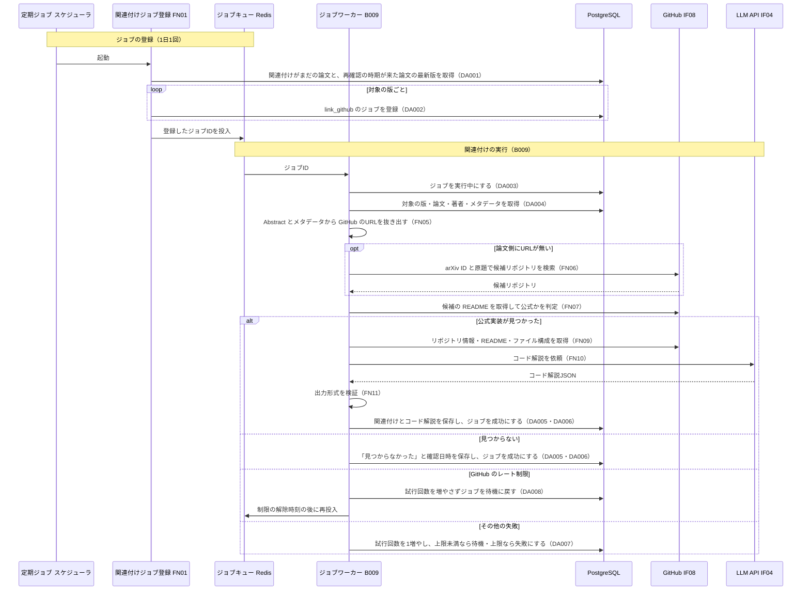

# BE詳細設計書 — F14 外部連携（GitHub関連付け）

## 0. 文書情報

| 項目 | 値 |
| :--- | :--- |
| 設計書ID | F14-BE |
| 親ID | F14 |
| 親設計書 | `基本設計書_概要.md` §4.1 機能一覧 |
| 機能名 | 外部連携 — GitHub関連付け（資料上のID F-14。優先度 Future。上流 §4 機能一覧 F14「論文の公式実装リポジトリを結びつけ、コードの解説を付ける」） |
| 版 | 1.0（新規作成。前版なし） |
| 作成日 | 2026-10-26 |
| 更新日 | 2026-10-26 |
| 作成方法 | `source/` 配下の企画資料と、確定済みの上流設計書から作成した新規設計（creating-backend-detailed-design v1.5.0 準拠） |
| インプット | (a) `source/02_機能要求定義.md:19,44-50`、`source/03_システム構成.md:7,11-12,34-44,56-61`、`source/04_収益化とロードマップ.md:27`、`source/01_企画概要.md:33-35`／(b) `docs/基本設計書_概要.md` §2 BF15、§4 機能一覧 F14・バッチ B009、§6 T001・T002・T009・CRUD図 F14 行、§7 IF04・IF08、§8 機密情報管理、§9 環境変数一覧、§11 ARC001・ARC004・ARC006・ARC007、付録 Q02・Q19・Q23・Q29・Q30・Q35・Q36／関連する下流資料: `docs/db/DB.T001.DB物理設計.md`・`DB.T002.DB物理設計.md`・`DB.T009.DB物理設計.md`（§4.6 F14 行、§6 job_type `link_github`、§7 DDL）、`docs/detail/be/BE.F04.BE詳細設計.md`（共通のジョブ実行枠・JobRepository・LlmClient） |
| インプットの性質 | `source/` にあるのは企画・初期設計案の Markdown 6ファイルだけで、GitHub関連付けのソースコード（ジョブ・GitHub API の呼び出し・保存先テーブル）は1つもない（`source/README.md:5-10`、上流 §前提）。F14 について資料に書かれているのは機能一覧の1行「GitHub関連付け｜Future｜論文の公式実装とコード解説」（`source/02_機能要求定義.md:19`）だけである。そのため本書の関数・データアクセス・SQL はすべて、上流で定義された計画上の実体（BF15 のシーケンス、B009、IF08、IF04、T009 の `link_github`）から導いた**実装の設計案**であり、実装済みであることは意味しない。資料に無い値（URL、関数名、件数上限、間隔、リトライ回数、判定基準）は※推測と明記する |
| 既存資料の突合 | `legacy/` は空ディレクトリ（ファイル0件）で、突合できる既存設計書・既存仕様・業務背景・非機能の記述は無い（上流 §4 バッチID命名規則「`legacy/` は空ディレクトリ」と同じ）。本書の既存版（`docs/detail/be/BE.F14.BE詳細設計.md`）も無かったため新規作成とした（上流 §4 機能一覧 F14 の詳細の所在も「未作成」） |

* **対象とする上流の要素**（ID はすべて上流の採番をそのまま使用）: 機能 F14、業務フロー BF15、バッチ B009、外部連携 IF08（GitHub）・IF04（LLM API）、テーブル T001 `papers`・T002 `paper_versions`・T009 `jobs`、方式 ARC001・ARC004・ARC006・ARC007、顧客確認事項 Q19・Q23・Q29・Q30。

## 1. バックエンド構成・モジュール設計

* **対象ドメイン**: 外部連携系（github）— 論文ごとに GitHub 上の公式実装リポジトリを探し、見つかった場合はリポジトリの情報と、README・ファイル構成をもとに LLM で作った日本語のコード解説を論文に結びつけて保存する処理（上流 F14・BF15・B009）。利用者からの操作は無く、すべてジョブワーカーの中で完結する。
* **対象APIエンドポイント**: 該当なし（0件）。上流 §7 内部API一覧の全8件（API01〜API08）に F14 のAPIは無く、上流 BF15 の参加者もジョブワーカー・PostgreSQL・GitHub・LLM API だけで、画面やAPIを経由しない。関連付けた結果を利用者に見せる画面項目とAPIも定義されていない（§1 前提 4。※上流要確認）。
* **対象バッチ**: B009 GitHub公式実装の関連付け（上流 §4 バッチ処理設計。非同期ジョブ）と、そのジョブを定期的に登録する処理（※上流未定義。§5）。
* **対象外部連携**: IF08 GitHub（公式実装の検索とリポジトリ情報の取得）、IF04 LLM API（コード解説の生成）。
* **ディレクトリ/ファイル構造**（実装は未着手。上流 §9 の想定構成 `web/`・`worker/`・`supabase/` と、F04-BE §1 のファイル配置に沿った配置案。すべて※推測）:

```
worker/                                         … Pythonワーカー（ジョブ・定期実行）
├── jobs/
│   ├── runner.py                               … ジョブ共通の実行枠 JobRunner（F04-BE で定義。本書はレート制限時の延期の分岐を加える）
│   ├── link_github_enqueue.py                  … 関連付けジョブの定期登録（FN01）
│   └── link_github.py                          … B009 の本処理（FN02）
├── github/
│   ├── client.py                               … IF08 GitHub API の呼び出し（GitHubClient。FN08）
│   ├── repo_finder.py                          … 公式実装の候補探しと判定（FN05〜FN07）
│   ├── code_material.py                        … コード解説の材料集め（FN09）
│   └── explanation_schema.py                   … コード解説の出力形式の検証（FN11）
├── llm/
│   ├── client.py                               … LLM API の呼び出し（LlmClient。F04-BE で定義）
│   └── prompts.py                              … 指示文の組み立て。本書はコード解説用を加える（FN10）
├── repositories/
│   ├── job_repository.py                       … ジョブの登録・取り合い・成功・失敗の記録（JobRepository。F04-BE で定義。本書は延期 FN13 を加える）
│   └── github_link_repository.py               … 関連付け対象の抽出・対象の版の取得・結果の保存（FN03・FN04・FN12）
└── scheduler/
    └── schedule.py                             … 関連付けジョブの定期登録を1日1回起動する登録
supabase/
└── migrations/                                 … GitHub関連付けテーブルのDDL（テーブルが上流で未定義のため未作成。上流 付録 Q23）
```

* **処理シーケンス図**（上流 BF15 の流れに、ジョブの登録・取り合い・失敗時の扱いと、本書で補った「見つからなかった」記録を加えたもの。探し方と保存先は※推測）:



* **前提・上流との差異**（本書で判明したもの。上流側の追記・訂正を要する）:
  1. **関連付けの保存先テーブルが無い**（※上流要確認）: 上流 §6 のテーブル一覧（T001〜T010）に、論文とリポジトリの関連・コード解説の保存先が無い（上流 §6 テーブル一覧の注記「GitHub関連付け（`:19`）」、付録 Q23。BF15 にも「※推測: 保存先テーブルは未定義」とある）。本書ではこのテーブルを※上流未定義として扱い、物理名は付けずに `{GitHub関連付けテーブル}` と書く（仮採番しない）。列名もすべて※推測の置き場所である（§3 発行SQL の冒頭）。
  2. **CRUD図の F14 行が jobs の C だけ**（※上流要確認）: 上流 §6 CRUD図の F14 行は papers R・paper_versions R・jobs C で、ジョブを実行中・成功・失敗へ書き換える U が無い（`docs/db/DB.T009.DB物理設計.md` §4.6 No.4 も C のみ）。B009 は自分のジョブの状態を書き換えるため U が必要になる（F04 の行が RU であるのと同じ理由）。あわせて、上記1の保存先テーブルへの C・U を表す列も CRUD図に無い。
  3. **起動のしかたが上流の2か所で食い違う**（※上流要確認）: 上流 §2 業務フロー一覧は BF15 の起点を「定期ジョブ（B009）」とし、上流 §4 バッチ処理設計は B009 を「非同期ジョブ（※推測: 実行契機は未定義）」としている。BF15 の最初の手順は「関連付けがまだの論文を取得」で、T009 は「論文の版ごとに関連付けジョブを登録する」としている。本書では両方を満たすよう、1日1回の定期実行で対象の版を選んで B009 のジョブ（版ごと）を登録し、B009 本体は非同期ジョブとして1版ずつ処理する二段の形にした（§5）。登録側の定期実行には上流のバッチIDが無い（※上流未定義）。
  4. **関連付けた結果を見せる場所が無い**（※上流要確認）: 論文詳細（P104）・Appendix（P105）の画面基本設計にも、論文詳細API（API03）の応答にも、公式実装へのリンクとコード解説の項目が無い。本書は保存までを扱い、表示のためのAPI項目は作らない（上流 §7 内部API一覧への追加、または API03 の応答への項目追加を要する）。
  5. **GitHub の認証情報の環境変数が無い**（※上流未定義）: 上流 IF08 は認証方式を「※推測: APIトークン」としているが、上流 §9 環境変数一覧に該当する変数が無い。本書では `GITHUB_TOKEN`（※推測）を置く。あわせて検索APIの問い合わせ間隔 `GITHUB_SEARCH_INTERVAL_SEC`、再確認の間隔 `GITHUB_RECHECK_DAYS`、1回の登録件数の上限 `GITHUB_LINK_BATCH_SIZE`、機能の有効化 `GITHUB_LINK_ENABLED` も上流に無い（いずれも※上流未定義・※推測）。
  6. **LLM API に送る材料が上流の定義と違う**（※上流要確認）: 上流 IF04 の送信データは「Abstract・本文・質問」で、リポジトリの README・ファイル構成は含まれていない。コード解説を作るには README とファイル構成を送る必要がある。
  7. **公式実装の探し方が未定義**（※上流要確認）: 上流 付録 Q30 は探し方（GitHub API・論文内のリンク・Papers with Code のような外部データ）を未決定とし、仮置きを「GitHub API」としている。本書は仮置きに従い、論文側に書かれた GitHub のURLを最優先し、無ければ GitHub の検索APIで探す方式とした（§4 FN05〜FN07）。外部データを使う方式に決まった場合、FN06 を差し替える。
  8. **コード解説の検証の扱い**（※上流要確認）: 上流 ARC004（LLM出力検証方式）の関連先は F04・F09・F11 で、F14 は入っていない。コード解説も LLM の生成物で、README に無いことを断定するおそれがあるため、本書では出力形式の検証と「README に書かれた事実」と「AI の推測」を分けて持たせる規則を当てはめた（※推測）。要約と同じ根拠・数値チェック（B003）を通すかは上流で決める必要がある。
  9. **リポジトリのライセンスの扱い**（※上流要確認）: 外部のライセンス条件を守ること（`source/02_機能要求定義.md:49`）は求められているが、リポジトリのコードを解説に引用してよいかの決まりは無い。本書ではコードの本文は取得も保存もせず、README とファイルの一覧だけを材料にし、リポジトリのライセンス名を記録する（※推測）。

## 2. API・インターフェース詳細設計

* **外部サービス連携仕様**: 本機能が使う外部連携は、上流 §7 外部連携一覧の全9件（IF01〜IF09）のうち IF08 と IF04 の2件。

| IF-ID | 連携先 | 連携方式 | エンドポイント / 接続先 | 認証方式 | タイムアウト | リトライ方針 | エラー時の挙動 | 定義状況 | 詳細の所在 |
| :--- | :--- | :--- | :--- | :--- | :--- | :--- | :--- | :--- | :--- |
| IF08 | GitHub | REST API（※推測。上流 IF08「REST API（※推測）」、付録 Q30 の仮置き「GitHub API」） | ※推測: `https://api.github.com` の5つの口。リポジトリ検索 `GET /search/repositories`、リポジトリ情報 `GET /repos/{owner}/{repo}`、README `GET /repos/{owner}/{repo}/readme`、ファイル構成 `GET /repos/{owner}/{repo}/git/trees/{branch}?recursive=1`、残り回数の確認 `GET /rate_limit` | ※推測: 個人アクセストークンを Bearer で送る（環境変数 `GITHUB_TOKEN`。※上流未定義） | ※推測: 1回の問い合わせあたり10秒 | ※推測: 通信断・タイムアウト・GitHub 側の障害（HTTP 5xx）のときだけ、1秒・2秒・4秒と間隔を倍にして最大3回まで送り直す。検索APIは連続で呼ばず、前回から `GITHUB_SEARCH_INTERVAL_SEC`（※推測: 2秒）以上あける（GitHub の検索APIは認証付きでも1分あたりの回数が少ないため） | レート制限に当たったとき（HTTP 403 で残り回数が0、または HTTP 429）は、試行回数を増やさずにジョブを待機へ戻し、制限が解ける時刻（応答ヘッダーの解除時刻）の後に再投入する。リポジトリが消えた・非公開になったとき（HTTP 404）はその候補を外して次の候補へ進む。トークンが無効なとき（HTTP 401）は送り直さず、全ジョブに影響するため ERROR を出して監視へ知らせ、ジョブは試行回数の上限によらずその場で失敗にする（再試行しても結果が変わらない例外として扱う。F04-BE の mark_failed_or_retry を force_fail を真にして呼ぶ）。送り直しを使い切ったときもジョブを失敗記録へ回す（上限未満ならジョブごと再実行） | 詳細 | §4 FN08、§6 |
| IF04 | LLM API | REST API（※推測。上流 IF04） | 提供元は未定（上流 Q29）。モデルは環境変数 `LLM_MODEL_ID`（上流 §9） | APIキー（環境変数 `LLM_API_KEY`。上流 §9） | ※推測: 90秒（README とファイル一覧を合わせた材料が要約より長くなるため、F04 の30秒・3分要約の60秒より長くする） | F04-BE の LlmClient.generate_structured の方針をそのまま使う。通信のタイムアウト・接続失敗・提供元の混雑（HTTP 429）・提供元の障害（HTTP 5xx）のときだけ、2秒・4秒・8秒と間隔を倍にして最大3回まで送り直す。それ以外の 4xx は送り直さない | 送り直しても失敗したら、ジョブを失敗記録へ回す（上限未満ならジョブごと再実行）。出力がコード解説の形式に合わないときは保存せず、最大2回まで作り直しを依頼し（※推測）、それでも合わなければリポジトリの関連付けだけを保存して解説は空のままにする（関連付けそのものは GitHub の情報で確定しているため） | 詳細 | §4 FN02・FN10・FN11 |

**総件数: 2件（全件 詳細）。全数である根拠**: 上流 §7 外部連携一覧の全9件を、上流 BF15 のシーケンスに現れる外部の参加者（GitHub＝IF08、LLM API＝IF04）と照合した結果。IF01・IF02（arXiv）は論文の収集と本文取得、IF03 は画面からのリンク遷移、IF05 は利用者の認証、IF06・IF07 は決済、IF09 は通知の連携で、利用者を持たず arXiv にも問い合わせない本機能では使わない（論文の情報は収集済みの DB から読む）。IF08 は失敗時の分岐（レート制限・消えたリポジトリ・認証失敗）、IF04 は外部への送信と作り直しを伴うため、どちらも completeness 3-1 の基準（2 状態を変える・5 失敗時の扱いが自明でない）に当てはまり「詳細」とした。

* **APIロースター（全数）**:

| API-ID | メソッド | エンドポイント | 概要 | 呼出元 | 認証 | 定義状況 | 詳細の所在 |
| :--- | :--- | :--- | :--- | :--- | :--- | :--- | :--- |
| — | 該当なし | — | — | — | — | — | — |

**総件数: 0件。根拠**: 上流 §7 内部API一覧の全8件（API01〜API08）のうち、F14 を担うものは0件である（各APIの概要は論文一覧・検索・詳細・要約・推薦・ブックマーク・課金で、出典もすべて `source/03_システム構成.md:47-54`。F14 の出典 `source/02_機能要求定義.md:19` を持つものは無い）。上流 BF15 はジョブワーカーの中で完結し、利用者・画面・APIの参加者を持たない。関連付けた結果の表示に使うAPIは必要になるが、上流に定義が無く、画面基本設計（P101〜P107）にも表示項目が無いため、本書で創作せず §1 前提 4 に※上流要確認として挙げた。

* **API詳細仕様**: 該当なし（APIロースターが0件のため）。

## 3. データアクセス（ORM / クエリ）設計

* **アクセス方式**（※推測）: `worker/` は PostgreSQL のドライバ（psycopg を想定）で、値を埋め込まないプレースホルダ付きのSQLを発行する（F04-BE §3 と同じ）。ORM の採否は上流で未定義のため、発行するSQLを本章で確定させる。ジョブワーカーは行単位アクセス制御を通らないサーバ側のサービスロールで接続する（`docs/db/DB.T009.DB物理設計.md` §7 の Supabase 環境の追加定義）。
* **データアクセス一覧（全数ロースター）**:

| DA-ID | 処理名 | 呼出元（関数/API） | 対象物理テーブル | 種別 (SELECT/INSERT/UPDATE/DELETE) | 定義状況 (詳細/簡易) | 詳細の所在 |
| :--- | :--- | :--- | :--- | :--- | :--- | :--- |
| DA001 | 関連付け対象の版の抽出 | FN03 find_targets_for_linking（FN01 から） | T001 papers, T002 paper_versions, {GitHub関連付けテーブル}（※上流未定義）, T009 jobs | SELECT | 詳細 | §3 詳細定義 DA001、発行SQL DA001 |
| DA002 | 関連付けジョブの登録 | JobRepository.enqueue（FN01 から） | T009 jobs | INSERT | 詳細 | §3 詳細定義 DA002、発行SQL DA002 |
| DA003 | ジョブの実行開始 | JobRepository.claim（JobRunner.run から） | T009 jobs | UPDATE | 詳細 | §3 詳細定義 DA003、発行SQL DA003 |
| DA004 | 対象の版と論文の取得 | FN04 find_target_with_metadata（FN02 から） | T001 papers, T002 paper_versions | SELECT | 詳細 | §3 詳細定義 DA004、発行SQL DA004 |
| DA005 | 関連付け結果の保存 | FN12 save_link_result（FN02 から） | {GitHub関連付けテーブル}（※上流未定義） | INSERT/UPDATE | 詳細 | §3 詳細定義 DA005、発行SQL DA005 |
| DA006 | ジョブの成功記録 | JobRepository.mark_succeeded（FN02 から） | T009 jobs | UPDATE | 詳細 | §3 詳細定義 DA006、発行SQL DA006 |
| DA007 | ジョブの失敗記録 | JobRepository.mark_failed_or_retry（JobRunner.run から） | T009 jobs | UPDATE | 詳細 | §3 詳細定義 DA007、発行SQL DA007 |
| DA008 | レート制限によるジョブの延期 | FN13 JobRepository.defer_for_rate_limit（JobRunner.run から） | T009 jobs | UPDATE | 詳細 | §3 詳細定義 DA008、発行SQL DA008 |

**総件数: 8件（SELECT 2件・INSERT 1件・INSERT/UPDATE 1件・UPDATE 4件・DELETE 0件。全件 詳細）。全数である根拠**: ソースコードが無いため、§4 関数ロースターのうち DB へ問い合わせる関数8件（FN03・FN04・FN12・FN13 と、F04-BE で定義された共用の JobRepository の enqueue・claim・mark_succeeded・mark_failed_or_retry）が発行する問い合わせを1件1行で数えた。上流 BF15 の DB への矢印2本（「関連付けがまだの論文を取得」→DA001、「論文とリポジトリの関連・解説を保存」→DA005）と、上流 CRUD図 F14 行の操作（papers R・paper_versions R→DA001・DA004、jobs C→DA002）のすべてに1件以上が対応する。加えて、§1 前提 2 で挙げたジョブの状態の書き換え（DA003・DA006・DA007・DA008）を含む。DA002・DA003・DA006・DA007 は F04-BE の DA004・DA001・DA002・DA003 と同じ文を共用する（本書でもSQL本文を示す）。8件とも、状態を変えるか（3-1 の2）、複数テーブルを結合するか（3-1 の3）、重複・取り合いの業務ルールを含む（3-1 の5・7）ため「詳細」とした。DELETE は0件（論文と版は消さない方針で、関連付けの行も消さずに再確認で書き換える。T001・T002 §1）。

* **データアクセス詳細定義**:

| DA-ID | 処理名 | 対象物理テーブル | JOIN / Include | 抽出条件 (Where) / ソート | トランザクション境界 | N+1対策・性能上の注意 |
| :--- | :--- | :--- | :--- | :--- | :--- | :--- |
| DA001 | 関連付け対象の版の抽出 | T001 papers, T002 paper_versions, {GitHub関連付けテーブル}（※上流未定義）, T009 jobs | 論文に、その論文の最新版を内部結合する（papers.id = paper_versions.paper_id かつ版番号が papers.latest_version と一致）。関連付けの行を論文IDで外部結合する | 次のどちらかに当たる論文の最新版を選ぶ。(1) 関連付けの行がまだ無い論文（一度も探していない）。(2) 前回「見つからなかった」と記録した論文のうち、確認から再確認の間隔（※推測: 30日。`GITHUB_RECHECK_DAYS`）以上たったもの（論文の公開後にリポジトリが公開されることがあるため）。すでに公式実装が見つかっている論文は対象にしない（新しい版が出ても公式リポジトリは変わらない前提 ※推測）。さらに、その版に関連付けのジョブが待機中・実行中・失敗のどれかで残っているものは外す（jobs に同じ版・種別 `link_github` で状態が待機・実行中・失敗の行が無いこと）。待機中・実行中を外すのは二重に登録しないため、失敗を外すのは、試行回数の上限まで失敗したジョブを毎日登録し直して失敗キューと失敗ジョブの再処理（B010。運用者が原因を取り除いてから待機に戻す）を迂回しないためである。投稿日時の新しい順に並べ、1回の登録件数の上限（※推測: 500件。`GITHUB_LINK_BATCH_SIZE`）までを返す | なし（参照のみ） | 論文全件を読む問い合わせのため、上限件数で区切る。上限500件は GitHub API の1時間あたりの回数（認証付き ※推測: 5,000回）を、1件あたり最大9回の問い合わせ（検索2回・候補ごとの README 最大5回・リポジトリ情報・ファイル構成）で割った目安（※推測）。ジョブの有無の確認は、版・種別の索引 `idx_jobs_paper_version_id_job_type` の先頭2列で引ける（失敗の行も対象にするため、待機・実行中だけの部分インデックス `uq_jobs_active_per_version` では足りない）。関連付けテーブルには論文IDの一意制約（※推測）を置き、外部結合をその索引で引く。最新版の結合は `uq_paper_versions_paper_id_version` で引ける |
| DA002 | 関連付けジョブの登録 | T009 jobs | なし | 版IDとジョブ種別 `link_github` で1行追加する。同じ版・同じ種別のジョブが待機中か実行中ですでにあれば、追加せずに何もしない（一意インデックス `uq_jobs_active_per_version` に当たったら何もしない） | 1件ごとに自動確定し、確定した後に Redis のキューへ投入する（F04-BE §6「Redis への投入は DB のコミット後」） | DA001 で外したはずのジョブが、抽出と登録の間に別経路で登録された場合も、一意インデックスが二重登録を防ぐ。500件を1件ずつ登録する往復は1日1回のため許容する（※推測） |
| DA003 | ジョブの実行開始 | T009 jobs | なし | 指定のジョブで、状態が待機のものだけを実行中にする（`id = $1 AND status = 'pending'`） | 1文で即時に確定する（F04-BE DA001 と同じ文） | 状態が待機であることを条件にした更新で、取り合いに勝った1つのワーカーだけが処理する（`docs/db/DB.T009.DB物理設計.md` §6 状態遷移）。更新できた行が無ければ、他のワーカーが処理中か完了済みのため何もしない |
| DA004 | 対象の版と論文の取得 | T001 papers, T002 paper_versions | 版に論文を内部結合する（paper_versions.paper_id = papers.id） | 指定した版IDの1行（`pv.id = $1`） | なし（参照のみ。トランザクションの外で読み、GitHub・LLM への問い合わせ中に DB の接続を持ち続けない） | 主キーで1行を引くだけ。F04-BE の DA005（対象の版と論文の取得）と違い、公式かどうかの判定に使う著者（papers.authors）と、論文側に書かれた GitHub のURLを探すための取り込み時点のメタデータ（paper_versions.metadata_snapshot）も読む |
| DA005 | 関連付け結果の保存 | {GitHub関連付けテーブル}（※上流未定義） | なし | 論文ID の行が無ければ追加し、あれば今回の結果で書き換える（論文IDの一意制約に当たったら更新する）。公式実装が見つかったときはリポジトリの情報・ライセンス名・判定の根拠・コード解説・生成モデル・確認日時を、見つからなかったときは「見つからなかった」と確認日時だけを書く。すでに公式実装が見つかっている行は「見つからなかった」で上書きしない（一時的に検索で見つからなかっただけで、確定した関連付けを消さないため） | DA006 と同じトランザクションで確定する（保存したのにジョブが待機へ戻って同じ問い合わせと LLM 呼び出しをやり直すことを防ぐ。§6 TX03） | 1行の追加または更新。リポジトリのコード本文は保存しない（§1 前提 9） |
| DA006 | ジョブの成功記録 | T009 jobs | なし | 指定のジョブで、状態が実行中のものだけを成功にする（`id = $1 AND status = 'running'`） | DA005 と同じトランザクション（F04-BE DA002 と同じ文） | 実行中の行だけを対象にし、他のワーカーの結果を上書きしない |
| DA007 | ジョブの失敗記録 | T009 jobs | なし | 指定のジョブで、状態が実行中のものについて、試行回数を1増やし直近エラーを書く。増やした後の試行回数が上限（環境変数 `JOB_MAX_ATTEMPTS`。※推測: 3）以上なら失敗、未満なら待機に戻す（`id = $1 AND status = 'running'`）。再試行しても結果が変わらない例外（トークン無効・版が無い）のときは、呼び出し側が上限を今の試行回数＋1にして渡し、必ず失敗にする（F04-BE §4 IPO No.4 の force_fail） | 単独で即時に確定する。本処理のトランザクションをロールバックした後に実行する（F04-BE DA003 と同じ文） | 直近エラーには GitHub のトークン・認証付きのURL・README の本文を含めず、エラーの種類と HTTP の状態コードだけを書く（`docs/db/DB.T009.DB物理設計.md` §4.3 (6) の方針） |
| DA008 | レート制限によるジョブの延期 | T009 jobs | なし | 指定のジョブで、状態が実行中のものを、試行回数を増やさずに待機へ戻し、直近エラーに「GitHub のレート制限」と解除予定時刻を書く（`id = $1 AND status = 'running'`） | 単独で即時に確定する（本処理のトランザクションをロールバックした後） | レート制限は時間がたてば必ず解けるため、試行回数を消費させると、制限が続いた日にジョブが失敗キューへ大量に流れ込む。そのため回数を増やさない。延期が続いて終わらなくなることを防ぐため、同じジョブの延期は1日あたり最大24回（※推測）までとし、超えたら DA007 に切り替える（延期の回数は Redis 側で数える ※推測。jobs に列が無いため） |

* **発行SQL**: 8件とも、番号付きのプレースホルダ（`$1`・`$2` の形）に値を渡す静的なSQLである。実行時にSQLの構造を組み立てる動的SQLは無い（結果の種類による書き分けは DA005 の中で値として扱い、条件句の有無は変わらない）。`{GitHub関連付けテーブル}` と、その列名（paper_id・paper_version_id・link_status・repo_full_name・repo_url・repo_license・default_branch・commit_sha・match_method・match_evidence・code_explanation・model_id・checked_at・generated_at）はテーブルが上流で未定義のための置き場所で、名前はすべて※推測である。`link_status` の値は公式実装が見つかった `linked` と見つからなかった `not_found` の2つ（※推測）。

**DA001 関連付け対象の版の抽出**（`$1` は再確認の間隔の日数、`$2` は1回の上限件数）
```sql
SELECT pv.id AS paper_version_id,
       p.id  AS paper_id,
       p.arxiv_id
FROM   papers p
JOIN   paper_versions pv
       ON pv.paper_id = p.id
      AND pv.version  = p.latest_version
LEFT JOIN {GitHub関連付けテーブル} gl
       ON gl.paper_id = p.id
WHERE  (
         gl.paper_id IS NULL
         OR (gl.link_status = 'not_found'
             AND gl.checked_at < CURRENT_TIMESTAMP - make_interval(days => $1))
       )
  AND  NOT EXISTS (
         SELECT 1
         FROM   jobs j
         WHERE  j.paper_version_id = pv.id
           AND  j.job_type = 'link_github'
           AND  j.status IN ('pending', 'running', 'failed')
       )
ORDER  BY p.submitted_at DESC
LIMIT  $2;
```

**DA002 関連付けジョブの登録**（F04-BE DA004 と同じ文。`$2` は本書では `link_github`）
```sql
INSERT INTO jobs (paper_version_id, job_type)
VALUES ($1, $2)
ON CONFLICT (paper_version_id, job_type)
  WHERE status IN ('pending', 'running') AND paper_version_id IS NOT NULL
  DO NOTHING
RETURNING id;
```

**DA003 ジョブの実行開始**（F04-BE DA001 と同じ文）
```sql
UPDATE jobs
SET status = 'running'
WHERE id = $1
  AND status = 'pending'
RETURNING id, paper_version_id, job_type, attempts;
```

**DA004 対象の版と論文の取得**
```sql
SELECT pv.id AS paper_version_id,
       pv.version,
       pv.metadata_snapshot,
       p.id AS paper_id,
       p.arxiv_id,
       p.title,
       p.abstract,
       p.authors
FROM   paper_versions pv
JOIN   papers p
       ON p.id = pv.paper_id
WHERE  pv.id = $1;
```

**DA005 関連付け結果の保存**（`$3` が `linked` のときは `$4`〜`$12` に値が入り、`not_found` のときは空で渡す）
```sql
INSERT INTO {GitHub関連付けテーブル}
       (paper_id, paper_version_id, link_status,
        repo_full_name, repo_url, repo_license, default_branch, commit_sha,
        match_method, match_evidence, code_explanation, model_id,
        checked_at, generated_at)
VALUES ($1, $2, $3,
        $4, $5, $6, $7, $8,
        $9, $10, $11, $12,
        CURRENT_TIMESTAMP,
        CASE WHEN $11::jsonb IS NULL THEN NULL ELSE CURRENT_TIMESTAMP END)
ON CONFLICT (paper_id) DO UPDATE
   SET paper_version_id = EXCLUDED.paper_version_id,
       link_status      = EXCLUDED.link_status,
       repo_full_name   = EXCLUDED.repo_full_name,
       repo_url         = EXCLUDED.repo_url,
       repo_license     = EXCLUDED.repo_license,
       default_branch   = EXCLUDED.default_branch,
       commit_sha       = EXCLUDED.commit_sha,
       match_method     = EXCLUDED.match_method,
       match_evidence   = EXCLUDED.match_evidence,
       code_explanation = EXCLUDED.code_explanation,
       model_id         = EXCLUDED.model_id,
       checked_at       = EXCLUDED.checked_at,
       generated_at     = EXCLUDED.generated_at
 WHERE {GitHub関連付けテーブル}.link_status <> 'linked'
    OR EXCLUDED.link_status = 'linked'
RETURNING link_status;
```
（すでに `linked` の行に `not_found` を書こうとしたときは WHERE に当たらず、行は書き換わらず何も返らない。FN12 はこれを「既存の関連付けを残した」として扱う）

**DA006 ジョブの成功記録**（F04-BE DA002 と同じ文）
```sql
UPDATE jobs
SET status = 'succeeded'
WHERE id = $1
  AND status = 'running';
```

**DA007 ジョブの失敗記録**（F04-BE DA003 と同じ文。`$2` は直近エラーの要約文、`$3` は試行回数の上限）
```sql
UPDATE jobs
SET attempts   = attempts + 1,
    last_error = $2,
    status     = CASE WHEN attempts + 1 >= $3 THEN 'failed' ELSE 'pending' END
WHERE id = $1
  AND status = 'running'
RETURNING status, attempts;
```

**DA008 レート制限によるジョブの延期**（`$2` は「GitHub のレート制限。解除予定 {時刻}」の文）
```sql
UPDATE jobs
SET status     = 'pending',
    last_error = $2
WHERE id = $1
  AND status = 'running'
RETURNING status, attempts;
```

## 4. サーバー側機能・処理ロジック設計（IPO設計）

* **関数ロースター（全数）**（※推測: 実装が無いため、関数名・所属モジュールは §1 のファイル構成案に合わせた命名案）:

| FN-ID | 関数名 | 所属モジュール | 概要 | 呼出元 | 定義状況 | 詳細の所在 |
| :--- | :--- | :--- | :--- | :--- | :--- | :--- |
| FN01 | enqueue_link_github_jobs | worker/jobs/link_github_enqueue.py | 1日1回起動され、関連付けがまだの論文と再確認の時期が来た論文の最新版を選び、版ごとに B009 のジョブを登録する | 定期ジョブ スケジューラ | 詳細 | §4 IPO FN01 |
| FN02 | link_github | worker/jobs/link_github.py | B009 の本処理。1つの版について公式実装を探し、見つかればコード解説を作って保存し、見つからなければその旨を保存する | JobRunner.run（共通の実行枠） | 詳細 | §4 IPO FN02 |
| FN03 | find_targets_for_linking | worker/repositories/github_link_repository.py（GitHubLinkRepository） | DA001 を発行し、関連付け対象の版を上限件数まで返す | FN01 | 詳細 | §4 IPO FN03 |
| FN04 | find_target_with_metadata | worker/repositories/github_link_repository.py（GitHubLinkRepository） | DA004 を発行し、対象の版・論文・著者・取り込み時点のメタデータを返す | FN02 | 詳細 | §4 IPO FN04 |
| FN05 | extract_links_from_paper | worker/github/repo_finder.py | Abstract と取り込み時点のメタデータの中から、GitHub のリポジトリを指すURLを抜き出す | FN02 | 詳細 | §4 IPO FN05 |
| FN06 | search_candidates | worker/github/repo_finder.py | 論文側にURLが無いとき、arXiv ID と原題で GitHub の検索APIを呼び、候補リポジトリを集める | FN02 | 詳細 | §4 IPO FN06 |
| FN07 | judge_official | worker/github/repo_finder.py | 候補リポジトリが論文の公式実装といえるかを、README の記述と所有者で判定し、最も確からしい1件を選ぶ | FN02 | 詳細 | §4 IPO FN07 |
| FN08 | request | worker/github/client.py（GitHubClient） | GitHub API を呼ぶ。通信の送り直し、検索の間隔、レート制限・認証失敗の判別を受け持つ | FN06・FN07・FN09 | 詳細 | §4 IPO FN08 |
| FN09 | collect_code_material | worker/github/code_material.py | 公式実装のリポジトリ情報・ライセンス名・README・ファイルの一覧を集め、LLM に渡せる長さに切り詰める | FN02 | 詳細 | §4 IPO FN09 |
| FN10 | build_code_explanation_prompt | worker/llm/prompts.py | 論文の原題・Abstract とリポジトリの材料から、コード解説を作らせる指示文を組み立てる | FN02 | 詳細 | §4 IPO FN10 |
| FN11 | validate_code_explanation | worker/github/explanation_schema.py | LLM の出力がコード解説の形式に合い、事実と推測が分けて書かれているかを確かめる | FN02 | 詳細 | §4 IPO FN11 |
| FN12 | save_link_result | worker/repositories/github_link_repository.py（GitHubLinkRepository） | DA005 を発行し、関連付けの結果を保存する | FN02 | 詳細 | §4 IPO FN12 |
| FN13 | defer_for_rate_limit | worker/repositories/job_repository.py（JobRepository） | DA008 を発行し、レート制限に当たったジョブを試行回数を増やさずに待機へ戻す | JobRunner.run | 詳細 | §4 IPO FN13 |
| — | run | worker/jobs/runner.py（JobRunner） | ジョブ共通の実行枠。ジョブの取り合い、本処理の呼び出し、失敗時の記録と再投入を受け持つ。本書はレート制限の例外を受けたときに FN13 を呼ぶ分岐を加える | Redis のキュー（ワーカー） | 詳細 | `docs/detail/be/BE.F04.BE詳細設計.md` §4 IPO No.1（本書で加える分岐は §4 IPO FN13 の注記） |
| — | claim | worker/repositories/job_repository.py（JobRepository） | DA003 を発行し、待機中のジョブを実行中にする | JobRunner.run | 詳細 | `docs/detail/be/BE.F04.BE詳細設計.md` §4 IPO No.2 |
| — | mark_succeeded | worker/repositories/job_repository.py（JobRepository） | DA006 を発行し、ジョブを成功にする | FN02 | 詳細 | `docs/detail/be/BE.F04.BE詳細設計.md` §4 IPO No.3 |
| — | mark_failed_or_retry | worker/repositories/job_repository.py（JobRepository） | DA007 を発行し、試行回数を増やして待機か失敗にする。再試行しても結果が変わらない例外は上限によらず失敗にする | JobRunner.run | 詳細 | `docs/detail/be/BE.F04.BE詳細設計.md` §4 IPO No.4 |
| — | enqueue | worker/repositories/job_repository.py（JobRepository） | DA002 を発行し、コミット後に Redis へ投入する | FN01 | 詳細 | `docs/detail/be/BE.F04.BE詳細設計.md` §4 IPO No.5 |
| — | generate_structured | worker/llm/client.py（LlmClient） | LLM API を呼んで JSON を受け取る。通信の送り直しを受け持つ | FN02 | 詳細 | `docs/detail/be/BE.F04.BE詳細設計.md` §4 IPO No.9 |

**総件数: 19件（本書で定義する関数13件・F04-BE で定義された共用の関数6件。全件 詳細）。全数である根拠**: ソースコードが無いため、上流 BF15 のシーケンスの処理（関連付けがまだの論文の取得→FN01・FN03、公式実装を探す→FN05〜FN08、コード解説の依頼→FN09〜FN11・generate_structured、保存→FN12、見つからない場合の終了→FN12）と、T009 の版ごとのジョブ登録（FN01・enqueue）、ジョブの状態の書き換え（claim・mark_succeeded・mark_failed_or_retry・FN13）、ジョブ共通の実行枠（run）を、1処理1関数に分けて数えた。探す処理を FN05〜FN07 の3つに分けたのは、外部に問い合わせない処理（FN05）、検索APIを呼ぶ処理（FN06）、公式かどうかの判断（FN07）で失敗の扱いと差し替えの単位が違うため（上流 Q30 で探し方が決まったときに FN06 だけを差し替えられるようにする）。共用の6件は F04-BE で詳細を定義済みのため、本書は詳細の所在を F04-BE の該当箇所とし、IPO を重ねて書かない（completeness 2-3 の委譲。責務は F04-BE にある。run へ加える分岐だけは本書の責務とし FN13 に書く）。本書の13件は、分岐（FN01・FN02・FN05〜FN09・FN11・FN12）、外部への送信（FN06〜FN10）、状態の書き換え（FN01・FN02・FN12・FN13）、複数テーブル（FN03・FN04）、失敗時の扱い（FN08・FN13）のどれかに当たるため、全件が completeness 3-1 の基準で「詳細」となる。

* **入力・処理・出力（IPO）定義**（ロースターは上表。本表は本書で定義する13件。共用の6件は F04-BE を参照）:

| FN-ID | 関数名 | 所属モジュール | 引数 (型) | 処理フロー (ステップ単位で具体的に) | 戻り値 | 発生しうるエラー |
| :--- | :--- | :--- | :--- | :--- | :--- | :--- |
| FN01 | enqueue_link_github_jobs | worker/jobs/link_github_enqueue.py | run_at: datetime（起動時刻。スケジューラが渡す） | 1. 機能の有効化（環境変数 `GITHUB_LINK_ENABLED`。※推測・※上流未定義）が無効なら、何もせず「対象外」として終わる（F14 は Future のため、提供を始めるまで止めておく）。<br>2. GitHub のトークン（`GITHUB_TOKEN`）が設定されていなければ、ジョブを登録しても全件が認証失敗になるため、登録せずに ERROR を出して終わる。<br>3. 同じ日の登録処理がすでに実行中なら、二重に走らないよう起動せずに終わる（※推測: ジョブ実行基盤の重複排除 ARC006。Redis のロックを日付をキーに取る）。<br>4. FN03 で、関連付け対象の版を上限件数（※推測: 500件）まで読む。0件なら手順6へ進む。<br>5. 版ごとに enqueue でジョブ（種別 `link_github`）を登録する（DA002）。同じ版のジョブが待機中か実行中ですでにあれば登録されず、その版は飛ばす。登録できたジョブは、コミットの後に Redis のキューへ投入される。<br>6. 抽出件数・登録件数・飛ばした件数を INFO ログに出す。抽出件数が上限に達していれば、翌日に残りを回すことを INFO で残す | 実行結果の集計（抽出件数、登録件数、飛ばした件数: int） | DB接続の失敗（登録処理を失敗で終え、翌日の起動でやり直す。それまでに登録したジョブは確定済みのため残る）、Redis への投入失敗（ジョブ行は待機のまま残る。F04-BE §0 確認事項 No.11 と同じく ARC006 で回収する） |
| FN02 | link_github | worker/jobs/link_github.py | job: { id, paperVersionId }（JobRunner.run が claim の後に渡す） | 1. FN04 で対象の版・論文・著者・メタデータを読む。<br>2. FN05 で、論文側（Abstract・メタデータ）に書かれた GitHub のURLを抜き出す。<br>3. 抜き出せたURLがあればそれを候補にする。無ければ FN06 で検索APIから候補を集める。<br>4. FN07 で候補を判定し、公式実装と判断できる1件を選ぶ。選べなければ手順9へ進む。<br>5. FN09 で、選んだリポジトリの情報・ライセンス名・README・ファイルの一覧を集める。<br>6. FN10 で指示文を作り、generate_structured で LLM にコード解説を作らせる（IF04）。<br>7. FN11 で出力を検証する。合わなければ不合格の理由を添えて手順6からやり直す（最大2回 ※推測）。それでも合わなければ解説は空にし、WARN を残す（関連付けはリポジトリの情報だけで保存する）。<br>8. 1つのトランザクションで、FN12 で「見つかった」として保存し、mark_succeeded でジョブを成功にしてコミットする。mark_succeeded が JobStateConflict を上げたとき（処理中に他のワーカーや再処理がジョブの状態を変えていた）は、保存ごと取り消し、JobRunner.run が WARN ログを残して終える（F04-BE §4 IPO No.3。二重に保存しないため）。<br>9. 公式実装を選べなかったときは、1つのトランザクションで、FN12 で「見つからなかった」と確認日時を保存し、mark_succeeded でジョブを成功にしてコミットする（上流 BF15「関連なしとして終了」。探した結果として正常に終わったため、失敗にはしない）。JobStateConflict の扱いは手順8と同じ。<br>10. GitHub のレート制限・通信の失敗・LLM の失敗はここで受け止めず、例外のまま JobRunner.run に返す（レート制限は延期、それ以外は失敗記録へ回る）。このうち GitHubAuthError（トークン無効）と PaperVersionNotFound（版が無い）は再試行しても結果が変わらないため、JobRunner.run は force_fail を真にして mark_failed_or_retry を呼び、試行回数の上限によらず失敗にする（F04-BE §4 IPO No.1 手順3 の「再試行しても結果が変わらない例外」にこの2つを加える。F04-BE への反映を要する） | なし | PaperVersionNotFound（ジョブが存在しない版を指している）、GitHubRateLimited（レート制限）、GitHubAuthError（トークン無効）、GitHubTransientError（送り直しを使い切った）、LlmTransientError・LlmPermanentError（LLM の失敗）、JobStateConflict（成功記録の時点でジョブが実行中でなかった）、DB 障害（いずれも JobRunner.run が受け止め、保存は1件も確定されずに取り消される） |
| FN03 | find_targets_for_linking | worker/repositories/github_link_repository.py | conn: DB接続, recheck_days: int（※推測: 30）, limit: int（※推測: 500） | 1. DA001 を発行する。<br>2. 結果の各行を { paperVersionId, paperId, arxivId } に詰めて返す | 関連付け対象の版の配列（投稿日時の新しい順） | DB 障害 |
| FN04 | find_target_with_metadata | worker/repositories/github_link_repository.py | conn: DB接続, paper_version_id: int | 1. DA004 を発行する。<br>2. 0行なら PaperVersionNotFound を上げる（ジョブが存在しない版を指している。版は消さない方針のため通常は起きない）。<br>3. 著者（JSON の配列）を名前の文字列の配列に直して返す | { paperVersionId, version, metadataSnapshot, paperId, arxivId, title, abstract, authors: string[] } | PaperVersionNotFound、DB 障害 |
| FN05 | extract_links_from_paper | worker/github/repo_finder.py | abstract: str, metadata_snapshot: dict | 1. Abstract と、取り込み時点のメタデータのうち著者のコメント欄・関連リンク欄（※推測: arXiv のメタデータの comment と link。保存されている場合）を材料にする。<br>2. 材料の中から、GitHub のリポジトリを指すURL（所有者名とリポジトリ名の2段だけの形。`github.com/{owner}/{repo}`）を抜き出す。末尾の `.git`・句読点・閉じ括弧は取り除く。<br>3. GitHub の個人ページ（所有者だけのURL）、gist、Issue やファイルを指す深いURLは、リポジトリ名の部分だけを取り出して候補にする（ファイルを指すURLでもリポジトリは特定できるため）。<br>4. 同じリポジトリを重複して数えず、出てきた順に最大3件（※推測）を返す | 候補リポジトリの配列（`{owner}/{repo}` と、根拠として「Abstract」「コメント欄」のどこにあったか） | なし（外部に問い合わせないため。メタデータの形が想定と違うときはその欄を飛ばす） |
| FN06 | search_candidates | worker/github/repo_finder.py | arxiv_id: str, title: str | 1. 1回目の検索として、arXiv ID を README に含むリポジトリを探す（※推測: 検索語 `"{arxiv_id}" in:readme`。版番号の接尾辞は付けない）。<br>2. 1回目で候補が無ければ、2回目として原題でリポジトリ名・説明文を探す（※推測: 原題から記号を除いた先頭の語、最大8語 ※推測を `in:name,description` で検索）。<br>3. フォーク（他のリポジトリの複製）は公式実装ではないため外す。<br>4. 検索結果のうちスター数の多い順に最大5件（※推測）を候補にする（検索結果の上位を残すのは、候補ごとに README を取りに行く問い合わせ回数を抑えるため）。<br>5. 検索APIは FN08 を通して呼び、前回の検索から決められた間隔（※推測: 2秒）以上をあける | 候補リポジトリの配列（`{owner}/{repo}`、既定のブランチ、スター数、根拠として「arXiv ID の検索」「原題の検索」のどちらで見つかったか） | GitHubRateLimited、GitHubAuthError、GitHubTransientError（FN08 からそのまま返す） |
| FN07 | judge_official | worker/github/repo_finder.py | candidates: 候補の配列（FN05 または FN06）, arxiv_id: str, title: str, authors: string[] | 1. 候補ごとに FN08 で README を取得する（README が無い・リポジトリが消えた（404）候補は外す）。<br>2. 次のどちらかに当たる候補を「公式実装」とみなす（※推測。上流 Q30 で判定基準が決まっていないための仮置き）。(a) README がこの論文の arXiv ID か、arXiv の論文ページ（`arxiv.org/abs/{arxiv_id}`）を指している。(b) 論文側（FN05）にURLが書かれていた候補で、README に論文の原題が含まれている。<br>3. 公式実装とみなした候補が複数あれば、論文側にURLが書かれていたもの、リポジトリの所有者名が著者名（姓）のどれかと一致するもの、スター数が多いものの順で1件を選ぶ。<br>4. どの候補も当たらなければ「見つからなかった」とする。原題が似ているだけのリポジトリは結びつけない（非公式の実装を公式として見せると、論文の内容を誤解させるおそれがあるため。上流 ARC009 の誤認させない表記の考え方 ※推測） | 選んだリポジトリ（`{owner}/{repo}`、判定の根拠の種類と根拠の文）、または「見つからなかった」 | GitHubRateLimited、GitHubAuthError、GitHubTransientError（FN08 からそのまま返す） |
| FN08 | request | worker/github/client.py（GitHubClient） | method: str, path: str, params: dict, is_search: bool | 1. 環境変数 `GITHUB_TOKEN`（※推測）を Bearer として付け、`https://api.github.com` に問い合わせる（IF08）。タイムアウトは10秒（※推測）。<br>2. 検索APIのときは、同じワーカーの前回の検索から決められた間隔（※推測: 2秒）がたつまで待つ。<br>3. 成功したら応答の本文を返す。README は本文をそのまま受け取る形式で取得する。<br>4. HTTP 403 で残り回数が0のとき、または HTTP 429 のときは、応答ヘッダーの解除時刻を添えて GitHubRateLimited を上げる。<br>5. HTTP 401 のときは送り直さず GitHubAuthError を上げる。<br>6. HTTP 404 のときは送り直さず「無い」を返す（呼び出し側が候補を外す）。<br>7. 通信断・タイムアウト・HTTP 5xx のときは、1秒・2秒・4秒と間隔をあけて最大3回まで送り直し、使い切ったら GitHubTransientError を上げる。<br>8. ログにはトークンと応答の本文を出さず、問い合わせ先の経路・状態コード・残り回数だけを出す | 応答の本文（JSON または README の文字列）、または「無い」 | GitHubRateLimited、GitHubAuthError、GitHubTransientError |
| FN09 | collect_code_material | worker/github/code_material.py | repo: 選んだリポジトリ（FN07 の戻り値） | 1. FN08 でリポジトリ情報を取得し、既定のブランチ、ライセンス名、説明文、最新のコミットの識別子を得る。リポジトリがアーカイブ済み（更新停止）でもそのまま関連付ける。<br>2. README（FN07 で取得済みのもの）を、指示文に入る長さ（※推測: 2万字）までに切り詰める。画像・表の装飾の記号は取り除く。<br>3. FN08 で既定のブランチのファイル構成を取得し、ファイルの経路だけを最大500件（※推測）まで並べる。依存物・生成物・画像のフォルダ（※推測: フォルダ `node_modules/`・`vendor/`・`dist/`・`build/`・`.git/`・`__pycache__/` と、拡張子 `.png`・`.jpg`・`.gif`・`.svg`・`.pdf`・`.zip`・`.pt`・`.ckpt`・`.bin`・`.safetensors` を除外する一覧で判定する。一覧は設定値として持つ）は外す。ファイルの中身は取得しない（§1 前提 9）。<br>4. ファイル構成が大きすぎて GitHub が途中までしか返さなかったときは、返った分だけを使い、材料が途中までであることを印として付ける | コード解説の材料（リポジトリ名、URL、既定のブランチ、コミット識別子、ライセンス名、説明文、切り詰めた README、ファイルの経路の一覧、途中までの印） | GitHubRateLimited、GitHubAuthError、GitHubTransientError（FN08 からそのまま返す） |
| FN10 | build_code_explanation_prompt | worker/llm/prompts.py | paper: { arxivId, title, abstract }, material: コード解説の材料（FN09）, previous_error: str または null | 1. 論文の原題と Abstract、リポジトリの材料を、指示文の決まった位置に入れる。<br>2. 出力は日本語で、次の項目を持つ JSON にするよう指示する（※推測）: リポジトリの概要、論文のどの手法がどこに実装されているかの対応、ファイル構成の説明、動かし方（README に書かれている場合だけ）、利用上の注意（ライセンス名を含む）、そして各記述が「README に書かれた事実」か「ファイル構成からの AI の推測」かの区別。<br>3. README とファイル構成に無いことを事実として書かないこと、コードを書き写さないことを指示に含める（上流 ARC004 の事実と推測の区別、§1 前提 9）。<br>4. 前回の出力が形式に合わなかったときは、その理由（previous_error）を添えて直させる | LLM へ送る指示文（文字列）と出力形式の定義 | なし |
| FN11 | validate_code_explanation | worker/github/explanation_schema.py | output: dict（generate_structured の戻り値の本文） | 1. 必須の項目（概要・対応・ファイル構成・注意・各記述の区別）がそろい、型が合っているかを確かめる。<br>2. 各記述に「事実」か「推測」の区別が付いているかを確かめ、付いていないものがあれば不合格とする。<br>3. 「事実」とされた記述のうちファイル名を挙げたものについて、そのファイル名が材料のファイル一覧に実在するかを確かめ、無ければ不合格とする（実在しないファイルを事実として見せないため ※推測）。<br>4. 解説の中にコードの塊（連続した行のコード）が含まれていれば不合格とする | 合格なら整えたコード解説、不合格なら不合格の理由（文字列） | なし（不合格は戻り値で返し、例外にしない） |
| FN12 | save_link_result | worker/repositories/github_link_repository.py（GitHubLinkRepository） | conn: トランザクション中の接続, paper_id: int, paper_version_id: int, result: 「見つかった」（リポジトリ・材料・判定の根拠・コード解説・生成モデル）または「見つからなかった」 | 1. 結果が「見つかった」なら、リポジトリ名・URL・ライセンス名・既定のブランチ・コミット識別子・判定の根拠・コード解説（空のこともある）・生成モデルを値にして DA005 を発行する。<br>2. 結果が「見つからなかった」なら、状態を「見つからなかった」にし、それ以外の値を空にして DA005 を発行する。<br>3. 行が返らなかったとき（すでに公式実装が見つかっている論文に「見つからなかった」を書こうとした）は、既存の関連付けを残したことを INFO ログに残す | 保存後の状態（「見つかった」「見つからなかった」「既存の関連付けを残した」） | DB 障害（呼び出し側のトランザクションごと取り消される） |
| FN13 | defer_for_rate_limit | worker/repositories/job_repository.py（JobRepository） | job_id: int, reset_at: datetime（レート制限の解除予定時刻） | 1. 同じジョブのその日の延期回数を Redis で1増やす（※推測: ジョブIDと日付をキーにする）。24回（※推測）を超えたら延期せず、mark_failed_or_retry に切り替える（制限が解けないまま延期が終わらなくなることを防ぐ）。<br>2. 直近エラーの文を「GitHub のレート制限。解除予定 {時刻}」にして DA008 を発行し、即時にコミットする。<br>3. 解除予定時刻に少し余裕（※推測: 60秒）を足した時刻に実行されるよう、同じジョブIDを Redis のキューへ予約投入する（※推測: Celery の countdown か RQ の enqueue_in）。ワーカーはその場で待たずに次のジョブへ進む。<br>※ JobRunner.run（F04-BE §4 IPO No.1）への追加: 本処理が GitHubRateLimited を上げたとき、トランザクションをロールバックしてから mark_failed_or_retry ではなく本関数を呼ぶ分岐を加える（F04-BE への反映を要する） | 更新後の状態（待機）と試行回数。延期を打ち切ったときは mark_failed_or_retry の戻り値 | DB 障害（ERROR ログ。ジョブは実行中のまま残り、ARC006 で回収する。F04-BE §0 確認事項 No.11 と同じ扱い）、Redis への再投入失敗（WARN ログ。ジョブ行は待機のまま残る） |

## 5. バッチ処理・非同期タスク設計

* **ジョブ実行定義**（バッチID は上流 §4 バッチ処理設計の採番をそのまま使用。ジョブとしての運用面の詳細はバッチ詳細設計書へ委譲する）:

| バッチID | ジョブ名 | 実行タイミング | 対象テーブル | 処理概要 | タイムアウト | 定義状況 | 詳細の所在 |
| :--- | :--- | :--- | :--- | :--- | :--- | :--- | :--- |
| B009 | GitHub公式実装の関連付け（ジョブ種別 `link_github`） | 下の登録処理が登録したジョブを、Redis のキューから取り出して1版ずつ実行する（上流 B009「非同期ジョブ」。実行契機は上流で未定義のため、登録処理による起動は※推測） | 読み取り: T001 papers, T002 paper_versions、書き込み: {GitHub関連付けテーブル}（※上流未定義）、T009 jobs（状態の書き換え） | 1つの版について、論文側に書かれた GitHub のURLか、arXiv ID・原題での検索から候補を集め、README がこの論文を指している候補を公式実装として1件選ぶ。見つかれば README とファイル構成を材料に LLM で日本語のコード解説を作り、リポジトリの情報と一緒に保存する。見つからなければその旨と確認日時を保存し、一定期間（※推測: 30日）の後に探し直す。GitHub のレート制限では試行回数を使わずに延期する（FN02・FN05〜FN13） | ※推測: 15分。通常は GitHub への問い合わせ最大9回（各10秒以内）と LLM の呼び出し最大3回（各90秒以内）で6分以内に収まる。送り直しが重なる最悪の場合はこれを超えることがあり、そのときはタイムアウトで打ち切って失敗記録へ回し、ジョブの再実行に任せる（§6 ジョブのタイムアウト） | 詳細 | §4 FN02、`docs/detail/batch/BT.B009.バッチ詳細設計.md`（未作成） |
| — ※上流未定義 | GitHub関連付けジョブの定期登録 | ※推測: 1日1回（UTC 04:00。論文メタデータ収集 B001 の後に新しい論文が対象に入るよう、B001 の仮置きの時刻より後にする。上流 付録 Q18） | 読み取り: T001 papers, T002 paper_versions, {GitHub関連付けテーブル}（※上流未定義）, T009 jobs、書き込み: T009 jobs（登録） | 関連付けがまだの論文と、「見つからなかった」から再確認の間隔がたった論文の最新版を、投稿日時の新しい順に上限件数（※推測: 500件）まで選び、版ごとに B009 のジョブを登録して Redis へ投入する。待機中・実行中・失敗のジョブがある版は登録しない（失敗の版は B010 の再処理に任せる。FN01・FN03） | ※推測: 5分 | 詳細 | §4 FN01、バッチ詳細設計書は上流にバッチIDが無いため未定（※上流要確認 §1 前提 3） |

**総件数: 2件（上流定義済み 1件・※上流未定義 1件）。全数である根拠**: 上流 §4 バッチ処理設計の全11件（B001〜B011）のうち、F14 を担うのは B009 だけである（B009 の出典 `source/02_機能要求定義.md:19` が F14 と同じで、上流 §2 BF15 の起点が「定期ジョブ（B009）」）。ほかの10件は論文の収集・要約・検証・公開・本文解析・同期・通知・Embedding・失敗ジョブの再処理・検索インデックスで、GitHub 関連付けには関わらない。B009 のジョブを版ごとに登録する処理（T009 §4.6 No.4「論文の版ごとに、GitHub公式実装の関連付けジョブを登録する」）は、上流の他のバッチの後続登録にも含まれていないため、本書で起動のしかたを補い※上流未定義として載せた（仮採番はしない）。2件とも状態を変え（completeness 3-1 の2）、重複の防止と失敗時の扱いを伴う（同5）ため「詳細」とした。

* **ジョブ共通の方針**（上流 ARC006、T009 §4.3。F04-BE §5 と同じ実行基盤を使う）:
  * 重複排除: 同じ版の `link_github` のジョブは、待機中と実行中を合わせて1件までに DB が抑える（`uq_jobs_active_per_version`）。登録処理は日付をキーにしたロックで二重起動を防ぐ（※推測）。
  * 再試行: 失敗するたびに試行回数を1増やし、上限（※推測: 3回）未満なら待機に戻して間隔をあけて再投入する（F04-BE JobRunner.run の 1分・5分・15分）。上限に達したら失敗にして失敗キューへ送り、失敗ジョブの再処理（B010。運用者が手動で起動。上流 付録 Q36）に任せる。GitHub のレート制限だけは試行回数を使わずに延期する（FN13）。
  * 監視: 失敗に移ったジョブ、GitHub の認証失敗、1日の延期回数の上限に達したジョブ、コード解説の作り直しの上限に達したものを ERROR または WARN ログに出し、監視の対象にする（監視の手段・通知先は上流 Q35 で未定義）。
  * 費用: コード解説は論文1本につき1回だけ作り、保存したものを使い回す。「見つからなかった」論文の再確認でも、公式実装が見つかるまでは LLM を呼ばない（上流 ARC001。※推測）。

## 6. 例外処理・セキュリティ設計

* **エラーハンドリング**:

| 例外種別 | 発生箇所 | 対応方法 | ログ出力 | クライアント応答 |
| :--- | :--- | :--- | :--- | :--- |
| 機能が無効、またはトークン未設定 | FN01 | ジョブを登録せずに終わる（無効のときは正常終了、トークン未設定のときは設定漏れとして扱う） | 無効のときは INFO、トークン未設定のときは ERROR | —（バッチのため応答なし） |
| DB障害（登録処理） | FN01・FN03 | 登録処理を失敗で終え、翌日の起動でやり直す。それまでに登録したジョブは確定済みのため残る | ERROR とスタックトレース | —（バッチのため応答なし） |
| Redis への投入失敗 | enqueue（FN01 から）・FN13 | ジョブ行は待機のまま残し、ジョブ実行基盤の回収に任せる（ARC006） | WARN（ジョブID） | —（バッチのため応答なし） |
| 対象の版が無い（PaperVersionNotFound） | FN04 → FN02 → JobRunner.run | 再試行しても結果が変わらないため、試行回数の上限によらずジョブをその場で失敗にする（force_fail を真にして mark_failed_or_retry を呼ぶ）。版は消さない方針のため通常は起きず、起きた場合はデータの不整合として調べる | ERROR（ジョブIDと版ID） | —（バッチのため応答なし） |
| GitHub のレート制限（GitHubRateLimited） | FN08 → FN02 → JobRunner.run | 本処理のトランザクションを取り消し、試行回数を増やさずにジョブを待機へ戻し、解除時刻の後に再投入する（FN13）。延期が1日24回（※推測）を超えたら失敗記録へ切り替える | WARN（ジョブIDと解除予定時刻）。延期の打ち切りは ERROR | —（バッチのため応答なし） |
| GitHub の認証失敗（GitHubAuthError） | FN08 → FN02 → JobRunner.run | 送り直さず、試行回数の上限によらずジョブをその場で失敗にする（force_fail を真にして mark_failed_or_retry を呼ぶ。トークンを直すまで何度実行しても失敗するため）。トークンの失効は全ジョブに影響するため、監視へすぐに知らせる | ERROR（トークンは出さない）、監視へ即時に知らせる | —（バッチのため応答なし） |
| GitHub の通信失敗・障害（GitHubTransientError） | FN08 → FN02 → JobRunner.run | 1秒・2秒・4秒の間隔で最大3回送り直し、使い切ったらジョブを失敗記録へ回す（上限未満ならジョブごと再実行） | 送り直しのたびに WARN、ジョブの失敗記録で WARN（上限到達時は ERROR） | —（バッチのため応答なし） |
| 候補リポジトリが消えた・非公開（HTTP 404） | FN07・FN09 | その候補を外して次の候補へ進む。FN09 で起きた場合（選んだ直後に消えた）は「見つからなかった」として扱う | INFO（リポジトリ名） | —（バッチのため応答なし） |
| メタデータの形の不一致 | FN05 | 想定と違う欄は飛ばし、残りの材料で続ける | WARN（版ID） | —（バッチのため応答なし） |
| LLM の通信失敗・障害（LlmTransientError）、指示の不備・認証失敗（LlmPermanentError） | generate_structured → FN02 → JobRunner.run | ジョブを失敗記録へ回す。関連付けもまだ保存していないため、再実行で探すところからやり直す（※推測。関連付けだけ先に保存する方式は、解説の無い行が残り再生成の契機が無くなるため採らない） | WARN（上限到達時は ERROR） | —（バッチのため応答なし） |
| コード解説の形式の不一致 | FN11 → FN02 | 不合格の理由を添えて最大2回作り直し、それでも合わなければ解説を空にして関連付けだけを保存する（※推測） | 作り直しのたびに INFO、上限に達したら WARN（arXiv ID とリポジトリ名） | —（バッチのため応答なし） |
| 成功記録の競合（JobStateConflict） | mark_succeeded → FN02 → JobRunner.run | 関連付けの保存ごと取り消し、ジョブの状態には触れずに終える（他のワーカーか再処理が状態を変えたため、その結果を優先する） | WARN（ジョブIDと、その時点の状態） | —（バッチのため応答なし） |
| 保存の失敗（DB障害） | FN12・mark_succeeded → FN02 | 関連付けの保存とジョブの成功記録をまとめて取り消し、ジョブを失敗記録へ回す | ERROR とスタックトレース | —（バッチのため応答なし） |
| ジョブのタイムアウト | B009 全体 | ジョブ実行基盤がジョブを打ち切り、失敗記録へ回す（※推測: 15分） | ERROR（ジョブIDと処理していた段階） | —（バッチのため応答なし） |
| 予期しない例外 | 全関数 | JobRunner.run が受け止め、トランザクションを取り消してから失敗記録へ回す。登録処理では処理を失敗で終える | ERROR とスタックトレース | —（バッチのため応答なし） |

* **セキュリティ上の考慮**（※推測。上流 §8 の方針を本機能に当てはめたもの）:
  * GitHub のトークン（`GITHUB_TOKEN`）はワーカーの環境変数だけに置き、ブラウザ・ログ・直近エラー・失敗キューへ出さない（上流 §8 機密情報管理）。トークンの権限は公開リポジトリの読み取りだけに絞る。
  * README は外部の第三者が書いた文章であり、LLM への指示を書き換える文が含まれていることがある。指示文では README を「材料」の区画に入れ、材料の中の指示には従わないよう明記する。LLM の出力はそのまま信じず、FN11 で形式とファイル名の実在を確かめてから保存する（上流 ARC004 の考え方）。
  * README・ファイル一覧は保存せず、コード解説と判定の根拠の短い文だけを保存する。コードの本文は取得しない（§1 前提 9）。
  * 保存したリポジトリのURLは、所有者名とリポジトリ名の形に整えてから組み立て直したものだけを使い、論文側のURLをそのまま保存しない（画面に表示する段階で別のサイトへ誘導されることを防ぐため）。
  * 本機能は利用者の個人データを扱わない（上流 CRUD図の F14 行に利用者のテーブルは無い）。

* **トランザクション制御**:

| 処理名 | トランザクション範囲 | ロールバック条件 |
| :--- | :--- | :--- |
| TX01 関連付けジョブの登録（FN01・DA002） | 版1件ごとのジョブの追加を1文で確定し、確定の後に Redis へ投入する（F04-BE §6「Redis へのジョブ投入は DB のコミットの後」） | 文の実行に失敗したとき（DB障害）。同じ版のジョブがすでにある場合は一意インデックスに当たって何もしないため失敗にならない。それまでに確定した版のジョブは残る |
| TX02 ジョブの実行開始（claim・DA003） | 待機から実行中への書き換えを1文で即時に確定する | 文の実行に失敗したとき。書き換えた行が無ければ何もせずに終わる |
| TX03 関連付け結果の保存とジョブの成功（FN12・mark_succeeded、DA005・DA006） | 関連付けの保存とジョブの成功記録を1つのトランザクションで確定する。GitHub と LLM への問い合わせはこのトランザクションの外で済ませ、結果がそろってから短く確定する（長い外部呼び出しの間、DB の接続とロックを持ち続けないため） | どちらかの文が失敗したとき（DB障害）、または成功記録で更新できた行が無かったとき（JobStateConflict）。両方とも取り消される。DB障害のときはジョブを失敗記録へ回し（再実行で探し直す）、JobStateConflict のときはジョブの状態に触れずに終える |
| TX04 ジョブの失敗記録（mark_failed_or_retry・DA007） | 本処理のトランザクションを取り消した後に、単独で即時に確定する | 文の実行に失敗したとき（ジョブは実行中のまま残り、ARC006 で回収する） |
| TX05 レート制限によるジョブの延期（FN13・DA008） | 本処理のトランザクションを取り消した後に、単独で即時に確定し、確定の後に Redis へ再投入する | 文の実行に失敗したとき（ジョブは実行中のまま残り、ARC006 で回収する） |

## 7. 利用する方式（共通基盤）

| 方式ID | 名称 | 本書での利用箇所 |
| :--- | :--- | :--- |
| ARC006 | ジョブ実行基盤（キュー・リトライ・失敗キュー・監視） | B009 はこの基盤のジョブ（種別 `link_github`）として登録・実行され、同じ版の二重実行の防止（`uq_jobs_active_per_version`）、失敗時の試行回数による再試行、上限到達時の失敗キューへの記録、失敗と認証失敗の監視をこの基盤に任せる（§4 FN01・FN13、§5）。上流 ARC006 の関連先 B001〜B011 に B009 が含まれる。本書はこの基盤に、レート制限で試行回数を使わずに延期する分岐を加える（FN13。F04-BE の JobRunner.run への反映を要する） |
| ARC001 | 生成物キャッシュ・重複排除方式 | LLM で作ったコード解説を論文ごとに保存して使い回し、同じ論文で何度も LLM を呼ばない。すでに公式実装が見つかった論文は再確認の対象から外し、「見つからなかった」論文も再確認の間隔をあけて探し直す（§3 DA001・DA005、§5 ジョブ共通の方針）。上流 ARC001 の関連先に F14 は無いが、LLM の費用を抑えるという方式の目的が本機能にも当てはまるため加えた（※推測） |
| ARC004 | LLM出力検証方式（事実と推測の区別） | コード解説の各記述に「README に書かれた事実」か「AI の推測」かの区別を持たせ、事実とされたファイル名が実在するかを確かめてから保存する（§4 FN10・FN11）。上流 ARC004 の関連先に F14 は無いが、LLM の生成物を利用者に見せるという点が要約と同じため当てはめた（※推測。※上流要確認 §1 前提 8） |
| ARC007 | 外部APIアクセス制御（レート制限遵守・同期キャッシュ） | GitHub の検索APIの問い合わせ間隔をあけ、1回の登録件数を GitHub の1時間あたりの回数に収まる上限で区切り、レート制限に当たったら解除時刻まで待つ（§2 IF08、§3 DA001、§4 FN08・FN13）。上流 ARC007 の関連先は arXiv（IF01・IF02）だけだが、外部APIのレート制限を守る要件（`source/02_機能要求定義.md:49`）は GitHub にも当てはまるため加えた（※推測。上流 §11.1 の関連先への IF08・F14 の追記を要する） |

**利用する方式の総件数: 4件。根拠**: 上流 §11.1 方式設計一覧の全10件（ARC001〜ARC010）を本書の処理と照合した。上流で関連先に F14・B009・IF08 が挙がっているのは ARC006（B009）の1件で、残る3件（ARC001・ARC004・ARC007）は本書の処理が方式の規則に従うと判断して加えた（いずれも※推測。上流 §11.1 の関連先への F14 の追記を要する）。ARC002（段階的生成・公開）は要約の速報版と詳細版の方式、ARC003（要約スキーマ）は要約の出力形式、ARC005（ライセンス・権利ゲート）は論文本文の利用可否、ARC008（プラン別機能制御）は Free・Pro の機能の分け方、ARC009（表示・編集ポリシー）は画面と画面向けAPIの表記、ARC010（個人データ最小化）は利用者の行動ログの扱いで、画面もAPIも利用者データも持たず論文本文も使わない本機能では使わない（ARC009 は FN07 で非公式の実装を結びつけない判断の考え方として参照するが、表示を担うのは表示側の機能のため含めない）。
