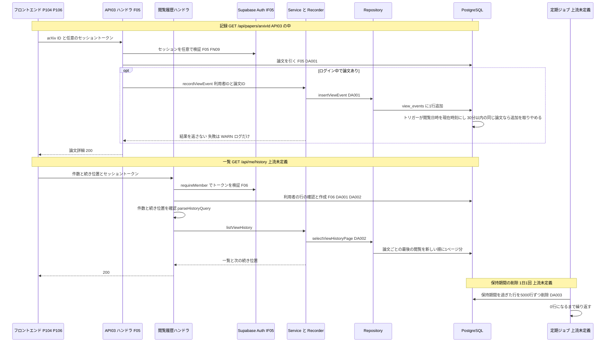

# BE詳細設計書 — F15 閲覧履歴（区分: 会員）

## 0. 文書情報

| 項目 | 値 |
| :--- | :--- |
| 設計書ID | F15-BE |
| 親ID | F15 |
| 親設計書 | `基本設計書_概要.md` §4.1 機能一覧 |
| 文書名 | BE詳細設計書 F15 閲覧履歴 |
| 対象システム | Kaine personal pj — arXiv日本語研究ダイジェスト Webアプリ |
| 版 | 1.1（第1回セルフレビュー `docs/reviews/be_F15_review_applied.md` の Major 2件・Minor 2件を反映） |
| 作成日 / 更新日 | 2026-10-26 / 2026-10-26 |
| 作成方法 | creating-backend-detailed-design v1.5.0 準拠。上流の確定設計書と `source/` の企画資料から作成（新規設計） |
| インプット | (a) `source/01_企画概要.md:29`、`source/02_機能要求定義.md:13,45,48,58`、`source/03_システム構成.md:7-11,39,42,49`、`source/04_収益化とロードマップ.md:35,45`／(b) `docs/基本設計書_概要.md` §2（BF05・BF08・BF13・EX04・EX05）、§4（F15 行、オンライン処理設計のエラー応答）、§5（バッチ一覧 B001〜B011）、§6（T001・T002・T003・T005・T008、CRUD図 F15 行）、§7（IF05、内部API一覧 API03 と注記「閲覧履歴の取得…APIが定義されていない」）、§8（認証・認可、セキュリティ対策「個人の行動データの過剰保持」）、§9（ディレクトリ構成）、§11（ARC002〜ARC004・ARC009・ARC010）、付録 Q25・Q27・Q31・Q32／関連する確定済みの下位設計書: `docs/db/DB.T008.DB物理設計.md`（view_events）、`docs/db/DB.T001.DB物理設計.md`（papers）、`docs/db/DB.T002.DB物理設計.md`（paper_versions）、`docs/db/DB.T003.DB物理設計.md`（summaries）、`docs/screens/画面.P106.画面基本設計.md`（H35〜H39、E01・E11・E12・E17）、`docs/screens/画面.P104.画面基本設計.md`（§7 閲覧履歴の記録）、`docs/detail/be/BE.F05.BE詳細設計.md`（API03、FN08・FN09・FN11、DA007）、`docs/detail/be/BE.F06.BE詳細設計.md`（requireMember、DA001・DA002）、`docs/detail/be/BE.F07.BE詳細設計.md`（一覧取得の続き位置の方式）／(c) `legacy/`（空） |
| インプットの性質 | `source/` は企画・初期設計案のMarkdown 6ファイルだけで、ルーティング定義・コントローラ・ORM定義・SQLは1つもありません（`source/README.md:5-10`、作業開始時の実ファイル数6件）。閲覧履歴について資料にあるのは、マイページに閲覧履歴を置くこと（`source/01_企画概要.md:29`）、`view_events` の列名3つ「（プライバシーに配慮）」（`source/03_システム構成.md:42`）、Phase 2 で閲覧履歴を作ること（`source/04_収益化とロードマップ.md:35`）、個人の行動ログを必要最小限にし退会・削除に対応すること（`source/02_機能要求定義.md:48`）だけです。そのため本書のエンドポイント・関数・データアクセスはすべて「上流の定義から導いた計画上の実体」であり、実装済みであることは意味しません。パス・ファイル名・関数名・JSONのキー名・SQL本文は実装時の命名案で、すべて※推測です |
| 既存版との関係 | `docs/detail/be/BE.F15.BE詳細設計.md` の旧版はありません（本書が初版）。残すべき既存の記述はありません |
| legacy/ との突合 | `legacy/` は空ディレクトリ（ファイル0件）です。突合する既存仕様・業務意図・非機能の記述はありません |

**確認事項（※推測・※上流要確認・※上流未定義の集約）**:

| No | 区分 | 確認事項 | 本書での仮置き | 関連箇所 | 上流の確認事項 |
| :--- | :--- | :--- | :--- | :--- | :--- |
| 1 | API | 閲覧履歴を取得するAPI（マイページ P106 が使う）のパス・パラメータ・ページ送りの方式（※上流未定義） | `GET /api/me/history`、20件ずつ、続き位置を表す文字列（カーソル）で続きを引く（※推測）。API ID は振らない | §2「GET /api/me/history」 | Q27 |
| 2 | API | 同じ論文を何度も開いたときの一覧での見せ方 | 論文ごとに最後に開いた1件だけを、最後に開いた日時の新しい順に出す（P106 H36、T008 §9 No.8 と同じ） | §3 DA002 | Q27 |
| 3 | API | 閲覧を記録するAPI（※上流要確認。上流 BF05 は「ログイン中なら記録」とだけ書き、どのAPIが記録するかを定めていない） | 論文詳細の取得（API03）の中で、本書の記録処理（recordViewEvent）を呼ぶ。要約の取得（API04）では記録しない。記録専用のAPIは設けない（F05 §2 API03 手順6と同じ判断） | §2 エンドポイントロースター No.2、§4 recordViewEvent | Q27（T008 §9 No.9） |
| 4 | 保持期間 | 閲覧イベントを何日残すか | 180日（T008 §9 No.1 と同じ） | §3 DA003、§5 | Q25 |
| 5 | バッチ | 保持期間を過ぎた行を削除する定期実行のジョブを上流 §5 バッチ一覧に追加するか（※上流未定義） | 1日1回、5,000行ずつ0行になるまで削除する案。バッチIDは振らない | §3 DA003、§5 | —（※上流未定義。T008 §9 No.2） |
| 6 | CRUD | 保持期間による削除（DA003）は view_events の「D」に当たるが、上流 §6 CRUD図の F15 行は「CR」（※上流要確認） | 本書で削除の処理を定義する。上流 CRUD図の F15 行の view_events を「CRD」にするか、削除を別のバッチIDの行として載せるかを確認する | §3 DA003 | —（※上流未定義） |
| 7 | CRUD | 利用者が自分の閲覧履歴を消せるようにするか（※上流要確認） | 消せない（上流 CRUD図 F15 行が「CR」で、T008 §7 の行単位アクセス制御にも削除のポリシーが無いため）。API は設けない | §2 エンドポイントロースター | —（※上流未定義。T008 §9 No.4） |
| 8 | 整合 | F05 BE詳細設計書の閲覧記録の書き方を本書に合わせるか（※上流要確認）。F05 §3 DA007 は閲覧日時を `now()` で渡し、主キーの重なりを `ON CONFLICT DO NOTHING` で吸収していない。F05 §4 FN08 は失敗時の WARN ログに利用者ID・論文IDを出す | 記録処理の持ち主は本書（F15）とし、本書 DA001（閲覧日時をアプリから渡さず、主キーの重なりは何もしない）と §4 recordViewEvent（ログに利用者IDと論文の組を出さない）を正とする。F05 の DA007・FN08 の記述を本書に合わせる修正を提案する。あわせて FN08 の引数の型（F05 は論文IDを `number`、本書は DB の `papers.id` に合わせて `bigint`）を本書に合わせる | §3 DA001、§4 No.5、§6 | —（下位設計書どうしの不整合） |
| 9 | CRUD | 閲覧履歴の一覧で日本語タイトルを出すため、F15 が `paper_versions`・`summaries` を参照（R）する（※上流要確認。上流 §6 CRUD図の F15 行は papers・users・view_events だけ） | 参照する。上流 CRUD図の F15 行に paper_versions「R」、summaries「R」の追加を提案する（F07 §0 確認事項 No.3 と同じ扱い） | §3 DA002 | —（※上流未定義） |
| 10 | 業務 | 短時間の開き直しを記録しない間隔 | 30分（T008 §9 No.3 の値を、DB のトリガーがそのまま適用する。本書のアプリ側では判定しない） | §3 DA001 | —（※上流未定義） |
| 11 | CRUD | 一覧の入口で使う F06 requireMember は、利用者の行が無ければ users に行を作る（INSERT）。上流 §6 CRUD図の F15 行の users は「R」だけ（※上流要確認） | 行の作成は F06 の責務（F06 DA002、CRUD図 F06 行の users「C」）とみなし、F15 の CRUD は「R」のままとする。F15 行に users「C」を加えるか、F15 の一覧では行を作らない認証（トークンの検証だけ）に切り替えるかを確認する | §2「GET /api/me/history」手順1、§3 F06 DA002 | —（※上流未定義） |

---

## 1. バックエンド構成・モジュール設計

* **対象ドメイン**: 会員系（機能ID F15 閲覧履歴）— ログイン中の利用者が論文詳細（P104）を開いたことを1回1行で記録し、マイページ（P106）でその記録を「論文ごとに最後に開いた日時の新しい順」に一覧する（上流 §4 F15「ログイン中の利用者が開いた論文を記録し、マイページで履歴として見せる。記録は必要最小限にとどめる」）。あわせて、保持期間を過ぎた記録を消す処理を持つ（上流 ARC010、T008 §4.3 (3)。ジョブとしては※上流未定義）。Free・Pro とも使える機能で、プランによる制限はありません（上流 §8 で Pro 限定とされている機能に閲覧履歴は含まれない）。
* **対象APIエンドポイント**: GET /api/me/history（閲覧履歴の取得。※上流未定義、パスは※推測）。閲覧の記録は独自のエンドポイントを持たず、F05 の GET /api/papers/{arxivId}（API03）の中から本書の記録処理を呼びます。全数と根拠は §2 のエンドポイントロースターを参照。
* **実行基盤**: 画面向けAPIは Next.js の API（Route Handler）として Vercel 上で動きます（`source/03_システム構成.md:7,16`、上流 §9）。DBへは環境変数 `DATABASE_URL` の接続文字列で PostgreSQL（Supabase）に直接つなぎ、SQLを発行します（上流 §9 環境変数一覧。※推測: F05〜F07 と同じSQLクライアント）。
  * この接続は行単位アクセス制御（Row Level Security）を通らないロールで動くため（※推測）、**本機能のすべてのSQLに「利用者IDが本人と一致する」条件を付け、利用者IDはセッションの検証結果からだけ取ります**（ブラウザから送られた値を使わない）。T008 の行単位アクセス制御（`docs/db/DB.T008.DB物理設計.md` §7）は、ブラウザから Supabase へ直接アクセスされた場合の二重目の防御として働きます（上流 §8「他人のデータの閲覧・改ざん」）。
  * 保持期間を過ぎた行の削除は、利用者のリクエストではなく定期実行で動くため、Pythonワーカー（上流 §9 `worker/`）からサービスロールで実行します（※推測・※上流未定義）。
* **ディレクトリ/ファイル構造**（上流 §9「`web/`（Next.js の画面と画面向けAPI）」「`worker/`（FastAPI・ジョブ）」の想定に従う。記録処理の置き場所は F05 §1 の `lib/server/history/viewEventRecorder.ts` に合わせる。ファイル名はすべて※推測）:

```
web/
├── app/api/me/history/
│   └── route.ts                    # GET（閲覧履歴の取得 ※上流未定義）
├── app/api/papers/[arxivId]/
│   └── route.ts                    # GET（API03。F05 の担当。本書の recordViewEvent を呼ぶ）
├── lib/auth/
│   └── requireMember.ts            # 会員向けAPI共通の認証（F06 の担当。本書は呼ぶだけ）
├── lib/server/history/
│   ├── validation.ts               # parseHistoryQuery / encodeHistoryCursor
│   ├── historyService.ts           # listViewHistory
│   ├── viewEventRecorder.ts        # recordViewEvent（F05 FN08 と同じ関数。持ち主は本書）
│   └── viewEventRepository.ts      # insertViewEvent / selectViewHistoryPage（DA001・DA002 のSQL発行）
├── lib/server/http/
│   └── errors.ts                   # toErrorResponse（F05 FN11。本書は呼ぶだけ）
└── lib/db/
    └── client.ts                   # DATABASE_URL による接続（全機能共通 ※推測）
worker/
└── jobs/
    └── view_events_retention.py    # purge_expired_view_events（DA003。※上流未定義のジョブ）
```

* **処理シーケンス図**（記録・一覧・保持期間の削除の3つの流れ。上流 BF05・EX04・EX05 と P106 E01・E12 を展開）:



---

## 2. API・インターフェース詳細設計

* **外部サービス連携仕様**: 本機能が呼ぶ外部サービスは Supabase Auth（上流 IF05）の1件だけです。**全数である根拠**: 上流 §7 外部連携一覧の全9件（IF01〜IF09）のうち、閲覧の記録（上流 BF05 の「ログイン中」の判定）と閲覧履歴の取得（会員だけが使う）に関わるのは IF05 だけです。arXiv（IF01〜IF03）・LLM（IF04）・Stripe（IF06・IF07）・GitHub（IF08）・通知（IF09）は、記録・一覧・保持期間の削除のどの手順にも現れません。記録の流れでの IF05 の呼び出しは F05 の FN09（任意のセッション確認）、一覧での呼び出しは F06 の requireMember が行い、本書の関数は直接呼びません。

| IF-ID | 連携先 | 連携方式 | エンドポイント / 接続先 | 認証方式 | タイムアウト | リトライ方針 | エラー時の挙動 | 定義状況 | 詳細の所在 |
| :--- | :--- | :--- | :--- | :--- | :--- | :--- | :--- | :--- | :--- |
| IF05 | Supabase Auth | SDKによる認証連携（※推測: F06 の verifyAccessToken が `@supabase/supabase-js` の `auth.getUser(トークン)` を呼ぶ） | 環境変数 `NEXT_PUBLIC_SUPABASE_URL` が指す Supabase プロジェクトの認証API（上流 §9） | 利用者のセッショントークン（JWT）をそのまま渡して検証する（上流 IF05 ※推測） | F06 の定義に従う（本書では値を決めない） | F06 の定義に従う | 一覧の取得では、トークンが無い・期限切れ・改ざんされている場合は 401 を返し、ログインを促す（上流 EX05）。認証サービスに届かない場合は 500 を返す（F06 §6 `AUTH_UNAVAILABLE`）。記録の流れでは、確かめられなければ未ログインとして扱い、記録をしないだけで論文詳細は表示を続ける（F05 FN09） | 詳細 | `docs/detail/be/BE.F06.BE詳細設計.md` §4 requireMember、`docs/detail/be/BE.F05.BE詳細設計.md` §4 FN09 |

* **エンドポイントロースター（全数）**:

| No | API ID | メソッド | パス | 概要 | 本機能との関係 | 認証 | 定義状況 | 詳細の所在 |
| :--- | :--- | :--- | :--- | :--- | :--- | :--- | :--- | :--- |
| 1 | —（※上流未定義） | GET | /api/me/history（※推測） | ログイン中の利用者が開いた論文を、論文ごとに最後に開いた日時の新しい順に1ページ分返す | 本書が持つエンドポイント | 必要 | 詳細 | §2「GET /api/me/history」 |
| 2 | API03 | GET | /api/papers/{arxivId} | 論文1本の詳細を返す。ログイン中の利用者が呼んだときは、本書の記録処理で閲覧を1件記録する | エンドポイントは F05 の担当。本書は中から呼ばれる記録処理（recordViewEvent）を持つ | 不要（ログイン中なら利用者を特定する） | 詳細 | エンドポイント: `docs/detail/be/BE.F05.BE詳細設計.md` §2「GET /api/papers/{arxivId}」／記録処理: 本書 §4 No.5 |

**総件数: 2件（本書が持つもの1件・他機能が持ち本書の処理を呼ぶもの1件）。全数である根拠**: 上流 §7 内部API一覧の全8件（API01〜API08）に閲覧履歴のカテゴリの行は0件で、`source/03_システム構成.md:46-54` の API設計案にも閲覧履歴のパスはありません。上流 §7 の注記と付録 Q27 が「閲覧履歴の取得」を API 未定義の機能として挙げており、画面設計 P106 の呼出APIロースターにも「閲覧履歴の取得」（E01・E12・E17、※上流未定義）があるため、これを No.1 としました。記録は上流 BF05 の流れの中で行われ、F05 BE詳細設計が API03 の手順6で記録すると決めているため（本書 §0 確認事項 No.3）、API03 を No.2 として載せています。要約の取得（API04）は記録をしないため載せていません。利用者が自分の閲覧履歴を消すAPIは、上流 CRUD図 F15 行に削除（D）が無いため設けていません（§0 確認事項 No.7）。定義状況は、No.1 が認証・入力の分岐とページ送り（completeness 3-1 の1・4）、No.2 が書き込みと失敗時に例外を伝えない扱い（3-1 の2・5）を含むため、2件とも「詳細」です。

* **全エンドポイント共通の決まり**（※推測。上流 §4 オンライン処理設計のエラー応答、§8 を具体化。F06・F07 と同じ決まりに合わせる）:
  * **認証**: リクエストヘッダー `Authorization: Bearer <Supabase のアクセストークン>` で受け取ります（F06 requireMember）。
  * **応答の形**: 成功時は `{"status":"success","data":{…}}`、失敗時は `{"status":"error","error":{"code":"<エラーコード>","message":"<利用者向けの文言>"}}` とします（エラーコードは §6 の一覧）。
  * **キャッシュ**: すべての応答に `Cache-Control: no-store` を付けます。どの論文をいつ開いたかは個人の行動データで、共有キャッシュや CDN に残してはならないためです（上流 ARC010）。
  * **利用者IDの出どころ**: どのエンドポイントも利用者IDを引数で受け取りません。セッションの検証結果だけを使います（T008 §4.3 (1)）。

### GET /api/me/history
* **概要**: ログイン中の利用者が開いた論文を、論文ごとに最後に開いた1件にまとめ、最後に開いた日時の新しい順に1ページ分返します。あわせて続きの取得位置を返します。マイページ（P106）を開いたとき（E01）、閲覧履歴の「さらに表示」（E12）、節の再読み込み（E17）から呼ばれます。**※上流未定義**: 上流 §7 内部API一覧に無いAPIで、パス・パラメータ・応答はすべて※推測です（上流 付録 Q27、§0 確認事項 No.1）。API ID は振っていません。
* **API ID**: —（※上流未定義）
* **認証要否**: 必要（ログイン中の会員。Free・Pro とも利用可）
* **リクエストパラメータ**:

| 種別(Path/Query/Body) | 項目名 | 型 | 必須 | 制約・バリデーション | 説明 |
| :--- | :--- | :--- | :--- | :--- | :--- |
| Header | Authorization | string | 必須 | 「Bearer」の後に Supabase のアクセストークンを付けた形 | ログイン中の利用者を特定する。無い・無効なら 401 |
| Query | limit | integer | 任意 | 1以上50以下の整数。指定が無いときは 20（※推測: P106 H39「最初に表示するのも20件」） | 1回に返す件数（論文の数） |
| Query | cursor | string | 任意 | 前回の応答の `nextCursor` をそのまま渡す。形が壊れている・中身が読めない場合は 400 | 続きを取る位置。指定が無いときは先頭から返す。中身は前のページの最後の論文の「最後に開いた日時（DBの値をマイクロ秒まで保った文字列）」と論文IDの組で、利用者には中身の意味を持たせない。日時をミリ秒に丸めると、同じミリ秒内に開いたより古い論文が次のページから漏れるため、精度を落とさずに持つ（F07 一覧と同じ方式） |

* **レスポンス（成功時）**:
```json
{
  "status": "success",
  "data": {
    "items": [
      {
        "arxivId": "2401.01234",
        "titleJa": "大規模言語モデルの推論効率を高める新手法",
        "titleOriginal": "An Efficient Inference Method for Large Language Models",
        "categories": ["cs.LG", "cs.CL"],
        "viewedAt": "2026-10-26T01:23:45.678Z"
      }
    ],
    "nextCursor": "eyJ0IjoiMjAyNi0xMC0yNlQwMToyMzo0NS42Nzg5MDFaIiwicCI6MTIzNDV9"
  }
}
```
  * `titleJa` は論文の最新版について検証に合格した30秒要約の日本語タイトルです。まだ無い論文は `null` を返し、画面は原題（`titleOriginal`）を出します（P106 H36、上流 ARC002・ARC004）。
  * `categories` は論文のカテゴリをすべて返し、先頭の1つだけを出すかは画面が決めます（P106 H37）。
  * `viewedAt` はその論文を最後に開いた日時（`view_events.viewed_at` の最大値、UTC の ISO 8601 形式）です。表示するタイムゾーンへの変換は画面に任せます（P106 H38、上流 ARC009）。版は返しません（閲覧イベントは版を持たないため。T008 §4.3 (2)）。
  * `nextCursor` は続きが無いとき `null` です。閲覧履歴の総件数は返しません（P106 は総件数を表示せず、「さらに表示」の有無だけを `nextCursor` で決めるため。P106 H39）。
* **レスポンスヘッダー**: `Content-Type: application/json`、`Cache-Control: no-store`
* **ステータスコード**:

| コード | 条件 |
| :--- | :--- |
| 200 | 正常終了。閲覧の記録が1件も無いときも、`items` を空配列、`nextCursor` を `null` として返す（P106 は H50 の空表示を出す） |
| 400 | `limit` が整数でない・範囲外、`cursor` が読めない（`INVALID_REQUEST`） |
| 401 | トークンが無い・無効・期限切れ（`UNAUTHORIZED`。上流 EX05）。P106 はログインが切れた旨のダイアログを出す（P106 E01・E12） |
| 500 | 認証サービスに届かない（`AUTH_UNAVAILABLE`。F06 §6）、DB障害・想定外の例外（`INTERNAL_ERROR`）。P106 は閲覧履歴の節だけにエラーと再読み込みを出す（上流 EX04 の考え方、P106 E01 様式②） |

* **ビジネスロジック・副作用**:
  1. 会員向けAPI共通の認証（F06 requireMember）でトークンを検証し、利用者IDを得る。無効なら 401 で終了する。利用者の行が無ければ requireMember が Free で作る（F06 DA001・DA002。会員登録の途中で行の作成に失敗した利用者を救う F06 の方針に従う）。
  2. 件数と続き位置を検証する（parseHistoryQuery。不正なら 400 で終了）。続き位置は「最後に開いた日時（マイクロ秒までの文字列）」と「論文ID」の組を復元したものです。
  3. 1ページ分を取得する（DA002）。同じ論文を何度も開いていても、その論文の最後の閲覧だけを1件として数える。指定件数より1件多く読み、1件多く取れたら続きがあると判断して最後の1件を捨て、残りの最後の行の「最後に開いた日時（DBが返したマイクロ秒までの文字列をそのまま使う）・論文ID」から次の続き位置を作る（encodeHistoryCursor）。取れた件数が指定件数以下なら続きは無い。
  4. 1文で読むため、トランザクションは張らない（総件数を返さないので、別の文と時点をそろえる必要が無い）。
  5. 一覧と次の続き位置を返す。
  6. 副作用はありません（閲覧履歴の参照のみ。requireMember による利用者の行の作成は F06 の責務）。利用者が閲覧履歴を見たこと自体は記録しません（上流 ARC010 の個人データ最小化）。
  7. **ページ送りの途中で別のタブから論文を開いた場合**: その論文は最後に開いた日時が新しくなり、一覧の先頭側へ移ります。続き位置より新しくなるため、続きのページには現れません（重複して出ることは無い）。画面を開き直せば先頭に出ます。最新の状態を常に保証する仕組み（ページ間の時点の固定）は、閲覧履歴の性質上不要と判断しています（※推測）。

---

## 3. データアクセス（ORM / クエリ）設計

* **データアクセス一覧（全数ロースター）**:

| DA-ID | 処理名 | 呼出元（関数/API） | テーブルID | 対象物理テーブル | 種別 (SELECT/INSERT/UPDATE/DELETE) | 定義状況 (詳細/簡易) | 詳細の所在 |
| :--- | :--- | :--- | :--- | :--- | :--- | :--- | :--- |
| DA001 | 閲覧イベントの記録（短時間の開き直しと同時刻の重なりは記録しない） | insertViewEvent ← recordViewEvent ← GET /api/papers/{arxivId}（API03。F05 FN01 → FN08） | T008 | view_events | INSERT | 詳細 | §3 詳細定義 DA001 |
| DA002 | 閲覧履歴の1ページ取得（論文ごとの最後の閲覧） | selectViewHistoryPage ← listViewHistory ← GET /api/me/history（※上流未定義） | T008, T001, T002, T003 | view_events, papers, paper_versions, summaries | SELECT | 詳細 | §3 詳細定義 DA002 |
| DA003 | 保持期間を過ぎた閲覧イベントの削除 | purge_expired_view_events ← 定期ジョブ（※上流未定義・バッチID未採番） | T008 | view_events | DELETE | 詳細 | §3 詳細定義 DA003 |
| F06 DA001 | 利用者1件取得（F06 の担当） | usersRepository.findById ← requireMember ← GET /api/me/history | T005 | users | SELECT | 簡易 | `docs/detail/be/BE.F06.BE詳細設計.md` §3 DA001 |
| F06 DA002 | 利用者の行が無ければ作成（F06 の担当） | usersRepository.insertIfAbsent ← requireMember ← GET /api/me/history | T005 | users | INSERT | 詳細 | `docs/detail/be/BE.F06.BE詳細設計.md` §3 詳細定義 DA002 |

**総件数: 5件（本書が定義するもの3件 — INSERT 1件・SELECT 1件・DELETE 1件／他書が定義し本機能の処理中に発行されるもの2件）。全数である根拠**: 本書の3件は、§2 の2つのエンドポイントと §5 の保持期間の削除の手順に現れるDBアクセスをすべて数えたものです（記録: DA001、一覧: DA002、保持期間の削除: DA003）。§4 の関数ロースターのうち、SQL を発行する3関数（insertViewEvent・selectViewHistoryPage・purge_expired_view_events）と1対1で対応します。一覧の入口で呼ぶ F06 requireMember が発行する2件（F06 DA001・DA002）は、F06 のIDのまま載せています（本書では採番しない）。API03 の中で記録の前に論文を引く処理（F05 DA001）は F05 の論文詳細の処理で、本機能の処理ではないため載せていません。DB物理設計 T008 §4.6 の F15 行「記録する。直近30分以内に同じ論文を記録済みなら記録しない／論文ごとに最も新しい閲覧を新しい順に一覧する」は DA001・DA002 に当たります。上流 §6 CRUD図の F15 行（papers「R」・users「R」・view_events「CR」）の各操作は、papers R → DA002、users R → F06 DA001、view_events C → DA001、R → DA002 に現れます。CRUD図に無い操作は、paper_versions・summaries の参照（DA002。§0 確認事項 No.9）と view_events の削除（DA003。§0 確認事項 No.6）で、どちらも ※上流要確認 です。テーブルID列は上流 §6 テーブル一覧のIDをそのまま引き継いでいます（papers=T001、paper_versions=T002、summaries=T003、users=T005、view_events=T008）。本機能に UPDATE はありません（T008 §4.6「本テーブルを更新（U）する機能はありません」）。
**定義状況の判定**（completeness 3-1）: DA001 は永続データを書き換え（3-1 の2）、DB のトリガーによる記録の取りやめと主キーの重なりの扱いがある（3-1 の5・7）。DA002 は4テーブルの結合（3-1 の3）、続き位置の有無による SQL の組み立ての分岐（3-1 の4）、論文ごとの集約と性能上の注意（3-1 の6）、「同じ論文は最後の1件だけ」という業務ルール（3-1 の7）を含む。DA003 は大量件数の削除（3-1 の2・6）と、上流に無い保持期間の業務ルール（3-1 の7）を含む。F06 の2件の判定は F06 の判定をそのまま引き継いでいます。

* **データアクセス詳細定義**（ロースターは本節冒頭の表。本表は本書が定義する定義状況＝詳細の3件を展開する。F06 DA002 の詳細は F06 §3 にある）:

| DA-ID | 処理名 | テーブルID | 対象物理テーブル | JOIN / Include | 抽出条件 (Where) / ソート | トランザクション境界 | N+1対策・性能上の注意 |
| :--- | :--- | :--- | :--- | :--- | :--- | :--- | :--- |
| DA001 | 閲覧イベントの記録 | T008 | view_events | なし | 抽出条件なし（1行の追加）。利用者IDはセッションの値、論文IDは API03 が arXiv ID から引き当てた値を入れる。閲覧日時はアプリから渡さず、DB の初期値とトリガーに任せる（トリガーが必ず現在時刻に置き換えるため、渡しても意味が無い。T008 §4.3 (3)）。同じ利用者・同じ論文を直近30分以内に記録済みなら、トリガーが黙って追加を取りやめる。ほぼ同時の2件が同じ時刻になり主キーが重なった場合は、何もしない（`INSERT … ON CONFLICT DO NOTHING`） | 追加1文だけを持つ短いトランザクション。最初に打ち切り時間（1秒）をそのトランザクションの中だけで設定し、追加してコミットする（`BEGIN` → `SET LOCAL statement_timeout = '1s'` → 追加 → `COMMIT`）。設定はトランザクションの終わりで消えるため、接続プールで同じ接続を使う他のリクエストに打ち切り時間が残らない。API03 の読み出し（F05 DA001〜DA003）とは同じトランザクションにしない。記録の失敗で論文詳細の応答を失敗させないため | 主キー `pk_view_events`（利用者ID・論文ID・閲覧日時）の並びが、トリガーの「同じ利用者・同じ論文の直近の行があるか」の確認にそのまま使えるため、追加のたびの確認は索引の範囲検索1回で済む。文の打ち切り時間を1秒にし（※推測）、DB が遅いときに論文詳細の応答を待たせ続けない。外部キー違反（利用者の行が無い、または論文がその間に消えた）は SQLSTATE 23503 として受け、記録しないだけで終える（§4 No.5） |
| DA002 | 閲覧履歴の1ページ取得 | T008, T001, T002, T003 | view_events, papers, paper_versions, summaries | 本人の閲覧イベントを論文IDごとにまとめ（論文ごとの最後の閲覧日時）、並べ替えて1ページ分（指定件数＋1）に絞った結果だけを、papers と論文IDで内部結合する（閲覧イベントが残る論文は削除を拒否されるため（T008 `fk_view_events_paper_id`）、内部結合で行が欠けることは無い）。paper_versions を「論文ID と papers の最新版番号」で外部結合する（版の行がまだ無い論文も一覧に残す）。summaries を版ごとの横断サブクエリ（LATERAL）で外部結合し、30秒要約・日本語・検証合格のうち生成日時が最も新しい1件の日本語タイトルだけを取る（版や要約が無い論文は日本語タイトルが空になる） | 本人の行（利用者IDが一致）だけを対象に、論文ごとに最後に開いた日時を求める（同じ論文を何度開いても1件にまとめる）。その日時の新しい順、同じ日時のときは論文IDの大きい順に並べる。続き位置が指定されたときは、その「最後に開いた日時・論文ID」の組より後ろ（並び順で先に来ない論文）だけに絞る。この絞り込みはまとめた後の値に対して、1ページ分へ絞る前に行う（まとめる前の個々の閲覧に対して行うと、続き位置より新しい閲覧を持つ論文が古い閲覧で次のページに再び現れるため）。続き位置の日時はマイクロ秒まで保った文字列で受け取り、DB側で日時型に戻して比較する。続き位置を作るため、最後に開いた日時を UTC・マイクロ秒までの文字列にしたものも併せて返す。指定件数より1件多く読む | 1文（自動コミット）。読み取りのみ | 論文ごとのまとめは、主キー `pk_view_events`（利用者ID・論文ID・閲覧日時）の索引だけを読んで行える（表本体を読まずに、利用者の範囲を論文IDの順に走査して各論文の最大の日時を取る）。1人の行数は、保持期間（仮置き180日）と30分以内の記録の取りやめで上限が抑えられるため、まとめる処理はページごとに本人の全行を読むが負担は小さい（※推測: 1日に20本の論文を開く利用者でも最大3,600行程度）。並べ替えはまとめた後の論文数（同じ上限以下）に対して行う。papers・paper_versions の結合と summaries の LATERAL の引き当ては、並べ替えて1ページ分（最大51件）に絞った後の行にだけ走らせる（絞る前に結合すると、本人が開いた全論文の数だけ要約の引き当てが走るため。SQL の上でも CTE `page` で先に絞り、プランナーの選び方に頼らない）。論文情報と日本語タイトルまで1回の SQL で取り、論文ごとの追加の問い合わせ（N+1）をしない。日本語タイトルは索引 `idx_summaries_lookup`（版・種別・言語・生成日時の降順）で1件だけ引く |
| DA003 | 保持期間を過ぎた閲覧イベントの削除 | T008 | view_events | なし | 閲覧日時が保持期間（仮置き180日）より前の行を、1回あたり5,000行まで消す。0行になるまで同じ文を繰り返す（T008 §7「運用で実行する文」をそのまま使う） | 1回の文（5,000行まで）ごとの自動コミット。全体を1つのトランザクションにしない。消す行が多い日にも、ほかの処理（記録・一覧）を長く止めないため | 消す対象は索引 `idx_view_events_viewed_at`（閲覧日時）で探し、全件を読まない。行ごとの内部の位置（ctid）で消す行を決めるため、主キーで引き直す往復が無い。1回の文は5,000行までに抑え、ロックを持つ時間と1回で生じる不要領域（後で掃除が要る領域）を小さく保つ。同じ時刻に2つ動いても、消す対象が重ならないか、重なっても片方が0行になるだけで害は無い |

* **発行SQL**: 本機能のデータアクセスは ORM を使わず、すべて SQL クライアントからパラメータ付きの SQL を発行します（§1 実行基盤）。値はすべて番号付きのプレースホルダ（`$1`〜`$4`）で渡し、文字列の連結で SQL を作りません（SQL インジェクション対策）。本書が定義する3件すべての SQL 本文を示します。動的に組み立てるのは DA002 の1件だけで、その分岐と生成され得る2つの形を示します。F06 DA001・DA002 の SQL 本文は F06 §3 にあります。

**DA001 閲覧イベントの記録**（詳細）
```sql
-- $1: 利用者ID（uuid。セッションの検証結果）、$2: 論文ID（bigint。API03 が arXiv ID から引き当てた papers.id）
BEGIN;
SET LOCAL statement_timeout = '1s';   -- このトランザクションの中だけ有効。COMMIT/ROLLBACK で元に戻る
INSERT INTO view_events (user_id, paper_id)
VALUES ($1, $2)
ON CONFLICT DO NOTHING;
COMMIT;                                -- 追加が失敗した場合は COMMIT せず ROLLBACK する
-- viewed_at は列の初期値とトリガー trg_view_events_before_insert により現在時刻になる（T008 §7）
-- 直近30分以内に同じ利用者・同じ論文の行があれば、トリガーが追加を取りやめる（エラーにはならず、追加件数が0になる）
-- 同じ時刻の行と主キーが重なった場合も、ON CONFLICT DO NOTHING で追加件数が0になる
-- 追加件数（0 か 1）はアプリでは区別しない
```

**DA002 閲覧履歴の1ページ取得**（詳細・動的）— 続き位置（`cursor`）の有無で、続き位置の条件を付けるかだけが変わります。それ以外の部分は固定です。取り出す件数には指定件数に1を足した値を渡します。

* 分岐1: 続き位置が無い（最初のページ。P106 E01・E17）→ 形A
* 分岐2: 続き位置がある（2ページ目以降。P106 E12）→ 形B（形Aに「最後に開いた日時・論文IDの組が続き位置より後ろ」の条件を足したもの）

形A（最初のページ）:
```sql
-- $1: 利用者ID（uuid）、$2: 取り出す件数（limit + 1）
WITH latest AS (
    SELECT ve.paper_id          AS paper_id,
           max(ve.viewed_at)    AS last_viewed_at      -- 同じ論文を何度開いても最後の1件にまとめる
      FROM view_events AS ve
     WHERE ve.user_id = $1
     GROUP BY ve.paper_id
),
page AS (
    SELECT l.paper_id, l.last_viewed_at
      FROM latest AS l
     ORDER BY l.last_viewed_at DESC, l.paper_id DESC
     LIMIT $2                                         -- 結合の前に1ページ分（指定件数＋1）へ絞る
)
SELECT p.arxiv_id                   AS arxiv_id,
       s.title_ja                   AS title_ja,
       p.title                      AS title_original,
       p.categories                 AS categories,
       pg.last_viewed_at            AS viewed_at,
       to_char(pg.last_viewed_at AT TIME ZONE 'UTC',
               'YYYY-MM-DD"T"HH24:MI:SS.US"Z"') AS viewed_at_text,  -- 続き位置用。マイクロ秒まで保つ
       pg.paper_id                  AS paper_id   -- 続き位置を作るためだけに使い、応答には出さない
  FROM page AS pg
  JOIN papers AS p ON p.id = pg.paper_id
  LEFT JOIN paper_versions AS pv
         ON pv.paper_id = p.id
        AND pv.version  = p.latest_version
  LEFT JOIN LATERAL (
        SELECT sm.json_content ->> 'title_ja' AS title_ja   -- キー名は ARC003 要約スキーマで確定（※推測。F07 DA006 と同じ）
          FROM summaries AS sm
         WHERE sm.paper_version_id  = pv.id
           AND sm.summary_type      = 'short'
           AND sm.language          = 'ja'
           AND sm.validation_status = 'passed'
         ORDER BY sm.generated_at DESC
         LIMIT 1
       ) AS s ON TRUE
 ORDER BY pg.last_viewed_at DESC, pg.paper_id DESC;   -- 結合後に並びを保証し直す
```

形B（2ページ目以降）: 形Aの `page` の中の `FROM latest AS l` の直後（`ORDER BY` の前）に次の WHERE 句を加えます。それ以外は形Aと同じです。パラメータは `$1` 利用者ID、`$2` 取り出す件数、`$3` 続き位置の日時（形Aの `viewed_at_text` と同じマイクロ秒までの文字列）、`$4` 続き位置の論文ID（bigint）です。
```sql
     WHERE (l.last_viewed_at, l.paper_id) < ($3::timestamptz, $4::bigint)
```
行値の比較（最後に開いた日時が古い、または同じ日時で論文IDが小さい論文）で、並び順 `last_viewed_at DESC, paper_id DESC` の続きだけを取ります。条件はまとめた後の値（`latest`）に対して、1ページ分へ絞る前（`page` の中）に掛けるため、続き位置より新しく開き直された論文が次のページに再び出ることはありません（§2 手順7）。

**DA003 保持期間を過ぎた閲覧イベントの削除**（詳細・※上流未定義）— T008 §7「運用で実行する文」と同じ文です。保持期間の値はパラメータで渡し、確定（上流 Q25）したときに設定だけを変えられるようにします（※推測）。
```sql
-- $1: 保持期間（interval。仮置き '180 days'）
DELETE FROM view_events
WHERE ctid IN (
    SELECT ctid
      FROM view_events
     WHERE viewed_at < CURRENT_TIMESTAMP - $1::interval
     LIMIT 5000
);
-- 削除件数が0になるまで繰り返す
```

---

## 4. サーバー側機能・処理ロジック設計（IPO設計）

* **関数ロースター（全数）**: 関数名・ファイル名はすべて実装時の命名案です（※推測）。

| No | ID（関数名） | 所属モジュール | 概要 | 対応DA | 定義状況 | 詳細の所在 |
| :--- | :--- | :--- | :--- | :--- | :--- | :--- |
| 1 | GET（閲覧履歴ハンドラ） | web/app/api/me/history/route.ts | 閲覧履歴の取得（※上流未定義）の受け口。認証・クエリ検証・サービス呼び出しを行い、一覧を返す | — | 詳細 | §4 IPO定義 No.1 |
| 2 | parseHistoryQuery | web/lib/server/history/validation.ts | 一覧の `limit` と `cursor` を検証し、件数と続き位置（マイクロ秒までの日時の文字列・論文ID）に変換する | — | 詳細 | §4 IPO定義 No.2 |
| 3 | encodeHistoryCursor | web/lib/server/history/validation.ts | 最後の行の「最後に開いた日時」（DBが返したマイクロ秒までの文字列をそのまま）と論文IDを、URL に載せられる文字列（JSON を base64url 化）にする | — | 簡易 | — |
| 4 | listViewHistory | web/lib/server/history/historyService.ts | 1ページ分を読み、続きの有無を判定して次の続き位置を作り、応答の形に変える | DA002 | 詳細 | §4 IPO定義 No.4 |
| 5 | recordViewEvent | web/lib/server/history/viewEventRecorder.ts | ログイン中の利用者の閲覧を1件記録する。失敗しても呼出元へ例外を伝えない（F05 FN08 と同じ関数。持ち主は本書） | DA001 | 詳細 | §4 IPO定義 No.5 |
| 6 | insertViewEvent | web/lib/server/history/viewEventRepository.ts | 打ち切り時間を1秒にした短いトランザクションの中で DA001 を発行し、DB のエラーはそのまま投げる | DA001 | 詳細 | §4 IPO定義 No.6 |
| 7 | selectViewHistoryPage | web/lib/server/history/viewEventRepository.ts | 続き位置の有無で DA002 の形A・形Bを選んで発行し、行の配列を返す | DA002 | 詳細 | §4 IPO定義 No.7 |
| 8 | purge_expired_view_events | worker/jobs/view_events_retention.py | 保持期間を過ぎた閲覧イベントを、5,000行ずつ0行になるまで削除する（※上流未定義のジョブの本体） | DA003 | 詳細 | §4 IPO定義 No.8 |

**総件数: 8件（ハンドラ1件・検証2件・サービス1件・記録1件・リポジトリ2件・ジョブ1件。詳細7件・簡易1件）。全数である根拠**: §1 のディレクトリ構造に挙げた本機能が持つ6ファイル（route.ts・validation.ts・historyService.ts・viewEventRecorder.ts・viewEventRepository.ts・view_events_retention.py）の関数をすべて数えたものです。ハンドラは §2 のエンドポイントロースターのうち本書が持つ No.1 と1対1、SQL を発行する関数（No.6・No.7・No.8）は §3 で本書が定義する DA001〜DA003 と1対1、記録関数（No.5）は §2 ロースター No.2（API03 から呼ばれる記録処理）に対応します。
**本機能が呼ぶ他書の関数（本ロースターに数えない）**: 会員向けAPI共通の認証 requireMember（`docs/detail/be/BE.F06.BE詳細設計.md` §4 No.5。No.1 から呼ぶ）、エラー応答への変換 toErrorResponse（`docs/detail/be/BE.F05.BE詳細設計.md` §4 FN11。No.1 から呼ぶ）、論文詳細のハンドラ getPaperDetail（F05 FN01。No.5 の呼出元）、DB接続（`lib/db/client.ts`。全機能共通で業務の処理を持たない ※推測）。どれも持ち主の設計書で定義されているため、本書では採番・詳細化しません。
**定義状況の判定**（completeness 3-1）: 分岐（入力不正・未認証・続きの有無・記録の失敗）を持つもの、状態を変えるもの（No.5・No.6・No.8）、SQL の組み立てを持つもの（No.7）を「詳細」としました。値を変換するだけの encodeHistoryCursor は「簡易」です。

* **入力・処理・出力（IPO）定義**（ロースターは本節冒頭の表。本表は定義状況＝詳細の7件を展開する）:

| No | 関数名 | 所属モジュール | 引数 (型) | 処理フロー (ステップ単位で具体的に) | 戻り値 | 発生しうるエラー |
| :--- | :--- | :--- | :--- | :--- | :--- | :--- |
| 1 | GET（閲覧履歴ハンドラ） | web/app/api/me/history/route.ts | request: Request | 1. requireMember（F06）でトークンを検証し、利用者IDを得る（利用者の行が無ければ F06 が作る）<br>2. parseHistoryQuery で URL の `limit`・`cursor` を件数と続き位置に変える<br>3. listViewHistory(利用者ID, 件数, 続き位置) を呼ぶ<br>4. 一覧と次の続き位置を `Cache-Control: no-store` 付きの 200 で返す<br>5. 途中で投げられた例外はすべて toErrorResponse（F05 FN11）に渡して応答にする | Response（200 と一覧本文） | 400 入力不正、401 未認証、500 認証サービス障害・DB障害（すべて toErrorResponse 経由） |
| 2 | parseHistoryQuery | web/lib/server/history/validation.ts | searchParams: URLSearchParams | 1. `limit` が無ければ 20 とする。あれば整数として読み、整数でない・1未満・50超なら入力不正を投げる<br>2. `cursor` が無ければ続き位置なしとする<br>3. `cursor` があれば base64url を復号して JSON として読む。最後に開いた日時（UTC・マイクロ秒6桁までの日時文字列。`^\d{4}-\d{2}-\d{2}T\d{2}:\d{2}:\d{2}\.\d{6}Z$`）と論文ID（正の整数）の両方がそろわなければ入力不正を投げる。日時は Date 型に変換せず文字列のまま持つ（ミリ秒への丸めで論文を取りこぼさないため）<br>4. 件数と続き位置を返す | { limit: number, cursor: { viewedAtText: string, paperId: bigint } \| null } | 入力不正（400、`INVALID_REQUEST`） |
| 4 | listViewHistory | web/lib/server/history/historyService.ts | userId: string, limit: number, cursor: { viewedAtText: string, paperId: bigint } \| null | 1. selectViewHistoryPage(利用者ID, 件数＋1, 続き位置)（DA002）で行を読む<br>2. 読めた行が件数より多ければ、最後の1行を捨て、残りの最後の行のマイクロ秒までの日時の文字列（`viewed_at_text`）と論文IDから encodeHistoryCursor で次の続き位置を作る。多くなければ次の続き位置は無し<br>3. 各行を応答の形（arXiv ID・日本語タイトル・原題・カテゴリ・最後に開いた日時）に変える。日本語タイトルが空の行は `null` のまま返す。論文IDは応答に含めない | { items: ViewHistoryItem[], nextCursor: string \| null } | DB障害（500） |
| 5 | recordViewEvent | web/lib/server/history/viewEventRecorder.ts | userId: string（uuid）, paperId: bigint | 1. insertViewEvent(利用者ID, 論文ID)（DA001）を呼ぶ。直近30分以内に同じ論文を記録済みのときや、同じ時刻の行と重なったときは DB 側で追加が0件になるが、本関数ではそれを区別しない<br>2. 外部キー違反（SQLSTATE 23503）なら、記録しないだけで戻る。利用者側（`fk_view_events_user_id`）は利用者の行がまだ無い（会員登録の途中）か退会と同時の操作、論文側（`fk_view_events_paper_id`）は引き当て後に論文が消えた場合で、どちらも閲覧の記録を諦めてよい。ログは WARN で、違反した制約名とリクエストIDだけを出す<br>3. 文の打ち切り（1秒）・DB障害・その他の例外も、WARN ログ（例外の種類とリクエストID）を残して戻る<br>4. どの場合も呼出元（API03）へ例外を伝えない。閲覧の記録は論文詳細に付随する処理で、失敗しても論文詳細の表示を止めないため（上流 EX04・ARC010）<br>5. ログには利用者IDと論文ID（arXiv ID）の組を出さない。誰がどの論文を開いたかは個人の行動データで、ログに残すと記録を最小限にする方針（上流 ARC010）を迂回することになるため | なし | なし（失敗はログだけに残し、呼出元へは伝えない） |
| 6 | insertViewEvent | web/lib/server/history/viewEventRepository.ts | userId: string, paperId: bigint | 1. トランザクションを開き、その中だけで打ち切り時間を1秒にする（※推測: `SET LOCAL statement_timeout = '1s'`。接続プールの他のリクエストへ設定を残さないため）<br>2. DA001 の追加を発行し、成功したらコミットする<br>3. 追加件数は返さない（0件でも1件でも同じに扱う）<br>4. 追加が失敗したらロールバックして接続を戻し、DB のエラー（外部キー違反・打ち切り・接続障害）は変換せずにそのまま投げる（扱いは呼出元の recordViewEvent が決める） | なし | 外部キー違反（SQLSTATE 23503）、文の打ち切り（SQLSTATE 57014）、DB障害 |
| 7 | selectViewHistoryPage | web/lib/server/history/viewEventRepository.ts | userId: string, fetchCount: number, cursor: { viewedAtText: string, paperId: bigint } \| null | 1. 続き位置が無ければ DA002 形A を、利用者ID・取り出す件数を渡して発行する<br>2. 続き位置があれば DA002 形B を、利用者ID・取り出す件数・続き位置の日時の文字列（変換せずそのまま）・論文IDを渡して発行する<br>3. 行の配列をそのまま返す（日本語タイトルが無い行は空のまま） | ViewHistoryRow[] | DB障害（500） |
| 8 | purge_expired_view_events | worker/jobs/view_events_retention.py | retention: 保持期間（日数。設定値。仮置き 180） | 1. サービスロールの接続（行単位アクセス制御を通らない）を得る<br>2. DA003 を保持期間を渡して発行する<br>3. 削除件数が0より大きければ、手順2を繰り返す。0になったら終える<br>4. 終了時に、消した合計件数と所要時間を INFO ログに出す（利用者IDは出さない）<br>5. DB障害で文が失敗したら、その回の文だけが取り消される。それまでに消した分は確定済みのまま、ジョブを失敗として終え、ERROR ログを残す。次回の実行で残りを消す（同じ条件で何度実行しても結果が変わらないため、やり直しに特別な処理は要らない）<br>6. 実行の起動・リトライ・監視は、ジョブ実行基盤（上流 ARC006）の共通の仕組みに従う（※推測・※上流未定義） | 消した合計件数（int） | DB障害（ジョブの失敗） |

---

## 5. バッチ処理・非同期タスク設計

* **ジョブ実行定義**: 上流 §5 バッチ一覧の全11件（B001〜B011）に、閲覧イベントを読み書きするものはありません（上流 §6 CRUD図でもバッチの行 B010・B011 の `view_events` 列は「-」）。本機能が上流で定義されたジョブを持つことはありません。一方、上流 §11 ARC010「閲覧記録は必要最小限にし」と付録 Q25「view_events の保持期間」を満たすには、保持期間を過ぎた行を消す定期実行が必要です（T008 §4.3 (3)・§8 No.3 で同じ結論）。上流に無いため **※上流未定義** として下表に1件載せ、**バッチIDは振りません**（上流 §5 への追加を提案。§0 確認事項 No.5）。

| ジョブ名 | 実行タイミング | 対象テーブル | 処理概要 | タイムアウト |
| :--- | :--- | :--- | :--- | :--- |
| 保持期間を過ぎた閲覧イベントの削除（※上流未定義・バッチID未採番） | 1日1回（※推測: 利用の少ない深夜帯。時刻は上流 §5 のバッチ共通方針と合わせて確定する） | view_events（T008） | 閲覧日時が保持期間（仮置き180日。上流 Q25）より前の行を、5,000行ずつ0行になるまで削除する（§3 DA003、§4 No.8）。記録を必要最小限にとどめるためで、推薦（F08）の行動履歴や利用状況の集計（F19）が使う期間もこの保持期間内に限られる | 30分（※推測。5,000行の1文は数秒以内の想定で、30分を超えた場合は打ち切ってジョブ失敗とし、残りは翌日に消す） |

**総件数: 1件（※上流未定義）。全数である根拠**: 本機能の2つのエンドポイントは、いずれも利用者のリクエストの中で処理を終え、ジョブキューへの登録や後続の非同期処理を持ちません（§2 一覧の手順6、§4 No.5）。退会時の閲覧イベントの削除は F16（上流 BF13）の担当で、本機能のジョブではありません（利用者の行を消したときも外部キーで一緒に消える。T008 §4.5 No.1）。残る定期処理は保持期間の削除の1件だけです。

---

## 6. 例外処理・セキュリティ設計

* **エラーハンドリング**: 一覧の取得では、例外はハンドラで1か所に集め、toErrorResponse（F05 FN11）で応答に変えます。利用者に原因がある失敗（業務エラー）は WARN、サーバ側の障害は ERROR とし、障害の詳細（SQL・スタックトレース・接続先）はログにだけ出して応答には出しません。閲覧の記録では、どんな失敗も呼出元へ伝えず WARN ログだけを残します（論文詳細の表示を止めないため）。どちらのログにもリクエストごとの識別子を付け、利用者IDと論文の組は出しません（誰がどの論文を開いたかは個人の行動データのため。上流 ARC010）。

| No | 例外種別 | 発生箇所 | 対応方法 | ログ出力 | クライアント応答 |
| :--- | :--- | :--- | :--- | :--- | :--- |
| 1 | 入力不正（`limit` が範囲外・整数でない、`cursor` が読めない） | parseHistoryQuery | 業務エラーとして投げ、処理を止める | WARN（エラーコードのみ） | 400 `INVALID_REQUEST` +「入力内容に誤りがあります。」 |
| 2 | 未認証（トークン無し・無効・期限切れ） | requireMember（F06） | 業務エラーとして投げ、閲覧イベントには触れない | WARN（エラーコードのみ） | 401 `UNAUTHORIZED` +「ログインが必要です。」（画面はログインを促す。上流 EX05） |
| 3 | 認証サービス障害（Supabase Auth に届かない） | requireMember（F06） | F06 の定義どおり障害として投げる | ERROR（F06 §6 の定義） | 500 `AUTH_UNAVAILABLE`（F06 §6） |
| 4 | DB障害（一覧の取得で接続できない・タイムアウト・その他の SQL エラー） | selectViewHistoryPage（DA002） | 想定外の例外として投げる | ERROR + スタックトレース | 500 `INTERNAL_ERROR` +「時間をおいて再度お試しください。」（P106 は閲覧履歴の節だけにエラーと再読み込みを出す） |
| 5 | 記録時の外部キー違反（利用者の行が無い・論文がその間に消えた。SQLSTATE 23503） | insertViewEvent（DA001）→ recordViewEvent | 記録しないだけで戻る。呼出元へ伝えない | WARN（違反した制約名・リクエストID） | 応答への影響なし（API03 は 200 のまま） |
| 6 | 記録時の DB障害・1秒の打ち切り（SQLSTATE 57014 を含む） | insertViewEvent（DA001）→ recordViewEvent | 記録しないだけで戻る。リトライしない（閲覧の記録は1件欠けても害が小さく、待ち時間を延ばさないため） | WARN（例外の種類・リクエストID） | 応答への影響なし（API03 は 200 のまま） |
| 7 | 短時間の開き直し・同じ時刻の重なり | DA001（DB のトリガーと `ON CONFLICT DO NOTHING`） | 例外にしない。DB が追加を取りやめ、追加件数が0になるだけ | 出さない | 応答への影響なし |
| 8 | 保持期間の削除での DB障害 | purge_expired_view_events（DA003） | その回の文だけが取り消され、ジョブを失敗として終える。次回の実行で残りを消す | ERROR + スタックトレース | —（利用者への応答は無い） |
| 9 | 予期しない例外（一覧の取得） | 一覧の全関数 | toErrorResponse でまとめて受ける | ERROR + スタックトレース | 500 `INTERNAL_ERROR` |

**総件数: 9件。全数である根拠**: §4 IPO定義の「発生しうるエラー」列に現れるエラーを重複を除いて数えたもの（入力不正・未認証・認証サービス障害・一覧の DB障害・記録時の外部キー違反・記録時の DB障害と打ち切り・保持期間の削除の DB障害）に、例外にしない記録の取りやめ（No.7）と、どこにも当てはまらない予期しない例外（No.9）を加えたものです。応答コードは上流 §4 オンライン処理設計のエラー応答（400・401・500）に合わせています。一覧の文の打ち切り時間は接続設定で5秒とします（※推測。F07 と同じ。上流 Q31 で応答時間の目標が決まれば見直す）。

* **セキュリティ設計**（上流 §8 を本機能に当てはめたもの）:
  * **他人のデータへのアクセス防止**: 利用者IDはセッションの検証結果だけから取り、記録・一覧の SQL の条件と値に入れます（§1 実行基盤）。ブラウザが他人の利用者IDを送っても使われません。ブラウザから Supabase へ直接アクセスされた場合は、T008 の行単位アクセス制御が本人の行以外の読み取りと、本人以外の利用者IDでの記録を拒否します（上流 §8、Q32。T008 §7）。
  * **記録の改ざん防止**: 閲覧日時はアプリから渡さず、DB のトリガーが必ず現在時刻に置き換えます。ブラウザから直接記録された場合でも、過去・未来の日時で履歴や集計を操作したり、30分の確認をすり抜けたりできません（T008 §4.3 (3)）。利用者が自分の履歴を更新・削除する経路は設けていません（§0 確認事項 No.7）。
  * **SQL インジェクション**: すべての値をプレースホルダで渡します（§3 発行SQL）。続き位置も形式を検証し、日時と論文IDの型に変換してから渡します（parseHistoryQuery）。
  * **個人データの保持**: 記録は「誰が・どの論文を・いつ」の3つだけで、滞在時間・要約の深さ・端末・IPアドレスは記録しません（T008 §4 概要、上流 ARC010、`source/03_システム構成.md:42`「プライバシーに配慮」）。要約の取得（API04）や Appendix の閲覧では記録しないため、論文詳細を1回開くと記録は最大1件です。保持期間を過ぎた行は §5 のジョブで消し（※上流未定義）、退会時は F16 が消します（利用者の行を消したときも外部キーで一緒に消える。上流 BF13、T008 §4.5 No.1）。応答は共有キャッシュに残さず（`Cache-Control: no-store`）、ログに利用者IDと論文の組を残しません。

* **トランザクション制御**:

| 処理名 | トランザクション範囲 | ロールバック条件 |
| :--- | :--- | :--- |
| 閲覧の記録（API03 の中、recordViewEvent） | DA001 の追加1文と、その前の打ち切り時間の設定（このトランザクションの中だけ有効）を持つ短いトランザクション。API03 の読み出しとは別にし、記録の成否が論文詳細の応答に影響しないようにする。30分以内の確認と追加は同じ文の中のトリガーで行われる | 追加が失敗した（外部キー違反・1秒の打ち切り・DB障害）場合はロールバックし、行は追加されない。打ち切り時間の設定もロールバックで消える。API03 の応答は 200 のまま |
| 閲覧履歴の取得（※上流未定義） | DA002 の1文（自動コミット）。総件数を返さないため、時点をそろえる別の文が無く、明示的なトランザクションは張らない | 失敗した場合は 500 を返す（読み取りだけなのでデータへの影響は無い） |
| 保持期間の削除（※上流未定義） | DA003 の1文（5,000行まで）ごとの自動コミット。全体を1つのトランザクションにしない | 失敗した回の文だけが取り消される。それまでの回で消した行は消えたまま（同じ条件での再実行で残りを消せるため、全体を戻す必要は無い） |
| 利用者の行の作成（一覧の入口の requireMember） | F06 の定義どおり（F06 §6 トランザクション制御） | F06 の定義どおり |

---

## 7. 利用する方式（共通基盤）

| 方式ID | 名称 | 本書での利用箇所 |
| :--- | :--- | :--- |
| ARC002 | 段階的生成・公開方式（速報版→詳細版） | 閲覧履歴の一覧（DA002）は、要約がまだ作られていない論文も一覧から外さず、日本語タイトルを空で返す。画面はその論文を原題で表示する（速報版を先に見せる考え方を、閲覧履歴の一覧にも当てはめる。P106 H36） |
| ARC003 | 要約スキーマ（構造化要約の出力仕様） | 一覧（DA002）は日本語タイトルを要約本文のJSONから取り出す。取り出すキー名はこのスキーマの定義に従う（本書では F07 と同じく `title_ja` と仮置き ※推測） |
| ARC004 | LLM出力検証方式（事実と推測の区別） | 一覧（DA002）で日本語タイトルを取るのは、検証に合格した要約だけに限る（`validation_status = 'passed'`）。不合格・未検証の要約のタイトルを利用者に見せないため |
| ARC009 | 表示・編集ポリシー（出典・版・日付・ブランド表記） | 一覧は最後に開いた日時を UTC の ISO 8601 形式で返し、表示するタイムゾーンへの変換は画面に任せる（日付の表記を全画面でそろえるため。P106 H38）。閲覧イベントは版を持たないため、版は返さない |
| ARC010 | 個人データ最小化・削除方針 | 本機能の中心となる方式。記録は「誰が・どの論文を・いつ」の3つだけに限り、論文詳細の取得（API03）でだけ記録し、30分以内の開き直しは DB 側で記録しない（DA001）。一覧はすべての SQL を本人の利用者IDで絞り、応答を共有キャッシュに残さず、ログに利用者IDと論文の組を残さない（§4 No.5、§6）。保持期間を過ぎた行を定期的に消す（DA003、§5。※上流未定義）。退会時の削除は F16 が担い、外部キーの連動削除でも消える。上流の適用範囲「F15」「T008」に該当する |

**全数である根拠**: 上流 §11.1 の全10件（ARC001〜ARC010）を、本書の §2〜§6 の処理に効いているかで1件ずつ判定しました。上表の5件以外は利用していません。ARC001（生成物キャッシュ・重複排除）は要約の生成物を使い回す仕組みで、本機能は要約を生成しません。ARC005（ライセンス・権利ゲート）は本文の解析・全文翻訳の可否で、本機能は本文を扱いません。ARC006（ジョブ実行基盤）は上流のバッチ B001〜B011 が対象で、本書 §5 の保持期間の削除はこれに載せる想定ですが、ジョブ自体が ※上流未定義 のため、利用は確定していません（上流 §5 にジョブが追加された時点で本表に加える）。ARC007（外部APIアクセス制御）は arXiv への問い合わせの制御で、本機能は arXiv に問い合わせません。ARC008（プラン別機能制御・利用量上限）は Pro 限定機能の判定で、閲覧履歴は Free でも使えるためプランの確認をしません。
