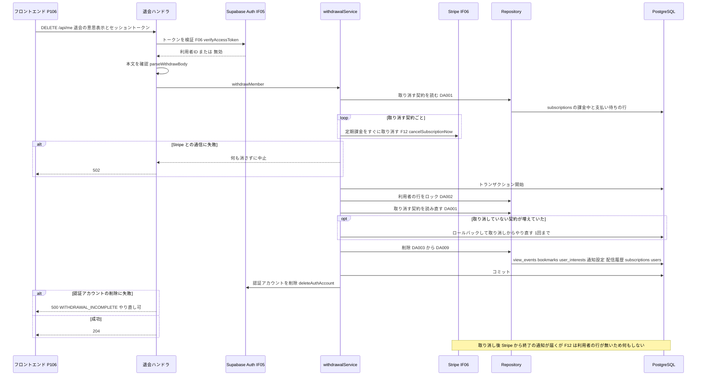

# BE詳細設計書 — F16 退会・個人データ削除（区分: 会員）

## 0. 文書情報

| 項目 | 値 |
| :--- | :--- |
| 設計書ID | F16-BE |
| 親ID | F16 |
| 親設計書 | `基本設計書_概要.md` §4.1 機能一覧 |
| 文書名 | BE詳細設計書 F16 退会・個人データ削除 |
| 対象システム | Kaine personal pj — arXiv日本語研究ダイジェスト Webアプリ |
| 版 | 1.1（第1回セルフレビュー `docs/reviews/be_F16_review_applied.md` の Major 2件・Minor 2件を反映） |
| 作成日 / 更新日 | 2026-10-26 / 2026-10-26 |
| 作成方法 | creating-backend-detailed-design v1.5.0 準拠。上流の確定設計書と `source/` の企画資料から作成（新規設計） |
| インプット | (a) `source/02_機能要求定義.md:48`、`source/03_システム構成.md:10,15,39-44`、`source/04_収益化とロードマップ.md:5,35`／(b) `docs/基本設計書_概要.md` §2（BF13・EX05）、§4（F16 行、オンライン処理設計のエラー応答）、§5（バッチ一覧 B001〜B011）、§6（T005〜T008・T010、CRUD図 F16 行）、§7（IF05・IF06・IF07、内部API一覧と注記「退会…APIが定義されていない」）、§8（認証・認可、セキュリティ対策「個人の行動データの過剰保持」、機密情報管理）、§9（環境変数一覧 `SUPABASE_SERVICE_ROLE_KEY`・`STRIPE_SECRET_KEY`、ディレクトリ構成）、§10（バックアップ）、§11（ARC010）、付録 Q04・Q17・Q27・Q31・Q32／関連する確定済みの下位設計書: `docs/db/DB.T005.DB物理設計.md`（users、§4.5 No.5 `fk_users_user_id_auth`）、`docs/db/DB.T006.DB物理設計.md`、`docs/db/DB.T007.DB物理設計.md`、`docs/db/DB.T008.DB物理設計.md`、`docs/db/DB.T010.DB物理設計.md`（§4.3 (2) 退会時の削除）、`docs/screens/画面.P106.画面基本設計.md`（H44〜H46・H55〜H57、E14〜E16、呼出APIロースター）、`docs/detail/be/BE.F06.BE詳細設計.md`（verifyAccessToken・requireMember・errorResponse、`app/api/me/route.ts`）、`docs/detail/be/BE.F10.BE詳細設計.md`（§1 前提5 通知設定・配信履歴の退会時の削除）、`docs/detail/be/BE.F12.BE詳細設計.md`（cancelSubscriptionNow、syncSubscription 手順4 退会済みの扱い）、`docs/detail/be/BE.F15.BE詳細設計.md`／(c) `legacy/`（空） |
| インプットの性質 | `source/` は企画・初期設計案のMarkdown 6ファイルだけで、ルーティング定義・コントローラ・ORM定義・SQLは1つもありません（`source/README.md:5-10`、作業開始時の実ファイル数6件。F15 作成時から変更なし）。退会について資料にあるのは「個人の行動ログは必要最小限にし、退会・削除に対応する」の1行（`source/02_機能要求定義.md:48`）と、削除対象となるテーブルの列定義（`source/03_システム構成.md:39-44`）だけです。そのため本書のエンドポイント・関数・データアクセスはすべて「上流の定義（BF13・CRUD図 F16 行）から導いた計画上の実体」であり、実装済みであることは意味しません。パス・ファイル名・関数名・JSONのキー名・SQL本文は実装時の命名案で、すべて※推測です |
| 既存版との関係 | `docs/detail/be/BE.F16.BE詳細設計.md` の旧版はありません（本書が初版）。残すべき既存の記述はありません |
| legacy/ との突合 | `legacy/` は空ディレクトリ（ファイル0件）です。突合する既存仕様・業務意図・非機能の記述はありません |

**確認事項（※推測・※上流要確認・※上流未定義の集約）**:

| No | 区分 | 確認事項 | 本書での仮置き | 関連箇所 | 上流の確認事項 |
| :--- | :--- | :--- | :--- | :--- | :--- |
| 1 | API | 退会APIのパス・メソッド・本文（※上流未定義。上流 BF13「退会の依頼（※推測: APIは未定義）」） | `DELETE /api/me`（F06 の `/api/me` と同じ資源への削除）、本文で退会の意思表示 `confirm: true` を受け取る。API ID は振らない | §2「DELETE /api/me」 | Q27 |
| 2 | 業務 | 退会時に Stripe 側の顧客情報まで消すか | 消さない。定期課金だけをすぐに取り消す（Stripe 側の請求・返金の記録を残すため ※推測。T005 §9 No.5・T010 §4.3 (2) と同じ仮置き） | §2 手順3、§4 No.4 | Q17 |
| 3 | 業務 | 退会時に Pro の支払い済み期間の残りを日割りで返金するか | 返金しない。すぐに取り消し、期間の残りは失う（F12 cancelSubscriptionNow の「日割りの返金はしない」に従う ※推測）。P106 H55 の確認文言に、残りの期間が使えなくなる旨を加えることを提案する | §2 手順3 | Q17 |
| 4 | CRUD | 削除中に契約の通知（F12 の Webhook）と競合しないよう、利用者の行をロック付きで読む（SELECT … FOR UPDATE）。上流 §6 CRUD図の F16 行の users は「D」だけ（※上流要確認） | 読む。上流 CRUD図の F16 行の users を「RD」にすることを提案する | §3 DA002 | —（※上流未定義） |
| 5 | テーブル | 通知設定・配信履歴の保存先テーブルが上流に無い（※上流未定義）。F10 BE詳細設計 §1 前提5 は、退会時にこれらを F16 で消すことを求めている | 本書の削除のトランザクションに、両テーブルの利用者IDによる削除（DA008・DA009）を含める。テーブル名が決まるまで SQL の表名は `{通知設定テーブル}`・`{配信履歴テーブル}` と書き、テーブルが作られるまでは発行しない | §3 DA008・DA009 | Q15・Q17 |
| 6 | 業務 | 個人データを消した後に認証アカウントの削除だけが失敗した場合の扱い（※上流要確認。P106 E15「どこまで削除が済んだかは利用者に見せず、サーバ側でやり直せるようにする」） | 500 `WITHDRAWAL_INCOMPLETE` を返し、運用者向けの ERROR ログに利用者IDを残す。利用者が同じ操作をやり直すと、消すデータが無いまま認証アカウントの削除だけをやり直す（同じ操作を何度行っても結果が同じ）。自動の再試行ジョブは設けない | §2 手順6、§6 No.8 | —（※上流未定義） |
| 7 | 画面 | Stripe との通信失敗を 502 で返す（F12 と同じ）。P106 E15 は 401 と「500・通信失敗」だけを想定している（※上流要確認） | P106 は 502 も「退会の処理ができませんでした。」のダイアログで扱う想定とする。P106 の様式①の条件に 502 を加えることを提案する | §2 ステータスコード | —（下位設計書どうしの不整合） |
| 8 | 認証 | 退会の入口で使う認証。F06 §4 No.5 は F16 の会員向けAPIも requireMember を使う想定（※推測）としているが、requireMember は利用者の行が無ければ作る | requireMember を使わず、F06 の verifyAccessToken でトークンの検証だけを行う。消すために利用者の行を作るのは無駄で、行が無い利用者（会員登録の途中で失敗した利用者）も認証アカウントを消せるようにするため。F06 §4 No.5 の「他機能」の記述から F16 を外す修正を提案する | §4 No.1 | —（下位設計書どうしの不整合） |
| 9 | 業務 | 再ログインの防止。退会の処理中に、別のタブからの会員向けAPI（F06 requireMember）が利用者の行を作り直すことがある | 認証アカウントの削除で防ぐ。Supabase 環境では認証アカウントへの外部キー（T005 `fk_users_user_id_auth`、CASCADE）があるため、作り直された行も認証アカウントの削除で一緒に消える。Supabase 以外の環境では残り得るが、検証用の環境だけのため許容する（※推測） | §2 手順6、§6 | Q32 |

---

## 1. バックエンド構成・モジュール設計

* **対象ドメイン**: 会員系（機能ID F16 退会・個人データ削除）— ログイン中の利用者の申し出を受けて、(1) Pro 契約中なら Stripe の定期課金を取り消し、(2) 利用者に紐づく個人データ（閲覧イベント・ブックマーク・関心分野・通知設定と配信履歴・契約・利用者）をすべて物理削除し、(3) Supabase Auth の認証アカウントを削除する（上流 §4 F16「利用者の申し出で、行動ログを含む個人データを削除する」、BF13、`source/02_機能要求定義.md:48`）。論理削除は使わない（T005〜T008・T010 の各物理設計「論理削除: 採用しません」）。
* **対象APIエンドポイント**: DELETE /api/me（退会。※上流未定義、パスは※推測）。全数と根拠は §2 のエンドポイントロースターを参照。
* **実行基盤**: 画面向けAPIとして Next.js の API（Route Handler）で Vercel 上で動きます（`source/03_システム構成.md:7,16`、上流 §9）。DBへは環境変数 `DATABASE_URL` で PostgreSQL（Supabase）に直接つなぎ、SQLを発行します（F06・F07・F15 と同じSQLクライアント ※推測）。
  * この接続は行単位アクセス制御（Row Level Security）を通らないロールで動きます（T005・T008 §7「退会処理は…サーバ側のサービスロールで動きます」）。そのため **本機能のすべての SQL に「利用者IDが本人と一致する」条件を付け、利用者IDはトークンの検証結果からだけ取ります**。他人の利用者IDをブラウザから送っても、その利用者のデータは消えません。
  * 認証アカウントの削除は、Supabase の管理用API を `SUPABASE_SERVICE_ROLE_KEY` で呼びます（上流 §9 環境変数一覧）。この鍵はサーバ側の環境変数にだけ置き、ブラウザへ渡しません（上流 §8 機密情報管理）。
  * Stripe の定期課金の取り消しは F12 の関数（cancelSubscriptionNow。`STRIPE_SECRET_KEY` を使う）を呼び、本書では Stripe との通信を実装しません。
* **ディレクトリ/ファイル構造**（上流 §9「`web/`」の想定に従う。`app/api/me/route.ts` は F06 と共有し、本書は DELETE の受け口だけを加える。ファイル名はすべて※推測）:

```
web/
├── app/api/me/
│   └── route.ts                        # POST・GET は F06 の担当。DELETE（退会 ※上流未定義）を本書で加える
├── lib/auth/
│   └── verifyAccessToken.ts            # Supabase Auth へのトークン検証（F06 の担当。本書は呼ぶだけ）
├── lib/billing/
│   └── stripeGateway.ts                # cancelSubscriptionNow（F12 の担当。本書は呼ぶだけ）
├── lib/http/
│   └── errorResponse.ts                # エラー応答の共通形式（F06 の担当。本書は呼ぶだけ）
├── lib/server/withdrawal/
│   ├── validation.ts                   # parseWithdrawBody
│   ├── withdrawalService.ts            # withdrawMember / cancelBillingSubscriptions / deletePersonalData
│   ├── authAdminGateway.ts             # deleteAuthAccount（Supabase の管理用API。IF05）
│   └── withdrawalRepository.ts         # DA001〜DA009 のSQL発行
└── lib/db/
    └── client.ts                       # DATABASE_URL による接続（全機能共通 ※推測）
```

* **処理シーケンス図**（上流 BF13 を本書の関数・DA へ分解したもの。関数名・DA-ID は §3・§4 のロースターと対応）:



---

## 2. API・インターフェース詳細設計

* **外部サービス連携仕様**: 本機能が呼ぶ外部サービスは Supabase Auth（上流 IF05）と Stripe（上流 IF06）の2件です。**全数である根拠**: 上流 §7 外部連携一覧の全9件（IF01〜IF09）のうち、上流 BF13 の手順に現れるのは「定期課金を解約」（Stripe）と「認証アカウントを削除」（Supabase Auth）の2つで、IF05 の備考にも「退会時のアカウント削除」とあります。Stripe の契約状態の通知（IF07）は、取り消しの後に Stripe から F12 の受け口へ届くもので本機能は受けません（F12 syncSubscription 手順4 が「利用者の行が無い（退会済み）」として扱う）。arXiv（IF01〜IF03）・LLM（IF04）・GitHub（IF08）・通知配信（IF09）は退会のどの手順にも現れません。

| IF-ID | 連携先 | 連携方式 | エンドポイント / 接続先 | 認証方式 | タイムアウト | リトライ方針 | エラー時の挙動 | 定義状況 | 詳細の所在 |
| :--- | :--- | :--- | :--- | :--- | :--- | :--- | :--- | :--- | :--- |
| IF05 | Supabase Auth（トークンの検証） | SDKによる認証連携（F06 verifyAccessToken） | 環境変数 `NEXT_PUBLIC_SUPABASE_URL` が指す Supabase プロジェクトの認証API（上流 §9） | 利用者のセッショントークン（JWT）をそのまま渡して検証する | F06 の定義（5秒 ※推測） | しない（F06 の定義） | 無効・期限切れなら 401、届かなければ 500 `AUTH_UNAVAILABLE`（F06 §6） | 詳細 | `docs/detail/be/BE.F06.BE詳細設計.md` §4 verifyAccessToken |
| IF05 | Supabase Auth（認証アカウントの削除） | SDKの管理用API（※推測: `@supabase/supabase-js` の `auth.admin.deleteUser(利用者ID)`。HTTP では `DELETE {NEXT_PUBLIC_SUPABASE_URL}/auth/v1/admin/users/{利用者ID}`） | 環境変数 `NEXT_PUBLIC_SUPABASE_URL` が指す Supabase プロジェクトの管理用API（トークンの検証と同じプロジェクト） | サービスロールの鍵（`SUPABASE_SERVICE_ROLE_KEY`）。利用者のトークンでは呼べない | 10秒（※推測） | 通信失敗と Supabase 側の5xxに限り1回だけ再送する。同じ利用者を何度消しても結果は同じため冪等 | 「その利用者は存在しない」と返されたら、すでに消えているとみなして成功にする。再送しても失敗したら、個人データは消えたまま 500 `WITHDRAWAL_INCOMPLETE` を返し、運用者向けの ERROR ログを残す（§0 確認事項 No.6） | 詳細 | §4 No.6 deleteAuthAccount |
| IF06 | Stripe（定期課金の即時の取り消し） | REST API（F12 cancelSubscriptionNow 経由） | `DELETE https://api.stripe.com/v1/subscriptions/{定期課金ID}`（F12 §2 外部連携 No.5） | Stripe シークレットキー（`STRIPE_SECRET_KEY`） | F12 の定義（10秒 ※推測） | F12 の定義（通信失敗と5xxに限り1回だけ再送。取り消し済み・存在しない場合は成功とみなす） | 再送しても失敗したら、何も消さずに退会を中止し 502 `STRIPE_UNAVAILABLE` を返す。行だけ消えて課金が続くと、本システムから課金を止められなくなるため（T010 §4.3 (2)） | 詳細 | `docs/detail/be/BE.F12.BE詳細設計.md` §4 No.19、本書 §4 No.4 |

**外部連携の総件数: 3行（連携先2件 — IF05 の用途2つ・IF06 の1つ）**。IF06 は上流では「決済セッション」の連携として定義されており、定期課金の取り消しに同じIDを使う扱いは F12 と同じく ※上流要確認 です（F12 §2 外部連携 No.5）。

* **エンドポイントロースター（全数）**:

| No | API ID | メソッド | パス | 概要 | 呼び出し元 | 認証 | 定義状況 | 詳細の所在 |
| :--- | :--- | :--- | :--- | :--- | :--- | :--- | :--- | :--- |
| 1 | —（※上流未定義） | DELETE | /api/me（※推測） | ログイン中の利用者を退会させる。Stripe の定期課金を取り消し、個人データをすべて削除し、認証アカウントを削除する | P106 E15（退会確定ボタン）。P106 呼出APIロースターの「退会（※上流未定義）」 | 必要（会員） | 詳細 | §2「DELETE /api/me」 |

**総件数: 1件。全数である根拠**: 上流 §7 内部API一覧の全8件（API01〜API08）に退会のAPIは0件で、`source/03_システム構成.md:46-54` の API設計案にもありません。上流 §7 の注記と付録 Q27 が「退会」を API 未定義の機能として挙げ、上流 BF13 も「退会の依頼（※推測: APIは未定義）」としているため、これを1件としました。P106 の呼出APIロースターでも退会は1件です。上流 BF13 の処理（定期課金の解約・各テーブルの削除・認証アカウントの削除）はすべてこの1回の依頼の中で行い、別のエンドポイントを設けません。定義状況は、状態の変更・外部サービス2つの呼び出し・失敗時のやり直しを含むため「詳細」です（completeness 3-1 の2・3・5）。

* **全エンドポイント共通の決まり**（※推測。上流 §4 オンライン処理設計のエラー応答、§8 を具体化。F06・F12 と同じ決まりに合わせる）:
  * **認証**: リクエストヘッダー `Authorization: Bearer <Supabase のアクセストークン>` で受け取ります。Cookie だけでは受け付けません。取り消せない操作を他サイトからの成りすまし送信（CSRF）で実行させないためです（上流 §8 CSRF）。
  * **応答の形**: 失敗時は `{"status":"error","error":{"code":"<エラーコード>","message":"<利用者向けの文言>"}}` とします（F06 errorResponse。エラーコードは §6 の一覧）。成功時は 204 で本文を返しません。
  * **キャッシュ**: 応答に `Cache-Control: no-store` を付けます。

### DELETE /api/me
* **概要**: ログイン中の利用者を退会させます。Pro 契約中（または最初の支払い待ち）の Stripe の定期課金をすぐに取り消し、利用者に紐づく個人データをすべて物理削除し、最後に Supabase Auth の認証アカウントを削除します（上流 BF13、F16）。マイページ（P106）の退会確定ボタン（E15）から呼ばれます。**※上流未定義**: 上流 §7 内部API一覧に無いAPIで、パス・本文・応答はすべて※推測です（上流 付録 Q27、§0 確認事項 No.1）。API ID は振っていません。
* **API ID**: —（※上流未定義）
* **認証要否**: 必要（ログイン中の会員。Free・Pro とも）
* **リクエストパラメータ**:

| 種別(Path/Query/Body) | 項目名 | 型 | 必須 | 制約・バリデーション | 説明 |
| :--- | :--- | :--- | :--- | :--- | :--- |
| Header | Authorization | string | 必須 | 「Bearer」の後に Supabase のアクセストークンを付けた形 | 退会する利用者を特定する。無い・無効なら 401 |
| Body | confirm | boolean | 必須 | 真（`true`）であること。それ以外・欠落・本文が JSON でない場合は 400 | 退会の意思表示。取り消せない操作のため、確認ダイアログ（P106 H55〜H57）を経た呼び出しだけを受け付ける目印とする。誤った呼び出し（本文なしの DELETE）で退会させないため（※推測） |

* **レスポンス（成功時）**: 本文なし（204 No Content）
* **レスポンスヘッダー**: `Cache-Control: no-store`
* **ステータスコード**:

| コード | 条件 |
| :--- | :--- |
| 204 | 退会が完了した（定期課金の取り消し・個人データの削除・認証アカウントの削除がすべて済んだ）。利用者の行がもともと無かった場合や、前回の途中失敗のやり直しで消すデータが無かった場合も 204 |
| 400 | 本文が JSON として読めない、`confirm` が真でない（`INVALID_BODY`） |
| 401 | トークンが無い・無効・期限切れ（`UNAUTHORIZED`。上流 EX05）。認証アカウントの削除まで済んだ後に同じトークンで呼んだ場合もこれになる |
| 500 | 認証サービスに届かない（`AUTH_UNAVAILABLE`。F06 §6）、DB障害・ロックの待ち時間切れ（`INTERNAL_ERROR`。何も消えていない）、個人データは消したが認証アカウントの削除に失敗した（`WITHDRAWAL_INCOMPLETE`。同じ操作でやり直せる） |
| 502 | Stripe との通信に失敗し、定期課金を取り消せなかった（`STRIPE_UNAVAILABLE`。F12 と同じコード。何も消えていない）（P106 の扱いは §0 確認事項 No.7） |

* **ビジネスロジック・副作用**:
  1. トークンを検証し、利用者IDを得る（F06 verifyAccessToken。無効なら 401、届かなければ 500 で終了）。利用者の行が無くても作らない（§0 確認事項 No.8）。
  2. 本文を検証する（parseWithdrawBody。退会の意思表示が無ければ 400 で終了）。
  3. **定期課金の取り消し**: 取り消すべき契約（課金中＝試用中・有効・支払い遅延・未払い・一時停止と、最初の支払い待ち＝`incomplete` の行）を読む（DA001。T010 §4.3 (2)「課金中の契約と最初の支払いに失敗した契約の Stripe 側の定期課金を解約し」）。1件ずつ Stripe 側ですぐに取り消す（F12 cancelSubscriptionNow）。取り消し済み・存在しない定期課金は成功とみなされる。どれか1件でも通信に失敗したら、DBには触れずに 502 で終了する。取り消しは DB のトランザクションの外で行う（外部の呼び出しの間、利用者の行のロックを持ち続けないため）。日割りの返金はしない（§0 確認事項 No.3）。Stripe 側の顧客情報は消さない（§0 確認事項 No.2）。
  4. **個人データの削除**: 1つのトランザクションを開き、利用者の行をロック付きで読む（DA002。ロックの待ち時間は10秒 ※推測）。同じ利用者への契約の通知（F12 syncSubscription が同じ行をロックする）と順番に処理させるためです。ロックを取ったら、取り消すべき契約をもう一度読み（DA001）、手順3で取り消していない定期課金IDがあれば（手順3と手順4の間に別のタブで Pro を申し込んだ場合）、ロールバックして手順3からもう一度だけやり直す。2回目も増えていたら 500 で終了する（何も消えていない）。
  5. 手順4のトランザクションの中で、閲覧イベント（DA003）・ブックマーク（DA004）・関心分野（DA005）・通知設定（DA008）・配信履歴（DA009）・契約（DA006）・利用者（DA007）の順に、本人の行をすべて物理削除し、コミットする（上流 BF13 の順序「view_events・bookmarks・user_interests・subscriptions・users」に、F10 が求める通知設定・配信履歴を契約の前に加えたもの）。子テーブルは外部キーの「一緒に削除」（T006〜T008・T010 の `ON DELETE CASCADE`）でも消えるが、上流 BF13・CRUD図 F16 行が各テーブルの削除を明示しているため、件数を確かめられるよう1テーブルずつ消す。DA008・DA009 は、そのテーブルが作られるまで発行しない（§0 確認事項 No.5）。利用者の行が無い場合（DA002 が0行）は、T006〜T008・T010 の行は外部キーにより存在し得ないため、それらの削除の文は発行せず、外部キーの有無が決まっていない通知設定・配信履歴（DA008・DA009）だけを消してコミットする。どれかの文が失敗したらロールバックし、500 で終了する（Stripe 側の取り消しは済んでいるが、課金が止まっただけで利用者の不利益は無く、やり直せば削除まで進む）。
  6. **認証アカウントの削除**: コミットの後、Supabase の管理用API で認証アカウントを削除する（deleteAuthAccount。IF05）。存在しないと返されたら成功とみなす。失敗したら、個人データは消えたまま 500 `WITHDRAWAL_INCOMPLETE` を返し、運用者がやり直せるよう ERROR ログに利用者IDを残す。利用者が同じ操作をやり直すと、手順3〜5は消すものが無いまま通過し、手順6だけをやり直す。認証アカウントを消すと、その利用者のトークンは以後の検証（F06 verifyAccessToken）で無効になる。Supabase 環境では、認証アカウントへの外部キー（T005 `fk_users_user_id_auth`、CASCADE）により、手順5の後に別のタブの操作で作り直された利用者の行も一緒に消える（§0 確認事項 No.9）。
  7. 204 を返す。ブラウザはセッションを破棄して P101 へ移る（P106 E15）。
  8. **副作用**: Stripe の定期課金の即時の取り消し（課金中・支払い待ちの契約があった場合）、`view_events`・`bookmarks`・`user_interests`・通知設定・配信履歴・`subscriptions`・`users` の本人の全行の削除、Supabase の認証アカウントの削除。退会の事実は、利用者IDを含まない INFO ログ（リクエストID・テーブルごとの削除件数）にだけ残す（上流 ARC010）。取り消しの後、Stripe から定期課金の終了の通知が F12 の受け口に届くが、F12 は利用者の行が無い（退会済み）ため何もしない（F12 syncSubscription 手順4。取り直した状態が解約済みなので取り消しも行わない）。

---

## 3. データアクセス（ORM / クエリ）設計

* **データアクセス一覧（全数ロースター）**:

| DA-ID | 処理名 | 呼出元（関数/API） | テーブルID | 対象物理テーブル | 種別 (SELECT/INSERT/UPDATE/DELETE) | 定義状況 (詳細/簡易) | 詳細の所在 |
| :--- | :--- | :--- | :--- | :--- | :--- | :--- | :--- |
| DA001 | 取り消すべき契約の取得 | listCancelableSubscriptions ← cancelBillingSubscriptions・deletePersonalData ← DELETE /api/me | T010 | subscriptions | SELECT | 詳細 | §3 詳細定義 DA001 |
| DA002 | 利用者の行のロック | lockUser ← deletePersonalData ← DELETE /api/me | T005 | users | SELECT（FOR UPDATE） | 詳細 | §3 詳細定義 DA002 |
| DA003 | 閲覧イベントの全削除 | deleteViewEvents ← deletePersonalData ← DELETE /api/me | T008 | view_events | DELETE | 簡易 | §3 発行SQL DA003 |
| DA004 | ブックマークの全削除 | deleteBookmarks ← deletePersonalData ← DELETE /api/me | T007 | bookmarks | DELETE | 簡易 | §3 発行SQL DA004 |
| DA005 | 関心分野の全削除 | deleteUserInterests ← deletePersonalData ← DELETE /api/me | T006 | user_interests | DELETE | 簡易 | §3 発行SQL DA005 |
| DA006 | 契約の全削除 | deleteSubscriptions ← deletePersonalData ← DELETE /api/me | T010 | subscriptions | DELETE | 詳細 | §3 詳細定義 DA006 |
| DA007 | 利用者の削除 | deleteUser ← deletePersonalData ← DELETE /api/me | T005 | users | DELETE | 詳細 | §3 詳細定義 DA007 |
| DA008 | 通知設定の全削除（※上流未定義） | deleteNotificationSettings ← deletePersonalData ← DELETE /api/me | —（※上流未定義） | {通知設定テーブル}（※上流未定義。F10 §1 前提1） | DELETE | 詳細 | §3 詳細定義 DA008 |
| DA009 | 配信履歴の全削除（※上流未定義） | deleteDigestDeliveries ← deletePersonalData ← DELETE /api/me | —（※上流未定義） | {配信履歴テーブル}（※上流未定義。F10 §1 前提1） | DELETE | 詳細 | §3 詳細定義 DA009 |

**総件数: 9件（SELECT 2件（うち1件は行ロック付き）・DELETE 7件。詳細6件・簡易3件。うち2件は対象テーブルが※上流未定義）。全数である根拠**: §2 のビジネスロジック手順3〜5に現れるDBアクセスをすべて数えたもの（手順3: DA001、手順4: DA002・DA001 の読み直し、手順5: DA003〜DA009）で、§4 の関数ロースターのうちリポジトリ層の9関数と1対1で対応します。上流 §6 CRUD図の F16 行（users「D」・user_interests「D」・bookmarks「D」・view_events「D」・subscriptions「RD」）の各操作は、users D → DA007、user_interests D → DA005、bookmarks D → DA004、view_events D → DA003、subscriptions R → DA001、D → DA006 に現れます。CRUD図に無い操作は、users の R（DA002。§0 確認事項 No.4）と、上流にテーブルが無い通知設定・配信履歴の削除（DA008・DA009。§0 確認事項 No.5）です。DB物理設計の「本テーブルを操作する機能」の F16 行（T005 §4.6 No.9、T006 §4.6 No.4、T007 §4.6 No.3、T008 §4.6 No.3、T010 §4.6 No.4）はすべて DA001〜DA007 のどれかに当たります。テーブルID列は上流 §6 テーブル一覧のIDをそのまま引き継いでいます（users=T005、user_interests=T006、bookmarks=T007、view_events=T008、subscriptions=T010）。入口のトークン検証（F06 verifyAccessToken）は DB に触れません。本機能に INSERT・UPDATE はありません。
**定義状況の判定**（completeness 3-1）: DA001 は状態の値による絞り込みの業務ルール（3-1 の7）と、トランザクションの外と中の2回読む扱い（3-1 の3・5）を含む。DA002 は同時実行の制御（3-1 の5）を含む。DA006 は Stripe 側の取り消しとの順序が自明でない（3-1 の5、T010 §4.3 (2)）。DA007 は認証アカウントとまたがり（3-1 の3）、子テーブルの連動削除を伴う（3-1 の2）。DA008・DA009 は上流にテーブルが無く、テーブルの作成に合わせて実装を差し替える扱いと、利用者の行が無い場合にも発行する扱いを持つ（3-1 の1・7）。DA003〜DA005 は1テーブルを利用者IDで消すだけの定型の削除のため「簡易」とし、SQL 本文は「発行SQL」に示します。

* **データアクセス詳細定義**（ロースターは本節冒頭の表。本表は定義状況＝詳細の6件を展開する）:

| DA-ID | 処理名 | テーブルID | 対象物理テーブル | JOIN / Include | 抽出条件 (Where) / ソート | トランザクション境界 | N+1対策・性能上の注意 |
| :--- | :--- | :--- | :--- | :--- | :--- | :--- | :--- |
| DA001 | 取り消すべき契約の取得 | T010 | subscriptions | なし | 本人の契約のうち、Stripe 側でまだ課金が続いている、または続く見込みの契約（試用中・有効・支払い遅延・未払い・一時停止）と、最初の支払い待ちの契約を取る（`status IN ('trialing','active','past_due','unpaid','paused','incomplete')`）。解約済み・期限切れの契約は取り消す必要が無いため除く。取り出すのは定期課金IDだけ。並び順は問わない | 1回目（手順3）は自動コミットの単独の文。2回目（手順4）は削除のトランザクションの中で、利用者の行のロックを取った後に読む | 1人あたりの行は数件で、索引 `idx_subscriptions_user_id`（利用者ID）で本人の行だけを読む。課金中の契約は一意インデックス `uq_subscriptions_user_billing` で1人1件までのため、取り消す定期課金は通常1件、支払い待ちを含めても数件 |
| DA002 | 利用者の行のロック | T005 | users | なし | 利用者IDが一致する1行に更新のためのロックを付けて読む（`WHERE user_id = $1 FOR UPDATE`）。0行なら利用者の行が無い（会員登録の途中で失敗した、または前回の退会で消えている） | 削除のトランザクションの最初の文。トランザクションの初めに、ロックの待ち時間を10秒、文の打ち切り時間を15秒にする（`SET LOCAL lock_timeout = '10s'`、`SET LOCAL statement_timeout = '15s'` ※推測）。文の打ち切り時間を延ばすのは、接続設定の5秒のままだとロックを待つ文がロックの待ち時間より先に打ち切られ、待ち時間の設定が効かないためです。どちらの設定もこのトランザクションの中だけで有効で、接続プールの他のリクエストには残らない。コミットかロールバックまでロックを持つ | ロックの範囲は本人の1行だけ。F12 の契約の通知の同期（syncSubscription）が同じ行を最大で約20秒（Stripe の呼び出し10秒と再送1回）持つことがあるため、待ち時間切れ（SQLSTATE 55P03）は 500 として利用者にやり直してもらう（※推測） |
| DA006 | 契約の全削除 | T010 | subscriptions | なし | 本人の契約の行を状態にかかわらずすべて消す（`WHERE user_id = $1`）。解約済みの契約も消す（退会したら契約の記録も個人データとして消す。上流 BF13） | 削除のトランザクションの中。手順3で Stripe 側の取り消しが済み、手順4で取り消していない契約が無いことを確かめた後にだけ発行する | 索引 `idx_subscriptions_user_id` で本人の行だけを消す。Stripe 側の取り消しより前に発行しないことが重要で、順序を逆にすると、行だけ消えて課金が続く状態になり本システムから止められなくなる（T010 §4.3 (2)） |
| DA007 | 利用者の削除 | T005 | users | なし | 利用者IDが一致する1行を消す（`WHERE user_id = $1`） | 削除のトランザクションの最後の文。この後コミットする | 主キーで1行を消す。子テーブル4つ（T006〜T008・T010）は外部キーの「一緒に削除」を持つが、DA003〜DA006 で先に消してあるため、ここで連動して消える行は通常0件（別のタブが手順4の直前に書き込んだ行だけが連動で消える）。認証アカウント側の外部キー（T005 `fk_users_user_id_auth`）は利用者の行が子なので、この削除では認証アカウントは消えない（手順6で消す） |
| DA008 | 通知設定の全削除（※上流未定義） | —（※上流未定義） | {通知設定テーブル} | なし | 本人の通知設定の行をすべて消す（`WHERE user_id = $1` ※推測: 利用者IDの列名は他の表に合わせる） | 削除のトランザクションの中。テーブルが作られるまでは発行しない（それまで呼出元の関数は何もせず0を返す実装にし、テーブルを作るリリースで本文の発行に置き換える ※推測。§4 No.14） | 1人1行の想定（F10 の通知設定）。テーブルが作られるときに、利用者IDに外部キーの「一緒に削除」を付けるよう F10・DB物理設計へ提案する（付ければ本文の発行を忘れても消し残しが無い） |
| DA009 | 配信履歴の全削除（※上流未定義） | —（※上流未定義） | {配信履歴テーブル} | なし | 本人の配信履歴の行をすべて消す（`WHERE user_id = $1` ※推測） | 削除のトランザクションの中。DA008 と同じく、テーブルが作られるまでは発行しない | 1人あたりの行は配信の回数分（F10 で保持期間を区切る想定）。利用者IDの索引があれば本人の行だけを消せる（F10 §3 の定義に従う） |

* **発行SQL**: 本機能のデータアクセスは ORM を使わず、すべて SQL クライアントからパラメータ付きの SQL を発行します（§1 実行基盤）。値はすべてプレースホルダ（`$1`）で渡し、文字列の連結で SQL を作りません。9件すべての SQL 本文を示します。実行時に組み立てを変える文（動的SQL）はありません。DA008・DA009 の表名はテーブルの確定後に書き換える固定の文で、テーブルを作るリリースまでは発行しません（§4 No.14・No.15）。

**DA001 取り消すべき契約の取得**（詳細）
```sql
-- $1: 利用者ID（uuid。トークンの検証結果）
SELECT stripe_subscription_id
  FROM subscriptions
 WHERE user_id = $1
   AND status IN ('trialing', 'active', 'past_due', 'unpaid', 'paused', 'incomplete');
```

**DA002 利用者の行のロック**（詳細）
```sql
-- 削除のトランザクションの初めに実行する（どちらもこのトランザクションの中だけ有効）
SET LOCAL statement_timeout = '15s';  -- 接続設定の5秒のままだと、ロックを待つ文が10秒より先に打ち切られるため延ばす
SET LOCAL lock_timeout = '10s';
-- $1: 利用者ID（uuid）
SELECT user_id
  FROM users
 WHERE user_id = $1
   FOR UPDATE;
-- 1行返ればロックを取れた。0行なら利用者の行が無い（DA008・DA009 だけを発行してコミットする）
```

**DA003 閲覧イベントの全削除**（簡易）— 主キー `pk_view_events` の先頭列（利用者ID）で本人の行だけを消します。
```sql
-- $1: 利用者ID（uuid）
DELETE FROM view_events
 WHERE user_id = $1;
```

**DA004 ブックマークの全削除**（簡易）— 主キー `pk_bookmarks` の先頭列（利用者ID）で本人の行だけを消します。
```sql
-- $1: 利用者ID（uuid）
DELETE FROM bookmarks
 WHERE user_id = $1;
```

**DA005 関心分野の全削除**（簡易）— 主キーの先頭列（利用者ID）で本人の行だけを消します。
```sql
-- $1: 利用者ID（uuid）
DELETE FROM user_interests
 WHERE user_id = $1;
```

**DA006 契約の全削除**（詳細）
```sql
-- $1: 利用者ID（uuid）。Stripe 側の取り消しが済んだ後にだけ発行する
DELETE FROM subscriptions
 WHERE user_id = $1;
```

**DA007 利用者の削除**（詳細）
```sql
-- $1: 利用者ID（uuid）
DELETE FROM users
 WHERE user_id = $1;
-- 子テーブル（user_interests・bookmarks・view_events・subscriptions）の残りは ON DELETE CASCADE で一緒に消える
```

**DA008 通知設定の全削除**（詳細・※上流未定義）
```sql
-- $1: 利用者ID（uuid）。{通知設定テーブル} はテーブル名の確定後に書き換える
DELETE FROM {通知設定テーブル}
 WHERE user_id = $1;
```

**DA009 配信履歴の全削除**（詳細・※上流未定義）
```sql
-- $1: 利用者ID（uuid）。{配信履歴テーブル} はテーブル名の確定後に書き換える
DELETE FROM {配信履歴テーブル}
 WHERE user_id = $1;
```

---

## 4. サーバー側機能・処理ロジック設計（IPO設計）

* **関数ロースター（全数）**: 関数名・ファイル名はすべて実装時の命名案です（※推測）。

| No | ID（関数名） | 所属モジュール | 概要 | 対応DA | 定義状況 | 詳細の所在 |
| :--- | :--- | :--- | :--- | :--- | :--- | :--- |
| 1 | DELETE（退会ハンドラ） | web/app/api/me/route.ts | 退会の受け口。トークンの検証・本文の検証・サービスの呼び出しを行い、204 か失敗の応答を返す | — | 詳細 | §4 IPO定義 No.1 |
| 2 | parseWithdrawBody | web/lib/server/withdrawal/validation.ts | 本文を JSON として読み、退会の意思表示（`confirm` が真）があるかを確かめる | — | 詳細 | §4 IPO定義 No.2 |
| 3 | withdrawMember | web/lib/server/withdrawal/withdrawalService.ts | 定期課金の取り消し・個人データの削除・認証アカウントの削除を順に行い、契約が増えていた場合のやり直しを1回まで行う | — | 詳細 | §4 IPO定義 No.3 |
| 4 | cancelBillingSubscriptions | web/lib/server/withdrawal/withdrawalService.ts | 取り消すべき契約を読み、Stripe 側で1件ずつすぐに取り消し、取り消した定期課金IDの一覧を返す | DA001 | 詳細 | §4 IPO定義 No.4 |
| 5 | deletePersonalData | web/lib/server/withdrawal/withdrawalService.ts | 1つのトランザクションで、利用者の行のロック・契約の読み直し・7つの表の削除を行う | DA001, DA002, DA003〜DA009 | 詳細 | §4 IPO定義 No.5 |
| 6 | deleteAuthAccount | web/lib/server/withdrawal/authAdminGateway.ts | Supabase の管理用API で認証アカウントを削除する。存在しなければ成功とみなす | — | 詳細 | §4 IPO定義 No.6 |
| 7 | listCancelableSubscriptions | web/lib/server/withdrawal/withdrawalRepository.ts | DA001 を発行し、定期課金IDの配列を返す | DA001 | 簡易 | §3 発行SQL DA001 |
| 8 | lockUser | web/lib/server/withdrawal/withdrawalRepository.ts | 呼出元のトランザクションの中でロックの待ち時間を設定し、DA002 を発行して、行があったかを返す | DA002 | 詳細 | §4 IPO定義 No.8 |
| 9 | deleteViewEvents | web/lib/server/withdrawal/withdrawalRepository.ts | 呼出元のトランザクションの中で DA003 を発行し、消した件数を返す | DA003 | 簡易 | §3 発行SQL DA003 |
| 10 | deleteBookmarks | web/lib/server/withdrawal/withdrawalRepository.ts | 呼出元のトランザクションの中で DA004 を発行し、消した件数を返す | DA004 | 簡易 | §3 発行SQL DA004 |
| 11 | deleteUserInterests | web/lib/server/withdrawal/withdrawalRepository.ts | 呼出元のトランザクションの中で DA005 を発行し、消した件数を返す | DA005 | 簡易 | §3 発行SQL DA005 |
| 12 | deleteSubscriptions | web/lib/server/withdrawal/withdrawalRepository.ts | 呼出元のトランザクションの中で DA006 を発行し、消した件数を返す | DA006 | 簡易 | §3 発行SQL DA006 |
| 13 | deleteUser | web/lib/server/withdrawal/withdrawalRepository.ts | 呼出元のトランザクションの中で DA007 を発行し、消した件数を返す | DA007 | 簡易 | §3 発行SQL DA007 |
| 14 | deleteNotificationSettings | web/lib/server/withdrawal/withdrawalRepository.ts | 通知設定の本人の行を消して件数を返す。テーブルが作られるリリースまでは何も発行せず0を返す実装にしておく（※上流未定義） | DA008 | 詳細 | §4 IPO定義 No.14 |
| 15 | deleteDigestDeliveries | web/lib/server/withdrawal/withdrawalRepository.ts | 配信履歴の本人の行を消して件数を返す。テーブルが作られるリリースまでは何も発行せず0を返す実装にしておく（※上流未定義） | DA009 | 詳細 | §4 IPO定義 No.15 |

**総件数: 15件（ハンドラ1件・検証1件・サービス3件・外部連携1件・リポジトリ9件。詳細9件・簡易6件）。全数である根拠**: §1 のディレクトリ構造に挙げた本機能が持つ5ファイル（`app/api/me/route.ts` の DELETE、validation.ts・withdrawalService.ts・authAdminGateway.ts・withdrawalRepository.ts）の関数をすべて数えたものです。ハンドラは §2 のエンドポイントロースター1件と1対1、リポジトリ関数は §3 のデータアクセスロースター9件と1対1、外部連携の関数は §2 の外部連携のうち本書が実装する1件（認証アカウントの削除）と1対1です。
**本機能が呼ぶ他書の関数（本ロースターに数えない）**: トークンの検証 verifyAccessToken（`docs/detail/be/BE.F06.BE詳細設計.md` §4 No.6。No.1 から呼ぶ）、エラー応答への変換 errorResponse（F06 §4 No.18。No.1 から呼ぶ）、定期課金の即時の取り消し cancelSubscriptionNow（`docs/detail/be/BE.F12.BE詳細設計.md` §4 No.19。No.4 から呼ぶ）、DB接続（`lib/db/client.ts`。全機能共通で業務の処理を持たない ※推測）。どれも持ち主の設計書で定義されているため、本書では採番・詳細化しません。同じファイル `app/api/me/route.ts` の POST・GET は F06 の関数で、本書の対象外です。
**定義状況の判定**（completeness 3-1）: 分岐（入力不正・行の有無・契約の増加・外部の失敗）を持つもの、外部サービスを呼ぶもの、トランザクションを扱うもの、ロックの待ち時間を持つもの、上流未定義のテーブルの有無で動きが変わるものを「詳細」としました。1文を発行して件数を返すだけのリポジトリ関数（No.7・No.9〜No.13）は「簡易」です。

* **入力・処理・出力（IPO）定義**（ロースターは本節冒頭の表。本表は定義状況＝詳細の9件を展開する）:

| No | 関数名 | 所属モジュール | 引数 (型) | 処理フロー (ステップ単位で具体的に) | 戻り値 | 発生しうるエラー |
| :--- | :--- | :--- | :--- | :--- | :--- | :--- |
| 1 | DELETE（退会ハンドラ） | web/app/api/me/route.ts | request: Request | 1. `Authorization` ヘッダーを読み、「Bearer 」で始まらない・トークンが空なら未認証の業務エラーを投げる<br>2. verifyAccessToken（F06）でトークンを検証し、利用者IDを得る。利用者の行は作らない<br>3. parseWithdrawBody で退会の意思表示を確かめる<br>4. withdrawMember(利用者ID) を呼ぶ<br>5. `Cache-Control: no-store` を付けて本文なしの 204 を返す<br>6. 途中で投げられた例外はすべて errorResponse（F06）に渡して応答にする | Response（204） | 400 入力不正、401 未認証、500 認証サービス障害・DB障害・退会の途中失敗、502 Stripe との通信失敗（すべて errorResponse 経由） |
| 2 | parseWithdrawBody | web/lib/server/withdrawal/validation.ts | request: Request | 1. 本文を JSON として読む。読めなければ入力不正（`INVALID_BODY`）を投げる<br>2. 読めた値がオブジェクトでない、または `confirm` が真偽値の真でなければ入力不正を投げる（文字列の "true" や 1 も受け付けない）<br>3. ほかのキーは無視する | なし | 入力不正（400） |
| 3 | withdrawMember | web/lib/server/withdrawal/withdrawalService.ts | userId: string（uuid） | 1. cancelBillingSubscriptions(利用者ID) を呼び、取り消した定期課金IDの集合を得る（Stripe との通信失敗はそのまま投げる。何も消えていない）<br>2. deletePersonalData(利用者ID, 取り消した集合) を呼ぶ<br>3. 手順2が「取り消していない契約が増えていた」を返したら、手順1と2をもう一度だけ行う。2回目も同じなら想定外の例外を投げる（何も消えていない）<br>4. 手順2が削除件数を返したら、deleteAuthAccount(利用者ID) を呼ぶ<br>5. 手順4が失敗したら、個人データは消えたまま退会の途中失敗（`WITHDRAWAL_INCOMPLETE`）の業務エラーを投げる。ERROR ログに利用者IDとリクエストIDを出す（運用者が認証アカウントを手で消せるようにするため。ログに利用者IDを出すのはこの場合だけ）<br>6. 成功したら、リクエストIDとテーブルごとの削除件数を INFO ログに出す（利用者IDは出さない） | なし | Stripe との通信失敗（502）、DB障害・ロックの待ち時間切れ・契約の増加の繰り返し（500）、退会の途中失敗（500） |
| 4 | cancelBillingSubscriptions | web/lib/server/withdrawal/withdrawalService.ts | userId: string | 1. listCancelableSubscriptions(利用者ID)（DA001）で取り消すべき定期課金IDを読む。0件なら空の集合を返す<br>2. 1件ずつ cancelSubscriptionNow（F12）で Stripe 側ですぐに取り消す。取り消し済み・存在しない定期課金は F12 が成功として返す<br>3. どれかで通信失敗の業務エラーが返ったら、残りを取り消さずにそのまま投げる（取り消し済みの分は戻さない。課金が止まるだけで利用者の不利益は無く、やり直しで残りを取り消せるため）<br>4. 取り消した定期課金IDの集合を返す | Set&lt;string&gt;（定期課金ID） | Stripe との通信失敗（502 `STRIPE_UNAVAILABLE`）、DB障害（500） |
| 5 | deletePersonalData | web/lib/server/withdrawal/withdrawalService.ts | userId: string, canceledIds: Set&lt;string&gt; | 1. DB接続を1本取り、トランザクションを始める<br>2. lockUser(利用者ID)（DA002）で利用者の行をロックする。行が無ければ、deleteNotificationSettings（DA008）と deleteDigestDeliveries（DA009）だけを呼んでコミットし、その件数を返す（T006〜T008・T010 の行は外部キーにより存在し得ないが、上流未定義の2表は利用者への外部キーを持つか決まっていないため）<br>3. listCancelableSubscriptions(利用者ID)（DA001）で取り消すべき契約を読み直す。canceledIds に無い定期課金IDが1件でもあれば、ロールバックして「取り消していない契約が増えていた」を返す<br>4. deleteViewEvents（DA003）・deleteBookmarks（DA004）・deleteUserInterests（DA005）・deleteNotificationSettings（DA008）・deleteDigestDeliveries（DA009）・deleteSubscriptions（DA006）・deleteUser（DA007）の順に呼び、それぞれの削除件数を集める<br>5. コミットする<br>6. 手順2〜5のどこかで失敗したら、ロールバックして例外をそのまま投げる（何も消えていない） | { counts: テーブルごとの削除件数 } \| 「契約が増えていた」 | DB障害・ロックの待ち時間切れ（500） |
| 6 | deleteAuthAccount | web/lib/server/withdrawal/authAdminGateway.ts | userId: string | 1. サービスロールの鍵（`SUPABASE_SERVICE_ROLE_KEY`）で作ったサーバ専用の Supabase クライアントで、認証アカウントの削除を依頼する（IF05。タイムアウト10秒 ※推測）<br>2. 成功したら戻る<br>3. 「その利用者は存在しない」と返されたら、すでに消えているとみなして戻る<br>4. 通信失敗・タイムアウト・Supabase 側の5xxなら1回だけ再送し、再送も失敗したら認証基盤エラーを投げる<br>5. 4xx（存在しない以外）は設定の誤り（鍵が違う）とみなし、再送せずに認証基盤エラーを投げる | なし | 認証基盤エラー（呼出元の withdrawMember が `WITHDRAWAL_INCOMPLETE` に変える） |
| 8 | lockUser | web/lib/server/withdrawal/withdrawalRepository.ts | client: トランザクション中の接続, userId: string | 1. そのトランザクションの中だけ、文の打ち切り時間を15秒、ロックの待ち時間を10秒にする（`SET LOCAL statement_timeout`、`SET LOCAL lock_timeout`。打ち切り時間をロックの待ち時間より長くしないと、待ち時間の設定より先に文が打ち切られるため）<br>2. DA002 を発行する<br>3. 1行返れば真、0行なら偽を返す<br>4. 待ち時間切れ（SQLSTATE 55P03）と文の打ち切り（SQLSTATE 57014）は DB障害としてそのまま投げる | boolean | ロックの待ち時間切れ・DB障害（500） |
| 14 | deleteNotificationSettings | web/lib/server/withdrawal/withdrawalRepository.ts | client: トランザクション中の接続, userId: string | 1. 通知設定テーブルが作られるまでは、本関数は何も発行せず0を返すだけの実装にしておく<br>2. F10 の通知設定テーブルを作るマイグレーションと同じリリースで、本関数の本体を DA008 の発行に置き換え、消した件数を返すようにする（実行時の切り替えは設けない。テーブルの有無と関数の中身が同じリリースでそろうため ※推測） | number | DB障害（500） |
| 15 | deleteDigestDeliveries | web/lib/server/withdrawal/withdrawalRepository.ts | client: トランザクション中の接続, userId: string | 1. 配信履歴テーブルが作られるまでは、本関数は何も発行せず0を返すだけの実装にしておく<br>2. F10 の配信履歴テーブルを作るマイグレーションと同じリリースで、本関数の本体を DA009 の発行に置き換え、消した件数を返すようにする（No.14 と同じ方式 ※推測） | number | DB障害（500） |

---

## 5. バッチ処理・非同期タスク設計

* **ジョブ実行定義**: **該当なし**。根拠: 上流 §5 バッチ一覧の全11件（B001〜B011）に、退会や個人データの削除を行うものはありません（上流 §6 CRUD図のバッチの行 B010・B011 の users・user_interests・bookmarks・view_events・subscriptions の列はすべて「-」）。本機能の1エンドポイントは、利用者のリクエストの中で取り消し・削除・認証アカウントの削除を終え、ジョブキューへの登録を持ちません（§2 手順3〜6）。認証アカウントの削除の途中失敗は、利用者のやり直しか運用者の手作業で完了させ、自動の再試行ジョブは設けません（§0 確認事項 No.6）。保持期間を過ぎた閲覧イベントの削除は F15 の担当（※上流未定義）で、本機能のジョブではありません。

| ジョブ名 | 実行タイミング | 対象テーブル | 処理概要 | タイムアウト |
| :--- | :--- | :--- | :--- | :--- |
| —（該当なし） | — | — | 本機能に定期実行・非同期のジョブはありません | — |

---

## 6. 例外処理・セキュリティ設計

* **エラーハンドリング**: 例外はハンドラで1か所に集め、errorResponse（F06）で応答に変えます。利用者に原因がある失敗（業務エラー）は WARN、サーバ側の障害は ERROR とし、障害の詳細（SQL・スタックトレース・接続先）はログにだけ出して応答には出しません。**どの段階で失敗しても「何も消えていない」か「個人データは消え、認証アカウントだけが残っている」のどちらかになり、同じ操作のやり直しで退会を完了できる**ように、外部の取り消し → DBの削除（1トランザクション）→ 認証アカウントの削除の順にしています。ログには利用者IDを出しません。ただし個人データを消した後に認証アカウントの削除だけが失敗した場合（No.8）は、運用者が残りを手で消せるよう、ERROR ログに利用者IDを出します（上流 ARC010 の例外。退会済みの利用者の利用者IDは、それ自体では個人の行動を表さないため）。

| No | 例外種別 | 発生箇所 | 対応方法 | ログ出力 | クライアント応答 |
| :--- | :--- | :--- | :--- | :--- | :--- |
| 1 | 入力不正（本文が JSON でない、退会の意思表示が無い） | parseWithdrawBody | 業務エラーとして投げ、何もしない | WARN（エラーコードのみ） | 400 `INVALID_BODY` +「入力内容に誤りがあります。」 |
| 2 | 未認証（トークン無し・無効・期限切れ、認証アカウントが削除済み） | 退会ハンドラ、verifyAccessToken（F06） | 業務エラーとして投げ、何もしない | WARN（エラーコードのみ） | 401 `UNAUTHORIZED` +「ログインが必要です。」（P106 はログインが切れた旨のダイアログ。上流 EX05） |
| 3 | 認証サービス障害（トークンの検証で Supabase Auth に届かない） | verifyAccessToken（F06） | F06 の定義どおり障害として投げる。何もしない | ERROR（F06 §6） | 500 `AUTH_UNAVAILABLE` |
| 4 | Stripe との通信失敗（定期課金の取り消し） | cancelBillingSubscriptions → cancelSubscriptionNow（F12） | 業務エラーとして投げ、DBには触れない。取り消し済みの定期課金は戻さない | ERROR（リクエストID・失敗した定期課金の件数） | 502 `STRIPE_UNAVAILABLE` +「退会の処理ができませんでした。時間をおいて再度お試しください。」 |
| 5 | 利用者の行のロックの待ち時間切れ（SQLSTATE 55P03） | lockUser（DA002） | トランザクションをロールバックし、障害として投げる。何も消えていない | WARN（リクエストID） | 500 `INTERNAL_ERROR` +「時間をおいて再度お試しください。」 |
| 6 | 削除中に取り消していない契約が増えた（2回続けて） | deletePersonalData → withdrawMember | 1回目はロールバックして取り消しからやり直す。2回目も増えていたら想定外の例外として投げる。何も消えていない | 1回目は INFO、2回目は ERROR（リクエストID） | 500 `INTERNAL_ERROR` |
| 7 | DB障害（取得・削除の文の失敗、接続できない、文の打ち切り） | リポジトリの全関数 | トランザクション中ならロールバックし、想定外の例外として投げる。何も消えていない | ERROR + スタックトレース | 500 `INTERNAL_ERROR` |
| 8 | 認証アカウントの削除の失敗（個人データの削除はコミット済み） | deleteAuthAccount → withdrawMember | 退会の途中失敗の業務エラーとして投げる。同じ操作でやり直すと、消すデータが無いまま認証アカウントの削除だけをやり直す | ERROR（利用者ID・リクエストID。運用者の手作業用） | 500 `WITHDRAWAL_INCOMPLETE` +「退会の処理ができませんでした。時間をおいて再度お試しください。」 |
| 9 | 予期しない例外 | 全関数 | errorResponse でまとめて受ける。トランザクション中ならロールバックする | ERROR + スタックトレース | 500 `INTERNAL_ERROR` |

**総件数: 9件。全数である根拠**: §4 IPO定義の「発生しうるエラー」列に現れるエラーを重複を除いて数えたもの（入力不正・未認証・認証サービス障害・Stripe との通信失敗・ロックの待ち時間切れ・契約の増加の繰り返し・DB障害・退会の途中失敗）に、どこにも当てはまらない予期しない例外（No.9）を加えたものです。応答コードは上流 §4 オンライン処理設計のエラー応答（400・401・500）に合わせ、502 だけは F12 と同じ扱いの ※上流未定義 です（§0 確認事項 No.7）。各文の打ち切り時間は接続設定で5秒とします（※推測。F07・F15 と同じ）。ただし削除のトランザクションの中だけは、ロックの待ち時間（10秒）より長い15秒にします（§3 DA002）。処理全体は、Stripe の取り消し（最大約20秒）・ロックの待ち（10秒）・認証アカウントの削除（最大約20秒）を合わせて最大約1分かかり得るため、Vercel の関数の実行時間の上限を60秒以上に設定します（※推測。上流 Q31 で応答時間の目標が決まれば見直す）。

* **セキュリティ設計**（上流 §8 を本機能に当てはめたもの）:
  * **他人の退会の防止**: 利用者IDはトークンの検証結果だけから取り、本文やパスで受け取りません。すべての SQL の条件と、認証アカウントの削除の対象に、この利用者IDだけを使います。他人の利用者IDを送っても、その利用者は退会しません（上流 §8「他人のデータの閲覧・改ざん」）。
  * **成りすまし送信（CSRF）と誤操作**: トークンを `Authorization` ヘッダーで受け取り、Cookie だけでは受け付けません。さらに本文に退会の意思表示（`confirm: true`）を必須にし、確認ダイアログを経ない呼び出しで退会させません（上流 §8 CSRF）。
  * **管理用の鍵の扱い**: 認証アカウントの削除に使うサービスロールの鍵は、サーバ側の環境変数にだけ置き、応答・ログ・ブラウザへ出しません（上流 §8 機密情報管理、§9 環境変数一覧）。この鍵で作るクライアントは authAdminGateway の中だけで使い、他の処理に渡しません。
  * **消し残しの防止**: 7つの表を1つのトランザクションで消し、子テーブルには外部キーの「一緒に削除」があるため、途中で止まっても中途半端に消えた状態は残りません（T006〜T008・T010 §4.5）。Supabase 環境では、認証アカウントを消すと利用者の行も外部キーで消えるため、処理中に別のタブが作り直した行も残りません（T005 `fk_users_user_id_auth`）。
  * **課金の取り残しの防止**: Stripe 側の取り消しが済むまで契約の行を消しません。取り消しの後に契約の通知が届いても、F12 は退会済みとして何もせず、まだ課金中の定期課金が見つかれば F12 がすぐに取り消します（F12 syncSubscription 手順4。二重の備え）。
  * **バックアップに残る個人データ**: DBのバックアップ（上流 §10 ※推測: Supabase の日次バックアップ）には、退会後もバックアップの保存期間の間だけ削除前のデータが残ります。保存期間を過ぎれば消えます。バックアップから復元したときに退会済みの利用者が戻らないようにする手順は上流に無いため、※上流要確認 とします（上流 Q17 の削除範囲の確認と合わせて扱う）。

* **トランザクション制御**:

| 処理名 | トランザクション範囲 | ロールバック条件 |
| :--- | :--- | :--- |
| 取り消すべき契約の取得（1回目） | DA001 の単独の文（自動コミット）。Stripe の呼び出しの前に読む | 失敗した場合は 500。何も消えていない |
| Stripe の定期課金の取り消し | DB のトランザクションの外（外部の呼び出しの間にロックを持たないため）。定期課金ごとに Stripe 側で確定する | Stripe 側の取り消しは戻さない。途中で失敗した場合は、取り消し済みの分を残したまま 502 で中止する（課金が止まるだけで、やり直しで残りを取り消せる） |
| 個人データの削除 | 1つのトランザクション: 文の打ち切り時間（15秒）とロックの待ち時間（10秒）の設定 → DA002（利用者の行のロック）→ DA001（契約の読み直し）→ DA003・DA004・DA005・DA008・DA009・DA006・DA007 → コミット | どれかの文の失敗、ロックの待ち時間切れ、取り消していない契約の増加のいずれかでロールバックする。ロールバックした場合は何も消えていない |
| 認証アカウントの削除 | DB のトランザクションの外。個人データの削除のコミットの後に行う（先に消すと、DBの削除が失敗したときに、ログインできないのに個人データが残る状態になるため） | 戻す処理は無い。失敗した場合は 500 `WITHDRAWAL_INCOMPLETE` を返し、やり直しで完了させる |

---

## 7. 利用する方式（共通基盤）

| 方式ID | 名称 | 本書での利用箇所 |
| :--- | :--- | :--- |
| ARC010 | 個人データ最小化・削除方針 | 本機能の中心となる方式。退会時に、利用者に紐づくデータ（閲覧イベント・ブックマーク・関心分野・通知設定と配信履歴・契約・利用者）を論理削除ではなく物理削除し、認証アカウントも消す（§2 手順5・6、DA003〜DA009）。外部キーの「一緒に削除」と認証アカウントへの外部キーを二重の備えにして消し残しを防ぐ。退会の記録は利用者IDを含まない削除件数だけをログに残す（§6）。上流の適用範囲「F16」「T005〜T008, T010」に該当する |

**全数である根拠**: 上流 §11.1 の全10件（ARC001〜ARC010）を、本書の §2〜§6 の処理に効いているかで1件ずつ判定しました。上表の1件以外は利用していません。ARC001（生成物キャッシュ）・ARC002（段階的生成・公開）・ARC003（要約スキーマ）・ARC004（LLM出力検証）・ARC005（ライセンス・権利ゲート）・ARC009（表示・編集ポリシー）は論文と要約の生成・表示の仕組みで、本機能は論文・要約を扱いません。ARC006（ジョブ実行基盤）は、本機能がジョブを持たないため使いません（§5）。ARC007（外部APIアクセス制御）は arXiv への問い合わせの制御で、本機能は arXiv に問い合わせません。ARC008（プラン別機能制御・利用量上限）は Pro 限定機能の利用可否の判定で、本機能はプランによって退会の可否を変えません（Pro の定期課金の取り消しは、プランではなく契約の状態で判断する。§3 DA001）。
