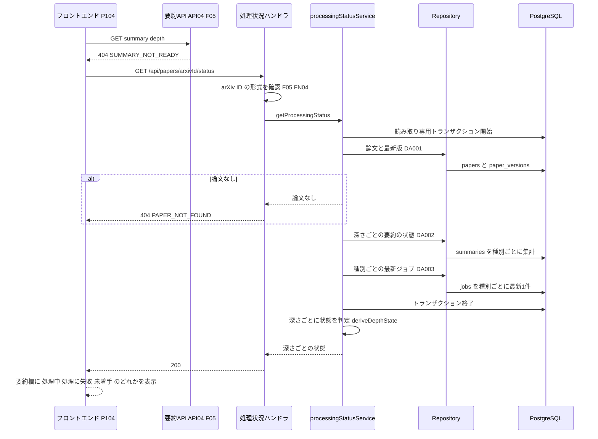

# BE詳細設計書 — F17 処理状況の確認（区分: 運用）

## 0. 文書情報

| 項目 | 値 |
| :--- | :--- |
| 設計書ID | F17-BE |
| 親ID | F17 |
| 親設計書 | `基本設計書_概要.md` §4.1 機能一覧 |
| 文書名 | BE詳細設計書 F17 処理状況の確認 |
| 対象システム | Kaine personal pj — arXiv日本語研究ダイジェスト Webアプリ |
| 版 | 1.1（第1回セルフレビュー `docs/reviews/be_F17_review_applied.md` の Major 1件・Minor 1件を反映） |
| 作成日 / 更新日 | 2026-10-26 / 2026-10-26 |
| 作成方法 | creating-backend-detailed-design v1.5.0 準拠。上流の確定設計書と `source/` の企画資料から作成（新規設計） |
| インプット | (a) `source/02_機能要求定義.md:46,58`、`source/03_システム構成.md:11,24-27,43,58`、`source/04_収益化とロードマップ.md:25-26`／(b) `docs/基本設計書_概要.md` §1（MVP完了基準 6）、§2（BF16・EX02・EX04）、§3.2（管理者向け画面0件）、§4（F17 行、オンライン処理設計「未処理論文の扱い」「部分的な障害の扱い」・エラー応答）、§5（バッチ一覧 B002〜B005）、§6（T001〜T003・T009、CRUD図 F17 行）、§7（内部API一覧 API03・API04 と注記「処理状況の取得…APIが定義されていない」）、§8（性能・可用性要件、アプリケーション保護）、§11（ARC002・ARC004・ARC006）、付録 Q05・Q24・Q27・Q31／関連する確定済みの下位設計書: `docs/db/DB.T009.DB物理設計.md`（jobs。§4.3 (4)「処理状況の表示」、§5.2 `idx_jobs_paper_version_id_job_type`、§6 コード定義）、`docs/db/DB.T001`〜`T003.DB物理設計.md`（§4.6 の F17 行、T003 §6 validation_status、T002 §6 content_status）、`docs/screens/画面.P104.画面基本設計.md`（H37、E01・E02・E08、呼出APIロースター）、`docs/detail/be/BE.F05.BE詳細設計.md`（API04 の `SUMMARY_NOT_READY`、FN04・FN05・FN11）、`docs/detail/be/BE.F03.BE詳細設計.md`・`docs/detail/be/BE.F08.BE詳細設計.md`（一覧の summaryStatus）／(c) `legacy/`（空） |
| インプットの性質 | `source/` は企画・初期設計案のMarkdown 6ファイルだけで、ルーティング定義・コントローラ・ORM定義・SQLは1つもありません（`source/README.md:5-10`、作業開始時の実ファイル数6件。F15・F16 作成時から変更なし）。処理状況について資料にあるのは、MVP完了基準「失敗時も画面全体が落ちず、処理状況を確認できる」（`source/02_機能要求定義.md:58`）、未処理論文は速報版を先に表示すること（`source/03_システム構成.md:58`）、`jobs` の列名（`:43`）だけです。そのため本書のエンドポイント・関数・データアクセスはすべて「上流の定義から導いた計画上の実体」であり、実装済みであることは意味しません。パス・ファイル名・関数名・JSONのキー名・状態のコード・SQL本文は実装時の命名案で、すべて※推測です |
| 既存版との関係 | `docs/detail/be/BE.F17.BE詳細設計.md` の旧版はありません（本書が初版）。残すべき既存の記述はありません |
| legacy/ との突合 | `legacy/` は空ディレクトリ（ファイル0件）です。突合する既存仕様・業務意図・非機能の記述はありません |

**確認事項（※推測・※上流要確認・※上流未定義の集約）**:

| No | 区分 | 確認事項 | 本書での仮置き | 関連箇所 | 上流の確認事項 |
| :--- | :--- | :--- | :--- | :--- | :--- |
| 1 | 機能一覧 | 上流 §4 機能一覧の F17 行は定義状況「簡易」、BE詳細設計書「-（未作成）」だが、本書を作成した（※上流要確認） | 本書を F17 のBE詳細設計とする。上流 §4 の F17 行の BE詳細設計書の列を `detail/be/BE.F17.BE詳細設計.md` に、定義状況を「詳細」に改めることを提案する（処理状況の判定に、ジョブと要約の状態を組み合わせる非自明な業務ルールがあるため。completeness 3-1 の1・7） | §0 | —（※上流未定義） |
| 2 | API | 処理状況を取得するAPIのパス・応答（※上流未定義。上流 §7 注記と付録 Q27 に「処理状況の取得」が API 未定義として挙がっている） | `GET /api/papers/{arxivId}/status`、論文の最新版について要約の深さごとの状態を返す。API ID は振らない | §2「GET /api/papers/{arxivId}/status」 | Q27 |
| 3 | 画面 | P104 は要約欄の処理状況（H37）を、要約API（API04）の「該当なし」だけで「速報版・要約処理中」と表示し、本APIを呼ばない（P104 呼出APIロースター全5件に無い）。T009 §4.3 (4) は「処理中」「処理に失敗」を区別して表示するとしている（※上流要確認） | API04 が `SUMMARY_NOT_READY` を返したときに、P104 が本APIを呼んで「処理中」「処理に失敗」「未着手」を出し分ける案とする。P104 の E01・E02・E08 と呼出APIロースターに本APIを加えることを提案する。加えない決定になった場合も、本APIは運用者の確認に使える | §2 エンドポイントロースター | —（下位設計書どうしの不整合） |
| 4 | 業務 | 処理状況として利用者に見せる段階の数と名前 | 6つ（公開済み・生成中・検証中・処理に失敗・本文未取得のため対象外・未着手）。失敗の原因（直近エラー）は利用者に見せない | §4 No.4 deriveDepthState | Q24 |
| 5 | 業務 | 処理状況を「論文の最新版」について出すか、「画面が表示している版」について出すか | 最新版について出す。要約が公開済みの古い版がある場合、API04 はその版の要約を返す（F05 FN05）ため、本APIが呼ばれるのは「どの版にも公開済みの要約が無い」ときに限られ、最新版の状況を出せば足りる | §2 概要 | —（※上流未定義） |
| 6 | 運用 | 運営者がジョブの処理状況を確認する画面（上流 Q05。管理者向け画面は0件） | 本書の対象外。運営者は DB とジョブキューの監視（上流 §10、ARC006）で確認する。本APIの応答は論文単位で、運営者向けの一覧・集計は持たない | §1 対象ドメイン | Q05 |
| 7 | データ | ジョブに登録日時・開始日時が無いため、「実行中のまま止まった」ジョブを見分けられない（T009 §9 No.1） | 実行中のジョブは、止まっているかどうかにかかわらず「生成中」「検証中」と表示する。止まったジョブの検出は運用の監視に任せる | §4 No.4 | —（※上流未定義。T009 §9 No.1） |
| 8 | CRUD | 上流 CRUD図の F17 行は papers・paper_versions・summaries・jobs の「R」。本書の読み取りはこの4表に収まる | 追加の操作なし | §3 | — |

---

## 1. バックエンド構成・モジュール設計

* **対象ドメイン**: 運用系（機能ID F17 処理状況の確認）— 論文の日本語要約がまだ公開されていないときに、その論文の最新版について、要約の深さ（30秒要約・3分要約・10分解説）ごとに「いまどの段階か」（生成中・検証中・処理に失敗・未着手・公開済み・本文未取得のため対象外）を返す（上流 §4 F17「処理に失敗しても画面全体を止めず、論文ごとの要約の処理状況を確認できるようにする」、BF16、MVP完了基準 `source/02_機能要求定義.md:58`）。参照だけの機能で、ジョブの再実行や要約の作り直しは行わない（失敗ジョブの再処理は B010 の担当）。運営者向けの一覧・集計画面は上流に無く、本書の対象外（§0 確認事項 No.6）。
* **対象APIエンドポイント**: GET /api/papers/{arxivId}/status（処理状況の取得。※上流未定義、パスは※推測）。全数と根拠は §2 のエンドポイントロースターを参照。
* **実行基盤**: 画面向けAPIとして Next.js の API（Route Handler）で Vercel 上で動きます（`source/03_システム構成.md:7,16`、上流 §9）。DBへは環境変数 `DATABASE_URL` で PostgreSQL（Supabase）に直接つなぎ、SQLを発行します（F05 と同じSQLクライアント ※推測）。`jobs` は行単位アクセス制御でブラウザからの読み取りをすべて拒否しているため（T009 §7）、処理状況はこの API がサーバ側で読み、利用者に見せてよい情報（状態のコード）だけに変換して返します。
* **ディレクトリ/ファイル構造**（上流 §9「`web/`」の想定に従う。論文の API と同じ `app/api/papers/[arxivId]/` の下に置き、arXiv ID の入力チェックとエラー応答は F05 の関数を使う。ファイル名はすべて※推測）:

```
web/
├── app/api/papers/[arxivId]/
│   ├── route.ts                        # GET（API03。F05 の担当）
│   ├── summary/route.ts                # GET（API04。F05 の担当）
│   └── status/route.ts                 # GET（処理状況の取得 ※上流未定義。本書の担当）
├── lib/server/papers/
│   └── validators.ts                   # validatePaperRequest（F05 FN04。本書は呼ぶだけ）
├── lib/server/http/
│   └── errors.ts                       # toErrorResponse（F05 FN11。本書は呼ぶだけ）
├── lib/server/processing/
│   ├── processingStatusService.ts      # getProcessingStatus / deriveDepthState
│   └── processingStatusRepository.ts   # DA001〜DA003 のSQL発行
└── lib/db/
    └── client.ts                       # DATABASE_URL による接続（全機能共通 ※推測）
```

* **処理シーケンス図**（上流 BF16・EX04 を本書の関数・DA へ分解したもの）:



---

## 2. API・インターフェース詳細設計

* **外部サービス連携仕様**: **該当なし**。根拠: 上流 §7 外部連携一覧の全9件（IF01〜IF09）のうち、上流 BF16 と CRUD図 F17 行（papers・paper_versions・summaries・jobs の参照だけ）に関わるものはありません。本機能は自前の DB だけを読み、arXiv・LLM・Supabase Auth（認証不要のため）・Stripe・GitHub・通知配信のどれも呼びません。ジョブキュー（Redis）も内部の構成要素で、本機能は直接読みません（ジョブの状態は `jobs` に記録されたものを読む。上流 ARC006）。

| IF-ID | 連携先 | 連携方式 | エンドポイント / 接続先 | 認証方式 | タイムアウト | リトライ方針 | エラー時の挙動 | 定義状況 | 詳細の所在 |
| :--- | :--- | :--- | :--- | :--- | :--- | :--- | :--- | :--- | :--- |
| —（該当なし） | — | — | — | — | — | — | — | — | — |

* **エンドポイントロースター（全数）**:

| No | API ID | メソッド | パス | 概要 | 呼び出し元 | 認証 | 定義状況 | 詳細の所在 |
| :--- | :--- | :--- | :--- | :--- | :--- | :--- | :--- | :--- |
| 1 | —（※上流未定義） | GET | /api/papers/{arxivId}/status（※推測） | 論文の最新版について、要約の深さごとの処理状況（公開済み・生成中・検証中・処理に失敗・未着手・本文未取得のため対象外）を返す | P104（要約API が `SUMMARY_NOT_READY` を返したとき。※上流要確認 §0 確認事項 No.3） | 不要 | 詳細 | §2「GET /api/papers/{arxivId}/status」 |

**総件数: 1件。全数である根拠**: 上流 §7 内部API一覧の全8件（API01〜API08）に処理状況のAPIは0件で、`source/03_システム構成.md:46-54` の API設計案にもありません。上流 §7 の注記と付録 Q27 が「処理状況の取得」を API 未定義の機能として挙げているため、これを1件としました。一覧のAPI（API01・API02・API05）が返す要約の公開状況（`published`／`processing` の2値。F03 §2 summaryStatus、F08 V03）は、それぞれ F02・F03・F08 の応答の一部で、本書のエンドポイントではありません。要約API（API04）の `SUMMARY_NOT_READY` も F05 の応答です。定義状況は、ジョブと要約の状態を組み合わせて段階を決める分岐と業務ルールを含むため「詳細」です（completeness 3-1 の1・3・7）。

* **全エンドポイント共通の決まり**（※推測。F05 の論文APIと同じ決まりに合わせる）:
  * **応答の形**: 成功時は `{"status":"success","data":{…}}`、失敗時は `{"status":"error","error":{"code":"<エラーコード>","message":"<利用者向けの文言>"}}` とします（F05 FN11）。
  * **キャッシュ**: 成功時は `Cache-Control: public, s-maxage=30, stale-while-revalidate=30` とします。処理状況は利用者によって変わらず、短い間なら共有キャッシュから返して DB の負荷を抑えられるためです。要約の公開（API04 の `s-maxage=300`）より短くするのは、処理状況は「いま進んでいるか」を見せるもので、古い状態を長く見せると「処理に失敗」が直っても残り続けるためです。失敗応答には `Cache-Control: no-store` を付けます（F05 と同じ）。

### GET /api/papers/{arxivId}/status
* **概要**: arXiv ID で指定した論文の最新版について、要約の深さ（30秒要約・3分要約・10分解説）ごとに、いまどの段階にあるかを返します。論文詳細（P104）の要約欄で、要約APIが「まだ公開された要約が無い」（`SUMMARY_NOT_READY`）と返したときに、「処理中」「処理に失敗」「未着手」を出し分けるために使います（上流 BF16・EX04、T009 §4.3 (4)）。失敗の原因（ジョブの直近エラー）・試行回数・ジョブIDは返しません（内部の情報で、外部APIの応答の断片を含み得るため。T009 §4.3 (6)）。**※上流未定義**: 上流 §7 内部API一覧に無いAPIで、パス・応答・状態のコードはすべて※推測です（上流 付録 Q27、§0 確認事項 No.2）。API ID は振っていません。
* **API ID**: —（※上流未定義）
* **認証要否**: 不要（論文の処理状況は公開情報で、利用者によって変わらない）
* **リクエストパラメータ**:

| 種別(Path/Query/Body) | 項目名 | 型 | 必須 | 制約・バリデーション | 説明 |
| :--- | :--- | :--- | :--- | :--- | :--- |
| Path | arxivId | string | 必須 | F05 FN04 と同じ規則。新形式（年月4桁・ピリオド・連番4〜5桁）か旧形式（分野名・スラッシュ・年月連番7桁）のどちらかで、32文字以内、版番号の接尾辞を含まない | 処理状況を知りたい論文の arXiv 上の識別子。旧形式の ID はスラッシュを含むため、パスの扱いは F05 の API03 と同じにする |

* **レスポンス（成功時）**:
```json
{
  "status": "success",
  "data": {
    "arxivId": "2401.01234",
    "latestVersion": 2,
    "contentStatus": "abstract_only",
    "depths": {
      "short":    { "state": "validating" },
      "standard": { "state": "validating" },
      "deep":     { "state": "not_available" }
    }
  }
}
```
  * `latestVersion` は論文の最新版の番号（`papers.latest_version`）です。処理状況はこの版について判定します（§0 確認事項 No.5）。
  * `contentStatus` は最新版の本文取得状況（`abstract_only`：Abstractのみ／`full_text`：本文取得済み。T002 §6）です。版の行がまだ無い場合は `null` です。
  * `depths` の各 `state` は次の6つのどれかです（判定の規則は §4 No.4）。
    * `published`（公開済み）: 検証に合格した要約がある。画面は要約API を呼び直せば要約を表示できる
    * `generating`（生成中）: その深さの要約を作るジョブが待機中か実行中
    * `validating`（検証中）: 要約はできたが、根拠・数値チェックが終わっていない
    * `failed`（処理に失敗）: 要約の生成か検証のジョブが試行回数の上限に達して失敗した、または検証で不合格になり、作り直しのジョブが予定されていない。運用者の再処理（B010）を待つ状態
    * `not_started`（未着手）: その深さのジョブも要約も無い。収集の直後で、要約ジョブがまだ登録されていない
    * `not_available`（本文未取得のため対象外）: 10分解説だけに使う。最新版の本文が未取得で、本文解析のジョブも予定されていないため、10分解説は作られない（上流 BF05、ARC002・ARC005）
* **レスポンスヘッダー**: `Content-Type: application/json; charset=utf-8`、`Cache-Control: public, s-maxage=30, stale-while-revalidate=30`
* **ステータスコード**:

| コード | 条件 |
| :--- | :--- |
| 200 | 正常終了。論文の版の行がまだ無い（収集の途中）場合も、`contentStatus` を `null`、3つの深さをすべて `not_started` として返す |
| 400 | arXiv ID の形式が正しくない（`INVALID_ARXIV_ID`。F05 と同じコード） |
| 404 | 自前 DB にその arXiv ID の論文が無い（`PAPER_NOT_FOUND`。F05 と同じコード） |
| 500 | DB障害・想定外の例外（`INTERNAL_ERROR`）。P104 は要約欄に従来どおり「速報版・要約処理中」（H37）を出す想定（処理状況の取得の失敗で要約欄をエラーにしない。上流 EX04 の考え方 ※推測） |

* **ビジネスロジック・副作用**:
  1. arXiv ID の形式を確かめる（F05 FN04 validatePaperRequest。深さは渡さない。不正なら 400 で終了）。
  2. 読み取り専用・REPEATABLE READ のトランザクションを開く。3つの読み取り（DA001〜DA003）を同じ時点のデータで行い、「ジョブは成功したのに要約がまだ見えない」のような食い違いで状態を取り違えないようにするためです。
  3. 論文と最新版を読む（DA001）。論文が無ければ 404 で終了する。最新版の行が無ければ、3つの深さをすべて「未着手」にして手順6へ進む。
  4. 最新版について、要約の種別（30秒要約・3分要約・10分解説）ごとに、合格した要約があるか・まだ検証待ちの要約があるか・最も新しい要約の検証結果を読む（DA002）。日本語の要約だけを対象にする。
  5. 最新版について、ジョブの種別（要約生成・検証・本文解析）ごとに、最も新しいジョブの状態を読む（DA003）。
  6. トランザクションを閉じ、深さごとに状態を決める（deriveDepthState。規則は §4 No.4）。
  7. 論文の arXiv ID・最新版・本文取得状況・深さごとの状態を 200 で返す。
  8. 副作用はありません（参照のみ）。ジョブの再登録や再実行は行いません（失敗の解消は運用者の再処理 B010 の担当）。

---

## 3. データアクセス（ORM / クエリ）設計

* **データアクセス一覧（全数ロースター）**:

| DA-ID | 処理名 | 呼出元（関数/API） | テーブルID | 対象物理テーブル | 種別 (SELECT/INSERT/UPDATE/DELETE) | 定義状況 (詳細/簡易) | 詳細の所在 |
| :--- | :--- | :--- | :--- | :--- | :--- | :--- | :--- |
| DA001 | 論文と最新版の取得 | findPaperWithLatestVersion ← getProcessingStatus ← GET /api/papers/{arxivId}/status | T001, T002 | papers, paper_versions | SELECT | 詳細 | §3 詳細定義 DA001 |
| DA002 | 最新版の要約の種別ごとの状態の集計 | summarizeSummaryStates ← getProcessingStatus ← GET /api/papers/{arxivId}/status | T003 | summaries | SELECT | 詳細 | §3 詳細定義 DA002 |
| DA003 | 最新版のジョブの種別ごとの最新の状態 | findLatestJobsByType ← getProcessingStatus ← GET /api/papers/{arxivId}/status | T009 | jobs | SELECT | 詳細 | §3 詳細定義 DA003 |

**総件数: 3件（すべて SELECT。詳細3件）。全数である根拠**: §2 のビジネスロジック手順3〜5に現れるDBアクセスをすべて数えたもので、§4 の関数ロースターのうちリポジトリ層の3関数と1対1で対応します。上流 §6 CRUD図の F17 行（papers「R」・paper_versions「R」・summaries「R」・jobs「R」）の各操作は、papers R・paper_versions R → DA001、summaries R → DA002、jobs R → DA003 に現れ、CRUD図に無い操作はありません。DB物理設計の「本テーブルを操作する機能」の F17 行（T001 §4.6 No.14「処理状況を出す論文を読む」、T002 §4.6 No.9「版ごとの本文取得状況を読む」、T003 §4.6 No.9「版ごとに、深さ別の要約が未検証・合格・不合格のどれかを読む」、T009 §4.6 No.5「最新版の要約ジョブの状態を読む」）はすべて DA001〜DA003 に当たります。テーブルID列は上流 §6 テーブル一覧のIDをそのまま引き継いでいます（papers=T001、paper_versions=T002、summaries=T003、jobs=T009）。本機能に INSERT・UPDATE・DELETE はありません。
**定義状況の判定**（completeness 3-1）: DA001 は2テーブルの結合（3-1 の3）と、版の行が無い場合の分岐（3-1 の1）を含む。DA002 は種別ごとの集計で状態判定の材料を作る業務ルール（3-1 の7）を含む。DA003 はジョブの再実行の履歴から種別ごとの最新1件を選ぶ規則（3-1 の7）と、索引に沿わせる性能上の注意（3-1 の6）を含む。3件とも「詳細」です。

* **データアクセス詳細定義**（ロースターは本節冒頭の表。本表は定義状況＝詳細の3件を展開する）:

| DA-ID | 処理名 | テーブルID | 対象物理テーブル | JOIN / Include | 抽出条件 (Where) / ソート | トランザクション境界 | N+1対策・性能上の注意 |
| :--- | :--- | :--- | :--- | :--- | :--- | :--- | :--- |
| DA001 | 論文と最新版の取得 | T001, T002 | papers, paper_versions | papers に、論文IDと最新版の番号が一致する版を外部結合する（版の行がまだ無い論文も返す）（`LEFT JOIN paper_versions ON paper_id = papers.id AND version = papers.latest_version`） | arXiv ID が一致する論文1件（`papers.arxiv_id = $1`）。取り出すのは論文の arXiv ID・最新版の番号と、版の論文バージョンID・本文取得状況 | 読み取り専用・REPEATABLE READ のトランザクションの最初の文 | 論文は一意制約 `uq_papers_arxiv_id` の索引で1件、版は一意制約 `uq_paper_versions_paper_id_version`（論文ID・版番号）の索引で1件に絞られる。全件走査は起きない |
| DA002 | 最新版の要約の種別ごとの状態の集計 | T003 | summaries | なし | 最新版の論文バージョンIDが一致し、言語が日本語の要約を、要約の種別ごとにまとめる（`WHERE paper_version_id = $1 AND language = 'ja' GROUP BY summary_type`）。種別ごとに、合格の要約が1件でもあるか、検証待ちの要約が1件でもあるか、生成日時が最も新しい要約の検証結果は何かを求める | 同じトランザクションの2文目 | 1つの版の要約は種別ごとに数件（作り直しの履歴を含む）で、索引 `idx_summaries_lookup`（版・種別・言語・生成日時の降順）で版の行だけを読む |
| DA003 | 最新版のジョブの種別ごとの最新の状態 | T009 | jobs | なし | 最新版の論文バージョンIDが一致し、種別が要約生成・検証・本文解析のどれかのジョブについて、種別ごとにジョブIDが最も大きい1件だけを取る（`DISTINCT ON (job_type) … ORDER BY job_type, id DESC`）。同じ版・同じ種別には再実行の履歴で複数の行があり、最も新しい1件がいまの状況を表すため。公開反映（`publish_summary`）は、検証に合格した時点で要約が公開扱いになる（F05 は合格の要約を直接読む）ため、判定に使わず読まない | 同じトランザクションの3文目 | 索引 `idx_jobs_paper_version_id_job_type`（版・種別・ジョブIDの降順）の並びどおりに読むため、種別ごとに先頭の1行を取るだけで並べ替えが起きない（T009 §5.2「論文詳細の処理状況の表示は、論文の最新版の要約ジョブを版と種別で引きます」）。1つの版のジョブは数件〜十数件 |

* **発行SQL**: 本機能のデータアクセスは ORM を使わず、すべて SQL クライアントからパラメータ付きの SQL を発行します（§1 実行基盤）。値はすべてプレースホルダ（`$1`）で渡し、文字列の連結で SQL を作りません。3件すべての SQL 本文を示します。実行時に組み立てを変える文（動的SQL）はありません。3文は、読み取り専用・REPEATABLE READ のトランザクション（`BEGIN TRANSACTION ISOLATION LEVEL REPEATABLE READ READ ONLY;` … `COMMIT;`）の中で順に発行します。

**DA001 論文と最新版の取得**（詳細）
```sql
-- $1: arXiv ID（版番号の接尾辞なし）
SELECT p.arxiv_id          AS arxiv_id,
       p.latest_version    AS latest_version,
       pv.id               AS paper_version_id,   -- 版の行がまだ無ければ NULL
       pv.content_status   AS content_status      -- 'abstract_only' / 'full_text'。版の行が無ければ NULL
  FROM papers AS p
  LEFT JOIN paper_versions AS pv
         ON pv.paper_id = p.id
        AND pv.version  = p.latest_version
 WHERE p.arxiv_id = $1;
-- 0行なら論文なし（404）
```

**DA002 最新版の要約の種別ごとの状態の集計**（詳細）
```sql
-- $1: 論文バージョンID（DA001 の paper_version_id）
SELECT sm.summary_type                                              AS summary_type,     -- 'short' / 'standard' / 'deep'
       bool_or(sm.validation_status = 'passed')                     AS has_passed,       -- 合格の要約が1件でもあるか
       bool_or(sm.validation_status = 'pending')                    AS has_pending,      -- 検証待ちの要約が1件でもあるか
       (array_agg(sm.validation_status ORDER BY sm.generated_at DESC))[1]
                                                                    AS latest_validation -- 最も新しい要約の検証結果
  FROM summaries AS sm
 WHERE sm.paper_version_id = $1
   AND sm.language         = 'ja'
 GROUP BY sm.summary_type;
-- 行が無い種別は「要約がまだ1件も無い」
```

**DA003 最新版のジョブの種別ごとの最新の状態**（詳細）
```sql
-- $1: 論文バージョンID（DA001 の paper_version_id）
SELECT DISTINCT ON (j.job_type)
       j.job_type   AS job_type,   -- 'summarize_abstract' / 'validate_summary' / 'analyze_full_text'
       j.status     AS status      -- 'pending' / 'running' / 'succeeded' / 'failed'
  FROM jobs AS j
 WHERE j.paper_version_id = $1
   AND j.job_type IN ('summarize_abstract', 'validate_summary', 'analyze_full_text')
 ORDER BY j.job_type, j.id DESC;
-- 直近エラー（last_error）・試行回数（attempts）は読まない（利用者に返さないため）
```

---

## 4. サーバー側機能・処理ロジック設計（IPO設計）

* **関数ロースター（全数）**: 関数名・ファイル名はすべて実装時の命名案です（※推測）。

| No | ID（関数名） | 所属モジュール | 概要 | 対応DA | 定義状況 | 詳細の所在 |
| :--- | :--- | :--- | :--- | :--- | :--- | :--- |
| 1 | GET（処理状況ハンドラ） | web/app/api/papers/[arxivId]/status/route.ts | 処理状況の取得の受け口。arXiv ID の検証・サービスの呼び出し・応答の組み立てを行う | — | 詳細 | §4 IPO定義 No.1 |
| 2 | getProcessingStatus | web/lib/server/processing/processingStatusService.ts | 読み取り専用トランザクションで論文・要約・ジョブを読み、深さごとの状態を決める | DA001〜DA003 | 詳細 | §4 IPO定義 No.2 |
| 3 | findPaperWithLatestVersion | web/lib/server/processing/processingStatusRepository.ts | DA001 を発行し、論文と最新版の情報、または「論文なし」を返す | DA001 | 簡易 | §3 発行SQL DA001 |
| 4 | deriveDepthState | web/lib/server/processing/processingStatusService.ts | 1つの深さについて、要約の状態とジョブの状態から6つの段階のどれかを決める（DBに触れない） | — | 詳細 | §4 IPO定義 No.4 |
| 5 | summarizeSummaryStates | web/lib/server/processing/processingStatusRepository.ts | DA002 を発行し、種別ごとの集計結果を種別をキーにした形で返す | DA002 | 簡易 | §3 発行SQL DA002 |
| 6 | findLatestJobsByType | web/lib/server/processing/processingStatusRepository.ts | DA003 を発行し、種別ごとの最新のジョブの状態を種別をキーにした形で返す | DA003 | 簡易 | §3 発行SQL DA003 |

**総件数: 6件（ハンドラ1件・サービス2件・リポジトリ3件。詳細3件・簡易3件）。全数である根拠**: §1 のディレクトリ構造に挙げた本機能が持つ3ファイル（status/route.ts・processingStatusService.ts・processingStatusRepository.ts）の関数をすべて数えたものです。ハンドラは §2 のエンドポイントロースター1件と1対1、リポジトリ関数は §3 のデータアクセスロースター3件と1対1です。
**本機能が呼ぶ他書の関数（本ロースターに数えない）**: arXiv ID の入力チェック validatePaperRequest（`docs/detail/be/BE.F05.BE詳細設計.md` §4 FN04）、エラー応答への変換 toErrorResponse（F05 §4 FN11）、DB接続（`lib/db/client.ts`。全機能共通 ※推測）。どれも持ち主の設計書で定義されているため、本書では採番・詳細化しません。
**定義状況の判定**（completeness 3-1）: 分岐（入力不正・論文なし・版なし）を持つハンドラ、トランザクションを扱い3つの表にまたがるサービス、状態を決める業務ルールを持つ deriveDepthState を「詳細」としました。1文を発行して結果の形を整えるだけのリポジトリ関数は「簡易」です（SQL と判定の材料の意味は §3 の詳細定義にあります）。

* **入力・処理・出力（IPO）定義**（ロースターは本節冒頭の表。本表は定義状況＝詳細の3件を展開する）:

| No | 関数名 | 所属モジュール | 引数 (型) | 処理フロー (ステップ単位で具体的に) | 戻り値 | 発生しうるエラー |
| :--- | :--- | :--- | :--- | :--- | :--- | :--- |
| 1 | GET（処理状況ハンドラ） | web/app/api/papers/[arxivId]/status/route.ts | request: Request, params: { arxivId: string } | 1. validatePaperRequest（F05 FN04）で arXiv ID の形式を確かめる（深さは渡さない）<br>2. getProcessingStatus(arXiv ID) を呼ぶ<br>3. 応答本文を組み立て、`Cache-Control: public, s-maxage=30, stale-while-revalidate=30` を付けて 200 で返す<br>4. 途中で投げられた例外はすべて toErrorResponse（F05 FN11）に渡して応答にする。失敗応答には `Cache-Control: no-store` が付く | Response（200 と処理状況の本文） | 400 入力不正、404 論文なし、500 DB障害（すべて toErrorResponse 経由） |
| 2 | getProcessingStatus | web/lib/server/processing/processingStatusService.ts | arxivId: string | 1. DB接続を1本取り、読み取り専用・REPEATABLE READ のトランザクションを始める<br>2. findPaperWithLatestVersion（DA001）で論文と最新版を読む。論文が無ければ論文なしの業務エラーを投げる<br>3. 最新版の行が無ければ（論文バージョンIDが空）、トランザクションを閉じ、本文取得状況を空、3つの深さを「未着手」として返す<br>4. summarizeSummaryStates（DA002）で要約の種別ごとの集計を読む<br>5. findLatestJobsByType（DA003）でジョブの種別ごとの最新の状態を読む<br>6. トランザクションを閉じる（読み取りだけなのでコミットでもロールバックでも同じ）<br>7. 30秒要約・3分要約・10分解説のそれぞれについて deriveDepthState を呼ぶ。30秒要約と3分要約には要約生成のジョブ（`summarize_abstract`）を、10分解説には本文解析のジョブ（`analyze_full_text`）を「生成のジョブ」として渡す。検証のジョブ（`validate_summary`）は3つの深さに共通で渡す（検証のジョブは版ごとに1種類で、深さを区別しないため）<br>8. arXiv ID・最新版の番号・本文取得状況・深さごとの状態を返す<br>9. 途中で DB のエラーが起きたら、トランザクションを閉じて例外をそのまま投げる | { arxivId, latestVersion, contentStatus, depths: { short, standard, deep } } | 論文なし（404）、DB障害（500） |
| 4 | deriveDepthState | web/lib/server/processing/processingStatusService.ts | depth: 'short' \| 'standard' \| 'deep', summary: { hasPassed, hasPending, latestValidation } \| null, generationJob: 状態 \| null, validationJob: 状態 \| null, contentStatus: 'abstract_only' \| 'full_text' | 上から順に判定し、最初に当てはまったものを返す。<br>1. その深さに合格の要約がある → 公開済み（`published`）<br>2. 生成のジョブが待機中か実行中 → 生成中（`generating`）。検証で不合格になり作り直しが予定されている場合もここに入る<br>3. 深さが10分解説で、最新版の本文が未取得（Abstractのみ）→ 本文未取得のため対象外（`not_available`）。手順2で本文解析のジョブが予定されているものは先に生成中になる<br>4. 検証のジョブが待機中か実行中で、その深さの要約が1件以上ある → 検証中（`validating`）<br>5. 生成のジョブが失敗している、または検証のジョブが失敗していてその深さの要約が1件以上ある、またはその深さの最も新しい要約の検証結果が不合格 → 処理に失敗（`failed`）。運用者の再処理（B010）か作り直しのジョブの登録を待つ状態。検証待ちの要約が残っていても、検証のジョブが失敗していればここに入る（検証が進む見込みが無いのに「検証中」と見せ続けないため）<br>6. その深さに検証待ちの要約がある（検証のジョブがまだ登録されていない、または成功と記録されたのに結果が反映されていない）→ 検証中（`validating`）<br>7. どれにも当てはまらない（ジョブも要約も無い、または生成のジョブが成功したのに要約が無い）→ 未着手（`not_started`）。生成のジョブが成功したのにその深さの要約が無いのは、生成が他の深さだけを作った場合か、ジョブの記録と要約の保存の食い違いで、利用者には未着手として見せる（※推測。食い違いの検出は運用の監視に任せる） | 'published' \| 'generating' \| 'validating' \| 'failed' \| 'not_started' \| 'not_available' | なし（引数の値だけで決まる） |

* **判定の順序の理由**: 公開済みを最優先にするのは、合格の要約があれば利用者は要約を読めるためです。生成中を失敗より先に判定するのは、検証で不合格になった要約（上流 EX02）の作り直しが予定されていれば、利用者には「処理中」と見せるのが正しいためです。本文未取得の判定を生成中の後に置くのは、本文解析のジョブ（B005）が予定されていれば、いまは Abstract だけでも10分解説が作られる見込みがあるためです（上流 ARC002）。検証待ちの要約があるだけの場合（手順6）を失敗（手順5）の後に置くのは、検証のジョブが試行回数の上限に達して失敗していれば、検証待ちの要約はそれ以上進まないためです。検証のジョブが待機中・実行中のとき（手順4）だけは失敗より先に「検証中」とし、再処理（B010）で検証が動き出した状態を正しく見せます。

---

## 5. バッチ処理・非同期タスク設計

* **ジョブ実行定義**: **該当なし**。根拠: 上流 §5 バッチ一覧の全11件（B001〜B011）のうち、F17 が登録・実行するものはありません。上流 §6 CRUD図の F17 行で `jobs` は「R」だけで、本機能はジョブの状態を読むだけです。要約の生成（B002）・検証（B003）・公開反映（B004）・本文解析（B005）は F04、失敗ジョブの再処理（B010）は運用者の操作で、どれも本機能のジョブではありません。

| ジョブ名 | 実行タイミング | 対象テーブル | 処理概要 | タイムアウト |
| :--- | :--- | :--- | :--- | :--- |
| —（該当なし） | — | — | 本機能に定期実行・非同期のジョブはありません | — |

---

## 6. 例外処理・セキュリティ設計

* **エラーハンドリング**: 例外はハンドラで1か所に集め、toErrorResponse（F05 FN11）で応答に変えます。利用者の操作で普通に起きる業務エラー（入力不正・論文なし）は 4xx で理由のコードを返し、ログには出しません（F05 と同じ ※推測）。DB障害と予期しない例外は ERROR ログに詳しく残し、利用者には内部の内容（例外メッセージ・SQL・テーブル名・スタックトレース・ジョブの直近エラー）を見せない汎用メッセージで 500 を返します。処理状況の取得は要約欄の補助の情報のため、失敗しても画面は従来の「速報版・要約処理中」の表示で続けられます（上流 EX04）。

| No | 例外種別 | 発生箇所 | 対応方法 | ログ出力 | クライアント応答 |
| :--- | :--- | :--- | :--- | :--- | :--- |
| 1 | 入力不正（arXiv ID の形式不正） | validatePaperRequest（F05 FN04） | 業務エラーとして投げ、DBに触れない | 出さない（※推測） | 400 `INVALID_ARXIV_ID` |
| 2 | 論文なし（自前 DB に該当の arXiv ID が無い） | getProcessingStatus（DA001 が0行） | 業務エラーとして投げる | 出さない（※推測） | 404 `PAPER_NOT_FOUND` |
| 3 | DB障害（接続できない・タイムアウト・クエリ失敗） | リポジトリの全関数 | トランザクションを閉じ、想定外の例外として投げる。リトライしない（画面は従来の表示で続けられるため） | ERROR + スタックトレース、リクエストのパス、DA-ID | 500 `INTERNAL_ERROR` と汎用メッセージ |
| 4 | 予期しない例外 | 全関数 | toErrorResponse でまとめて受ける | ERROR + スタックトレース | 500 `INTERNAL_ERROR` と汎用メッセージ |

**総件数: 4件。全数である根拠**: §4 IPO定義の「発生しうるエラー」列に現れるエラーを重複を除いて数えたもの（入力不正・論文なし・DB障害）に、どこにも当てはまらない予期しない例外（No.4）を加えたものです。版の行が無い場合は例外にせず「未着手」として返します（§2 ステータスコード 200）。応答コードとエラーコードは上流 §4 オンライン処理設計のエラー応答（400・404・500）と F05 のコードに合わせています。各文の打ち切り時間は接続設定で5秒とします（※推測。F05 と同じ。上流 Q31 で応答時間の目標が決まれば見直す）。

* **セキュリティ設計**（上流 §8 を本機能に当てはめたもの）:
  * **内部情報の漏えい防止**: ジョブの直近エラー（外部APIの応答の断片を含み得る。T009 §4.3 (6)）・試行回数・ジョブID・論文バージョンIDは SQL でも読まず、応答にも出しません。返すのは状態のコード6種類と、論文の公開情報（arXiv ID・最新版・本文取得状況）だけです。`jobs` はブラウザから直接読めないよう行単位アクセス制御で全拒否されており（T009 §7）、本APIはその内容を要約した状態だけを出す窓口になります。
  * **SQL インジェクション**: arXiv ID はプレースホルダで渡し、入力チェック（F05 FN04）で形式も限定します。
  * **負荷**: 認証不要で誰でも呼べるため、共有キャッシュ（30秒）で同じ論文への問い合わせを DB に届かせないようにします。3文とも索引で数行だけを読む軽い問い合わせです（§3）。
  * **個人データ**: 利用者を指す情報を読みも返しもしません。

* **トランザクション制御**:

| 処理名 | トランザクション範囲 | ロールバック条件 |
| :--- | :--- | :--- |
| 処理状況の取得（※上流未定義） | DA001〜DA003 を1つの読み取り専用・REPEATABLE READ のトランザクションにまとめる。ジョブの状態と要約の状態を同じ時点で読み、ジョブが成功した直後に要約がまだ見えないような食い違いで「処理に失敗」「未着手」と取り違えないため。論文が無い、または版が無い場合は DA001 の後で閉じる | どれかの文が失敗した場合はトランザクションを閉じて 500 を返す（読み取りだけなのでデータへの影響は無い） |

---

## 7. 利用する方式（共通基盤）

| 方式ID | 名称 | 本書での利用箇所 |
| :--- | :--- | :--- |
| ARC002 | 段階的生成・公開方式（速報版→詳細版） | 要約がまだ公開されていない論文について、どの段階まで進んでいるか（生成中・検証中・未着手）を返し、画面が速報版を表示しながら処理中であることを示せるようにする（`source/03_システム構成.md:58`）。10分解説は本文が未取得で本文解析も予定されていなければ「対象外」と返す（人気論文・リクエストされた論文だけを本文解析する方針）。上流の適用範囲「F17」に該当する |
| ARC004 | LLM出力検証方式（事実と推測の区別） | 「公開済み」と判定するのは検証に合格した要約があるときだけにし、検証待ちは「検証中」、不合格は作り直しが予定されていなければ「処理に失敗」と返す（DA002、deriveDepthState）。検証を通っていない要約を公開済みと見せないため |
| ARC006 | ジョブ実行基盤（キュー・リトライ・失敗キュー・監視） | ジョブ実行基盤が `jobs` に残す状態（待機・実行中・成功・失敗）を、版と種別ごとの最新1件で読み、利用者向けの段階に変換する（DA003）。試行回数の上限に達して失敗したジョブは「処理に失敗」として見せ、再処理（B010）を待つ状態であることを示す。上流の適用範囲「F17」「T009」に該当する |

**全数である根拠**: 上流 §11.1 の全10件（ARC001〜ARC010）を、本書の §2〜§6 の処理に効いているかで1件ずつ判定しました。上表の3件以外は利用していません。ARC001（生成物キャッシュ・重複排除）はジョブを登録する側（F04・B001）の仕組みで、本機能はジョブを登録しません。ARC003（要約スキーマ）は要約本文の形の定義で、本機能は要約本文を読みません。ARC005（ライセンス・権利ゲート）は本文解析の可否の判定で、本機能はその結果である本文取得状況とジョブの有無を読むだけで、可否を判定しません。ARC007（外部APIアクセス制御）・ARC008（プラン別機能制御）は、本機能が外部APIを呼ばず、プランで応答を変えないため使いません。ARC009（表示・編集ポリシー）は版・日付・出典の表記で、本機能は最新版の番号を返すだけで表記は画面に任せます。ARC010（個人データ最小化）は、本機能が個人データを扱わないため使いません。
