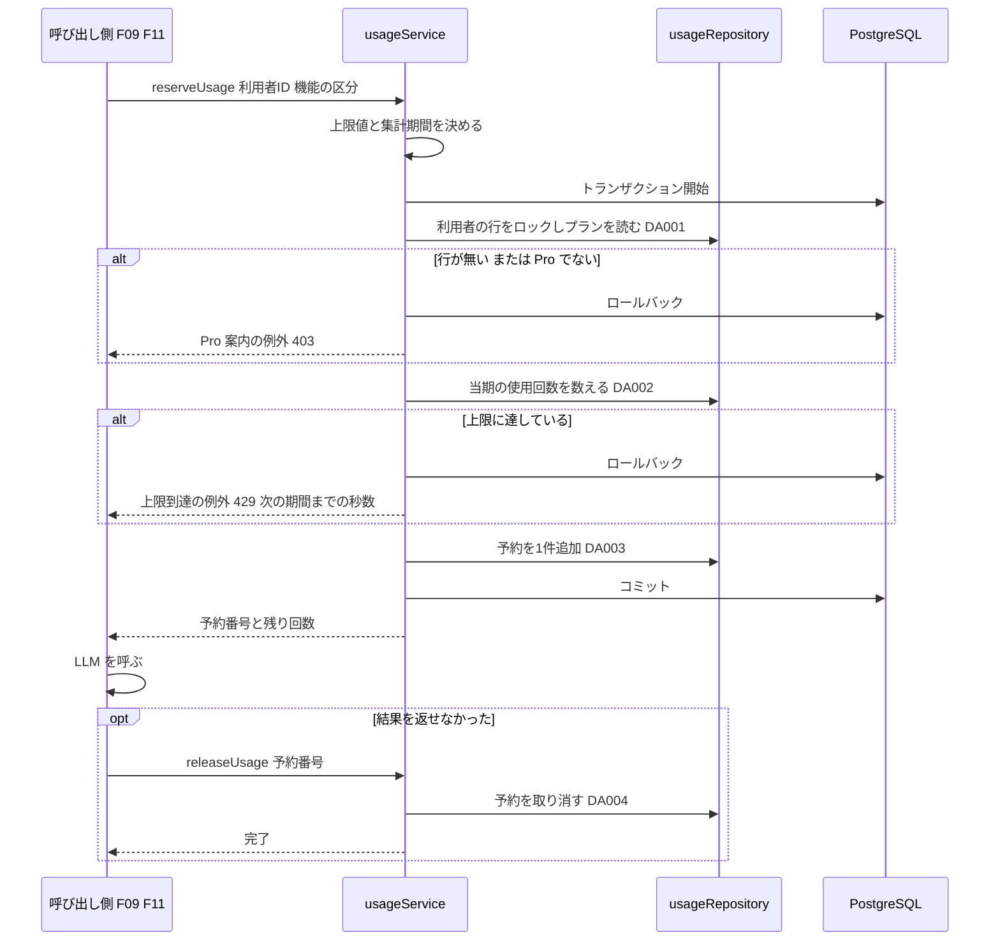

# BE詳細設計書 — F18 Pro機能の利用量制限（区分: 課金）

## 0. 文書情報

| 項目 | 値 |
| :--- | :--- |
| 設計書ID | F18-BE |
| 親ID | F18 |
| 親設計書 | `基本設計書_概要.md` §4.1 機能一覧 |
| 文書名 | BE詳細設計書 F18 Pro機能の利用量制限 |
| 対象システム | Kaine personal pj — arXiv日本語研究ダイジェスト Webアプリ |
| 版 | 1.1（第1回セルフレビュー `docs/reviews/be_F18_review_applied.md` の Major 1件・Minor 2件を反映） |
| 作成日 / 更新日 | 2026-10-26 / 2026-10-26 |
| 作成方法 | creating-backend-detailed-design v1.5.0 準拠。上流の確定設計書と `source/` の企画資料から作成（新規設計） |
| インプット | (a) `source/04_収益化とロードマップ.md:4-5,21,28,41`、`source/03_システム構成.md:39,44`、`source/02_機能要求定義.md:14,16`／(b) `docs/基本設計書_概要.md` §2（BF09・BF11・EX07）、§4（F18 行、オンライン処理設計のエラー応答「利用量上限超過は 429」）、§5（バッチ一覧 B001〜B011）、§6（T005・T010、CRUD図 F18 行、テーブル一覧の注記「利用量…の保存先テーブルが無い」）、§7（内部API一覧）、§8（セキュリティ対策「Pro機能の不正利用」）、§9（環境変数一覧）、§11（ARC008・ARC010）、付録 Q14・Q23・Q27／関連する確定済みの下位設計書: `docs/db/DB.T005.DB物理設計.md`（§4.6 No.10 F18、§6 plan）、`docs/db/DB.T010.DB物理設計.md`（§4.6 No.5 F18、§9 No.1 請求期間の列）、`docs/screens/画面.P107.画面基本設計.md`（H22、§7「当月の利用量の表示は取得手段が上流に無い」）、`docs/detail/be/BE.F09.BE詳細設計.md`（reserveUsage・releaseUsage の呼び出し、`USAGE_LIMIT_EXCEEDED`）、`docs/detail/be/BE.F11.BE詳細設計.md`（同、機能の区分値 `paper_compare`）、`docs/detail/be/BE.F16.BE詳細設計.md`（退会時の削除範囲）／(c) `legacy/`（空） |
| インプットの性質 | `source/` は企画・初期設計案のMarkdown 6ファイルだけで、ルーティング定義・コントローラ・ORM定義・SQLは1つもありません（`source/README.md:5-10`、作業開始時の実ファイル数6件。F15〜F17 作成時から変更なし）。利用量制限について資料にあるのは「Proの高コスト機能には利用量上限を設ける」（`source/04_収益化とロードマップ.md:28`）と、Phase 4 の「従量制限」（`:41`）の2行だけで、上限の値・集計期間・保存先はありません（上流 付録 Q14・Q23）。そのため本書の関数・データアクセスはすべて「上流の定義と、呼び出し側（F09・F11）の設計から導いた計画上の実体」であり、実装済みであることは意味しません。ファイル名・関数名・上限値・テーブルの形・SQL本文は実装時の案で、すべて※推測です |
| 既存版との関係 | `docs/detail/be/BE.F18.BE詳細設計.md` の旧版はありません（本書が初版）。残すべき既存の記述はありません |
| legacy/ との突合 | `legacy/` は空ディレクトリ（ファイル0件）です。突合する既存仕様・業務意図・非機能の記述はありません |

**確認事項（※推測・※上流要確認・※上流未定義の集約）**:

| No | 区分 | 確認事項 | 本書での仮置き | 関連箇所 | 上流の確認事項 |
| :--- | :--- | :--- | :--- | :--- | :--- |
| 1 | 業務 | 上限の値 | AIチャット 1か月100回、複数論文比較 1か月20回（※推測）。環境変数で変えられるようにし、決まった値を設定する | §4 No.3 resolveUsageLimit | Q14 |
| 2 | 業務 | 集計期間（「当期」の区切り） | 日本時間の暦月（毎月1日0時から翌月1日0時まで）。P107 H22 の注記「1か月あたり」（※推測）に合わせる。請求期間に合わせる案は、契約テーブルに請求期間の列が無いため採らない（T010 §9 No.1） | §4 No.4 currentUsagePeriod | Q14 |
| 3 | 業務 | AIチャットと複数論文比較の回数を分けて数えるか、合算するか（F11 §2「F18 の責務」） | 機能ごとに分けて数え、上限も機能ごとに持つ（1回あたりのLLM費用が機能で大きく違うため ※推測） | §3 DA002 | Q14 |
| 4 | テーブル | 利用量の保存先テーブルが上流に無い（※上流未定義。上流 §6 テーブル一覧の注記、付録 Q23） | 本書では表名を `{利用量テーブル}` と書き、仮採番しない。持たせる列の案（予約番号・利用者ID・機能の区分・集計期間の開始日・予約日時・取消日時）を §3 に示し、DB物理設計書の追加を提案する | §3 | Q23 |
| 5 | CRUD | 上流 CRUD図の F18 行は users「R」・subscriptions「R」だけで、利用量の記録（C）・取消（U）を表す列が無い（※上流要確認）。subscriptions を読む目的も上流に無い | 利用量テーブルの追加とあわせて CRUD図に列を加え、F18 に「CRU」を付けることを提案する。subscriptions は本書では読まない（集計期間を暦月にしたため、契約を読む目的が無い。F09・F11 が渡す契約の情報も受け取るだけで使わない）。上流 CRUD図の F18 行の subscriptions を「-」にするか、請求期間に合わせる決定（No.2）とあわせて残すかを確認する | §3 | Q14・Q23 |
| 6 | 業務 | 予約の「期限切れ」（※上流要確認）。F09 は、予約の取消に失敗したときに「未取消の予約は F18 側の期限切れで消える想定」としている | 期限切れは設けない。F09・F11 は成功時に「確定」を呼ばず、予約のまま消費とみなす作りのため、F18 からは「成功して使われた予約」と「取消に失敗した予約」を見分けられない。取消に失敗した予約は消費として数え、F09・F11 が ERROR ログに残す予約番号で運用者が取り消す。F09 §4 answerQuestion 手順3 の記述を本書に合わせる修正を提案する | §4 No.2 releaseUsage | —（下位設計書どうしの不整合） |
| 7 | 退会 | 利用量の記録は利用者に紐づく個人データ（どの機能をいつ使ったか）だが、F16 の削除範囲に入っていない（※上流要確認） | 利用量テーブルの利用者IDに、利用者の行への外部キーの「一緒に削除」（ON DELETE CASCADE）を付ける案とし、F16 の削除のトランザクションにも利用量テーブルの削除を加えることを提案する（F16 §0 確認事項 No.5 の通知設定・配信履歴と同じ扱い） | §3、§6 | Q17・Q23 |
| 8 | 画面 | 当月の残り回数を利用者に見せる取得手段（P107 §7 で ※上流要確認） | 本書では取得APIを設けない。残り回数は F09・F11 の成功応答（`usage.remaining`）で返る。料金画面（P107）や論文詳細（P104）で、機能を使う前に残り回数を見せる場合は、取得APIの追加を上流 Q27 とあわせて確認する | §2 エンドポイントロースター | Q27 |
| 9 | 運用 | 古い集計期間の利用量の行をいつまで残すか | 消さない（コスト監視・利用状況分析 F19 の材料になり得るため）。保持期間が決まれば F19 と合わせて削除の方法を決める | §5 | —（※上流未定義） |
| 10 | 環境変数 | 上限値を持つ環境変数 `USAGE_LIMIT_AI_CHAT`・`USAGE_LIMIT_PAPER_COMPARE` は上流 §9 環境変数一覧に無い（※上流未定義） | 追加する。値が無い・整数でない場合は安全側に倒し、その機能を使わせない（上限0として扱う）とともに ERROR ログを残す | §4 No.3 | Q33 |
| 11 | 整合 | F09 §4・F11 §4 の reserveUsage の行は「発生しうるエラー」を上限到達（429）と保存先の障害（500）だけとしているが、本書の reserveUsage はロックの下でプランを読み直し、Pro でなければ 403 `PRO_REQUIRED` を投げる（下位設計書どうしの不整合） | 本書の 403 を正とする。F09・F11 の呼び出し側は assertProPlan の 403 と同じ業務エラーとして toErrorResponse で扱えるため、処理の変更は不要。F09 §4・F11 §4 の reserveUsage の行の「発生しうるエラー」に 403 を加える修正を提案する | §2 呼び出し側との取り決め、§4 No.1 | —（下位設計書どうしの不整合） |

---

## 1. バックエンド構成・モジュール設計

* **対象ドメイン**: 課金系（機能ID F18 Pro機能の利用量制限）— コストの高い Pro 機能（F09 AIチャット・F11 複数論文比較）について、利用者ごと・機能ごとに集計期間内の利用回数を数え、上限に達していれば実行させない（上流 §4 F18「利用者ごとに利用量の上限を設けて超過時は実行しない」、EX07、ARC008、`source/04_収益化とロードマップ.md:28`）。区分はシステム機能で、利用者が直接呼ぶ画面向けAPIを持たず、F09・F11 のAPIの中から呼ばれる関数（予約・取消）として提供する。LLM の呼び出しや Pro かどうかの一次判定は呼び出し側の責務で、本書は「LLM を呼ぶ前に1回分を確保し、失敗したら戻す」ことだけを担う。
* **対象APIエンドポイント**: 本書が持つエンドポイントは0件。F09 の `POST /api/papers/{arxivId}/chat` と F11 の `POST /api/papers/compare`（どちらも※上流未定義）の中から、本書の関数が呼ばれる。全数と根拠は §2 のエンドポイントロースターを参照。
* **実行基盤**: 呼び出し側と同じく、Next.js の API（Route Handler）として Vercel 上で動きます（上流 §9）。DBへは環境変数 `DATABASE_URL` で PostgreSQL（Supabase）に直接つなぎ、SQLを発行します（F09・F11 と同じSQLクライアント ※推測）。この接続は行単位アクセス制御を通らないため、すべての SQL に利用者IDの条件を付け、利用者IDは呼び出し側がセッションの検証結果から渡した値だけを使います。
* **ディレクトリ/ファイル構造**（F09 §1・F11 §1 の「`lib/usage/` … F18 の担当範囲」に従う。ファイル名はすべて※推測）:

```
web/
├── lib/usage/
│   ├── usageService.ts          # reserveUsage / releaseUsage（F09・F11 から呼ばれる）
│   ├── usageLimits.ts           # resolveUsageLimit（機能ごとの上限値を環境変数から読む）
│   ├── usagePeriod.ts           # currentUsagePeriod（日本時間の暦月の開始と次の開始）
│   └── usageRepository.ts       # DA001〜DA004 のSQL発行
├── lib/chat/chat-service.ts     # answerQuestion（F09 の担当。本書の関数を呼ぶ）
├── lib/compare/…                # comparePapers（F11 の担当。本書の関数を呼ぶ）
└── lib/db/
    └── client.ts                # DATABASE_URL による接続（全機能共通 ※推測）
```

* **処理シーケンス図**（上流 BF09・BF11・EX07 のうち「プランと利用量を確認」を本書の関数・DA へ分解したもの）:



---

## 2. API・インターフェース詳細設計

* **外部サービス連携仕様**: **該当なし**。根拠: 上流 §7 外部連携一覧の全9件（IF01〜IF09）のうち、上流 EX07 の「当期の利用量を確認」に関わるものはありません。本機能は自前の DB だけを読み書きし、LLM（IF04）は呼び出し側（F09・F11）が呼びます。Stripe（IF06・IF07）は、集計期間を暦月にしたため請求期間を問い合わせません（§0 確認事項 No.2）。

| IF-ID | 連携先 | 連携方式 | エンドポイント / 接続先 | 認証方式 | タイムアウト | リトライ方針 | エラー時の挙動 | 定義状況 | 詳細の所在 |
| :--- | :--- | :--- | :--- | :--- | :--- | :--- | :--- | :--- | :--- |
| —（該当なし） | — | — | — | — | — | — | — | — | — |

* **エンドポイントロースター（全数）**:

| No | API ID | メソッド | パス | 概要 | 本機能との関係 | 認証 | 定義状況 | 詳細の所在 |
| :--- | :--- | :--- | :--- | :--- | :--- | :--- | :--- | :--- |
| 1 | —（※上流未定義） | POST | /api/papers/{arxivId}/chat | Pro利用者の論文についての質問に、AIが回答する | エンドポイントは F09 の担当。LLM を呼ぶ前に本書の reserveUsage（機能の区分 `ai_chat`）を、回答を返せなかったときに releaseUsage を呼ぶ | 必要（Pro） | 詳細 | エンドポイント: `docs/detail/be/BE.F09.BE詳細設計.md` §2「POST /api/papers/{arxivId}/chat」／利用量: 本書 §4 No.1・No.2 |
| 2 | —（※上流未定義） | POST | /api/papers/compare | Pro利用者が選んだ複数の論文を、AIが比較・統合して要約する | エンドポイントは F11 の担当。LLM を呼ぶ前に本書の reserveUsage（機能の区分 `paper_compare`）を、結果を返せなかったときに releaseUsage を呼ぶ | 必要（Pro） | 詳細 | エンドポイント: `docs/detail/be/BE.F11.BE詳細設計.md` §2「POST /api/papers/compare」／利用量: 本書 §4 No.1・No.2 |

**総件数: 2件（本書が持つもの0件・他機能が持ち本書の関数を呼ぶもの2件）。全数である根拠**: 上流 §7 内部API一覧の全8件（API01〜API08）に利用量のAPIは0件で、上流 §7 の注記・付録 Q27 にも利用量の取得は挙がっていません。上流 §4 F18 の区分は「システム機能」で、上流 ARC008 の適用範囲のうち利用量の上限を持つのは F09・F11 の2機能（上流 §4 F09・F11「Proの機能で、利用量に上限を設ける」、BF09・BF11 の「プランと利用量を確認」）だけです。この2機能の受け口が F09 §2・F11 §2 の各1件のため、2件としました。10分解説（API04）は Pro 限定の可能性があるものの事前生成の要約を返すだけで LLM を呼ばず、利用量の上限の対象ではありません（上流 §4 オンライン処理設計「事前生成優先」）。カスタム通知（F10）は Pro の特典ですが中身が未定義で、上限の対象としていません（F10 §1 前提4）。当月の利用量の取得API は設けていません（§0 確認事項 No.8）。定義状況は、2件とも状態の変更（利用量の消費）と上限の分岐を含むため「詳細」です（completeness 3-1 の1・2）。

* **呼び出し側との取り決め**（本書の関数の外部仕様。F09 §4・F11 §4 の reserveUsage・releaseUsage の行と一致させる）:

| 関数 | 引数 | 戻り値 | 投げる例外 | 呼び出し側の義務 |
| :--- | :--- | :--- | :--- | :--- |
| reserveUsage | 利用者ID（セッションの検証結果）、契約の情報（受け取るだけで使わない。§0 確認事項 No.5）、機能の区分（`ai_chat` か `paper_compare`） | 予約番号（uuid）と、今回の分を差し引いた当期の残り回数 | 上限到達（429 `USAGE_LIMIT_EXCEEDED`、次の集計期間の開始までの秒数付き）、Pro でない（403 `PRO_REQUIRED`）、DB障害（500） | LLM を呼ぶ前に呼ぶ。入力の検査とプランの一次判定は先に済ませる。429 のときは応答の `Retry-After` に秒数を入れる |
| releaseUsage | 予約番号 | なし | DB障害（500） | 結果を返せなかったとき（論文なし・要約なし・LLM の失敗・検証の不合格・DB障害）にだけ呼ぶ。成功したときは呼ばない（予約がそのまま消費になる）。取消に失敗したら予約番号を ERROR ログに残す |

---

## 3. データアクセス（ORM / クエリ）設計

* **保存先テーブル**（※上流未定義。§0 確認事項 No.4）: 予約1回を1行とする `{利用量テーブル}` を前提にします。列の案は次のとおりで、物理定義は DB物理設計書の追加を待ちます。

| 列の案（論理名） | 列の案（物理名 ※推測） | 型の案 | 意味 |
| :--- | :--- | :--- | :--- |
| 予約番号 | id | UUID（主キー。DB が生成） | 予約1回を一意に決める。取消のときに呼び出し側が渡す |
| 利用者ID | user_id | UUID（users.user_id への外部キー、一緒に削除） | 誰の利用か。退会で利用者を消すと一緒に消える（§0 確認事項 No.7） |
| 機能の区分 | feature | VARCHAR（`ai_chat`・`paper_compare` のどちらか） | どの機能の利用か。上限は機能ごとに数える |
| 集計期間の開始日 | period_start | DATE（日本時間の暦月の1日） | どの集計期間の利用か。数えるときの条件に使う |
| 予約日時 | reserved_at | TIMESTAMPTZ（初期値は現在時刻） | 予約した日時。F19 の利用状況分析の材料 |
| 取消日時 | released_at | TIMESTAMPTZ（空を許す） | 取り消した日時。空なら消費として数える |

  索引の案: 利用者ID・機能の区分・集計期間の開始日の組に、取消日時が空の行だけを対象とする部分索引（当期の使用回数を数える DA002 のため）。

* **データアクセス一覧（全数ロースター）**:

| DA-ID | 処理名 | 呼出元（関数/API） | テーブルID | 対象物理テーブル | 種別 (SELECT/INSERT/UPDATE/DELETE) | 定義状況 (詳細/簡易) | 詳細の所在 |
| :--- | :--- | :--- | :--- | :--- | :--- | :--- | :--- |
| DA001 | 利用者の行のロックとプランの確認 | lockMemberForUsage ← reserveUsage ← F09・F11 の受け口 | T005 | users | SELECT（FOR UPDATE） | 詳細 | §3 詳細定義 DA001 |
| DA002 | 当期の使用回数の集計 | countActiveUsage ← reserveUsage ← F09・F11 の受け口 | —（※上流未定義） | {利用量テーブル} | SELECT | 詳細 | §3 詳細定義 DA002 |
| DA003 | 予約の追加 | insertUsageReservation ← reserveUsage ← F09・F11 の受け口 | —（※上流未定義） | {利用量テーブル} | INSERT | 詳細 | §3 詳細定義 DA003 |
| DA004 | 予約の取消 | releaseUsageReservation ← releaseUsage ← F09・F11 の受け口 | —（※上流未定義） | {利用量テーブル} | UPDATE | 詳細 | §3 詳細定義 DA004 |

**総件数: 4件（SELECT 2件（うち1件は行ロック付き）・INSERT 1件・UPDATE 1件。詳細4件）。全数である根拠**: §2 の取り決めの2関数（予約・取消）の処理に現れるDBアクセスをすべて数えたもの（予約: DA001〜DA003、取消: DA004）で、§4 の関数ロースターのうちリポジトリ層の4関数と1対1で対応します。上流 §6 CRUD図の F18 行（users「R」・subscriptions「R」）のうち、users R → DA001 です。subscriptions R に当たる DA はありません（集計期間を暦月にしたため読む目的が無い。§0 確認事項 No.5）。CRUD図に無い操作は、上流にテーブルが無い利用量の記録（DA002〜DA004。§0 確認事項 No.4・No.5）です。DB物理設計の F18 行のうち、T005 §4.6 No.10「利用量の上限を確かめる前に、プランが Pro かを確かめる」は DA001 に当たり、T010 §4.6 No.5「利用量の上限を確かめる前に契約を読む」に当たる DA は ※上流要確認 です。テーブルID列は上流 §6 テーブル一覧のIDをそのまま引き継いでいます（users=T005）。本機能に DELETE はありません（取消は取消日時を入れる更新で表し、行を残す。F19 の分析と、取消の二重実行を見分けるため）。
**定義状況の判定**（completeness 3-1）: DA001 は同時実行の制御（3-1 の5）とプランによる分岐（3-1 の1）を含む。DA002 は集計期間と取消の扱いの業務ルール（3-1 の7）を含む。DA003 は永続データを書き換え、DA001〜DA002 と同じトランザクションで上限を守る扱い（3-1 の2・5）を含む。DA004 は書き換えと、二重の取消を無害にする扱い（3-1 の2・5）を含む。4件とも「詳細」です。

* **データアクセス詳細定義**（ロースターは本節冒頭の表。本表は定義状況＝詳細の4件を展開する）:

| DA-ID | 処理名 | テーブルID | 対象物理テーブル | JOIN / Include | 抽出条件 (Where) / ソート | トランザクション境界 | N+1対策・性能上の注意 |
| :--- | :--- | :--- | :--- | :--- | :--- | :--- | :--- |
| DA001 | 利用者の行のロックとプランの確認 | T005 | users | なし | 利用者IDが一致する1行に更新のためのロックを付け、プランを読む（`WHERE user_id = $1 FOR UPDATE`）。0行か、プランが Pro でなければ予約しない | 予約のトランザクションの最初の文。トランザクションの初めに、ロックの待ち時間を3秒、文の打ち切り時間を5秒にする（`SET LOCAL lock_timeout = '3s'`、`SET LOCAL statement_timeout = '5s'` ※推測。どちらもこのトランザクションの中だけ有効） | 同じ利用者の予約を1件ずつ順番に処理させるためのロックで、数えてから追加するまでの間に別の予約が割り込んで上限を超えるのを防ぐ。ロックの範囲は本人の1行だけで、別の利用者は待たせない。ロックを持つのは DA001〜DA003 の3文の間だけで、LLM の呼び出しの間は持たない。プランを呼び出し側の確認（F09・F11 の assertProPlan）とは別にここでも読むのは、確認の後に解約の通知（F12）でプランが Free に戻った場合に、ロックの下で最新のプランを確かめるため |
| DA002 | 当期の使用回数の集計 | —（※上流未定義） | {利用量テーブル} | なし | 利用者IDと機能の区分が一致し、集計期間の開始日が当期の開始日で、取消日時が空の行を数える。取り消された予約は数えない。取消されていない予約は、成功して使われたものも結果を返す途中のものも消費として数える | 予約のトランザクションの2文目（DA001 のロックの下） | 部分索引（利用者ID・機能の区分・集計期間の開始日、取消日時が空の行だけ）で、本人の当期の行だけを数える。1人1か月で上限の値（最大100行程度）しか無いため軽い |
| DA003 | 予約の追加 | —（※上流未定義） | {利用量テーブル} | なし | 抽出条件なし（1行の追加）。予約番号と予約日時は DB の初期値に任せ、利用者ID・機能の区分・当期の開始日を入れる。追加した行の予約番号を返す | 予約のトランザクションの3文目。成功したらコミットする | DA002 の結果が上限未満のときだけ発行する。同じ利用者の別の予約は DA001 のロックで待たされるため、2つの予約が同時に上限の最後の1回を取ることは無い |
| DA004 | 予約の取消 | —（※上流未定義） | {利用量テーブル} | なし | 予約番号が一致し、取消日時が空の行の取消日時に現在時刻を入れる（`WHERE id = $1 AND released_at IS NULL`）。すでに取り消された行は条件に合わず0行になるが、成功として扱う | 1文の自動コミット（ロックは取らない） | 主キーで1行を更新する。取り消しの二重実行は条件で無害になり、使用回数が減りすぎることは無い。予約が属する集計期間の回数だけが戻るため、月をまたいで取り消しても当月の回数は変わらない |

* **発行SQL**: 本機能のデータアクセスは ORM を使わず、すべて SQL クライアントからパラメータ付きの SQL を発行します（§1 実行基盤）。値はすべてプレースホルダ（`$1`〜`$3`）で渡し、文字列の連結で SQL を作りません。4件すべての SQL 本文を示します。実行時に組み立てを変える文（動的SQL）はありません。`{利用量テーブル}` はテーブル名の確定後に書き換えます。

**DA001 利用者の行のロックとプランの確認**（詳細）
```sql
-- 予約のトランザクションの初めに実行する（どちらもこのトランザクションの中だけ有効）
SET LOCAL statement_timeout = '5s';
SET LOCAL lock_timeout = '3s';
-- $1: 利用者ID（uuid。呼び出し側がセッションの検証結果から渡す）
SELECT plan
  FROM users
 WHERE user_id = $1
   FOR UPDATE;
-- 0行、または plan が 'pro' でなければ予約しない（Pro 案内の例外）
```

**DA002 当期の使用回数の集計**（詳細）
```sql
-- $1: 利用者ID（uuid）、$2: 機能の区分（'ai_chat' / 'paper_compare'）、$3: 当期の開始日（date。日本時間の暦月の1日）
SELECT count(*) AS used
  FROM {利用量テーブル}
 WHERE user_id      = $1
   AND feature      = $2
   AND period_start = $3
   AND released_at IS NULL;
```

**DA003 予約の追加**（詳細）
```sql
-- $1: 利用者ID（uuid）、$2: 機能の区分、$3: 当期の開始日（date）
INSERT INTO {利用量テーブル} (user_id, feature, period_start)
VALUES ($1, $2, $3)
RETURNING id;
-- id（予約番号）と reserved_at は列の初期値で決まる
```

**DA004 予約の取消**（詳細）
```sql
-- $1: 予約番号（uuid）
UPDATE {利用量テーブル}
   SET released_at = CURRENT_TIMESTAMP
 WHERE id = $1
   AND released_at IS NULL;
-- 0行でも成功として扱う（取消済み、または存在しない予約番号）
```

---

## 4. サーバー側機能・処理ロジック設計（IPO設計）

* **関数ロースター（全数）**: 関数名・ファイル名はすべて実装時の命名案です（※推測）。

| No | ID（関数名） | 所属モジュール | 概要 | 対応DA | 定義状況 | 詳細の所在 |
| :--- | :--- | :--- | :--- | :--- | :--- | :--- |
| 1 | reserveUsage | web/lib/usage/usageService.ts | 1つのトランザクションで、利用者の行のロック・プランの確認・当期の回数の集計・上限の判定・予約の追加を行い、予約番号と残り回数を返す（F09 No.6・F11 No.6 から呼ばれる） | DA001〜DA003 | 詳細 | §4 IPO定義 No.1 |
| 2 | releaseUsage | web/lib/usage/usageService.ts | 予約番号の1回分を取り消す。取消済み・存在しない予約でも成功とする（F09 No.7・F11 No.7 から呼ばれる） | DA004 | 詳細 | §4 IPO定義 No.2 |
| 3 | resolveUsageLimit | web/lib/usage/usageLimits.ts | 機能の区分から、その機能の1か月あたりの上限回数を環境変数で決める。設定が壊れていれば0にする | — | 詳細 | §4 IPO定義 No.3 |
| 4 | currentUsagePeriod | web/lib/usage/usagePeriod.ts | 現在時刻から、日本時間の暦月で当期の開始日と次の集計期間の開始時刻を求める | — | 詳細 | §4 IPO定義 No.4 |
| 5 | lockMemberForUsage | web/lib/usage/usageRepository.ts | 呼出元のトランザクションの中で打ち切り時間とロックの待ち時間を設定し、DA001 を発行してプランか「行なし」を返す | DA001 | 簡易 | §3 発行SQL DA001 |
| 6 | countActiveUsage | web/lib/usage/usageRepository.ts | 呼出元のトランザクションの中で DA002 を発行し、使用回数を数値で返す | DA002 | 簡易 | §3 発行SQL DA002 |
| 7 | insertUsageReservation | web/lib/usage/usageRepository.ts | 呼出元のトランザクションの中で DA003 を発行し、予約番号を返す | DA003 | 簡易 | §3 発行SQL DA003 |
| 8 | releaseUsageReservation | web/lib/usage/usageRepository.ts | DA004 を発行し、取り消した件数（0か1）を返す | DA004 | 簡易 | §3 発行SQL DA004 |

**総件数: 8件（サービス2件・規則2件・リポジトリ4件。詳細4件・簡易4件）。全数である根拠**: §1 のディレクトリ構造に挙げた本機能が持つ4ファイル（usageService.ts・usageLimits.ts・usagePeriod.ts・usageRepository.ts）の関数をすべて数えたものです。サービス関数は §2 の取り決めの2関数（F09 §4 No.6・No.7、F11 §4 No.6・No.7 の reserveUsage・releaseUsage）と1対1、リポジトリ関数は §3 のデータアクセスロースター4件と1対1です。
**本機能を呼ぶ他書の関数（本ロースターに数えない）**: answerQuestion（`docs/detail/be/BE.F09.BE詳細設計.md` §4 No.4）、comparePapers（`docs/detail/be/BE.F11.BE詳細設計.md` §4 No.4）。どちらも持ち主の設計書で定義されています。DB接続（`lib/db/client.ts`）は全機能共通で業務の処理を持たないため数えません（※推測）。
**定義状況の判定**（completeness 3-1）: 状態を変え、上限の分岐と同時実行の制御を持つ reserveUsage、状態を変え二重実行を無害にする releaseUsage、設定の誤りを安全側に倒す分岐を持つ resolveUsageLimit、時差の扱いの業務ルールを持つ currentUsagePeriod を「詳細」としました。1文を発行して結果をそのまま返すリポジトリ関数は「簡易」です（SQL の意味は §3 の詳細定義にあります）。

* **入力・処理・出力（IPO）定義**（ロースターは本節冒頭の表。本表は定義状況＝詳細の4件を展開する）:

| No | 関数名 | 所属モジュール | 引数 (型) | 処理フロー (ステップ単位で具体的に) | 戻り値 | 発生しうるエラー |
| :--- | :--- | :--- | :--- | :--- | :--- | :--- |
| 1 | reserveUsage | web/lib/usage/usageService.ts | userId: string（uuid）, subscription: BillingSubscription \| null（受け取るだけで使わない）, feature: 'ai_chat' \| 'paper_compare' | 1. resolveUsageLimit(機能の区分) で上限回数を得る<br>2. currentUsagePeriod(現在時刻) で当期の開始日と、次の集計期間の開始時刻を得る<br>3. 上限回数が0なら、DBに触れずに上限到達の例外を、次の期間の開始までの秒数付きで投げる（設定の誤りで機能を止めた場合も同じ）<br>4. DB接続を1本取り、トランザクションを始める<br>5. lockMemberForUsage（DA001）で利用者の行をロックしてプランを読む。行が無い、またはプランが Pro でなければ、ロールバックして Pro 案内の例外（`PRO_REQUIRED`）を投げる<br>6. countActiveUsage（DA002）で当期の使用回数を数える。上限回数以上なら、ロールバックして上限到達の例外（`USAGE_LIMIT_EXCEEDED`）を、次の期間の開始までの秒数（切り上げ）付きで投げる<br>7. insertUsageReservation（DA003）で予約を1件追加し、コミットする<br>8. 予約番号と、残り回数（上限回数 − 使用回数 − 1）を返す<br>9. 手順4〜7で DB のエラー（ロックの待ち時間切れを含む）が起きたら、ロールバックして例外をそのまま投げる（予約は残らない） | { reservationId: string, remaining: number } | 上限到達（429）、Pro でない（403）、DB障害・ロックの待ち時間切れ（500） |
| 2 | releaseUsage | web/lib/usage/usageService.ts | reservationId: string（uuid） | 1. 予約番号が uuid の形でなければ、何もせずに戻る（呼び出し側の誤りで、取り消す行が無いため）<br>2. releaseUsageReservation（DA004）を呼ぶ<br>3. 取り消した件数が0でも1でも成功として戻る（取消済み、または存在しない予約番号の場合も、二度目の取消で回数が減りすぎないため）<br>4. DB のエラーはそのまま投げる。呼び出し側（F09・F11）は元の例外を優先し、取消の失敗を予約番号付きの ERROR ログに残す。取り消されなかった予約は消費として数えたまま残り、運用者が予約番号で取り消す（§0 確認事項 No.6） | なし | DB障害（500。呼び出し側がログに残し、利用者への応答は元の例外のまま） |
| 3 | resolveUsageLimit | web/lib/usage/usageLimits.ts | feature: 'ai_chat' \| 'paper_compare' | 1. AIチャットなら環境変数 `USAGE_LIMIT_AI_CHAT`、複数論文比較なら `USAGE_LIMIT_PAPER_COMPARE` を読む（※上流未定義の環境変数。§0 確認事項 No.10）<br>2. 値が無ければ仮置きの既定値（AIチャット100、複数論文比較20。※推測）を使う<br>3. 値が0以上の整数でなければ、上限0として扱い、設定の誤りを ERROR ログに残す（読み違えて上限が外れ、LLM の費用が売上を上回るのを防ぐため。上流 ARC008）<br>4. 上限回数を返す | number（0以上の整数） | なし（設定の誤りはログと上限0で扱う） |
| 4 | currentUsagePeriod | web/lib/usage/usagePeriod.ts | now: 日時（UTC） | 1. 現在時刻を日本時間（UTC+9。夏時間なし）に直す<br>2. 日本時間の年月の1日を当期の開始日とする<br>3. 翌月1日0時（日本時間）を次の集計期間の開始時刻とし、UTC に直す<br>4. 次の期間の開始までの秒数（切り上げ）を求める<br>5. 当期の開始日・次の期間の開始時刻・残り秒数を返す | { periodStart: Date（日付）, nextPeriodStartsAt: Date, secondsUntilNext: number } | なし |

---

## 5. バッチ処理・非同期タスク設計

* **ジョブ実行定義**: **該当なし**。根拠: 上流 §5 バッチ一覧の全11件（B001〜B011）に、利用量を扱うものはありません。上流 §6 CRUD図のバッチの行（B010・B011）の users・subscriptions の列は「-」です。本機能の2関数は、呼び出し側のリクエストの中で処理を終えます。集計期間の切り替えは、数えるときの条件（当期の開始日）で自然に行われるため、月初に回数を0に戻すジョブは要りません。予約の期限切れを掃除するジョブも設けません（§0 確認事項 No.6）。古い期間の行の削除は保持期間が決まってから F19 とあわせて決めます（§0 確認事項 No.9）。

| ジョブ名 | 実行タイミング | 対象テーブル | 処理概要 | タイムアウト |
| :--- | :--- | :--- | :--- | :--- |
| —（該当なし） | — | — | 本機能に定期実行・非同期のジョブはありません | — |

---

## 6. 例外処理・セキュリティ設計

* **エラーハンドリング**: 本機能は応答を作らず、業務エラーと例外を呼び出し側（F09・F11）へ投げます。呼び出し側の toErrorResponse が応答に変えます（F09 §6・F11 §6）。上限到達と Pro でない場合は、利用者の操作で普通に起きる業務エラーとして投げます。DB障害は例外のまま投げ、予約が中途半端に残らないよう必ずロールバックします。ログには利用者IDを出さず、予約番号と機能の区分だけを出します（どの利用者がいつ何回使ったかは個人の行動データのため。上流 ARC010）。

| No | 例外種別 | 発生箇所 | 対応方法 | ログ出力 | クライアント応答（呼び出し側が返すもの） |
| :--- | :--- | :--- | :--- | :--- | :--- |
| 1 | 上限到達 | reserveUsage（手順3・6） | ロールバックし、業務エラーとして次の集計期間の開始までの秒数付きで投げる。予約は追加しない | INFO（機能の区分のみ） | 429 `USAGE_LIMIT_EXCEEDED`、`Retry-After` に秒数（上流 EX07。F09 §2・F11 §2）。LLM は呼ばれない |
| 2 | Pro でない（利用者の行が無い・プランが Free） | reserveUsage（手順5） | ロールバックし、業務エラーとして投げる。呼び出し側の確認の後にプランが変わった場合だけ起きる | INFO（機能の区分のみ） | 403 `PRO_REQUIRED`（F09・F11 と同じコード） |
| 3 | ロックの待ち時間切れ（SQLSTATE 55P03）・文の打ち切り（57014） | lockMemberForUsage（DA001） | ロールバックし、障害として投げる。予約は残らない。同じ利用者の行は、F12 の契約の通知の同期（F12 syncSubscription。Stripe の呼び出しの間、最長で約20秒）と F16 の退会（F16 DA002）もロックするため、その間に依頼が来た場合に起きる。待ち時間を長くすると LLM の締め切り（F09・F11 の55秒）を圧迫するため、3秒で打ち切ってやり直してもらう（※推測） | WARN（機能の区分） | 500 `INTERNAL_ERROR`。利用者はやり直せる（回数は消費されていない） |
| 4 | DB障害（予約の数え上げ・追加） | countActiveUsage・insertUsageReservation | ロールバックし、障害として投げる。予約は残らない | ERROR + スタックトレース | 500 `INTERNAL_ERROR`（回数は消費されていない） |
| 5 | DB障害（予約の取消） | releaseUsageReservation | 障害として投げる。呼び出し側が元の例外を優先し、予約番号を ERROR ログに残す | ERROR（予約番号） | 呼び出し側の元の失敗（404・502・500）のまま。取り消せなかった1回は消費として残り、運用者が取り消す |
| 6 | 上限値の設定の誤り（環境変数が整数でない） | resolveUsageLimit | 例外にせず上限0として扱い、その機能を使わせない | ERROR（環境変数名） | 429 `USAGE_LIMIT_EXCEEDED`（設定が直るまで） |

**総件数: 6件。全数である根拠**: §4 IPO定義の「発生しうるエラー」列と処理フローに現れる失敗を重複を除いて数えたもの（上限到達・Pro でない・ロックの待ち時間切れと打ち切り・予約時の DB障害・取消時の DB障害・設定の誤り）です。予期しない例外は呼び出し側の toErrorResponse がまとめて受けるため、本書では数えません（F09 §6・F11 §6）。応答コードは上流 §4 オンライン処理設計のエラー応答（403・429・500）に合わせています。

* **セキュリティ設計**（上流 §8 を本機能に当てはめたもの）:
  * **Pro機能の不正利用の防止**: 上限の確認と予約は、LLM を呼ぶ前にサーバ側で必ず行います（上流 §8「Pro機能の不正利用」、ARC008）。画面の表示や回数の表示には頼りません。同じ利用者が同時に多数の依頼を送っても、利用者の行のロックの下で数えてから追加するため、上限を超えて予約されることはありません。
  * **他人の回数の操作の防止**: 利用者IDは呼び出し側がセッションの検証結果から渡した値だけを使い、ブラウザから受け取りません。取消は予約番号（推測しにくい uuid）でしか行えず、ブラウザへは渡しません（F09・F11 の応答に予約番号は含まれない）。
  * **設定の誤りへの備え**: 上限値の環境変数が壊れていたら上限0として機能を止め、費用が無制限にかかる方向には倒しません。
  * **個人データ**: 利用量の記録は退会時に消す対象とします（§0 確認事項 No.7）。ログには利用者IDを出しません。

* **トランザクション制御**:

| 処理名 | トランザクション範囲 | ロールバック条件 |
| :--- | :--- | :--- |
| 利用量の予約（reserveUsage） | 1つのトランザクション: 打ち切り時間（5秒）とロックの待ち時間（3秒）の設定 → DA001（利用者の行のロック）→ DA002（当期の回数）→ DA003（予約の追加）→ コミット。LLM の呼び出しはこのトランザクションの外（コミットの後）で呼び出し側が行う | Pro でない、上限到達、どれかの文の失敗、ロックの待ち時間切れのいずれかでロールバックする。ロールバックした場合は予約は残らない |
| 利用量の取消（releaseUsage） | DA004 の1文（自動コミット）。予約とは別のトランザクション | 失敗した場合は文だけが取り消され、予約は消費として残る（§6 No.5） |
| 予約と LLM の呼び出しの間 | トランザクションをまたがない。予約はコミット済みで、結果を返せなければ呼び出し側が取消を呼ぶ（補償） | — |

---

## 7. 利用する方式（共通基盤）

| 方式ID | 名称 | 本書での利用箇所 |
| :--- | :--- | :--- |
| ARC008 | プラン別機能制御・利用量上限 | 本機能の中心となる方式。Pro 限定の高コスト機能（AIチャット・複数論文比較）について、利用者ごと・機能ごとの1か月あたりの上限回数を、LLM を呼ぶ前に予約の形で確保し、上限に達していれば実行させない（§4 No.1、DA001〜DA003）。予約の時にもロックの下でプランを読み直し、Pro でなくなった利用者には使わせない。上限値の設定が壊れているときは機能を止める側に倒す（§4 No.3）。上流の適用範囲「F18」「T005」に該当する |
| ARC010 | 個人データ最小化・削除方針 | 利用量の記録は機能の区分と日時だけを持ち、質問文や比較の内容は持たない。ログに利用者IDを出さない。退会時に利用量の記録を消す（外部キーの一緒に削除と、F16 の削除範囲への追加の提案。§0 確認事項 No.7）。上流の適用範囲は F15・F16・F08 で F18 は含まれていないが、利用量の記録は利用者に紐づく行動データのため当てはめた（※上流要確認） |

**全数である根拠**: 上流 §11.1 の全10件（ARC001〜ARC010）を、本書の §2〜§6 の処理に効いているかで1件ずつ判定しました。上表の2件以外は利用していません。ARC001〜ARC005・ARC009 は論文・要約の生成・検証・ライセンス・表示の仕組みで、本機能は論文・要約を扱いません。ARC006（ジョブ実行基盤）は、本機能がジョブを持たないため使いません（§5）。ARC007（外部APIアクセス制御）は arXiv への問い合わせの制御で、本機能は外部APIを呼びません（LLM の呼び出しの費用を抑えるのは ARC008 の役割として扱う）。
