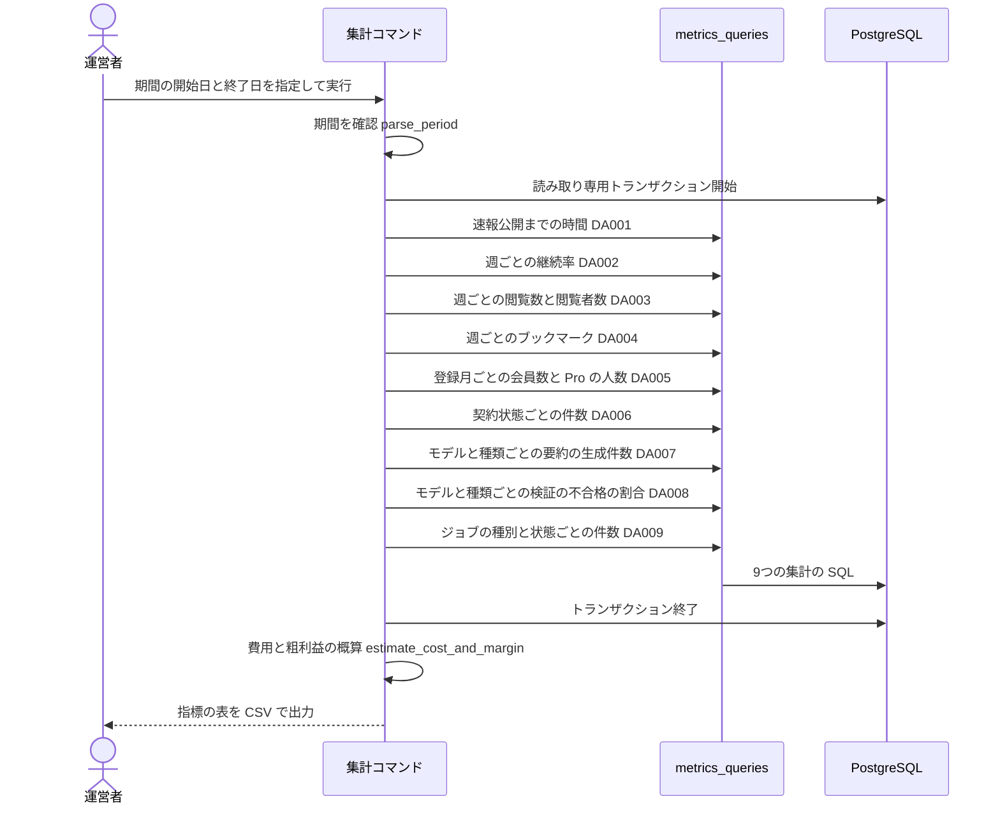

# BE詳細設計書 — F19 コスト監視・利用状況分析（区分: 運用）

## 0. 文書情報

| 項目 | 値 |
| :--- | :--- |
| 設計書ID | F19-BE |
| 親ID | F19 |
| 親設計書 | `基本設計書_概要.md` §4.1 機能一覧 |
| 文書名 | BE詳細設計書 F19 コスト監視・利用状況分析 |
| 対象システム | Kaine personal pj — arXiv日本語研究ダイジェスト Webアプリ |
| 版 | 1.1（第1回セルフレビュー `docs/reviews/be_F19_review_applied.md` の Major 3件・Minor 2件を反映） |
| 作成日 / 更新日 | 2026-10-26 / 2026-10-26 |
| 作成方法 | creating-backend-detailed-design v1.5.0 準拠。上流の確定設計書と `source/` の企画資料から作成（新規設計） |
| インプット | (a) `source/04_収益化とロードマップ.md:5,10-16,18-22,41,43-48`、`source/03_システム構成.md:11,35-44`、`source/02_機能要求定義.md:46-48`／(b) `docs/基本設計書_概要.md` §2（BF17）、§3.2（管理者向け画面0件）、§4（F19 行）、§5（バッチ一覧 B001〜B011）、§6（T001〜T010、CRUD図 F19 行）、§8（セキュリティ対策「個人の行動データの過剰保持」、機密情報管理）、§9（環境変数一覧・ディレクトリ構成）、§10（運用監視の検証指標）、§11（ARC001・ARC004・ARC006・ARC010）、付録 Q05・Q23・Q25・Q34・Q37／関連する確定済みの下位設計書: `docs/db/DB.T001`・`T003`・`T005`・`T007`・`T008`・`T009`・`T010.DB物理設計.md`（各 §4.6 の F19 行、T003 §9 No.9 費用の列、T010 §9 No.1 契約の日時の列）、`docs/detail/be/BE.F09.BE詳細設計.md`（トークン数を INFO ログへ残す）、`docs/detail/be/BE.F15.BE詳細設計.md`（閲覧イベントの保持期間）、`docs/detail/be/BE.F18.BE詳細設計.md`（利用量の記録）／(c) `legacy/`（空） |
| インプットの性質 | `source/` は企画・初期設計案のMarkdown 6ファイルだけで、ルーティング定義・コントローラ・ORM定義・SQLは1つもありません（`source/README.md:5-10`、作業開始時の実ファイル数6件。F15〜F18 作成時から変更なし）。コスト監視・利用状況分析について資料にあるのは、Phase 4 の「コスト監視、利用状況分析」（`source/04_収益化とロードマップ.md:41`）と、検証すべき指標の5行（`:44-48`）、価格案「月額980円・仮」（`:5`）だけで、指標の計算式・集計期間・確認の手段（画面か帳票か）はありません。そのため本書の関数・データアクセス・指標の定義はすべて「上流の定義から導いた計画上の実体」であり、実装済みであることは意味しません。ファイル名・関数名・指標の計算式・SQL本文は実装時の案で、すべて※推測です |
| 既存版との関係 | `docs/detail/be/BE.F19.BE詳細設計.md` の旧版はありません（本書が初版）。残すべき既存の記述はありません |
| legacy/ との突合 | `legacy/` は空ディレクトリ（ファイル0件）です。突合する既存仕様・業務意図・非機能の記述はありません |

**確認事項（※推測・※上流要確認・※上流未定義の集約）**:

| No | 区分 | 確認事項 | 本書での仮置き | 関連箇所 | 上流の確認事項 |
| :--- | :--- | :--- | :--- | :--- | :--- |
| 1 | 機能一覧 | 上流 §4 機能一覧の F19 行は定義状況「簡易」、BE詳細設計書「-（未作成）」だが、本書を作成した（※上流要確認） | 本書を F19 のBE詳細設計とする。上流 §4 の F19 行の BE詳細設計書の列を `detail/be/BE.F19.BE詳細設計.md` に、定義状況を「詳細」に改めることを提案する（指標の計算式に非自明な業務ルールがあり、7テーブルにまたがる集計を持つため。completeness 3-1 の3・7） | §0 | —（※上流未定義） |
| 2 | 実行手段 | 運営者が指標をどこで確認するか（上流 Q05。管理者向け画面は0件） | 管理画面・APIは設けない。運営者が手で実行する集計コマンド（Pythonワーカーの運用スクリプト）が期間を受け取り、指標の表をCSVで出す（※推測・※上流未定義）。定期実行のバッチIDは振らない | §1、§5 | Q05 |
| 3 | 指標 | 指標の計算式（資料は指標名だけ） | §4 No.4 の「指標ロースター」の定義（週の区切りは日本時間の月曜0時。※推測） | §4 | —（※上流未定義） |
| 4 | 費用 | 要約1件ごとの生成費用（トークン数・金額）を記録する列が無い（T003 §9 No.9）。AIチャット・比較の費用は INFO ログにトークン数があるだけ（F09 §4 callLlm） | 「1論文あたり生成コスト」は、要約の生成件数に、モデル・要約の種類ごとの1件あたりの単価の見込み（設定値）を掛けた**概算**とする。単価の設定が無ければ件数だけを出す。AIチャット・比較の費用は本書の対象外とする。利用回数の記録（F18 の利用量テーブル）は上流でテーブルが未定義のため（上流 Q23）、本書の集計にも含めない。テーブルができた時点で、機能ごとの利用回数を指標に加えることを提案する | §4 No.5、§3 DA007 | Q23 |
| 5 | 指標 | 「1ユーザーあたりの粗利益」は、売上（Pro の人数×月額）から費用を引く必要があるが、費用は No.4 の概算しか無く、Stripe の手数料も記録が無い | 「売上の見込み（Pro の人数×月額980円・仮）− 生成費用の概算」を全会員数で割った**概算**として出し、概算であることを表の注記に書く（※推測） | §4 No.5 | Q23 |
| 6 | 指標 | 「解約率」「転換率」を期間別に出すには契約の開始日時・解約日時が要るが、契約テーブルに無い（T010 §9 No.1） | 解約率は集計時点の契約状態の件数（累計）からの概算、転換率は登録月ごとの「現在 Pro の割合」とする。期間別の正確な値は Stripe の管理画面で確認する運用とする（※推測） | §3 DA005・DA006 | —（※上流未定義。T010 §9 No.1） |
| 7 | 指標 | 「ユーザーフィードバック」を集める手段とテーブルが無い（上流 Q37・Q23） | 本書では集計しない（指標ロースターに「算出不可」として載せる） | §4 No.4 | Q37 |
| 8 | CRUD | 速報公開までの時間と論文ごとの生成件数を出すため、F19 が `paper_versions` を参照（R）する（※上流要確認。上流 §6 CRUD図の F19 行の paper_versions は「-」。要約は版にぶら下がるため、論文とつなぐには版を経由する必要がある） | 参照する。上流 CRUD図の F19 行に paper_versions「R」の追加を提案する（F07 §0 確認事項 No.3 と同じ扱い） | §3 DA001・DA007 | —（※上流未定義） |
| 9 | 指標 | 週間利用継続率・要約閲覧数・ブックマーク率の元になる閲覧イベントは、ログイン中の論文詳細の閲覧だけを記録する（F15）。ゲストの閲覧と、保持期間（仮置き180日）より前の閲覧は数えられない。解除したブックマークは行が消えるため数えられない | その制約を指標の注記に明記する。ゲストを含む閲覧数は、アクセス解析（Vercel のアクセスログ）で別に確認する運用とする（※推測） | §4 No.4 | Q25 |
| 10 | 権限 | 集計コマンドがDBへつなぐ権限 | 読み取り専用のDBロール（参照の権限だけを持つ。※推測・※上流未定義）と、その接続文字列を持つ環境変数 `METRICS_DATABASE_URL`（※上流未定義）を設ける。トランザクションも読み取り専用で開き、誤って書き換えない | §1、§6 | Q33・Q34 |

---

## 1. バックエンド構成・モジュール設計

* **対象ドメイン**: 運用系（機能ID F19 コスト監視・利用状況分析）— 運営者が、指定した期間について、資料の検証指標（`source/04_収益化とロードマップ.md:44-48`）とジョブの失敗の傾向を集計して確認する（上流 §4 F19「1論文あたりの生成コスト、利用者あたりの粗利益、継続率・転換率を集計して確認する」、BF17、§10 運用監視）。区分は管理機能で、参照だけを行い、データを書き換えない。上流に管理者向け画面が無いため（上流 §3.2、Q05）、画面向けAPIは持たず、運営者が手で実行する集計コマンドとして設計する（§0 確認事項 No.2）。出力は集計値だけで、個人を特定する値（利用者ID・arXiv ID と利用者の組）は出さない。
* **対象APIエンドポイント**: なし（0件）。全数と根拠は §2 のエンドポイントロースターを参照。
* **実行基盤**: Pythonワーカーの環境（上流 §9 `worker/`）で、運営者がコマンドとして実行します（※推測: `python -m worker.ops.metrics_report --from 2026-10-01 --to 2026-11-01`）。DBへは読み取り専用ロールの接続文字列（環境変数 `METRICS_DATABASE_URL`。※上流未定義、§0 確認事項 No.10）でつなぎ、SQLを発行します（※推測: psycopg）。集計の結果は標準出力へCSVで出し、ファイルへの保存は運営者が行います。
* **ディレクトリ/ファイル構造**（上流 §9「`worker/`（FastAPI・ジョブ・PDF解析）」の想定に従う。ファイル名はすべて※推測）:

```
worker/
└── ops/
    ├── metrics_report.py        # main / parse_period / build_report / render_csv（集計コマンドの入口と進行）
    ├── metrics_formulas.py      # estimate_cost_and_margin（費用と粗利益の概算）
    └── metrics_queries.py       # DA001〜DA009 のSQL発行
```

* **処理シーケンス図**（上流 BF17「運営者による確認」を本書の関数・DA へ分解したもの）:



---

## 2. API・インターフェース詳細設計

* **外部サービス連携仕様**: **該当なし**。根拠: 上流 §7 外部連携一覧の全9件（IF01〜IF09）のうち、上流 BF17 と CRUD図 F19 行（7テーブルの参照だけ）に関わるものはありません。本機能は自前の DB だけを読みます。解約率・転換率の期間別の正確な値や決済手数料は Stripe の管理画面で運営者が確認する運用とし（§0 確認事項 No.5・No.6）、本機能から Stripe（IF06・IF07）は呼びません。LLM の費用の実額も、LLM 提供元の管理画面で確認する運用とし、IF04 は呼びません。

| IF-ID | 連携先 | 連携方式 | エンドポイント / 接続先 | 認証方式 | タイムアウト | リトライ方針 | エラー時の挙動 | 定義状況 | 詳細の所在 |
| :--- | :--- | :--- | :--- | :--- | :--- | :--- | :--- | :--- | :--- |
| —（該当なし） | — | — | — | — | — | — | — | — | — |

* **エンドポイントロースター（全数）**: **該当なし（0件）**。根拠: 上流 §7 内部API一覧の全8件（API01〜API08）に F19 のAPIは無く、上流 §7 の注記・付録 Q27 にもコスト監視・利用状況分析のAPIは挙がっていません。上流 §3.2 の管理者向け画面は0件で、APIを呼ぶ画面がありません（付録 Q05）。本機能は運営者が実行する集計コマンドとして提供します（§1、§0 確認事項 No.2）。

| No | API ID | メソッド | パス | 概要 | 認証 | 定義状況 | 詳細の所在 |
| :--- | :--- | :--- | :--- | :--- | :--- | :--- | :--- |
| —（該当なし） | — | — | — | 本機能に画面向けのエンドポイントはありません | — | — | — |

* **集計コマンドの入出力**（エンドポイントの代わりに、運営者とのインターフェースとして定める。※推測・※上流未定義）:

| 種別 | 項目名 | 型 | 必須 | 制約・バリデーション | 説明 |
| :--- | :--- | :--- | :--- | :--- | :--- |
| 引数 | --from | 日付（YYYY-MM-DD） | 必須 | 実在する日付 | 集計期間の開始日（日本時間のその日の0時から） |
| 引数 | --to | 日付（YYYY-MM-DD） | 必須 | 実在する日付で、`--from` より後、期間は366日以内 | 集計期間の終了日（日本時間のその日の0時まで。この日は含まない）。1年を超える期間は集計が重くなるため断る |
| 環境変数 | METRICS_DATABASE_URL | 文字列 | 必須 | PostgreSQL の接続文字列 | 読み取り専用ロールでの接続先（§0 確認事項 No.10） |
| 環境変数 | METRICS_UNIT_COST_JSON | 文字列（JSON） | 任意 | モデルIDと要約の種類ごとの1件あたりの単価（円）の対応表 | 生成費用の概算に使う（§0 確認事項 No.4）。無ければ費用と粗利益は出さず、件数だけを出す |
| 環境変数 | METRICS_PRO_MONTHLY_PRICE_JPY | 整数 | 任意 | 0以上の整数。無ければ 980（`source/04_収益化とロードマップ.md:5` の仮の価格） | 売上の見込みの計算に使う |
| 出力 | 標準出力 | CSV（UTF-8） | — | 1行目は見出し。列は「指標ID・指標名・区分（週・登録月・生成モデルと要約の種類・契約状態・ジョブの種別と状態のどれか）・値・単位・注記」 | 指標ロースター（§4 No.4）の全指標を、算出できないものも「算出不可」として出す |
| 終了コード | — | 整数 | — | 0: 成功、2: 引数の誤り、1: DB障害・その他の失敗 | 運営者や将来の定期実行が成否を判断できるようにする |

---

## 3. データアクセス（ORM / クエリ）設計

* **データアクセス一覧（全数ロースター）**:

| DA-ID | 処理名 | 呼出元（関数/API） | テーブルID | 対象物理テーブル | 種別 (SELECT/INSERT/UPDATE/DELETE) | 定義状況 (詳細/簡易) | 詳細の所在 |
| :--- | :--- | :--- | :--- | :--- | :--- | :--- | :--- |
| DA001 | 速報公開までの時間の集計 | query_publish_lag ← build_report ← 集計コマンド | T001, T002, T003 | papers, paper_versions, summaries | SELECT | 詳細 | §3 詳細定義 DA001 |
| DA002 | 週ごとの継続率の集計 | query_weekly_retention ← build_report ← 集計コマンド | T008 | view_events | SELECT | 詳細 | §3 詳細定義 DA002 |
| DA003 | 週ごとの閲覧数と閲覧者数の集計 | query_weekly_views ← build_report ← 集計コマンド | T008 | view_events | SELECT | 詳細 | §3 詳細定義 DA003 |
| DA004 | 週ごとのブックマークの集計 | query_weekly_bookmarks ← build_report ← 集計コマンド | T007, T008 | bookmarks, view_events | SELECT | 詳細 | §3 詳細定義 DA004 |
| DA005 | 登録月ごとの会員数と Pro の人数の集計 | query_member_cohorts ← build_report ← 集計コマンド | T005 | users | SELECT | 詳細 | §3 詳細定義 DA005 |
| DA006 | 契約状態ごとの件数の集計 | query_subscription_states ← build_report ← 集計コマンド | T010 | subscriptions | SELECT | 詳細 | §3 詳細定義 DA006 |
| DA007 | モデルと種類ごとの要約の生成件数の集計 | query_generation_counts ← build_report ← 集計コマンド | T002, T003 | paper_versions, summaries | SELECT | 詳細 | §3 詳細定義 DA007 |
| DA008 | モデルと種類ごとの検証の不合格の割合の集計 | query_validation_failures ← build_report ← 集計コマンド | T003 | summaries | SELECT | 詳細 | §3 詳細定義 DA008 |
| DA009 | ジョブの種別と状態ごとの件数の集計 | query_job_states ← build_report ← 集計コマンド | T009 | jobs | SELECT | 詳細 | §3 詳細定義 DA009 |

**総件数: 9件（すべて SELECT。詳細9件）。全数である根拠**: §4 No.4 の指標ロースターのうち、DBから算出する指標の材料を、1つの集計につき1文で数えたものです（M01→DA001、M02→DA002、M03→DA003、M04→DA004、M05→DA005、M06→DA006、M07・M08→DA007 と DA005、M09→DA008、M11→DA009。M10 は算出不可で DA なし）。§4 の関数ロースターのうち、SQLを発行する9関数と1対1で対応します。上流 §6 CRUD図の F19 行（papers・summaries・users・bookmarks・view_events・jobs・subscriptions の「R」）の各操作は、papers R → DA001、summaries R → DA001・DA007・DA008、users R → DA005、bookmarks R → DA004、view_events R → DA002〜DA004、jobs R → DA009、subscriptions R → DA006 に現れます。CRUD図に無い操作は paper_versions の参照（DA001・DA007。§0 確認事項 No.8）です。DB物理設計の「本テーブルを操作する機能」の F19 行（T001 §4.6 No.15、T003 §4.6 No.10、T005 §4.6 No.11、T007 §4.6 No.4、T008 §4.6 No.4、T009 §4.6 No.6、T010 §4.6 No.6）はすべて DA001〜DA009 のどれかに当たります。テーブルID列は上流 §6 テーブル一覧のIDをそのまま引き継いでいます。本機能に INSERT・UPDATE・DELETE はありません。
**定義状況の判定**（completeness 3-1）: 9件とも、指標の計算式という非自明な業務ルール（3-1 の7）と、期間の全件を読む大量件数の集計の性能上の注意（3-1 の6）を含みます。DA001・DA004・DA007 はさらに複数テーブルにまたがります（3-1 の3）。9件とも「詳細」です。

* **データアクセス詳細定義**（ロースターは本節冒頭の表。本表は定義状況＝詳細の9件を展開する。期間の開始・終了は、日本時間の0時を UTC に直した時刻で渡す）:

| DA-ID | 処理名 | テーブルID | 対象物理テーブル | JOIN / Include | 抽出条件 (Where) / ソート | トランザクション境界 | N+1対策・性能上の注意 |
| :--- | :--- | :--- | :--- | :--- | :--- | :--- | :--- |
| DA001 | 速報公開までの時間の集計 | T001, T002, T003 | papers, paper_versions, summaries | 論文に版を内部結合し、版に「日本語・30秒要約・検証に合格」の要約を外部結合する（まだ公開されていない論文も数えるため） | 投稿日時が期間内の論文について、論文ごとに最初の合格の30秒要約の生成日時を求め、投稿日時からの経過時間を出す。投稿された週（日本時間の月曜始まり）ごとに、件数・公開済みの件数・経過時間の中央値と90パーセンタイル（時間単位）を求める。公開の時刻は記録が無いため、合格した要約の生成日時で代える（※推測） | 集計の読み取り専用トランザクションの1文目 | 期間内の論文の数だけ読む。papers の投稿日時の索引（T001 の定義に従う）で期間を絞る。結合は版・要約とも論文ID・論文バージョンIDの索引で引き、論文ごとの追加の問い合わせはしない |
| DA002 | 週ごとの継続率の集計 | T008 | view_events | 自分自身との結合（前の週に閲覧した利用者が、次の週にも閲覧したか） | 期間の1週前から期間の終わりまでの閲覧を、利用者と週（日本時間の月曜始まり）の組にまとめる。週ごとに、前の週に閲覧した利用者数と、そのうち当週にも閲覧した利用者数を出す。継続率はその割合（※推測: 週間利用継続率の定義） | 2文目 | 索引 `idx_view_events_viewed_at` で期間の行だけを読む。保持期間（仮置き180日）より前の閲覧は残っていないため、それより古い期間を指定すると値が小さく出る（§0 確認事項 No.9） |
| DA003 | 週ごとの閲覧数と閲覧者数の集計 | T008 | view_events | なし | 期間内の閲覧を週ごとに数え、閲覧回数（要約閲覧数の材料）と閲覧した利用者数を出す | 3文目 | DA002 と同じ索引で期間の行だけを読む。ゲストの閲覧と、30分以内の開き直しは記録されていないため数えられない（F15 DA001） |
| DA004 | 週ごとのブックマークの集計 | T007, T008 | bookmarks, view_events | 週を鍵に、ブックマークの集計と閲覧者数の集計を完全外部結合する（片方しか無い週も出す） | 期間内に保存されたブックマークを週ごとに数え、保存の件数と保存した利用者数を出す。同じ週に閲覧した利用者数と並べ、ブックマーク率（保存した利用者数 ÷ 閲覧した利用者数）の材料にする（※推測: ブックマーク率の定義） | 4文目 | bookmarks には保存日時だけの索引が無く（T007 の索引は利用者ID・保存日時の組と論文ID）、期間の絞り込みで全件を読む。会員数が増えるほど重くなるため、利用の少ない時間帯に実行する（※推測）。解除したブックマークは行が消えるため数えられない |
| DA005 | 登録月ごとの会員数と Pro の人数の集計 | T005 | users | なし | 期間の終わりより前に登録した会員を、登録月（日本時間）ごとに数え、そのうち現在のプランが Pro の人数を出す。転換率はその割合（登録月ごとの「現在 Pro の割合」。※推測。期間別の正確な転換率は契約の日時が無いため出せない。§0 確認事項 No.6）。全体の会員数と Pro の人数は、月ごとの値の合計で出す | 5文目 | users の全件を読む（会員数の規模では軽い。上流 §8 の規模の目安は月間アクティブ1,000〜30,000人で、上流でも※推測） |
| DA006 | 契約状態ごとの件数の集計 | T010 | subscriptions | なし | 契約の行を状態ごとに数える（期間の条件は付けない。契約に日時の列が無いため）。解約率は「解約済み ÷（解約済み＋課金中の状態の件数）」の累計の概算（※推測。§0 確認事項 No.6）。最初の支払いをしなかった契約（`incomplete`・`incomplete_expired`）は分母に入れない | 6文目 | 契約の行は会員数より少なく、全件を読んでも軽い |
| DA007 | モデルと種類ごとの要約の生成件数の集計 | T002, T003 | paper_versions, summaries | 要約に版を内部結合し、論文IDを得る | 生成日時が期間内の要約を、生成モデルと要約の種類ごとに数え、件数と、対象になった論文の数を出す。あわせて期間全体の行（区分をまたいで重複を除いた論文の数）を同じ文で出す（`GROUPING SETS`）。1つの論文は複数の区分に現れるため、区分ごとの論文の数を足すと重複して数え、1論文あたりの費用が小さく出るためです。1論文あたりの生成件数は区分ごとの割合。不合格の作り直しも件数に入る（作り直しの分も費用がかかるため） | 7文目 | 要約の生成日時だけの索引は無く（T003 の索引は版・種類・言語・生成日時の組）、期間の絞り込みで全件を読む。要約は論文の数の数倍あるため、利用の少ない時間帯に実行する（※推測） |
| DA008 | モデルと種類ごとの検証の不合格の割合の集計 | T003 | summaries | なし | 生成日時が期間内の要約を、生成モデルと要約の種類ごとに、検証済み（合格か不合格）の件数と不合格の件数に数える。要約の誤り率は「不合格 ÷ 検証済み」（※推測。利用者からの誤りの報告は集める手段が無い。上流 Q37）。未検証の要約は分母に入れない | 8文目 | DA007 と同じく期間の全件を読む |
| DA009 | ジョブの種別と状態ごとの件数の集計 | T009 | jobs | なし | ジョブの行を種別と状態ごとに数え、件数・試行回数の合計・一度でも失敗したジョブの件数を出す（期間の条件は付けない。ジョブに日時の列が無いため。T009 §9 No.1） | 9文目 | ジョブの全件を読む。行が増え続ける表のため（T009 §9 No.4 消さない）、件数が百万を超えたら集計の頻度を下げる（※推測） |

* **発行SQL**: 本機能のデータアクセスは ORM を使わず、すべて SQL クライアントからパラメータ付きの SQL を発行します（§1 実行基盤）。値はすべてプレースホルダ（`$1`・`$2`）で渡し、文字列の連結で SQL を作りません（実装の SQL クライアントの書式に合わせて置き換える ※推測）。9件すべての SQL 本文を示します。実行時に組み立てを変える文（動的SQL）はありません。9文は、読み取り専用・REPEATABLE READ のトランザクション（`BEGIN TRANSACTION ISOLATION LEVEL REPEATABLE READ READ ONLY;` … `COMMIT;`）の中で順に発行し、同じ時点のデータで指標をそろえます。共通のパラメータは `$1`: 期間の開始（timestamptz。開始日の日本時間0時）、`$2`: 期間の終了（timestamptz。終了日の日本時間0時。含まない）です。

**DA001 速報公開までの時間の集計**（詳細）
```sql
WITH first_pub AS (
    SELECT p.id                                  AS paper_id,
           p.submitted_at                        AS submitted_at,
           min(s.generated_at)                   AS published_at      -- 最初の合格の30秒要約の生成日時（公開の時刻の代わり）
      FROM papers AS p
      JOIN paper_versions AS pv ON pv.paper_id = p.id
      LEFT JOIN summaries AS s
             ON s.paper_version_id  = pv.id
            AND s.language          = 'ja'
            AND s.summary_type      = 'short'
            AND s.validation_status = 'passed'
     WHERE p.submitted_at >= $1
       AND p.submitted_at <  $2
     GROUP BY p.id, p.submitted_at
)
SELECT date_trunc('week', submitted_at AT TIME ZONE 'Asia/Tokyo')            AS week_jst,
       count(*)                                                              AS papers,
       count(published_at)                                                   AS published_papers,
       percentile_cont(0.5) WITHIN GROUP (
           ORDER BY extract(epoch FROM published_at - submitted_at) / 3600)  AS median_hours,
       percentile_cont(0.9) WITHIN GROUP (
           ORDER BY extract(epoch FROM published_at - submitted_at) / 3600)  AS p90_hours
  FROM first_pub
 GROUP BY 1
 ORDER BY 1;
-- 公開されていない論文（published_at が NULL）は件数には入り、経過時間の計算からは外れる
```

**DA002 週ごとの継続率の集計**（詳細）
```sql
WITH weekly AS (
    SELECT DISTINCT user_id,
           date_trunc('week', viewed_at AT TIME ZONE 'Asia/Tokyo') AS week_jst
      FROM view_events
     WHERE viewed_at >= $1 - INTERVAL '7 days'
       AND viewed_at <  $2
)
SELECT prev.week_jst + INTERVAL '7 days'   AS week_jst,
       count(*)                            AS prev_week_users,   -- 前の週に閲覧した利用者数
       count(cur.user_id)                  AS retained_users     -- そのうち当週にも閲覧した利用者数
  FROM weekly AS prev
  LEFT JOIN weekly AS cur
         ON cur.user_id  = prev.user_id
        AND cur.week_jst = prev.week_jst + INTERVAL '7 days'
 GROUP BY 1
 ORDER BY 1;
-- 継続率 = retained_users ÷ prev_week_users。期間の終わりを越える最後の週は、当週が途中のため出力から外す（build_report で除く）
```

**DA003 週ごとの閲覧数と閲覧者数の集計**（詳細）
```sql
SELECT date_trunc('week', viewed_at AT TIME ZONE 'Asia/Tokyo') AS week_jst,
       count(*)                                                AS views,
       count(DISTINCT user_id)                                 AS viewers
  FROM view_events
 WHERE viewed_at >= $1
   AND viewed_at <  $2
 GROUP BY 1
 ORDER BY 1;
```

**DA004 週ごとのブックマークの集計**（詳細）
```sql
WITH v AS (
    SELECT date_trunc('week', viewed_at AT TIME ZONE 'Asia/Tokyo') AS week_jst,
           count(DISTINCT user_id)                                 AS viewers
      FROM view_events
     WHERE viewed_at >= $1 AND viewed_at < $2
     GROUP BY 1
),
b AS (
    SELECT date_trunc('week', created_at AT TIME ZONE 'Asia/Tokyo') AS week_jst,
           count(*)                                                 AS bookmarks,
           count(DISTINCT user_id)                                  AS bookmarkers
      FROM bookmarks
     WHERE created_at >= $1 AND created_at < $2
     GROUP BY 1
)
SELECT week_jst,
       coalesce(v.viewers, 0)     AS viewers,
       coalesce(b.bookmarkers, 0) AS bookmarkers,
       coalesce(b.bookmarks, 0)   AS bookmarks
  FROM v FULL JOIN b USING (week_jst)
 ORDER BY week_jst;
-- ブックマーク率 = bookmarkers ÷ viewers（viewers が0の週は算出しない）
```

**DA005 登録月ごとの会員数と Pro の人数の集計**（詳細）
```sql
SELECT date_trunc('month', created_at AT TIME ZONE 'Asia/Tokyo') AS cohort_month_jst,
       count(*)                                                  AS members,
       count(*) FILTER (WHERE plan = 'pro')                      AS pro_members_now
  FROM users
 WHERE created_at < $2
 GROUP BY 1
 ORDER BY 1;
-- 転換率（登録月ごと）= pro_members_now ÷ members。$1 は使わない（登録月の推移を全期間で見るため）
```

**DA006 契約状態ごとの件数の集計**（詳細）
```sql
SELECT status,
       count(*) AS subscriptions
  FROM subscriptions
 GROUP BY status
 ORDER BY status;
-- 解約率（累計の概算）= canceled ÷（canceled ＋ trialing・active・past_due・unpaid・paused の合計）
-- incomplete・incomplete_expired は分母に入れない
```

**DA007 モデルと種類ごとの要約の生成件数の集計**（詳細）
```sql
SELECT s.model_id                    AS model_id,       -- 全体の行では NULL
       s.summary_type                AS summary_type,   -- 全体の行では NULL
       GROUPING(s.model_id, s.summary_type) = 3
                                     AS is_total,       -- 真なら期間全体の行
       count(*)                      AS generated,
       count(DISTINCT pv.paper_id)   AS papers
  FROM summaries AS s
  JOIN paper_versions AS pv ON pv.id = s.paper_version_id
 WHERE s.generated_at >= $1
   AND s.generated_at <  $2
 GROUP BY GROUPING SETS ((s.model_id, s.summary_type), ())
 ORDER BY is_total, 1, 2;
-- 区分ごとの行: 1論文あたりの生成件数 = generated ÷ papers
-- 全体の行（is_total が真）: papers は区分をまたいで重複を除いた論文の数。1論文あたりの費用の分母に使う
-- 費用の概算は estimate_cost_and_margin が区分ごとの行に単価を掛けて求める
```

**DA008 モデルと種類ごとの検証の不合格の割合の集計**（詳細）
```sql
SELECT model_id,
       summary_type,
       count(*) FILTER (WHERE validation_status IN ('passed', 'failed')) AS validated,
       count(*) FILTER (WHERE validation_status = 'failed')              AS failed
  FROM summaries
 WHERE generated_at >= $1
   AND generated_at <  $2
 GROUP BY 1, 2
 ORDER BY 1, 2;
-- 要約の誤り率 = failed ÷ validated（validated が0の組は算出しない）
```

**DA009 ジョブの種別と状態ごとの件数の集計**（詳細）
```sql
SELECT job_type,
       status,
       count(*)                                AS jobs,
       sum(attempts)                           AS total_failed_attempts,
       count(*) FILTER (WHERE attempts > 0)    AS jobs_with_failure
  FROM jobs
 GROUP BY 1, 2
 ORDER BY 1, 2;
-- 期間の条件は付けない（ジョブに日時の列が無い）。直近エラー（last_error）は読まない
```

---

## 4. サーバー側機能・処理ロジック設計（IPO設計）

* **関数ロースター（全数）**: 関数名・ファイル名はすべて実装時の命名案です（※推測）。

| No | ID（関数名） | 所属モジュール | 概要 | 対応DA | 定義状況 | 詳細の所在 |
| :--- | :--- | :--- | :--- | :--- | :--- | :--- |
| 1 | main | worker/ops/metrics_report.py | 集計コマンドの入口。引数と環境変数を読み、集計を進め、CSV を出して終了コードを返す | — | 詳細 | §4 IPO定義 No.1 |
| 2 | parse_period | worker/ops/metrics_report.py | 開始日・終了日を検証し、日本時間0時を UTC の時刻に直した期間を返す | — | 詳細 | §4 IPO定義 No.2 |
| 3 | build_report | worker/ops/metrics_report.py | 読み取り専用トランザクションで9つの集計を読み、指標ロースターの全指標の値を組み立てる | DA001〜DA009 | 詳細 | §4 IPO定義 No.3 |
| 4 | （指標ロースター） | worker/ops/metrics_report.py | 出力する指標の一覧と計算式。build_report が使う定義（関数ではなく定義表。ロースターの全数を示すため本表に載せる） | — | 詳細 | §4 指標ロースター |
| 5 | estimate_cost_and_margin | worker/ops/metrics_formulas.py | 生成件数と単価から生成費用の概算を、Pro の人数と月額から売上の見込みを求め、1論文あたりの費用と1利用者あたりの粗利益の概算を出す | — | 詳細 | §4 IPO定義 No.5 |
| 6 | render_csv | worker/ops/metrics_report.py | 指標の値を CSV の行に変えて標準出力へ書く。算出できない値は「算出不可」と注記を出す | — | 簡易 | — |
| 7 | query_publish_lag | worker/ops/metrics_queries.py | DA001 を発行し、行の配列を返す | DA001 | 簡易 | §3 発行SQL DA001 |
| 8 | query_weekly_retention | worker/ops/metrics_queries.py | DA002 を発行し、行の配列を返す | DA002 | 簡易 | §3 発行SQL DA002 |
| 9 | query_weekly_views | worker/ops/metrics_queries.py | DA003 を発行し、行の配列を返す | DA003 | 簡易 | §3 発行SQL DA003 |
| 10 | query_weekly_bookmarks | worker/ops/metrics_queries.py | DA004 を発行し、行の配列を返す | DA004 | 簡易 | §3 発行SQL DA004 |
| 11 | query_member_cohorts | worker/ops/metrics_queries.py | DA005 を発行し、行の配列を返す | DA005 | 簡易 | §3 発行SQL DA005 |
| 12 | query_subscription_states | worker/ops/metrics_queries.py | DA006 を発行し、行の配列を返す | DA006 | 簡易 | §3 発行SQL DA006 |
| 13 | query_generation_counts | worker/ops/metrics_queries.py | DA007 を発行し、行の配列を返す | DA007 | 簡易 | §3 発行SQL DA007 |
| 14 | query_validation_failures | worker/ops/metrics_queries.py | DA008 を発行し、行の配列を返す | DA008 | 簡易 | §3 発行SQL DA008 |
| 15 | query_job_states | worker/ops/metrics_queries.py | DA009 を発行し、行の配列を返す | DA009 | 簡易 | §3 発行SQL DA009 |

**総件数: 15件（入口1件・期間の検証1件・進行1件・指標の定義表1件・概算1件・出力1件・集計の発行9件。詳細5件・簡易10件）。全数である根拠**: §1 のディレクトリ構造に挙げた3ファイル（metrics_report.py・metrics_formulas.py・metrics_queries.py）の関数と、metrics_report.py が持つ指標の定義表をすべて数えたものです。集計の発行の9関数は §3 のデータアクセスロースター9件と1対1です。
**定義状況の判定**（completeness 3-1）: 引数の誤り・DB障害で終了コードが分かれる main、日付と時差の検証を持つ parse_period、トランザクションと9つの集計をまとめる build_report、計算式の業務ルールを持つ指標ロースターと概算の関数を「詳細」としました。値を並べて書き出すだけの render_csv と、1文を発行して結果を返すだけの集計の関数は「簡易」です（SQL と計算式の意味は §3 と指標ロースターにあります）。

* **指標ロースター（全数）**（§4 No.4。CSV に出す指標の一覧。`source/04_収益化とロードマップ.md:44-48` の検証指標と、上流 §10 運用監視のジョブの監視から作る）:

| 指標ID | 指標名 | 出典 | 計算式（※推測） | 区分の単位 | 材料 | 定義状況 | 詳細の所在 |
| :--- | :--- | :--- | :--- | :--- | :--- | :--- | :--- |
| M01 | 新着論文から日本語速報公開までの時間 | `source/04_収益化とロードマップ.md:44` | 投稿日時から、最初に検証に合格した30秒要約の生成日時までの時間の中央値と90パーセンタイル。あわせて投稿された論文の数と、そのうち公開済みの数 | 投稿された週 | DA001 | 詳細 | §3 DA001 |
| M02 | 週間利用継続率 | `:45` | 前の週に論文詳細を開いた会員のうち、当週にも開いた会員の割合 | 週 | DA002 | 詳細 | §3 DA002 |
| M03 | 要約閲覧数 | `:45` | ログイン中の会員が論文詳細を開いた回数（30分以内の開き直しを除く）。あわせて開いた会員の数 | 週 | DA003 | 詳細 | §3 DA003 |
| M04 | ブックマーク率 | `:45` | その週に論文を保存した会員の数 ÷ その週に論文詳細を開いた会員の数。あわせて保存の件数 | 週 | DA004 | 詳細 | §3 DA004 |
| M05 | 無料から有料への転換率 | `:46` | 登録月ごとに、その月に登録した会員のうち現在 Pro の会員の割合。あわせて全体の会員数と Pro の人数 | 登録月 | DA005 | 詳細 | §3 DA005 |
| M06 | 解約率 | `:46` | 解約済みの契約 ÷（解約済み＋課金中の契約）の累計の概算（期間別ではない） | 集計時点 | DA006 | 詳細 | §3 DA006 |
| M07 | 1論文あたり生成コスト | `:47` | 期間内に生成した要約の件数 ÷ 対象になった論文の数（1論文あたりの生成件数）。単価の設定があれば、件数×単価の合計 ÷ 論文の数（円。概算） | 生成モデルと要約の種類 | DA007 | 詳細 | §3 DA007、§4 No.5 |
| M08 | 1ユーザーあたりの粗利益 | `:47` | （Pro の人数×月額 ×期間の月数 − M07 の費用の合計）÷ 全体の会員数（円。概算。決済手数料とAIチャット・比較の費用を含まない） | 期間全体 | DA005・DA007 | 詳細 | §4 No.5 |
| M09 | 要約の誤り率 | `:48` | 検証で不合格になった要約 ÷ 検証済みの要約（合格と不合格） | 生成モデルと要約の種類 | DA008 | 詳細 | §3 DA008 |
| M10 | ユーザーフィードバック | `:48` | 算出不可（集める手段とテーブルが無い。上流 Q37・Q23）。CSV には「算出不可」として出す | — | なし | 簡易 | §0 確認事項 No.7 |
| M11 | ジョブの失敗の傾向 | 上流 §10 運用監視、`source/02_機能要求定義.md:46` | ジョブの種別と状態ごとの件数、試行回数の合計、一度でも失敗したジョブの件数（累計） | ジョブの種別と状態 | DA009 | 詳細 | §3 DA009 |

**指標の総件数: 11件（算出する10件・算出不可1件）。全数である根拠**: `source/04_収益化とロードマップ.md:44-48` の検証指標の5行に書かれた指標名を1つずつ数えた10件（速報公開までの時間、週間利用継続率、要約閲覧数、ブックマーク率、転換率、解約率、1論文あたり生成コスト、1ユーザーあたりの粗利益、要約の誤り率、ユーザーフィードバック）に、上流 §10 運用監視と上流 §4 F19 の「コスト監視」に当たるジョブの失敗の傾向（M11。ジョブの失敗は再処理と費用の増加に直結するため）を加えたものです。上流 §10 の検証指標の列挙とも一致します。

* **入力・処理・出力（IPO）定義**（ロースターは本節冒頭の表。本表は定義状況＝詳細のうち関数の4件を展開する。No.4 の指標ロースターは上の表で展開済み）:

| No | 関数名 | 所属モジュール | 引数 (型) | 処理フロー (ステップ単位で具体的に) | 戻り値 | 発生しうるエラー |
| :--- | :--- | :--- | :--- | :--- | :--- | :--- |
| 1 | main | worker/ops/metrics_report.py | argv: list[str] | 1. `--from`・`--to` を読み、parse_period で期間に変える。誤りなら理由を標準エラーへ出し、終了コード2で終える<br>2. 環境変数 `METRICS_DATABASE_URL` が無ければ、標準エラーへ出して終了コード2で終える<br>3. 単価（`METRICS_UNIT_COST_JSON`）と月額（`METRICS_PRO_MONTHLY_PRICE_JPY`）を読む。単価が JSON として読めなければ、警告を標準エラーへ出し、単価なしとして続ける（件数の指標は出せるため）<br>4. build_report で指標の値を組み立てる<br>5. render_csv で標準出力へ書く<br>6. 終了コード0で終える<br>7. 手順4・5で DB障害・想定外の例外が起きたら、例外の種類とメッセージを標準エラーへ出し（接続文字列は出さない）、終了コード1で終える | 終了コード（0・1・2） | 引数の誤り（2）、DB障害（1） |
| 2 | parse_period | worker/ops/metrics_report.py | from_text: str, to_text: str | 1. どちらも YYYY-MM-DD の実在する日付として読む。読めなければ誤りとする<br>2. 終了日が開始日より後でなければ誤りとする<br>3. 期間が366日を超えれば誤りとする（集計が重くなりすぎるため）<br>4. 開始日・終了日の日本時間0時（UTC+9。夏時間なし）を UTC の時刻に直す<br>5. 期間の開始・終了の時刻と、期間の月数（日数 ÷ 30.4 を小数のまま）を返す | { start: datetime, end: datetime, months: float } | 引数の誤り |
| 3 | build_report | worker/ops/metrics_report.py | conn: DB接続, period, unit_costs: dict \| None, monthly_price: int | 1. 読み取り専用・REPEATABLE READ のトランザクションを始める。文の打ち切り時間を5分にする（集計は数百万行を読むことがあるため ※推測）<br>2. DA001〜DA009 の集計の関数を順に呼ぶ<br>3. トランザクションを閉じる<br>4. 指標ロースターの計算式で、M01〜M09・M11 の値を求める。割り算の分母が0の区分は「算出不可（分母0）」とする。週ごとの指標（M01〜M04）で、期間の始まりか終わりが週の途中に当たる最初と最後の週は、期間に含まれる日だけで数えた値になるため、注記に「週の一部のみ」と付ける（期間を月曜始まり・月曜終わりで指定すれば付かない）。DA002 の最後の週が期間の終わりを越える場合は、その週を除く<br>5. estimate_cost_and_margin で M07 の費用と M08 を求める<br>6. M10 は「算出不可（集める手段なし）」とする<br>7. 各指標に、§0 確認事項 No.4〜No.9 の制約を短い注記として付ける（例: M03「ゲストの閲覧を含まない」、M06「累計の概算」）<br>8. 指標の値の一覧を返す | list[MetricRow] | DB障害・文の打ち切り（呼出元へ投げる） |
| 5 | estimate_cost_and_margin | worker/ops/metrics_formulas.py | generation_rows: DA007 の行, cohort_rows: DA005 の行, unit_costs: dict \| None, monthly_price: int, months: float | 1. 単価が無ければ、費用と粗利益は「算出不可（単価の設定なし）」として返す<br>2. DA007 の行ごとに、生成件数にそのモデル・要約の種類の単価を掛け、合計して期間の生成費用の概算とする。単価の設定に無いモデル・種類の行は費用に含めず、その件数を注記に出す<br>3. 1論文あたりの費用の概算 = 生成費用の合計 ÷ 期間全体の論文の数（DA007 の全体の行の論文の数。区分をまたいで重複を除いた値）。全体の論文の数が0なら「算出不可（分母0）」<br>4. 売上の見込み = 現在の Pro の人数（DA005 の合計）× 月額 × 期間の月数<br>5. 1利用者あたりの粗利益の概算 =（売上の見込み − 生成費用の合計）÷ 全体の会員数（DA005 の合計）。会員数が0なら「算出不可（分母0）」<br>6. 決済手数料とAIチャット・比較の LLM 費用を含まないことを注記に付ける | { cost_total, cost_per_paper, revenue_estimate, margin_per_member, notes } | なし（値が無いときは算出不可として返す） |

---

## 5. バッチ処理・非同期タスク設計

* **ジョブ実行定義**: 上流 §5 バッチ一覧の全11件（B001〜B011）に、F19 の集計を行うものはありません。本機能の集計コマンドは運営者が手で実行するもので、定期実行の登録もジョブキューへの登録もしません（§1、§0 確認事項 No.2）。上流に無い運用の道具のため **※上流未定義** として下表に1件載せ、**バッチIDは振りません**。定期実行（例: 毎週月曜に前週分を集計して保存する）にするかは、上流 Q05 の管理画面の要否とあわせて決めます。

| ジョブ名 | 実行タイミング | 対象テーブル | 処理概要 | タイムアウト |
| :--- | :--- | :--- | :--- | :--- |
| 運用集計コマンド（※上流未定義・バッチID未採番。手動実行） | 運営者が必要なときに手で実行する（利用の少ない時間帯を推奨。DA004・DA007〜DA009 が全件を読むため ※推測） | papers・paper_versions・summaries・users・bookmarks・view_events・jobs・subscriptions（参照のみ） | 指定した期間について、指標ロースター（§4）の11指標を集計し、CSV で出力する | 1文あたり5分（文の打ち切り時間 ※推測）。全体の上限は設けない |

**総件数: 1件（※上流未定義・手動実行）**。根拠: 本機能の処理は上の集計コマンドだけで、ほかに非同期処理・定期実行はありません。

---

## 6. 例外処理・セキュリティ設計

* **エラーハンドリング**: 本機能は利用者への応答を持たず、運営者へは終了コードと標準エラーの文で失敗を知らせます。集計は読み取りだけで、失敗してもデータへの影響はありません。標準エラーと出力には、接続文字列・SQL本文の値・利用者IDを出しません。

| No | 例外種別 | 発生箇所 | 対応方法 | ログ出力 | クライアント応答（運営者への知らせ） |
| :--- | :--- | :--- | :--- | :--- | :--- |
| 1 | 引数の誤り（日付が読めない・期間が逆・366日超） | parse_period | 集計を始めずに終える | 標準エラーに理由 | 終了コード2 |
| 2 | 接続先の設定が無い | main | 集計を始めずに終える | 標準エラーに理由（環境変数名だけ） | 終了コード2 |
| 3 | 単価の設定が読めない | main | 警告を出し、単価なしとして続ける（費用と粗利益は算出不可になる） | 標準エラーに警告 | 終了コード0（件数の指標は出る） |
| 4 | DB障害（接続できない・文の打ち切り・クエリ失敗） | build_report・集計の全関数 | トランザクションを閉じ、集計を中止する。リトライしない（運営者がやり直せるため） | 標準エラーに例外の種類とメッセージ（接続文字列は除く） | 終了コード1。CSV は出さない（一部の指標だけの不完全な表を出さないため） |
| 5 | 分母0（その区分に対象が無い） | build_report・estimate_cost_and_margin | 例外にせず、その値を「算出不可（分母0）」とする | 出さない | 終了コード0 |
| 6 | 予期しない例外 | 全関数 | main がまとめて受ける | 標準エラーに例外の種類とスタックトレース | 終了コード1 |

**総件数: 6件。全数である根拠**: §4 IPO定義の「発生しうるエラー」列と処理フローに現れる失敗（引数の誤り・接続先の設定なし・単価の設定の誤り・DB障害・分母0）に、どこにも当てはまらない予期しない例外（No.6）を加えたものです。

* **セキュリティ設計**（上流 §8 を本機能に当てはめたもの）:
  * **書き換えの防止**: 読み取り専用のDBロール（§0 確認事項 No.10）でつなぎ、トランザクションも読み取り専用で開くため、集計コマンドの誤りでデータが書き換わることはありません。
  * **個人データの扱い**: 出力は週・月・モデル・状態ごとの件数と割合だけで、利用者ID・メールアドレス・利用者と論文の組を出しません（上流 ARC010、§8「個人の行動データの過剰保持」）。閲覧イベントは保持期間の中にあるものだけを読みます（F15）。会員数が少ない時期は、件数の小さい区分から個人が推測できることがあるため、CSV の扱いは運営者の中に限ります（※推測）。
  * **機密情報**: 接続文字列はサーバ側の環境変数にだけ置き、標準エラーにも出しません（上流 §8 機密情報管理）。
  * **負荷**: 全件を読む集計（DA004・DA007〜DA009）があるため、利用の少ない時間帯に実行し、文の打ち切り時間（5分）で長く止まらないようにします。Supabase に読み取り専用の複製（リードレプリカ）を用意できる場合は、そちらへつなぎます（※推測）。

* **トランザクション制御**:

| 処理名 | トランザクション範囲 | ロールバック条件 |
| :--- | :--- | :--- |
| 指標の集計（build_report） | DA001〜DA009 を1つの読み取り専用・REPEATABLE READ のトランザクションにまとめる。9つの指標を同じ時点のデータでそろえるため（例: 会員数と契約数が別の時点で数えられて割合が狂うのを防ぐ） | どれかの文が失敗した場合はトランザクションを閉じて集計を中止する（読み取りだけなのでデータへの影響は無い） |

---

## 7. 利用する方式（共通基盤）

| 方式ID | 名称 | 本書での利用箇所 |
| :--- | :--- | :--- |
| ARC001 | 生成物キャッシュ・重複排除方式 | 1論文あたりの生成件数（M07、DA007）で、同じ論文の要約が何件作られたかを確かめ、生成物の使い回しが効いているか（同じ論文を何度も処理して費用がかさんでいないか）を監視する |
| ARC004 | LLM出力検証方式（事実と推測の区別） | 要約の誤り率（M09、DA008）を、検証で不合格になった割合として出し、モデルごとの検証の結果の傾向を確かめる。速報公開までの時間（M01）は、検証に合格した要約の生成日時で数える |
| ARC006 | ジョブ実行基盤（キュー・リトライ・失敗キュー・監視） | ジョブ実行基盤が `jobs` に残す種別・状態・試行回数を集計し（M11、DA009）、失敗の傾向と再試行の多さ（費用の増加の原因）を運営者が確認できるようにする |
| ARC010 | 個人データ最小化・削除方針 | 閲覧イベント・ブックマーク・会員の表を、件数と割合の集計にだけ使い、個人を特定する値を出力しない。閲覧イベントは保持期間の中のものだけを読む。上流の適用範囲は F15・F16・F08 で F19 は含まれていないが、個人の行動データを読む機能のため当てはめた（※上流要確認） |

**全数である根拠**: 上流 §11.1 の全10件（ARC001〜ARC010）を、本書の §2〜§6 の処理に効いているかで1件ずつ判定しました。上表の4件以外は利用していません。ARC002（段階的生成・公開）・ARC003（要約スキーマ）・ARC005（ライセンス・権利ゲート）・ARC009（表示・編集ポリシー）は要約の生成と表示の仕組みで、本機能は要約の中身を読みません。ARC007（外部APIアクセス制御）は arXiv への問い合わせの制御で、本機能は外部APIを呼びません。ARC008（プラン別機能制御・利用量上限）は Pro 機能の利用可否の判定で、本機能はプランを集計に使うだけで、機能の利用を制御しません。
