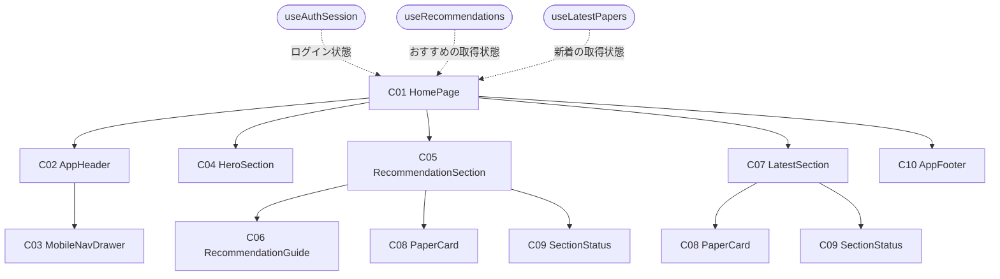
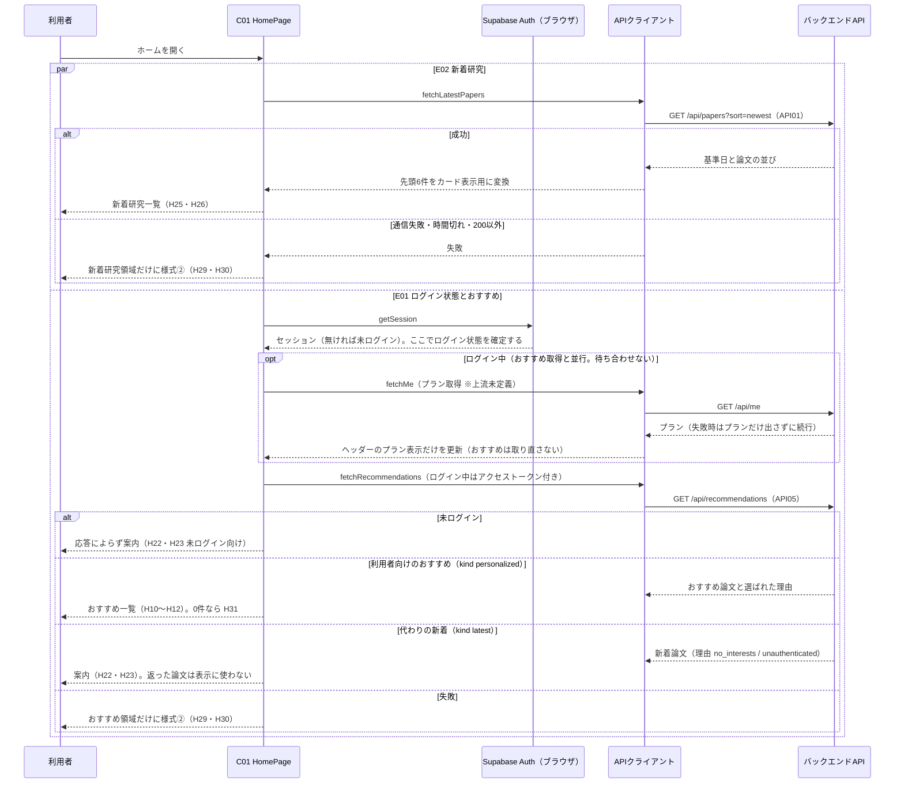
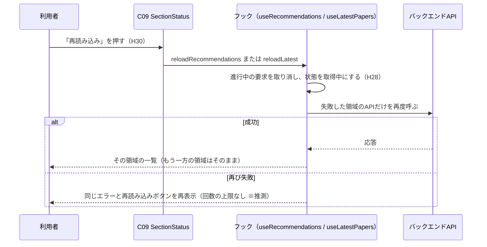

# FE詳細設計書 — P101 ホーム

## 0. 文書情報

| 項目 | 値 |
| :--- | :--- |
| 設計書ID | P101-FE |
| 親ID | P101 |
| 親設計書 | `screens/画面.P101.画面基本設計.md` |
| 版 | 1.0（新規作成） |
| 作成日 | 2026-10-27 |
| 更新日 | 2026-10-27 |
| 作成方法 | 上流の画面基本設計書（P101）、確定済みの `docs/基本設計書_概要.md`、`source/` 配下の企画資料からの設計（creating-frontend-detailed-design v1.5.0 準拠）。API の応答の形は作成済みの BE詳細設計書（`detail/be/BE.F02.BE詳細設計.md`・`detail/be/BE.F08.BE詳細設計.md`・`detail/be/BE.F06.BE詳細設計.md`）に合わせた |
| インプットの性質 | `source/` にあるのは企画・初期設計案の Markdown 6ファイルだけで、本画面のソースコード（ページ・コンポーネント・フック・ルーティング定義）は1行も無い（`source/README.md:5-10`、上流 概要書 §前提）。このため本書は**新規設計**であり、ファイルパス・関数名・State名・型はすべて実装時の命名案（※推測）である。技術スタックは Next.js / TypeScript / Tailwind CSS / shadcn/ui（`source/03_システム構成.md:6`）、認証は Supabase Auth（`source/03_システム構成.md:10`）を前提にする |
| 既存資料の突合 | `legacy/` は空ディレクトリ（ファイル0件）で、突合する既存設計・業務資料は無い。本書の既存版（`docs/detail/fe/FE.P101.FE詳細設計.md`）も無かったため、引き継ぐ記述・ID は上流設計書で採番済みのもの（P101〜P107、C01〜C10、H01〜H33、E01〜E15、様式①〜④、API01・API05、IF05、F02・F06・F08・F17、BF08、EX04、ARC001〜ARC003・ARC009・ARC010、Q04・Q11）だけである |

## 1. フロントエンド構成・ルーティング設計

* **対象ドメイン**: ホーム系（home） — サービスの入口として、利用者の関心に合わせたおすすめ論文と新着研究を並べて表示する画面（上流 P101 §1、`source/01_企画概要.md:24`）。ログイン状態の確認・おすすめの取得・新着研究の取得・領域ごとの失敗表示までを本書の範囲とし、遷移先の画面（P102 新着論文・P103 論文検索・P104 論文詳細・P106 マイページ・P107 料金、および※上流未定義のログイン・会員登録画面と利用規約ページ）の中身は各画面の設計書の責務とする。
* **対象画面ID**: P101
* **ディレクトリ/ファイル構造**（※推測: 実装は未着手。BE詳細設計書 F08 が置いた `web/` 配下の Next.js App Router 構成に合わせた。全21ファイル。内訳は app 1・components 10・hooks 3・lib 8。うち C02・C03・C10・C08・C09 と共通処理は他画面でも使い回す前提で `components/layout`・`components/paper`・`components/common`・`lib` に置く）:

```
web/
├── app/
│   └── page.tsx                         … C01 HomePage（パス `/` のページ。クライアントコンポーネント）
├── components/
│   ├── layout/
│   │   ├── AppHeader.tsx                … C02 共通ヘッダー
│   │   ├── MobileNavDrawer.tsx          … C03 モバイル幅のナビゲーションドロワー
│   │   └── AppFooter.tsx                … C10 共通フッター
│   ├── home/
│   │   ├── HeroSection.tsx              … C04 キャッチコピー帯
│   │   ├── RecommendationSection.tsx    … C05 おすすめ領域
│   │   ├── RecommendationGuide.tsx      … C06 おすすめの代わりに出す案内
│   │   └── LatestSection.tsx            … C07 新着研究領域
│   ├── paper/
│   │   └── PaperCard.tsx                … C08 論文カード（両領域で共用）
│   └── common/
│       └── SectionStatus.tsx            … C09 領域ごとの取得中・失敗・0件表示
├── hooks/
│   ├── useAuthSession.ts                … ログイン状態と利用者表示の取得
│   ├── useRecommendations.ts            … おすすめ取得の状態管理
│   └── useLatestPapers.ts               … 新着研究取得の状態管理
└── lib/
    ├── supabase/browserClient.ts        … ブラウザ用 Supabase クライアントの生成
    ├── api/
    │   ├── requestJson.ts               … API呼び出しの共通処理（時間切れ・応答検査）
    │   ├── recommendationsClient.ts     … GET /api/recommendations の呼び出し
    │   ├── papersClient.ts              … GET /api/papers の呼び出し
    │   └── meClient.ts                  … GET /api/me の呼び出し（※上流未定義。§4.1 No.3）
    ├── home/recommendationView.ts       … おすすめ領域の表示内容の判定と案内文言
    ├── paper/paperCardModel.ts          … 2つのAPIの論文を共通のカード表示用データへ変換
    └── format/display.ts                … 著者・日付・選ばれた理由・基準日注記の整形
```

* **ルーティング定義**（総件数: 1件。全数である根拠: 本書の対象は P101 の1画面だけで、上流 概要書 §3.1 の P101 行のパスが `/` の1件である。遷移先の画面のパスは §5 の遷移先列に記す）:

| パス | コンポーネント | 認証要否 | ルートファイル |
| :--- | :--- | :--- | :--- |
| `/`（※推測。上流 概要書 §3.1・付録 Q03 の仮置き） | HomePage（C01） | 不要（ゲストも閲覧できる。ログイン中のときだけおすすめ論文を表示する — 上流 P101 §1） | `web/app/page.tsx`（App Router はファイル配置がそのままルート定義になるため、別のルート定義ファイルは持たない） |

## 2. コンポーネント設計

* **コンポーネントツリー図**（上流 P101 §3.1 の木をそのまま引き継ぐ。点線は本書で決めた状態の受け渡し）:



* **コンポーネントロースター**（総件数: 10件。全数である根拠: 上流 P101 §3.2 コンポーネント一覧の C01〜C10 の全10件と1対1で対応させ、本書で追加・統合した部品は無い。C08 と C09 は両領域で使い回すため上流と同じく1件として数える。shadcn/ui の汎用部品（Sheet・Button・Skeleton・Card）は画面固有のコンポーネントではないため数えず、使う箇所を各コンポーネントの役割に記す）:

| コンポーネントID | コンポーネント名 | 種類 | ファイルパス | 概要 | 定義状況 | 詳細の所在 |
| :--- | :--- | :--- | :--- | :--- | :--- | :--- |
| C01 | HomePage | Page | `web/app/page.tsx` | ホーム画面全体。3つのフックでログイン状態・おすすめ・新着研究を取得し、各領域へ渡す | 詳細 | §2 コンポーネント詳細定義、§3、§4 |
| C02 | AppHeader | Layout | `web/components/layout/AppHeader.tsx` | 全画面共通のヘッダー。サービス名・導線・ログイン状態を表示し、モバイル幅ではドロワーの開閉を受け持つ | 詳細 | §2 コンポーネント詳細定義、§5 E03〜E09 |
| C03 | MobileNavDrawer | UI | `web/components/layout/MobileNavDrawer.tsx` | モバイル幅でメニューボタンを押したときに開く導線の収納先 | 詳細 | §2 コンポーネント詳細定義、§5 E09・E15 |
| C04 | HeroSection | UI | `web/components/home/HeroSection.tsx` | コンセプトの文言（H09）を中央寄せで表示する帯。Props・内部State を持たず、ログイン状態によらず常に同じ固定文言を出すだけで分岐が無い（上流 P101 H09「常時表示 ※推測」） | 簡易 | 本表 |
| C05 | RecommendationSection | UI | `web/components/home/RecommendationSection.tsx` | おすすめ領域。表示内容の判定結果に従い、一覧・案内・状態表示のどれかを出す | 詳細 | §2 コンポーネント詳細定義、§4 resolveRecommendationView |
| C06 | RecommendationGuide | UI | `web/components/home/RecommendationGuide.tsx` | おすすめを出せない利用者に、未ログインか関心分野未登録かで文言と行き先を変えた案内を出す | 詳細 | §2 コンポーネント詳細定義、§4 getGuideContent |
| C07 | LatestSection | UI | `web/components/home/LatestSection.tsx` | 新着研究領域。基準日の注記と先頭6件の一覧、P102 への導線を出す | 詳細 | §2 コンポーネント詳細定義、§4 useLatestPapers |
| C08 | PaperCard | UI | `web/components/paper/PaperCard.tsx` | 論文1本を日本語タイトルと30秒要約で示すカード。要約の公開状況で表示を切り替える | 詳細 | §2 コンポーネント詳細定義、§4 mapRecommendationItem・mapLatestPaper |
| C09 | SectionStatus | UI | `web/components/common/SectionStatus.tsx` | 領域ごとの取得中・失敗・0件の表示。失敗時は再読み込みボタンを出す | 詳細 | §2 コンポーネント詳細定義、§6 |
| C10 | AppFooter | Layout | `web/components/layout/AppFooter.tsx` | 全画面共通のフッター。arXiv との関係の注記（H32）と利用規約へのリンク（H33）を常に同じ形で出す。Props・内部State を持たず、分岐が無い（上流 P101 H32・H33「常時表示」） | 簡易 | 本表 |

* **コンポーネント詳細定義**（ロースターのうち定義状況＝詳細の8件。Props の型は §3 型定義を参照）:

| コンポーネントID | コンポーネント名 | 種類(Page/UI/HOC等) | ファイルパス | 担当項目ID | Props (型) | 内部State (型) | 役割・概要 |
| :--- | :--- | :--- | :--- | :--- | :--- | :--- | :--- |
| C01 | HomePage | Page | `web/app/page.tsx` | — | なし（ルートのページで、URL の値を受け取らない） | なし（状態は3つのフックが持つ。auth: AuthState、recommendations: RecommendationState、latest: LatestState — §3 ローカルステート定義） | 画面を開いたときにログイン状態の確認（E01 前半）と新着研究の取得（E02）を同時に始め、ログイン状態が分かった時点でおすすめを取得する（E01 後半）。フックから受け取った状態をそのまま子へ配り、どの表示を出すかの判定は子と §4 の関数に任せる。ページ自体はクライアントコンポーネントとする（ブラウザに残る Supabase のセッションを読む必要があるため。`'use client'` ※推測） |
| C02 | AppHeader | Layout | `web/components/layout/AppHeader.tsx` | H01, H02, H03, H04, H05, H06, H07, H08 | auth: AuthState、onLogoClick: () => void | isDrawerOpen: boolean（初期値 false） | サービス名と P102・P103・P107・P106 への導線、ログイン状態を表示する。ログイン状態の確認中は H05〜H07 を出さず、確定してからログインボタン（H06）か利用者表示（H07）のどちらかを出す（確認中に未ログインの表示が一瞬出てから切り替わるちらつきを避けるため ※推測）。H07 はプランの取得状況で出し方を変え、取得中はメールアドレスの横にプラン欄の幅だけ灰色の枠（Skeleton）を出し、取得済みなら「Free」「Pro」を出し、取得失敗ならプラン欄を出さずにメールアドレスだけを出す（※推測）。幅が lg（1024px）未満のときは導線と H05〜H07 を出さずにメニューボタン（H08）だけを出し、ドロワー（C03）の開閉状態をここで持つ（※上流要確認: 上流 P101 §3.2 は C02 の内部State を「-」としているが、C03 は開閉状態を Props で受け取るため、保持先が C02 になる） |
| C03 | MobileNavDrawer | UI | `web/components/layout/MobileNavDrawer.tsx` | H02, H03, H04, H05, H06, H07 | open: boolean、onOpenChange: (open: boolean) => void、auth: AuthState | なし | shadcn/ui の Sheet（右から出る引き出し）で、ヘッダーの導線とログイン状態を縦並びで表示する。中のリンクを押すとドロワーを閉じてから遷移し（E04〜E08）、外側の半透明の背景を押すと遷移せずに閉じる（E15）。表示条件はヘッダーと同じで、H05・H07 はログイン中だけ、H06 は未ログインのときだけ出す |
| C05 | RecommendationSection | UI | `web/components/home/RecommendationSection.tsx` | H10, H11, H12 | view: RecommendationView、onReload: () => void | なし | 表示内容の判定結果（§4 resolveRecommendationView）に従い、次のどれか1つだけを出す。取得中は見出し（H10）と読み込み中表示（H28）、失敗は見出しとエラーと再読み込み（H29・H30）（※推測。※上流要確認: 上流 P101 H10 の表示条件は「利用者向けのおすすめが返ってきたとき」だが、ログイン中の取得中・失敗時にも見出しを出さないと、エラーの帯がどの領域のものか分からなくなるため出す）、0件は見出しと該当なし（H31）、案内は見出しを出さずに案内（C06）、一覧は見出しと論文カード（C08）の並び（デスクトップ3列・モバイル1列のグリッド ※推測）。一覧のカードには選ばれた理由（H12）を付ける |
| C06 | RecommendationGuide | UI | `web/components/home/RecommendationGuide.tsx` | H22, H23 | variant: 'unauthenticated' \| 'noInterests' | なし | 未ログイン向けか関心分野未登録向けかで、案内文（H22）とボタンの文言・行き先（H23）を切り替える（文言と行き先は §4 getGuideContent）。ボタンは Next.js の Link で、押すと遷移する（E11） |
| C07 | LatestSection | UI | `web/components/home/LatestSection.tsx` | H24, H25, H26, H27 | state: LatestState、onReload: () => void | なし | 見出し（H24）と「新着論文をもっと見る」（H27）は取得の成否によらず常に出す。基準日の注記（H25）は取得に成功して基準日が分かったときだけ出す（取得中・失敗のときは基準日が分からないため出さない ※推測。※上流要確認: 上流 P101 H25 の表示条件は「常時表示」）。一覧の位置には、取得中なら H28、失敗なら H29・H30、0件なら H31、それ以外は先頭6件の論文カードを出す。H27 はデスクトップでは見出しの右端のテキストリンク、モバイルでは一覧下の全幅ボタンとして置く |
| C08 | PaperCard | UI | `web/components/paper/PaperCard.tsx` | H12, H13, H14, H15, H16, H17, H18, H19, H20, H21 | paper: PaperCardModel、showReasons: boolean | なし | 上から、選ばれた理由（H12。おすすめ領域で理由があるときだけ）、日本語タイトル（H13。Link で P104 へ）、原題（H14。日本語タイトルがあるときだけ）、著者（H15）、カテゴリ・版・投稿日（H16〜H18）、解析範囲（H19）と30秒要約（H20）を積む。要約が公開されていない論文では H19・H20 の代わりに処理状況（H21）を出す。文字列はすべて React の標準のエスケープを通して描画し、外部由来の文字列を HTML として埋め込まない（上流 概要書 §8 XSS 対策） |
| C09 | SectionStatus | UI | `web/components/common/SectionStatus.tsx` | H28, H29, H30, H31 | status: 'loading' \| 'error' \| 'empty'、errorMessage?: string、onReload?: () => void | なし | 取得中は shadcn/ui の Skeleton でカード形の灰色の枠を3つ並べる（※推測）。失敗は赤色の帯にメッセージ（H29）と「再読み込み」ボタン（H30）を出す（様式②の本画面での読み替え — 上流 P101 §5.1）。0件は「表示できる論文がありません」（H31）を出す。失敗の帯は `role="alert"` を付け、読み上げソフトにも失敗を伝える（※推測） |

## 3. 状態管理（State）設計

* **型定義**（※推測: §3・§4 の表で使う型。API の応答のキー名は BE詳細設計書 F02・F08・F06 の §2 に合わせた）:

```ts
// ログイン状態（useAuthSession が返す）
type AuthState =
  | { status: 'loading' }                                   // セッション確認中
  | { status: 'guest' }                                     // 未ログイン（セッションが無い・取得失敗）
  | { status: 'authenticated'; accessToken: string;
      user: { email: string;
              planStatus: 'loading' | 'loaded' | 'failed';   // プラン取得の進み具合
              plan: 'free' | 'pro' | null } };             // planStatus が loaded のときだけ値を持つ

// useAuthSession の戻り値
type UseAuthSessionResult = { auth: AuthState; refreshSession: () => void };

// API呼び出しの失敗（requestJson が投げる）
class ApiRequestError extends Error {
  kind: 'timeout' | 'aborted' | 'network' | 'http' | 'invalid_response';
  httpStatus: number | null;                                // kind が http のときだけ値を持つ
}

// カード1枚分の表示データ（2つのAPIの差を吸収した共通形）
type PaperCardModel = {
  arxivId: string; titleJa: string | null; titleOriginal: string;
  authors: string[]; primaryCategory: string; version: number;
  submittedAt: string;              // ISO 8601（オフセット付き）
  summaryShort: string | null;
  sourceScope: 'abstract_only' | 'full_text' | null;
  isSummaryPublished: boolean;
  reasons: { type: 'category' | 'keyword' | 'history'; topic: string }[];
};

// おすすめ取得の状態（useRecommendations が返す）
type RecommendationState =
  | { status: 'idle' } | { status: 'loading' } | { status: 'error' }
  | { status: 'success'; kind: 'personalized' | 'latest';
      fallbackReason: 'unauthenticated' | 'no_interests' | null;
      items: PaperCardModel[] };

// おすすめ領域に出す内容（resolveRecommendationView が返す）
type RecommendationView =
  | { type: 'loading' } | { type: 'error' } | { type: 'empty' }
  | { type: 'guide'; variant: 'unauthenticated' | 'noInterests' }
  | { type: 'list'; items: PaperCardModel[] };

// 新着研究取得の状態（useLatestPapers が返す）
type LatestState =
  | { status: 'loading' } | { status: 'error' }
  | { status: 'success'; baseDate: string | null; dateBasis: string;
      timeZone: string; items: PaperCardModel[] };          // items は先頭6件
```

* **グローバルステート / Context定義**（総件数: 1件。全数である根拠: 本画面で画面をまたいで共有される状態は、Supabase Auth のクライアントが保持するログインのセッションだけである。React の Context・状態管理ライブラリは使わず、ログイン状態は C01 から Props で配る — 上流 P101 §3.2 の Props 定義に合わせた）:

| State名 | 型 | スコープ | 初期値 | 更新タイミング | 管理方法 |
| :--- | :--- | :--- | :--- | :--- | :--- |
| Supabase のログインセッション | Session \| null（Supabase の型） | アプリ全体（全画面。ブラウザのタブをまたいで共有） | セッション Cookie があればその内容、無ければ null | ログイン・ログアウト・トークンの自動更新のとき（Supabase のクライアントが更新する。本画面は読むだけで書き換えない） | `@supabase/ssr` のブラウザ用クライアントを1つだけ作って使い回し（getBrowserSupabaseClient）、`auth.getSession()` で読む（※推測） |

* **ローカルステート定義**（総件数: 7件。全数である根拠: コンポーネントロースターの全10件を対象に、状態を持つものを数えた。C01 は3つのフックを通じて6件（ログイン状態・その確認の通し番号・おすすめの取得状態・その取り消し制御・新着研究の取得状態・その取り消し制御。フックの中身はページに属する状態として C01 に計上する）、C02 は1件（ドロワーの開閉）を持つ。フック内部の確認の通し番号1件と取り消し用の制御2件は再描画を伴わない値（useRef）だが、古い応答による上書きと二重取得の防止に効くため数える。C03〜C10 の8件は状態を持たない）:

| コンポーネント | State名 | 型 | 初期値 | 用途 |
| :--- | :--- | :--- | :--- | :--- |
| C01 HomePage（useAuthSession 内） | auth | AuthState | `{ status: 'loading' }` | ログイン中かどうかと、ヘッダーに出す利用者の表示（メールアドレスとプラン）を持つ。おすすめ領域の出し分けと、おすすめAPIへ付けるアクセストークンの出どころになる。ログイン中の確定はセッションを読んだ時点で行い、プランは後から別に埋める（プランの取得を待っておすすめの取得が遅れないようにするため） |
| C01 HomePage（useAuthSession 内） | requestSeqRef | number（useRef） | 0 | ログイン状態の確認を始めるたびに1つ増やす通し番号。確認の結果が返ったとき、手元の番号が最新でなければ（やり直し後に古い確認の結果が届いた場合や画面を離れた後）状態を更新しない。プラン取得の結果にも同じ番号を照らし合わせる |
| C01 HomePage（useRecommendations 内） | state | RecommendationState | `{ status: 'idle' }` | おすすめAPIの取得状態と結果を持つ。ログイン状態が確定するまでは idle のままにして、呼び出しを始めない（アクセストークンを付けて呼ぶため） |
| C01 HomePage（useRecommendations 内） | abortRef | AbortController \| null（useRef） | null | 進行中のおすすめ取得を取り消すための制御。再読み込みやロゴ押下で取り直すときと画面を離れるときに前の要求を取り消し、古い応答が後から届いて表示を上書きするのを防ぐ |
| C01 HomePage（useLatestPapers 内） | state | LatestState | `{ status: 'loading' }` | 新着研究APIの取得状態と結果（基準日・日付の種類・タイムゾーン・先頭6件）を持つ。画面を開いた直後から取得を始めるため、初期値を取得中にする |
| C01 HomePage（useLatestPapers 内） | abortRef | AbortController \| null（useRef） | null | 進行中の新着研究取得を取り消すための制御。用途はおすすめ側と同じ |
| C02 AppHeader | isDrawerOpen | boolean | false | モバイル幅のドロワー（C03）が開いているか。メニューボタン（H08）で反転し、リンク押下・外側押下で閉じる。画面を移ると部品ごと作り直されるため閉じた状態に戻る |
| C03 MobileNavDrawer | なし | — | — | 開閉状態は C02 から Props で受け取り、自身では持たない |
| C04 HeroSection | なし | — | — | 固定文言だけを表示する |
| C05 RecommendationSection | なし | — | — | 表示内容は C01 から受け取った判定結果だけで決まる |
| C06 RecommendationGuide | なし | — | — | 案内の種類は Props で受け取る |
| C07 LatestSection | なし | — | — | 取得状態は C01 から Props で受け取る |
| C08 PaperCard | なし | — | — | 論文1件分の表示データは Props で受け取る。カードを開閉・選択する操作は無い |
| C09 SectionStatus | なし | — | — | どの状態を出すかは Props で受け取る |
| C10 AppFooter | なし | — | — | 固定文言とリンクだけを表示する |

* **永続化ステート**（総件数: 1件。全数である根拠: 本画面が自分で localStorage・sessionStorage・Cookie に書き込む値は無い。ブラウザに保存されている値のうち本画面が読むのは、Supabase Auth がログイン時に保存したセッションの Cookie だけである。閲覧の記録も残さない — 上流 P101 §7「閲覧履歴は記録しない」、ARC010）:

| キー | 保存先 | 型 | 用途 | 有効期限 |
| :--- | :--- | :--- | :--- | :--- |
| `sb-<SupabaseプロジェクトID>-auth-token`（※推測: `@supabase/ssr` の既定の Cookie 名） | Cookie（Supabase のライブラリが書き込む。本画面は読むだけ） | string（アクセストークンと更新用トークンを含む JSON を符号化した値） | ブラウザを閉じてもログイン状態を保ち、本画面を開いたときにログイン中かどうかを判定するために使う。おすすめAPIは、この Cookie か、ここから取り出したアクセストークンで利用者を特定する（BE.F08 §2 リクエストパラメータ） | Supabase Auth の設定に従う（既定ではアクセストークン1時間・更新用トークンで延長 ※推測。上流 概要書 §8「セッションの有効期限は未定義」） |

## 4. クライアント側機能・処理ロジック設計（IPO設計）

* **処理フロー図**（画面を開いたとき — E01・E02。E01 の前半〈セッション確認〉と E02 を同時に始め、E01 の後半〈おすすめ取得〉はセッションが分かってから始める）:



* **処理フロー図**（再読み込み — E13。失敗した領域だけを取り直す）:



* **関数・フックロースター**（総件数: 24件。全数である根拠: ソースコードが無いため、上流 P101 §5 のイベント E01〜E15 の処理と、§4 の表示項目の整形規則（H12・H15・H18・H25・H13/H14・H19〜H21・H22/H23・H27）を、1つの責務を1関数として分けた設計上の全数である。E01→useAuthSession・fetchMe・useRecommendations・fetchRecommendations・resolveRecommendationView、E02→useLatestPapers・fetchLatestPapers、共通の通信→requestJson・getBrowserSupabaseClient、カード整形→mapRecommendationItem・mapLatestPaper・formatAuthors・formatJstDate・formatReason、H25→formatBaseDateNote、H22/H23・E11→getGuideContent、E12→buildLatestMoreHref、E03→handleLogoClick・refreshSession、E09→toggleDrawer、E15→closeDrawer、E04〜E08→handleDrawerLinkClick、E13→reloadRecommendations・reloadLatest。E10・E14 と、デスクトップ幅の E04〜E08 は Next.js の Link が遷移するだけで本書の関数を持たない。関数には上流で採番されたIDが無いため、本書では新たに番号を振らず、関数名を識別子として扱う）:

| 関数名（識別子） | 種別 | 所属 | ファイル | 概要 | 定義状況 | 詳細の所在 |
| :--- | :--- | :--- | :--- | :--- | :--- | :--- |
| useAuthSession | フック | C01 | `web/hooks/useAuthSession.ts` | ブラウザに残るセッションからログイン状態を確かめ、ログイン中ならプランを取得して表示用の利用者情報を作る | 詳細 | 本章 IPO定義 |
| refreshSession | フック内関数 | C01 | `web/hooks/useAuthSession.ts` | ログイン状態の確認をやり直す（E03）。中身は useAuthSession の確認処理（手順1〜6）を呼び直すだけで、独自の分岐を持たない | 簡易 | 本表（確認処理は useAuthSession） |
| getBrowserSupabaseClient | ユーティリティ | 共通 | `web/lib/supabase/browserClient.ts` | ブラウザ用の Supabase クライアントを初回だけ作り、以降は同じものを返す。公開用のURLとキー（`NEXT_PUBLIC_SUPABASE_URL`・`NEXT_PUBLIC_SUPABASE_ANON_KEY`）だけを使い、サーバ用の鍵はブラウザへ渡さない（上流 概要書 §8 機密情報管理）。条件による分岐は「作成済みかどうか」だけで、業務判断を含まない | 簡易 | 本表 |
| fetchMe | APIクライアント | 共通 | `web/lib/api/meClient.ts` | GET /api/me を呼んでログイン中の利用者のプランを得る（※上流未定義。§4.1 No.3） | 詳細 | 本章 IPO定義 |
| requestJson | APIクライアント | 共通 | `web/lib/api/requestJson.ts` | API呼び出しの共通処理。時間切れ・取り消し・ステータス・応答の形を検査し、失敗を1種類の例外にそろえる | 詳細 | 本章 IPO定義 |
| useRecommendations | フック | C01 | `web/hooks/useRecommendations.ts` | ログイン状態が確定したらおすすめAPIを呼び、取得状態を持つ。再読み込み用の関数を返す | 詳細 | 本章 IPO定義 |
| fetchRecommendations | APIクライアント | C01 | `web/lib/api/recommendationsClient.ts` | GET /api/recommendations を呼び、応答をカード表示用の形に変える | 詳細 | 本章 IPO定義 |
| reloadRecommendations | フック内関数 | C01 → C05 → C09 | `web/hooks/useRecommendations.ts` | おすすめの取得をやり直す（E13）。中身は useRecommendations の取得処理を同じ引数で呼び直すだけで、独自の分岐を持たない | 簡易 | 本表（取得処理は useRecommendations） |
| resolveRecommendationView | 判定関数 | C01 → C05 | `web/lib/home/recommendationView.ts` | ログイン状態とおすすめの取得状態から、おすすめ領域に何を出すかを決める | 詳細 | 本章 IPO定義 |
| getGuideContent | 判定関数 | C06 | `web/lib/home/recommendationView.ts` | 案内の種類から、案内文・ボタン文言・行き先を返す | 詳細 | 本章 IPO定義 |
| useLatestPapers | フック | C01 | `web/hooks/useLatestPapers.ts` | 画面を開いた直後から新着研究APIを呼び、取得状態を持つ。再読み込み用の関数を返す | 詳細 | 本章 IPO定義 |
| fetchLatestPapers | APIクライアント | C01 | `web/lib/api/papersClient.ts` | GET /api/papers を新しい順で呼び、先頭6件をカード表示用の形に変える | 詳細 | 本章 IPO定義 |
| reloadLatest | フック内関数 | C01 → C07 → C09 | `web/hooks/useLatestPapers.ts` | 新着研究の取得をやり直す（E13）。中身は useLatestPapers の取得処理を呼び直すだけで、独自の分岐を持たない | 簡易 | 本表（取得処理は useLatestPapers） |
| mapRecommendationItem | 変換関数 | C08 | `web/lib/paper/paperCardModel.ts` | おすすめAPIの論文1件をカード表示用の形に変える | 詳細 | 本章 IPO定義 |
| mapLatestPaper | 変換関数 | C08 | `web/lib/paper/paperCardModel.ts` | 新着研究APIの論文1件をカード表示用の形に変える | 詳細 | 本章 IPO定義 |
| formatAuthors | 整形関数 | C08 | `web/lib/format/display.ts` | 著者の並びを、先頭2名と残りの人数の表記にまとめる（H15） | 詳細 | 本章 IPO定義 |
| formatJstDate | 整形関数 | C08 | `web/lib/format/display.ts` | 日時を日本時間の日付にして、タイムゾーンを併記する（H18） | 詳細 | 本章 IPO定義 |
| formatReason | 整形関数 | C08 | `web/lib/format/display.ts` | 選ばれた理由を利用者向けの文に直す（H12） | 詳細 | 本章 IPO定義 |
| formatBaseDateNote | 整形関数 | C07 | `web/lib/format/display.ts` | 新着研究の基準日の注記を組み立てる（H25） | 詳細 | 本章 IPO定義 |
| buildLatestMoreHref | 整形関数 | C07 | `web/lib/format/display.ts` | 「新着論文をもっと見る」の行き先URLを、表示中の基準日を引き継いで組み立てる（H27・E12） | 詳細 | 本章 IPO定義 |
| handleLogoClick | イベントハンドラ | C01 → C02 | `web/app/page.tsx` | ロゴを押したとき、本画面にいれば先頭へ戻して全体を取り直す（E03） | 詳細 | 本章 IPO定義 |
| toggleDrawer | イベントハンドラ | C02 | `web/components/layout/AppHeader.tsx` | ドロワーの開閉状態を反転する（E09）。現在の値を逆にするだけで分岐を持たない | 簡易 | 本表 |
| closeDrawer | イベントハンドラ | C02 → C03 | `web/components/layout/AppHeader.tsx` | ドロワーを閉じる（E15）。Sheet が「閉じたい」と通知してきたときに開閉状態を false にするだけで分岐を持たない | 簡易 | 本表 |
| handleDrawerLinkClick | イベントハンドラ | C03 | `web/components/layout/MobileNavDrawer.tsx` | ドロワー内のリンクを押したときにドロワーを閉じる（E04〜E08）。遷移そのものは Link が行い、本関数は closeDrawer を呼ぶだけで分岐を持たない | 簡易 | 本表 |

* **入力・処理・出力（IPO）定義**（ロースターのうち定義状況＝詳細の17件。簡易の7件はロースターの概要欄で定義を完結している）:

| 関数名 | 所属コンポーネント | 引数 (型) | 処理フロー (ステップ単位で具体的に) | 戻り値 | 発生しうるエラー |
| :--- | :--- | :--- | :--- | :--- | :--- |
| useAuthSession | C01 | なし | 1. 画面を開いた時点（初回描画後）に、状態を確認中にしたまま getBrowserSupabaseClient で得たクライアントからセッションを読む（`auth.getSession()`）。<br>2. セッションが無い、または読み出しで例外が起きたときは、未ログインとして状態を確定する（エラーは表示しない。上流 P101 E01「セッション取得の失敗はエラー表示せず未ログインとして扱う」）。<br>3. セッションがあれば、その時点でアクセストークンとメールアドレスを入れてログイン中として状態を確定し、プランは「取得中」にする（ここで確定するのは、おすすめの取得をプランの取得の完了まで待たせないため）。<br>4. 続けて fetchMe でプランを取得する（おすすめの取得と並行して進む）。<br>5. 取得できたらプランだけを更新し「取得済み」にする。失敗したときはプランを「取得失敗」にする（ヘッダーのプラン表示だけを省き、画面の他の部分は止めない ※推測）。プランの更新ではログイン状態の種類とアクセストークンを変えないため、おすすめは取り直されない。<br>6. 画面を離れた後、または確認をやり直した後に古い応答が返ったときは状態を更新しない（確認ごとに通し番号 requestSeqRef を1つ増やして控え、結果の番号が最新のときだけ反映する。画面を離れるときも番号を増やして以降の結果を捨てる）。<br>7. 確認のやり直し用に、手順1〜6を最初から行う関数（refreshSession）を返す。やり直しでは状態をいったん確認中に戻す。<br>（ここで得るセッションはブラウザに保存された値をサーバで検証せずに読んだものであり、ヘッダーの表示とおすすめ領域の出し分けにだけ使う。利用者の特定と権限の判断は各APIがトークンを検証して行う — BE.F08 §2） | UseAuthSessionResult | なし（失敗はすべて未ログインまたはプラン取得失敗として吸収する） |
| fetchMe | useAuthSession | accessToken: string、signal: AbortSignal | 1. requestJson で GET /api/me を呼ぶ。要求ヘッダーに `Authorization: Bearer <アクセストークン>` を付ける（BE.F06 §2 API共通仕様）。<br>2. 応答のプランを小文字に正規化して返す（`free` / `pro` 以外の値はプラン不明として null） | 'free' \| 'pro' \| null | 通信失敗・時間切れ・200以外（requestJson の例外がそのまま伝わる。呼び出し元の useAuthSession がプラン取得失敗として扱う） |
| requestJson | fetchMe・fetchRecommendations・fetchLatestPapers | url: string、options: { headers?: Record<string,string>; signal?: AbortSignal; cache?: RequestCache } | 1. 呼び出し元の取り消し信号と、10秒の時間切れ（※推測: 応答時間の目標値は上流 概要書 §8 で未定義）を合わせた取り消し信号を作る。<br>2. `fetch` で GET を送る（Cookie は同じ生成元なので自動で送られる）。<br>3. 時間切れで取り消されたときは「時間切れ」、呼び出し元から取り消されたときは「取り消し」、通信自体ができなかったときは「通信失敗」の例外にする。<br>4. ステータスが200以外なら「HTTPエラー」の例外にし、ステータスを付ける（本画面の2つのAPIは 401 を返さない設計のため、400・500 を含めすべて同じ扱い — BE.F08 §2、BE.F02 §2）。<br>5. 応答本文を JSON として読む。読めないとき、または `status` が `success` でないときは「応答形式不正」の例外にする。<br>6. 応答の `data` を返す | unknown（応答の data 部分） | ApiRequestError（種類: 時間切れ／取り消し／通信失敗／HTTPエラー／応答形式不正、HTTPステータス） |
| useRecommendations | C01 | auth: AuthState | 1. ログイン状態が確認中の間は何もしない（状態は idle のまま）。<br>2. ログイン状態が確定したら（未ログイン・ログイン中のどちらでも）取得を始める。取得をやり直すきっかけは「ログイン状態の種類（確認中・未ログイン・ログイン中）」と「アクセストークン」のどちらかが変わったときと、再読み込みのときだけとする（プランの更新では取り直さない。依存は `auth.status` と `accessToken`）。ログイン状態が確認中に戻ったとき（refreshSession）は進行中の要求を取り消して idle に戻し、再確定を待つ。上流 BF08・P101 E01 のとおり、未ログインでもおすすめAPIを呼ぶ（※上流要確認: 未ログイン時は応答を表示に使わないため、呼び出しを省いてよいか — §4.1 注記）。<br>3. 進行中の要求があれば取り消し、新しい取り消し制御を作り、状態を取得中にする。<br>4. fetchRecommendations に、ログイン中ならアクセストークンを、未ログインなら何も渡さずに呼ぶ。<br>5. 成功したら、応答の種別（利用者向けのおすすめか代わりの新着か）・代わりの理由・論文の並びを状態に入れる。<br>6. 失敗したら状態を失敗にする。ただし取り消しによる失敗のときは状態を変えない（新しい取得が既に始まっているか、画面を離れたため）。<br>7. 画面を離れるときは進行中の要求を取り消す。<br>8. 再読み込み用に、手順3〜6をやり直す関数（reloadRecommendations）を返す | { state: RecommendationState; reloadRecommendations: () => void } | なし（失敗は状態に入れて画面に渡す） |
| fetchRecommendations | useRecommendations | accessToken: string \| null、signal: AbortSignal | 1. requestJson で GET /api/recommendations を呼ぶ。アクセストークンがあれば `Authorization: Bearer <アクセストークン>` を付ける（Cookie より確実に利用者を特定させるため。BE.F08 §2「両方あれば Authorization ヘッダーを優先」）。ブラウザのキャッシュは使わない（`cache: 'no-store'`。応答が利用者ごとに変わるため — BE.F08 §2 レスポンスヘッダー）。<br>2. 応答の種別が「利用者向け」「代わりの新着」のどちらでもないときは応答形式不正の例外にする。<br>3. 論文の各要素を mapRecommendationItem でカード表示用に変える（並び順は応答のまま変えない。上流 P101 H11「採点順のまま」）。<br>4. 種別・代わりの理由・変換後の並びを返す | { kind: 'personalized' \| 'latest'; fallbackReason: 'unauthenticated' \| 'no_interests' \| null; items: PaperCardModel[] } | ApiRequestError（requestJson と同じ種類） |
| resolveRecommendationView | C01（結果を C05 へ渡す） | auth: AuthState、state: RecommendationState | 1. ログイン状態が確認中なら「取得中」を返す。<br>2. 未ログインなら、おすすめの取得状態によらず「案内（未ログイン向け）」を返す（取得の失敗もエラーとして出さない。上流 P101 E01・H22）。<br>3. 以下はログイン中のとき。取得状態が idle か取得中なら「取得中」を返す。<br>4. 取得に失敗していれば「失敗」を返す。<br>5. 応答が代わりの新着で、理由が関心分野未登録のときは「案内（関心分野設定向け）」を返す（返ってきた論文は表示に使わない。上流 P101 H22）。<br>6. 応答が代わりの新着で、理由が未ログインのとき（画面側ではログイン中だが、サーバ側でトークンが期限切れ・無効と判定された場合）は「案内（未ログイン向け）」を返す（※推測: ログインし直しを促すのが利用者にとって正しい行き先のため）。<br>7. 応答が利用者向けのおすすめで0件なら「0件」を返す。<br>8. それ以外は「一覧」とその論文の並びを返す | RecommendationView | なし（入力の組み合わせはすべて上の分岐で尽くされる） |
| getGuideContent | C06 | variant: 'unauthenticated' \| 'noInterests' | 1. 未ログイン向けなら、案内文「会員登録すると、関心分野に合わせたおすすめ論文が表示されます」、ボタン「ログイン・会員登録」、行き先 `/login?next=/` を返す（行き先の画面は※上流未定義。上流 付録 Q04。ログイン後に本画面へ戻すため戻り先を付ける ※推測）。<br>2. 関心分野設定向けなら、案内文「関心分野を設定すると、あなたに合わせたおすすめ論文が表示されます」、ボタン「関心分野を設定する」、行き先 `/mypage#interests`（P106 の関心分野の位置 ※推測）を返す。<br>（文言はすべて上流 P101 H22・H23 の※推測をそのまま使う） | { message: string; buttonLabel: string; href: string } | なし |
| useLatestPapers | C01 | なし | 1. 画面を開いた時点で、ログイン状態の確認を待たずに取得を始める（上流 P101 E02「E01 の結果を待たずに実行」）。<br>2. 進行中の要求があれば取り消し、新しい取り消し制御を作り、状態を取得中にする。<br>3. fetchLatestPapers を呼ぶ。<br>4. 成功したら、基準日・日付の種類・タイムゾーン・先頭6件を状態に入れる。0件のときも成功として入れる（C07 が該当なし表示を出す）。<br>5. 失敗したら状態を失敗にする。取り消しによる失敗のときは状態を変えない。<br>6. 画面を離れるときは進行中の要求を取り消す。<br>7. 再読み込み用に、手順2〜5をやり直す関数（reloadLatest）を返す | { state: LatestState; reloadLatest: () => void } | なし（失敗は状態に入れて画面に渡す） |
| fetchLatestPapers | useLatestPapers | signal: AbortSignal | 1. requestJson で GET /api/papers を、並び順に新しい順（`sort=newest`）だけを付けて呼ぶ。日付とカテゴリは付けない（API が最新の投稿日を基準日にして返すため。BE.F02 §2 date「指定なし」）。<br>2. 応答の論文の並びから先頭6件だけを取り出す（上流 P101 H26「表示件数は6件 ※推測」。API に件数の指定が無いため画面側で切り詰める — §4.1 注記）。<br>3. 6件それぞれを mapLatestPaper でカード表示用に変える（並び順は応答のまま）。<br>4. 基準日・日付の種類・タイムゾーンと変換後の並びを返す | { baseDate: string \| null; dateBasis: string; timeZone: string; items: PaperCardModel[] } | ApiRequestError（requestJson と同じ種類） |
| mapRecommendationItem | fetchRecommendations | item: おすすめAPIの論文1件（BE.F08 §2 応答項目） | 1. arXiv ID・原題・日本語タイトル・著者・主カテゴリ・投稿日時・30秒要約・解析範囲・選ばれた理由を同名の項目へ移す。<br>2. 版は応答の版番号（`version`）をそのまま使う。<br>3. 要約の表示状態が「公開済み」（`published`）のときだけ要約公開ありとし、それ以外の値はすべて未公開として扱う（2つのAPIで未公開を表す値が違うため — 本行末尾の注記）。<br>4. 公開済みでも30秒要約の本文が空のときは未公開として扱う（カードに空の要約欄を出さないため） | PaperCardModel | なし（応答の形の検査は requestJson と fetchRecommendations で済んでいる） |
| mapLatestPaper | fetchLatestPapers | paper: 新着研究APIの論文1件（BE.F02 §2 応答項目） | 1. 原題は応答の `title` から、30秒要約は `shortSummary` から移す（おすすめAPIとキー名が違う）。<br>2. 版は表示中の要約の対象になった版（`displayVersion`）を使う（上流 P101 H17「表示中の要約の対象となった版を出す」）。<br>3. 要約の表示状態が「公開済み」のときだけ要約公開ありとし、それ以外（新着研究APIでは「処理中」`processing`）は未公開とする。公開済みでも本文が空なら未公開とする。<br>4. 選ばれた理由は空の並びにする（新着研究のカードには理由を出さない） | PaperCardModel | なし |
| formatAuthors | C08 | authors: string[] | 1. 著者が0名なら「著者情報なし」を返す（※推測）。<br>2. 2名以下なら全員を「、」でつないで返す。<br>3. 3名以上なら先頭2名を「、」でつなぎ、残りの人数を「ほか N名」として後ろに付ける（上流 P101 H15 ※推測） | string | なし |
| formatJstDate | C08 | isoDateTime: string | 1. オフセット付きの日時を日本時間（`Asia/Tokyo`）に直す（おすすめAPIは UTC、新着研究APIは日本時間で返すため、どちらも同じ日付になるよう必ず変換する）。<br>2. `YYYY-MM-DD` の形にし、後ろに「（JST）」を付ける（上流 P101 H18、ARC009「日付には表示タイムゾーンを併記」）。<br>3. 日時として読めない値のときは「日付不明」を返す（※推測） | string（例「2026-10-25（JST）」） | なし |
| formatReason | C08 | reason: { type; topic } | 1. 理由の種類が関心カテゴリ一致か関心キーワード一致なら「関心分野「{トピック}」に一致」を返す。<br>2. 最近の閲覧・保存と同じ分野なら「最近よく読む分野「{トピック}」」を返す。<br>3. それ以外の種類は表示しない（空文字を返し、C08 はその理由を出さない。API の種類が増えても誤った文言を出さないため）。<br>（文言は BE.F08 §4 区分値 V04 の想定と上流 P101 H12 ※推測に合わせた。カードには理由を最大3件まで横に並べる — BE.F08 の reasons は0〜3件） | string | なし |
| formatBaseDateNote | C07 | baseDate: string \| null、dateBasis: string、timeZone: string | 1. 日付の種類を日本語にする。投稿日（`submitted`）なら「投稿日」、新着公開日（`announced` ※推測: 上流 付録 Q11 で決まれば BE.F02 が値を変える）なら「新着公開日」、それ以外は「基準日」とする。<br>2. タイムゾーンが日本時間（`Asia/Tokyo`）なら「JST」、それ以外はその値をそのまま表記にする。<br>3. 基準日があれば「{日付の種類} {基準日}（{タイムゾーン}）に投稿・公開された論文」の形で返す（上流 P101 H25 の例に合わせ、種類が投稿日なら「投稿された論文」、新着公開日なら「公開された論文」）。<br>4. 基準日が無い（DB に論文が1件も無い）ときは空文字を返し、C07 は H25 を出さない（※推測） | string | なし |
| buildLatestMoreHref | C07 | baseDate: string \| null | 1. 基準日があれば `/papers?date={基準日}` を返す（本画面で見ていた日付から P102 を始められるようにする。上流 P101 E12「基準日を引き継ぐ ※推測」）。<br>2. 基準日が無いとき、または新着研究の取得中・失敗のときは `/papers` を返す（P102 側の初期値に任せる） | string | なし |
| handleLogoClick | C01（C02 から呼ばれる） | event: React.MouseEvent | 1. 現在のパスが本画面（`/`）でなければ何もしない（Link が `/` へ遷移し、本画面が新たに表示されて E01・E02 が走る）。<br>2. 本画面にいるときは、Link の既定の遷移を止める（同じページへの遷移では画面が作り直されず、取り直しが起きないため）。<br>3. ドロワーが開いていれば閉じる。<br>4. 画面の先頭へスクロールする。<br>5. ログイン状態の確認をやり直し（refreshSession）、新着研究を取り直す（reloadLatest）。おすすめは reloadRecommendations を呼ばない。ログイン状態がいったん確認中に戻って再確定することで useRecommendations が1回だけ取り直すため、ここで呼ぶと二重に取得してしまう（上流 P101 E03「E01 を再度実行する」） | void | なし（取得の失敗は各フックが状態として扱う） |

* **API応答の差の注記**（※上流要確認）: おすすめAPI（BE.F08）と新着研究API（BE.F02）は、上流 概要書 §7 API05 で「GET /api/papers と同じ要素構成」とされているが、BE詳細設計書ではキー名と値が次のとおり食い違っている。本書は2つの変換関数（mapRecommendationItem・mapLatestPaper）で差を吸収するが、BE側でそろえるのが望ましい。(1) 原題: `titleOriginal` と `title`。(2) 30秒要約: `summaryShort` と `shortSummary`。(3) 版: `version`（最新版）と `displayVersion`（要約の対象の版）。(4) 要約未公開の値: `not_published` と `processing`。(5) 投稿日時のオフセット: UTC（`Z`）と日本時間（`+09:00`）。

### 4.1 呼出API 全数ロースター（BE詳細設計書への入口）

総件数: 9件（本画面が直接呼ぶ境界4件＋FE完結の処理5件）。全数である根拠: 上流 P101 §5 呼出APIロースターの3件（API05・API01・IF05）に、本書で H07 のプラン表示のために使う GET /api/me（※上流未定義）を加え、Supabase Auth のセッション取得は API を介さずブラウザのライブラリが読むため IF05 の行として扱った。上流 概要書 §7 内部API一覧の全8件のうち、API02〜API04・API06〜API08 は本画面からは呼ばない（検索は P103、論文詳細と要約は P104、ブックマークは P104・P106、決済は P107 の責務）。FE完結の行は §4 関数ロースターのうち API を介さない判定・整形・画面操作を、利用者から見える処理ごとにまとめたもの。

| メソッド | エンドポイント | 対応機能ID | BE詳細設計書 | 呼び出す処理・取得するもの | 責務の所在 |
| :--- | :--- | :--- | :--- | :--- | :--- |
| GET | `/api/recommendations`（API05） | F08 | `detail/be/BE.F08.BE詳細設計.md` | ログイン中の利用者へのおすすめ論文と選ばれた理由、または代わりの新着論文と代わりの理由を取得する（E01・E13） | BE |
| GET | `/api/papers?sort=newest`（API01） | F02 | `detail/be/BE.F02.BE詳細設計.md` | 最新の投稿日を基準日とした新着論文の並びと、基準日・日付の種類・タイムゾーンを取得する（E02・E13） | BE |
| GET | `/api/me`（※上流未定義: 上流 概要書 §7 と上流 P101 §5 呼出APIロースターに無い。BE.F06 で定義済み） | F06 | `detail/be/BE.F06.BE詳細設計.md` | ログイン中の利用者のプランを取得し、ヘッダーの利用者表示（H07）に出す（E01） | BE |
| — | Supabase Auth のセッション取得（IF05。ブラウザのライブラリが Cookie を読む） | F06 | `detail/be/BE.F06.BE詳細設計.md` | ログイン中かどうか、アクセストークンとメールアドレスを得る（E01・E03） | 外部サービス（Supabase Auth）。本システムのBEは介さない |
| — | — | F08 | — | ログイン状態と応答の種別から、おすすめ一覧・案内・状態表示のどれを出すかを決め、案内の文言と行き先を選ぶ（resolveRecommendationView・getGuideContent） | **FE完結** |
| — | — | F02 | — | 新着研究の並びを先頭6件に切り詰め、基準日の注記と P102 への行き先を組み立てる（fetchLatestPapers・formatBaseDateNote・buildLatestMoreHref） | **FE完結** |
| — | — | F02, F08, F17 | — | 2つのAPIの論文をカード表示用にそろえ、著者の省略・日本時間の日付・選ばれた理由の文言・Abstractベース表示・要約未公開時の処理状況表示を切り替える（mapRecommendationItem・mapLatestPaper・formatAuthors・formatJstDate・formatReason。F17 は処理状況の表示 H21） | **FE完結** |
| — | — | F06 | — | ヘッダーにログインボタンか利用者表示（メールアドレスとプラン）を出し分ける（C02・C03） | **FE完結** |
| — | — | —（機能一覧に該当なし。画面操作だけ） | — | ドロワーの開閉、ロゴ押下での取り直し、各画面への遷移（toggleDrawer・closeDrawer・handleDrawerLinkClick・handleLogoClick・refreshSession・Link） | **FE完結** |

* **BE詳細設計書の列**: 上流 概要書 §4 機能一覧の F02・F06・F08 行の「BE詳細設計書」列の値を転記した。概要書では3件とも「（未作成）」と書かれているが、`docs/detail/be/` に作成済みであることを確認したため注記を外して記載した。F17 は概要書で BE詳細設計書が「-（未作成）」のため `—` とした。
* **※上流要確認（本節で生じたもの）**:
  * GET /api/me は上流 概要書 §7 内部API一覧と上流 P101 §5 呼出APIロースターに無い。上流 P101 H07 はプランを「利用者テーブルのプラン区分の値 ※推測」とするだけで取得手段が無いため、BE.F06 が定義した GET /api/me を使う。上流の両ロースターへの追加を要確認。
  * 未ログイン時のおすすめAPIの呼び出し: 上流 BF08・P101 E01 は「ログイン状態によらず呼ぶ」としているが、未ログイン時の応答は表示に使わない（P101 H22）。本書は上流どおり呼ぶが、呼び出しを省けば無駄な通信が1本減る。
  * 新着研究APIに件数の指定が無い: BE.F02 は基準日の論文をすべて返し、本画面はそのうち6件だけを使う。1日の投稿が数百件ある日には不要な転送が増えるため、件数を指定する項目の追加を要確認（BE.F02 §2 は応答を5分間配信網でキャッシュするため、DB の負荷は増えない）。

## 5. イベントハンドラ・アクション定義

* **ユーザーアクションマッピング**（総件数: 15件。全数である根拠: 上流 P101 §5 イベント定義の E01〜E15 の全15件と1対1で対応させた。本書で追加したイベントは無い）:

| 画面ID | 対応イベントID | 対象コンポーネントID | 要素 | トリガー | 発火関数名 | 処理の概要 | 遷移先 |
| :--- | :--- | :--- | :--- | :--- | :--- | :--- | :--- |
| P101 | E01 | C01 | ページ | ページロード（直接アクセス・ロゴ押下・ブラウザの戻る操作で本画面が表示されたとき） | useAuthSession → useRecommendations（fetchMe・fetchRecommendations・resolveRecommendationView） | ブラウザに残るセッションからログイン状態を確かめ、ログイン中ならプランを取得する。ログイン状態が分かったらおすすめAPIを呼び、応答の種別とログイン状態からおすすめ一覧・案内・0件・失敗のどれを出すかを決める。応答の種類は BE.F08 が定めた種別（`kind`: 利用者向け `personalized`／代わりの新着 `latest`）で見分ける（上流 P101 E01 は「選ばれた理由の有無で見分ける ※推測」としていたが、上流 P101 §7 の確認事項に BE.F08 が種別の項目で回答したため、そちらに合わせた。※上流要確認: 上流 P101 E01・§7 の記述の更新） | なし |
| P101 | E02 | C01 | ページ | ページロード（E01 と同時に、E01 の結果を待たずに） | useLatestPapers（fetchLatestPapers） | 新着研究を新しい順で取得し、先頭6件と基準日の注記を新着研究領域に出す | なし |
| P101 | E03 | C02 | サービス名（ロゴ）H01 | Click | handleLogoClick（refreshSession・reloadLatest） | 他の画面からなら本画面へ遷移する。本画面にいるときは先頭へ戻り、ログイン状態・おすすめ・新着研究を取り直す | P101（`/`） |
| P101 | E04 | C02、C03 | ナビ「新着論文」H02 | Click | デスクトップ: なし（Link が遷移）／モバイル: handleDrawerLinkClick | 新着論文一覧へ移る。モバイル幅ではドロワーを閉じてから移る | P102（`/papers` ※推測） |
| P101 | E05 | C02、C03 | ナビ「論文検索」H03 | Click | デスクトップ: なし（Link が遷移）／モバイル: handleDrawerLinkClick | 論文検索へ移る。モバイル幅ではドロワーを閉じてから移る | P103（`/search` ※推測） |
| P101 | E06 | C02、C03 | ナビ「料金」H04 | Click | デスクトップ: なし（Link が遷移）／モバイル: handleDrawerLinkClick | 料金画面へ移る。モバイル幅ではドロワーを閉じてから移る | P107（`/pricing` ※推測） |
| P101 | E07 | C02、C03 | ナビ「マイページ」H05 | Click | デスクトップ: なし（Link が遷移）／モバイル: handleDrawerLinkClick | マイページへ移る。ログイン中のときだけ要素が表示される。モバイル幅ではドロワーを閉じてから移る | P106（`/mypage` ※推測） |
| P101 | E08 | C02、C03 | ログインボタン H06 | Click | デスクトップ: なし（Link が遷移）／モバイル: handleDrawerLinkClick | ログイン・会員登録の画面へ移る。ログイン後に本画面へ戻すため、戻り先を付ける（※推測） | ログイン・会員登録画面（`/login?next=/` ※推測。※上流未定義 — 上流 付録 Q04） |
| P101 | E09 | C02 | メニューボタン H08 | Click | toggleDrawer | ドロワーが閉じていれば開き、開いていれば閉じる | なし |
| P101 | E10 | C08 | 論文カードの日本語タイトル H13 | Click | なし（Link が遷移） | 押した論文の詳細画面を、その論文の arXiv ID を付けて開く | P104（`/papers/{arxivId}` ※推測） |
| P101 | E11 | C06 | おすすめ案内ボタン H23 | Click | なし（Link が遷移。行き先は getGuideContent が決める） | 未ログイン向けの案内ならログイン・会員登録の画面へ、関心分野設定向けの案内ならマイページの関心分野の位置へ移る | 未ログイン向け: ログイン・会員登録画面（`/login?next=/` ※推測。※上流未定義）／関心分野設定向け: P106（`/mypage#interests` ※推測） |
| P101 | E12 | C07 | 新着論文をもっと見る H27 | Click | なし（Link が遷移。行き先は buildLatestMoreHref が決める） | 新着論文一覧へ移る。本画面で表示していた基準日を引き継ぐ | P102（`/papers?date={基準日}`、基準日が無ければ `/papers` ※推測） |
| P101 | E13 | C09（C05・C07 の中） | 再読み込みボタン H30 | Click | reloadRecommendations（おすすめ領域）／reloadLatest（新着研究領域） | 失敗した領域のデータだけを取り直す。取り直している間はその領域に読み込み中表示を出し、もう一方の領域はそのまま残す | なし |
| P101 | E14 | C10 | 利用規約リンク H33 | Click | なし（Link が遷移） | 利用規約のページへ移る | 利用規約ページ（`/terms` ※推測。※上流未定義） |
| P101 | E15 | C03 | ドロワーの外側（半透明の背景） | Click（タップ） | closeDrawer | 遷移せずにドロワーを閉じる。shadcn/ui の Sheet は Esc キーでも同じ閉じる通知を出すため、キーボード操作でも同じ関数で閉じる（※上流未定義: Esc キーでの開閉は上流 P101 §5 に無い。Sheet の標準動作として残すかを要確認） | なし |

## 6. バリデーション・エラーフィードバック設計

* **クライアント側バリデーション**（総件数: 0件。根拠: 本画面には入力項目が無い。上流 P101 §4 の33項目は表示・リンク・ボタンだけで構成され、上流 P101 §6 も「該当なし」としている。検索語の入力は P103 の責務）:

| 画面ID | 対象フィールド | ルール | 正規表現 / 条件 | エラーメッセージ |
| :--- | :--- | :--- | :--- | :--- |
| P101 | 該当なし | — | — | — |

* **UIエラーフィードバック**（総件数: 11件。全数である根拠: 本画面が呼ぶ境界4件（おすすめAPI・新着研究API・利用者情報API・セッション取得）それぞれについて、requestJson が区別する失敗の種類のうち画面上の扱いが変わるものを数え、上流 P101 §5.1 で「該当なし」とされた様式①③④を1行ずつ加えた。おすすめAPIはログイン中と未ログインで扱いが変わるため2行に分けた。HTTPエラーのうち 400・500 は同じ表示になるため1行にまとめ、401・403 は本画面の2つのAPIが返さない設計のため行を設けない — BE.F08 §2 ステータスコード、BE.F02 §2 ステータスコード）:

| エラー種別 | HTTPステータス | エラー表示様式 | UI挙動 | 表示コンポーネント |
| :--- | :--- | :--- | :--- | :--- |
| おすすめの取得失敗（ログイン中・HTTPエラー） | 500（ほかの200以外も同じ扱い） | 様式② | おすすめ領域の一覧の位置に赤色の帯で「おすすめ論文を読み込めませんでした。時間をおいて再読み込みしてください。」と「再読み込み」ボタンを出す。新着研究領域とヘッダー・フッターは表示を続ける。再読み込みで成功すれば帯は消える（上流 P101 §5.1） | C09 SectionStatus（C05 の中） |
| おすすめの取得失敗（ログイン中・通信失敗・時間切れ・応答形式不正） | —（応答が無い、または読めない） | 様式② | 上の行と同じ表示（利用者にとっては原因によらず「読み込めなかった」ことが分かれば足り、再読み込みで回復できるため ※推測） | C09 SectionStatus（C05 の中） |
| おすすめの取得失敗（未ログイン） | 500・応答なしのすべて | 該当様式なし | エラーを出さず、未ログイン向けの案内（H22・H23）を出す。未ログインの利用者にはおすすめを出す対象ではないため（上流 P101 E01） | C06 RecommendationGuide（C05 の中） |
| 新着研究の取得失敗（HTTPエラー） | 500・400（ほかの200以外も同じ扱い） | 様式② | 新着研究領域の一覧の位置に赤色の帯で「新着研究を読み込めませんでした。時間をおいて再読み込みしてください。」と「再読み込み」ボタンを出す。見出し（H24）と「新着論文をもっと見る」（H27）は出し続け、おすすめ領域は表示を続ける。400 は本画面が日付・カテゴリを送らないため起きない想定だが、起きた場合も同じ表示にする（※推測） | C09 SectionStatus（C07 の中） |
| 新着研究の取得失敗（通信失敗・時間切れ・応答形式不正） | —（応答が無い、または読めない） | 様式② | 上の行と同じ表示 | C09 SectionStatus（C07 の中） |
| 利用者情報（プラン）の取得失敗 | 500・401・応答なしのすべて | 該当様式なし | エラーを出さず、ヘッダーの利用者表示（H07）からプランだけを省いてメールアドレスを出す。おすすめの取得は続ける（プランは表示だけに使い、本画面の動作を変えないため ※推測） | C02 AppHeader、C03 MobileNavDrawer |
| セッション取得の失敗 | —（ブラウザ内の処理） | 該当様式なし | エラーを出さず未ログインとして扱い、ログインボタン（H06）と未ログイン向けの案内を出す（上流 P101 E01） | C02 AppHeader、C06 RecommendationGuide |
| 取得の取り消し（再読み込み・ロゴ押下・画面離脱） | —（ブラウザ内の処理） | 該当様式なし | 何も表示しない。新しい取得の結果、または離脱先の画面がそのまま表示される | —（各フックが状態を変えない） |
| ポップアップ表示の対象 | — | 様式①（該当なし） | 使わない。本画面は API の失敗を領域内に閉じ込める方針のため、画面全体を覆うポップアップは出さない（上流 P101 §5.1、上流 EX04） | — |
| 全画面エラーの対象 | — | 様式③（該当なし） | データ取得の失敗では使わない。本画面のパスは `/` 固定で、存在しない論文や不正な値を受け取らない（上流 P101 §5.1）。描画中の想定外の例外は Next.js の既定のエラー画面（`app/error.tsx`）が受け止める（※推測。※上流要確認: 上流 P101 §7 は「領域ごとにエラー境界を置く ※推測」としているが、上流のコンポーネント一覧 C01〜C10 にエラー境界の部品が無い。本書はデータ取得の失敗をフックで領域内に閉じ込めることで EX04 を満たし、描画例外を領域ごとに閉じ込める部品の追加は上流へ戻す） | `app/error.tsx`（※推測。上流の画面一覧にエラー画面は無い — 上流 付録 Q04） |
| 入力欄下表示の対象 | — | 様式④（該当なし） | 使わない。本画面に入力項目が無い | — |

## 7. 利用する方式（共通基盤）

総件数: 5件。全数である根拠: 上流 概要書 §11.1 の全10件（ARC001〜ARC010）のうち、上流 P101 §8 が本画面で利用するとした5件をそのまま引き継いだ。残る ARC004（LLM出力検証）・ARC005（ライセンス・権利ゲート）・ARC006（ジョブ実行基盤）・ARC007（外部APIアクセス制御）・ARC008（プラン別機能制御）は、本画面のクライアント処理から直接使わない（検証・権利確認・ジョブ・arXiv 通信は BE とバッチの責務で、本画面にプランで変わる機能は無い — 上流 P101 §7「プランによる差は無い」）。

| 方式ID | 名称 | 本書での利用箇所 |
| :--- | :--- | :--- |
| ARC009 | 表示・編集ポリシー（出典・版・日付・ブランド表記） | 論文カードに版を必ず出し（mapLatestPaper は要約の対象の版を使う）、Abstract だけで要約した論文に「Abstractベース」を出し、日付を日本時間に直してタイムゾーンを併記し（formatJstDate）、新着研究の基準日の種類とタイムゾーンを注記する（formatBaseDateNote）。フッターに arXiv との関係の注記を常に出す（C10）。上流の適用範囲「P101〜P107 全画面」に該当する |
| ARC002 | 段階的生成・公開方式（速報版→詳細版） | 要約が公開されていない論文も一覧から外さず、原題と処理状況（H21）で速報版として出す（mapRecommendationItem・mapLatestPaper が「公開済み以外」をすべて未公開として扱い、C08 が表示を切り替える）。※上流要確認: 上流の適用範囲は P102・P104 で P101 の記載が無い（上流 P101 §8 と同じ） |
| ARC001 | 生成物キャッシュ・重複排除方式 | 本画面は事前生成済みの要約を2つのAPIから受け取って表示するだけで、画面から要約の生成を起動しない。※上流要確認: 上流の適用範囲に画面の記載が無い（上流 P101 §8 と同じ） |
| ARC003 | 要約スキーマ（構造化要約の出力仕様） | カードに出す日本語タイトル・原題・30秒要約・解析範囲・対象の版は、このスキーマの項目を2つのAPIが移したもので、本画面は PaperCardModel に受けて表示する。※上流要確認: 上流の適用範囲は API04 までで、API01・API05 の応答に要約の一部が含まれることは記載が無い（上流 P101 §8 と同じ） |
| ARC010 | 個人データ最小化・削除方針 | 本画面はカードを表示しただけでは閲覧を記録せず、ブラウザにも閲覧の痕跡を保存しない（§3 永続化ステートは Supabase のセッション Cookie だけ）。おすすめの採点に使う閲覧履歴は API05 側で必要最小限だけ参照する |
