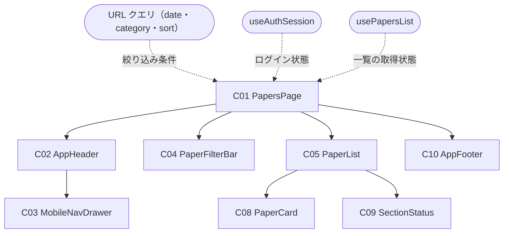
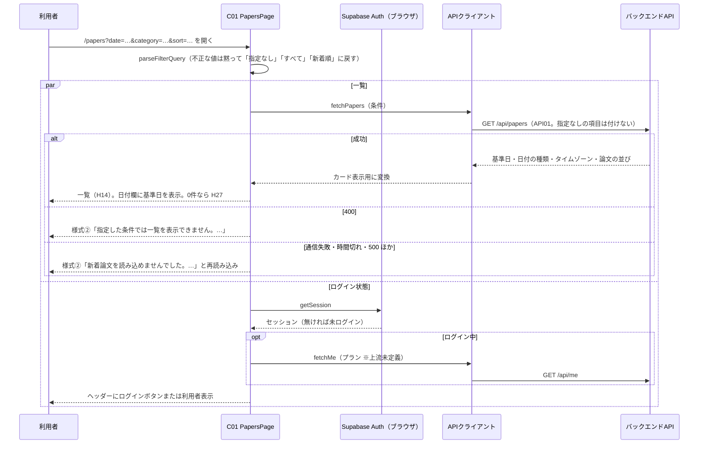
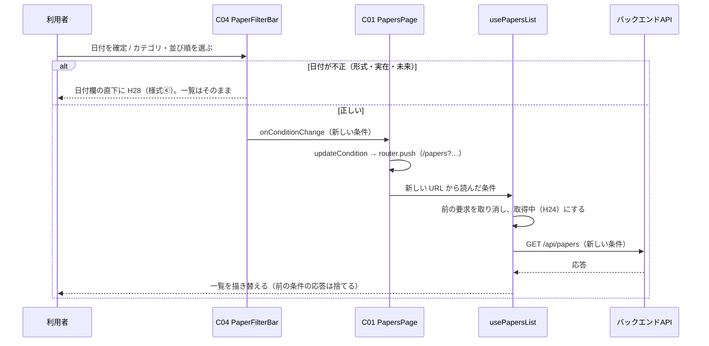

# FE詳細設計書 — P102 新着論文

## 0. 文書情報

| 項目 | 値 |
| :--- | :--- |
| 設計書ID | P102-FE |
| 親ID | P102 |
| 親設計書 | `screens/画面.P102.画面基本設計.md` |
| 版 | 1.0（新規作成） |
| 作成日 | 2026-10-27 |
| 更新日 | 2026-10-27 |
| 作成方法 | 上流の画面基本設計書（P102）、確定済みの `docs/基本設計書_概要.md`、`source/` 配下の企画資料からの設計（creating-frontend-detailed-design v1.5.0 準拠）。API の応答の形は作成済みの BE詳細設計書（`detail/be/BE.F02.BE詳細設計.md`・`detail/be/BE.F06.BE詳細設計.md`）に合わせた。P101 ホームと共用する部品・関数（共通ヘッダー・フッター・論文カード・状態表示・ログイン状態の取得・API呼び出しの共通処理・表示の整形）は `detail/fe/FE.P101.FE詳細設計.md` の定義を再利用し、本書では P102 での使い方と P102 固有の部分を定義する |
| インプットの性質 | `source/` にあるのは企画・初期設計案の Markdown 6ファイルだけで、本画面のソースコード（ページ・コンポーネント・フック・ルーティング定義）は1行も無い（`source/README.md:5-10`、上流 概要書 §前提）。このため本書は**新規設計**であり、ファイルパス・関数名・State名・型はすべて実装時の命名案（※推測）である。技術スタックは Next.js / TypeScript / Tailwind CSS / shadcn/ui（`source/03_システム構成.md:6`）、認証は Supabase Auth（`source/03_システム構成.md:10`） |
| 既存資料の突合 | `legacy/` は空ディレクトリ（ファイル0件）で、突合する既存設計・業務資料は無い。本書の既存版（`docs/detail/fe/FE.P102.FE詳細設計.md`）も無かったため、引き継ぐ記述・ID は上流設計書で採番済みのもの（P101〜P104・P106・P107、C01〜C05・C08〜C10、H01〜H30、E01〜E15、様式①〜④、API01、IF05、F02・F05・F06・F17、BF03、EX04、ARC001〜ARC003・ARC009、Q04・Q08・Q11・Q12）だけである |

## 1. フロントエンド構成・ルーティング設計

* **対象ドメイン**: 新着論文系（papers） — 日付とカテゴリで新着論文を絞り込み、新着順または関連度順に並べて一覧する画面（上流 P102 §1、`source/01_企画概要.md:25`）。絞り込み条件の受け取り（URL クエリ）・日付の入力検査・一覧の取得・失敗表示までを本書の範囲とし、遷移先の画面（P101 ホーム・P103 論文検索・P104 論文詳細・P106 マイページ・P107 料金、および※上流未定義のログイン・会員登録画面と利用規約ページ）の中身は各画面の設計書の責務とする。
* **対象画面ID**: P102
* **ディレクトリ/ファイル構造**（※推測: 実装は未着手。P101 と同じ `web/` 配下の Next.js App Router 構成。本画面で使うファイルは全17件。内訳は本画面で新設する5件〈`app/papers/page.tsx`・`components/papers/PaperFilterBar.tsx`・`components/papers/PaperList.tsx`・`hooks/usePapersList.ts`・`lib/papers/filterCondition.ts`〉と、P101 で定義した21件のうち本画面でも使う共用12件〈C02・C03・C10・C08・C09 の部品5件、`hooks/useAuthSession.ts`、`lib/` の `supabase/browserClient.ts`・`api/requestJson.ts`・`api/papersClient.ts`〈本書で fetchPapers を追加〉・`api/meClient.ts`・`paper/paperCardModel.ts`・`format/display.ts`〈本書で formatDateBasisNote を追加〉の6件〉。P101 のファイルのうち `app/page.tsx`・`components/home/` の4件・`hooks/useRecommendations.ts`・`hooks/useLatestPapers.ts`・`lib/api/recommendationsClient.ts`・`lib/home/recommendationView.ts` の9件は本画面では使わない。下の木で「新設」「共用」を明示する）:

```
web/
├── app/
│   └── papers/
│       └── page.tsx                     … 新設: C01 PapersPage（パス `/papers` のページ）
├── components/
│   ├── layout/
│   │   ├── AppHeader.tsx                … 共用: C02 共通ヘッダー（P101 で定義。本書で Props を3つ追加 — activeNav・loginReturnTo・onActiveNavClick）
│   │   ├── MobileNavDrawer.tsx          … 共用: C03 モバイル幅のナビゲーションドロワー
│   │   └── AppFooter.tsx                … 共用: C10 共通フッター
│   ├── papers/
│   │   ├── PaperFilterBar.tsx           … 新設: C04 絞り込みバー
│   │   └── PaperList.tsx                … 新設: C05 論文一覧
│   ├── paper/
│   │   └── PaperCard.tsx                … 共用: C08 論文カード
│   └── common/
│       └── SectionStatus.tsx            … 共用: C09 取得中・失敗・0件の表示（本書で Props を1つ追加）
├── hooks/
│   ├── useAuthSession.ts                … 共用: ログイン状態と利用者表示の取得
│   └── usePapersList.ts                 … 新設: 一覧の取得の状態管理
└── lib/
    ├── supabase/browserClient.ts        … 共用: ブラウザ用 Supabase クライアント
    ├── api/
    │   ├── requestJson.ts               … 共用: API呼び出しの共通処理
    │   ├── papersClient.ts              … 共用: GET /api/papers の呼び出し（本書で fetchPapers を追加）
    │   └── meClient.ts                  … 共用: GET /api/me の呼び出し
    ├── papers/filterCondition.ts        … 新設: 絞り込み条件の読み取り・検査・URL の組み立て
    ├── paper/paperCardModel.ts          … 共用: 論文をカード表示用データへ変換
    └── format/display.ts                … 共用: 著者・日付の整形（本書で formatDateBasisNote を追加）
```

* **ルーティング定義**（総件数: 1件。全数である根拠: 本書の対象は P102 の1画面だけで、上流 概要書 §3.1 の P102 行のパスが `/papers` の1件である。絞り込み条件は同じパスのクエリで受け渡し、別のルートを持たない）:

| パス | コンポーネント | 認証要否 | ルートファイル |
| :--- | :--- | :--- | :--- |
| `/papers`（※推測。上流 概要書 §3.1・付録 Q03 の仮置き）。クエリ `date`（`YYYY-MM-DD`）・`category`（arXiv のカテゴリ表記）・`sort`（`newest` / `relevance`）をすべて任意で受け取る（上流 P102 §1 ※推測） | PapersPage（C01） | 不要（ゲスト・会員 Free・会員 Pro のどれでも同じ表示 — 上流 P102 §1・付録 Q08） | `web/app/papers/page.tsx`（App Router のファイル配置がそのままルート定義になる） |

## 2. コンポーネント設計

* **コンポーネントツリー図**（上流 P102 §3.1 の木をそのまま引き継ぐ。点線は本書で決めた状態の受け渡し）:



* **コンポーネントロースター**（総件数: 8件。全数である根拠: 上流 P102 §3.2 コンポーネント一覧の C01〜C05・C08〜C10 の全8件と1対1で対応させ、本書で追加・統合した部品は無い。C06・C07 は上流で欠番。C01・C04・C05 は P101 の同じ番号の部品とは別物で、C02・C03・C08・C09・C10 は P101 と同じ部品を共用する — 上流 P102 §3.2。shadcn/ui の汎用部品〈Select・Popover・Calendar・Input・Sheet・Skeleton〉は画面固有のコンポーネントではないため数えない）:

| コンポーネントID | コンポーネント名 | 種類 | ファイルパス | 概要 | 定義状況 | 詳細の所在 |
| :--- | :--- | :--- | :--- | :--- | :--- | :--- |
| C01 | PapersPage | Page | `web/app/papers/page.tsx` | 新着論文画面全体。URL クエリから絞り込み条件を読み、一覧を取得して各部品へ渡す。条件の変更は URL の書き換えで行う | 詳細 | §2 コンポーネント詳細定義、§4 |
| C02 | AppHeader | Layout | `web/components/layout/AppHeader.tsx` | 全画面共通のヘッダー。本画面では「新着論文」を選択中の見た目にする | 詳細 | §2 コンポーネント詳細定義（P102 での使い方）、`detail/fe/FE.P101.FE詳細設計.md` §2 C02（部品の定義） |
| C03 | MobileNavDrawer | UI | `web/components/layout/MobileNavDrawer.tsx` | モバイル幅でメニューボタンを押したときに開く導線の収納先 | 詳細 | §2 コンポーネント詳細定義（P102 での使い方）、`detail/fe/FE.P101.FE詳細設計.md` §2 C03 |
| C04 | PaperFilterBar | UI | `web/components/papers/PaperFilterBar.tsx` | 日付・カテゴリ・並び順の指定欄と日付の種類の注記。日付は入力検査を通ったときだけ条件に反映する | 詳細 | §2 コンポーネント詳細定義、§4 handleDateCommit・validateDateInput、§6 |
| C05 | PaperList | UI | `web/components/papers/PaperList.tsx` | 絞り込み結果の論文を API の返却順に縦1列で並べ、取得中・失敗・0件のときは状態表示に置き換える | 詳細 | §2 コンポーネント詳細定義、§4 resolveListView |
| C08 | PaperCard | UI | `web/components/paper/PaperCard.tsx` | 論文1本を日本語タイトルと30秒要約で示すカード。本画面では選ばれた理由を出さない | 詳細 | §2 コンポーネント詳細定義（P102 での使い方）、`detail/fe/FE.P101.FE詳細設計.md` §2 C08 |
| C09 | SectionStatus | UI | `web/components/common/SectionStatus.tsx` | 一覧の位置に出す取得中・失敗・0件の表示 | 詳細 | §2 コンポーネント詳細定義（P102 での使い方）、`detail/fe/FE.P101.FE詳細設計.md` §2 C09 |
| C10 | AppFooter | Layout | `web/components/layout/AppFooter.tsx` | 全画面共通のフッター。arXiv との関係の注記（H29）と利用規約へのリンク（H30）を常に同じ形で出す。Props・内部State を持たず分岐が無い（P101 と同じ部品をそのまま使う） | 簡易 | 本表、`detail/fe/FE.P101.FE詳細設計.md` §2 ロースター C10 |

* **コンポーネント詳細定義**（ロースターのうち定義状況＝詳細の7件。共用部品は「P102 での使い方」と、P101 の定義から変わる点だけを書く。Props の型は §3 型定義を参照）:

| コンポーネントID | コンポーネント名 | 種類(Page/UI/HOC等) | ファイルパス | 担当項目ID | Props (型) | 内部State (型) | 役割・概要 |
| :--- | :--- | :--- | :--- | :--- | :--- | :--- | :--- |
| C01 | PapersPage | Page | `web/app/papers/page.tsx` | H09 | searchParams: Record<string, string \| string[] \| undefined>（Next.js がページに渡す URL クエリ） | なし（状態は2つのフックが持つ。auth: AuthState、list: PapersListState — §3 ローカルステート定義。絞り込み条件は状態として持たず、毎回 URL クエリから読み直す） | ページ見出し「新着論文」（H09）を出し、URL クエリを parseFilterQuery で絞り込み条件に直して usePapersList に渡す。絞り込みバーで条件が変わったら updateCondition で URL を書き換え、書き換わった URL から読み直した条件で一覧が取り直される（条件の置き場所を URL の1か所にすることで、再読み込み・戻る操作・URL の共有で同じ一覧が開けるようにする — 上流 P102 §7「条件は URL に持つ」。※上流要確認: 上流 P102 §3.2 C01 は内部State に「現在の絞り込み条件」を挙げているが、本書は条件を状態に持たず URL から読む。状態と URL の二重管理による食い違いを避けるため）。URL クエリを毎回読むため、ページは要求ごとに描画する（`useSearchParams` を使わず Props で受けるのは、静的生成時に読み込み待ちの枠が要らないようにするため ※推測）。クライアントコンポーネントとする（`'use client'` ※推測） |
| C02 | AppHeader | Layout | `web/components/layout/AppHeader.tsx` | H01, H02, H03, H04, H05, H06, H07, H08 | auth: AuthState、activeNav?: 'papers' \| 'search' \| 'pricing' \| 'mypage'（本書で追加）、loginReturnTo?: string（本書で追加）、onActiveNavClick?: (event: React.MouseEvent) => void（本書で追加）、onLogoClick?: () => void（P101 で定義。本画面では渡さない） | isDrawerOpen: boolean（初期値 false） | P101 の定義どおりサービス名・導線・ログイン状態を出す。本画面では activeNav に 'papers' を渡し、「新着論文」（H02）を選択中の見た目（背景色付き・太字、`aria-current="page"`）にする。ロゴ（H01）は onLogoClick を渡さないため、ただの `/` へのリンクになる（E07）。ログインボタン（H06）の行き先は loginReturnTo を戻り先にした `/login?next=…` とし、ログイン後に同じ絞り込み条件の本画面へ戻す（上流 P102 E12）。選択中の導線（H02）が押されたときは、モバイル幅ならドロワーを閉じてから、ページから受け取った onActiveNavClick を呼ぶ（ページ固有の取り直しを共用部品の中に持たないため。E08）。Props の追加は既定値を持つ任意項目にし、P101 の使い方を変えない（※上流要確認: 共用部品の Props の一本化を P101 FE詳細設計へ戻す） |
| C03 | MobileNavDrawer | UI | `web/components/layout/MobileNavDrawer.tsx` | H02, H03, H04, H05, H06, H07 | open: boolean、onOpenChange: (open: boolean) => void、auth: AuthState、activeNav?: 'papers' \| 'search' \| 'pricing' \| 'mypage'、loginReturnTo?: string、onActiveNavClick?: (event: React.MouseEvent) => void | なし | P101 の定義どおり。本画面では「新着論文」を選択中の見た目にし、押すとドロワーを閉じてから、ページから受け取った onActiveNavClick を呼ぶ（E08）。ログインボタンの行き先は C02 と同じ |
| C04 | PaperFilterBar | UI | `web/components/papers/PaperFilterBar.tsx` | H10, H11, H12, H13, H28 | condition: FilterCondition、baseDate: string \| null、dateBasis: string、timeZone: string、onConditionChange: (next: FilterCondition) => void | dateInput: string、dateError: DateErrorKind \| null、isCalendarOpen: boolean | 日付（H10）は文字入力欄と、押すと開くカレンダー（shadcn/ui の Popover＋Calendar）の両方で指定できる。入力欄には、URL に日付があればその日付、無ければ一覧APIが返した基準日を表示する。入力を確定したとき（カレンダーで選んだとき、または入力欄で Enter を押すか欄から離れたとき）に handleDateCommit で検査し、正しければ条件を変え、正しくなければ欄の直下に赤字のエラー（H28）を出して一覧はそのまま残す（上流 P102 H28）。カテゴリ（H12）と並び順（H13）は shadcn/ui の Select で、選び直すとすぐ条件を変える。日付の種類とタイムゾーンの注記（H11）は formatDateBasisNote で組み立てる。デスクトップは1行に横並び、モバイルは縦に積む |
| C05 | PaperList | UI | `web/components/papers/PaperList.tsx` | H14 | view: PapersListView、onReload: () => void | なし | resolveListView の結果に従い、取得中・失敗・0件のときは状態表示（C09）を、それ以外は論文カード（C08）を API の返却順に縦1列で並べる（デスクトップは本文幅 1200px、モバイルは画面幅いっぱい ※推測）。表示件数は API が返した件数のままで、ページ送りは置かない（上流 P102 H14。件数の多さは §4.1 の※上流要確認） |
| C08 | PaperCard | UI | `web/components/paper/PaperCard.tsx` | H15, H16, H17, H18, H19, H20, H21, H22, H23 | paper: PaperCardModel、showReasons: boolean（本画面では常に false） | なし | P101 の定義どおり。本画面の項目IDとの対応は、日本語タイトル H15（日本語タイトルが無い論文では原題を出し、押すと P104 へ — E05）、原題 H16（日本語タイトルがあるときだけ）、著者 H17、カテゴリ H18、版 H19（要約の対象の版）、投稿日 H20（日本時間とタイムゾーン併記）、解析範囲 H21（解析範囲が Abstract のみの論文のときだけ「Abstractベース」）、30秒要約 H22（公開済みのときだけ）、処理状況 H23（要約が公開されていない論文で H21・H22 の代わり）。選ばれた理由は出さない（上流 P102 C08） |
| C09 | SectionStatus | UI | `web/components/common/SectionStatus.tsx` | H24, H25, H26, H27 | status: 'loading' \| 'error' \| 'empty'、errorMessage?: string、emptyMessage?: string（本書で追加）、onReload?: () => void | なし | P101 の定義どおり。本画面では、取得中にカード形の灰色の枠（H24）、失敗時に赤色の帯のメッセージ（H25）と「再読み込み」（H26）、0件時に「この日付・カテゴリの論文はありません。日付やカテゴリを変えてお試しください。」（H27）を出す。0件の文言が P101 と違うため、文言を Props で渡せるようにする（渡さなければ P101 の「表示できる論文がありません」） |

## 3. 状態管理（State）設計

* **型定義**（※推測: §3・§4 の表で使う型。AuthState・PaperCardModel・ApiRequestError は `detail/fe/FE.P101.FE詳細設計.md` §3 の定義をそのまま使う。API の応答のキー名は BE.F02 §2 に合わせた）:

```ts
// 絞り込み条件（URL クエリから読み直した値。parseFilterQuery が返す）
type FilterCondition = {
  date: string | null;                 // YYYY-MM-DD。null は「指定なし（最新の基準日）」
  category: string | null;             // null は「すべてのカテゴリ」
  sort: 'newest' | 'relevance';        // 既定は newest
};

// 日付入力の誤りの種類（validateDateInput が返す）
type DateErrorKind = 'format' | 'nonexistent' | 'future';

// 一覧取得の状態（usePapersList が返す）
type PapersListState =
  | { status: 'loading' }
  | { status: 'error'; httpStatus: number | null }     // 400 とそれ以外で文言を変えるため保持
  | { status: 'success'; baseDate: string | null; dateBasis: string;
      timeZone: string; items: PaperCardModel[] };

// 一覧の位置に出す内容（resolveListView が返す）
type PapersListView =
  | { type: 'loading' }
  | { type: 'error'; message: string }
  | { type: 'empty' }
  | { type: 'list'; items: PaperCardModel[] };
```

* **グローバルステート / Context定義**（総件数: 2件。全数である根拠: 本画面で画面の外と共有される状態は、Supabase Auth のログインセッション〈P101 と同じ〉と、絞り込み条件を持つ URL クエリの2つである。React の Context・状態管理ライブラリは使わない）:

| State名 | 型 | スコープ | 初期値 | 更新タイミング | 管理方法 |
| :--- | :--- | :--- | :--- | :--- | :--- |
| Supabase のログインセッション | Session \| null（Supabase の型） | アプリ全体（全画面） | セッション Cookie があればその内容、無ければ null | ログイン・ログアウト・トークンの自動更新のとき（本画面は読むだけ） | P101 と同じ。`@supabase/ssr` のブラウザ用クライアントを使い回し、`auth.getSession()` で読む（`detail/fe/FE.P101.FE詳細設計.md` §3） |
| 絞り込み条件（URL クエリ `date`・`category`・`sort`） | 文字列のクエリ（読み取り後は FilterCondition） | 本画面と、本画面へリンクする画面（P101 の「新着論文をもっと見る」が `date` を付けて開く） | URL に付いている値。無ければすべて「指定なし」 | 利用者が日付・カテゴリ・並び順を変えたとき（updateCondition が新しい URL へ移る）、ブラウザの戻る・進む操作のとき | Next.js の `router.push` で書き換え、ページに渡される searchParams で読む。履歴に積むことで、戻る操作で前の条件に戻れる（上流 P102 E02 ※推測） |

* **ローカルステート定義**（総件数: 8件。全数である根拠: コンポーネントロースターの全8件を対象に、状態を持つものを数えた。C01 はフックを通じて4件〈useAuthSession のログイン状態とその確認の通し番号、usePapersList の取得状態とその取り消し制御〉、C02 は1件〈ドロワーの開閉〉、C04 は3件〈入力中の日付・その誤り・カレンダーの開閉〉。フック内部の通し番号と取り消し制御は再描画を伴わない値〈useRef〉だが、古い応答による上書きの防止に効くため数える〈P101 と同じ基準〉。C03・C05・C08・C09・C10 は状態を持たない）:

| コンポーネント | State名 | 型 | 初期値 | 用途 |
| :--- | :--- | :--- | :--- | :--- |
| C01 PapersPage（useAuthSession 内） | auth | AuthState | `{ status: 'loading' }` | ログイン中かどうかと、ヘッダーに出す利用者の表示（メールアドレスとプラン）を持つ。本画面では表示の出し分けにだけ使い、一覧の取得には使わない（一覧APIは認証不要のため） |
| C01 PapersPage（useAuthSession 内） | requestSeqRef | number（useRef） | 0 | ログイン状態の確認の通し番号。古い確認の結果で状態を上書きしないために使う（P101 と同じ） |
| C01 PapersPage（usePapersList 内） | state | PapersListState | `{ status: 'loading' }` | 一覧APIの取得状態と結果（基準日・日付の種類・タイムゾーン・論文の並び）を持つ。画面を開いた直後から取得を始めるため、初期値を取得中にする |
| C01 PapersPage（usePapersList 内） | abortRef | AbortController \| null（useRef） | null | 進行中の一覧取得を取り消すための制御。条件を続けて変えたとき、前の条件の応答が後から届いて一覧を上書きしないよう、新しい取得を始める前に前の要求を取り消す（上流 P102 §7「古い応答で上書きしない」） |
| C02 AppHeader | isDrawerOpen | boolean | false | モバイル幅のドロワーが開いているか（P101 と同じ） |
| C04 PaperFilterBar | dateInput | string | 条件の日付があればその値、無ければ基準日（取得前は空文字） | 日付の入力欄に表示している文字列。確定前の入力途中の値を持つため、条件（URL）とは別に持つ。条件の日付か基準日が変わったとき（戻る操作や一覧の取得完了）は、その値で入れ直す |
| C04 PaperFilterBar | dateError | DateErrorKind \| null | null | 直前に確定した日付入力の誤りの種類。null 以外のとき日付欄の直下に H28 を出す。正しい日付が確定するか、条件の日付が外から変わったときに null に戻す |
| C04 PaperFilterBar | isCalendarOpen | boolean | false | 日付のカレンダーが開いているか。カレンダーで日付を選んだとき、外側を押したとき、Esc キーで閉じる（shadcn/ui の Popover の標準動作） |
| C03 MobileNavDrawer | なし | — | — | 開閉状態は C02 から Props で受け取る |
| C05 PaperList | なし | — | — | 表示内容は C01 から受け取った判定結果だけで決まる |
| C08 PaperCard | なし | — | — | 論文1件分の表示データは Props で受け取る |
| C09 SectionStatus | なし | — | — | どの状態を出すかは Props で受け取る |
| C10 AppFooter | なし | — | — | 固定文言とリンクだけを表示する |

* **永続化ステート**（総件数: 1件。全数である根拠: 本画面が自分で localStorage・sessionStorage・Cookie に書き込む値は無い。絞り込み条件は URL に持ち、ブラウザの保存領域には書かない。本画面が読むのは Supabase Auth がログイン時に保存したセッションの Cookie だけである〈P101 と同じ〉。閲覧の記録も残さない — 上流 P102 §7）:

| キー | 保存先 | 型 | 用途 | 有効期限 |
| :--- | :--- | :--- | :--- | :--- |
| `sb-<SupabaseプロジェクトID>-auth-token`（※推測: `@supabase/ssr` の既定の Cookie 名） | Cookie（Supabase のライブラリが書き込む。本画面は読むだけ） | string | 本画面を開いたときにログイン中かどうかを判定し、ヘッダーの表示を出し分けるために使う。一覧APIは認証不要のため、この値を一覧の取得には使わない | Supabase Auth の設定に従う（※推測。上流 概要書 §8「セッションの有効期限は未定義」） |

## 4. クライアント側機能・処理ロジック設計（IPO設計）

* **処理フロー図**（画面を開いたとき — E01。ログイン状態の確認と一覧の取得は互いを待たずに同時に進める）:



* **処理フロー図**（条件の変更 — E02〜E04。条件は URL を書き換えることで変え、一覧の取得はページが受け取った新しい URL から始まる）:



* **関数・フックロースター**（総件数: 25件。内訳は本書で新設する15件と、P101 で定義済みのものを本画面でも使う10件。全数である根拠: ソースコードが無いため、上流 P102 §5 のイベント E01〜E15 の処理と、§4・§6 の表示項目・入力検査の規則を、1つの責務を1関数として分けた設計上の全数である。E01→parseFilterQuery・getTodayJst・usePapersList・fetchPapers・resolveListView・useAuthSession・fetchMe・requestJson・getBrowserSupabaseClient、E02→handleDateCommit・validateDateInput、E03→handleCategoryChange、E04→handleSortChange、E02〜E04 の共通→updateCondition・buildPapersHref、E06→reloadPapers、E08→handlePapersNavClick、E12→buildLoginHref、E13→toggleDrawer、E14→closeDrawer、E08〜E12 のドロワー内→handleDrawerLinkClick、カード整形→mapLatestPaper・formatAuthors・formatJstDate、H11→formatDateBasisNote。E05・E07・E15 と、デスクトップ幅の E09〜E12 は Next.js の Link が遷移するだけで本書の関数を持たない。P101 の関数のうち、おすすめ・ホーム固有のもの〈useRecommendations・fetchRecommendations・reloadRecommendations・resolveRecommendationView・getGuideContent・useLatestPapers・fetchLatestPapers・reloadLatest・mapRecommendationItem・formatReason・formatBaseDateNote・buildLatestMoreHref・handleLogoClick・refreshSession〉の14件は本画面では使わない。関数には上流で採番されたIDが無いため、新たに番号を振らず関数名を識別子として扱う）:

| 関数名（識別子） | 種別 | 所属 | ファイル | 概要 | 定義状況 | 詳細の所在 |
| :--- | :--- | :--- | :--- | :--- | :--- | :--- |
| parseFilterQuery | 変換関数 | C01 | `web/lib/papers/filterCondition.ts` | URL クエリを絞り込み条件に直す。不正な値はエラーにせず「指定なし」「すべてのカテゴリ」「新着順」に戻す | 詳細 | 本章 IPO定義 |
| validateDateInput | 検査関数 | C04（parseFilterQuery からも使う） | `web/lib/papers/filterCondition.ts` | 日付の文字列が形式・実在・今日以前の3つを満たすか調べ、誤りの種類を返す | 詳細 | 本章 IPO定義 |
| getTodayJst | ユーティリティ | 共通 | `web/lib/papers/filterCondition.ts` | 現在時刻を日本時間（`Asia/Tokyo`）に直した暦日を `YYYY-MM-DD` で返す。日本時間には夏時間が無く変換だけで分岐を持たない | 簡易 | 本表 |
| buildPapersHref | 変換関数 | C01 | `web/lib/papers/filterCondition.ts` | 絞り込み条件から `/papers?…` の URL を組み立てる | 詳細 | 本章 IPO定義 |
| usePapersList | フック | C01 | `web/hooks/usePapersList.ts` | 絞り込み条件が変わるたびに一覧APIを呼び、取得状態を持つ。再読み込み用の関数を返す | 詳細 | 本章 IPO定義 |
| fetchPapers | APIクライアント | C01 | `web/lib/api/papersClient.ts` | 条件を付けて GET /api/papers を呼び、全件をカード表示用の形に変える | 詳細 | 本章 IPO定義 |
| reloadPapers | フック内関数 | C01 → C05 → C09 | `web/hooks/usePapersList.ts` | 同じ条件で一覧を取り直す（E06）。usePapersList の取得処理を呼び直すだけで、独自の分岐を持たない | 簡易 | 本表（取得処理は usePapersList） |
| resolveListView | 判定関数 | C01 → C05 | `web/lib/papers/filterCondition.ts` | 一覧の取得状態から、一覧の位置に何を出すか（文言を含む）を決める | 詳細 | 本章 IPO定義 |
| updateCondition | イベントハンドラ | C01（C04 から呼ばれる） | `web/app/papers/page.tsx` | 新しい条件の URL へ移る。いまと同じ条件なら URL は変えず取り直す | 詳細 | 本章 IPO定義 |
| handleDateCommit | イベントハンドラ | C04 | `web/components/papers/PaperFilterBar.tsx` | 日付の確定時に検査し、正しければ条件を変え、誤りなら H28 を出す（E02） | 詳細 | 本章 IPO定義 |
| handleCategoryChange | イベントハンドラ | C04 | `web/components/papers/PaperFilterBar.tsx` | カテゴリの選び直しを条件に反映する（E03） | 詳細 | 本章 IPO定義 |
| handleSortChange | イベントハンドラ | C04 | `web/components/papers/PaperFilterBar.tsx` | 並び順の選び直しを条件に反映する（E04）。選んだ値を条件の並び順に入れて onConditionChange を呼ぶだけで、日付・カテゴリは変えず分岐を持たない | 簡易 | 本表 |
| handlePapersNavClick | イベントハンドラ | C01（C02・C03 へ onActiveNavClick として渡す） | `web/app/papers/page.tsx` | 「新着論文」を押したとき、条件なしの本画面を開き直す（E08） | 詳細 | 本章 IPO定義 |
| buildLoginHref | 変換関数 | C01 → C02・C03 | `web/lib/papers/filterCondition.ts` | いまの URL（パスとクエリ）を符号化し、戻り先として付けたログイン画面の URL `/login?next=…` を返す（E12）。入力をそのまま符号化するだけで分岐を持たない（ログイン画面のパスは※上流未定義 — 上流 付録 Q04） | 簡易 | 本表 |
| formatDateBasisNote | 整形関数 | C04 | `web/lib/format/display.ts` | 日付の種類とタイムゾーンの注記（H11）を組み立てる | 詳細 | 本章 IPO定義 |
| useAuthSession | フック | C01 | `web/hooks/useAuthSession.ts` | ログイン状態と利用者表示を取得する（E01）。本画面ではやり直し用の関数（refreshSession）は使わない | 詳細 | `detail/fe/FE.P101.FE詳細設計.md` §4 IPO定義 |
| getBrowserSupabaseClient | ユーティリティ | 共通 | `web/lib/supabase/browserClient.ts` | ブラウザ用の Supabase クライアントを1つだけ作って返す | 簡易 | `detail/fe/FE.P101.FE詳細設計.md` §4 関数ロースター |
| fetchMe | APIクライアント | 共通 | `web/lib/api/meClient.ts` | GET /api/me でプランを取得する（※上流未定義。§4.1） | 詳細 | `detail/fe/FE.P101.FE詳細設計.md` §4 IPO定義 |
| requestJson | APIクライアント | 共通 | `web/lib/api/requestJson.ts` | API呼び出しの共通処理（時間切れ10秒・取り消し・ステータスと応答の形の検査） | 詳細 | `detail/fe/FE.P101.FE詳細設計.md` §4 IPO定義 |
| mapLatestPaper | 変換関数 | C08 | `web/lib/paper/paperCardModel.ts` | 一覧APIの論文1件をカード表示用の形に変える（要約の対象の版、公開済み以外は未公開） | 詳細 | `detail/fe/FE.P101.FE詳細設計.md` §4 IPO定義 |
| formatAuthors | 整形関数 | C08 | `web/lib/format/display.ts` | 著者を先頭2名と「ほか N名」にまとめる（H17） | 詳細 | `detail/fe/FE.P101.FE詳細設計.md` §4 IPO定義 |
| formatJstDate | 整形関数 | C08 | `web/lib/format/display.ts` | 日時を日本時間の日付にしてタイムゾーンを併記する（H20） | 詳細 | `detail/fe/FE.P101.FE詳細設計.md` §4 IPO定義 |
| toggleDrawer | イベントハンドラ | C02 | `web/components/layout/AppHeader.tsx` | ドロワーの開閉を反転する（E13） | 簡易 | `detail/fe/FE.P101.FE詳細設計.md` §4 関数ロースター |
| closeDrawer | イベントハンドラ | C02 → C03 | `web/components/layout/AppHeader.tsx` | ドロワーを閉じる（E14） | 簡易 | `detail/fe/FE.P101.FE詳細設計.md` §4 関数ロースター |
| handleDrawerLinkClick | イベントハンドラ | C03 | `web/components/layout/MobileNavDrawer.tsx` | ドロワー内のリンクを押したときにドロワーを閉じる（E09〜E12） | 簡易 | `detail/fe/FE.P101.FE詳細設計.md` §4 関数ロースター |

* **入力・処理・出力（IPO）定義**（ロースターの詳細17件のうち、本書で新設する11件。P101 で定義済みの共用の詳細6件〈useAuthSession・fetchMe・requestJson・mapLatestPaper・formatAuthors・formatJstDate〉は P101 の IPO定義を正とし、本書では繰り返さない。簡易8件〈新設4件: getTodayJst・reloadPapers・handleSortChange・buildLoginHref／共用4件: getBrowserSupabaseClient・toggleDrawer・closeDrawer・handleDrawerLinkClick〉はロースターの概要欄で定義を完結している）:

| 関数名 | 所属コンポーネント | 引数 (型) | 処理フロー (ステップ単位で具体的に) | 戻り値 | 発生しうるエラー |
| :--- | :--- | :--- | :--- | :--- | :--- |
| parseFilterQuery | C01 | searchParams: Record<string, string \| string[] \| undefined>、today: string（`YYYY-MM-DD`。getTodayJst の値） | 1. `date`・`category`・`sort` のそれぞれについて、同じ名前が複数付いていれば最初の値だけを使い、前後の空白を除く。空文字は「指定なし」とみなす。<br>2. 日付は validateDateInput で調べ、誤りが無ければ採用し、誤りがあれば「指定なし」（最新の基準日）にする。利用者が入力した値ではないため、入力エラー（H28）は出さない（上流 P102 E01）。<br>3. カテゴリは、カテゴリの選択肢（§4 handleCategoryChange の選択肢一覧）に含まれていれば採用し、含まれなければ「すべてのカテゴリ」にする（上流 P102 §6 H12）。<br>4. 並び順は「新着順」（`newest`）か「関連度順」（`relevance` ※推測: 値の名前は BE.F02 §2 の仮置き。上流 付録 Q12）のどちらかなら採用し、それ以外は新着順にする。<br>5. 3つをまとめて返す。不正な値で開いた URL を書き直すことはしない（戻る操作の履歴を増やさないため ※推測） | FilterCondition | なし（不正な値はすべて既定値に戻して吸収する） |
| validateDateInput | C04、parseFilterQuery | text: string、today: string | 1. 前後の空白を除いた値が「4桁の年・2桁の月・2桁の日をハイフンでつないだ形」（`^\d{4}-\d{2}-\d{2}$`）でなければ「形式不正」を返す（上流 P102 §6、上流 概要書 §4 入力チェック）。<br>2. 年・月・日を数に直し、その年月に実在する日でなければ（月が1〜12でない、日がその月の日数を超える。うるう年の2月29日は実在とする）「存在しない日付」を返す。<br>3. 今日（日本時間の暦日）より後なら「未来の日付」を返す（文字列の大小比較で判定できる形のため、そのまま比べる）。<br>4. どれにも当たらなければ誤りなし（null）を返す。<br>（BE.F02 §2 の date の検査〈形式・実在・今日以前〉と同じ規則にそろえ、画面で通った日付が API で 400 にならないようにする） | DateErrorKind \| null | なし |
| buildPapersHref | C01 | condition: FilterCondition | 1. 日付があれば `date` を付ける。<br>2. カテゴリがあれば（すべてのカテゴリでなければ）`category` を付ける。<br>3. 並び順が関連度順のときだけ `sort=relevance` を付け、新着順のときは付けない（既定値を省いて URL を短くし、P101 から開いた URL〈`/papers?date=…`〉と同じ条件の URL が一つの形になるようにする ※推測）。<br>4. 付ける項目が無ければ `/papers`、あれば `date`・`category`・`sort` の順に並べて `/papers?…` を返す（値は URL 符号化する） | string | なし |
| usePapersList | C01 | condition: FilterCondition | 1. 条件の3つの値（日付・カテゴリ・並び順）のどれかが変わるたびに取得を始める（依存はこの3値。条件のオブジェクトが作り直されただけでは取り直さない）。<br>2. 進行中の要求があれば取り消し、新しい取り消し制御を作る。<br>3. 状態を取得中にする。前の一覧は消し、古い条件の結果を新しい条件の結果と取り違えないようにする（上流 P102 H24）。<br>4. fetchPapers を呼ぶ。<br>5. 成功したら、基準日・日付の種類・タイムゾーン・論文の並びを状態に入れる。0件のときも成功として入れる。<br>6. 失敗したら、HTTP ステータス（応答が無ければ無し）を付けて状態を失敗にする。取り消しによる失敗のときは状態を変えない（新しい取得が既に始まっているか、画面を離れたため）。<br>7. 画面を離れるときは進行中の要求を取り消す。<br>8. 再読み込み用に、手順2〜6を同じ条件でやり直す関数（reloadPapers）を返す | { state: PapersListState; reloadPapers: () => void } | なし（失敗は状態に入れて画面に渡す） |
| fetchPapers | usePapersList | condition: FilterCondition、signal: AbortSignal | 1. 条件のうち指定のある項目だけをクエリにする（日付が無ければ `date` を付けない — API が最新の投稿日を基準日にして返す。BE.F02 §2 date「指定なし」）。並び順は常に付ける（`sort=newest` または `sort=relevance`）。<br>2. requestJson で GET /api/papers を呼ぶ（認証不要のため Authorization は付けない。応答は配信網で5分共有されるため、ブラウザの既定のキャッシュ動作に任せる — BE.F02 §2 レスポンスヘッダー）。<br>3. 応答の論文の並びを全件、mapLatestPaper でカード表示用に変える（並び順は応答のまま。件数の切り詰めはしない — 上流 P102 H14）。<br>4. 基準日・日付の種類・タイムゾーンと変換後の並びを返す | { baseDate: string \| null; dateBasis: string; timeZone: string; items: PaperCardModel[] } | ApiRequestError（requestJson と同じ種類。HTTPエラーではステータスを持つ） |
| resolveListView | C01（結果を C05 へ渡す） | state: PapersListState | 1. 取得中なら「取得中」を返す。<br>2. 失敗で HTTP ステータスが 400 なら、「指定した条件では一覧を表示できません。日付やカテゴリを選び直してください。」の文言を付けた「失敗」を返す（画面の検査を経由しない値を API が受け取った場合。通常は起きない — 上流 P102 §5.1）。<br>3. それ以外の失敗（500 ほかの 200 以外、通信失敗、時間切れ、応答形式不正）なら、「新着論文を読み込めませんでした。時間をおいて再読み込みしてください。」の文言を付けた「失敗」を返す（上流 P102 §5.1。文言は※推測）。<br>4. 成功で論文が0件なら「0件」を返す。<br>5. それ以外は「一覧」と論文の並びを返す | PapersListView | なし |
| updateCondition | C01 | next: FilterCondition | 1. buildPapersHref で新しい条件の URL を作る。<br>2. いまの条件から作った URL と同じなら、URL は変えずに reloadPapers で取り直す（同じ URL への移動では一覧が取り直されないため。例: 失敗表示の後に同じ値を選び直したとき — 上流 P102 §5.1 様式②「絞り込み条件を変えても取り直される」）。<br>3. 違えば `router.push` で新しい URL へ移る（履歴に積み、戻る操作で前の条件に戻れるようにする）。スクロール位置は先頭へ戻さない（絞り込みバーを触った位置のまま結果を見られるようにする。`scroll: false` ※推測）。<br>4. 移った後、ページが受け取る URL クエリが変わり、usePapersList が新しい条件で取り直す | void | なし |
| handleDateCommit | C04 | text: string（入力欄の文字列、またはカレンダーで選んだ日付を `YYYY-MM-DD` にした値） | 1. 入力欄の値を確定した値に置き換え、カレンダーを閉じる。<br>2. validateDateInput（今日は getTodayJst）で調べる。<br>3. 誤りがあれば、その種類を日付の誤りに入れて終える（一覧は取り直さず、直前の一覧をそのまま残す — 上流 P102 H28）。<br>4. 誤りが無ければ日付の誤りを消す。<br>5. 確定した日付が条件の日付と同じなら何もしない。条件の日付が無く（最新の基準日を表示中）、確定した日付が表示中の基準日と同じときも、条件を変えない（同じ一覧を取り直さないため）。<br>6. それ以外は、日付だけを差し替えた条件で onConditionChange を呼ぶ（カテゴリ・並び順はそのまま — 上流 P102 E02） | void | なし |
| handleCategoryChange | C04 | value: string（Select で選んだ値。「すべてのカテゴリ」は `all`） | 1. 選んだ値が `all` ならカテゴリを「指定なし」に、それ以外はその値にする。<br>2. カテゴリだけを差し替えた条件で onConditionChange を呼ぶ（上流 P102 E03）。<br>（選択肢は「すべてのカテゴリ」と、画面の定数に持つ収集対象カテゴリの並び。収集対象カテゴリの一覧は資料に定義が無く、資料に現れるのは `cs.LG` だけである — `source/03_システム構成.md:47`。本書では定数の初期値を `cs.LG` の1件とし、収集対象が決まった時点で定数を差し替える。※上流要確認: 上流 P102 §7・BE.F02 §6 No.3 と同じ確認事項。API から選択肢を取る方式にするかも併せて確認する） | void | なし |
| handlePapersNavClick | C01（C02・C03 から onActiveNavClick として呼ばれる。ドロワーを閉じる処理は呼び出し前に C02 が済ませる） | event: React.MouseEvent | 1. いまのパスが `/papers` で、URL クエリが付いていなければ、Link の既定の遷移を止め、reloadPapers で最新の基準日の一覧を取り直す（同じ URL への移動では取り直されないため。上流 P102 E08「E01 を実行する」）。<br>2. それ以外は何もしない（Link が条件なしの `/papers` へ移り、新しい URL から読んだ初期条件で一覧が取り直される） | void | なし |
| formatDateBasisNote | C04 | dateBasis: string、timeZone: string | 1. 日付の種類を日本語にする。投稿日（`submitted`）なら「投稿日」、新着公開日（`announced` ※推測）なら「新着公開日（arXivでの公開日）」、それ以外は「基準日」。<br>2. タイムゾーンが日本時間（`Asia/Tokyo`）なら「日本時間（JST）」、それ以外はその値を表記にする。<br>3. 「日付は{日付の種類}・{タイムゾーン}で表示しています」の形で返す（上流 P102 H11 の文の形）。<br>4. 一覧の取得前（日付の種類が分からないとき）は、BE.F02 の現行の値である投稿日・日本時間を前提にした文を出す（注記を空にせず常に出すため。上流 P102 H11「常時表示」）。<br>（※上流要確認: 上流 P102 H10・H11 は「新着公開日で絞り込む仮置き ※推測」だが、BE.F02 §2 は新着公開日の列が無いため投稿日で絞り込む。画面の注記は API が返す日付の種類に従って出すため、上流 付録 Q11 の決定後も画面側の変更は要らない） | string | なし |

### 4.1 呼出API 全数ロースター（BE詳細設計書への入口）

総件数: 8件（本画面が直接呼ぶ境界3件＋FE完結の処理5件）。全数である根拠: 上流 P102 §5 呼出APIロースターの2件（API01・IF05）に、H07 のプラン表示のために使う GET /api/me（※上流未定義。P101 と同じ扱い）を加えた。上流 概要書 §7 内部API一覧の全8件のうち、API02〜API08 は本画面からは呼ばない（検索は P103、論文詳細と要約は P104、おすすめは P101、ブックマークは P104・P106、決済は P107 の責務）。FE完結の行は §4 関数ロースターのうち API を介さない判定・整形・画面操作を、利用者から見える処理ごとにまとめたもの。

| メソッド | エンドポイント | 対応機能ID | BE詳細設計書 | 呼び出す処理・取得するもの | 責務の所在 |
| :--- | :--- | :--- | :--- | :--- | :--- |
| GET | `/api/papers?date=…&category=…&sort=…`（API01。date・category は指定のあるときだけ付ける） | F02 | `detail/be/BE.F02.BE詳細設計.md` | 条件に合う論文の並びと、基準日・日付の種類・タイムゾーンを取得する（E01〜E04・E06・E08） | BE |
| GET | `/api/me`（※上流未定義: 上流 概要書 §7 と上流 P102 §5 呼出APIロースターに無い。BE.F06 で定義済み） | F06 | `detail/be/BE.F06.BE詳細設計.md` | ログイン中の利用者のプランを取得し、ヘッダーの利用者表示（H07）に出す（E01） | BE |
| — | Supabase Auth のセッション取得（IF05。ブラウザのライブラリが Cookie を読む） | F06 | `detail/be/BE.F06.BE詳細設計.md` | ログイン中かどうかとメールアドレスを得る（E01） | 外部サービス（Supabase Auth）。本システムのBEは介さない |
| — | — | F02 | — | 絞り込み条件を URL クエリで持ち、不正な値を既定値に戻し、条件の変更を URL の書き換えで行う（parseFilterQuery・buildPapersHref・updateCondition・handlePapersNavClick） | **FE完結** |
| — | — | F02 | — | 日付の入力検査（形式・実在・今日以前）と、日付の種類・タイムゾーンの注記（validateDateInput・handleDateCommit・formatDateBasisNote・getTodayJst） | **FE完結** |
| — | — | F02, F05, F17 | — | 一覧の論文をカード表示用にそろえ、著者の省略・日本時間の日付・Abstractベース表示・要約未公開時の処理状況表示を切り替え、押すと論文詳細へ移す（mapLatestPaper・formatAuthors・formatJstDate・resolveListView。F05 は P104 への導線、F17 は処理状況の表示 H23） | **FE完結** |
| — | — | F06 | — | ヘッダーにログインボタンか利用者表示を出し分け、ログイン後の戻り先を付ける（C02・C03・buildLoginHref） | **FE完結** |
| — | — | —（機能一覧に該当なし。画面操作だけ） | — | ドロワーの開閉と各画面への遷移（toggleDrawer・closeDrawer・handleDrawerLinkClick・Link） | **FE完結** |

* **BE詳細設計書の列**: 上流 概要書 §4 機能一覧の F02・F06 行の「BE詳細設計書」列の値を転記した。概要書では「（未作成）」と書かれているが、`docs/detail/be/` に作成済みであることを確認したため注記を外した。F05・F17 の行は FE完結のため `—` とした。
* **※上流要確認（本節で生じたもの）**:
  * GET /api/me が上流 概要書 §7 と上流 P102 §5 呼出APIロースターに無い（P101 と同じ確認事項）。
  * 一覧の件数・ページ送りの指定が API01 に無い。BE.F02 は基準日の論文をすべて返し、本画面も全件を描画するため、新着の多い日に「すべてのカテゴリ」を選ぶと描画が重くなる（上流 P102 §7 と同じ確認事項）。
  * カテゴリの選択肢の一覧が資料に無い（§4 handleCategoryChange）。
  * 絞り込みの日付の種類: 上流 P102 は新着公開日、BE.F02 は投稿日（§4 formatDateBasisNote）。

## 5. イベントハンドラ・アクション定義

* **ユーザーアクションマッピング**（総件数: 15件。全数である根拠: 上流 P102 §5 イベント定義の E01〜E15 の全15件と1対1で対応させた。本書で追加したイベントは無い）:

| 画面ID | 対応イベントID | 対象コンポーネントID | 要素 | トリガー | 発火関数名 | 処理の概要 | 遷移先 |
| :--- | :--- | :--- | :--- | :--- | :--- | :--- | :--- |
| P102 | E01 | C01 | ページ | ページロード（ヘッダーの導線・P101 の「新着論文をもっと見る」・直接アクセス・ブラウザの戻る操作で本画面が表示されたとき） | parseFilterQuery → usePapersList（fetchPapers・resolveListView）、useAuthSession（fetchMe） | URL クエリを絞り込み条件に直し（不正な値は黙って既定値に戻す）、一覧APIを呼んで一覧を描く。日付を指定せずに開いたときは、API が返した基準日を日付欄に出す。同時にログイン状態を確かめてヘッダーを出し分ける。戻る・進む操作で URL クエリだけが変わったときも、同じ手順で取り直す | なし |
| P102 | E02 | C04 | 日付 H10 | Change（カレンダーで選んだとき、入力欄で Enter を押したとき、入力欄から離れたとき） | handleDateCommit（validateDateInput）→ updateCondition | 日付を検査し、正しければ日付だけを変えた条件の URL へ移って一覧を取り直す。正しくなければ日付欄の直下に H28 を出し、一覧はそのまま残す | なし（同じ画面の URL クエリだけが変わる） |
| P102 | E03 | C04 | カテゴリ H12 | Change | handleCategoryChange → updateCondition | 選んだカテゴリの条件の URL へ移って一覧を取り直す。「すべてのカテゴリ」ではカテゴリを付けない | なし（同じ画面の URL クエリだけが変わる） |
| P102 | E04 | C04 | 並び順 H13 | Change | handleSortChange → updateCondition | 選んだ並び順の条件の URL へ移って一覧を取り直す。関連度順の値の名前は `relevance`（※推測。上流 付録 Q12） | なし（URL クエリだけが変わる） |
| P102 | E05 | C08 | 論文カードの日本語タイトル H15 | Click | なし（Link が遷移） | 押した論文の詳細画面を、その論文の arXiv ID を付けて開く | P104（`/papers/{arxivId}` ※推測） |
| P102 | E06 | C09（C05 の中） | 再読み込みボタン H26 | Click | reloadPapers | いまの条件のまま一覧を取り直す。取り直している間は H24 を出す | なし |
| P102 | E07 | C02 | サービス名（ロゴ）H01 | Click | なし（Link が遷移。本画面では onLogoClick を渡さない） | ホーム画面へ移る | P101（`/`） |
| P102 | E08 | C02、C03 | ナビ「新着論文」H02 | Click | handlePapersNavClick（C01 が C02・C03 へ onActiveNavClick として渡す。モバイルでは C02 がドロワーを閉じてから呼ぶ） | 条件なしの本画面を開き直し、最新の基準日・すべてのカテゴリ・新着順の一覧を出す。すでに条件なしで開いているときは同じ URL のまま取り直す | P102（`/papers`） |
| P102 | E09 | C02、C03 | ナビ「論文検索」H03 | Click | デスクトップ: なし（Link が遷移）／モバイル: handleDrawerLinkClick | 論文検索へ移る。モバイル幅ではドロワーを閉じてから移る | P103（`/search` ※推測） |
| P102 | E10 | C02、C03 | ナビ「料金」H04 | Click | デスクトップ: なし（Link が遷移）／モバイル: handleDrawerLinkClick | 料金画面へ移る。モバイル幅ではドロワーを閉じてから移る | P107（`/pricing` ※推測） |
| P102 | E11 | C02、C03 | ナビ「マイページ」H05 | Click | デスクトップ: なし（Link が遷移）／モバイル: handleDrawerLinkClick | マイページへ移る。ログイン中のときだけ要素が表示される | P106（`/mypage` ※推測） |
| P102 | E12 | C02、C03 | ログインボタン H06 | Click | デスクトップ: なし（Link が遷移。行き先は buildLoginHref が決める）／モバイル: handleDrawerLinkClick | ログイン・会員登録の画面へ移る。いまの URL（絞り込み条件を含む）を戻り先として付け、ログイン後に同じ一覧へ戻す（上流 P102 E12 ※推測） | ログイン・会員登録画面（`/login?next=<いまのURL>` ※推測。※上流未定義 — 上流 付録 Q04） |
| P102 | E13 | C02 | メニューボタン H08 | Click | toggleDrawer | ドロワーが閉じていれば開き、開いていれば閉じる | なし |
| P102 | E14 | C03 | ドロワーの外側（半透明の背景） | Click（タップ） | closeDrawer | 遷移せずにドロワーを閉じる。shadcn/ui の Sheet は Esc キーでも同じ閉じる通知を出す（※上流未定義: Esc キーでの閉じる操作は上流 P102 §5 に無い。P101 と同じ扱い） | なし |
| P102 | E15 | C10 | 利用規約リンク H30 | Click | なし（Link が遷移） | 利用規約のページへ移る | 利用規約ページ（`/terms` ※推測。※上流未定義） |

## 6. バリデーション・エラーフィードバック設計

* **クライアント側バリデーション**（総件数: 5件。全数である根拠: 上流 P102 §6 バリデーション・制約定義の全5行〈H10 の3規則、H12・H13 の各1規則〉と1対1で対応させた。入力・選択の項目は H10・H12・H13 の3件で、H12・H13 は選択肢からしか選べないため画面上のエラーは出さない）:

| 画面ID | 対象フィールド | ルール | 正規表現 / 条件 | エラーメッセージ |
| :--- | :--- | :--- | :--- | :--- |
| P102 | 日付 H10 | 形式（年4桁・月2桁・日2桁をハイフンでつないだ形であること） | 前後の空白を除いた値が次の正規表現に合うこと（`/^\d{4}-\d{2}-\d{2}$/`）。合わなければ誤りの種類「形式不正」 | 「日付は YYYY-MM-DD の形式で入力してください」（※推測。上流 P102 §6） |
| P102 | 日付 H10 | 実在（暦の上で存在する日付であること） | 月が1〜12で、日がその月の日数以内であること。うるう年〈4で割り切れ、100で割り切れないか400で割り切れる年〉の2月は29日まで。満たさなければ「存在しない日付」 | 「存在しない日付です」（※推測。上流 P102 §6） |
| P102 | 日付 H10 | 今日以前（日本時間の今日より後の日付でないこと） | 日本時間の今日の暦日（getTodayJst）と比べ、後であれば「未来の日付」 | 「未来の日付は指定できません」（※推測。上流 P102 §6） |
| P102 | カテゴリ H12 | 選択肢の中から選ぶこと | 画面上は Select の選択肢以外を選べないため検査しない。URL クエリから選択肢に無い値が来たときは、エラーを出さず「すべてのカテゴリ」に戻す（parseFilterQuery 手順3） | —（エラーは出さない） |
| P102 | 並び順 H13 | 「新着順」「関連度順」のどちらかであること | 画面上は Select の選択肢以外を選べないため検査しない。URL クエリから2値以外が来たときは、エラーを出さず「新着順」に戻す（parseFilterQuery 手順4） | —（エラーは出さない） |

* **UIエラーフィードバック**（総件数: 12件。全数である根拠: 本画面が呼ぶ境界3件〈一覧API・利用者情報API・セッション取得〉それぞれについて requestJson が区別する失敗の種類のうち画面上の扱いが変わるものと、日付入力の誤り3種、URL クエリの不正値、取り消しを数え、上流 P102 §5.1 で「該当なし」とされた様式①③を1行ずつ加えた。一覧APIの HTTP エラーは 400 とそれ以外で文言が変わるため2行に分けた。401・403 は一覧APIが返さない設計のため行を設けない — BE.F02 §2 ステータスコード）:

| エラー種別 | HTTPステータス | エラー表示様式 | UI挙動 | 表示コンポーネント |
| :--- | :--- | :--- | :--- | :--- |
| 一覧の取得失敗（サーバーエラー） | 500（400 以外の 200 以外も同じ扱い） | 様式② | 一覧の位置（絞り込みバーの直下）に赤色の帯で「新着論文を読み込めませんでした。時間をおいて再読み込みしてください。」と「再読み込み」ボタンを出す。ヘッダー・絞り込みバー・フッターは表示・操作を続けられ、条件を変えても取り直される（上流 P102 §5.1） | C09 SectionStatus（C05 の中） |
| 一覧の取得失敗（通信失敗・時間切れ・応答形式不正） | —（応答が無い、または読めない） | 様式② | 上の行と同じ表示（原因によらず再読み込みで回復できるため ※推測） | C09 SectionStatus（C05 の中） |
| 一覧の入力不正 | 400 | 様式② | 一覧の位置に「指定した条件では一覧を表示できません。日付やカテゴリを選び直してください。」と「再読み込み」ボタンを出す。画面の検査は API と同じ規則にそろえているため通常は起きない（上流 P102 §5.1 ※推測） | C09 SectionStatus（C05 の中） |
| 日付の形式不正 | —（画面の検査） | 様式④ | 日付欄の直下に赤字で「日付は YYYY-MM-DD の形式で入力してください」を出す。一覧は直前のものを残す。正しい日付を確定すると消えて一覧が取り直される | C04 PaperFilterBar（H28） |
| 存在しない日付 | —（画面の検査） | 様式④ | 日付欄の直下に赤字で「存在しない日付です」を出す。以降は上の行と同じ | C04 PaperFilterBar（H28） |
| 未来の日付 | —（画面の検査） | 様式④ | 日付欄の直下に赤字で「未来の日付は指定できません」を出す。以降は上の行と同じ。カレンダーでは今日より後の日を選べないようにする（※推測） | C04 PaperFilterBar（H28） |
| URL クエリの不正値 | —（画面の読み取り） | 該当様式なし | エラーを出さず、その項目だけを既定値（最新の基準日・すべてのカテゴリ・新着順）に戻して開く。利用者が入力した値ではないため H28 は出さない（上流 P102 E01） | —（parseFilterQuery が吸収する） |
| 利用者情報（プラン）の取得失敗 | 500・401・応答なしのすべて | 該当様式なし | エラーを出さず、ヘッダーの利用者表示（H07）からプランだけを省く（P101 と同じ） | C02 AppHeader、C03 MobileNavDrawer |
| セッション取得の失敗 | —（ブラウザ内の処理） | 該当様式なし | エラーを出さず未ログインとして扱い、ログインボタン（H06）を出す（上流 P102 E01） | C02 AppHeader |
| 取得の取り消し（条件の連続変更・再読み込み・画面離脱） | —（ブラウザ内の処理） | 該当様式なし | 何も表示しない。最後に出した条件の結果だけが表示される | —（usePapersList が状態を変えない） |
| ポップアップ表示の対象 | — | 様式①（該当なし） | 使わない。一覧の取得失敗は一覧の領域に閉じ込める（上流 P102 §5.1、上流 EX04） | — |
| 全画面エラーの対象 | — | 様式③（該当なし） | データ取得の失敗では使わない。本画面のパスに論文IDのような可変部分は無く、不正なクエリは様式②・④と既定値への戻しで扱う（上流 P102 §5.1）。描画中の想定外の例外は Next.js の既定のエラー画面（`app/error.tsx`）が受け止める（※推測。※上流要確認: 一覧の領域に描画例外を閉じ込める部品は上流のコンポーネント一覧に無い。P101 と同じ扱い） | `app/error.tsx`（※推測） |

## 7. 利用する方式（共通基盤）

総件数: 4件。全数である根拠: 上流 概要書 §11.1 の全10件（ARC001〜ARC010）のうち、上流 P102 §8 が本画面で利用するとした4件をそのまま引き継いだ。残る6件のうち、ARC004（LLM出力検証）・ARC005（ライセンス・権利ゲート）・ARC006（ジョブ実行基盤）・ARC007（外部APIアクセス制御）は BE とバッチの責務で、本画面のクライアント処理から直接使わない。ARC008（プラン別機能制御）は本画面にプランで変わる機能が無いため使わない（上流 P102 §7「プランによる差は無い」）。ARC010（個人データ最小化）は、本画面が個人データを読み書きせず閲覧も記録しないため、使う箇所が無い（上流 P102 §7「閲覧履歴は記録しない」。ヘッダーのプラン表示は P101 と共用の部品の働きで、本画面固有の利用ではない）。

| 方式ID | 名称 | 本書での利用箇所 |
| :--- | :--- | :--- |
| ARC009 | 表示・編集ポリシー（出典・版・日付・ブランド表記） | 絞り込みの日付の種類とタイムゾーンを API の応答に従って注記し（formatDateBasisNote、H11）、カードの版は要約の対象の版を出し（mapLatestPaper、H19）、投稿日を日本時間に直してタイムゾーンを併記し（formatJstDate、H20）、Abstract だけで要約した論文に「Abstractベース」を出し（H21）、フッターに arXiv との関係の注記を常に出す（C10、H29）。上流の適用範囲「P101〜P107 全画面 / API01〜API05」に該当する |
| ARC002 | 段階的生成・公開方式（速報版→詳細版） | 要約が公開されていない論文も一覧から外さず、原題と処理状況（H23）で速報版として出す（mapLatestPaper が「公開済み以外」をすべて未公開として扱い、C08 が表示を切り替える）。上流の適用範囲「P102, P104」に該当する |
| ARC001 | 生成物キャッシュ・重複排除方式 | 本画面は事前生成済みの要約を一覧APIから受け取って表示するだけで、画面から要約の生成を起動しない（H22、E01〜E04・E06）。※上流要確認: 上流の適用範囲に画面の記載が無い（上流 P102 §8 と同じ） |
| ARC003 | 要約スキーマ（構造化要約の出力仕様） | カードに出す日本語タイトル・原題・30秒要約・解析範囲・対象の版（H15・H16・H19・H21・H22）は、このスキーマの項目を一覧APIが移したもので、本画面は PaperCardModel に受けて表示する。※上流要確認: 上流の適用範囲は API04 までで、API01 の応答に要約の一部が含まれることは記載が無い（上流 P102 §8 と同じ） |
