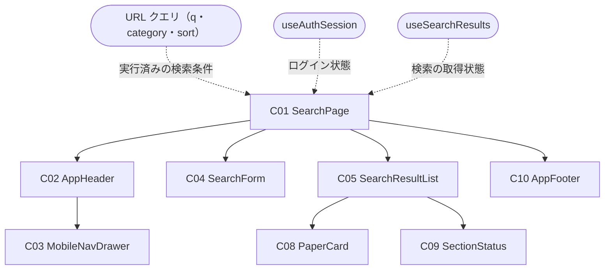
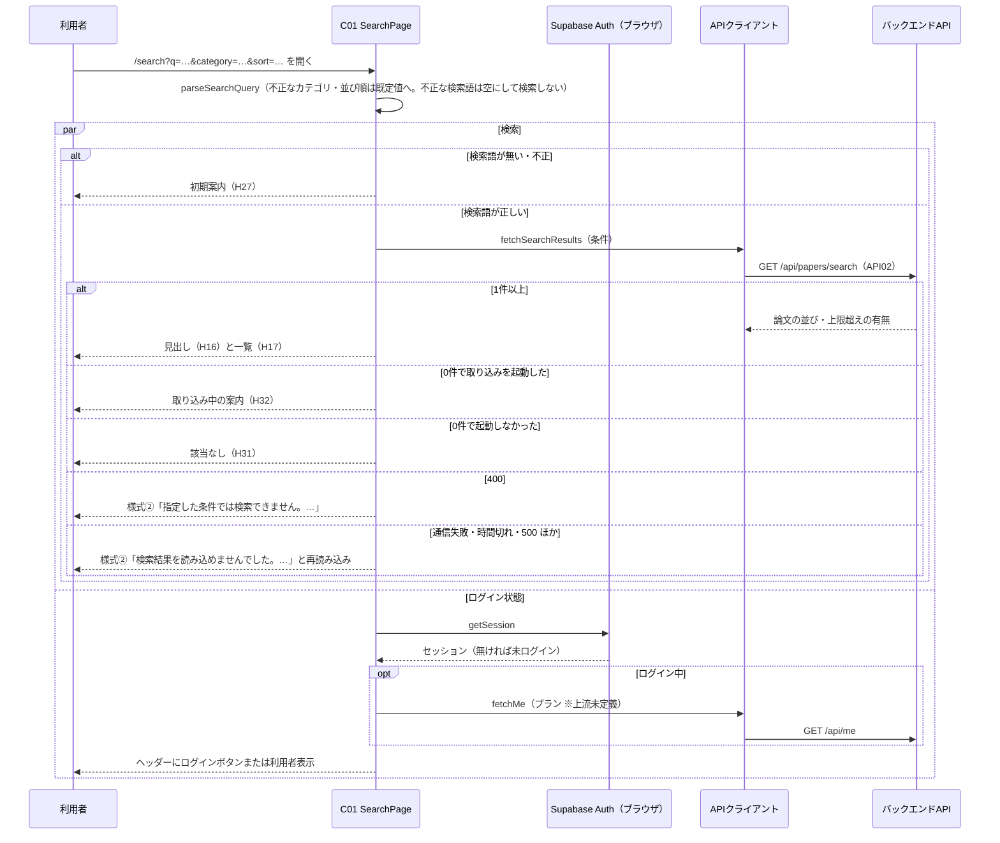
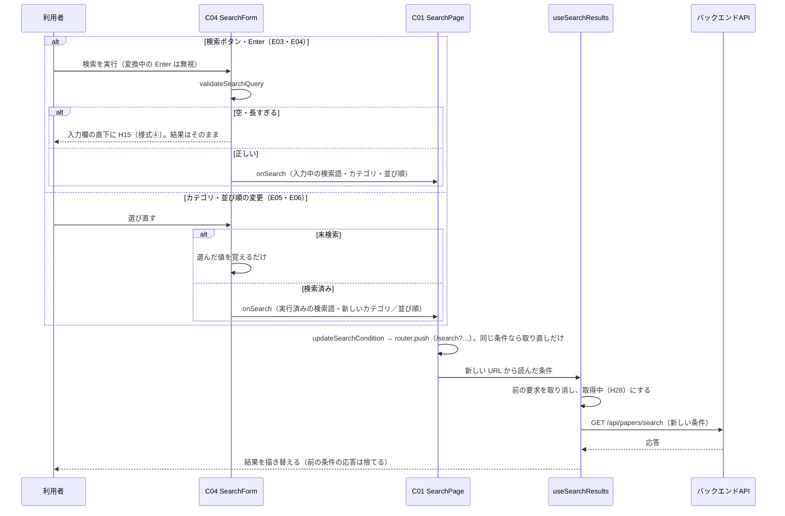

# FE詳細設計書 — P103 論文検索

## 0. 文書情報

| 項目 | 値 |
| :--- | :--- |
| 設計書ID | P103-FE |
| 親ID | P103 |
| 親設計書 | `screens/画面.P103.画面基本設計.md` |
| 版 | 1.0（新規作成） |
| 作成日 | 2026-10-27 |
| 更新日 | 2026-10-27 |
| 作成方法 | 上流の画面基本設計書（P103）、確定済みの `docs/基本設計書_概要.md`、`source/` 配下の企画資料からの設計（creating-frontend-detailed-design v1.5.0 準拠）。API の応答の形は作成済みの BE詳細設計書（`detail/be/BE.F03.BE詳細設計.md`・`detail/be/BE.F06.BE詳細設計.md`）に合わせた。P101 ホーム・P102 新着論文と共用する部品・関数（共通ヘッダー・フッター・論文カード・状態表示・ログイン状態の取得・API呼び出しの共通処理・表示の整形・カテゴリの選択肢・ログイン画面の URL の組み立て）は `detail/fe/FE.P101.FE詳細設計.md`・`detail/fe/FE.P102.FE詳細設計.md` の定義を再利用し、本書では P103 での使い方と P103 固有の部分を定義する |
| インプットの性質 | `source/` にあるのは企画・初期設計案の Markdown 6ファイルだけで、本画面のソースコード（ページ・コンポーネント・フック・ルーティング定義）は1行も無い（`source/README.md:5-10`、上流 概要書 §前提）。このため本書は**新規設計**であり、ファイルパス・関数名・State名・型はすべて実装時の命名案（※推測）である。技術スタックは Next.js / TypeScript / Tailwind CSS / shadcn/ui（`source/03_システム構成.md:6`）、認証は Supabase Auth（`source/03_システム構成.md:10`） |
| 既存資料の突合 | `legacy/` は空ディレクトリ（ファイル0件）で、突合する既存設計・業務資料は無い。本書の既存版（`docs/detail/fe/FE.P103.FE詳細設計.md`）も無かったため、引き継ぐ記述・ID は上流設計書で採番済みのもの（P101〜P104・P106・P107、C01〜C05・C08〜C10、H01〜H34、E01〜E17、様式①〜④、API02、IF05、B006、F03・F05・F06・F17、BF04、EX04、ARC001〜ARC003・ARC007・ARC009・ARC010、Q04・Q08・Q10・Q12）だけである |

## 1. フロントエンド構成・ルーティング設計

* **対象ドメイン**: 論文検索系（search） — キーワード（著者名を含む）とカテゴリで論文を検索し、関連度順または新着順に並べて一覧する画面（上流 P103 §1、`source/01_企画概要.md:26`、`source/02_機能要求定義.md:8`）。検索条件の受け取り（URL クエリ）・検索語の入力検査・検索の実行・取り込み中の案内・失敗表示までを本書の範囲とする。arXiv からの取り込み（B006）はサーバ側の責務で画面からは起動しない。遷移先の画面（P101 ホーム・P102 新着論文・P104 論文詳細・P106 マイページ・P107 料金、および※上流未定義のログイン・会員登録画面と利用規約ページ）の中身は各画面の設計書の責務とする。
* **対象画面ID**: P103
* **ディレクトリ/ファイル構造**（※推測: 実装は未着手。P101・P102 と同じ `web/` 配下の Next.js App Router 構成。本画面で使うファイルは全18件。内訳は本画面で新設する6件〈`app/search/page.tsx`・`components/search/SearchForm.tsx`・`components/search/SearchResultList.tsx`・`hooks/useSearchResults.ts`・`lib/search/searchCondition.ts`・`lib/api/searchClient.ts`〉と、P101・P102 で定義したファイルのうち本画面でも使う共用12件〈C02・C03・C10・C08・C09 の部品5件、`hooks/useAuthSession.ts`、`lib/` の `supabase/browserClient.ts`・`api/requestJson.ts`・`api/meClient.ts`・`paper/paperCardModel.ts`〈本書で mapSearchItem を追加〉・`format/display.ts`・`papers/filterCondition.ts`〈P102 のカテゴリの選択肢と buildLoginHref を使う〉の6件〉。下の木で「新設」「共用」を明示する）:

```
web/
├── app/
│   └── search/
│       └── page.tsx                     … 新設: C01 SearchPage（パス `/search` のページ）
├── components/
│   ├── layout/
│   │   ├── AppHeader.tsx                … 共用: C02 共通ヘッダー（P101 で定義、P102 で Props を追加）
│   │   ├── MobileNavDrawer.tsx          … 共用: C03 モバイル幅のナビゲーションドロワー
│   │   └── AppFooter.tsx                … 共用: C10 共通フッター
│   ├── search/
│   │   ├── SearchForm.tsx               … 新設: C04 検索フォーム
│   │   └── SearchResultList.tsx         … 新設: C05 検索結果一覧
│   ├── paper/
│   │   └── PaperCard.tsx                … 共用: C08 論文カード（本書で Props を1つ追加 — dateLabel）
│   └── common/
│       └── SectionStatus.tsx            … 共用: C09 状態表示（本書で表示の種類を1つ追加）
├── hooks/
│   ├── useAuthSession.ts                … 共用: ログイン状態と利用者表示の取得
│   └── useSearchResults.ts              … 新設: 検索の取得の状態管理
└── lib/
    ├── supabase/browserClient.ts        … 共用: ブラウザ用 Supabase クライアント
    ├── api/
    │   ├── requestJson.ts               … 共用: API呼び出しの共通処理
    │   ├── searchClient.ts              … 新設: GET /api/papers/search の呼び出し
    │   └── meClient.ts                  … 共用: GET /api/me の呼び出し
    ├── search/searchCondition.ts        … 新設: 検索条件の読み取り・検査・URL の組み立て・表示内容の判定
    ├── papers/filterCondition.ts        … 共用: カテゴリの選択肢・ログイン画面の URL の組み立て（P102 で定義）
    ├── paper/paperCardModel.ts          … 共用: 論文をカード表示用データへ変換（本書で mapSearchItem を追加）
    └── format/display.ts                … 共用: 著者・日付の整形
```

* **ルーティング定義**（総件数: 1件。全数である根拠: 本書の対象は P103 の1画面だけで、上流 概要書 §3.1 の P103 行のパスが `/search` の1件である。検索条件は同じパスのクエリで受け渡し、別のルートを持たない）:

| パス | コンポーネント | 認証要否 | ルートファイル |
| :--- | :--- | :--- | :--- |
| `/search`（※推測。上流 概要書 §3.1・付録 Q03 の仮置き）。クエリ `q`（検索語）・`category`（arXiv のカテゴリ表記）・`sort`（`relevance` / `newest`）をすべて任意で受け取る（上流 P103 §1 ※推測） | SearchPage（C01） | 不要（ゲスト・会員 Free・会員 Pro のどれでも同じ表示 — 上流 P103 §1・付録 Q08） | `web/app/search/page.tsx`（App Router のファイル配置がそのままルート定義になる） |

## 2. コンポーネント設計

* **コンポーネントツリー図**（上流 P103 §3.1 の木をそのまま引き継ぐ。点線は本書で決めた状態の受け渡し）:



* **コンポーネントロースター**（総件数: 8件。全数である根拠: 上流 P103 §3.2 コンポーネント一覧の C01〜C05・C08〜C10 の全8件と1対1で対応させ、本書で追加・統合した部品は無い。C06・C07 は上流で欠番。C01・C04・C05 は P101・P102 の同じ番号の部品とは別物で、C02・C03・C08・C09・C10 は P101・P102 と同じ部品を共用する — 上流 P103 §3.2。shadcn/ui の汎用部品〈Input・Button・Select・Sheet・Skeleton〉は画面固有のコンポーネントではないため数えない）:

| コンポーネントID | コンポーネント名 | 種類 | ファイルパス | 概要 | 定義状況 | 詳細の所在 |
| :--- | :--- | :--- | :--- | :--- | :--- | :--- |
| C01 | SearchPage | Page | `web/app/search/page.tsx` | 論文検索画面全体。URL クエリから実行済みの検索条件を読み、検索語があれば検索を取得して各部品へ渡す。検索の実行は URL の書き換えで行う | 詳細 | §2 コンポーネント詳細定義、§4 |
| C02 | AppHeader | Layout | `web/components/layout/AppHeader.tsx` | 全画面共通のヘッダー。本画面では「論文検索」を選択中の見た目にする | 詳細 | §2 コンポーネント詳細定義（P103 での使い方）、`detail/fe/FE.P101.FE詳細設計.md` §2 C02、`detail/fe/FE.P102.FE詳細設計.md` §2 C02（追加 Props） |
| C03 | MobileNavDrawer | UI | `web/components/layout/MobileNavDrawer.tsx` | モバイル幅でメニューボタンを押したときに開く導線の収納先 | 詳細 | §2 コンポーネント詳細定義（P103 での使い方）、`detail/fe/FE.P101.FE詳細設計.md` §2 C03 |
| C04 | SearchForm | UI | `web/components/search/SearchForm.tsx` | 検索語・カテゴリ・並び順の指定欄と検索ボタン。検索語は入力検査を通ったときだけ検索する | 詳細 | §2 コンポーネント詳細定義、§4 handleSearchSubmit・validateSearchQuery、§6 |
| C05 | SearchResultList | UI | `web/components/search/SearchResultList.tsx` | 検索結果を検索語と件数の見出し付きで縦1列に並べ、検索前・取得中・失敗・0件・取り込み中のときは状態表示に置き換える | 詳細 | §2 コンポーネント詳細定義、§4 resolveSearchView |
| C08 | PaperCard | UI | `web/components/paper/PaperCard.tsx` | 論文1本を日本語タイトルと30秒要約で示すカード。本画面では選ばれた理由を出さない | 詳細 | §2 コンポーネント詳細定義（P103 での使い方）、`detail/fe/FE.P101.FE詳細設計.md` §2 C08 |
| C09 | SectionStatus | UI | `web/components/common/SectionStatus.tsx` | 結果の位置に出す検索前・取得中・失敗・0件・取り込み中の表示 | 詳細 | §2 コンポーネント詳細定義（P103 での使い方）、`detail/fe/FE.P101.FE詳細設計.md` §2 C09 |
| C10 | AppFooter | Layout | `web/components/layout/AppFooter.tsx` | 全画面共通のフッター。arXiv との関係の注記（H33）と利用規約へのリンク（H34）を常に同じ形で出す。Props・内部State を持たず分岐が無い（P101 と同じ部品をそのまま使う） | 簡易 | 本表、`detail/fe/FE.P101.FE詳細設計.md` §2 ロースター C10 |

* **コンポーネント詳細定義**（ロースターのうち定義状況＝詳細の7件。共用部品は「P103 での使い方」と、P101・P102 の定義から変わる点だけを書く。Props の型は §3 型定義を参照）:

| コンポーネントID | コンポーネント名 | 種類(Page/UI/HOC等) | ファイルパス | 担当項目ID | Props (型) | 内部State (型) | 役割・概要 |
| :--- | :--- | :--- | :--- | :--- | :--- | :--- | :--- |
| C01 | SearchPage | Page | `web/app/search/page.tsx` | H09 | searchParams: Record<string, string \| string[] \| undefined>（Next.js がページに渡す URL クエリ） | formResetKey: number（初期値 0）。ほかの状態は2つのフックが持つ（auth: AuthState、search: SearchState — §3 ローカルステート定義） | ページ見出し「論文検索」（H09）を出し、URL クエリを parseSearchQuery で「実行済みの検索条件」と「フォームの初期値」に直す。検索語があれば useSearchResults に条件を渡して検索し、無ければ検索せずに初期案内を出す。検索の実行・条件の変更は updateSearchCondition で URL を書き換えて行い、書き換わった URL から読み直した条件で検索が走る（再読み込み・戻る操作・URL の共有で同じ結果を開けるようにする — 上流 P103 §7「条件は URL に持つ」）。※上流要確認: 上流 P103 §3.2 C01 は内部State に「実行済みの検索条件」「取り込みを起動したかどうか」を挙げているが、本書は実行済みの条件を URL から読み、取り込みの有無は検索の取得状態の一部として持つ（状態と URL の二重管理を避けるため。P102 と同じ方針）。ページはクライアントコンポーネントとし（`'use client'` ※推測）、URL クエリは Props で受ける（P102 と同じ理由） |
| C02 | AppHeader | Layout | `web/components/layout/AppHeader.tsx` | H01, H02, H03, H04, H05, H06, H07, H08 | auth: AuthState、activeNav: 'search'、loginReturnTo: string、onActiveNavClick: (event: React.MouseEvent) => void（いずれも P102 で追加した任意の Props） | isDrawerOpen: boolean（初期値 false） | P101 の定義どおりサービス名・導線・ログイン状態を出す。本画面では「論文検索」（H03）を選択中の見た目（背景色付き・太字、`aria-current="page"`）にする。ロゴ（H01）はただの `/` へのリンク（E09）。ログインボタン（H06）は、いまの URL（検索条件を含む）を戻り先にしたログイン画面へ移す（E14。上流 P103 E14「同じ検索条件のまま戻す」）。選択中の導線が押されたときは、モバイル幅ならドロワーを閉じてから onActiveNavClick を呼ぶ（E11） |
| C03 | MobileNavDrawer | UI | `web/components/layout/MobileNavDrawer.tsx` | H02, H03, H04, H05, H06, H07 | open: boolean、onOpenChange: (open: boolean) => void、auth: AuthState、activeNav: 'search'、loginReturnTo: string、onActiveNavClick: (event: React.MouseEvent) => void | なし | P101・P102 の定義どおり。本画面では「論文検索」を選択中の見た目にする |
| C04 | SearchForm | UI | `web/components/search/SearchForm.tsx` | H10, H11, H12, H13, H14, H15 | initial: SearchFormValues（URL から読んだフォームの初期値）、executed: SearchCondition \| null（実行済みの検索条件。未検索なら null）、onSearch: (next: SearchCondition) => void | queryInput: string、queryError: QueryErrorKind \| null、categoryInput: string \| null、sortInput: 'relevance' \| 'newest' | 検索語の入力欄（H10）と検索ボタン（H14）を横に並べ、その下に検索対象の説明（H11）・カテゴリ（H12）・並び順（H13）を置く（モバイルは縦に積み、検索ボタンは全幅）。検索の実行（Enter キー・検索ボタン）では validateSearchQuery で検索語を検査し、空・長すぎるときは欄の直下に赤字のエラー（H15）を出して検索しない（直前の結果はそのまま残す — 上流 P103 H15）。入力し直すとエラーを消す（E02）。カテゴリ・並び順は、検索済みなら選び直した時点で、表示中の結果の検索語のまま検索し直し、未検索なら値を覚えておくだけにする（上流 P103 E05・E06）。URL の条件が外から変わったとき（戻る・進む操作）は、入力欄・選択欄をその条件の値で入れ直す。検索語の入力欄には `type="search"`・`enterKeyHint="search"` を付け、モバイルのキーボードに検索キーを出す（※推測） |
| C05 | SearchResultList | UI | `web/components/search/SearchResultList.tsx` | H16, H17 | view: SearchView、onReload: () => void | なし | resolveSearchView の結果に従い、検索前・取得中・失敗・0件・取り込み中のときは状態表示（C09）を、それ以外は検索結果見出し（H16。formatResultHeading の文言）と論文カード（C08）を API の返却順に縦1列で並べる（デスクトップは本文幅 1200px、モバイルは画面幅いっぱい ※推測）。見出しの検索語は、入力欄の今の値ではなく、表示中の結果を検索したときの語（応答の正規化後の語）を出す（入力欄を書き換えた後でも、表示中の結果の条件を取り違えないようにする — 上流 P103 H16） |
| C08 | PaperCard | UI | `web/components/paper/PaperCard.tsx` | H18, H19, H20, H21, H22, H23, H24, H25, H26 | paper: PaperCardModel、showReasons: boolean（本画面では常に false）、dateLabel?: string（本書で追加。本画面では `'投稿日'`） | なし | P101 の定義どおり。投稿日の行は、dateLabel があれば日付の前にその語を付けて「投稿日 2024-01-23（JST）」の形で出し、無ければ P101・P102 の表示のまま変えない（上流 P103 H23「どの日付かを日付の前に「投稿日」と明記」を、共用部品の既定の表示を変えずに満たすため。※上流要確認: C09 の追加 Props と併せ、共用部品の Props の一本化を P101 FE詳細設計へ戻す）。本画面の項目IDとの対応は、日本語タイトル H18（日本語タイトルが無い論文では原題を出し、押すと P104 へ — E07）、原題 H19（日本語タイトルがあるときだけ）、著者 H20、カテゴリ H21、版 H22（要約の対象の版。要約が未公開なら最新版）、投稿日 H23（「投稿日」の語と、日本時間の日付とタイムゾーンを併記）、解析範囲 H24（解析範囲が Abstract のみの論文のときだけ「Abstractベース」）、30秒要約 H25（公開済みのときだけ）、処理状況 H26（要約が公開されていない論文で H24・H25 の代わり）。選ばれた理由は出さない（上流 P103 C08） |
| C09 | SectionStatus | UI | `web/components/common/SectionStatus.tsx` | H27, H28, H29, H30, H31, H32 | status: 'loading' \| 'error' \| 'empty' \| 'notice'（`notice` は本書で追加）、errorMessage?: string、emptyMessage?: string（P102 で追加）、noticeMessage?: string（本書で追加）、onReload?: () => void | なし | P101 の定義どおり。本画面では、検索前に初期案内（H27）、取得中にカード形の灰色の枠（H28）、失敗時に赤色の帯のメッセージ（H29）と「再読み込み」（H30）、0件時に該当なし表示（H31）、取り込み中に案内（H32）を出す。初期案内と取り込み中の案内は、エラーでも0件でもない「お知らせ」として、灰色の枠に情報アイコンを添えて表示する（※推測）。このため表示の種類 `notice` と文言の Props を追加する（渡さなければ P101・P102 の使い方は変わらない。※上流要確認: P102 で追加した emptyMessage と併せ、共用部品の Props の一本化を P101 FE詳細設計へ戻す） |

## 3. 状態管理（State）設計

* **型定義**（※推測: §3・§4 の表で使う型。AuthState・PaperCardModel・ApiRequestError は `detail/fe/FE.P101.FE詳細設計.md` §3 の定義をそのまま使う。API の応答のキー名は BE.F03 §2 に合わせた）:

```ts
// 実行済みの検索条件（URL クエリから読み直した値）
type SearchCondition = {
  q: string;                           // 正規化済みの検索語（前後の空白を除き、連続した空白を1つにまとめた値）
  category: string | null;             // null は「すべてのカテゴリ」
  sort: 'relevance' | 'newest';        // 既定は relevance
};

// フォームの初期値（parseSearchQuery が返す。検索語が不正でもカテゴリ・並び順は活かす）
type SearchFormValues = { q: string; category: string | null; sort: 'relevance' | 'newest' };

// 検索語の誤りの種類（validateSearchQuery が返す）
type QueryErrorKind = 'empty' | 'tooLong';

// 検索の取得状態（useSearchResults が返す）
type SearchState =
  | { status: 'idle' }                                     // 検索語が無い（検索前）
  | { status: 'loading' }
  | { status: 'error'; httpStatus: number | null }         // 400 とそれ以外で文言を変えるため保持
  | { status: 'success'; executedQ: string; items: PaperCardModel[];
      hasMore: boolean; syncTriggered: boolean };

// 結果の位置に出す内容（resolveSearchView が返す）
type SearchView =
  | { type: 'initial' } | { type: 'loading' }
  | { type: 'error'; message: string }
  | { type: 'empty'; message: string } | { type: 'syncing' }
  | { type: 'list'; heading: string; items: PaperCardModel[] };
```

* **グローバルステート / Context定義**（総件数: 2件。全数である根拠: 本画面で画面の外と共有される状態は、Supabase Auth のログインセッション〈P101 と同じ〉と、実行済みの検索条件を持つ URL クエリの2つである。React の Context・状態管理ライブラリは使わない）:

| State名 | 型 | スコープ | 初期値 | 更新タイミング | 管理方法 |
| :--- | :--- | :--- | :--- | :--- | :--- |
| Supabase のログインセッション | Session \| null（Supabase の型） | アプリ全体（全画面） | セッション Cookie があればその内容、無ければ null | ログイン・ログアウト・トークンの自動更新のとき（本画面は読むだけ） | P101 と同じ（`detail/fe/FE.P101.FE詳細設計.md` §3） |
| 実行済みの検索条件（URL クエリ `q`・`category`・`sort`） | 文字列のクエリ（読み取り後は SearchCondition） | 本画面と、検索条件付き URL を共有された利用者 | URL に付いている値。`q` が無ければ検索前 | 利用者が検索を実行したとき、検索済みでカテゴリ・並び順を変えたとき（updateSearchCondition が新しい URL へ移る）、ブラウザの戻る・進む操作のとき | Next.js の `router.push` で書き換え、ページに渡される searchParams で読む。履歴に積むことで、戻る操作で前の検索結果に戻れる（上流 P103 E04 ※推測） |

* **ローカルステート定義**（総件数: 10件。全数である根拠: コンポーネントロースターの全8件を対象に、状態を持つものを数えた。C01 は5件〈フォームを作り直すための番号、useAuthSession のログイン状態とその確認の通し番号、useSearchResults の取得状態とその取り消し制御〉、C02 は1件〈ドロワーの開閉〉、C04 は4件〈入力中の検索語・その誤り・選択中のカテゴリ・選択中の並び順〉。フック内部の通し番号と取り消し制御は再描画を伴わない値〈useRef〉だが、古い応答による上書きの防止に効くため数える〈P101・P102 と同じ基準〉。C03・C05・C08・C09・C10 は状態を持たない）:

| コンポーネント | State名 | 型 | 初期値 | 用途 |
| :--- | :--- | :--- | :--- | :--- |
| C01 SearchPage | formResetKey | number | 0 | 検索フォームを初期状態に作り直すための番号。条件なしの本画面を開いているときに「論文検索」を押されたら1増やし、C04 の key に渡してフォームの入力途中の値を消す（URL が変わらないため、URL からの入れ直しでは消えないため。E11） |
| C01 SearchPage（useAuthSession 内） | auth | AuthState | `{ status: 'loading' }` | ログイン中かどうかと、ヘッダーに出す利用者の表示を持つ。本画面では表示の出し分けにだけ使い、検索には使わない（検索APIは認証不要のため） |
| C01 SearchPage（useAuthSession 内） | requestSeqRef | number（useRef） | 0 | ログイン状態の確認の通し番号。古い確認の結果で状態を上書きしないために使う（P101 と同じ） |
| C01 SearchPage（useSearchResults 内） | state | SearchState | URL に検索語があれば `{ status: 'loading' }`、無ければ `{ status: 'idle' }` | 検索の取得状態と結果（正規化後の検索語・論文の並び・上限を超えて該当があるか・取り込みを起動したか）を持つ。検索語が無いときは API を呼ばず検索前のまま |
| C01 SearchPage（useSearchResults 内） | abortRef | AbortController \| null（useRef） | null | 進行中の検索を取り消すための制御。条件を続けて変えたとき、前の条件の応答が後から届いて結果を上書きしないよう、新しい検索を始める前に前の要求を取り消す（上流 P103 §7「古い応答で上書きしない」） |
| C02 AppHeader | isDrawerOpen | boolean | false | モバイル幅のドロワーが開いているか（P101 と同じ） |
| C04 SearchForm | queryInput | string | フォームの初期値の検索語（URL の検索語が不正なら空） | 検索語の入力欄に表示している文字列。実行前の入力途中の値を持つため、実行済みの条件（URL）とは別に持つ。実行済みの条件が外から変わったとき（戻る・進む操作）は、その検索語で入れ直す |
| C04 SearchForm | queryError | QueryErrorKind \| null | null | 直前に実行しようとした検索語の誤りの種類。null 以外のとき入力欄の直下に H15 を出す。入力し直したとき（E02）と、正しい検索語で実行したときに null に戻す |
| C04 SearchForm | categoryInput | string \| null | フォームの初期値のカテゴリ（null は「すべてのカテゴリ」） | 選択中のカテゴリ。未検索のときは選んだ値をここに覚えておき、検索の実行時に使う（上流 P103 E05「選んだ値を覚えておくだけ」）。検索済みのときは選び直すとすぐ検索し直す |
| C04 SearchForm | sortInput | 'relevance' \| 'newest' | フォームの初期値の並び順（既定は関連度順） | 選択中の並び順。扱いはカテゴリと同じ（上流 P103 E06） |
| C03 MobileNavDrawer | なし | — | — | 開閉状態は C02 から Props で受け取る |
| C05 SearchResultList | なし | — | — | 表示内容は C01 から受け取った判定結果だけで決まる |
| C08 PaperCard | なし | — | — | 論文1件分の表示データは Props で受け取る |
| C09 SectionStatus | なし | — | — | どの状態を出すかは Props で受け取る |
| C10 AppFooter | なし | — | — | 固定文言とリンクだけを表示する |

* **永続化ステート**（総件数: 1件。全数である根拠: 本画面が自分で localStorage・sessionStorage・Cookie に書き込む値は無い。検索条件は URL に持ち、検索語をブラウザの保存領域にも利用者のデータにも保存しない〈上流 P103 §7「検索語は記録しない」、ARC010〉。本画面が読むのは Supabase Auth がログイン時に保存したセッションの Cookie だけである〈P101 と同じ〉）:

| キー | 保存先 | 型 | 用途 | 有効期限 |
| :--- | :--- | :--- | :--- | :--- |
| `sb-<SupabaseプロジェクトID>-auth-token`（※推測: `@supabase/ssr` の既定の Cookie 名） | Cookie（Supabase のライブラリが書き込む。本画面は読むだけ） | string | 本画面を開いたときにログイン中かどうかを判定し、ヘッダーの表示を出し分けるために使う。検索APIは認証不要のため、この値を検索には使わない | Supabase Auth の設定に従う（※推測。上流 概要書 §8「セッションの有効期限は未定義」） |

## 4. クライアント側機能・処理ロジック設計（IPO設計）

* **処理フロー図**（画面を開いたとき — E01。ログイン状態の確認と検索は互いを待たずに同時に進める）:



* **処理フロー図**（検索の実行と条件の変更 — E03〜E06。検索は URL を書き換えることで行い、取得はページが受け取った新しい URL から始まる）:



* **関数・フックロースター**（総件数: 26件。内訳は本書で新設する16件と、P101・P102 で定義済みのものを本画面でも使う10件〈P101 定義9件・P102 定義1件〉。全数である根拠: ソースコードが無いため、上流 P103 §5 のイベント E01〜E17 の処理と、§4・§6 の表示項目・入力検査の規則を、1つの責務を1関数として分けた設計上の全数である。E01→parseSearchQuery・validateSearchQuery・useSearchResults・fetchSearchResults・mapSearchItem・resolveSearchView・formatResultHeading・useAuthSession・fetchMe・requestJson・getBrowserSupabaseClient、E02→handleQueryInput、E03→handleQueryKeyDown、E04→handleSearchSubmit、E05→handleCategorySelect、E06→handleSortSelect、E03〜E06 の共通→updateSearchCondition・buildSearchHref、E08→reloadSearch、E11→handleSearchNavClick、E14→buildLoginHref、E15→toggleDrawer、E16→closeDrawer、E10〜E14 のドロワー内→handleDrawerLinkClick、カード整形→formatAuthors・formatJstDate。E07・E09・E17 と、デスクトップ幅の E10・E12〜E14 は Next.js の Link が遷移するだけで本書の関数を持たない。P101・P102 の関数のうち、本画面で使わないもの〈P101 のおすすめ・ホーム固有の14件と mapLatestPaper、P102 の一覧固有の14件〉は数えない。関数には上流で採番されたIDが無いため、新たに番号を振らず関数名を識別子として扱う）:

| 関数名（識別子） | 種別 | 所属 | ファイル | 概要 | 定義状況 | 詳細の所在 |
| :--- | :--- | :--- | :--- | :--- | :--- | :--- |
| parseSearchQuery | 変換関数 | C01 | `web/lib/search/searchCondition.ts` | URL クエリを、実行済みの検索条件（検索語が正しいときだけ）とフォームの初期値に直す | 詳細 | 本章 IPO定義 |
| validateSearchQuery | 検査関数 | C04（parseSearchQuery からも使う） | `web/lib/search/searchCondition.ts` | 検索語を正規化し、空・長すぎるかを調べる | 詳細 | 本章 IPO定義 |
| buildSearchHref | 変換関数 | C01 | `web/lib/search/searchCondition.ts` | 検索条件から `/search?…` の URL を組み立てる | 詳細 | 本章 IPO定義 |
| useSearchResults | フック | C01 | `web/hooks/useSearchResults.ts` | 実行済みの検索条件が変わるたびに検索APIを呼び、取得状態を持つ。再読み込み用の関数を返す | 詳細 | 本章 IPO定義 |
| fetchSearchResults | APIクライアント | C01 | `web/lib/api/searchClient.ts` | GET /api/papers/search を呼び、結果をカード表示用の形に変える | 詳細 | 本章 IPO定義 |
| mapSearchItem | 変換関数 | C08 | `web/lib/paper/paperCardModel.ts` | 検索APIの論文1件をカード表示用の形に変える | 詳細 | 本章 IPO定義 |
| resolveSearchView | 判定関数 | C01 → C05 | `web/lib/search/searchCondition.ts` | 検索の取得状態から、結果の位置に何を出すか（文言を含む）を決める | 詳細 | 本章 IPO定義 |
| formatResultHeading | 整形関数 | C05 | `web/lib/search/searchCondition.ts` | 検索結果見出し（H16）の文言を組み立てる | 詳細 | 本章 IPO定義 |
| reloadSearch | フック内関数 | C01 → C05 → C09 | `web/hooks/useSearchResults.ts` | 同じ条件で検索し直す（E08）。useSearchResults の取得処理を呼び直すだけで、独自の分岐を持たない | 簡易 | 本表（取得処理は useSearchResults） |
| updateSearchCondition | イベントハンドラ | C01（C04 から onSearch として呼ばれる） | `web/app/search/page.tsx` | 新しい条件の URL へ移る。いまと同じ条件なら URL は変えず検索し直す | 詳細 | 本章 IPO定義 |
| handleQueryInput | イベントハンドラ | C04 | `web/components/search/SearchForm.tsx` | 検索語の入力欄の文字が変わったとき、入力中の値を入れ替え、表示中の入力エラーを消す（E02）。検索はしない。値の入れ替えと誤りの消去を常に行うだけで分岐を持たない | 簡易 | 本表 |
| handleQueryKeyDown | イベントハンドラ | C04 | `web/components/search/SearchForm.tsx` | 入力欄で Enter キーが押されたとき、日本語入力の変換中でなければ検索を実行する（E03） | 詳細 | 本章 IPO定義 |
| handleSearchSubmit | イベントハンドラ | C04 | `web/components/search/SearchForm.tsx` | 検索語を検査し、正しければ入力中の条件で検索を実行し、誤りなら H15 を出す（E04。E03 からも呼ぶ） | 詳細 | 本章 IPO定義 |
| handleCategorySelect | イベントハンドラ | C04 | `web/components/search/SearchForm.tsx` | カテゴリの選び直しを、検索済みなら検索し直しに、未検索なら値の記憶にする（E05） | 詳細 | 本章 IPO定義 |
| handleSortSelect | イベントハンドラ | C04 | `web/components/search/SearchForm.tsx` | 並び順の選び直しを、検索済みなら検索し直しに、未検索なら値の記憶にする（E06） | 詳細 | 本章 IPO定義 |
| handleSearchNavClick | イベントハンドラ | C01（C02・C03 へ onActiveNavClick として渡す） | `web/app/search/page.tsx` | 「論文検索」を押したとき、検索前の状態の本画面を開き直す（E11） | 詳細 | 本章 IPO定義 |
| useAuthSession | フック | C01 | `web/hooks/useAuthSession.ts` | ログイン状態と利用者表示を取得する（E01）。本画面ではやり直し用の関数（refreshSession）は使わない | 詳細 | `detail/fe/FE.P101.FE詳細設計.md` §4 IPO定義 |
| getBrowserSupabaseClient | ユーティリティ | 共通 | `web/lib/supabase/browserClient.ts` | ブラウザ用の Supabase クライアントを1つだけ作って返す | 簡易 | `detail/fe/FE.P101.FE詳細設計.md` §4 関数ロースター |
| fetchMe | APIクライアント | 共通 | `web/lib/api/meClient.ts` | GET /api/me でプランを取得する（※上流未定義。§4.1） | 詳細 | `detail/fe/FE.P101.FE詳細設計.md` §4 IPO定義 |
| requestJson | APIクライアント | 共通 | `web/lib/api/requestJson.ts` | API呼び出しの共通処理（時間切れ10秒・取り消し・ステータスと応答の形の検査） | 詳細 | `detail/fe/FE.P101.FE詳細設計.md` §4 IPO定義 |
| formatAuthors | 整形関数 | C08 | `web/lib/format/display.ts` | 著者を先頭2名と「ほか N名」にまとめる（H20） | 詳細 | `detail/fe/FE.P101.FE詳細設計.md` §4 IPO定義 |
| formatJstDate | 整形関数 | C08 | `web/lib/format/display.ts` | 日時を日本時間の日付にしてタイムゾーンを併記する（H23。「投稿日」の語は本関数では付けず、C08 が Props の dateLabel を日付の前に付ける） | 詳細 | `detail/fe/FE.P101.FE詳細設計.md` §4 IPO定義 |
| buildLoginHref | 変換関数 | C01 → C02・C03 | `web/lib/papers/filterCondition.ts` | いまの URL を戻り先として付けたログイン画面の URL を返す（E14） | 簡易 | `detail/fe/FE.P102.FE詳細設計.md` §4 関数ロースター |
| toggleDrawer | イベントハンドラ | C02 | `web/components/layout/AppHeader.tsx` | ドロワーの開閉を反転する（E15） | 簡易 | `detail/fe/FE.P101.FE詳細設計.md` §4 関数ロースター |
| closeDrawer | イベントハンドラ | C02 → C03 | `web/components/layout/AppHeader.tsx` | ドロワーを閉じる（E16） | 簡易 | `detail/fe/FE.P101.FE詳細設計.md` §4 関数ロースター |
| handleDrawerLinkClick | イベントハンドラ | C03 | `web/components/layout/MobileNavDrawer.tsx` | ドロワー内のリンクを押したときにドロワーを閉じる（E10・E12〜E14） | 簡易 | `detail/fe/FE.P101.FE詳細設計.md` §4 関数ロースター |

* **入力・処理・出力（IPO）定義**（ロースターの詳細19件のうち、本書で新設する14件。P101 で定義済みの共用の詳細5件〈useAuthSession・fetchMe・requestJson・formatAuthors・formatJstDate〉は P101 の IPO定義を正とし、本書では繰り返さない。簡易7件〈新設2件: reloadSearch・handleQueryInput／共用5件: getBrowserSupabaseClient・buildLoginHref・toggleDrawer・closeDrawer・handleDrawerLinkClick〉はロースターの概要欄で定義を完結している）:

| 関数名 | 所属コンポーネント | 引数 (型) | 処理フロー (ステップ単位で具体的に) | 戻り値 | 発生しうるエラー |
| :--- | :--- | :--- | :--- | :--- | :--- |
| parseSearchQuery | C01 | searchParams: Record<string, string \| string[] \| undefined> | 1. `q`・`category`・`sort` のそれぞれについて、同じ名前が複数付いていれば最初の値だけを使う。<br>2. カテゴリは、カテゴリの選択肢（P102 で定義した定数。現在は `cs.LG` の1件 — `detail/fe/FE.P102.FE詳細設計.md` §4 handleCategoryChange）に含まれていれば採用し、含まれなければ「すべてのカテゴリ」にする（上流 P103 E01）。<br>3. 並び順は「関連度順」（`relevance`）か「新着順」（`newest`）のどちらかなら採用し、それ以外は関連度順にする（上流 P103 E01・H13。値名は BE.F03 §2 sort に合わせた）。<br>4. 検索語は validateSearchQuery で調べる。誤りが無ければ、正規化した検索語と手順2・3の値を「実行済みの検索条件」とする。誤りがあれば（空・200文字超）実行済みの条件は無し（検索前）とし、フォームの検索語も空にする（不正な語は入力欄に入れない。利用者が入力した値ではないため H15 も出さない — 上流 P103 E01）。<br>5. 実行済みの検索条件（または無し）と、フォームの初期値（検索語・カテゴリ・並び順）を返す。不正な値で開いた URL を書き直すことはしない（戻る操作の履歴を増やさないため ※推測。P102 と同じ） | { executed: SearchCondition \| null; formValues: SearchFormValues } | なし（不正な値はすべて既定値に戻して吸収する） |
| validateSearchQuery | C04、parseSearchQuery | text: string | 1. 前後の空白（全角の空白を含む）を取り除き、途中の連続した空白を1つにまとめる（BE.F03 §2 q の正規化と同じ規則にそろえ、画面で通った語が API で 400 にならないようにする ※推測）。<br>2. 正規化後が空なら誤りの種類「空」を返す（上流 P103 §6、上流 概要書 §4 入力チェック「検索語 q が空のときは検索を実行せず、入力を促す」）。<br>3. 正規化後の文字数が200を超えるなら「長すぎる」を返す（上限値は※推測。上流 P103 §6、BE.F03 §2）。文字数は、絵文字や一部の漢字のように2つの符号単位で表される文字も1文字と数える（コードポイント単位。`Array.from(text).length` ※推測。BE 側の数え方と合わせることを※上流要確認）。<br>4. 誤りが無ければ、正規化後の検索語と誤りなし（null）を返す | { normalized: string; error: QueryErrorKind \| null } | なし |
| buildSearchHref | C01 | condition: SearchCondition | 1. 検索語を `q` として必ず付ける。<br>2. カテゴリがあれば（すべてのカテゴリでなければ）`category` を付ける。<br>3. 並び順が新着順のときだけ `sort=newest` を付け、関連度順（既定値）のときは付けない（既定値を省いて URL を短くし、同じ条件の URL が一つの形になるようにする ※推測。P102 と同じ方針）。<br>4. `q`・`category`・`sort` の順に並べ、値を URL 符号化して `/search?…` を返す | string | なし |
| useSearchResults | C01 | executed: SearchCondition \| null | 1. 実行済みの条件の3つの値（検索語・カテゴリ・並び順）のどれかが変わるたびに処理する（依存はこの3値と、条件の有無）。<br>2. 進行中の要求があれば取り消す。<br>3. 条件が無ければ（検索前）、状態を検索前にして終える（API は呼ばない）。<br>4. 新しい取り消し制御を作り、状態を取得中にする。前の結果は消し、古い条件の結果を新しい条件の結果と取り違えないようにする（上流 P103 H28）。<br>5. fetchSearchResults を呼ぶ。<br>6. 成功したら、正規化後の検索語・論文の並び・上限超えの有無・取り込みの起動の有無を状態に入れる。0件のときも成功として入れる。<br>7. 失敗したら、HTTP ステータス（応答が無ければ無し）を付けて状態を失敗にする。取り消しによる失敗のときは状態を変えない。<br>8. 画面を離れるときは進行中の要求を取り消す。<br>9. 再読み込み用に、手順2〜7を同じ条件でやり直す関数（reloadSearch）を返す | { state: SearchState; reloadSearch: () => void } | なし（失敗は状態に入れて画面に渡す） |
| fetchSearchResults | useSearchResults | condition: SearchCondition、signal: AbortSignal | 1. 検索語を `q`、カテゴリがあれば `category`、並び順を `sort` として必ず付けたクエリを作る（並び順は既定値でも付け、API 側の既定値の変更に左右されないようにする ※推測）。<br>2. requestJson で GET /api/papers/search を呼ぶ（認証不要のため Authorization は付けない。応答は配信網で60秒共有されるため、ブラウザの既定のキャッシュ動作に任せる — BE.F03 §2 レスポンスヘッダー）。<br>3. 応答の論文の並び（`items`）を全件、mapSearchItem でカード表示用に変える（並び順は応答のまま。件数の切り詰めはしない — BE.F03 が最大50件で返す）。<br>4. 応答の正規化後の検索語（`query.q`）・変換後の並び・上限超えの有無（`hasMore`）・取り込みの起動の有無（`syncTriggered`）を返す | { executedQ: string; items: PaperCardModel[]; hasMore: boolean; syncTriggered: boolean } | ApiRequestError（requestJson と同じ種類。HTTPエラーではステータスを持つ） |
| mapSearchItem | fetchSearchResults | item: 検索APIの論文1件（BE.F03 §2 応答項目） | 1. arXiv ID・日本語タイトル・著者・主カテゴリ・投稿日時・30秒要約（`summaryShort`）・解析範囲を同名の項目へ移す。原題は応答の `title` から移す（P101 のおすすめAPI・P102 の一覧APIとキー名の組み合わせが違う — 本行末尾の注記）。<br>2. 版は、添えた要約の対象の版（`summaryVersion`）があればそれを、要約が未公開で無ければ最新の版（`latestVersion`）を使う（上流 P103 H22、BE.F03 §2 summaryVersion）。<br>3. 要約の表示状態が「公開済み」（`published`）のときだけ要約公開ありとし、それ以外（`processing`）は未公開とする。公開済みでも本文が空なら未公開とする（P101 の変換関数と同じ規則）。<br>4. 選ばれた理由は空の並びにする。<br>（※上流要確認: 3つのAPIの論文の要素のキー名が揃っていない。原題は F02・F03 が `title`・F08 が `titleOriginal`、30秒要約は F02 が `shortSummary`・F03 と F08 が `summaryShort`、版は F02 が `displayVersion`・F03 が `summaryVersion`（無ければ `latestVersion`）・F08 が `version`。上流 概要書 §7 API02 は「GET /api/papers と同じ要素構成」としているため、BE側でそろえれば変換関数を1つにできる） | PaperCardModel | なし |
| resolveSearchView | C01（結果を C05 へ渡す） | state: SearchState | 1. 検索前なら「初期案内」を返す（文言「キーワードを入力して論文を検索してください。タイトル・著者名・概要から探せます。」※推測 — 上流 P103 H27）。<br>2. 取得中なら「取得中」を返す。<br>3. 失敗で HTTP ステータスが 400 なら、「指定した条件では検索できません。キーワードやカテゴリを見直してください。」の文言を付けた「失敗」を返す（画面の検査を経由しない値を API が受け取った場合。通常は起きない — 上流 P103 §5.1）。<br>4. それ以外の失敗（500 ほかの 200 以外、通信失敗、時間切れ、応答形式不正）なら、「検索結果を読み込めませんでした。時間をおいて再読み込みしてください。」の文言を付けた「失敗」を返す（上流 P103 §5.1。文言は※推測）。<br>5. 成功で論文が0件のとき、取り込みを起動していれば「取り込み中」を返す（文言は上流 P103 H32 ※推測）。<br>6. 成功で論文が0件のとき、取り込みを起動していなければ、検索語を埋め込んだ「「（検索語）」に一致する論文は見つかりませんでした。別のキーワードやカテゴリでお試しください。」の文言を付けた「0件」を返す（上流 P103 H31。検索語は応答の正規化後の語）。<br>7. それ以外は、formatResultHeading の見出しと論文の並びを付けた「一覧」を返す | SearchView | なし |
| formatResultHeading | C05 | executedQ: string、count: number、hasMore: boolean | 1. 上限を超えて該当が無ければ「「（検索語）」の検索結果　N件」を返す（N は表示する論文の件数。上流 P103 H16）。<br>2. 上限を超えて該当があれば「「（検索語）」の検索結果　N件以上（上位 N件を表示）」を返す（BE.F03 は最大50件を返し、51件目の有無だけを知らせるため、件数を正確に出せない。「50件」と出すと全件のように読めてしまうため ※推測。※上流要確認: 上流 P103 H16 の形には上限超えの表記が無い。ページ送りの要否と併せて確認する）。<br>3. 検索語が長いときは見出しの中で表示幅に合わせて末尾を「…」で切り詰める（CSS の1行省略表示。件数の部分は切り詰めない ※推測） | string | なし |
| updateSearchCondition | C01 | next: SearchCondition | 1. buildSearchHref で新しい条件の URL を作る。<br>2. いまの実行済みの条件から作った URL と同じなら、URL は変えずに reloadSearch で検索し直す（同じ URL への移動では検索し直されないため。例: 失敗表示の後に同じ語で検索ボタンを押したとき、取り込み中の案内を見た後に時間をおいて同じ語で検索し直したとき — 上流 P103 §7「利用者に時間をおいて検索し直すよう案内する」）。<br>3. 違えば `router.push` で新しい URL へ移る（履歴に積み、戻る操作で前の検索結果に戻れるようにする）。スクロール位置は先頭へ戻さない（`scroll: false` ※推測）。<br>4. 移った後、ページが受け取る URL クエリが変わり、useSearchResults が新しい条件で検索する | void | なし |
| handleQueryKeyDown | C04 | event: React.KeyboardEvent<HTMLInputElement> | 1. 押されたキーが Enter でなければ何もしない。<br>2. 日本語入力の変換中なら何もしない（変換の確定だけを行い、検索は走らせない — 上流 P103 E03）。変換中かどうかは、キーボード操作の変換中の印（`event.nativeEvent.isComposing`）と、変換中のキーに付く番号（`keyCode` が 229）の両方で判断する（一部のブラウザでは変換確定の Enter で変換中の印が先に外れるため ※推測）。<br>3. フォームの既定の送信（ページの再読み込み）を止め、handleSearchSubmit を呼ぶ | void | なし |
| handleSearchSubmit | C04 | なし（入力中の検索語・選択中のカテゴリ・並び順を使う） | 1. validateSearchQuery で入力中の検索語を調べる。<br>2. 誤りがあれば、その種類を入力エラーに入れて終える（検索せず、直前の結果をそのまま残す — 上流 P103 H15）。入力欄にフォーカスを戻し、エラー文を入力欄の説明として読み上げソフトに伝える（`aria-describedby`・`aria-invalid` ※推測）。<br>3. 誤りが無ければ入力エラーを消し、入力欄の値を正規化後の語に置き換える。<br>4. 正規化後の検索語・選択中のカテゴリ・選択中の並び順で onSearch を呼ぶ（上流 P103 E04） | void | なし |
| handleCategorySelect | C04 | value: string（Select で選んだ値。「すべてのカテゴリ」は `all`） | 1. 選んだ値が `all` ならカテゴリを「指定なし」に、それ以外はその値にし、選択中のカテゴリに入れる。<br>2. 実行済みの検索条件が無ければ（未検索）、ここで終える（値を覚えておくだけ — 上流 P103 E05）。<br>3. 検索済みなら、実行済みの条件の検索語と並び順に新しいカテゴリを組み合わせて onSearch を呼ぶ（入力欄の今の検索語ではなく、表示中の結果の検索語を使う — 上流 P103 E05「表示中の結果の検索語」）。このとき入力欄に未実行の語を打ち込んでいた場合は、URL の条件が変わったことを受けて入力欄が実行済みの語に入れ直され、打ち込み途中の語は消える。入力欄と表示中の結果の語を一致させ、どの語の結果かを取り違えないための意図した動きとする（※推測。handleSortSelect も同じ）。<br>（選択肢は P102 と同じ定数を使う。※上流要確認: 収集対象カテゴリの一覧 — P102 と同じ確認事項） | void | なし |
| handleSortSelect | C04 | value: 'relevance' \| 'newest' | 1. 選んだ値を選択中の並び順に入れる。<br>2. 実行済みの検索条件が無ければ、ここで終える（上流 P103 E06）。<br>3. 検索済みなら、実行済みの条件の検索語とカテゴリに新しい並び順を組み合わせて onSearch を呼ぶ。<br>（上流 概要書 §7 API02 に並び順のパラメータは無いが、BE.F03 §2 が `sort` を設けているためそれに渡す。※上流要確認: 上流 P103 §7 と同じ確認事項） | void | なし |
| handleSearchNavClick | C01（C02・C03 から onActiveNavClick として呼ばれる。ドロワーを閉じる処理は呼び出し前に C02 が済ませる） | event: React.MouseEvent | 1. いまのパスが `/search` で URL クエリが付いていなければ、Link の既定の遷移を止め、フォームを作り直すための番号を1増やして、検索フォームの入力途中の値と入力エラーを消す（同じ URL への移動では画面が作り直されないため。上流 P103 E11「検索前の状態に戻る」）。<br>2. それ以外は何もしない（Link が条件なしの `/search` へ移り、新しい URL から読んだ検索前の状態になる。フォームは URL の条件が外から変わったときの入れ直しで空になる） | void | なし |

### 4.1 呼出API 全数ロースター（BE詳細設計書への入口）

総件数: 9件（本画面が直接呼ぶ境界3件＋FE完結の処理6件）。全数である根拠: 上流 P103 §5 呼出APIロースターの2件（API02・IF05）に、H07 のプラン表示のために使う GET /api/me（※上流未定義。P101・P102 と同じ扱い）を加えた。上流 概要書 §7 内部API一覧の全8件のうち、API01・API03〜API08 は本画面からは呼ばない（新着一覧は P102、論文詳細と要約は P104、おすすめは P101、ブックマークは P104・P106、決済は P107 の責務）。arXiv からの取り込み（B006）は API02 がサーバ側で起動するもので、画面からは呼ばない（上流 P103 §5）。FE完結の行は §4 関数ロースターのうち API を介さない判定・整形・画面操作を、利用者から見える処理ごとにまとめたもの。

| メソッド | エンドポイント | 対応機能ID | BE詳細設計書 | 呼び出す処理・取得するもの | 責務の所在 |
| :--- | :--- | :--- | :--- | :--- | :--- |
| GET | `/api/papers/search?q=…&category=…&sort=…`（API02。category は指定のあるときだけ付ける。sort は※上流未定義の項目で BE.F03 が設けたもの） | F03 | `detail/be/BE.F03.BE詳細設計.md` | 検索語・カテゴリに合う論文の並び（最大50件）と、上限超えの有無・arXiv からの取り込み（B006）を起動したかを取得する（E01・E03〜E06・E08） | BE |
| GET | `/api/me`（※上流未定義: 上流 概要書 §7 と上流 P103 §5 呼出APIロースターに無い。BE.F06 で定義済み） | F06 | `detail/be/BE.F06.BE詳細設計.md` | ログイン中の利用者のプランを取得し、ヘッダーの利用者表示（H07）に出す（E01） | BE |
| — | Supabase Auth のセッション取得（IF05。ブラウザのライブラリが Cookie を読む） | F06 | `detail/be/BE.F06.BE詳細設計.md` | ログイン中かどうかとメールアドレスを得る（E01） | 外部サービス（Supabase Auth）。本システムのBEは介さない |
| — | — | F03 | — | 実行済みの検索条件を URL クエリで持ち、不正な値を既定値に戻し、検索の実行・条件の変更を URL の書き換えで行う（parseSearchQuery・buildSearchHref・updateSearchCondition・handleSearchNavClick） | **FE完結** |
| — | — | F03 | — | 検索語の正規化と入力検査（空・200文字超）、日本語入力の変換中の Enter の除外、未検索時のカテゴリ・並び順の記憶（validateSearchQuery・handleQueryInput・handleQueryKeyDown・handleSearchSubmit・handleCategorySelect・handleSortSelect） | **FE完結** |
| — | — | F03 | — | 検索前・取得中・失敗・0件・取り込み中・一覧のどれを出すかを決め、見出しの件数表記を組み立てる（resolveSearchView・formatResultHeading。取り込み中の案内は応答の値を表示するだけで、取り込みの完了を待って検索し直すことはしない — 上流 P103 §7） | **FE完結** |
| — | — | F03, F05, F17 | — | 検索結果の論文をカード表示用にそろえ、著者の省略・日本時間の日付・Abstractベース表示・要約未公開時の処理状況表示を切り替え、押すと論文詳細へ移す（mapSearchItem・formatAuthors・formatJstDate。F05 は P104 への導線、F17 は処理状況の表示 H26） | **FE完結** |
| — | — | F06 | — | ヘッダーにログインボタンか利用者表示を出し分け、ログイン後の戻り先を付ける（C02・C03・buildLoginHref） | **FE完結** |
| — | — | —（機能一覧に該当なし。画面操作だけ） | — | ドロワーの開閉と各画面への遷移（toggleDrawer・closeDrawer・handleDrawerLinkClick・Link） | **FE完結** |

* **BE詳細設計書の列**: 上流 概要書 §4 機能一覧の F03・F06 行の「BE詳細設計書」列の値を転記した。概要書では「（未作成）」と書かれているが、`docs/detail/be/` に作成済みであることを確認したため注記を外した。FE完結の行は `—` とした。
* **※上流要確認（本節で生じたもの）**:
  * GET /api/me が上流 概要書 §7 と上流 P103 §5 呼出APIロースターに無い（P101・P102 と同じ確認事項）。
  * 並び順 `sort` が上流 概要書 §7 API02 に無い。BE.F03 が `source/02_機能要求定義.md:34` を根拠に設けたため、本書はそれに渡す（上流 P103 §7 と同じ確認事項）。
  * 件数の上限（BE.F03 は50件）とページ送り。本書は上限超えを見出しで知らせるだけで、続きを読む手段は置かない（上流 P103 §7 と同じ確認事項）。
  * 検索語の最大長（200文字 ※推測）と文字数の数え方（画面はコードポイント単位）を BE と合わせること。

## 5. イベントハンドラ・アクション定義

* **ユーザーアクションマッピング**（総件数: 17件。全数である根拠: 上流 P103 §5 イベント定義の E01〜E17 の全17件と1対1で対応させた。本書で追加したイベントは無い）:

| 画面ID | 対応イベントID | 対象コンポーネントID | 要素 | トリガー | 発火関数名 | 処理の概要 | 遷移先 |
| :--- | :--- | :--- | :--- | :--- | :--- | :--- | :--- |
| P103 | E01 | C01 | ページ | ページロード（ヘッダーの導線・直接アクセス・ブラウザの戻る操作・検索条件付き URL で本画面が表示されたとき） | parseSearchQuery → useSearchResults（fetchSearchResults・mapSearchItem・resolveSearchView・formatResultHeading）、useAuthSession（fetchMe） | URL クエリを実行済みの検索条件とフォームの初期値に直し（不正なカテゴリ・並び順は既定値へ、不正な検索語は空にして検索しない）、検索語があれば検索APIを呼んで結果を描く。無ければ初期案内を出す。同時にログイン状態を確かめてヘッダーを出し分ける。戻る・進む操作で URL クエリだけが変わったときも同じ手順で取り直す | なし |
| P103 | E02 | C04 | 検索キーワード H10 | Input（文字を入力・削除したとき） | handleQueryInput | 入力中の値を入れ替え、表示中の入力エラー（H15）を消す。検索はしない | なし |
| P103 | E03 | C04 | 検索キーワード H10 | Enter キー（日本語入力の変換中を除く） | handleQueryKeyDown → handleSearchSubmit | 変換中の Enter は変換の確定だけにし、それ以外の Enter で検索ボタンと同じく検索語を検査してから検索する | なし（同じ画面の URL クエリだけが変わる） |
| P103 | E04 | C04 | 検索ボタン H14 | Click | handleSearchSubmit → updateSearchCondition | 検索語を検査し、正しければ入力中の検索語・カテゴリ・並び順の条件の URL へ移って検索する。正しくなければ H15 を出して検索しない | なし（同じ画面の URL クエリだけが変わる） |
| P103 | E05 | C04 | カテゴリ H12 | Change | handleCategorySelect → updateSearchCondition（検索済みのときだけ） | 検索済みなら、表示中の結果の検索語と新しいカテゴリで検索し直す。未検索なら値を覚えるだけ | なし（検索済みのときは URL クエリだけが変わる） |
| P103 | E06 | C04 | 並び順 H13 | Change | handleSortSelect → updateSearchCondition（検索済みのときだけ） | 検索済みなら、表示中の結果の検索語と新しい並び順で検索し直す。未検索なら値を覚えるだけ | なし（検索済みのときは URL クエリだけが変わる） |
| P103 | E07 | C08 | 論文カードの日本語タイトル H18 | Click | なし（Link が遷移） | 押した論文の詳細画面を、その論文の arXiv ID を付けて開く | P104（`/papers/{arxivId}` ※推測） |
| P103 | E08 | C09（C05 の中） | 再読み込みボタン H30 | Click | reloadSearch | 失敗したときと同じ条件で検索し直す。取り直している間は H28 を出す | なし |
| P103 | E09 | C02 | サービス名（ロゴ）H01 | Click | なし（Link が遷移。本画面では onLogoClick を渡さない） | ホーム画面へ移る | P101（`/`） |
| P103 | E10 | C02、C03 | ナビ「新着論文」H02 | Click | デスクトップ: なし（Link が遷移）／モバイル: handleDrawerLinkClick | 新着論文一覧へ移る。モバイル幅ではドロワーを閉じてから移る | P102（`/papers` ※推測） |
| P103 | E11 | C02、C03 | ナビ「論文検索」H03 | Click | handleSearchNavClick（C01 が C02・C03 へ onActiveNavClick として渡す。モバイルでは C02 がドロワーを閉じてから呼ぶ） | 条件なしの本画面を開き直し、検索前の状態（初期案内 H27、空のフォーム）に戻す | P103（`/search`） |
| P103 | E12 | C02、C03 | ナビ「料金」H04 | Click | デスクトップ: なし（Link が遷移）／モバイル: handleDrawerLinkClick | 料金画面へ移る。モバイル幅ではドロワーを閉じてから移る | P107（`/pricing` ※推測） |
| P103 | E13 | C02、C03 | ナビ「マイページ」H05 | Click | デスクトップ: なし（Link が遷移）／モバイル: handleDrawerLinkClick | マイページへ移る。ログイン中のときだけ要素が表示される | P106（`/mypage` ※推測） |
| P103 | E14 | C02、C03 | ログインボタン H06 | Click | デスクトップ: なし（Link が遷移。行き先は buildLoginHref が決める）／モバイル: handleDrawerLinkClick | ログイン・会員登録の画面へ移る。いまの URL（検索条件を含む）を戻り先として付け、ログイン後に同じ検索結果へ戻す（上流 P103 E14 ※推測） | ログイン・会員登録画面（`/login?next=<いまのURL>` ※推測。※上流未定義 — 上流 付録 Q04） |
| P103 | E15 | C02 | メニューボタン H08 | Click | toggleDrawer | ドロワーが閉じていれば開き、開いていれば閉じる | なし |
| P103 | E16 | C03 | ドロワーの外側（半透明の背景） | Click（タップ） | closeDrawer | 遷移せずにドロワーを閉じる。shadcn/ui の Sheet は Esc キーでも同じ閉じる通知を出す（※上流未定義: Esc キーでの閉じる操作は上流 P103 §5 に無い。P101・P102 と同じ扱い） | なし |
| P103 | E17 | C10 | 利用規約リンク H34 | Click | なし（Link が遷移） | 利用規約のページへ移る | 利用規約ページ（`/terms` ※推測。※上流未定義） |

## 6. バリデーション・エラーフィードバック設計

* **クライアント側バリデーション**（総件数: 4件。全数である根拠: 上流 P103 §6 バリデーション・制約定義の全4行〈H10 の2規則、H12・H13 の各1規則〉と1対1で対応させた。入力・選択の項目は H10・H12・H13 の3件で、H12・H13 は選択肢からしか選べないため画面上のエラーは出さない）:

| 画面ID | 対象フィールド | ルール | 正規表現 / 条件 | エラーメッセージ |
| :--- | :--- | :--- | :--- | :--- |
| P103 | 検索キーワード H10 | 必須（空白を除いて1文字以上） | 前後の空白（全角を含む）を取り除き、途中の連続した空白を1つにまとめた後の値が空でないこと。空なら誤りの種類「空」 | 「検索キーワードを入力してください」（※推測。上流 P103 §6） |
| P103 | 検索キーワード H10 | 最大長（200文字以内） | 正規化後の値の文字数（コードポイント単位）が200以下であること。超えれば「長すぎる」（上限値は※推測） | 「キーワードは200文字以内で入力してください」（※推測。上流 P103 §6） |
| P103 | カテゴリ H12 | 選択肢の中から選ぶこと | 画面上は Select の選択肢以外を選べないため検査しない。URL クエリから選択肢に無い値が来たときは、エラーを出さず「すべてのカテゴリ」に戻す（parseSearchQuery 手順2） | —（エラーは出さない） |
| P103 | 並び順 H13 | 「関連度順」「新着順」のどちらかであること | 画面上は Select の選択肢以外を選べないため検査しない。URL クエリから2値以外が来たときは、エラーを出さず「関連度順」に戻す（parseSearchQuery 手順3） | —（エラーは出さない） |

* **UIエラーフィードバック**（総件数: 11件。全数である根拠: 本画面が呼ぶ境界3件〈検索API・利用者情報API・セッション取得〉それぞれについて requestJson が区別する失敗の種類のうち画面上の扱いが変わるものと、検索語の入力の誤り2種、URL クエリの不正値、取り消しを数え、上流 P103 §5.1 で「該当なし」とされた様式①③を1行ずつ加えた。検索APIの HTTP エラーは 400 とそれ以外で文言が変わるため2行に分けた。401・403 は検索APIが返さない設計のため行を設けない — BE.F03 §2 ステータスコード。0件・取り込み中はエラーではないため本表に含めず、§4 resolveSearchView に定義した）:

| エラー種別 | HTTPステータス | エラー表示様式 | UI挙動 | 表示コンポーネント |
| :--- | :--- | :--- | :--- | :--- |
| 検索の取得失敗（サーバーエラー） | 500（400 以外の 200 以外も同じ扱い） | 様式② | 結果の位置（検索フォームの直下）に赤色の帯で「検索結果を読み込めませんでした。時間をおいて再読み込みしてください。」と「再読み込み」ボタンを出す。ヘッダー・検索フォーム・フッターは表示・操作を続けられ、条件を変えて検索しても取り直される（上流 P103 §5.1） | C09 SectionStatus（C05 の中） |
| 検索の取得失敗（通信失敗・時間切れ・応答形式不正） | —（応答が無い、または読めない） | 様式② | 上の行と同じ表示（原因によらず再読み込みで回復できるため ※推測） | C09 SectionStatus（C05 の中） |
| 検索の入力不正 | 400 | 様式② | 結果の位置に「指定した条件では検索できません。キーワードやカテゴリを見直してください。」と「再読み込み」ボタンを出す。画面の検査は API と同じ規則にそろえているため通常は起きない（上流 P103 §5.1 ※推測） | C09 SectionStatus（C05 の中） |
| 検索語が空 | —（画面の検査） | 様式④ | 入力欄の直下に赤字で「検索キーワードを入力してください」を出し、検索しない。直前の結果は残す。入力し直すと消える（E02） | C04 SearchForm（H15） |
| 検索語が長すぎる | —（画面の検査） | 様式④ | 入力欄の直下に赤字で「キーワードは200文字以内で入力してください」を出す。以降は上の行と同じ | C04 SearchForm（H15） |
| URL クエリの不正値 | —（画面の読み取り） | 該当様式なし | エラーを出さず、カテゴリ・並び順は既定値（すべてのカテゴリ・関連度順）に戻し、検索語が空・長すぎるときは入力欄を空にして検索前の状態で開く。利用者が入力した値ではないため H15 は出さない（上流 P103 E01） | —（parseSearchQuery が吸収する） |
| 利用者情報（プラン）の取得失敗 | 500・401・応答なしのすべて | 該当様式なし | エラーを出さず、ヘッダーの利用者表示（H07）からプランだけを省く（P101 と同じ） | C02 AppHeader、C03 MobileNavDrawer |
| セッション取得の失敗 | —（ブラウザ内の処理） | 該当様式なし | エラーを出さず未ログインとして扱い、ログインボタン（H06）を出す（上流 P103 E01） | C02 AppHeader |
| 取得の取り消し（条件の連続変更・再読み込み・画面離脱） | —（ブラウザ内の処理） | 該当様式なし | 何も表示しない。最後に出した条件の結果だけが表示される | —（useSearchResults が状態を変えない） |
| ポップアップ表示の対象 | — | 様式①（該当なし） | 使わない。検索の失敗は結果の領域に閉じ込める（上流 P103 §5.1、上流 EX04） | — |
| 全画面エラーの対象 | — | 様式③（該当なし） | データ取得の失敗では使わない。本画面のパスに可変部分は無く、不正なクエリは既定値への戻しで扱う（上流 P103 §5.1）。描画中の想定外の例外は Next.js の既定のエラー画面（`app/error.tsx`）が受け止める（※推測。※上流要確認: 結果の領域に描画例外を閉じ込める部品は上流のコンポーネント一覧に無い。P101・P102 と同じ扱い） | `app/error.tsx`（※推測） |

## 7. 利用する方式（共通基盤）

総件数: 6件。全数である根拠: 上流 概要書 §11.1 の全10件（ARC001〜ARC010）のうち、上流 P103 §8 が本画面で利用するとした6件をそのまま引き継いだ。残る4件のうち、ARC004（LLM出力検証）・ARC005（ライセンス・権利ゲート）・ARC006（ジョブ実行基盤）は BE とバッチの責務で、本画面のクライアント処理から直接使わない（取り込みジョブの登録は API02 がサーバ側で行う）。ARC008（プラン別機能制御）は本画面にプランで変わる機能が無いため使わない（上流 P103 §7「プランによる差は無い」）。

| 方式ID | 名称 | 本書での利用箇所 |
| :--- | :--- | :--- |
| ARC009 | 表示・編集ポリシー（出典・版・日付・ブランド表記） | カードの版は要約の対象の版（無ければ最新版）を出し（mapSearchItem、H22）、投稿日に「投稿日」の語を付けて日本時間に直しタイムゾーンを併記し（formatJstDate、H23）、Abstract だけで要約した論文に「Abstractベース」を出し（H24）、フッターに arXiv との関係の注記を常に出す（C10、H33）。上流の適用範囲「P101〜P107 全画面 / API01〜API05」に該当する |
| ARC007 | 外部APIアクセス制御（レート制限遵守・同期キャッシュ） | 画面は arXiv へ直接問い合わせず、取り込みも起動しない。サーバが起動したかどうかを応答の値で受け取り、取り込み中の案内（H32）を出すだけにする。取り込みの完了を待って自動で検索し直すこともしない（resolveSearchView。上流 P103 §7）。同じ語で検索し直されても、BE.F03 が直近10分の重複登録を抑止する。上流の適用範囲「B006 / F03」に該当する |
| ARC001 | 生成物キャッシュ・重複排除方式 | 本画面は事前生成済みの要約を検索APIから受け取って表示するだけで、画面から要約の生成を起動しない（H25、E01・E03〜E06・E08）。※上流要確認: 上流の適用範囲に画面の記載が無い（上流 P103 §8 と同じ） |
| ARC002 | 段階的生成・公開方式（速報版→詳細版） | 要約が公開されていない論文も結果から外さず、原題と処理状況（H26）で速報版として出す（mapSearchItem が「公開済み以外」をすべて未公開として扱い、C08 が表示を切り替える）。※上流要確認: 上流の適用範囲は P102・P104 で P103 の記載が無い（上流 P103 §8 と同じ） |
| ARC003 | 要約スキーマ（構造化要約の出力仕様） | カードに出す日本語タイトル・原題・30秒要約・解析範囲・対象の版（H18・H19・H22・H24・H25）は、このスキーマの項目を検索APIが移したもので、本画面は PaperCardModel に受けて表示する。※上流要確認: 上流の適用範囲は API04 までで、API02 の応答に要約の一部が含まれることは記載が無い（上流 P103 §8 と同じ） |
| ARC010 | 個人データ最小化・削除方針 | 検索語をブラウザの保存領域にも利用者のデータにも保存せず、URL にだけ持つ。検索結果の表示だけでは閲覧を記録しない（§3 永続化ステート、上流 P103 §7）。※上流要確認: 上流の適用範囲は F08・F15・F16 で F03 の記載が無い（上流 P103 §8 と同じ） |
