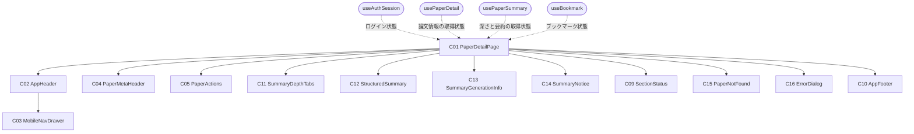
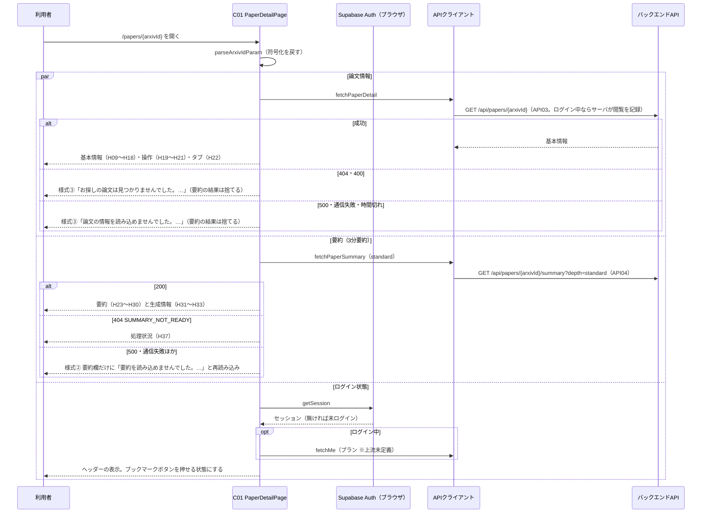
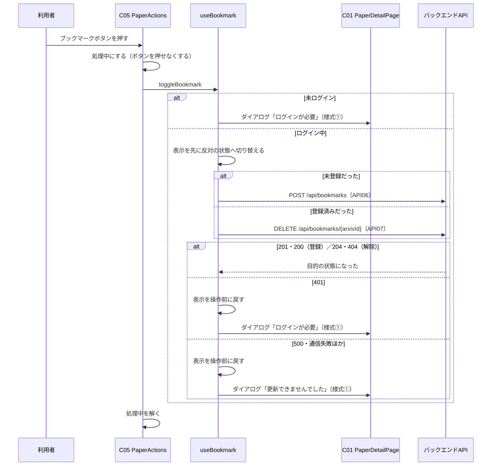

# FE詳細設計書 — P104 論文詳細

## 0. 文書情報

| 項目 | 値 |
| :--- | :--- |
| 設計書ID | P104-FE |
| 親ID | P104 |
| 親設計書 | `screens/画面.P104.画面基本設計.md` |
| 版 | 1.0（新規作成） |
| 作成日 | 2026-10-27 |
| 更新日 | 2026-10-27 |
| 作成方法 | 上流の画面基本設計書（P104）、確定済みの `docs/基本設計書_概要.md`、`source/` 配下の企画資料からの設計（creating-frontend-detailed-design v1.5.0 準拠）。API の応答の形は作成済みの BE詳細設計書（`detail/be/BE.F05.BE詳細設計.md`・`detail/be/BE.F07.BE詳細設計.md`・`detail/be/BE.F06.BE詳細設計.md`）に合わせた。P101〜P103 と共用する部品・関数（共通ヘッダー・フッター・状態表示・ログイン状態の取得・API呼び出しの共通処理・日付の整形・ログイン画面の URL の組み立て）は `detail/fe/FE.P101.FE詳細設計.md`・`detail/fe/FE.P102.FE詳細設計.md` の定義を再利用し、本書では P104 での使い方と P104 固有の部分、共用関数への拡張点を定義する |
| インプットの性質 | `source/` にあるのは企画・初期設計案の Markdown 6ファイルだけで、本画面のソースコード（ページ・コンポーネント・フック・ルーティング定義）は1行も無い（`source/README.md:5-10`、上流 概要書 §前提）。このため本書は**新規設計**であり、ファイルパス・関数名・State名・型はすべて実装時の命名案（※推測）である。技術スタックは Next.js / TypeScript / Tailwind CSS / shadcn/ui、数式は KaTeX（`source/03_システム構成.md:6,14`）、認証は Supabase Auth（`source/03_システム構成.md:10`） |
| 既存資料の突合 | `legacy/` は空ディレクトリ（ファイル0件）で、突合する既存設計・業務資料は無い。本書の既存版（`docs/detail/fe/FE.P104.FE詳細設計.md`）も無かったため、引き継ぐ記述・ID は上流設計書で採番済みのもの（P101〜P107、C01〜C05・C09〜C16、H01〜H47、E01〜E21、様式①〜④、API03・API04・API06・API07、IF03・IF05、F04・F05・F06・F07・F15・F17、BF05・BF07、EX04・EX05、T003・T004・T008、ARC001〜ARC005・ARC008〜ARC010、Q04・Q08・Q09・Q11・Q29）だけである |

## 1. フロントエンド構成・ルーティング設計

* **対象ドメイン**: 論文詳細系（paperDetail） — 1本の論文の基本情報と、30秒要約・3分要約・10分解説の構造化要約、主張ごとの区分と出典、ブックマークの登録・解除、原文と Appendix への導線を表示する画面（上流 P104 §1、`source/01_企画概要.md:27,33-37`、`source/02_機能要求定義.md:9,21-29`）。論文情報と要約の取得・深さの切り替え・ブックマークの操作・論文が見つからないときの全画面表示までを本書の範囲とする。閲覧の記録はサーバ側の責務で画面からは記録用の API を呼ばない。遷移先の画面（P101 ホーム・P102 新着論文・P103 論文検索・P105 Appendix・P106 マイページ・P107 料金、arXiv の原文ページ、出典の原文ページ、および※上流未定義のログイン・会員登録画面と利用規約ページ）の中身は各画面・外部の責務とする。
* **対象画面ID**: P104
* **ディレクトリ/ファイル構造**（※推測: 実装は未着手。P101〜P103 と同じ `web/` 配下の Next.js App Router 構成。本画面で使うファイルは全26件。内訳は本画面で新設する16件〈`app/papers/[arxivId]/page.tsx`、`components/paperDetail/` の8件、`hooks/` の3件、`lib/api/paperDetailClient.ts`・`lib/api/bookmarksClient.ts`・`lib/paperDetail/summaryView.ts`・`lib/paperDetail/mathText.ts` の4件〉と、P101・P102 で定義したファイルのうち本画面でも使う共用10件〈C02・C03・C10・C09 の部品4件、`hooks/useAuthSession.ts`、`lib/` の `supabase/browserClient.ts`・`api/requestJson.ts`〈本書で拡張〉・`api/meClient.ts`・`format/display.ts`〈本書で formatJstDateTime を追加〉・`papers/filterCondition.ts`〈buildLoginHref を使う〉の5件〉。論文カード C08 は本画面では使わない。下の木で「新設」「共用」を明示する）:

```
web/
├── app/
│   └── papers/
│       └── [arxivId]/
│           └── page.tsx                 … 新設: C01 PaperDetailPage（パス `/papers/{arxivId}` のページ）
├── components/
│   ├── layout/
│   │   ├── AppHeader.tsx                … 共用: C02 共通ヘッダー
│   │   ├── MobileNavDrawer.tsx          … 共用: C03 モバイル幅のナビゲーションドロワー
│   │   └── AppFooter.tsx                … 共用: C10 共通フッター
│   ├── paperDetail/
│   │   ├── PaperMetaHeader.tsx          … 新設: C04 論文の基本情報
│   │   ├── PaperActions.tsx             … 新設: C05 ブックマーク・原文・Appendix
│   │   ├── SummaryDepthTabs.tsx         … 新設: C11 要約の深さタブ
│   │   ├── StructuredSummary.tsx        … 新設: C12 構造化要約
│   │   ├── SummaryGenerationInfo.tsx    … 新設: C13 要約の生成情報
│   │   ├── SummaryNotice.tsx            … 新設: C14 要約欄の案内
│   │   ├── PaperNotFound.tsx            … 新設: C15 論文が見つからない表示
│   │   └── ErrorDialog.tsx              … 新設: C16 ダイアログ
│   └── common/
│       └── SectionStatus.tsx            … 共用: C09 取得中・失敗の表示
├── hooks/
│   ├── useAuthSession.ts                … 共用: ログイン状態と利用者表示の取得
│   ├── usePaperDetail.ts                … 新設: 論文情報の取得の状態管理
│   ├── usePaperSummary.ts               … 新設: 要約の取得と深さの状態管理
│   └── useBookmark.ts                   … 新設: ブックマーク状態の管理
└── lib/
    ├── supabase/browserClient.ts        … 共用: ブラウザ用 Supabase クライアント
    ├── api/
    │   ├── requestJson.ts               … 共用: API呼び出しの共通処理（本書で拡張 — §4 requestJson の拡張点）
    │   ├── paperDetailClient.ts         … 新設: GET /api/papers/{arxivId}・…/summary の呼び出し
    │   ├── bookmarksClient.ts           … 新設: POST /api/bookmarks・DELETE /api/bookmarks/{arxivId} の呼び出し
    │   └── meClient.ts                  … 共用: GET /api/me の呼び出し
    ├── paperDetail/
    │   ├── summaryView.ts               … 新設: 画面・要約欄の表示内容の判定と、項目・区分・出典・版・著者の整形
    │   └── mathText.ts                  … 新設: 数式を含む文字列の描画
    ├── papers/filterCondition.ts        … 共用: ログイン画面の URL の組み立て（P102 で定義）
    └── format/display.ts                … 共用: 日付の整形（本書で formatJstDateTime を追加）
```

* **ルーティング定義**（総件数: 1件。全数である根拠: 本書の対象は P104 の1画面だけで、上流 概要書 §3.1 の P104 行のパスが `/papers/{arxivId}` の1件である。要約の深さは URL に持たず画面内の状態とする — §3）:

| パス | コンポーネント | 認証要否 | ルートファイル |
| :--- | :--- | :--- | :--- |
| `/papers/{arxivId}`（※推測。上流 概要書 §3.1・付録 Q03 の仮置き）。`{arxivId}` は1つのパスの区切りで受け、旧形式の ID に含まれるスラッシュは `%2F` に符号化して渡す（例 `/papers/hep-th%2F9901001`。§4 parseArxivIdParam） | PaperDetailPage（C01） | 不要（閲覧はゲストも可。ブックマークの操作だけログインが要る — 上流 P104 §1） | `web/app/papers/[arxivId]/page.tsx`（App Router の動的な区切り。P105 の `/papers/{arxivId}/appendix` と同じ階層に並べられるよう、区切りを1つに限る） |

## 2. コンポーネント設計

* **コンポーネントツリー図**（上流 P104 §3.1 の木をそのまま引き継ぐ。点線は本書で決めた状態の受け渡し）:



* **コンポーネントロースター**（総件数: 13件。全数である根拠: 上流 P104 §3.2 コンポーネント一覧の C01〜C05・C09〜C16 の全13件と1対1で対応させ、本書で追加・統合した部品は無い。C06〜C08 は上流で欠番。C04・C05 は P101〜P103 の同じ番号の部品とは別物で、C02・C03・C09・C10 は P101〜P103 と同じ部品を共用する — 上流 P104 §3.2。shadcn/ui の汎用部品〈Tabs・Button・Badge・AlertDialog・Sheet・Skeleton〉と KaTeX は画面固有のコンポーネントではないため数えない）:

| コンポーネントID | コンポーネント名 | 種類 | ファイルパス | 概要 | 定義状況 | 詳細の所在 |
| :--- | :--- | :--- | :--- | :--- | :--- | :--- |
| C01 | PaperDetailPage | Page | `web/app/papers/[arxivId]/page.tsx` | 論文詳細画面全体。パスの arXiv ID で論文情報と要約を並行して取得し、論文情報が取れなければメインコンテンツ全体を C15 に置き換える。ダイアログの表示状態を持つ | 詳細 | §2 コンポーネント詳細定義、§4 |
| C02 | AppHeader | Layout | `web/components/layout/AppHeader.tsx` | 全画面共通のヘッダー。本画面ではどの導線も選択中の見た目にしない | 詳細 | §2 コンポーネント詳細定義（P104 での使い方）、`detail/fe/FE.P101.FE詳細設計.md` §2 C02 |
| C03 | MobileNavDrawer | UI | `web/components/layout/MobileNavDrawer.tsx` | モバイル幅でメニューボタンを押したときに開く導線の収納先 | 詳細 | §2 コンポーネント詳細定義（P104 での使い方）、`detail/fe/FE.P101.FE詳細設計.md` §2 C03 |
| C04 | PaperMetaHeader | UI | `web/components/paperDetail/PaperMetaHeader.tsx` | 日本語タイトル・原題・著者・カテゴリ・arXiv ID・版・新しい版の注記・日付・解析範囲を示す。著者が多いときは折りたたむ | 詳細 | §2 コンポーネント詳細定義、§4 formatVersionLabel・getVisibleAuthors |
| C05 | PaperActions | UI | `web/components/paperDetail/PaperActions.tsx` | ブックマーク・arXiv で原文を開く・Appendix の3つの操作を並べる。ブックマークの処理中はボタンを押せなくする | 詳細 | §2 コンポーネント詳細定義、§4 handleBookmarkClick・toggleBookmark |
| C11 | SummaryDepthTabs | UI | `web/components/paperDetail/SummaryDepthTabs.tsx` | 30秒要約・3分要約・10分解説を切り替えるタブ | 詳細 | §2 コンポーネント詳細定義、§4 handleDepthChange |
| C12 | StructuredSummary | UI | `web/components/paperDetail/StructuredSummary.tsx` | 選んだ深さの要約を項目ごとに表示し、主張ごとに区分ラベルと出典を付け、数式を KaTeX で描く | 詳細 | §2 コンポーネント詳細定義、§4 getVisibleSections・getClaimBasisLabel・buildCitationLabel・renderTextWithMath |
| C13 | SummaryGenerationInfo | UI | `web/components/paperDetail/SummaryGenerationInfo.tsx` | 表示中の要約の処理日時（H31）・生成モデル（H32）・対象の版（H33）を「処理日時 2024-01-23 12:10（JST）」「生成モデル …」「対象の版 v1」の形で並べる。Props は要約の生成日時・モデル名・版番号の3つだけで内部State を持たず、要約が取れたときに常に同じ形で出すだけで分岐が無い（上流 P104 C13 簡易） | 簡易 | 本表 |
| C14 | SummaryNotice | UI | `web/components/paperDetail/SummaryNotice.tsx` | 選んだ深さの要約が無い・見られない理由（10分解説なし・Pro 案内・処理中）を要約欄に示す | 詳細 | §2 コンポーネント詳細定義、§4 resolveSummaryView |
| C09 | SectionStatus | UI | `web/components/common/SectionStatus.tsx` | 要約欄に出す取得中・失敗の表示 | 詳細 | §2 コンポーネント詳細定義（P104 での使い方）、`detail/fe/FE.P101.FE詳細設計.md` §2 C09 |
| C15 | PaperNotFound | UI | `web/components/paperDetail/PaperNotFound.tsx` | 論文情報が取れないとき、メインコンテンツ全体を置き換えて理由とホームへの導線を示す | 詳細 | §2 コンポーネント詳細定義、§4 resolvePageView |
| C16 | ErrorDialog | UI | `web/components/paperDetail/ErrorDialog.tsx` | ブックマークの操作でログインが必要なとき・更新に失敗したときに画面中央に重ねるダイアログ | 詳細 | §2 コンポーネント詳細定義、§4 closeDialog・handleDialogLogin |
| C10 | AppFooter | Layout | `web/components/layout/AppFooter.tsx` | 全画面共通のフッター。arXiv との関係の注記（H46）と利用規約へのリンク（H47）を常に同じ形で出す。Props・内部State を持たず分岐が無い（P101 と同じ部品をそのまま使う） | 簡易 | 本表、`detail/fe/FE.P101.FE詳細設計.md` §2 ロースター C10 |

* **コンポーネント詳細定義**（ロースターのうち定義状況＝詳細の11件。共用部品は「P104 での使い方」と、P101〜P103 の定義から変わる点だけを書く。Props の型は §3 型定義を参照）:

| コンポーネントID | コンポーネント名 | 種類(Page/UI/HOC等) | ファイルパス | 担当項目ID | Props (型) | 内部State (型) | 役割・概要 |
| :--- | :--- | :--- | :--- | :--- | :--- | :--- | :--- |
| C01 | PaperDetailPage | Page | `web/app/papers/[arxivId]/page.tsx` | — | params: { arxivId: string }（Next.js がページに渡すパスの値） | dialog: DialogState（初期値 null）。ほかの状態は4つのフックが持つ（auth、paper、summary と選択中の深さ、ブックマーク状態 — §3 ローカルステート定義） | ダイアログの状態を自身で持ち、その設定関数を useBookmark に渡して、ブックマークの操作の結果としてダイアログを出せるようにする。パスの値を parseArxivIdParam で arXiv ID に直し、論文情報（usePaperDetail）と3分要約（usePaperSummary）の取得を同時に始める（上流 P104 E01「並行して行う」）。resolvePageView の結果が「見つからない」「読み込めない」ならヘッダー・フッターを残してメインコンテンツ全体を C15 に置き換え、要約の結果は使わない。取得中は基本情報の位置に要約と同じ形の灰色の枠を出す（上流 P104 H38 ※推測）。論文情報が取れたら C04・C05・C11 と、要約欄（resolveSummaryView の結果に応じて C12＋C13、C14、C09 のどれか）を描く。レイアウトはデスクトップで本文860px＋右に幅300pxのサイド領域（C05 と C13）、モバイルで基本情報 → C05 → タブ → 要約 → C13 の縦並び（上流 P104 §2.3 ※推測）。論文情報が取れたらブラウザのタブのページタイトルを「（日本語タイトル、無ければ原題）｜サービス名」にする（上流 P104 H09 ※推測。クライアントで描くページのため `document.title` を書き換える）。クライアントコンポーネントとする（`'use client'` ※推測） |
| C02 | AppHeader | Layout | `web/components/layout/AppHeader.tsx` | H01, H02, H03, H04, H05, H06, H07, H08 | auth: AuthState、loginReturnTo: string（P102 で追加した任意の Props。本画面のパス） | isDrawerOpen: boolean（初期値 false） | P101 の定義どおり。本画面に対応する導線は無いため activeNav は渡さず、どの導線も選択中の見た目にしない（上流 P104 §2.3）。onActiveNavClick・onLogoClick も渡さない。ログインボタン（H06）は本画面のパスを戻り先にしたログイン画面へ移す（E17） |
| C03 | MobileNavDrawer | UI | `web/components/layout/MobileNavDrawer.tsx` | H02, H03, H04, H05, H06, H07 | open: boolean、onOpenChange: (open: boolean) => void、auth: AuthState、loginReturnTo: string | なし | P101 の定義どおり。どの導線も選択中の見た目にしない |
| C04 | PaperMetaHeader | UI | `web/components/paperDetail/PaperMetaHeader.tsx` | H09, H10, H11, H12, H13, H14, H15, H16, H17, H18 | paper: PaperDetailModel | isAuthorsExpanded: boolean（初期値 false） | 日本語タイトル（H09。見出し要素 h1。日本語タイトルが無い論文では原題を見出しにする）、原題（H10。日本語タイトルがあるときだけ）、著者（H11。getVisibleAuthors の結果。11名以上のときは「ほか N名」を押せる文字で出し、押すと全員を展開し「閉じる」に替える — E21）、カテゴリ（H12。論文が持つすべてをラベルで）、arXiv ID（H13。「arXiv:」に続けて）、版（H14）と新しい版の注記（H15）は formatVersionLabel の結果、投稿日（H16）・更新日（H17）は「投稿日」「更新日」の語に続けて formatJstDate の結果（改訂が無く更新日が無い論文では、更新日にも投稿日と同じ日付を出す — 上流 P104 H17「投稿日と同じときも出す」※推測）、解析範囲（H18。本文取得状況が「Abstract のみ」なら「Abstractベース」、それ以外は「本文取得済み」）を上から積む。文字列はすべて React の標準のエスケープを通して描く |
| C05 | PaperActions | UI | `web/components/paperDetail/PaperActions.tsx` | H19, H20, H21 | arxivId: string、originalUrl: string \| null、isBookmarked: boolean、canBookmark: boolean（ログイン状態の確認が済んでいるか）、onToggleBookmark: () => Promise<void> | isProcessing: boolean（初期値 false） | ブックマークボタン（H19）は、登録済みなら「★ ブックマーク済み」、未登録なら「☆ ブックマークに追加」（上流 P104 H19 ※推測）。押すと handleBookmarkClick で処理中にしてから onToggleBookmark を待ち、終わるまでボタンを押せなくする（二重送信の防止 — 上流 P104 H19・C05）。ログイン状態の確認中も押せなくする（未ログインかどうかが決まる前に API を呼ばないため ※推測）。「arXiv で原文を開く ↗」（H20）は toSafeExternalUrl で確かめた原文URL を新しいタブで開くリンク（`target="_blank"`・`rel="noopener noreferrer"`。E04）で、安全な URL が得られないとき（原文URL が無い、URL として読めない、方式が http・https 以外のとき）だけ出さない（※推測。MVP 完了基準「arXiv の原文リンクが開ける」— `source/02_機能要求定義.md:56` — を満たすため、それ以外では必ず出す）。「Appendix（数式解説・参考文献）」（H21）は P105 へのリンク（E05。arXiv ID は符号化して付ける）。デスクトップは縦に、モバイルは横一列に並べる |
| C11 | SummaryDepthTabs | UI | `web/components/paperDetail/SummaryDepthTabs.tsx` | H22 | selectedDepth: SummaryDepth、onChange: (depth: SummaryDepth) => void | なし | shadcn/ui の Tabs で「30秒要約」「3分要約」「10分解説」の3つを常に出す（10分解説が見られない場合も出し、理由は要約欄で示す — 上流 P104 H22）。選んでいるタブは背景色付き・太字にする。キーボードの左右キーでもタブを移れる（Tabs の標準動作）。押されたら onChange を呼ぶ（E02） |
| C12 | StructuredSummary | UI | `web/components/paperDetail/StructuredSummary.tsx` | H23, H24, H25, H26, H27, H28, H29, H30 | summary: SummaryModel | なし | getVisibleSections で深さに応じた項目（結論 H23・課題（研究背景）H24・手法 H25・結果（実験結果）H26・限界 H27・応用 H28）を見出し付きで順に出す。各項目の主張ごとに、先頭へ区分ラベル（H29。getClaimBasisLabel。「論文の記載」は緑、「AIの補足（推測）」は紫のラベル ※推測）、本文（renderTextWithMath で数式を KaTeX に描いた文字列）、末尾へ出典リンク（H30。その主張に出典があるときだけ、buildCitationLabel の文言で、toSafeExternalUrl で確かめた出典URL を新しいタブで開く — E06）を並べる。安全な出典URL が無い出典は、リンクにせず文言だけを出す（※推測） |
| C14 | SummaryNotice | UI | `web/components/paperDetail/SummaryNotice.tsx` | H34, H35, H36, H37 | kind: 'deepUnavailable' \| 'proRequired' \| 'notReady' | なし | 案内の種類に応じて1つを出す。10分解説なし（H34「この論文は本文を取得していないため、10分解説はありません。Abstract をもとにした3分要約をご覧ください。」）、Pro 案内（H35「10分解説は Pro プランでご利用いただけます。」と、P107 への「料金プランを見る」リンク H36 — E07）、処理中（H37「速報版・要約処理中」と「この論文の日本語要約は準備中です。原文は「arXiv で原文を開く」から確認できます。」）。文言は上流 P104 H34〜H37 の※推測のとおり |
| C09 | SectionStatus | UI | `web/components/common/SectionStatus.tsx` | H38, H39, H40 | status: 'loading' \| 'error'、errorMessage?: string、onReload?: () => void | なし | P101 の定義どおり。本画面では要約欄に、取得中は要約の項目の形の灰色の枠（H38）、失敗時は赤色の帯のメッセージ（H39）と「再読み込み」（H40 — E08）を出す。0件の表示と P103 で追加したお知らせの表示は使わない（要約が無いときは C14 で理由を示すため — 上流 P104 C09） |
| C15 | PaperNotFound | UI | `web/components/paperDetail/PaperNotFound.tsx` | H41, H42 | kind: 'notFound' \| 'loadFailed' | なし | 論文が無いとき「お探しの論文は見つかりませんでした。URL をご確認ください。」、取得に失敗したとき「論文の情報を読み込めませんでした。時間をおいて再度お試しください。」を見出しとして出し（H41）、その下に「ホームに戻る」リンク（H42 — E09）を置く。ヘッダーとフッターは残す（様式③の本画面での形 — 上流 P104 §5.1） |
| C16 | ErrorDialog | UI | `web/components/paperDetail/ErrorDialog.tsx` | H43, H44, H45 | dialog: DialogState（null のとき閉じる）、onLogin: () => void、onClose: () => void | なし | shadcn/ui の AlertDialog で画面中央に重ねる。ログインが必要なとき、メッセージ（H43「ブックマークするにはログインが必要です。」）・「ログイン」ボタン（H44 — E10）・「閉じる」ボタン（H45 — E11）を出す。更新に失敗したとき、メッセージ（H43「ブックマークを更新できませんでした。時間をおいて再度お試しください。」）と「OK」ボタン（H45 — E11）だけを出す。開いている間は背景を操作できず、Esc キーでも閉じる（AlertDialog の標準動作。閉じる操作は E11 と同じ扱い） |

## 3. 状態管理（State）設計

* **型定義**（※推測: §3・§4 の表で使う型。AuthState・ApiRequestError は `detail/fe/FE.P101.FE詳細設計.md` §3 の定義を使い、ApiRequestError には本書でエラーコードを足す — §4 requestJson の拡張点。API の応答のキー名は BE.F05 §2 に合わせた）:

```ts
type SummaryDepth = 'short' | 'standard' | 'deep';          // 30秒要約・3分要約・10分解説

// 論文の基本情報（fetchPaperDetail が返す）
type PaperDetailModel = {
  arxivId: string; titleJa: string | null; titleOriginal: string;
  authors: string[]; categories: string[];
  submittedAt: string; updatedAt: string | null;           // ISO 8601（UTC）
  latestVersion: number; displayedVersion: number;
  originalUrl: string | null;                              // toSafeExternalUrl を通した値
  isAbstractOnly: boolean;                                 // 本文取得状況が Abstract のみか
};

// 主張1件と要約（fetchPaperSummary が返す）
type Claim = { claimId: string; text: string; basis: 'paper' | 'ai_inference' | 'unknown' };
type Citation = { claimId: string; section: string | null; page: number | null; url: string | null };
type SummaryModel = {
  depth: SummaryDepth; version: number; isAbstractOnly: boolean;
  sections: Partial<Record<'conclusion' | 'problem' | 'method' | 'results' | 'limitations' | 'applications', Claim[]>>;
  citations: Citation[]; generatedAt: string; modelId: string;
};

// 論文情報の取得状態（usePaperDetail が返す）
type PaperDetailState =
  | { status: 'loading' }
  | { status: 'error'; kind: 'notFound' | 'loadFailed' }
  | { status: 'success'; paper: PaperDetailModel };

// 要約の取得状態（usePaperSummary が返す）
type SummaryState =
  | { status: 'loading' }
  | { status: 'unavailable'; reason: 'deepUnavailable' | 'proRequired' | 'notReady' }
  | { status: 'error' }
  | { status: 'success'; summary: SummaryModel };

// 画面全体・要約欄に出す内容（resolvePageView・resolveSummaryView が返す）
type PageView = { type: 'loading' } | { type: 'notFound' } | { type: 'loadFailed' } | { type: 'content'; paper: PaperDetailModel };
type SummaryView =
  | { type: 'loading' } | { type: 'error'; message: string }
  | { type: 'notice'; kind: 'deepUnavailable' | 'proRequired' | 'notReady' }
  | { type: 'summary'; summary: SummaryModel };

// ダイアログ（C01 が持つ）
type DialogState = null | { type: 'loginRequired' } | { type: 'updateFailed' };
```

* **グローバルステート / Context定義**（総件数: 1件。全数である根拠: 本画面で画面の外と共有される状態は、Supabase Auth のログインセッション〈P101 と同じ〉だけである。パスの arXiv ID は読むだけで本画面から書き換えない。要約の深さは URL に持たず画面内の状態とする〈上流 P104 C01 の内部State「選択中の要約の深さ」を引き継ぐ〉。React の Context・状態管理ライブラリは使わない）:

| State名 | 型 | スコープ | 初期値 | 更新タイミング | 管理方法 |
| :--- | :--- | :--- | :--- | :--- | :--- |
| Supabase のログインセッション | Session \| null（Supabase の型） | アプリ全体（全画面） | セッション Cookie があればその内容、無ければ null | ログイン・ログアウト・トークンの自動更新のとき（本画面は読むだけ） | P101 と同じ（`detail/fe/FE.P101.FE詳細設計.md` §3）。本画面ではブックマークAPI に付けるアクセストークンの出どころにもなる |

* **ローカルステート定義**（総件数: 12件。全数である根拠: コンポーネントロースターの全13件を対象に、状態を持つものを数えた。C01 は9件〈ダイアログ、useAuthSession のログイン状態とその確認の通し番号、usePaperDetail の取得状態とその取り消し制御、usePaperSummary の選択中の深さ・取得状態・その取り消し制御、useBookmark の登録状態〉、C02・C04・C05 は1件ずつ〈ドロワーの開閉・著者の展開・ブックマークの処理中〉。フック内部の通し番号と取り消し制御は再描画を伴わない値〈useRef〉だが、古い応答による上書きの防止に効くため数える〈P101〜P103 と同じ基準〉。C03・C09・C10・C11・C12・C13・C14・C15・C16 の9件は状態を持たない）:

| コンポーネント | State名 | 型 | 初期値 | 用途 |
| :--- | :--- | :--- | :--- | :--- |
| C01 PaperDetailPage | dialog | DialogState | null | 画面中央に重ねるダイアログの種類。未ログインまたはセッション切れでブックマークを押したとき「ログインが必要」、更新に失敗したとき「更新失敗」にし、閉じる・ログインへ移るときに null に戻す（上流 P104 C01「ダイアログの表示状態」） |
| C01 PaperDetailPage（useAuthSession 内） | auth | AuthState | `{ status: 'loading' }` | ログイン中かどうかと、ヘッダーに出す利用者の表示を持つ。本画面ではブックマークの操作の可否と、ブックマークAPI に付けるアクセストークンの出どころになる |
| C01 PaperDetailPage（useAuthSession 内） | requestSeqRef | number（useRef） | 0 | ログイン状態の確認の通し番号（P101 と同じ） |
| C01 PaperDetailPage（usePaperDetail 内） | state | PaperDetailState | `{ status: 'loading' }` | 論文情報の取得状態と結果。失敗のときは「見つからない」か「読み込めない」かを持つ |
| C01 PaperDetailPage（usePaperDetail 内） | abortRef | AbortController \| null（useRef） | null | 進行中の論文情報の取得を取り消すための制御。別の論文へ移ったとき（同じページ部品のままパスだけが変わったとき）と画面を離れるときに、前の要求を取り消す |
| C01 PaperDetailPage（usePaperSummary 内） | selectedDepth | SummaryDepth | `'standard'`（3分要約。上流 P104 H22、BE.F05 API04「未指定時は standard」） | 選択中の要約の深さ。タブで変える。別の論文へ移ったときは3分要約に戻す |
| C01 PaperDetailPage（usePaperSummary 内） | state | SummaryState | `{ status: 'loading' }` | 選択中の深さの要約の取得状態と結果。要約が無い・見られないときはその理由を持つ |
| C01 PaperDetailPage（usePaperSummary 内） | abortRef | AbortController \| null（useRef） | null | 進行中の要約の取得を取り消すための制御。深さを続けて切り替えたとき、前の深さの応答が後から届いて要約欄を上書きしないよう、新しい取得を始める前に前の要求を取り消す（上流 P104 H38） |
| C01 PaperDetailPage（useBookmark 内） | isBookmarked | boolean | false | 表示中の論文をログイン中の利用者がブックマークしているか。論文情報の応答に登録状態が無いため、初期表示は未登録とする（上流 P104 H19・§7。※上流要確認: BE.F05 API03 の応答にも無い）。登録済みの論文を登録しても API が成功扱いにするため、表示がずれても次の操作で正しい状態にそろう |
| C02 AppHeader | isDrawerOpen | boolean | false | モバイル幅のドロワーが開いているか（P101 と同じ） |
| C04 PaperMetaHeader | isAuthorsExpanded | boolean | false | 著者一覧を展開しているか（上流 P104 C04「著者一覧を展開しているかどうか」）。「ほか N名」で true、「閉じる」で false にする（E21） |
| C05 PaperActions | isProcessing | boolean | false | ブックマークの登録・解除の処理中か（上流 P104 C05「登録・解除の処理中かどうか」）。処理中はボタンを押せなくし、二重送信を防ぐ |
| C03 MobileNavDrawer | なし | — | — | 開閉状態は C02 から Props で受け取る |
| C09 SectionStatus | なし | — | — | どの状態を出すかは Props で受け取る |
| C10 AppFooter | なし | — | — | 固定文言とリンクだけを表示する |
| C11 SummaryDepthTabs | なし | — | — | 選択中の深さは C01 から Props で受け取る |
| C12 StructuredSummary | なし | — | — | 要約は Props で受け取る |
| C13 SummaryGenerationInfo | なし | — | — | 生成情報は Props で受け取る |
| C14 SummaryNotice | なし | — | — | 案内の種類は Props で受け取る |
| C15 PaperNotFound | なし | — | — | 失敗の種類は Props で受け取る |
| C16 ErrorDialog | なし | — | — | ダイアログの種類は C01 から Props で受け取る |

* **永続化ステート**（総件数: 1件。全数である根拠: 本画面が自分で localStorage・sessionStorage・Cookie に書き込む値は無い。選択中の深さもブラウザに保存しない。本画面が読むのは Supabase Auth がログイン時に保存したセッションの Cookie だけである〈P101 と同じ〉。閲覧の記録はサーバが行い、ブラウザには残さない）:

| キー | 保存先 | 型 | 用途 | 有効期限 |
| :--- | :--- | :--- | :--- | :--- |
| `sb-<SupabaseプロジェクトID>-auth-token`（※推測: `@supabase/ssr` の既定の Cookie 名） | Cookie（Supabase のライブラリが書き込む。本画面は読むだけ） | string | ログイン中かどうかの判定と、ブックマークAPI に付けるアクセストークンの取り出しに使う。論文情報API・要約API へはブラウザが自動で送り、サーバが閲覧の記録（論文情報API）と10分解説のプランの確認（要約API）に使う（BE.F05 §2） | Supabase Auth の設定に従う（※推測。上流 概要書 §8「セッションの有効期限は未定義」） |

## 4. クライアント側機能・処理ロジック設計（IPO設計）

* **処理フロー図**（画面を開いたとき — E01。論文情報・要約・ログイン状態の3つを同時に始める）:



* **処理フロー図**（ブックマークの操作 — E03。表示を先に切り替え、失敗したら戻す）:



* **関数・フックロースター**（総件数: 34件。内訳は本書で新設する25件と、P101・P102 で定義済みのものを本画面でも使う9件〈P101 定義8件・P102 定義1件〉。定義状況は詳細22件・簡易12件。全数である根拠: ソースコードが無いため、上流 P104 §5 のイベント E01〜E21 の処理と、§4 の表示項目の整形規則（H09〜H18・H22〜H33）を、1つの責務を1関数として分けた設計上の全数である。E01→parseArxivIdParam・usePaperDetail・fetchPaperDetail・toSafeExternalUrl・resolvePageView・usePaperSummary・fetchPaperSummary・resolveSummaryView・useBookmark・useAuthSession・fetchMe・requestJson・getBrowserSupabaseClient、E02→handleDepthChange、E03→handleBookmarkClick・toggleBookmark・addBookmark・removeBookmark、E08→reloadSummary、E10→handleDialogLogin・buildLoginHref、E11→closeDialog、E17→buildLoginHref、E18→toggleDrawer、E19→closeDrawer、E13〜E17 のドロワー内→handleDrawerLinkClick、E21→toggleAuthorsExpanded、表示の整形→formatVersionLabel（H14・H15）・getVisibleAuthors（H11）・formatJstDate（H16・H17）・formatJstDateTime（H31）・getVisibleSections（H23〜H28）・getClaimBasisLabel（H29）・buildCitationLabel（H30）・renderTextWithMath（H25 ほかの数式）。E04〜E07・E09・E12〜E17・E20 は Next.js の Link か外部リンクが遷移するだけで本書の関数を持たない〈行き先の URL は toSafeExternalUrl・buildLoginHref が決める〉。P101〜P103 の関数のうち本画面で使わないもの〈一覧・検索・おすすめ固有の関数と論文カードの変換関数〉は数えない。関数には上流で採番されたIDが無いため、新たに番号を振らず関数名を識別子として扱う）:

| 関数名（識別子） | 種別 | 所属 | ファイル | 概要 | 定義状況 | 詳細の所在 |
| :--- | :--- | :--- | :--- | :--- | :--- | :--- |
| parseArxivIdParam | 変換関数 | C01 | `web/lib/paperDetail/summaryView.ts` | パスの値から arXiv ID を取り出す（符号化されたスラッシュを戻す） | 詳細 | 本章 IPO定義 |
| resolvePageView | 判定関数 | C01 | `web/lib/paperDetail/summaryView.ts` | 論文情報の取得状態から、メインコンテンツに何を出すかを決める | 詳細 | 本章 IPO定義 |
| usePaperDetail | フック | C01 | `web/hooks/usePaperDetail.ts` | arXiv ID が変わるたびに論文情報を取得し、取得状態を持つ | 詳細 | 本章 IPO定義 |
| fetchPaperDetail | APIクライアント | C01 | `web/lib/api/paperDetailClient.ts` | GET /api/papers/{arxivId} を呼び、基本情報を表示用の形に変える | 詳細 | 本章 IPO定義 |
| usePaperSummary | フック | C01 | `web/hooks/usePaperSummary.ts` | 選択中の深さを持ち、arXiv ID か深さが変わるたびに要約を取得する | 詳細 | 本章 IPO定義 |
| fetchPaperSummary | APIクライアント | C01 | `web/lib/api/paperDetailClient.ts` | GET /api/papers/{arxivId}/summary を呼び、要約を表示用の形に変え、無い・見られない理由を見分ける | 詳細 | 本章 IPO定義 |
| reloadSummary | フック内関数 | C01 → C09 | `web/hooks/usePaperSummary.ts` | 選んでいる深さのまま要約を取り直す（E08）。usePaperSummary の取得処理を呼び直すだけで、独自の分岐を持たない | 簡易 | 本表（取得処理は usePaperSummary） |
| handleDepthChange | イベントハンドラ | C01（C11 から onChange として呼ばれる） | `web/hooks/usePaperSummary.ts` | タブで選んだ深さに切り替える（E02） | 詳細 | 本章 IPO定義 |
| resolveSummaryView | 判定関数 | C01 | `web/lib/paperDetail/summaryView.ts` | 要約の取得状態から、要約欄に何を出すかを決める | 詳細 | 本章 IPO定義 |
| getVisibleSections | 判定関数 | C12 | `web/lib/paperDetail/summaryView.ts` | 深さと要約の中身から、表示する項目とその順を決める（H23〜H28） | 詳細 | 本章 IPO定義 |
| getClaimBasisLabel | 判定関数 | C12 | `web/lib/paperDetail/summaryView.ts` | 主張の区分から、ラベルの文言と色を決める（H29） | 詳細 | 本章 IPO定義 |
| buildCitationLabel | 整形関数 | C12 | `web/lib/paperDetail/summaryView.ts` | 出典参照から「出典 §章 p.ページ」の文言を組み立てる（H30） | 詳細 | 本章 IPO定義 |
| renderTextWithMath | 描画関数 | C12 | `web/lib/paperDetail/mathText.ts` | 主張の本文のうち数式の部分だけを KaTeX で描き、それ以外を通常の文字として描く | 詳細 | 本章 IPO定義 |
| toSafeExternalUrl | 検査関数 | C01・C12 | `web/lib/paperDetail/summaryView.ts` | 外部リンクの URL が http・https の正しい URL かを確かめ、安全なものだけを返す。arXiv の http の URL は https に直す（H20・H30） | 詳細 | 本章 IPO定義 |
| formatVersionLabel | 整形関数 | C04 | `web/lib/paperDetail/summaryView.ts` | 版の表示（H14）と新しい版の注記（H15）の文言を組み立てる | 詳細 | 本章 IPO定義 |
| getVisibleAuthors | 整形関数 | C04 | `web/lib/paperDetail/summaryView.ts` | 著者の並びと展開状態から、表示する著者と「ほか N名」の有無を決める（H11） | 詳細 | 本章 IPO定義 |
| toggleAuthorsExpanded | イベントハンドラ | C04 | `web/components/paperDetail/PaperMetaHeader.tsx` | 著者一覧の展開・折りたたみを切り替える（E21）。展開状態を反転するだけで分岐を持たない | 簡易 | 本表 |
| formatJstDateTime | 整形関数 | C13 | `web/lib/format/display.ts` | 日時を日本時間の `YYYY-MM-DD HH:mm（JST）` に直す（H31）。formatJstDate と同じ変換に時刻を加えるだけで、日時として読めない値は formatJstDate と同じく「日付不明」とする | 簡易 | 本表（変換規則は `detail/fe/FE.P101.FE詳細設計.md` §4 formatJstDate） |
| useBookmark | フック | C01 | `web/hooks/useBookmark.ts` | ブックマーク状態を持ち、切り替えの関数を返す | 詳細 | 本章 IPO定義 |
| toggleBookmark | フック内関数 | C01 → C05 | `web/hooks/useBookmark.ts` | ログイン状態と登録状態に応じて登録・解除を行い、失敗時は表示を戻してダイアログを出す（E03） | 詳細 | 本章 IPO定義 |
| handleBookmarkClick | イベントハンドラ | C05 | `web/components/paperDetail/PaperActions.tsx` | ブックマークボタンを押したとき、処理中にしてから onToggleBookmark を待ち、終わったら処理中を解く（E03）。処理中の目印の付け外しだけで分岐を持たない（押せない状態はボタンの無効化で守る） | 簡易 | 本表 |
| addBookmark | APIクライアント | C01 | `web/lib/api/bookmarksClient.ts` | アクセストークンを付けて POST /api/bookmarks を呼ぶ（本文は `{ arxivId }`）。201・200 のどちらも成功として返し、それ以外は requestJson の例外をそのまま伝える。応答の中身は使わず分岐を持たない | 簡易 | 本表 |
| removeBookmark | APIクライアント | C01 | `web/lib/api/bookmarksClient.ts` | アクセストークンを付けて DELETE /api/bookmarks/{arxivId} を呼ぶ。204 と 404 を「解除された」として扱う | 詳細 | 本章 IPO定義 |
| closeDialog | イベントハンドラ | C01（C16 から onClose として呼ばれる） | `web/app/papers/[arxivId]/page.tsx` | ダイアログを閉じる（E11）。ダイアログの状態を null に戻すだけで分岐を持たない | 簡易 | 本表 |
| handleDialogLogin | イベントハンドラ | C01（C16 から onLogin として呼ばれる） | `web/app/papers/[arxivId]/page.tsx` | ダイアログを閉じてから、本画面のパスを戻り先にしたログイン画面（buildLoginHref）へ `router.push` で移る（E10）。分岐を持たない | 簡易 | 本表 |
| useAuthSession | フック | C01 | `web/hooks/useAuthSession.ts` | ログイン状態と利用者表示を取得する（E01）。本画面ではやり直し用の関数（refreshSession）は使わない | 詳細 | `detail/fe/FE.P101.FE詳細設計.md` §4 IPO定義 |
| getBrowserSupabaseClient | ユーティリティ | 共通 | `web/lib/supabase/browserClient.ts` | ブラウザ用の Supabase クライアントを1つだけ作って返す | 簡易 | `detail/fe/FE.P101.FE詳細設計.md` §4 関数ロースター |
| fetchMe | APIクライアント | 共通 | `web/lib/api/meClient.ts` | GET /api/me でプランを取得する（※上流未定義。§4.1） | 詳細 | `detail/fe/FE.P101.FE詳細設計.md` §4 IPO定義 |
| requestJson | APIクライアント | 共通 | `web/lib/api/requestJson.ts` | API呼び出しの共通処理。本書で、GET 以外のメソッド・本文の送信・2xx の成功扱い・本文なしの応答・エラーコードの取り出しを足す | 詳細 | `detail/fe/FE.P101.FE詳細設計.md` §4 IPO定義（元の手順）、本章「requestJson の拡張点」（追加分） |
| formatJstDate | 整形関数 | C04 | `web/lib/format/display.ts` | 日時を日本時間の日付にしてタイムゾーンを併記する（H16・H17） | 詳細 | `detail/fe/FE.P101.FE詳細設計.md` §4 IPO定義 |
| buildLoginHref | 変換関数 | C01 → C02・C03 | `web/lib/papers/filterCondition.ts` | いまの URL を戻り先として付けたログイン画面の URL を返す（E10・E17） | 簡易 | `detail/fe/FE.P102.FE詳細設計.md` §4 関数ロースター |
| toggleDrawer | イベントハンドラ | C02 | `web/components/layout/AppHeader.tsx` | ドロワーの開閉を反転する（E18） | 簡易 | `detail/fe/FE.P101.FE詳細設計.md` §4 関数ロースター |
| closeDrawer | イベントハンドラ | C02 → C03 | `web/components/layout/AppHeader.tsx` | ドロワーを閉じる（E19） | 簡易 | `detail/fe/FE.P101.FE詳細設計.md` §4 関数ロースター |
| handleDrawerLinkClick | イベントハンドラ | C03 | `web/components/layout/MobileNavDrawer.tsx` | ドロワー内のリンクを押したときにドロワーを閉じる（E13〜E17） | 簡易 | `detail/fe/FE.P101.FE詳細設計.md` §4 関数ロースター |

* **requestJson の拡張点**（P101 で定義した共用関数に、本画面のために足す処理。P101〜P103 の呼び出し方〈GET・200〉の動きは変えない。※上流要確認: P101 FE詳細設計の requestJson の IPO 定義へ一本化する）:
  1. 引数の options に `method`（既定 GET）と `body`（JSON にして送る値）と `accessToken`（あれば `Authorization: Bearer …` を付ける）を足す。本文を送るときは `Content-Type: application/json` を付ける。
  2. 成功の判定を「200 のとき」から「200〜299 のとき」に広げる（ブックマークの登録は 201、解除は 204 を返すため — BE.F07 §2）。
  3. 本文の無い応答（204）は JSON として読まず、data を null として返す。
  4. 200〜299 以外のときは、応答本文を JSON として読めれば、そのエラーコード（`error.code`）を ApiRequestError に付ける（要約の 404 の理由〈本文未取得・未生成・論文なし〉と 403 の理由を見分けるため — BE.F05 §2 API04）。読めなければエラーコードは無しとする。

* **入力・処理・出力（IPO）定義**（ロースターの詳細22件のうち、本書で新設する18件。P101 で定義済みの共用の詳細4件〈useAuthSession・fetchMe・requestJson・formatJstDate〉は P101 の IPO定義を正とし、requestJson の追加分は上の「requestJson の拡張点」に書いた。簡易12件〈新設7件: reloadSummary・toggleAuthorsExpanded・formatJstDateTime・handleBookmarkClick・addBookmark・closeDialog・handleDialogLogin／共用5件: getBrowserSupabaseClient・buildLoginHref・toggleDrawer・closeDrawer・handleDrawerLinkClick〉はロースターの概要欄で定義を完結している）:

| 関数名 | 所属コンポーネント | 引数 (型) | 処理フロー (ステップ単位で具体的に) | 戻り値 | 発生しうるエラー |
| :--- | :--- | :--- | :--- | :--- | :--- |
| parseArxivIdParam | C01 | raw: string（パスの `{arxivId}` の値） | 1. 値に符号化された文字（`%2F` ほか）が残っていれば元に戻す（`decodeURIComponent`。ルーターが戻した後の値にもう一度かけても変わらない文字だけが対象になるよう、`%` を含むときだけかける）。戻せない壊れた符号化のときは、元の値をそのまま使う。<br>2. 前後の空白を除いた値を返す。形式の正しさ（新形式・旧形式）は画面では判定せず、API の 400・404 に任せる（BE.F05 §2 と規則を二重に持たないため）。<br>（旧形式の ID〈例 `hep-th/9901001`〉はスラッシュを含むため、パスの区切りを1つに保つには、本画面へのリンクを作る側が arXiv ID を符号化する必要がある〈`/papers/${encodeURIComponent(arxivId)}`〉。※上流要確認: P101〜P103・P106 の FE詳細設計の P104 へのリンク〈P101 E10・P102 E05・P103 E07〉にも同じ符号化を入れる） | string | なし |
| resolvePageView | C01 | state: PaperDetailState | 1. 取得中なら「取得中」を返す（基本情報の位置に灰色の枠を出す）。<br>2. 失敗で種類が「見つからない」なら「見つからない」を返す（様式③）。<br>3. 失敗で種類が「読み込めない」なら「読み込めない」を返す（様式③）。<br>4. 成功なら「内容」と論文情報を返す | PageView | なし |
| usePaperDetail | C01 | arxivId: string | 1. arXiv ID が変わるたびに取得を始める（依存は arXiv ID だけ）。<br>2. 進行中の要求があれば取り消し、新しい取り消し制御を作り、状態を取得中にする。<br>3. fetchPaperDetail を呼ぶ。<br>4. 成功したら論文情報を状態に入れ、ブラウザのタブのページタイトルを日本語タイトル（無ければ原題）にする。<br>5. 失敗で HTTP ステータスが 404 または 400 なら「見つからない」にする（400 は arXiv ID の形式が正しくない URL で、利用者にとっては存在しない論文と同じため ※推測。上流 P104 §5.1 は 404 だけを挙げている）。それ以外の失敗（500 ほか、通信失敗、時間切れ、応答形式不正）は「読み込めない」にする。取り消しによる失敗のときは状態を変えない。<br>6. 画面を離れるときは進行中の要求を取り消す。<br>（再読み込みの関数は持たない。論文情報の失敗時はブラウザの再読み込みで開き直す — 上流 P104 §5.1 様式③） | { state: PaperDetailState } | なし（失敗は状態に入れて画面に渡す） |
| fetchPaperDetail | usePaperDetail | arxivId: string、signal: AbortSignal | 1. requestJson で GET /api/papers/{arxivId} を呼ぶ（arXiv ID は符号化して付ける）。Cookie は同じ生成元のため自動で送られ、ログイン中ならサーバが閲覧を記録する（BE.F05 §2 API03。画面は記録用の API を呼ばない）。応答はキャッシュしない（`cache: 'no-store'`。閲覧の記録を取りこぼさないため — BE.F05 §2 レスポンスヘッダー）。<br>2. 応答の項目を PaperDetailModel に移す。原題は `titleOriginal`、表示中の版は `displayedVersion`、最新版は `latestVersion` から移す。<br>3. 原文URL は toSafeExternalUrl を通し、安全でなければ無しにする。<br>4. 本文取得状況（`contentStatus`）が「Abstract のみ」（`abstract_only`）なら Abstract のみとし、それ以外の値は本文取得済みとする（※推測: T002 の本文取得状況の値のうち Abstract のみ以外を一括で扱う）。<br>5. 変換後の論文情報を返す | PaperDetailModel | ApiRequestError（requestJson と同じ種類。HTTPエラーではステータスとエラーコードを持つ） |
| usePaperSummary | C01 | arxivId: string | 1. 選択中の深さを3分要約で始める。arXiv ID が変わったときは3分要約に戻す。<br>2. arXiv ID か選択中の深さが変わるたびに取得を始める（依存はこの2つ）。<br>3. 進行中の要求があれば取り消し、新しい取り消し制御を作り、状態を取得中にする（前の深さの要約は消し、取り違えさせない — 上流 P104 H38）。<br>4. fetchPaperSummary を呼ぶ。<br>5. 結果が要約なら成功、無い・見られない理由なら「見られない」とその理由を状態に入れる。<br>6. 例外なら状態を失敗にする。取り消しによる失敗のときは状態を変えない。<br>7. 画面を離れるときは進行中の要求を取り消す。<br>8. 選択中の深さ、取得状態、深さを変える関数（handleDepthChange）、取り直す関数（reloadSummary）を返す。<br>（論文情報の取得とは互いを待たずに並行して進む — 上流 P104 E01。論文情報が「見つからない」「読み込めない」になったときは、要約の結果を画面が使わない — resolvePageView） | { selectedDepth: SummaryDepth; state: SummaryState; handleDepthChange: (d: SummaryDepth) => void; reloadSummary: () => void } | なし（失敗は状態に入れて画面に渡す） |
| fetchPaperSummary | usePaperSummary | arxivId: string、depth: SummaryDepth、signal: AbortSignal | 1. requestJson で GET /api/papers/{arxivId}/summary を `depth` を付けて呼ぶ（深さは既定値の3分要約でも必ず付ける）。Cookie は自動で送られ、10分解説を Pro 限定とする場合にサーバがプランの確認に使う（BE.F05 §2 API04）。<br>2. 成功したら、応答の `content` の6項目（結論 `conclusion`・課題 `problem`・手法 `method`・結果 `results`・限界 `limitations`・応用 `applications`）を、それぞれ主張の並びとして移す。項目が無い・配列でないときはその項目を無しとする。主張の区分（`basis`）が「論文の記載」（`paper`）か「AIの推測」（`ai_inference`）でなければ「不明」とする。<br>3. 出典（`citations`）を主張IDの順のまま移す（章 `sourceSection`、ページ `sourcePage`、URL は `sourceUrl` を toSafeExternalUrl に通した値）。<br>4. 対象の版（`version`）・解析範囲（`sourceScope` が `abstract_only` なら Abstract のみ）・生成日時（`generatedAt`）・生成モデル（`modelId`）を移して要約を返す。<br>5. 403 なら「Pro 限定」を理由として返す（上流 P104 H35）。<br>6. 404 のとき、エラーコードが本文未取得（`DEEP_SUMMARY_UNAVAILABLE`）なら「10分解説なし」を、未生成（`SUMMARY_NOT_READY`）またはエラーコードが読めないときは「処理中」を理由として返す（BE.F05 §2 API04 のエラーコードの使い分け）。10分解説を選んで未生成だった場合（本文は取得済みだが10分解説がまだ作られていない）も「処理中」とする（※推測。※上流要確認: 上流 P104 H37 の表示条件は30秒・3分のタブに限っており、10分解説が未生成の場合の表示が無い）。<br>7. 404 でエラーコードが論文なし（`PAPER_NOT_FOUND`）のときと、400・500 ほかの 200〜299 以外、通信失敗、時間切れ、応答形式不正は例外のまま伝える（論文なしは論文情報の側で様式③になるため、要約欄では失敗として扱う ※推測） | SummaryModel または { unavailable: 'deepUnavailable' \| 'proRequired' \| 'notReady' } | ApiRequestError（手順7の場合） |
| handleDepthChange | C01（C11 から） | depth: SummaryDepth | 1. 選んだ深さが選択中の深さと同じなら何もしない（上流 P104 E02「選択中のタブを押したときは何もしない」）。<br>2. 違えば選択中の深さを変える。usePaperSummary の依存が変わり、その深さの要約の取得が始まる（同じ深さを前に見ていても、取り直す — 上流 P104 E02「その深さの要約を取り直す」。要約API の応答は配信網で5分共有されるため負荷は小さい — BE.F05 §2）。<br>3. 論文情報がまだ取れていないときはタブ自体を出さないため、この関数は呼ばれない（上流 P104 E02「論文情報が取れているとき」） | void | なし |
| resolveSummaryView | C01（結果を C12・C13・C14・C09 へ渡す） | state: SummaryState | 1. 取得中なら「取得中」を返す（C09 の灰色の枠。H38）。<br>2. 失敗なら「要約を読み込めませんでした。時間をおいて再読み込みしてください。」の文言を付けた「失敗」を返す（C09 の赤色の帯と再読み込み。H39・H40。様式②。文言は上流 P104 §5.1 ※推測）。<br>3. 見られない理由があれば「案内」とその種類を返す（C14。H34〜H37）。<br>4. 成功なら「要約」を返す（C12 と C13） | SummaryView | なし |
| getVisibleSections | C12 | depth: SummaryDepth、sections: SummaryModel['sections'] | 1. 30秒要約なら結論だけを対象にする（上流 P104 H23「30秒要約はこの項目だけ」、`source/02_機能要求定義.md:24`）。<br>2. 3分要約なら結論・課題・手法・結果・限界を対象にし、要約に応用があればそれも加える（上流 P104 §7「深さごとの表示項目」）。<br>3. 10分解説なら6項目すべてを対象にする。<br>4. 対象のうち、要約に主張が1件以上ある項目だけを、結論・課題・手法・結果・限界・応用の順に返す（上流 P104 H24〜H28「要約にこの項目があるときに表示」）。各項目には見出し（「結論」「課題（研究背景）」「手法」「結果（実験結果）」「限界」「応用」）を付ける。<br>5. 対象の項目がどれも空だった場合は、結論の見出しだけを返し、本文に「この要約には表示できる項目がありません。」を出す（※推測: 検証に合格した要約で起きる想定は無いが、空の要約欄を出さないため） | { key; heading; claims: Claim[] }[] | なし |
| getClaimBasisLabel | C12 | basis: Claim['basis'] | 1. 「論文の記載」（`paper`）なら、文言「論文の記載」と緑のラベルを返す。<br>2. 「AIの推測」（`ai_inference`）なら、文言「AIの補足（推測）」と紫のラベルを返す。<br>3. 「不明」なら、AIの補足と同じ文言・色を返す（区分の分からない主張を事実として見せないため ※推測 — 上流 ARC004「事実と推測の区別」）。<br>（文言・配色は上流 P104 H29 ※推測。上流 P104 §7 の「区分の値を要約JSONのどこに持つか」は BE.F05 §2 API04 の主張ごとの `basis` で決まったため、本書はそれに従う。※上流要確認: 上流 P104 の確認事項の更新） | { text: string; tone: 'paper' \| 'inference' } | なし |
| buildCitationLabel | C12 | citation: Citation | 1. 章が「Abstract」（大文字小文字を区別しない）なら「出典 Abstract」を返す（上流 P104 H30「Abstract ベースでページが無いときは「出典 Abstract」」）。<br>2. 章とページの両方があれば「出典 §{章} p.{ページ}」を返す（例「出典 §4.2 p.6」）。<br>3. 章だけあれば「出典 §{章}」、ページだけあれば「出典 p.{ページ}」を返す（※推測）。<br>4. どちらも無ければ「出典」とだけ返す（URL があればリンクとしては出す ※推測） | string | なし |
| renderTextWithMath | C12 | text: string | 1. 本文を、ドル記号2つで囲んだ部分（別行の数式）とドル記号1つで囲んだ部分（文中の数式）と、それ以外の文字に分ける（※推測: 数式の書き方は要約スキーマ ARC003 で未定義。※上流要確認）。バックスラッシュを前に付けたドル記号は数式の区切りとみなさない。閉じのドル記号が無いときは、残りを通常の文字として扱う。<br>2. 通常の文字は React の文字としてそのまま描く（エスケープされる）。<br>3. 数式の部分は KaTeX で HTML に変換し、その結果だけを要素の中身として差し込む。変換は、数式の誤りで例外を出さず赤字で元の式を見せる設定（`throwOnError: false`）と、外部の URL や任意の HTML を許さない設定（`trust: false`、`strict: 'warn'`）で行う（外部由来の文字列からスクリプトが動かないようにする — 上流 P104 H25、上流 概要書 §8 XSS 対策 ※推測）。<br>4. 分けた順に並べた描画結果を返す | ReactNode[] | なし（数式の誤りは KaTeX が赤字の表示にする） |
| toSafeExternalUrl | C01・C12 | value: string \| null \| undefined | 1. 値が無ければ無しを返す。<br>2. URL として読めなければ無しを返す。<br>3. 読めた URL の方式が http・https のどちらでもなければ無しを返す（`javascript:`・`data:` のような方式でスクリプトが動くのを防ぐため ※推測）。<br>4. ホストが arXiv（`arxiv.org`、またはその下位のホスト）で方式が http なら、方式を https に置き換えて返す（arXiv のメタデータの原文URL は http の形で入ることがあり、通信を暗号化するため ※推測 — 上流 概要書 §8「盗聴」）。<br>5. それ以外は URL をそのまま返す（http のままの外部 URL も、リンクを消すと原文に辿れなくなるため許す）。<br>（行き先のホストは arXiv に限らない。出典の行き先は arXiv の原文ページを想定するが上流で決まっていないため — 上流 P104 §7「出典URL の行き先」※上流要確認） | string \| null | なし |
| formatVersionLabel | C04 | displayedVersion: number、latestVersion: number | 1. 表示中の版と最新版が同じなら、版の表示を「v{N}（最新）」にし、注記は無しにする（上流 P104 H14 ※推測）。<br>2. 表示中の版が最新版より古ければ、版の表示を「表示中 v{N} / 最新 v{M}」にし、注記を「この要約は v{N} を対象にしています。arXiv には新しい版 v{M} があります。」にする（上流 P104 H15）。<br>3. 表示中の版が最新版より新しい（データの不整合）ときは、表示中の版だけを「v{N}」と出し、注記は無しにする（※推測） | { versionText: string; newerNotice: string \| null } | なし |
| getVisibleAuthors | C04 | authors: string[]、expanded: boolean | 1. 著者が0名なら「著者情報なし」を1件だけ返し、展開の操作は出さない（P101 formatAuthors と同じ扱い ※推測）。<br>2. 10名以下なら全員を返し、展開の操作は出さない。<br>3. 11名以上で折りたたみ中なら、先頭10名と「ほか {残りの人数}名」の操作を返す。<br>4. 11名以上で展開中なら、全員と「閉じる」の操作を返す。<br>（10名の境目は上流 P104 H11 ※推測） | { names: string[]; toggleLabel: string \| null } | なし |
| useBookmark | C01 | auth: AuthState、arxivId: string、openDialog: (d: Exclude<DialogState, null>) => void（C01 のダイアログの状態を設定する関数） | 1. 登録状態を未登録で始める。arXiv ID が変わったときは未登録に戻す（論文情報の応答に登録状態が無いため — §3 ローカルステート定義）。<br>2. 登録状態と、切り替えの関数（toggleBookmark）を返す。<br>3. ダイアログを出すときは、引数の openDialog を呼ぶ（ダイアログの状態は C01 が持つ — 上流 P104 C01） | { isBookmarked: boolean; toggleBookmark: () => Promise<void> } | なし |
| toggleBookmark | C01（C05 から onToggleBookmark として呼ばれる） | なし（ログイン状態・登録状態・arXiv ID を使う） | 1. ログイン状態の確認中なら何もしない（ボタンは押せない状態のはずだが、念のため）。<br>2. 未ログインなら API を呼ばず、openDialog で「ログインが必要」のダイアログを出して終える（上流 P104 E03、上流 EX05 を画面側で先回り）。<br>3. 操作前の登録状態を控え、表示を先に反対の状態へ切り替える（利用者の操作にすぐ応えるため。上流 P104 E03「失敗時はボタンの表示を操作前の状態に戻す」を満たす形 ※推測）。<br>4. 操作前が未登録なら addBookmark、登録済みなら removeBookmark を、ログイン状態のアクセストークンを付けて呼ぶ。<br>5. 成功したら終える（登録は 201・200、解除は 204・404 のどれでも、目的の状態になったものとする — 上流 P104 E03、BE.F07 §2）。<br>6. 失敗で HTTP ステータスが 401 なら、表示を控えた状態に戻し、openDialog で「ログインが必要」のダイアログを出す（セッション切れ — 上流 P104 §5.1 様式①）。<br>7. それ以外の失敗（500、通信失敗、時間切れ、応答形式不正、400、登録で会員登録が済んでいない 403〈`USER_NOT_REGISTERED`。※上流未定義 — BE.F07 §2〉、登録で論文が無い 404）は、表示を控えた状態に戻し、openDialog で「更新失敗」のダイアログを出す（※推測: 上流 P104 §5.1 は 500・通信失敗だけを挙げている）。<br>8. 処理中の目印は C05 の handleBookmarkClick が付け外しする | Promise<void>（失敗も中で処理し、例外を外へ出さない） | なし |
| removeBookmark | toggleBookmark | arxivId: string、accessToken: string | 1. requestJson で DELETE /api/bookmarks/{arxivId} を、アクセストークンを付けて呼ぶ（arXiv ID は符号化して付ける — BE.F07 §2「`%2F` で符号化されて届いた場合も復号して同じ ID として扱う」）。<br>2. 204 なら成功として返す。<br>3. 404（`BOOKMARK_NOT_FOUND`）も、すでに目的の「未登録」の状態になっているため成功として返す（上流 P104 E03、BE.F07 §2）。<br>4. それ以外の失敗は requestJson の例外のまま伝える | Promise<void> | ApiRequestError（手順4の場合） |

### 4.1 呼出API 全数ロースター（BE詳細設計書への入口）

総件数: 13件（本画面が直接呼ぶ境界6件＋FE完結の処理7件）。全数である根拠: 上流 P104 §5 呼出APIロースターの5件（API03・API04・API06・API07・IF05）に、H07 のプラン表示のために使う GET /api/me（※上流未定義。P101〜P103 と同じ扱い）を加えた。上流 概要書 §7 内部API一覧の全8件のうち、API01・API02・API05・API08 は本画面からは呼ばない（新着一覧は P102、検索は P103、おすすめは P101、決済は P107 の責務）。arXiv の原文ページ（IF03）と出典の原文ページは利用者のブラウザが直接開く外部リンクで API 呼び出しではないため、FE完結の行に含めた。閲覧の記録（F15）は API03 の中でサーバが行い、画面から別の API は呼ばない。FE完結の行は §4 関数ロースターのうち API を介さない判定・整形・画面操作を、利用者から見える処理ごとにまとめたもの。

| メソッド | エンドポイント | 対応機能ID | BE詳細設計書 | 呼び出す処理・取得するもの | 責務の所在 |
| :--- | :--- | :--- | :--- | :--- | :--- |
| GET | `/api/papers/{arxivId}`（API03） | F05（閲覧の記録は F15） | `detail/be/BE.F05.BE詳細設計.md`（閲覧の記録は `detail/be/BE.F15.BE詳細設計.md`） | 論文の基本情報・表示中の版・最新版・原文URL・本文取得状況を取得する。ログイン中ならサーバが閲覧を記録する（E01） | BE |
| GET | `/api/papers/{arxivId}/summary?depth=…`（API04） | F05（要約の生成は F04） | `detail/be/BE.F05.BE詳細設計.md`（API04 の定義は F05 にある — BE.F04 §1） | 指定した深さの構造化要約・主張ごとの区分・出典参照・生成情報を取得する。無い・見られない理由をエラーコードで受け取る（E01・E02・E08） | BE |
| POST | `/api/bookmarks`（API06） | F07 | `detail/be/BE.F07.BE詳細設計.md` | ログイン中の利用者のブックマークに論文を加える（E03） | BE |
| DELETE | `/api/bookmarks/{arxivId}`（API07） | F07 | `detail/be/BE.F07.BE詳細設計.md` | ログイン中の利用者のブックマークから論文を外す（E03） | BE |
| GET | `/api/me`（※上流未定義: 上流 概要書 §7 と上流 P104 §5 呼出APIロースターに無い。BE.F06 で定義済み） | F06 | `detail/be/BE.F06.BE詳細設計.md` | ログイン中の利用者のプランを取得し、ヘッダーの利用者表示（H07）に出す（E01） | BE |
| — | Supabase Auth のセッション取得（IF05。ブラウザのライブラリが Cookie を読む） | F06 | `detail/be/BE.F06.BE詳細設計.md` | ログイン中かどうか、メールアドレス、ブックマークAPI に付けるアクセストークンを得る（E01・E03） | 外部サービス（Supabase Auth）。本システムのBEは介さない |
| — | — | F05 | — | 論文情報の取得結果から、本文・見つからない表示・読み込めない表示のどれを出すかを決め、ページタイトルを付ける（parseArxivIdParam・resolvePageView・usePaperDetail） | **FE完結** |
| — | — | F05, F04, F17 | — | 要約欄に要約・取得中・失敗・案内（10分解説なし・Pro 案内・処理中）のどれを出すかを決め、深さに応じた項目・区分ラベル・出典の文言・数式を描く（resolveSummaryView・getVisibleSections・getClaimBasisLabel・buildCitationLabel・renderTextWithMath。F17 は処理状況の表示 H37） | **FE完結** |
| — | — | F05 | — | 版・新しい版の注記・著者の折りたたみ・日付と処理日時の日本時間表示・解析範囲の文言を組み立てる（formatVersionLabel・getVisibleAuthors・formatJstDate・formatJstDateTime） | **FE完結** |
| — | — | F07 | — | ブックマークの表示を先に切り替え、失敗時に戻してダイアログを出し、処理中の二重送信を防ぐ（useBookmark・toggleBookmark・handleBookmarkClick・closeDialog・handleDialogLogin） | **FE完結** |
| — | IF03 arXiv 原文ページ、出典の原文ページ（外部リンク） | F05 | — | 原文URL・出典URL が http・https の正しい URL かを確かめ（arXiv の http の URL は https に直す）、新しいタブで開く（toSafeExternalUrl。E04・E06） | **FE完結**（行き先は外部サイト） |
| — | — | F06 | — | ヘッダーにログインボタンか利用者表示を出し分け、ログイン後の戻り先を付ける（C02・C03・buildLoginHref） | **FE完結** |
| — | — | —（機能一覧に該当なし。画面操作だけ） | — | ドロワーの開閉、著者の展開、各画面への遷移（toggleDrawer・closeDrawer・handleDrawerLinkClick・toggleAuthorsExpanded・Link） | **FE完結** |

* **BE詳細設計書の列**: 上流 概要書 §4 機能一覧の F05・F07・F06・F15 行の「BE詳細設計書」列の値を転記した。概要書では「（未作成）」と書かれているが、`docs/detail/be/` に作成済みであることを確認したため注記を外した。FE完結の行は `—` とした。
* **※上流要確認（本節で生じたもの）**:
  * GET /api/me が上流 概要書 §7 と上流 P104 §5 呼出APIロースターに無い（P101〜P103 と同じ確認事項）。
  * 閲覧の記録の契機: 上流 P104 E01 は「要約の取得を受けて記録する」とするが、BE.F05・BE.F15 は論文情報API（API03）の中で記録する。画面の動きは変わらないが、上流 P104 の記述を BE に合わせて更新する。
  * ブックマーク状態の初期表示: BE.F05 API03 の応答にも登録状態が無い（上流 P104 §7 と同じ確認事項）。
  * 10分解説が未生成（本文は取得済み）のときの表示（§4 fetchPaperSummary 手順6）。
  * 数式の書き方（ドル記号の区切り）が要約スキーマ ARC003 で未定義（§4 renderTextWithMath）。
  * 旧形式の arXiv ID を含む本画面への URL の符号化を、リンクを作る側の画面（P101〜P103・P106）にも入れる（§4 parseArxivIdParam）。

## 5. イベントハンドラ・アクション定義

* **ユーザーアクションマッピング**（総件数: 21件。全数である根拠: 上流 P104 §5 イベント定義の E01〜E21 の全21件と1対1で対応させた。本書で追加したイベントは無い）:

| 画面ID | 対応イベントID | 対象コンポーネントID | 要素 | トリガー | 発火関数名 | 処理の概要 | 遷移先 |
| :--- | :--- | :--- | :--- | :--- | :--- | :--- | :--- |
| P104 | E01 | C01 | ページ | ページロード（P101〜P103・P106 のカード、直接アクセス、ブラウザの戻る操作で本画面が表示されたとき） | parseArxivIdParam → usePaperDetail（fetchPaperDetail・resolvePageView）・usePaperSummary（fetchPaperSummary・resolveSummaryView）・useBookmark・useAuthSession（fetchMe） | パスの arXiv ID で論文情報と3分要約の取得、ログイン状態の確認を同時に始める。論文情報が取れなければメインコンテンツ全体を C15 に置き換え、要約の結果は捨てる。論文情報が取れて要約だけが失敗したら要約欄だけに様式②を出す。ログイン中なら論文情報の取得の中でサーバが閲覧を記録する（※上流要確認: 上流は要約の取得を契機とする — §4.1） | なし |
| P104 | E02 | C11 | 要約の深さタブ H22 | Click（キーボードの左右キーでの移動を含む） | handleDepthChange → usePaperSummary（fetchPaperSummary・resolveSummaryView） | 選んだ深さの要約を取り直す。選択中のタブなら何もしない。応答に応じて要約・10分解説なし・Pro 案内・処理中・失敗のどれかを要約欄に出す | なし |
| P104 | E03 | C05 | ブックマークボタン H19 | Click | handleBookmarkClick → toggleBookmark（addBookmark・removeBookmark） | 未ログインなら API を呼ばずにログインが必要な旨のダイアログを出す。ログイン中なら表示を先に切り替えて登録・解除の API を呼び、失敗したら表示を戻してダイアログを出す。処理中はボタンを押せなくする | なし |
| P104 | E04 | C05 | arXiv で原文を開く H20 | Click | なし（外部リンク。行き先は toSafeExternalUrl を通した原文URL） | arXiv の原文ページを新しいタブで開く。本画面はそのまま残す | arXiv 原文ページ（外部。上流 IF03） |
| P104 | E05 | C05 | Appendix リンク H21 | Click | なし（Link が遷移） | その論文の Appendix 画面へ移る（arXiv ID は符号化して付ける） | P105（`/papers/{arxivId}/appendix` ※推測） |
| P104 | E06 | C12 | 出典参照リンク H30 | Click | なし（外部リンク。行き先は toSafeExternalUrl を通した出典URL） | 主張の根拠となる原文を新しいタブで開く。本画面はそのまま残す | 出典の原文ページ（外部。※上流未定義 — 上流 P104 §5 遷移先 No.3） |
| P104 | E07 | C14 | 料金を見るリンク H36 | Click | なし（Link が遷移） | 料金画面へ移る | P107（`/pricing` ※推測。※上流要確認: 上流の画面遷移図に P104 → P107 の線は無い） |
| P104 | E08 | C09 | 再読み込みボタン H40 | Click | reloadSummary | 選んでいる深さのまま要約を取り直す。取り直している間は H38 を出す | なし |
| P104 | E09 | C15 | ホームへ戻るリンク H42 | Click | なし（Link が遷移） | ホーム画面へ移る | P101（`/`） |
| P104 | E10 | C16 | ダイアログのログインボタン H44 | Click | handleDialogLogin（buildLoginHref） | ダイアログを閉じて、本画面のパスを戻り先にしたログイン・会員登録の画面へ移る（上流 P104 E10 ※推測） | ログイン・会員登録画面（`/login?next=<本画面のパス>` ※推測。※上流未定義 — 上流 付録 Q04） |
| P104 | E11 | C16 | ダイアログの閉じるボタン H45 | Click（Esc キーを含む） | closeDialog | ダイアログを閉じて本画面に戻る。ブックマークの表示は操作前の状態に戻っている | なし |
| P104 | E12 | C02 | サービス名（ロゴ）H01 | Click | なし（Link が遷移。本画面では onLogoClick を渡さない） | ホーム画面へ移る | P101（`/`） |
| P104 | E13 | C02、C03 | ナビ「新着論文」H02 | Click | デスクトップ: なし（Link が遷移）／モバイル: handleDrawerLinkClick | 新着論文一覧へ移る。モバイル幅ではドロワーを閉じてから移る | P102（`/papers` ※推測） |
| P104 | E14 | C02、C03 | ナビ「論文検索」H03 | Click | デスクトップ: なし（Link が遷移）／モバイル: handleDrawerLinkClick | 論文検索へ移る。モバイル幅ではドロワーを閉じてから移る | P103（`/search` ※推測） |
| P104 | E15 | C02、C03 | ナビ「料金」H04 | Click | デスクトップ: なし（Link が遷移）／モバイル: handleDrawerLinkClick | 料金画面へ移る。モバイル幅ではドロワーを閉じてから移る | P107（`/pricing` ※推測） |
| P104 | E16 | C02、C03 | ナビ「マイページ」H05 | Click | デスクトップ: なし（Link が遷移）／モバイル: handleDrawerLinkClick | マイページへ移る。ログイン中のときだけ要素が表示される | P106（`/mypage` ※推測） |
| P104 | E17 | C02、C03 | ログインボタン H06 | Click | デスクトップ: なし（Link が遷移。行き先は buildLoginHref が決める）／モバイル: handleDrawerLinkClick | ログイン・会員登録の画面へ移る。本画面のパスを戻り先として付け、ログイン後に本画面へ戻す（上流 P104 E17 ※推測） | ログイン・会員登録画面（`/login?next=<本画面のパス>` ※推測。※上流未定義） |
| P104 | E18 | C02 | メニューボタン H08 | Click | toggleDrawer | ドロワーが閉じていれば開き、開いていれば閉じる | なし |
| P104 | E19 | C03 | ドロワーの外側（半透明の背景） | Click（タップ） | closeDrawer | 遷移せずにドロワーを閉じる。shadcn/ui の Sheet は Esc キーでも同じ閉じる通知を出す（※上流未定義: Esc キーでの閉じる操作は上流 P104 §5 に無い。P101〜P103 と同じ扱い） | なし |
| P104 | E20 | C10 | 利用規約リンク H47 | Click | なし（Link が遷移） | 利用規約のページへ移る | 利用規約ページ（`/terms` ※推測。※上流未定義） |
| P104 | E21 | C04 | 著者の「ほか N名」H11 | Click | toggleAuthorsExpanded（表示は getVisibleAuthors） | 折りたたんでいた11人目以降の著者を表示し、「ほか N名」を「閉じる」に置き換える。「閉じる」を押すと先頭10名の表示に戻す | なし |

## 6. バリデーション・エラーフィードバック設計

* **クライアント側バリデーション**（総件数: 0件。根拠: 本画面には入力項目が無い。上流 P104 §4 の47項目は表示・選択（深さのタブ）・リンク・ボタンだけで構成され、上流 P104 §6 も「該当なし」としている。深さのタブは3つの選択肢からしか選べず、パスの arXiv ID の形式はサーバが判断する — §4 parseArxivIdParam）:

| 画面ID | 対象フィールド | ルール | 正規表現 / 条件 | エラーメッセージ |
| :--- | :--- | :--- | :--- | :--- |
| P104 | 該当なし | — | — | — |

* **UIエラーフィードバック**（総件数: 17件。全数である根拠: 本画面が呼ぶ境界6件〈論文情報API・要約API・登録API・解除API・利用者情報API・セッション取得〉それぞれについて、画面上の扱いが変わる応答と失敗の種類を数えた。論文情報API は 404・400・それ以外の失敗の3行、要約API は失敗2行〈500 ほか・論文なしの 404〉と、エラーではなく案内として扱う 403・404 の2種〈本文未取得・未生成〉の3行、ブックマークは未ログイン・401・それ以外の失敗の3行〈登録と解除で扱いが同じため1つにまとめる〉、利用者情報とセッションの各1行、取り消し1行、上流 P104 §5.1 で「該当なし」とされた様式④1行。要約API の 400 は「500 ほか」の行に含める）:

| エラー種別 | HTTPステータス | エラー表示様式 | UI挙動 | 表示コンポーネント |
| :--- | :--- | :--- | :--- | :--- |
| 論文が無い | 404 | 様式③ | ヘッダー・フッターを残し、メインコンテンツ全体を「お探しの論文は見つかりませんでした。URL をご確認ください。」と「ホームに戻る」に置き換える。要約の結果は使わない（上流 P104 §5.1） | C15 PaperNotFound |
| arXiv ID の形式が正しくない | 400 | 様式③ | 上の行と同じ表示（形式の正しくない URL は、利用者にとっては存在しない論文と同じため ※推測。上流 P104 §5.1 は 404 だけを挙げている） | C15 PaperNotFound |
| 論文情報の取得失敗 | 500 ほかの 200〜299 以外、通信失敗・時間切れ・応答形式不正 | 様式③ | メインコンテンツ全体を「論文の情報を読み込めませんでした。時間をおいて再度お試しください。」と「ホームに戻る」に置き換える。ブラウザの再読み込みで開き直せる（上流 P104 §5.1） | C15 PaperNotFound |
| 要約の取得失敗 | 500・400 ほかの 200〜299 以外（403・案内として扱う 404 を除く）、通信失敗・時間切れ・応答形式不正 | 様式② | 要約欄（深さタブの直下）だけに赤色の帯で「要約を読み込めませんでした。時間をおいて再読み込みしてください。」と「再読み込み」を出す。基本情報・操作・タブは使える。別の深さのタブを押しても取り直される（上流 P104 §5.1） | C09 SectionStatus |
| 要約の取得で論文が無い | 404（`PAPER_NOT_FOUND`） | 様式② | 要約欄に上の行と同じ表示を出す。論文情報も同じ理由で失敗していれば、メインコンテンツ全体が様式③に置き換わるため見えない（論文情報だけ取れている場合の取り込みの競合への備え ※推測） | C09 SectionStatus |
| 10分解説が Pro 限定 | 403（`PRO_PLAN_REQUIRED`） | 該当様式なし（案内） | 要約欄に「10分解説は Pro プランでご利用いただけます。」と「料金プランを見る」を出す（上流 P104 H35・H36。10分解説を Pro 限定にする決定 — 上流 付録 Q09 — が無い間は起きない） | C14 SummaryNotice |
| 10分解説が無い（本文未取得） | 404（`DEEP_SUMMARY_UNAVAILABLE`） | 該当様式なし（案内） | 要約欄に「この論文は本文を取得していないため、10分解説はありません。…」を出す（上流 P104 H34） | C14 SummaryNotice |
| 要約がまだ無い | 404（`SUMMARY_NOT_READY`、またはエラーコードが読めない 404） | 該当様式なし（案内） | 要約欄に「速報版・要約処理中」と準備中の案内を出す（上流 P104 H37。10分解説が未生成の場合も同じ — ※上流要確認） | C14 SummaryNotice |
| 未ログインでブックマークを押した | —（API を呼ばない） | 様式① | 画面中央に「ブックマークするにはログインが必要です。」と「ログイン」「閉じる」のダイアログを出す（上流 P104 §5.1、上流 EX05） | C16 ErrorDialog |
| ブックマークの操作でセッション切れ | 401 | 様式① | ボタンの表示を操作前に戻し、上の行と同じダイアログを出す（上流 P104 §5.1） | C16 ErrorDialog |
| ブックマークの更新失敗 | 500・400・403（`USER_NOT_REGISTERED`。※上流未定義）・登録時の 404、通信失敗・時間切れ・応答形式不正 | 様式① | ボタンの表示を操作前に戻し、「ブックマークを更新できませんでした。時間をおいて再度お試しください。」と「OK」のダイアログを出す（上流 P104 §5.1 は 500・通信失敗だけを挙げている。それ以外も利用者が取れる対処は同じため同じ表示にする ※推測） | C16 ErrorDialog |
| 利用者情報（プラン）の取得失敗 | 500・401・応答なしのすべて | 該当様式なし | エラーを出さず、ヘッダーの利用者表示（H07）からプランだけを省く（P101 と同じ） | C02 AppHeader、C03 MobileNavDrawer |
| セッション取得の失敗 | —（ブラウザ内の処理） | 該当様式なし | エラーを出さず未ログインとして扱い、ログインボタン（H06）を出す。ブックマークを押すとログインが必要な旨のダイアログになる（上流 P104 E01） | C02 AppHeader、C05 PaperActions |
| 取得の取り消し（深さの連続切り替え・別の論文への移動・画面離脱） | —（ブラウザ内の処理） | 該当様式なし | 何も表示しない。最後に選んだ深さ・最後に開いた論文の結果だけが表示される | —（各フックが状態を変えない） |
| 解除で既に未登録 | 404（`BOOKMARK_NOT_FOUND`） | 該当様式なし | エラーにせず、目的の「未登録」の状態になったものとして表示をそのままにする（上流 P104 E03、BE.F07 §2） | C05 PaperActions |
| 登録で既に登録済み | 200（`alreadyBookmarked: true`） | 該当様式なし | エラーにせず、「登録済み」の表示のままにする（上流 P104 E03、BE.F07 §2） | C05 PaperActions |
| 入力欄下表示の対象 | — | 様式④（該当なし） | 使わない。本画面に入力項目が無い（上流 P104 §5.1） | — |

## 7. 利用する方式（共通基盤）

総件数: 8件。全数である根拠: 上流 概要書 §11.1 の全10件（ARC001〜ARC010）のうち、上流 P104 §8 が本画面で利用するとした8件をそのまま引き継いだ。残る2件のうち、ARC006（ジョブ実行基盤）と ARC007（外部APIアクセス制御）は BE とバッチの責務で、本画面のクライアント処理から直接使わない（本画面は arXiv の API を呼ばず、原文は利用者のブラウザが外部リンクとして開くだけ）。

| 方式ID | 名称 | 本書での利用箇所 |
| :--- | :--- | :--- |
| ARC009 | 表示・編集ポリシー（出典・版・日付・ブランド表記） | 版の表示と新しい版の注記（formatVersionLabel、H14・H15）、要約ごとの対象の版（C13、H33）、解析範囲（C04、H18）、投稿日・更新日・処理日時の日本時間とタイムゾーンの併記（formatJstDate・formatJstDateTime、H16・H17・H31）、出典の表示（buildCitationLabel、H30）、フッターの arXiv との関係の注記（C10、H46）。上流の適用範囲「P101〜P107 全画面 / API01〜API05」に該当する |
| ARC003 | 要約スキーマ（構造化要約の出力仕様） | 要約API の `content` の6項目・主張ごとの区分・出典・生成情報を、スキーマの形のまま SummaryModel に受け（fetchPaperSummary）、深さに応じて項目を出す（getVisibleSections、H23〜H28）。上流の適用範囲「F04, F05 / API04」に該当する。数式の書き方はスキーマで未定義（※上流要確認 — §4 renderTextWithMath） |
| ARC004 | LLM出力検証方式（事実と推測の区別） | 検証に合格した要約だけを API から受け取って表示し、主張ごとの区分を「論文の記載」「AIの補足（推測）」のラベルで見せる。区分の分からない主張は推測として見せる（getClaimBasisLabel、H29）。上流の適用範囲「F04」に該当する |
| ARC002 | 段階的生成・公開方式（速報版→詳細版） | 要約がまだ無い論文は処理状況（H37）を出し、10分解説は本文を解析した論文だけにある旨（H34）を、API のエラーコードで見分けて示す（fetchPaperSummary）。上流の適用範囲「P102, P104」に該当する |
| ARC005 | ライセンス・権利ゲート | 本文の利用が許された論文だけに10分解説があるため、無いときは H34 で理由を示す。日本語全文の公開可否は P105 の責務（※上流要確認: 上流の適用範囲は P105 で P104 の記載が無い — 上流 P104 §8 と同じ） |
| ARC008 | プラン別機能制御・利用量上限 | 10分解説が Pro 限定のとき、要約API の 403 を受けて Pro 案内（H35・H36）を出す（fetchPaperSummary 手順5。上流 付録 Q09 の決定待ち）。プランの判定はサーバが行い、画面はヘッダーのプラン表示で判断しない。上流の適用範囲「API04」に該当する |
| ARC001 | 生成物キャッシュ・重複排除方式 | 本画面は事前生成済みの要約を受け取って表示するだけで、画面を開くたび・深さを切り替えるたびに LLM を呼ばない（E01・E02・E08）。※上流要確認: 上流の適用範囲に画面の記載が無い（上流 P104 §8 と同じ） |
| ARC010 | 個人データ最小化・削除方針 | ログイン中に本画面を開いたときの閲覧の記録はサーバが論文情報API の中で行い（BE.F05・BE.F15 の直近30分の重複抑止を含む）、画面は記録用の API を呼ばず、ブラウザにも閲覧の痕跡を保存しない（§3 永続化ステート）。上流の適用範囲「F15」に該当する |
