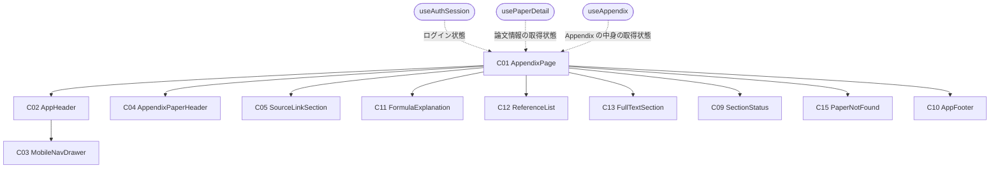
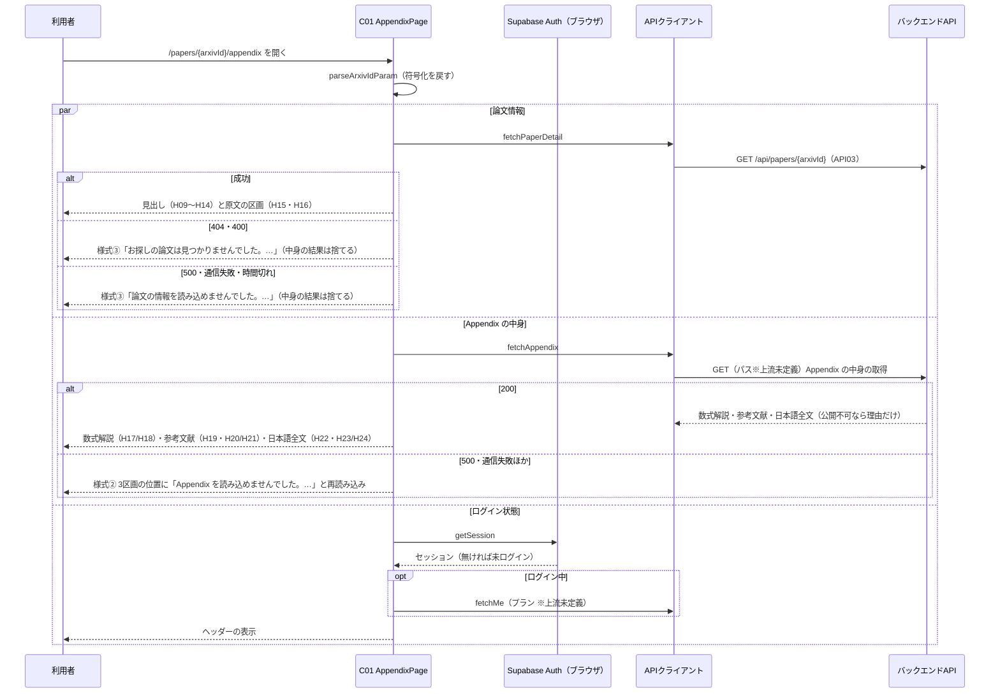

# FE詳細設計書 — P105 Appendix

## 0. 文書情報

| 項目 | 値 |
| :--- | :--- |
| 設計書ID | P105-FE |
| 親ID | P105 |
| 親設計書 | `screens/画面.P105.画面基本設計.md` |
| 版 | 1.0（新規作成） |
| 作成日 | 2026-10-27 |
| 更新日 | 2026-10-27 |
| 作成方法 | 上流の画面基本設計書（P105）、確定済みの `docs/基本設計書_概要.md`、`source/` 配下の企画資料からの設計（creating-frontend-detailed-design v1.5.0 準拠）。API の応答の形は作成済みの BE詳細設計書（`detail/be/BE.F05.BE詳細設計.md`・`detail/be/BE.F06.BE詳細設計.md`）に合わせた。P101〜P104 と共用する部品・関数（共通ヘッダー・フッター・状態表示・論文が見つからない表示・ログイン状態の取得・API呼び出しの共通処理・論文情報の取得と表示内容の判定・外部リンクの検査・版の文言・数式の描画・ログイン画面の URL の組み立て）は `detail/fe/FE.P101.FE詳細設計.md`・`detail/fe/FE.P102.FE詳細設計.md`・`detail/fe/FE.P104.FE詳細設計.md` の定義を再利用し、本書では P105 での使い方と P105 固有の部分、共用関数への拡張点を定義する |
| インプットの性質 | `source/` にあるのは企画・初期設計案の Markdown 6ファイルだけで、本画面のソースコード（ページ・コンポーネント・フック・ルーティング定義）は1行も無い（`source/README.md:5-10`、上流 概要書 §前提）。このため本書は**新規設計**であり、ファイルパス・関数名・State名・型はすべて実装時の命名案（※推測）である。技術スタックは Next.js / TypeScript / Tailwind CSS / shadcn/ui、数式は KaTeX（`source/03_システム構成.md:6,14`）、認証は Supabase Auth（`source/03_システム構成.md:10`） |
| 既存資料の突合 | `legacy/` は空ディレクトリ（ファイル0件）で、突合する既存設計・業務資料は無い。本書の既存版（`docs/detail/fe/FE.P105.FE詳細設計.md`）も無かったため、引き継ぐ記述・ID は上流設計書で採番済みのもの（P101〜P107、C01〜C05・C09〜C13・C15、H01〜H31、E01〜E15、様式①〜④、API03、IF03・IF05、F05・F06・F15、BF02・BF05、EX03・EX04、T002・T008、B005、ARC001〜ARC010、Q03・Q04・Q08・Q23・Q27）だけである |

## 1. フロントエンド構成・ルーティング設計

* **対象ドメイン**: 論文詳細系（appendix） — 1本の論文について、原文へのリンクとライセンス、数式解説、参考文献、利用許諾が確認できた論文に限った日本語全文をまとめて表示する画面（上流 P105 §1、`source/01_企画概要.md:28`）。論文情報と Appendix の中身の取得・4つの区画の表示の切り替え・論文が見つからないときの全画面表示までを本書の範囲とする。日本語全文を公開してよいかの判断はサーバの責務で、画面はサーバの判断結果を表示するだけにする（上流 P105 §7）。遷移先の画面（P101 ホーム・P102 新着論文・P103 論文検索・P104 論文詳細・P106 マイページ・P107 料金、arXiv の原文ページ、参考文献のリンク先、および※上流未定義のログイン・会員登録画面と利用規約ページ）の中身は各画面・外部の責務とする。
* **対象画面ID**: P105
* **ディレクトリ/ファイル構造**（※推測: 実装は未着手。P101〜P104 と同じ `web/` 配下の Next.js App Router 構成。本画面で使うファイルは全23件。内訳は本画面で新設する9件〈`app/papers/[arxivId]/appendix/page.tsx`、`components/appendix/` の5件、`hooks/useAppendix.ts`、`lib/api/appendixClient.ts`、`lib/appendix/appendixView.ts`〉と、P101〜P104 で定義したファイルのうち本画面でも使う共用14件〈部品5件: C02・C03・C10・C09 と P104 の C15、フック2件: `useAuthSession.ts`・`usePaperDetail.ts`、`lib/` の7件: `supabase/browserClient.ts`・`api/requestJson.ts`・`api/meClient.ts`・`api/paperDetailClient.ts`〈本書で fetchPaperDetail を拡張〉・`paperDetail/summaryView.ts`・`paperDetail/mathText.ts`〈本書で renderLatex を追加〉・`papers/filterCondition.ts`〉。下の木で「新設」「共用」を明示する）:

```
web/
├── app/
│   └── papers/
│       └── [arxivId]/
│           └── appendix/
│               └── page.tsx             … 新設: C01 AppendixPage（パス `/papers/{arxivId}/appendix` のページ）
├── components/
│   ├── layout/
│   │   ├── AppHeader.tsx                … 共用: C02 共通ヘッダー
│   │   ├── MobileNavDrawer.tsx          … 共用: C03 モバイル幅のナビゲーションドロワー
│   │   └── AppFooter.tsx                … 共用: C10 共通フッター
│   ├── appendix/
│   │   ├── AppendixPaperHeader.tsx      … 新設: C04 論文の見出し
│   │   ├── SourceLinkSection.tsx        … 新設: C05 原文の区画
│   │   ├── FormulaExplanation.tsx       … 新設: C11 数式解説の区画
│   │   ├── ReferenceList.tsx            … 新設: C12 参考文献の区画
│   │   └── FullTextSection.tsx          … 新設: C13 日本語全文の区画
│   ├── paperDetail/
│   │   └── PaperNotFound.tsx            … 共用: C15 論文が見つからない表示（P104 で定義）
│   └── common/
│       └── SectionStatus.tsx            … 共用: C09 取得中・失敗の表示
├── hooks/
│   ├── useAuthSession.ts                … 共用: ログイン状態と利用者表示の取得
│   ├── usePaperDetail.ts                … 共用: 論文情報の取得の状態管理（P104 で定義。本書でページタイトルの形式の指定を追加）
│   └── useAppendix.ts                   … 新設: Appendix の中身の取得の状態管理
└── lib/
    ├── supabase/browserClient.ts        … 共用: ブラウザ用 Supabase クライアント
    ├── api/
    │   ├── requestJson.ts               … 共用: API呼び出しの共通処理
    │   ├── paperDetailClient.ts         … 共用: GET /api/papers/{arxivId} の呼び出し（本書でライセンス種別の取り込みを追加）
    │   ├── appendixClient.ts            … 新設: Appendix の中身の取得（パスは※上流未定義）
    │   └── meClient.ts                  … 共用: GET /api/me の呼び出し
    ├── paperDetail/
    │   ├── summaryView.ts               … 共用: arXiv ID の取り出し・画面の表示内容の判定・外部リンクの検査・版の文言（P104 で定義）
    │   └── mathText.ts                  … 共用: 数式の描画（本書で renderLatex を追加）
    ├── appendix/appendixView.ts         … 新設: 4区画の表示内容の判定と、参考文献・ライセンス・出典の文言
    └── papers/filterCondition.ts        … 共用: ログイン画面の URL の組み立て（P102 で定義）
```

* **ルーティング定義**（総件数: 1件。全数である根拠: 本書の対象は P105 の1画面だけで、上流 概要書 §3.1 の P105 行のパスが `/papers/{arxivId}/appendix` の1件である）:

| パス | コンポーネント | 認証要否 | ルートファイル |
| :--- | :--- | :--- | :--- |
| `/papers/{arxivId}/appendix`（※推測。上流 概要書 §3.1・付録 Q03 の仮置き）。`{arxivId}` は P104 と同じく1つのパスの区切りで受け、旧形式の ID に含まれるスラッシュは `%2F` に符号化して渡す（`detail/fe/FE.P104.FE詳細設計.md` §1・§4 parseArxivIdParam） | AppendixPage（C01） | 不要（ゲスト・会員 Free・会員 Pro のどれでも同じ表示 — 上流 P105 §1・付録 Q08） | `web/app/papers/[arxivId]/appendix/page.tsx`（P104 のページと同じ動的な区切りの下に置く） |

## 2. コンポーネント設計

* **コンポーネントツリー図**（上流 P105 §3.1 の木をそのまま引き継ぐ。点線は本書で決めた状態の受け渡し）:



* **コンポーネントロースター**（総件数: 11件。全数である根拠: 上流 P105 §3.2 コンポーネント一覧の C01〜C05・C09〜C13・C15 の全11件と1対1で対応させ、本書で追加・統合した部品は無い。C06〜C08・C14・C16 は上流で欠番。C01・C04・C05・C11〜C13 は他画面の同じ番号の部品とは別物で、C02・C03・C09・C10 は P101〜P104 と、C15 は P104 と同じ部品を共用する — 上流 P105 §3.2。shadcn/ui の汎用部品〈Card・Button・Badge・Sheet・Skeleton〉と KaTeX は画面固有のコンポーネントではないため数えない）:

| コンポーネントID | コンポーネント名 | 種類 | ファイルパス | 概要 | 定義状況 | 詳細の所在 |
| :--- | :--- | :--- | :--- | :--- | :--- | :--- |
| C01 | AppendixPage | Page | `web/app/papers/[arxivId]/appendix/page.tsx` | Appendix 画面全体。論文情報と Appendix の中身を並行して取得し、論文情報が取れなければメインコンテンツ全体を C15 に置き換える | 詳細 | §2 コンポーネント詳細定義、§4 |
| C02 | AppHeader | Layout | `web/components/layout/AppHeader.tsx` | 全画面共通のヘッダー。本画面ではどの導線も選択中の見た目にしない | 詳細 | §2 コンポーネント詳細定義（P105 での使い方）、`detail/fe/FE.P101.FE詳細設計.md` §2 C02 |
| C03 | MobileNavDrawer | UI | `web/components/layout/MobileNavDrawer.tsx` | モバイル幅でメニューボタンを押したときに開く導線の収納先 | 詳細 | §2 コンポーネント詳細定義（P105 での使い方）、`detail/fe/FE.P101.FE詳細設計.md` §2 C03 |
| C04 | AppendixPaperHeader | UI | `web/components/appendix/AppendixPaperHeader.tsx` | どの論文の Appendix かを示す見出し。上から「‹ 論文詳細に戻る」（H11。同じ論文の P104 へのリンクで arXiv ID は符号化して付ける — E02）、ページ見出し「Appendix」（H09）、日本語タイトル（H10。無い論文では原題）、原題（H12。日本語タイトルがあるときだけ）、「arXiv:」に続く arXiv ID（H13）、版（H14。P104 の formatVersionLabel の版の文言だけを使い、新しい版の注記は出さない）を積む。Props は論文情報だけで内部State を持たず、日本語タイトルの有無と版の比較は共用関数と同じ規則に従うだけで本画面固有の業務判断を含まない（上流 P105 C04 簡易） | 簡易 | 本表 |
| C05 | SourceLinkSection | UI | `web/components/appendix/SourceLinkSection.tsx` | 「原文」の区画。arXiv の原文ページへの導線とライセンス表示を出す | 詳細 | §2 コンポーネント詳細定義、§4 formatLicenseLabel |
| C11 | FormulaExplanation | UI | `web/components/appendix/FormulaExplanation.tsx` | 「数式解説」の区画。数式を KaTeX で描き、日本語の説明と原文の章・ページを添える。無い論文では理由を出す | 詳細 | §2 コンポーネント詳細定義、§4 renderLatex・formatFormulaSource・getFormulaNotice |
| C12 | ReferenceList | UI | `web/components/appendix/ReferenceList.tsx` | 「参考文献」の区画。番号付きの一覧とリンクを出す。無い論文では理由を出す | 詳細 | §2 コンポーネント詳細定義、§4 formatReferenceLine・getReferenceLink・getReferenceNotice |
| C13 | FullTextSection | UI | `web/components/appendix/FullTextSection.tsx` | 「日本語全文」の区画。サーバが公開してよいと判断した論文だけ全文と AI 翻訳の注記を出し、それ以外は理由を出す | 詳細 | §2 コンポーネント詳細定義、§4 getFullTextView |
| C09 | SectionStatus | UI | `web/components/common/SectionStatus.tsx` | 数式解説・参考文献・日本語全文の3区画の位置に出す取得中・失敗の表示 | 詳細 | §2 コンポーネント詳細定義（P105 での使い方）、`detail/fe/FE.P101.FE詳細設計.md` §2 C09 |
| C15 | PaperNotFound | UI | `web/components/paperDetail/PaperNotFound.tsx` | 論文情報が取れないとき、メインコンテンツ全体を置き換えて理由とホームへの導線を示す | 詳細 | §2 コンポーネント詳細定義（P105 での使い方）、`detail/fe/FE.P104.FE詳細設計.md` §2 C15 |
| C10 | AppFooter | Layout | `web/components/layout/AppFooter.tsx` | 全画面共通のフッター。arXiv との関係の注記（H30）と利用規約へのリンク（H31）を常に同じ形で出す。Props・内部State を持たず分岐が無い（P101 と同じ部品をそのまま使う） | 簡易 | 本表、`detail/fe/FE.P101.FE詳細設計.md` §2 ロースター C10 |

* **コンポーネント詳細定義**（ロースターのうち定義状況＝詳細の9件。共用部品は「P105 での使い方」と、他画面の定義から変わる点だけを書く。Props の型は §3 型定義を参照）:

| コンポーネントID | コンポーネント名 | 種類(Page/UI/HOC等) | ファイルパス | 担当項目ID | Props (型) | 内部State (型) | 役割・概要 |
| :--- | :--- | :--- | :--- | :--- | :--- | :--- | :--- |
| C01 | AppendixPage | Page | `web/app/papers/[arxivId]/appendix/page.tsx` | — | params: { arxivId: string }（Next.js がページに渡すパスの値） | なし（状態は3つのフックが持つ。auth、paper、appendix — §3 ローカルステート定義） | パスの値を parseArxivIdParam で arXiv ID に直し、論文情報（usePaperDetail）と Appendix の中身（useAppendix）の取得を同時に始める（上流 P105 E01「並行して行う」）。resolvePageView の結果が「見つからない」「読み込めない」ならヘッダー・フッターを残してメインコンテンツ全体を C15 に置き換え、中身の結果は使わない。取得中は見出しと原文の区画の位置に灰色の枠を出す（上流 P105 H25 ※推測）。論文情報が取れたら C04・C05 を描き、その下の3区画の位置に、resolveAppendixView の結果に応じて C11・C12・C13 か C09 を描く（「原文」→「数式解説」→「参考文献」→「日本語全文」の順。本文幅はデスクトップ1000px、モバイルは画面幅いっぱい — 上流 P105 §2.3 ※推測）。論文情報が取れたらブラウザのタブのページタイトルを「Appendix｜（日本語タイトル、無ければ原題）」にする（※推測）。タイトルは usePaperDetail が付けるため、C01 はその形式（「Appendix｜」を前に付ける形）を usePaperDetail に渡すだけにする（§4「usePaperDetail の拡張点」）。クライアントコンポーネントとする（`'use client'` ※推測） |
| C02 | AppHeader | Layout | `web/components/layout/AppHeader.tsx` | H01, H02, H03, H04, H05, H06, H07, H08 | auth: AuthState、loginReturnTo: string（本画面のパス） | isDrawerOpen: boolean（初期値 false） | P101 の定義どおり。本画面に対応する導線は無いため activeNav・onActiveNavClick・onLogoClick は渡さず、どの導線も選択中の見た目にしない（上流 P105 §2.3）。ログインボタン（H06）は本画面のパスを戻り先にしたログイン画面へ移す（E12） |
| C03 | MobileNavDrawer | UI | `web/components/layout/MobileNavDrawer.tsx` | H02, H03, H04, H05, H06, H07 | open: boolean、onOpenChange: (open: boolean) => void、auth: AuthState、loginReturnTo: string | なし | P101 の定義どおり。どの導線も選択中の見た目にしない |
| C05 | SourceLinkSection | UI | `web/components/appendix/SourceLinkSection.tsx` | H15, H16 | originalUrl: string \| null（toSafeExternalUrl を通した値）、licenseType: string \| null | なし | 固定の見出し「原文」の枠に、「arXiv で原文を開く ↗」（H15）と「ライセンス: …」（H16。formatLicenseLabel の結果）を並べる（デスクトップは横並び、モバイルは縦に積む）。H15 は新しいタブで開くリンク（`target="_blank"`・`rel="noopener noreferrer"`。E03）で、日本語全文の公開可否にかかわらず常に出す（日本語全文を公開できない論文では原文を読む唯一の導線になるため — 上流 P105 H15）。原文URL が安全でないため得られないとき（P104 toSafeExternalUrl の規則）だけ、代わりに「原文のリンクを取得できませんでした」を出す（※推測） |
| C11 | FormulaExplanation | UI | `web/components/appendix/FormulaExplanation.tsx` | H17, H18 | formulas: FormulaItem[]、isAbstractOnly: boolean | なし | 固定の見出し「数式解説」の枠に、数式解説が1件以上あれば、原文に出てくる順に、別行の数式（renderLatex）・日本語の説明（renderTextWithMath。説明の中の数式も描く）・「出典: 原文 §章 p.ページ」（formatFormulaSource）を1組として並べる（H17）。0件なら getFormulaNotice の文言を出す（H18） |
| C12 | ReferenceList | UI | `web/components/appendix/ReferenceList.tsx` | H19, H20, H21 | references: ReferenceItem[]、isAbstractOnly: boolean | なし | 固定の見出し「参考文献」の枠に、参考文献が1件以上あれば、原文と同じ順で番号付きの一覧（H19。各行は formatReferenceLine）を並べ、リンク先がある文献の右端に getReferenceLink の文言のリンク（H20。新しいタブで開く — E04）を付ける。0件なら getReferenceNotice の文言を出す（H21） |
| C13 | FullTextSection | UI | `web/components/appendix/FullTextSection.tsx` | H22, H23, H24 | fullText: FullTextModel | なし | 固定の見出し「日本語全文」の枠に、getFullTextView の結果が「公開」なら、先頭に AI 翻訳の注記（H23「この日本語全文は AI が翻訳したものです。内容の正確さは原文をご確認ください。」）を出し、その下に章ごとの日本語の章見出しと本文（H22。本文は renderTextWithMath で数式を描く）を並べる。「非公開」なら理由の文言（H24）を出す。画面側では公開してよいかを判断し直さず、サーバが全文を返したかどうかと理由だけで出し分ける（許されない論文の全文はサーバが応答から外す — 上流 P105 §7、BE.F05 §2） |
| C09 | SectionStatus | UI | `web/components/common/SectionStatus.tsx` | H25, H26, H27 | status: 'loading' \| 'error'、errorMessage?: string、onReload?: () => void | なし | P101 の定義どおり。本画面では、数式解説・参考文献・日本語全文の3区画の位置をまとめて1つの表示にし、取得中は区画の形の灰色の枠を3つ（H25）、失敗時は赤色の帯の「Appendix を読み込めませんでした。時間をおいて再読み込みしてください。」（H26）と「再読み込み」（H27 — E05）を出す。見出しと原文の区画はそのまま残す（上流 P105 §5.1 様式②） |
| C15 | PaperNotFound | UI | `web/components/paperDetail/PaperNotFound.tsx` | H28, H29 | kind: 'notFound' \| 'loadFailed' | なし | P104 の定義どおり。本画面の項目IDとの対応は、理由の文言 H28（P104 H41 と同じ文言）と「ホームに戻る」H29（E06） |

## 3. 状態管理（State）設計

* **型定義**（※推測: §3・§4 の表で使う型。AuthState・ApiRequestError は `detail/fe/FE.P101.FE詳細設計.md` §3、PaperDetailModel・PaperDetailState・PageView は `detail/fe/FE.P104.FE詳細設計.md` §3 の定義を使い、PaperDetailModel にはライセンス種別を足す。Appendix の応答のキー名は BE.F05 §2「Appendix の中身の取得」に合わせた）:

```ts
// P104 の PaperDetailModel への追加（本書で追加。P104 では使わない）
//   licenseType: string | null;      // 論文のライセンス種別（API03 の licenseType）

type FormulaItem = { latex: string; explanationJa: string; sourceSection: string | null; sourcePage: number | null };
type ReferenceItem = { number: number; authors: string[]; title: string | null; year: number | null;
                       arxivId: string | null; url: string | null };
type FullTextReason = 'LICENSE_NOT_PERMITTED' | 'LICENSE_NEEDS_REVIEW' | 'NOT_TRANSLATED' | 'NOT_AVAILABLE_YET' | 'UNKNOWN';
type FullTextModel =
  | { publishable: true; sections: { headingJa: string; bodyJa: string }[] }
  | { publishable: false; reason: FullTextReason };

// Appendix の中身（fetchAppendix が返す）
type AppendixModel = { version: number; formulas: FormulaItem[]; references: ReferenceItem[]; fullText: FullTextModel };

// Appendix の中身の取得状態（useAppendix が返す）
type AppendixState = { status: 'loading' } | { status: 'error' } | { status: 'success'; appendix: AppendixModel };

// 3区画の位置に出す内容（resolveAppendixView が返す）
type AppendixView = { type: 'loading' } | { type: 'error'; message: string } | { type: 'content'; appendix: AppendixModel };
```

* **グローバルステート / Context定義**（総件数: 1件。全数である根拠: 本画面で画面の外と共有される状態は、Supabase Auth のログインセッション〈P101 と同じ〉だけである。パスの arXiv ID は読むだけで本画面から書き換えない。React の Context・状態管理ライブラリは使わない）:

| State名 | 型 | スコープ | 初期値 | 更新タイミング | 管理方法 |
| :--- | :--- | :--- | :--- | :--- | :--- |
| Supabase のログインセッション | Session \| null（Supabase の型） | アプリ全体（全画面） | セッション Cookie があればその内容、無ければ null | ログイン・ログアウト・トークンの自動更新のとき（本画面は読むだけ） | P101 と同じ（`detail/fe/FE.P101.FE詳細設計.md` §3）。本画面ではヘッダーの表示の出し分けにだけ使う |

* **ローカルステート定義**（総件数: 7件。全数である根拠: コンポーネントロースターの全11件を対象に、状態を持つものを数えた。C01 は6件〈useAuthSession のログイン状態とその確認の通し番号、usePaperDetail の取得状態とその取り消し制御、useAppendix の取得状態とその取り消し制御〉、C02 は1件〈ドロワーの開閉〉。フック内部の通し番号と取り消し制御は再描画を伴わない値〈useRef〉だが、古い応答による上書きの防止に効くため数える〈P101〜P104 と同じ基準〉。C03・C04・C05・C09・C10・C11・C12・C13・C15 の9件は状態を持たない〈上流 P105 §3.2 の内部State もすべて「-」〉）:

| コンポーネント | State名 | 型 | 初期値 | 用途 |
| :--- | :--- | :--- | :--- | :--- |
| C01 AppendixPage（useAuthSession 内） | auth | AuthState | `{ status: 'loading' }` | ログイン中かどうかと、ヘッダーに出す利用者の表示を持つ。本画面では表示の出し分けにだけ使う |
| C01 AppendixPage（useAuthSession 内） | requestSeqRef | number（useRef） | 0 | ログイン状態の確認の通し番号（P101 と同じ） |
| C01 AppendixPage（usePaperDetail 内） | state | PaperDetailState | `{ status: 'loading' }` | 論文情報の取得状態と結果（P104 と同じ。本書でライセンス種別を足す） |
| C01 AppendixPage（usePaperDetail 内） | abortRef | AbortController \| null（useRef） | null | 進行中の論文情報の取得を取り消すための制御（P104 と同じ） |
| C01 AppendixPage（useAppendix 内） | state | AppendixState | `{ status: 'loading' }` | Appendix の中身の取得状態と結果（上流 P105 C01「Appendix の中身の取得状態と結果」） |
| C01 AppendixPage（useAppendix 内） | abortRef | AbortController \| null（useRef） | null | 進行中の中身の取得を取り消すための制御。再読み込みや別の論文への移動のとき、前の要求の応答が後から届いて3区画を上書きしないようにする |
| C02 AppHeader | isDrawerOpen | boolean | false | モバイル幅のドロワーが開いているか（P101 と同じ） |
| C03 MobileNavDrawer | なし | — | — | 開閉状態は C02 から Props で受け取る |
| C04 AppendixPaperHeader | なし | — | — | 論文情報は Props で受け取る |
| C05 SourceLinkSection | なし | — | — | 原文URL とライセンス種別は Props で受け取る |
| C09 SectionStatus | なし | — | — | どの状態を出すかは Props で受け取る |
| C10 AppFooter | なし | — | — | 固定文言とリンクだけを表示する |
| C11 FormulaExplanation | なし | — | — | 数式解説は Props で受け取る |
| C12 ReferenceList | なし | — | — | 参考文献は Props で受け取る |
| C13 FullTextSection | なし | — | — | 日本語全文と公開の可否は Props で受け取る |
| C15 PaperNotFound | なし | — | — | 失敗の種類は Props で受け取る |

* **永続化ステート**（総件数: 1件。全数である根拠: 本画面が自分で localStorage・sessionStorage・Cookie に書き込む値は無い。本画面が読むのは Supabase Auth がログイン時に保存したセッションの Cookie だけである〈P101 と同じ〉）:

| キー | 保存先 | 型 | 用途 | 有効期限 |
| :--- | :--- | :--- | :--- | :--- |
| `sb-<SupabaseプロジェクトID>-auth-token`（※推測: `@supabase/ssr` の既定の Cookie 名） | Cookie（Supabase のライブラリが書き込む。本画面は読むだけ） | string | ログイン中かどうかの判定に使う。論文情報API へはブラウザが自動で送る（サーバはこれで閲覧を記録する — BE.F05 §2 API03。本画面での記録の是非は §4.1 の※上流要確認） | Supabase Auth の設定に従う（※推測。上流 概要書 §8「セッションの有効期限は未定義」） |

## 4. クライアント側機能・処理ロジック設計（IPO設計）

* **処理フロー図**（画面を開いたとき — E01。論文情報・Appendix の中身・ログイン状態の3つを同時に始める）:



* **関数・フックロースター**（総件数: 27件。内訳は本書で新設する12件と、P101・P102・P104 で定義済みのものを本画面でも使う15件〈P101 定義7件・P102 定義1件・P104 定義7件〉。定義状況は詳細21件・簡易6件。全数である根拠: ソースコードが無いため、上流 P105 §5 のイベント E01〜E15 の処理と、§4 の表示項目の整形規則（H10・H12・H14・H16〜H24）を、1つの責務を1関数として分けた設計上の全数である。E01→parseArxivIdParam・usePaperDetail・fetchPaperDetail・toSafeExternalUrl・resolvePageView・useAppendix・fetchAppendix・resolveAppendixView・useAuthSession・fetchMe・requestJson・getBrowserSupabaseClient、E05→reloadAppendix、E12→buildLoginHref、E13→toggleDrawer、E14→closeDrawer、E08〜E12 のドロワー内→handleDrawerLinkClick、表示の整形→formatVersionLabel（H14）・formatLicenseLabel（H16）・renderLatex（H17 の数式）・renderTextWithMath（H17 の説明・H22 の本文）・formatFormulaSource（H17 の出典）・getFormulaNotice（H18）・formatReferenceLine（H19）・getReferenceLink（H20、E04 の行き先）・getReferenceNotice（H21）・getFullTextView（H22〜H24）。E02〜E04・E06〜E12・E15 は Next.js の Link か外部リンクが遷移するだけで本書の関数を持たない〈行き先の URL は toSafeExternalUrl・getReferenceLink・buildLoginHref が決める〉。P101〜P104 の関数のうち本画面で使わないもの〈要約・ブックマーク・一覧・検索・おすすめ固有の関数〉は数えない。関数には上流で採番されたIDが無いため、新たに番号を振らず関数名を識別子として扱う）:

| 関数名（識別子） | 種別 | 所属 | ファイル | 概要 | 定義状況 | 詳細の所在 |
| :--- | :--- | :--- | :--- | :--- | :--- | :--- |
| useAppendix | フック | C01 | `web/hooks/useAppendix.ts` | arXiv ID が変わるたびに Appendix の中身を取得し、取得状態を持つ。再読み込み用の関数を返す | 詳細 | 本章 IPO定義 |
| fetchAppendix | APIクライアント | C01 | `web/lib/api/appendixClient.ts` | Appendix の中身の取得 API（パスは※上流未定義）を呼び、表示用の形に変える | 詳細 | 本章 IPO定義 |
| reloadAppendix | フック内関数 | C01 → C09 | `web/hooks/useAppendix.ts` | Appendix の中身だけを取り直す（E05）。useAppendix の取得処理を呼び直すだけで、独自の分岐を持たない。論文情報は取り直さない（上流 P105 E05） | 簡易 | 本表（取得処理は useAppendix） |
| resolveAppendixView | 判定関数 | C01 | `web/lib/appendix/appendixView.ts` | 中身の取得状態から、3区画の位置に何を出すかを決める | 詳細 | 本章 IPO定義 |
| getFormulaNotice | 判定関数 | C11 | `web/lib/appendix/appendixView.ts` | 数式解説が0件のときの理由の文言を決める（H18） | 詳細 | 本章 IPO定義 |
| getReferenceNotice | 判定関数 | C12 | `web/lib/appendix/appendixView.ts` | 参考文献が0件のときの理由の文言を決める（H21） | 詳細 | 本章 IPO定義 |
| getFullTextView | 判定関数 | C13 | `web/lib/appendix/appendixView.ts` | 日本語全文を出すか、出さないならどの理由の文言を出すかを決める（H22〜H24） | 詳細 | 本章 IPO定義 |
| formatReferenceLine | 整形関数 | C12 | `web/lib/appendix/appendixView.ts` | 参考文献1件を「[番号] 著者. タイトル. 年.」の形にする（H19） | 詳細 | 本章 IPO定義 |
| getReferenceLink | 判定関数 | C12 | `web/lib/appendix/appendixView.ts` | 参考文献のリンク先と文言（「arXiv ↗」「原文 ↗」）を決める（H20） | 詳細 | 本章 IPO定義 |
| formatLicenseLabel | 整形関数 | C05 | `web/lib/appendix/appendixView.ts` | ライセンス種別を利用者向けの名称にする（H16） | 詳細 | 本章 IPO定義 |
| formatFormulaSource | 整形関数 | C11 | `web/lib/appendix/appendixView.ts` | 数式解説の出典を「出典: 原文 §章 p.ページ」の形にする（H17） | 詳細 | 本章 IPO定義 |
| renderLatex | 描画関数 | C11 | `web/lib/paperDetail/mathText.ts` | 区切りの無い数式の文字列1つを、別行の数式として KaTeX で描く（H17） | 詳細 | 本章 IPO定義 |
| parseArxivIdParam | 変換関数 | C01 | `web/lib/paperDetail/summaryView.ts` | パスの値から arXiv ID を取り出す（符号化されたスラッシュを戻す） | 詳細 | `detail/fe/FE.P104.FE詳細設計.md` §4 IPO定義 |
| resolvePageView | 判定関数 | C01 | `web/lib/paperDetail/summaryView.ts` | 論文情報の取得状態から、メインコンテンツに何を出すかを決める | 詳細 | `detail/fe/FE.P104.FE詳細設計.md` §4 IPO定義 |
| usePaperDetail | フック | C01 | `web/hooks/usePaperDetail.ts` | arXiv ID が変わるたびに論文情報を取得し、取得状態を持つ。本書でページタイトルの形式を渡せるようにする | 詳細 | `detail/fe/FE.P104.FE詳細設計.md` §4 IPO定義（元の手順）、本章「usePaperDetail の拡張点」（追加分） |
| fetchPaperDetail | APIクライアント | C01 | `web/lib/api/paperDetailClient.ts` | GET /api/papers/{arxivId} を呼び、基本情報を表示用の形に変える。本書でライセンス種別の取り込みを足す | 詳細 | `detail/fe/FE.P104.FE詳細設計.md` §4 IPO定義（元の手順）、本章「fetchPaperDetail の拡張点」（追加分） |
| toSafeExternalUrl | 検査関数 | C01・C12 | `web/lib/paperDetail/summaryView.ts` | 外部リンクの URL が http・https の正しい URL かを確かめ、安全なものだけを返す（H15・H20） | 詳細 | `detail/fe/FE.P104.FE詳細設計.md` §4 IPO定義 |
| formatVersionLabel | 整形関数 | C04 | `web/lib/paperDetail/summaryView.ts` | 版の文言を組み立てる（H14。本画面では新しい版の注記は使わない） | 詳細 | `detail/fe/FE.P104.FE詳細設計.md` §4 IPO定義 |
| renderTextWithMath | 描画関数 | C11・C13 | `web/lib/paperDetail/mathText.ts` | 文字列のうち数式の部分だけを KaTeX で描く（H17 の説明・H22 の本文） | 詳細 | `detail/fe/FE.P104.FE詳細設計.md` §4 IPO定義 |
| useAuthSession | フック | C01 | `web/hooks/useAuthSession.ts` | ログイン状態と利用者表示を取得する（E01） | 詳細 | `detail/fe/FE.P101.FE詳細設計.md` §4 IPO定義 |
| getBrowserSupabaseClient | ユーティリティ | 共通 | `web/lib/supabase/browserClient.ts` | ブラウザ用の Supabase クライアントを1つだけ作って返す | 簡易 | `detail/fe/FE.P101.FE詳細設計.md` §4 関数ロースター |
| fetchMe | APIクライアント | 共通 | `web/lib/api/meClient.ts` | GET /api/me でプランを取得する（※上流未定義。§4.1） | 詳細 | `detail/fe/FE.P101.FE詳細設計.md` §4 IPO定義 |
| requestJson | APIクライアント | 共通 | `web/lib/api/requestJson.ts` | API呼び出しの共通処理（P104 で拡張済み。本画面は GET だけを使う） | 詳細 | `detail/fe/FE.P101.FE詳細設計.md` §4 IPO定義、`detail/fe/FE.P104.FE詳細設計.md` §4「requestJson の拡張点」 |
| buildLoginHref | 変換関数 | C01 → C02・C03 | `web/lib/papers/filterCondition.ts` | いまの URL を戻り先として付けたログイン画面の URL を返す（E12） | 簡易 | `detail/fe/FE.P102.FE詳細設計.md` §4 関数ロースター |
| toggleDrawer | イベントハンドラ | C02 | `web/components/layout/AppHeader.tsx` | ドロワーの開閉を反転する（E13） | 簡易 | `detail/fe/FE.P101.FE詳細設計.md` §4 関数ロースター |
| closeDrawer | イベントハンドラ | C02 → C03 | `web/components/layout/AppHeader.tsx` | ドロワーを閉じる（E14） | 簡易 | `detail/fe/FE.P101.FE詳細設計.md` §4 関数ロースター |
| handleDrawerLinkClick | イベントハンドラ | C03 | `web/components/layout/MobileNavDrawer.tsx` | ドロワー内のリンクを押したときにドロワーを閉じる（E08〜E12） | 簡易 | `detail/fe/FE.P101.FE詳細設計.md` §4 関数ロースター |

* **fetchPaperDetail の拡張点**（P104 で定義した共用関数に、本画面のために足す処理。P104 の動きは変えない。※上流要確認: P104 FE詳細設計の fetchPaperDetail の IPO 定義と PaperDetailModel の型へ一本化する）:
  1. 応答のライセンス種別（`licenseType`）を、前後の空白を除いて PaperDetailModel の licenseType に移す。値が無い・空文字のときは無し（null）とする（BE.F05 §2 API03）。

* **usePaperDetail の拡張点**（P104 で定義した共用フックに、本画面のために足す処理。P104 の動きは変えない。※上流要確認: P104 FE詳細設計の usePaperDetail の IPO 定義へ一本化する）:
  1. 引数に任意の `formatTitle?: (title: string) => string` を足す。手順4でページタイトルを付けるとき、日本語タイトル（無ければ原題）をこの関数に通した文字列を使う。渡さなかったときは P104 のとおり日本語タイトル（無ければ原題）をそのまま使う。
  2. 本画面は「Appendix｜」を前に付ける関数を渡す（C01）。

* **入力・処理・出力（IPO）定義**（ロースターの詳細21件のうち、本書で新設する11件。P101・P104 で定義済みの共用の詳細10件〈parseArxivIdParam・resolvePageView・usePaperDetail・fetchPaperDetail・toSafeExternalUrl・formatVersionLabel・renderTextWithMath・useAuthSession・fetchMe・requestJson〉は定義元の IPO定義を正とし、fetchPaperDetail・usePaperDetail の追加分は上の「fetchPaperDetail の拡張点」「usePaperDetail の拡張点」に書いた。簡易6件〈新設1件: reloadAppendix／共用5件: getBrowserSupabaseClient・buildLoginHref・toggleDrawer・closeDrawer・handleDrawerLinkClick〉はロースターの概要欄で定義を完結している）:

| 関数名 | 所属コンポーネント | 引数 (型) | 処理フロー (ステップ単位で具体的に) | 戻り値 | 発生しうるエラー |
| :--- | :--- | :--- | :--- | :--- | :--- |
| useAppendix | C01 | arxivId: string | 1. arXiv ID が変わるたびに取得を始める（依存は arXiv ID だけ）。<br>2. 進行中の要求があれば取り消し、新しい取り消し制御を作り、状態を取得中にする。<br>3. fetchAppendix を呼ぶ。<br>4. 成功したら中身を状態に入れる。<br>5. 失敗したら状態を失敗にする。取り消しによる失敗のときは状態を変えない。<br>6. 画面を離れるときは進行中の要求を取り消す。<br>7. 再読み込み用に、手順2〜5を同じ arXiv ID でやり直す関数（reloadAppendix）を返す。<br>（論文情報の取得とは互いを待たずに並行して進む — 上流 P105 E01。論文情報が「見つからない」「読み込めない」になったときは、中身の結果を画面が使わない — resolvePageView） | { state: AppendixState; reloadAppendix: () => void } | なし（失敗は状態に入れて画面に渡す） |
| fetchAppendix | useAppendix | arxivId: string、signal: AbortSignal | 1. Appendix の中身の取得 API の URL を、arXiv ID を符号化して組み立てる。パスは上流 §7 と BE.F05 のどちらにも決まっていないため、本書では仮のパスを置かず、決まったパスを書き換える場所を本関数の中の定数1か所に限る（※上流未定義。上流 P105 §5 呼出APIロースター No.2「本書では仮のパスを置かない」を引き継ぐ）。メソッドは GET（BE.F05 §2 ※推測）。<br>2. requestJson で呼ぶ。認証は不要で Authorization は付けない。応答は配信網で5分共有される設定のため、ブラウザの既定のキャッシュ動作に任せる（BE.F05 §2）。<br>3. 数式解説（`formulaExplanations`）の各要素を、数式（`latex`）・日本語の説明（`explanationJa`）・章（`sourceSection`）・ページ（`sourcePage`）として移す。数式が空の要素は捨てる（描くものが無いため ※推測）。配列でなければ0件とする。<br>4. 参考文献（`references`）の各要素を、番号・著者の並び・タイトル・年・arXiv ID・URL として移す（URL は toSafeExternalUrl を通す）。並びは応答の順（原文と同じ順）のまま変えない。配列でなければ0件とする。<br>5. 日本語全文（`fullText`）は、公開可（`publishable` が true）で章（`sections`）が配列なら、各章の見出しと本文を移して「公開」とする。公開不可なら理由（`reason`）を移し、4つの既知の理由のどれでもなければ「不明」とする。<br>6. 版（`version`）と、手順3〜5の結果を返す。Appendix の版は画面の版の表示（H14）には使わない。版の表示は論文情報の表示中の版で行う（BE.F05 は API03 と同じ規則で版を決めるため、両者は一致する — BE.F05 §2「Appendix の中身の取得」手順3）。食い違ったときは論文情報の版の表示を優先し、開発時だけ警告をブラウザのコンソールに出して不整合に気づけるようにする（※推測） | AppendixModel | ApiRequestError（requestJson と同じ種類。HTTPエラーではステータスとエラーコードを持つ） |
| resolveAppendixView | C01（結果を C11〜C13・C09 へ渡す） | state: AppendixState | 1. 取得中なら「取得中」を返す（C09 の灰色の枠。H25）。<br>2. 失敗なら「Appendix を読み込めませんでした。時間をおいて再読み込みしてください。」の文言を付けた「失敗」を返す（C09 の赤色の帯と再読み込み。H26・H27。様式②。400・論文なしの 404 を含め、中身の取得のどの失敗も同じ表示にする。論文が無い場合は論文情報の側で様式③になるため見えない ※推測）。<br>3. 成功なら「中身」を返す（C11・C12・C13） | AppendixView | なし |
| getFormulaNotice | C11 | isAbstractOnly: boolean | 1. 論文の本文が未取得（本文取得状況が Abstract のみ）なら「この論文は本文を取得していないため、数式解説はありません。」を返す。<br>2. 本文は取得済みなら「この論文には解説の対象となる数式がありません。」を返す。<br>（文言は上流 P105 H18 ※推測。本文取得状況は論文情報〈API03 の contentStatus〉から取る。数式解説と参考文献は本文を解析した論文だけにあるため — 上流 BF02・B005） | string | なし |
| getReferenceNotice | C12 | isAbstractOnly: boolean | 1. 本文が未取得なら「この論文は本文を取得していないため、参考文献を表示できません。原文でご確認ください。」を返す。<br>2. 本文は取得済みなら「参考文献を取り出せませんでした。原文でご確認ください。」を返す。<br>（文言は上流 P105 H21 ※推測） | string | なし |
| getFullTextView | C13 | fullText: FullTextModel | 1. 公開で、章が1件以上あれば「公開」と章の並びを返す（C13 は AI 翻訳の注記 H23 を先頭に付けて H22 を出す）。<br>2. 公開でも章が0件なら、「準備中」の文言（「この論文の日本語全文は準備中です。原文は arXiv でご覧ください。」）を返す（空の全文を出さないため ※推測）。<br>3. 非公開で理由が「ライセンスが翻訳公開を許さない、または不明」（`LICENSE_NOT_PERMITTED`）か「公開してよいか確認が要る」（`LICENSE_NEEDS_REVIEW`）なら、許諾の文言（「この論文は日本語全文の公開に必要な利用許諾が確認できないため、日本語全文は公開していません。原文は arXiv でご覧ください。」）を返す（確認中の論文も、利用者から見れば許諾が確認できていない状態のため ※推測）。<br>4. 非公開で理由が「翻訳がまだ」（`NOT_TRANSLATED`）か「全文翻訳の機能がまだ提供されていない」（`NOT_AVAILABLE_YET`。Phase 3 まで — 上流 P105 §7）なら、準備中の文言を返す。<br>5. 理由が「不明」なら許諾の文言を返す（公開の根拠が分からないものを「準備中」と案内して期待させないため ※推測）。<br>（文言は上流 P105 H24 ※推測。理由の4値は BE.F05 §2 の仮置き） | { type: 'published'; sections } \| { type: 'unpublished'; message: string } | なし |
| formatReferenceLine | C12 | ref: ReferenceItem | 1. 著者が0名なら著者の部分を出さない。1〜3名なら全員を「, 」でつなぐ。4名以上なら「先頭の著者 et al.」にまとめる（上流 P105 H19 ※推測）。<br>2. 「[番号]」に続けて、著者・タイトル・年のうち値のあるものだけを「. 」で区切って並べ、最後に「.」を付ける（例「[1] A. Example. Attention Is All You Need. 2017.」）。<br>3. タイトルも著者も年も無いときは「[番号] （書誌情報を取り出せませんでした）」とする（※推測） | string | なし |
| getReferenceLink | C12 | ref: ReferenceItem | 1. 参考文献に arXiv ID があれば、arXiv ID をスラッシュで区切った部分ごとに符号化してスラッシュでつなぎ直し、`https://arxiv.org/abs/` の後ろに付けた URL を行き先、「arXiv ↗」を文言にして返す（上流 P105 H20）。旧形式の ID（例 `hep-th/9901001`）は `https://arxiv.org/abs/hep-th/9901001` のようにスラッシュを区切りのまま残す（arXiv の旧形式の論文ページはこの形で、スラッシュを `%2F` にすると開けないため。本サービス内の P104・P105 への URL はスラッシュも `%2F` に符号化する規則〈P104 §4 parseArxivIdParam〉で、外部の arXiv の URL とは規則が違う）。<br>2. arXiv ID が無く、URL（toSafeExternalUrl を通した値）があれば、その URL を行き先、「原文 ↗」を文言にして返す。<br>3. どちらも無ければ無しを返す（リンクを出さない） | { href: string; label: string } \| null | なし |
| formatLicenseLabel | C05 | licenseType: string \| null | 1. 値が無ければ「ライセンス: 確認中」を返す（上流 P105 H16）。<br>2. 値（arXiv のライセンスの URL）の末尾のスラッシュと方式の違い（http・https）を無視して、次の名称に置き換える（※推測: 取りうる値は上流で未定義。※上流要確認 — 上流 P105 §7）。CC BY 4.0 の URL なら「CC BY 4.0」、CC BY-SA 4.0 なら「CC BY-SA 4.0」、CC BY-NC-SA 4.0 なら「CC BY-NC-SA 4.0」、CC BY-NC-ND 4.0 なら「CC BY-NC-ND 4.0」、CC0 1.0 なら「CC0 1.0（パブリックドメイン）」、arXiv の非独占配布ライセンスなら「arXiv 標準ライセンス（再配布不可）」。<br>3. どれにも当たらなければ、値をそのまま表示する（未知のライセンスを別の名前で見せて取り違えさせないため ※推測）。<br>4. 「ライセンス: 」を前に付けて返す | string | なし |
| formatFormulaSource | C11 | sourceSection: string \| null、sourcePage: number \| null | 1. 章とページの両方があれば「出典: 原文 §{章} p.{ページ}」を返す（上流 P105 H17）。<br>2. 章だけなら「出典: 原文 §{章}」、ページだけなら「出典: 原文 p.{ページ}」を返す（※推測）。<br>3. どちらも無ければ空文字を返し、C11 は出典の行を出さない（※推測） | string | なし |
| renderLatex | C11 | latex: string | 1. 文字列が空なら何も描かない。<br>2. KaTeX で別行の数式として HTML に変換し（`displayMode: true`）、その結果だけを要素の中身として差し込む。変換の設定は P104 renderTextWithMath と同じ（数式の誤りで例外を出さず赤字で元の式を見せる `throwOnError: false`、外部の URL や任意の HTML を許さない `trust: false`、`strict: 'warn'`）にし、外部由来の文字列からスクリプトが動かないようにする（上流 P105 H17、上流 概要書 §8 XSS 対策 ※推測）。<br>3. 横に長い数式は数式の枠の中だけを横にスクロールできるようにし、画面全体を横に広げない（モバイルの画面幅を超える数式への備え ※推測） | ReactNode | なし（数式の誤りは KaTeX が赤字の表示にする） |

### 4.1 呼出API 全数ロースター（BE詳細設計書への入口）

総件数: 10件（本画面が直接呼ぶ境界4件＋FE完結の処理6件）。全数である根拠: 上流 P105 §5 呼出APIロースターの3件（API03・Appendix の中身の取得〈※上流未定義〉・IF05）に、H07 のプラン表示のために使う GET /api/me（※上流未定義。P101〜P104 と同じ扱い）を加えた。上流 概要書 §7 内部API一覧の全8件のうち、API03 以外は本画面からは呼ばない。arXiv の原文ページ（IF03）と参考文献のリンク先は利用者のブラウザが直接開く外部リンクで API 呼び出しではないため、FE完結の行に含めた。FE完結の行は §4 関数ロースターのうち API を介さない判定・整形・画面操作を、利用者から見える処理ごとにまとめたもの。

| メソッド | エンドポイント | 対応機能ID | BE詳細設計書 | 呼び出す処理・取得するもの | 責務の所在 |
| :--- | :--- | :--- | :--- | :--- | :--- |
| GET | `/api/papers/{arxivId}`（API03） | F05（閲覧の記録は F15） | `detail/be/BE.F05.BE詳細設計.md`（閲覧の記録は `detail/be/BE.F15.BE詳細設計.md`） | 論文の基本情報・表示中の版・最新版・原文URL・ライセンス種別・本文取得状況を取得する（E01）。※上流要確認: ログイン中に呼ぶとサーバが閲覧を記録する（BE.F05 §2 API03）が、上流 P105 §5・§7 は「本画面では閲覧を記録しない」としている。本画面から呼ぶときは記録しない指定を API03 に設けるか、上流 P105 の記述を改めるかの確認が要る | BE |
| GET | Appendix の中身の取得（パスは※上流未定義。上流 概要書 §7 と上流 付録 Q27 への追加が必要） | F05 | `detail/be/BE.F05.BE詳細設計.md`（§2「Appendix の中身の取得」） | 数式解説・参考文献・日本語全文と、日本語全文を公開できないときの理由を取得する（E01・E05）。全文の公開可否はサーバがライセンスで判断し、許されない論文の全文は応答に含めない | BE |
| GET | `/api/me`（※上流未定義: 上流 概要書 §7 と上流 P105 §5 呼出APIロースターに無い。BE.F06 で定義済み） | F06 | `detail/be/BE.F06.BE詳細設計.md` | ログイン中の利用者のプランを取得し、ヘッダーの利用者表示（H07）に出す（E01） | BE |
| — | Supabase Auth のセッション取得（IF05。ブラウザのライブラリが Cookie を読む） | F06 | `detail/be/BE.F06.BE詳細設計.md` | ログイン中かどうかとメールアドレスを得る（E01） | 外部サービス（Supabase Auth）。本システムのBEは介さない |
| — | — | F05 | — | 論文情報の取得結果から、中身・見つからない表示・読み込めない表示のどれを出すかを決め、見出しと版の文言を組み立てる（parseArxivIdParam・resolvePageView・usePaperDetail・formatVersionLabel） | **FE完結** |
| — | — | F05 | — | 3区画の位置に中身・取得中・失敗のどれを出すかを決め、数式解説と参考文献を描き、0件のときは本文取得状況に応じた理由を出す（resolveAppendixView・renderLatex・renderTextWithMath・formatFormulaSource・getFormulaNotice・formatReferenceLine・getReferenceNotice） | **FE完結** |
| — | — | F05 | — | サーバの判断結果に従って日本語全文と AI 翻訳の注記を出すか、非公開の理由を出すかを決め、ライセンス種別を利用者向けの名称にする（getFullTextView・formatLicenseLabel。公開の判断そのものはサーバの責務 — 上流 ARC005） | **FE完結** |
| — | IF03 arXiv 原文ページ、参考文献のリンク先（外部リンク） | F05 | — | 原文URL と参考文献の URL を確かめ、参考文献の arXiv ID からリンク先を組み立て、新しいタブで開く（toSafeExternalUrl・getReferenceLink。E03・E04） | **FE完結**（行き先は外部サイト） |
| — | — | F06 | — | ヘッダーにログインボタンか利用者表示を出し分け、ログイン後の戻り先を付ける（C02・C03・buildLoginHref） | **FE完結** |
| — | — | —（機能一覧に該当なし。画面操作だけ） | — | ドロワーの開閉と各画面への遷移（toggleDrawer・closeDrawer・handleDrawerLinkClick・Link） | **FE完結** |

* **BE詳細設計書の列**: 上流 概要書 §4 機能一覧の F05・F06・F15 行の「BE詳細設計書」列の値を転記した。概要書では「（未作成）」と書かれているが、`docs/detail/be/` に作成済みであることを確認したため注記を外した。FE完結の行は `—` とした。
* **※上流要確認（本節で生じたもの）**:
  * 閲覧の記録: 本画面が API03 を呼ぶと、ログイン中はサーバが閲覧を記録する。上流 P105 は本画面では記録しないとしているため、API03 に記録しない指定を設けるか、上流の記述を改めるかを決める（P104 FE詳細設計 §4.1 の「閲覧の記録の契機」と併せて確認する）。
  * Appendix の中身の取得 API のパスと応答の形が上流 §7 に無い（上流 P105 §7 と同じ確認事項。BE.F05 の応答の形も※推測）。
  * ライセンス種別の取りうる値と名称の対応（§4 formatLicenseLabel。上流 P105 §7 と同じ確認事項）。
  * GET /api/me が上流 概要書 §7 と上流 P105 §5 呼出APIロースターに無い（P101〜P104 と同じ確認事項）。
  * 共用関数 fetchPaperDetail へのライセンス種別の追加、usePaperDetail へのページタイトルの形式の追加、mathText.ts への renderLatex の追加を P104 FE詳細設計へ一本化する。

## 5. イベントハンドラ・アクション定義

* **ユーザーアクションマッピング**（総件数: 15件。全数である根拠: 上流 P105 §5 イベント定義の E01〜E15 の全15件と1対1で対応させた。本書で追加したイベントは無い）:

| 画面ID | 対応イベントID | 対象コンポーネントID | 要素 | トリガー | 発火関数名 | 処理の概要 | 遷移先 |
| :--- | :--- | :--- | :--- | :--- | :--- | :--- | :--- |
| P105 | E01 | C01 | ページ | ページロード（P104 の「Appendix」、直接アクセス、ブラウザの戻る操作で本画面が表示されたとき） | parseArxivIdParam → usePaperDetail（fetchPaperDetail・resolvePageView）・useAppendix（fetchAppendix・resolveAppendixView）・useAuthSession（fetchMe） | パスの arXiv ID で論文情報と Appendix の中身の取得、ログイン状態の確認を同時に始める。論文情報が取れなければメインコンテンツ全体を C15 に置き換え、中身の結果は捨てる。論文情報が取れて中身だけが失敗したら3区画の位置だけに様式②を出す（※上流要確認: ログイン中は API03 の中でサーバが閲覧を記録する — §4.1） | なし |
| P105 | E02 | C04 | 論文詳細に戻る H11 | Click | なし（Link が遷移） | 同じ論文の詳細画面へ移る（arXiv ID は符号化して付ける） | P104（`/papers/{arxivId}` ※推測。※上流要確認: 上流の画面遷移図に P105 → P104 の線は無い） |
| P105 | E03 | C05 | arXiv で原文を開く H15 | Click | なし（外部リンク。行き先は toSafeExternalUrl を通した原文URL） | arXiv の原文ページを新しいタブで開く。本画面はそのまま残す | arXiv 原文ページ（外部。上流 IF03） |
| P105 | E04 | C12 | 参考文献のリンク H20 | Click | なし（外部リンク。行き先は getReferenceLink が決める） | 参考文献の arXiv ページ、または文献の URL を新しいタブで開く。本画面はそのまま残す | 参考文献のリンク先（外部。※上流未定義 — 上流 P105 §5 遷移先 No.3） |
| P105 | E05 | C09 | 再読み込みボタン H27 | Click | reloadAppendix | Appendix の中身だけを取り直す。取り直している間は3区画の位置に H25 を出し、見出しと原文の区画はそのまま残す | なし |
| P105 | E06 | C15 | ホームへ戻るリンク H29 | Click | なし（Link が遷移） | ホーム画面へ移る | P101（`/`） |
| P105 | E07 | C02 | サービス名（ロゴ）H01 | Click | なし（Link が遷移。本画面では onLogoClick を渡さない） | ホーム画面へ移る | P101（`/`） |
| P105 | E08 | C02、C03 | ナビ「新着論文」H02 | Click | デスクトップ: なし（Link が遷移）／モバイル: handleDrawerLinkClick | 新着論文一覧へ移る。モバイル幅ではドロワーを閉じてから移る | P102（`/papers` ※推測） |
| P105 | E09 | C02、C03 | ナビ「論文検索」H03 | Click | デスクトップ: なし（Link が遷移）／モバイル: handleDrawerLinkClick | 論文検索へ移る。モバイル幅ではドロワーを閉じてから移る | P103（`/search` ※推測） |
| P105 | E10 | C02、C03 | ナビ「料金」H04 | Click | デスクトップ: なし（Link が遷移）／モバイル: handleDrawerLinkClick | 料金画面へ移る。モバイル幅ではドロワーを閉じてから移る | P107（`/pricing` ※推測） |
| P105 | E11 | C02、C03 | ナビ「マイページ」H05 | Click | デスクトップ: なし（Link が遷移）／モバイル: handleDrawerLinkClick | マイページへ移る。ログイン中のときだけ要素が表示される | P106（`/mypage` ※推測） |
| P105 | E12 | C02、C03 | ログインボタン H06 | Click | デスクトップ: なし（Link が遷移。行き先は buildLoginHref が決める）／モバイル: handleDrawerLinkClick | ログイン・会員登録の画面へ移る。本画面のパスを戻り先として付け、ログイン後に本画面へ戻す（上流 P105 E12 ※推測） | ログイン・会員登録画面（`/login?next=<本画面のパス>` ※推測。※上流未定義 — 上流 付録 Q04） |
| P105 | E13 | C02 | メニューボタン H08 | Click | toggleDrawer | ドロワーが閉じていれば開き、開いていれば閉じる | なし |
| P105 | E14 | C03 | ドロワーの外側（半透明の背景） | Click（タップ） | closeDrawer | 遷移せずにドロワーを閉じる。shadcn/ui の Sheet は Esc キーでも同じ閉じる通知を出す（※上流未定義: Esc キーでの閉じる操作は上流 P105 §5 に無い。P101〜P104 と同じ扱い） | なし |
| P105 | E15 | C10 | 利用規約リンク H31 | Click | なし（Link が遷移） | 利用規約のページへ移る | 利用規約ページ（`/terms` ※推測。※上流未定義） |

## 6. バリデーション・エラーフィードバック設計

* **クライアント側バリデーション**（総件数: 0件。根拠: 本画面には入力項目が無い。上流 P105 §4 の31項目は表示・リンク・ボタンだけで構成され、上流 P105 §6 も「該当なし」としている。パスの arXiv ID の形式はサーバが判断する — P104 §4 parseArxivIdParam）:

| 画面ID | 対象フィールド | ルール | 正規表現 / 条件 | エラーメッセージ |
| :--- | :--- | :--- | :--- | :--- |
| P105 | 該当なし | — | — | — |

* **UIエラーフィードバック**（総件数: 11件。全数である根拠: 本画面が呼ぶ境界4件〈論文情報API・Appendix の中身の取得・利用者情報API・セッション取得〉それぞれについて、画面上の扱いが変わる応答と失敗の種類を数えた。論文情報API は 404・400・それ以外の失敗の3行〈P104 と同じ扱い〉、Appendix の中身は失敗2行〈500 ほか・400 と論文なしの 404〉、利用者情報とセッションの各1行、取り消し1行、数式の描画の誤り1行〈API の失敗ではないが、その数式の表示だけが変わるため〉、上流 P105 §5.1 で「該当なし」とされた様式①④を1行ずつ。日本語全文の非公開・数式解説や参考文献の0件はエラーではないため本表に含めず、§4 getFullTextView・getFormulaNotice・getReferenceNotice に定義した）:

| エラー種別 | HTTPステータス | エラー表示様式 | UI挙動 | 表示コンポーネント |
| :--- | :--- | :--- | :--- | :--- |
| 論文が無い | 404 | 様式③ | ヘッダー・フッターを残し、メインコンテンツ全体を「お探しの論文は見つかりませんでした。URL をご確認ください。」と「ホームに戻る」に置き換える。中身の結果は使わない（上流 P105 §5.1） | C15 PaperNotFound |
| arXiv ID の形式が正しくない | 400 | 様式③ | 上の行と同じ表示（P104 と同じ扱い ※推測。上流 P105 §5.1 は 404 だけを挙げている） | C15 PaperNotFound |
| 論文情報の取得失敗 | 500 ほかの 200〜299 以外、通信失敗・時間切れ・応答形式不正 | 様式③ | メインコンテンツ全体を「論文の情報を読み込めませんでした。時間をおいて再度お試しください。」と「ホームに戻る」に置き換える。ブラウザの再読み込みで開き直せる（上流 P105 §5.1） | C15 PaperNotFound |
| Appendix の中身の取得失敗 | 500 ほかの 200〜299 以外、通信失敗・時間切れ・応答形式不正 | 様式② | 数式解説・参考文献・日本語全文の3区画の位置に赤色の帯で「Appendix を読み込めませんでした。時間をおいて再読み込みしてください。」と「再読み込み」を出す。見出しと原文の区画（原文への導線を含む）は使える（上流 P105 §5.1） | C09 SectionStatus |
| Appendix の中身の入力不正・論文なし | 400・404 | 様式② | 上の行と同じ表示。論文情報も同じ理由で失敗していれば、メインコンテンツ全体が様式③に置き換わるため見えない（※推測。上流 P105 §5.1 は 500・通信失敗だけを挙げている） | C09 SectionStatus |
| 利用者情報（プラン）の取得失敗 | 500・401・応答なしのすべて | 該当様式なし | エラーを出さず、ヘッダーの利用者表示（H07）からプランだけを省く（P101 と同じ） | C02 AppHeader、C03 MobileNavDrawer |
| セッション取得の失敗 | —（ブラウザ内の処理） | 該当様式なし | エラーを出さず未ログインとして扱い、ログインボタン（H06）を出す（上流 P105 E01） | C02 AppHeader |
| 取得の取り消し（再読み込み・別の論文への移動・画面離脱） | —（ブラウザ内の処理） | 該当様式なし | 何も表示しない。最後に開いた論文・最後の再読み込みの結果だけが表示される | —（各フックが状態を変えない） |
| 数式の描画の誤り | —（ブラウザ内の処理） | 該当様式なし | 例外にせず、その数式だけを KaTeX が赤字の元の式として表示する。他の数式・区画の表示は続ける（renderLatex・renderTextWithMath ※推測） | C11 FormulaExplanation、C13 FullTextSection |
| ポップアップ表示の対象 | — | 様式①（該当なし） | 使わない。本画面には会員向けの操作や状態を変える操作が無く、失敗は中身の領域に閉じ込める（上流 P105 §5.1） | — |
| 入力欄下表示の対象 | — | 様式④（該当なし） | 使わない。本画面に入力項目が無い（上流 P105 §5.1） | — |

## 7. 利用する方式（共通基盤）

総件数: 5件。全数である根拠: 上流 概要書 §11.1 の全10件（ARC001〜ARC010）のうち、上流 P105 §8 が本画面で利用するとした5件をそのまま引き継いだ。残る5件のうち、ARC006（ジョブ実行基盤）と ARC007（外部APIアクセス制御）は BE とバッチの責務で、本画面のクライアント処理から直接使わない。ARC003（要約スキーマ）は本画面が要約を表示しないため使わない（数式解説・参考文献・日本語全文の形は要約スキーマではなく Appendix の中身の取得 API で決まる）。ARC008（プラン別機能制御）は本画面にプランで変わる機能が無いため使わない（上流 P105 §7「プランによる差は無い」）。ARC010（個人データ最小化）は、上流 P105 が本画面で閲覧を記録しないとしているため使わないが、API03 の呼び出しで記録が起きる点は §4.1 の※上流要確認のとおり。

| 方式ID | 名称 | 本書での利用箇所 |
| :--- | :--- | :--- |
| ARC005 | ライセンス・権利ゲート | 日本語全文の公開の判断はサーバに任せ、画面はサーバが全文を返したかと非公開の理由だけで、全文（H22・H23）か理由（H24）を出し分ける（getFullTextView）。判断の根拠としてライセンス表示（H16。formatLicenseLabel）を出す。上流の適用範囲「F04, F05 / B005 / T002.license_type / P105」に該当する |
| ARC009 | 表示・編集ポリシー（出典・版・日付・ブランド表記） | 版の表示（formatVersionLabel、H14）、数式解説の出典の章・ページ（formatFormulaSource、H17）、フッターの arXiv との関係の注記（C10、H30）。上流の適用範囲「P101〜P107 全画面 / API01〜API05」に該当する |
| ARC002 | 段階的生成・公開方式（速報版→詳細版） | 数式解説・参考文献は本文を解析した論文だけにあるため、0件のときは本文取得状況に応じた理由（H18・H21）を出す（getFormulaNotice・getReferenceNotice）。※上流要確認: 上流の適用範囲は P102・P104 で P105 の記載が無い（上流 P105 §8 と同じ） |
| ARC001 | 生成物キャッシュ・重複排除方式 | 数式解説・日本語全文は事前生成したものを Appendix の中身の取得 API から受け取って表示するだけで、画面を開くたびに LLM を呼ばない（E01・E05）。※上流要確認: 上流の適用範囲に画面の記載が無い（上流 P105 §8 と同じ） |
| ARC004 | LLM出力検証方式（事実と推測の区別） | 日本語全文には AI 翻訳である旨（H23）を必ず先頭に添え、原文（H15）を正とする（C13）。※上流要確認: 上流の適用範囲は F04・F09・F11 で F05 の全文翻訳の記載が無い（上流 P105 §8 と同じ） |
