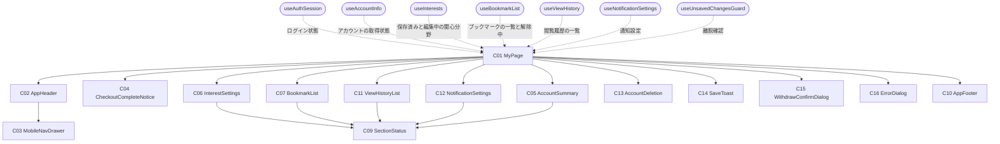
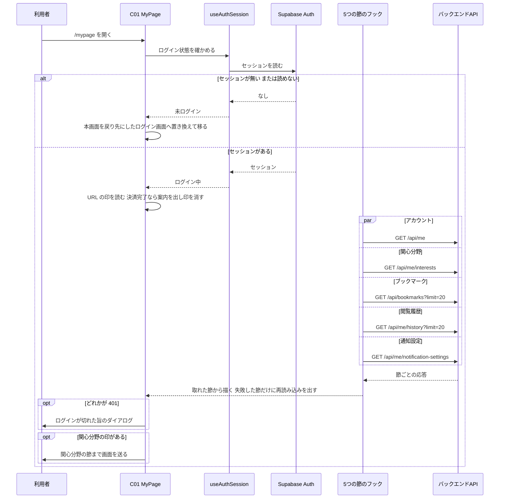
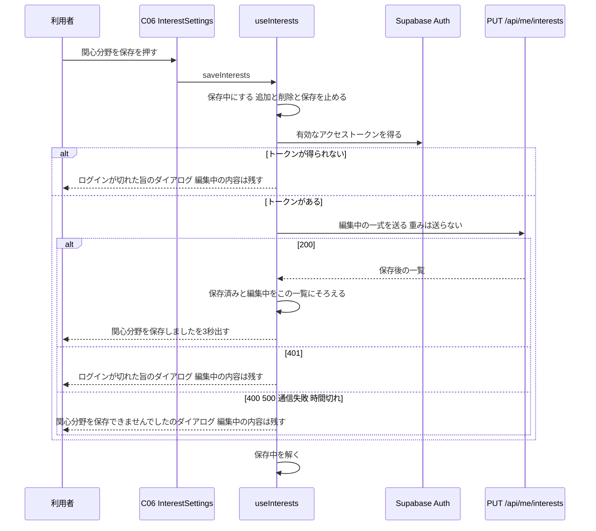
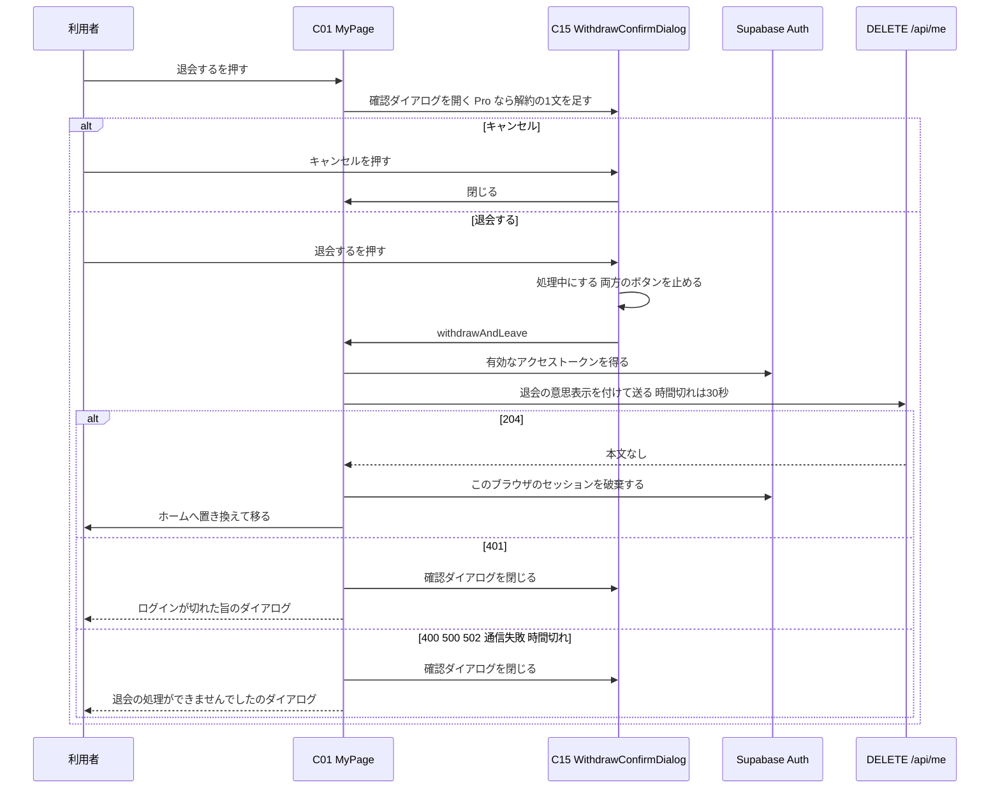
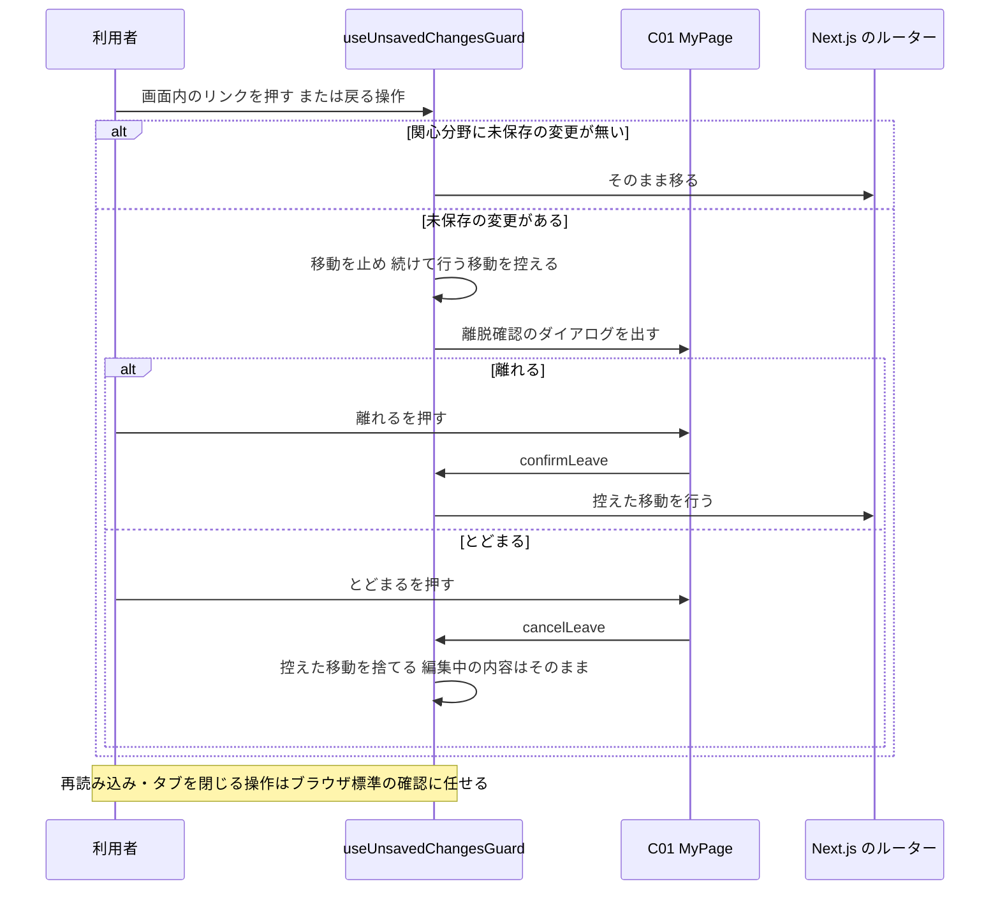

# FE詳細設計書 — P106 マイページ

## 0. 文書情報

| 項目 | 値 |
| :--- | :--- |
| 設計書ID | P106-FE |
| 親ID | P106 |
| 親設計書 | `screens/画面.P106.画面基本設計.md` |
| 版 | 1.0（新規作成） |
| 作成日 | 2026-10-27 |
| 更新日 | 2026-10-27 |
| 作成方法 | 上流の画面基本設計書（P106）、確定済みの `docs/基本設計書_概要.md`、`source/` 配下の企画資料をもとに設計した（creating-frontend-detailed-design v1.5.0 準拠）。API の応答の形は作成済みの BE詳細設計書（`detail/be/BE.F06.BE詳細設計.md`・`detail/be/BE.F07.BE詳細設計.md`・`detail/be/BE.F10.BE詳細設計.md`・`detail/be/BE.F15.BE詳細設計.md`・`detail/be/BE.F16.BE詳細設計.md`、決済の戻り先は `detail/be/BE.F12.BE詳細設計.md`）に合わせた。P101〜P104 と共用する部品・関数（共通ヘッダー・フッター・状態表示・ダイアログ、ログイン状態の取得、API呼び出しの共通処理、日付の整形、ログイン画面の URL の組み立て、ブックマークの解除）は `detail/fe/FE.P101.FE詳細設計.md`・`detail/fe/FE.P102.FE詳細設計.md`・`detail/fe/FE.P104.FE詳細設計.md` の定義を使う。本書には、P106 でどう使うかと P106 固有の部分、共用部品・関数に足す拡張点を書く |
| インプットの性質 | `source/` にあるのは企画・初期設計案の Markdown 6ファイルだけで、本画面のソースコード（ページ・コンポーネント・フック・ルーティング定義）は1行も無い（`source/README.md:5-10`、上流 概要書 §前提）。このため本書は**新規設計**であり、ファイルパス・関数名・State名・型はすべて実装時の命名案（※推測）である。技術スタックは Next.js / TypeScript / Tailwind CSS / shadcn/ui（`source/03_システム構成.md:6`）、認証は Supabase Auth（`source/03_システム構成.md:10`）。本画面の内容（関心分野・ブックマーク・閲覧履歴・通知設定）の出典は `source/01_企画概要.md:29`、`source/02_機能要求定義.md:11-12,15,48` |
| 既存資料の突合 | `legacy/` は空のディレクトリ（ファイル0件）で、突合する既存の設計・業務資料は無い。本書の既存版（`docs/detail/fe/FE.P106.FE詳細設計.md`）も無かったため、消さずに残すべき既存の記述は無い。引き継いだIDは上流設計書で採番済みのものだけである（画面 P101〜P107、コンポーネント C01〜C07・C09〜C16、項目 H01〜H59、イベント E01〜E31、様式①〜④、API07、IF05・IF07、機能 F06・F07・F08・F10・F12・F15・F16、業務フロー BF05〜BF08・BF10・BF12・BF13・EX04〜EX06、テーブル T005〜T008・T010、バッチ B007、方式 ARC008〜ARC010、顧客確認事項 Q03・Q04・Q15・Q17・Q23・Q25・Q27・Q32） |

## 1. フロントエンド構成・ルーティング設計

* **対象ドメイン**: マイページ系（mypage） — ログイン中の会員が、自分のアカウント情報と契約プランを確かめ、関心分野（カテゴリ・キーワード）を編集・保存し、ブックマークと閲覧履歴を見返し、新着ダイジェストを受け取るかどうかを切り替え、ログアウト・退会を行う画面（上流 P106 §1、`source/01_企画概要.md:29`）。本書が扱うのは次の範囲である。ログイン状態の確認と未ログイン時のログイン画面への移動、5つの節（アカウント・関心分野・ブックマーク・閲覧履歴・通知設定）の別々の取得と節ごとの失敗表示、関心分野の編集・入力チェック・一括保存、ブックマークの解除と続きの取得、閲覧履歴の続きの取得、通知設定の保存、ログアウト、退会の確認と依頼、未保存の変更があるときの離脱確認。サーバ側の保存・削除・課金の解約は各 BE詳細設計書の責務とする。プランの申込み・変更・解約は P107 の責務とする（上流 P106 §7）。遷移先の画面（P101 ホーム・P102 新着論文・P103 論文検索・P104 論文詳細・P107 料金、および※上流未定義のログイン・会員登録画面と利用規約ページ）の中身は、各画面の設計書の責務とする。
* **対象画面ID**: P106
* **ディレクトリ/ファイル構造**（※推測: 実装は未着手。P101〜P104 と同じく `web/` 配下の Next.js App Router 構成とする。本画面で使うファイルは全36件で、内訳は次の2つ。(1) 本画面で新設する23件: `app/mypage/page.tsx`、`components/mypage/` の9件、`hooks/` の6件、`lib/api/` の3件、`lib/mypage/` の4件。(2) 他の設計書で定義済みのファイルのうち本画面でも使う共用13件: C02・C03・C10・C09・C16 の部品5件、`hooks/useAuthSession.ts`、`lib/supabase/browserClient.ts`（本書で関数を追加）、`lib/api/requestJson.ts`（本書で拡張）、`lib/api/meClient.ts`（本書で関数を追加）、`lib/api/bookmarksClient.ts`（本書で関数を追加）、`lib/format/display.ts`（本書で関数を追加）、`lib/papers/filterCondition.ts`、`lib/interests/arxivCategories.ts`（BE.F06 で定義）。論文カード C08 は本画面では使わない。下の木では各ファイルに「新設」「共用」を付ける）:

```
web/
├── app/
│   └── mypage/
│       └── page.tsx                     … 新設: C01 MyPage（パス `/mypage` のページ）
├── components/
│   ├── layout/
│   │   ├── AppHeader.tsx                … 共用: C02 共通ヘッダー（P101 で定義、P102 で Props を追加）
│   │   ├── MobileNavDrawer.tsx          … 共用: C03 モバイル幅のナビゲーションドロワー
│   │   └── AppFooter.tsx                … 共用: C10 共通フッター
│   ├── common/
│   │   ├── SectionStatus.tsx            … 共用: C09 取得中・失敗・0件の表示（本書で Props を2つ追加）
│   │   └── ErrorDialog.tsx              … 共用: C16 ダイアログ（P104 の `components/paperDetail/ErrorDialog.tsx` を汎用にしてここへ移す。※上流要確認 — §4.1 末尾）
│   └── mypage/
│       ├── CheckoutCompleteNotice.tsx   … 新設: C04 Pro 申込み完了の案内
│       ├── AccountSummary.tsx           … 新設: C05 アカウント
│       ├── InterestSettings.tsx         … 新設: C06 関心分野
│       ├── BookmarkList.tsx             … 新設: C07 ブックマーク
│       ├── ViewHistoryList.tsx          … 新設: C11 閲覧履歴
│       ├── NotificationSettings.tsx     … 新設: C12 通知設定
│       ├── AccountDeletion.tsx          … 新設: C13 退会の入口
│       ├── SaveToast.tsx                … 新設: C14 保存完了メッセージ
│       └── WithdrawConfirmDialog.tsx    … 新設: C15 退会の確認ダイアログ
├── hooks/
│   ├── useAuthSession.ts                … 共用: ログイン状態と利用者表示の取得（P101 で定義）
│   ├── useAccountInfo.ts                … 新設: アカウント情報の取得の状態管理
│   ├── useInterests.ts                  … 新設: 関心分野の取得・編集中の内容・保存の状態管理
│   ├── useBookmarkList.ts               … 新設: ブックマーク一覧の取得・続き・解除の状態管理
│   ├── useViewHistory.ts                … 新設: 閲覧履歴の取得・続きの状態管理
│   ├── useNotificationSettings.ts       … 新設: 通知設定の取得・保存の状態管理
│   └── useUnsavedChangesGuard.ts        … 新設: 未保存の変更があるときの離脱確認
└── lib/
    ├── supabase/browserClient.ts        … 共用: ブラウザ用 Supabase クライアント（本書で getFreshAccessToken を追加）
    ├── api/
    │   ├── requestJson.ts               … 共用: API呼び出しの共通処理（P104 で拡張済み。本書で時間切れの指定を追加 — §4「requestJson の拡張点」）
    │   ├── meClient.ts                  … 共用: GET /api/me の呼び出し（本書で fetchAccount・deleteAccount を追加）
    │   ├── bookmarksClient.ts           … 共用: ブックマークAPIの呼び出し（P104 で定義。本書で fetchBookmarks を追加）
    │   ├── interestsClient.ts           … 新設: GET・PUT /api/me/interests の呼び出し
    │   ├── historyClient.ts             … 新設: GET /api/me/history の呼び出し
    │   └── notificationSettingsClient.ts … 新設: GET・PUT /api/me/notification-settings の呼び出し
    ├── mypage/
    │   ├── entryMarkers.ts              … 新設: URL の決済完了の印と関心分野の節を指す印の読み取り
    │   ├── interestRules.ts             … 新設: 関心分野の入力チェック・正規化・未保存の判定・表示文言
    │   ├── apiError.ts                  … 新設: API の失敗を画面の扱い（ログイン切れ／操作の失敗）へ振り分ける
    │   └── paperListItem.ts             … 新設: ブックマーク・閲覧履歴の1行分の表示データへの変換と論文詳細の URL
    ├── interests/arxivCategories.ts     … 共用: arXiv の分類名の一覧（BE.F06 で定義した定数。カテゴリ選択の選択肢に使う）
    ├── papers/filterCondition.ts        … 共用: ログイン画面の URL の組み立て（P102 で定義）
    └── format/display.ts                … 共用: 日付の整形（P101・P104 で定義。本書で formatCount・formatPlanLabel を追加）
```

* **ルーティング定義**（総件数: 1件。全数である根拠: 本書の対象は P106 の1画面だけで、上流 概要書 §3.1 の P106 行のパスは `/mypage` の1件である。決済完了の印〈クエリ `checkout=success`〉と関心分野の節を指す印〈ハッシュ `#interests`〉は同じページへの付加情報であり、別のルートにはしない）:

| パス | コンポーネント | 認証要否 | ルートファイル |
| :--- | :--- | :--- | :--- |
| `/mypage`（※推測。上流 概要書 §3.1・付録 Q03 の仮置き）。Stripe の決済画面から戻ったときは `/mypage?checkout=success`（BE.F12 §0 確認事項 No.11 の成功時の戻り先）、ホームの関心分野設定の案内から来たときは `/mypage#interests`（`detail/fe/FE.P101.FE詳細設計.md` §5 E11）で開かれる | MyPage（C01） | 要（ログインしていなければ、本画面の URL を戻り先にしてログイン・会員登録画面へ移す — 上流 P106 §1。判定はブラウザ側で行い、サーバ側のミドルウェアでの振り分けは置かない ※推測。データは各APIがトークンを検証して本人の分だけを返すため、画面側の判定は表示の出し分けにだけ使う） | `web/app/mypage/page.tsx` |

## 2. コンポーネント設計

* **コンポーネントツリー図**（上流 P106 §3.1 の木をそのまま引き継ぐ。点線は本書で決めた状態の受け渡し）:



* **コンポーネントロースター**（総件数: 15件。全数である根拠: 上流 P106 §3.2 コンポーネント一覧の C01〜C07・C09〜C16 の全15件と1対1で対応させた。本書で追加・統合した部品は無い。C08（論文カード）は上流で本画面の欠番。C02・C03・C09・C10・C16 は P101〜P104 と同じ部品を共用し、C04〜C07・C11〜C15 は他画面の同じ番号の部品とは別物である — 上流 P106 §3.2。shadcn/ui の汎用部品（Button・Select・Input・Badge・Switch・AlertDialog・Sheet・Skeleton・Toast）は画面固有のコンポーネントではないため数えず、使う箇所を各コンポーネントの役割に記す）:

| コンポーネントID | コンポーネント名 | 種類 | ファイルパス | 概要 | 定義状況 | 詳細の所在 |
| :--- | :--- | :--- | :--- | :--- | :--- | :--- |
| C01 | MyPage | Page | `web/app/mypage/page.tsx` | マイページ全体。ログイン状態を確かめ、未ログインならログイン画面へ移す。ログイン中なら5つの節のデータを別々に取得して各部品へ渡し、ダイアログ・保存完了メッセージ・離脱確認を束ねる | 詳細 | §2 コンポーネント詳細定義、§4 |
| C02 | AppHeader | Layout | `web/components/layout/AppHeader.tsx` | 全画面共通のヘッダー。本画面では「マイページ」を選択中の見た目にする | 詳細 | §2 コンポーネント詳細定義（P106 での使い方）、`detail/fe/FE.P101.FE詳細設計.md` §2 C02、`detail/fe/FE.P102.FE詳細設計.md` §2 C02 |
| C03 | MobileNavDrawer | UI | `web/components/layout/MobileNavDrawer.tsx` | モバイル幅でメニューボタンを押したときに開く導線の収納先 | 詳細 | §2 コンポーネント詳細定義（P106 での使い方）、`detail/fe/FE.P101.FE詳細設計.md` §2 C03 |
| C04 | CheckoutCompleteNotice | UI | `web/components/mypage/CheckoutCompleteNotice.tsx` | Stripe の決済画面から戻ったときだけ、申込みを受け付けた旨とプランの反映に時間がかかる旨を示す | 詳細 | §2 コンポーネント詳細定義、§4 applyEntryMarkers |
| C05 | AccountSummary | UI | `web/components/mypage/AccountSummary.tsx` | メールアドレス・契約プラン・会員登録日を示し、料金画面への導線とログアウトボタンを置く | 詳細 | §2 コンポーネント詳細定義、§4 useAccountInfo・handleLogout |
| C06 | InterestSettings | UI | `web/components/mypage/InterestSettings.tsx` | 関心分野のチップの一覧、カテゴリ・キーワードの追加欄、入力エラー、保存ボタンを置く | 詳細 | §2 コンポーネント詳細定義、§4 useInterests・handleAddCategory・handleAddKeyword、§6 |
| C07 | BookmarkList | UI | `web/components/mypage/BookmarkList.tsx` | 保存した論文を保存日の新しい順に並べ、解除ボタンと「さらに表示」を置く | 詳細 | §2 コンポーネント詳細定義、§4 useBookmarkList |
| C09 | SectionStatus | UI | `web/components/common/SectionStatus.tsx` | 節ごとの取得中・失敗・0件の表示 | 詳細 | §2 コンポーネント詳細定義（P106 での使い方）、`detail/fe/FE.P101.FE詳細設計.md` §2 C09 |
| C10 | AppFooter | Layout | `web/components/layout/AppFooter.tsx` | 全画面共通のフッター。arXiv との関係の注記（H58）と利用規約へのリンク（H59）を常に同じ形で出す。Props・内部State を持たず分岐が無い（P101 と同じ部品をそのまま使う） | 簡易 | 本表、`detail/fe/FE.P101.FE詳細設計.md` §2 ロースター C10 |
| C11 | ViewHistoryList | UI | `web/components/mypage/ViewHistoryList.tsx` | ログイン中に開いた論文を閲覧日時の新しい順に並べ、「さらに表示」を置く | 詳細 | §2 コンポーネント詳細定義、§4 useViewHistory |
| C12 | NotificationSettings | UI | `web/components/mypage/NotificationSettings.tsx` | 新着ダイジェストを受け取るかどうかの切替と配信先を示す。提供開始前は節ごと出さない | 詳細 | §2 コンポーネント詳細定義、§4 useNotificationSettings・toggleDigest |
| C13 | AccountDeletion | UI | `web/components/mypage/AccountDeletion.tsx` | 退会で削除されるデータを示し、退会の確認ダイアログを開くボタンを置く | 詳細 | §2 コンポーネント詳細定義、§4 openWithdrawDialog |
| C14 | SaveToast | UI | `web/components/mypage/SaveToast.tsx` | 関心分野・通知設定の保存に成功したことを画面下部に3秒間（※推測）出して自動で消す。受け取った文言を出して時間で消すだけで、出し分けの分岐を持たない（上流 P106 C14 簡易） | 簡易 | 本表、§4 関数ロースター scheduleToastHide |
| C15 | WithdrawConfirmDialog | UI | `web/components/mypage/WithdrawConfirmDialog.tsx` | 退会すると元に戻せないことを示し、確定かキャンセルを選ばせるダイアログ。処理中は両方のボタンを押せなくする | 詳細 | §2 コンポーネント詳細定義、§4 withdrawAndLeave |
| C16 | ErrorDialog | UI | `web/components/common/ErrorDialog.tsx` | ログイン切れ・操作の失敗・離脱確認のときに画面中央に重ねるダイアログ | 詳細 | §2 コンポーネント詳細定義、§4 openDialog |

* **コンポーネント詳細定義**（ロースターのうち定義状況＝詳細の13件。共用部品は「P106 での使い方」と、他画面の定義から変わる点だけを書く。Props の型は §3 型定義を参照）:

| コンポーネントID | コンポーネント名 | 種類(Page/UI/HOC等) | ファイルパス | 担当項目ID | Props (型) | 内部State (型) | 役割・概要 |
| :--- | :--- | :--- | :--- | :--- | :--- | :--- | :--- |
| C01 | MyPage | Page | `web/app/mypage/page.tsx` | H09 | なし（URL のクエリとハッシュは `useSearchParams` と `window.location.hash` から読む） | dialog: DialogState（初期値 null）、isWithdrawDialogOpen: boolean（初期値 false）、toast: ToastState（初期値 null）、showCheckoutNotice: boolean（初期値 false）。ほかの状態は7つのフックが持つ（§3 ローカルステート定義） | ページ見出し「マイページ」（H09。見出し要素 h1）を出し、ブラウザのタブのページタイトルを「マイページ｜サービス名」にする（上流 P106 H09 ※推測）。ログイン状態（useAuthSession）が「未ログイン」に決まったら、何も取得せずにログイン画面へ移す（redirectGuestToLogin）。「ログイン中」に決まったら、5つの節のフック（useAccountInfo・useInterests・useBookmarkList・useViewHistory・useNotificationSettings）がそれぞれ同時に取得を始める（上流 P106 E01「並行して行う」）。続けて URL の印を読み、決済完了の印があれば C04 を出し、関心分野の印があれば関心分野の節まで画面を送る（applyEntryMarkers）。確認中の間は5つの節すべてに読み込み中表示（H47）を出す。レイアウトは2通りある。デスクトップ（lg 1024px 以上 ※推測）では左列（幅440px）にアカウント・関心分野・通知設定・退会、右列（幅790px）にブックマーク・閲覧履歴を積む。モバイルでは1列でアカウント・関心分野・ブックマーク・閲覧履歴・通知設定・退会の順に積む（上流 P106 §2.3 ※推測）。この並べ替えは CSS グリッドの領域指定で行い、部品を2回描かない（※推測）。各節の取得で失敗の種類がログイン切れなら、その節に失敗表示を出したうえで、ログインが切れた旨のダイアログを1つだけ出す（openDialog）。関心分野に未保存の変更があるあいだは useUnsavedChangesGuard で離脱を見張る（E31）。クライアントコンポーネントとする（ブラウザに残る Supabase のセッションを読むため。`'use client'` ※推測） |
| C02 | AppHeader | Layout | `web/components/layout/AppHeader.tsx` | H01, H02, H03, H04, H05, H06, H07, H08 | auth: AuthState、activeNav: 'mypage'、loginReturnTo: string（`/mypage`）、onActiveNavClick: (event: React.MouseEvent) => void（handleMyPageNavClick）。いずれも P102 で追加した任意の Props | isDrawerOpen: boolean（初期値 false） | P101・P102 の定義どおり、サービス名・導線・ログイン状態を出す。本画面では「マイページ」（H05）を選択中の見た目（太字・下線、`aria-current="page"`）にする（上流 P106 §2.3）。H05 を押したときは onActiveNavClick で本画面を開き直す（E26）。利用者表示（H07）のプランは useAuthSession の値を使う。Stripe から戻った直後はプランがまだ Free のことがあるが、C04 の案内で補う（上流 P106 H10）。ログインボタン（H06）は、表示中にログアウトを終えた直後の一瞬だけ見える（上流 P106 H06）。押すと本画面のパスを戻り先にしたログイン画面へ移る（E27）。ロゴ・導線のリンクは Next.js の Link のままとし、未保存の変更があるときの確認は useUnsavedChangesGuard がページ全体のクリックを先に受けて行う（共用部品を本画面のために変えないため） |
| C03 | MobileNavDrawer | UI | `web/components/layout/MobileNavDrawer.tsx` | H02, H03, H04, H05, H06, H07 | open: boolean、onOpenChange: (open: boolean) => void、auth: AuthState、activeNav: 'mypage'、loginReturnTo: string、onActiveNavClick: (event: React.MouseEvent) => void | なし | P101・P102 の定義どおり。本画面では「マイページ」を選択中の見た目にし、押すとドロワーを閉じてから onActiveNavClick を呼ぶ（E26）。他のリンクはドロワーを閉じてから移る（E23〜E25・E27）。未保存の変更があってリンクの押下が離脱確認で止められたときは、ドロワーを開いたままにする（「とどまる」を選べば元の表示に戻るため ※推測） |
| C04 | CheckoutCompleteNotice | UI | `web/components/mypage/CheckoutCompleteNotice.tsx` | H10 | show: boolean | なし | show が真のときだけ、ページ見出しの下に案内の帯（`role="status"`）で「Pro プランのお申し込みを受け付けました。プランの反映まで少し時間がかかる場合があります。」（上流 P106 H10 ※推測）を出す。偽のときは何も描かない。帯には閉じるボタンを置かない（上流 P106 §4 に閉じる項目が無いため）。本画面を開き直すと消える。契約状態は Stripe からの通知（IF07）を受けてサーバ側で非同期に更新されるため（上流 BF12）、本画面からプランの更新を待って取り直す処理は置かない ※推測 |
| C05 | AccountSummary | UI | `web/components/mypage/AccountSummary.tsx` | H11, H12, H13, H14, H15, H16 | state: AccountSectionState、onReload: () => void、onLogout: () => void | なし | 節見出し「アカウント」（H11）は常に出す。取得中・失敗のときは中身の位置に C09 を出す（状態は loading か error、再読み込みは onReload — E17）。取得できたら次の3つを並べる。メールアドレス（H12。メールアドレスが無いログイン方式では、セッションの利用者情報にある表示名を出し、それも無ければ「—」※推測 — BE.F06 §2 GET /api/me「`email` は null になり得る」）。契約プラン（H13。formatPlanLabel の結果を Badge で出す）。会員登録日（H14。「会員登録日」の語に続けて formatJstDate の結果）。「プランを確認・変更する ›」（H15）は `/pricing` への Link（E18）、「ログアウト」（H16）は onLogout を呼ぶボタン（E19）で、どちらも取得の成否に関わらず常に出す（上流 P106 H15・H16「常時表示」）。メールアドレスは本画面では変えさせない（上流 P106 H12） |
| C06 | InterestSettings | UI | `web/components/mypage/InterestSettings.tsx` | H17, H18, H19, H20, H21, H22, H23, H24, H25, H26 | state: InterestsSectionState、draft: InterestItem[]、isDirty: boolean、isSaving: boolean、onAdd: (item: InterestItem) => void、onRemove: (topic: string) => void、onSave: () => void、onReload: () => void | selectedCategory: string \| null（初期値 null）、keywordInput: string（初期値 ""）、inputError: InterestInputError \| null（初期値 null） | 節の要素に `id="interests"` を付ける（ホームの案内からの移動先 — §1 ルーティング定義）。節見出し「関心分野」と説明文（H17）は常に出す。取得中・失敗のときは C09 を出し、追加欄と保存ボタンは出さない（保存済みの内容が分からないまま保存させないため ※推測）。取得できたら次の順に出す。(1) 編集中の内容が0件なら未登録の案内（H18）、1件以上なら formatInterestLabel の文言のチップを並べる（H19。並び順は §4 useInterests の注記）。各チップの右端に「×」（H20。押すと onRemove — E02）を置く。(2) カテゴリ選択（H21。shadcn/ui の Select。選択肢は getCategoryOptions の結果）と「追加」（H22。カテゴリが未選択のときは押せない）。(3) キーワード入力（H23。最大入力長は設けず、超過は追加時に知らせる ※推測）と「追加」（H24）。(4) 入力エラー（H25。inputError があるときだけキーワード入力欄の直下に赤文字で出す。`aria-live="polite"`）。(5) 保存ボタン（H26。isDirty が偽、または isSaving が真のときは押せない。保存中は文言を「保存中…」にする）。保存中は H20〜H24 も押せなくする（上流 P106 E02「保存の処理中は受け付けない」） |
| C07 | BookmarkList | UI | `web/components/mypage/BookmarkList.tsx` | H27, H28, H29, H30, H31, H32, H33, H34 | state: BookmarkListState、removingIds: ReadonlySet<string>、onRemove: (arxivId: string) => void、onLoadMore: () => void、onReload: () => void | なし | 節見出し「ブックマーク」（H27）は常に出す。取得中・失敗のときは C09 を出す。取得できたら、件数（H28。formatCount の結果に「件」を付ける）を見出しの横に出す。0件なら一覧の位置に C09 の0件表示（H50。文言は「まだブックマークした論文はありません。論文詳細の「☆ ブックマークに追加」で保存できます。」）を出す。1件以上なら1行ずつ次を並べる。タイトル（H29。buildPaperHref の URL への Link — E08。2行で切って末尾を「…」にする、Tailwind CSS の `line-clamp-2`）、カテゴリ（H30。Badge）、版（H31。「v」と最新版の番号。版が取れない行は出さない ※推測）、保存日（H32。「保存日」の語に続けて formatJstDate の結果）、「解除」（H33。押すと onRemove — E09。removingIds に含まれる行は押せない）。続きがある（nextCursor がある）ときだけ一覧の下に「さらに表示」（H34。押すと onLoadMore — E10。続きの取得中は「読み込み中…」にして押せない）を出す |
| C09 | SectionStatus | UI | `web/components/common/SectionStatus.tsx` | H47, H48, H49, H50 | status: 'loading' \| 'error' \| 'empty'、errorMessage?: string、onReload?: () => void、emptyMessage?: string（本書で追加）、skeletonVariant?: 'cards' \| 'rows' \| 'fields'（本書で追加） | なし | P101 の定義どおり、取得中は灰色の枠（H47）、失敗は赤色の帯のメッセージ（H48）と「再読み込み」ボタン（H49 — E17）、0件は0件表示（H50）を出す。本書で次の2つを足す。(1) emptyMessage を渡されたら、P101 の固定文言「表示できる論文がありません」の代わりにその文言を出す（ブックマークと閲覧履歴で文言が違うため — 上流 P106 H50）。(2) skeletonVariant で枠の形を選ぶ。カード形が既定（P101〜P104 の呼び出しは変わらない）。本画面ではブックマーク・閲覧履歴に1行形の枠5本（'rows'）、アカウント・関心分野・通知設定に項目形の枠3本（'fields'）を使う（上流 P106 H47「節の中身の形をした灰色の枠」※推測）。失敗の文言は本画面では「読み込めませんでした。時間をおいて再読み込みしてください。」（上流 P106 §5.1 様式②）。関心分野の0件は H18 で案内するため、関心分野の節では 'empty' を使わない |
| C11 | ViewHistoryList | UI | `web/components/mypage/ViewHistoryList.tsx` | H35, H36, H37, H38, H39 | state: ViewHistoryState、onLoadMore: () => void、onReload: () => void | なし | 節見出し「閲覧履歴」と補足「ログイン中に開いた論文（新しい順）」（H35）は常に出す。取得中・失敗のときは C09 を出す。0件なら C09 の0件表示（H50。文言は「まだ閲覧した論文はありません。」）を出す。1件以上なら1行ずつ次を並べる。タイトル（H36。buildPaperHref の URL への Link — E11。2行で切る）、カテゴリ（H37）、閲覧日時（H38。「閲覧」の語に続けて formatJstDateTime の結果）。版は出さない（閲覧イベントは版を持たないため — 上流 P106 H38）。総件数は出さない（BE.F15 §2 が総件数を返さないため）。続きがあるときだけ「さらに表示」（H39 — E12）を出す。続きの取得中の扱いは C07 と同じ |
| C12 | NotificationSettings | UI | `web/components/mypage/NotificationSettings.tsx` | H40, H41, H42, H43 | state: NotificationSectionState、isSaving: boolean、onToggle: (next: boolean) => void、onReload: () => void | なし | 状態が「提供前」（GET が 404 を返した）のときは節ごと何も描かない（H40〜H43 を出さない — 上流 P106 H40）。それ以外では節見出し「通知設定」（H40）を出し、取得中・失敗のときは C09 を出す。取得できたら説明文（H41）、「新着ダイジェストを受け取る」のラベル付きのトグル（H42。shadcn/ui の Switch。オンが「受け取る」。isSaving が真のときは押せない。押すと onToggle — E13）、「配信先:」に続けて配信先のメールアドレス（H43。配信先が無いときは「—」※推測）を出す |
| C13 | AccountDeletion | UI | `web/components/mypage/AccountDeletion.tsx` | H44, H45, H46 | onRequestWithdraw: () => void | なし | 節見出し「退会」（H44）、説明文「退会すると、関心分野・ブックマーク・閲覧履歴・契約情報が削除され、元に戻せません。」（H45）、赤系の「退会する」ボタン（H46。押すと onRequestWithdraw — E14）を常に出す。ほかの節の取得に失敗していても押せる（退会の申し出を妨げないため ※推測）。上流 P106 C13 の Props「契約プラン」は、H45 の文言がプランで変わらないため受け取らない（プランで変わるのは C15 の H55 だけ） |
| C15 | WithdrawConfirmDialog | UI | `web/components/mypage/WithdrawConfirmDialog.tsx` | H55, H56, H57 | open: boolean、plan: Plan \| null、onConfirm: () => Promise<void>、onCancel: () => void | isProcessing: boolean（初期値 false） | shadcn/ui の AlertDialog で画面中央に重ねる。メッセージ（H55）は「本当に退会しますか？関心分野・ブックマーク・閲覧履歴・契約情報はすべて削除され、元に戻せません。」とし、続けて次の1文を足す。プランが Pro なら「Pro プランの定期課金も解約されます。」。プランが分からない（アカウントの節の取得に失敗した）なら「Pro プランをご契約中の場合は、定期課金も解約されます。」（※推測。Pro の利用者が解約を知らずに退会するのを防ぐため）。Free なら何も足さない。「退会する」（H56。赤系）を押すと handleWithdrawConfirm で処理中にしてから onConfirm を待ち、終わるまで「処理中…」にして H56・H57 を押せなくする（二重送信の防止 — 上流 P106 H56）。「キャンセル」（H57）は onCancel を呼ぶ（E16）。処理中は Esc キーと背景の押下でも閉じない（AlertDialog の閉じる通知を処理中は無視する） |
| C16 | ErrorDialog | UI | `web/components/common/ErrorDialog.tsx` | H52, H53, H54 | dialog: DialogState（null のとき閉じる）、onLogin: () => void、onClose: () => void、onLeave: () => void（本書で追加） | なし | shadcn/ui の AlertDialog で画面中央に重ねる。dialog の種類で中身を変える。(1) ログイン切れ: メッセージ（H52）「ログインの有効期限が切れました。もう一度ログインしてください。」、「ログイン」（H53 — E20）、「閉じる」（H54 — E21）。(2) 操作の失敗: H52 に渡された文言（§6 UIエラーフィードバック）、「OK」（H54 — E21）だけ。(3) 離脱確認: H52 に「関心分野の変更が保存されていません。このページを離れますか？」（上流 P106 E31）、「離れる」（onLeave。※上流未定義: 上流 P106 §4 に項目IDが無い）、「とどまる」（H54 の位置。押すと onClose）。開いている間は背景を操作できず、Esc キーでも閉じる（閉じる操作は E21、離脱確認では「とどまる」と同じ扱い）。P104 の同じ部品にあった「ログインが必要」の種類（未ログインでブックマークを押したとき）も、同じ形で残す（P104 の呼び出しを変えないため） |

## 3. 状態管理（State）設計

* **型定義**（※推測: §3・§4 の表で使う型。AuthState・ApiRequestError は `detail/fe/FE.P101.FE詳細設計.md` §3 の定義を使う。ApiRequestError のエラーコードは `detail/fe/FE.P104.FE詳細設計.md` §4「requestJson の拡張点」で足したもの。API の応答のキー名は BE.F06・BE.F07・BE.F10・BE.F15・BE.F16 の §2 に合わせた）:

```ts
type Plan = 'free' | 'pro';

// アカウント情報（fetchAccount が返す）
type AccountInfo = { email: string | null; plan: Plan | null; createdAt: string };   // createdAt は ISO 8601（UTC）

type AccountSectionState =
  | { status: 'loading' } | { status: 'error' }
  | { status: 'success'; account: AccountInfo; displayName: string | null };          // displayName はセッションの利用者情報から

// 関心分野1件（重みは画面で扱わないため持たない — 上流 P106 §7）
type InterestItem = { topic: string; kind: 'category' | 'keyword' };

type InterestsSectionState =
  | { status: 'loading' } | { status: 'error' }
  | { status: 'success'; saved: InterestItem[]; limit: number };                     // limit は登録できる上限件数

type InterestInputError = 'keywordEmpty' | 'keywordTooLong' | 'duplicate' | 'limitReached';

// ブックマーク・閲覧履歴の1行
type BookmarkItem = { arxivId: string; title: string; primaryCategory: string | null;
                      latestVersion: number | null; bookmarkedAt: string };
type HistoryItem  = { arxivId: string; title: string; primaryCategory: string | null; viewedAt: string };

type BookmarkListState =
  | { status: 'loading' } | { status: 'error' }
  | { status: 'success'; items: BookmarkItem[]; totalCount: number;
      nextCursor: string | null; isLoadingMore: boolean };

type ViewHistoryState =
  | { status: 'loading' } | { status: 'error' }
  | { status: 'success'; items: HistoryItem[]; nextCursor: string | null; isLoadingMore: boolean };

type NotificationSettingsModel = { digestEnabled: boolean; destination: string | null };

type NotificationSectionState =
  | { status: 'loading' } | { status: 'error' } | { status: 'unavailable' }           // unavailable は提供開始前
  | { status: 'success'; settings: NotificationSettingsModel };

// ダイアログ（C16）
type DialogState =
  | null
  | { kind: 'sessionExpired' }                                // ログイン切れ（様式①）
  | { kind: 'operationFailed'; message: string }              // 操作の失敗（様式①）
  | { kind: 'leaveConfirm' }                                  // 離脱確認（E31）
  | { kind: 'loginRequired' };                                // P104 で使う種類（本画面では使わない）

type ToastState = null | { message: string; key: number };    // key は同じ文言を続けて出すときに出し直すための通し番号

// API の失敗を画面でどう扱うか（toUserFacingError が返す）
type UserFacingError = 'sessionExpired' | 'failed' | 'ignored';

// URL の印（readEntryMarkers が返す）
type EntryMarkers = { checkoutSucceeded: boolean; focusInterests: boolean };
```

* **グローバルステート / Context定義**（総件数: 1件。全数である根拠: 本画面で画面の外と共有される状態は、Supabase Auth のクライアントが持つログインのセッション〈P101 と同じ〉だけである。URL の印は読むだけで、決済完了の印は読んだ後に URL から消す〈§4 applyEntryMarkers〉。React の Context・状態管理ライブラリは使わず、ログイン状態は C01 から Props で配る）:

| State名 | 型 | スコープ | 初期値 | 更新タイミング | 管理方法 |
| :--- | :--- | :--- | :--- | :--- | :--- |
| Supabase のログインセッション | Session \| null（Supabase の型） | アプリ全体（全画面。ブラウザのタブをまたいで共有） | セッションの Cookie があればその内容、無ければ null | ログイン・トークンの自動更新のとき（Supabase のクライアントが更新する）。本画面は、ログアウト（E19）と退会の完了（E15）のときに破棄する | `@supabase/ssr` のブラウザ用クライアントを1つだけ作って使い回す（getBrowserSupabaseClient）。読み出しは `auth.getSession()`、破棄は `auth.signOut()`（※推測） |

* **ローカルステート定義**（総件数: 30件。全数である根拠: コンポーネントロースターの全15件を対象に、状態を持つものを数えた。C01 は23件。内訳は、ページ自身の4件〈ダイアログ・退会確認の開閉・保存完了メッセージ・決済完了の案内〉と、7つのフックの19件〈useAuthSession 2件、useAccountInfo 2件、useInterests 4件、useBookmarkList 3件、useViewHistory 2件、useNotificationSettings 3件、useUnsavedChangesGuard 3件〉。フックの中身はページに属する状態として C01 に数える。C02 は1件〈ドロワーの開閉〉、C06 は3件〈カテゴリの選択・キーワードの入力値・入力エラー〉、C14 は2件〈表示中かどうか・消すタイマー〉、C15 は1件〈退会の処理中〉。再描画を伴わない値〈useRef〉も、古い応答による上書きや二重の処理の防止に効くものは数える〈P101〜P104 と同じ基準〉。C03・C04・C05・C07・C09・C10・C11・C12・C13・C16 の10件は状態を持たない。上流 P106 §3.2 が C06・C07・C11・C12 の内部State とした「編集中の関心分野」「保存の処理中」「解除の処理中の論文」「続きの取得中」は、離脱確認〈E31〉とダイアログの出し分けで C01 が参照するため、C01 のフックへ持ち上げた）:

| コンポーネント | State名 | 型 | 初期値 | 用途 |
| :--- | :--- | :--- | :--- | :--- |
| C01 MyPage | dialog | DialogState | null | 画面中央に出すダイアログ（C16）の種類と文言。ログイン切れを他の種類より優先して残す（openDialog） |
| C01 MyPage | isWithdrawDialogOpen | boolean | false | 退会の確認ダイアログ（C15）が開いているか。退会するボタン（E14）で開き、キャンセル（E16）・退会の失敗（E15）で閉じる |
| C01 MyPage | toast | ToastState | null | 保存完了メッセージ（C14）に出す文言。保存に成功するたびに通し番号を1つ増やし、同じ文言でも出し直す |
| C01 MyPage | showCheckoutNotice | boolean | false | Pro 申込み完了の案内（C04）を出すか。決済完了の印を読んだときだけ真にし、URL から印を消した後も、本画面を開いている間は出し続ける |
| C01 MyPage（useAuthSession 内） | auth | AuthState | `{ status: 'loading' }` | ログイン中かどうかと、ヘッダーに出す利用者の表示（メールアドレスとプラン）。未ログインに決まったらログイン画面へ移す判定に、ログイン中に決まったら5つの節の取得を始める合図に使う（P101 の定義のまま） |
| C01 MyPage（useAuthSession 内） | requestSeqRef | number（useRef） | 0 | ログイン状態の確認ごとに増やす通し番号。古い確認の結果で状態を上書きしないために使う（P101 の定義のまま） |
| C01 MyPage（useAccountInfo 内） | state | AccountSectionState | `{ status: 'loading' }` | アカウントの節の取得状態と結果。ログイン状態の確認中から読み込み中表示を出すため、初期値を取得中にする |
| C01 MyPage（useAccountInfo 内） | abortRef | AbortController \| null（useRef） | null | 進行中のアカウント情報の取得を取り消すための制御。再読み込み・開き直し・画面離脱のときに前の要求を取り消し、古い応答が後から届いて表示を上書きするのを防ぐ |
| C01 MyPage（useInterests 内） | state | InterestsSectionState | `{ status: 'loading' }` | 関心分野の節の取得状態と、サーバに保存済みの関心分野と上限件数。未保存の判定（isInterestsDirty）の比較元になる |
| C01 MyPage（useInterests 内） | draft | InterestItem[] | `[]`（取得に成功したら保存済みの内容の写し） | 編集中の関心分野。追加（E04・E06）と削除（E02）はこれだけを変え、保存（E07）のときにまとめて送る。保存に失敗しても消さない（上流 P106 E07） |
| C01 MyPage（useInterests 内） | isSaving | boolean | false | 関心分野の保存中か。保存中は追加・削除・保存を受け付けない（上流 P106 E02・E07） |
| C01 MyPage（useInterests 内） | abortRef | AbortController \| null（useRef） | null | 進行中の関心分野の取得を取り消すための制御。用途は useAccountInfo と同じ。保存の要求は取り消さない（送った保存は結果まで待つ） |
| C01 MyPage（useBookmarkList 内） | state | BookmarkListState | `{ status: 'loading' }` | ブックマークの一覧・総件数・続きの取得位置・続きの取得中かどうか |
| C01 MyPage（useBookmarkList 内） | removingIds | Set<string> | 空の集合 | 解除の処理中の論文の arXiv ID。その行の解除ボタンを押せなくし、同じ論文の解除の二重送信を防ぐ（上流 P106 E09） |
| C01 MyPage（useBookmarkList 内） | abortRef | AbortController \| null（useRef） | null | 進行中の一覧の取得（最初の取得・続き・再読み込み）を取り消すための制御。再読み込みを始めたら続きの取得も取り消す。解除の要求は取り消さない |
| C01 MyPage（useViewHistory 内） | state | ViewHistoryState | `{ status: 'loading' }` | 閲覧履歴の一覧・続きの取得位置・続きの取得中かどうか |
| C01 MyPage（useViewHistory 内） | abortRef | AbortController \| null（useRef） | null | 進行中の閲覧履歴の取得を取り消すための制御。用途は useBookmarkList と同じ |
| C01 MyPage（useNotificationSettings 内） | state | NotificationSectionState | `{ status: 'loading' }` | 通知設定の節の取得状態と、受け取り設定・配信先。提供開始前なら unavailable にして節ごと隠す |
| C01 MyPage（useNotificationSettings 内） | isSaving | boolean | false | 通知設定の保存中か。保存中はトグルを押せなくする（上流 P106 E13） |
| C01 MyPage（useNotificationSettings 内） | abortRef | AbortController \| null（useRef） | null | 進行中の通知設定の取得を取り消すための制御。保存の要求は取り消さない |
| C01 MyPage（useUnsavedChangesGuard 内） | pendingProceedRef | (() => void) \| null（useRef） | null | 離脱確認で「離れる」を選んだときに続けて行う移動（リンク先への遷移・ログアウト・ログイン画面への移動・本画面の開き直し）。確認を出すたびに入れ替え、「とどまる」で捨てる |
| C01 MyPage（useUnsavedChangesGuard 内） | sentinelPushedRef | boolean（useRef） | false | ブラウザの戻る操作を受け止めるための履歴の見張りの項目を、すでに積んだかどうか。未保存の変更が出たときに1回だけ積む |
| C01 MyPage（useUnsavedChangesGuard 内） | leavingRef | boolean（useRef） | false | 「離れる」を選んで移動している最中か。真の間は、移動に伴うブラウザの履歴の変化を離脱として止めない |
| C02 AppHeader | isDrawerOpen | boolean | false | モバイル幅のドロワー（C03）が開いているか（P101 の定義のまま） |
| C03 MobileNavDrawer | なし | — | — | 開閉状態は C02 から Props で受け取る |
| C04 CheckoutCompleteNotice | なし | — | — | 出すかどうかは Props で受け取る |
| C05 AccountSummary | なし | — | — | 取得状態は C01 から Props で受け取る |
| C06 InterestSettings | selectedCategory | string \| null | null | カテゴリ選択（H21）で選んだ分類名。追加（E04）に成功したら未選択に戻す |
| C06 InterestSettings | keywordInput | string | "" | キーワード入力欄（H23）の入力値。追加に成功したら空に戻し、ルールに反したときは残す（上流 P106 E06） |
| C06 InterestSettings | inputError | InterestInputError \| null | null | 追加のルール違反の種類。H25 の文言を決める。入力を直す（E05）・カテゴリを選び直す（E03）・追加に成功すると消す |
| C07 BookmarkList | なし | — | — | 一覧と解除中の論文は C01 から Props で受け取る |
| C09 SectionStatus | なし | — | — | どの状態を出すかは Props で受け取る |
| C10 AppFooter | なし | — | — | 固定文言とリンクだけを出す |
| C11 ViewHistoryList | なし | — | — | 一覧は C01 から Props で受け取る |
| C12 NotificationSettings | なし | — | — | 設定と保存中かどうかは C01 から Props で受け取る |
| C13 AccountDeletion | なし | — | — | 固定文言とボタンだけを出す |
| C14 SaveToast | isVisible | boolean | false | 保存完了メッセージを出しているか。受け取った文言の通し番号が変わったら真にし、3秒後（※推測）に偽にする |
| C14 SaveToast | hideTimerRef | number \| null（useRef） | null | メッセージを消すタイマー。続けて保存したときは前のタイマーを止めて3秒を数え直し、画面を離れるときも止める |
| C15 WithdrawConfirmDialog | isProcessing | boolean | false | 退会の処理中か。処理中は確定・キャンセルの両方を押せなくし、ダイアログも閉じさせない |
| C16 ErrorDialog | なし | — | — | ダイアログの種類と文言は C01 から Props で受け取る |

* **永続化ステート**（総件数: 1件。全数である根拠: 本画面が自分で localStorage・sessionStorage・Cookie に書き込む値は無い。編集中の関心分野も保存しない〈未保存のまま離れるときは E31 で確かめてから捨てる〉。本画面が読むのは Supabase Auth がログイン時に保存したセッションの Cookie だけで〈P101 と同じ〉、ログアウトと退会の完了のときに Supabase のライブラリがそれを消す）:

| キー | 保存先 | 型 | 用途 | 有効期限 |
| :--- | :--- | :--- | :--- | :--- |
| `sb-<SupabaseプロジェクトID>-auth-token`（※推測: `@supabase/ssr` の既定の Cookie 名） | Cookie（Supabase のライブラリが書き込み・削除する。本画面は読むことと、`auth.signOut()` による削除の依頼だけを行う） | string（アクセストークンと更新用トークンを含む JSON を符号化した値） | 本画面を開いたときにログイン中かどうかを判定し、各APIへ付けるアクセストークンを取り出す。ログアウト（E19）と退会の完了（E15）のときに削除する | Supabase Auth の設定に従う（既定ではアクセストークン1時間・更新用トークンで延長 ※推測。上流 概要書 §8「セッションの有効期限は未定義」、付録 Q32） |

## 4. クライアント側機能・処理ロジック設計（IPO設計）

* **処理フロー図**（画面を開いたとき — E01。ログイン状態を確かめてから、5つの節の取得を同時に始める）:



* **処理フロー図**（関心分野の保存 — E07。編集中の内容をまとめて送り、保存済みの内容を置き換える）:



* **処理フロー図**（退会 — E14〜E16。確認ダイアログを挟み、成功したらセッションを破棄してホームへ移る）:



* **処理フロー図**（未保存の変更があるときの離脱 — E31）:



* **関数・フックロースター**（総件数: 73件。内訳は本書で新設する60件と、他の設計書で定義済みのものを本画面でも使う13件〈P101 定義9件・P102 定義1件・P104 定義2件・BE.F06 定義1件〉。定義状況は詳細40件・簡易33件。全数である根拠: ソースコードが無いため、上流 P106 §5 のイベント E01〜E31 の処理と、§4 の表示項目の整形規則〈H07・H12〜H14・H19・H28〜H32・H36〜H38・H43・H55〉と、§6 の入力ルールを、1つの責務を1関数として分けた設計上の全数である。イベントとの対応は次のとおり。E01→readEntryMarkers・applyEntryMarkers・redirectGuestToLogin・useAuthSession・fetchMe・getBrowserSupabaseClient・getFreshAccessToken・requestJson・buildLoginHref・useAccountInfo・fetchAccount・useInterests・fetchInterests・useBookmarkList・fetchBookmarks・useViewHistory・fetchViewHistory・useNotificationSettings・fetchNotificationSettings・mapPaperListItem・toUserFacingError・openDialog、E02→removeDraftInterest、E03→handleCategorySelect、E04→handleAddCategory・validateInterestAddition・addDraftInterest、E05→handleKeywordInput、E06→handleAddKeyword・handleKeywordKeyDown・normalizeKeyword・validateInterestAddition・addDraftInterest、E07→saveInterests・putInterests・isInterestsDirty・showToast、E09→removeBookmarkItem・removeBookmark、E10→loadMoreBookmarks、E12→loadMoreHistory、E13→toggleDigest・putNotificationSettings・showToast、E14→openWithdrawDialog、E15→handleWithdrawConfirm・withdrawAndLeave・deleteAccount、E16→closeWithdrawDialog、E17→reloadAccount・reloadInterests・reloadBookmarks・reloadHistory・reloadNotificationSettings、E19→handleLogout、E20→handleDialogLogin、E21→closeDialog、E26→handleMyPageNavClick・reloadAllSections・refreshSession、E28→toggleDrawer、E29→closeDrawer、ドロワー内の E23〜E25・E27→handleDrawerLinkClick、E31→useUnsavedChangesGuard・requestNavigation・confirmLeave・cancelLeave。表示の整形→formatJstDate・formatJstDateTime・formatCount・formatPlanLabel・formatInterestLabel・getCategoryOptions・buildPaperHref・scheduleToastHide。E08・E11・E18・E22〜E25・E27・E30 は Next.js の Link が遷移するだけで本書の関数を持たない〈未保存の変更があるときだけ useUnsavedChangesGuard が先に受ける〉。関数には上流で採番されたIDが無いため、本書では番号を振らず、関数名を識別子として扱う）:

| 関数名 | 種類 | 所属 | ファイルパス | 概要 | 定義状況 | 詳細の所在 |
| :--- | :--- | :--- | :--- | :--- | :--- | :--- |
| readEntryMarkers | 変換関数 | C01 | `web/lib/mypage/entryMarkers.ts` | URL のクエリに決済完了の印（`checkout=success`）があるか、ハッシュが関心分野の節（`#interests`）を指すかを、それぞれ真偽値にして返す。値を比べるだけで分岐を持たない | 簡易 | 本表 |
| applyEntryMarkers | ページ内処理 | C01 | `web/app/mypage/page.tsx` | ログイン中に決まった後に URL の印を反映する。決済完了の案内を出して印を URL から消し、関心分野の節が描かれたらそこまで画面を送る | 詳細 | 本章 IPO定義 |
| redirectGuestToLogin | ページ内処理 | C01 | `web/app/mypage/page.tsx` | 未ログインに決まったら、本画面の URL を戻り先にしたログイン画面へ、履歴を置き換えて移る | 詳細 | 本章 IPO定義 |
| useAccountInfo | フック | C01 | `web/hooks/useAccountInfo.ts` | ログイン中に決まったらアカウント情報を取得し、節の状態にする | 詳細 | 本章 IPO定義 |
| fetchAccount | APIクライアント | 共通 | `web/lib/api/meClient.ts`（本書で追加） | GET /api/me を呼び、メールアドレス・プラン・会員登録日を返す | 詳細 | 本章 IPO定義 |
| reloadAccount | フック内関数 | C01（C05 から onReload として呼ばれる） | `web/hooks/useAccountInfo.ts` | アカウントの節だけを取り直す（E17）。進行中の取得を取り消して取得中に戻し、useAccountInfo の取得手順を呼び直すだけで、独自の分岐を持たない | 簡易 | 本表（取得手順は useAccountInfo） |
| useInterests | フック | C01 | `web/hooks/useInterests.ts` | 関心分野を取得し、保存済みの内容と編集中の内容を持ち、追加・削除・保存の関数を返す | 詳細 | 本章 IPO定義 |
| fetchInterests | APIクライアント | 共通 | `web/lib/api/interestsClient.ts` | GET /api/me/interests を呼び、関心分野の一覧と上限件数を返す | 詳細 | 本章 IPO定義 |
| putInterests | APIクライアント | 共通 | `web/lib/api/interestsClient.ts` | PUT /api/me/interests に編集中の一式を送り、保存後の一覧を返す | 詳細 | 本章 IPO定義 |
| addDraftInterest | フック内関数 | C01（C06 から onAdd として呼ばれる） | `web/hooks/useInterests.ts` | 入力チェックを通った関心分野1件を編集中の内容の末尾に加える（E04・E06）。チェックは呼び出し元（handleAddCategory・handleAddKeyword）が済ませており、配列に足すだけで分岐を持たない | 簡易 | 本表 |
| removeDraftInterest | フック内関数 | C01（C06 から onRemove として呼ばれる） | `web/hooks/useInterests.ts` | 指定したトピックのチップを編集中の内容から外す（E02）。サーバには送らない。保存中は C06 がボタンを押せなくしているため、配列から除くだけで分岐を持たない | 簡易 | 本表 |
| saveInterests | フック内関数 | C01（C06 から onSave として呼ばれる） | `web/hooks/useInterests.ts` | 編集中の関心分野をまとめて保存し、成功したら保存済みの内容をそろえて完了メッセージを出す（E07） | 詳細 | 本章 IPO定義 |
| reloadInterests | フック内関数 | C01（C06 から onReload として呼ばれる） | `web/hooks/useInterests.ts` | 関心分野の節だけを取り直す（E17）。再読み込みボタンは取得に失敗したとき（編集中の内容が無いとき）にしか出ないため、useInterests の取得手順を呼び直すだけで分岐を持たない | 簡易 | 本表（取得手順は useInterests） |
| isInterestsDirty | 判定関数 | C01 | `web/lib/mypage/interestRules.ts` | 編集中の内容が保存済みの内容と違うか（未保存の変更があるか）を判定する | 詳細 | 本章 IPO定義 |
| normalizeKeyword | 変換関数 | C06 | `web/lib/mypage/interestRules.ts` | キーワードの前後の空白を除き、続いた空白を1つにまとめる | 詳細 | 本章 IPO定義 |
| validateInterestAddition | 判定関数 | C06 | `web/lib/mypage/interestRules.ts` | 関心分野1件を加えてよいかを §6 のルールで確かめ、違反の種類を返す | 詳細 | 本章 IPO定義 |
| getCategoryOptions | 変換関数 | C06 | `web/lib/mypage/interestRules.ts` | arXiv の分類名の一覧（`ARXIV_CATEGORIES`）から、編集中の内容にすでにあるカテゴリを除いた選択肢を返す（上流 P106 H21）。一覧を絞り込むだけで分岐を持たない | 簡易 | 本表 |
| formatInterestLabel | 整形関数 | C06 | `web/lib/mypage/interestRules.ts` | チップの文言を「名称（カテゴリ）」または「名称（キーワード）」の形にする（上流 P106 H19）。種類に応じて語を付けるだけの対応表で、それ以外の分岐を持たない | 簡易 | 本表 |
| handleCategorySelect | イベントハンドラ | C06 | `web/components/mypage/InterestSettings.tsx` | カテゴリ選択の値を控え、入力エラーを消す（E03）。値を2つ書き換えるだけで分岐を持たない | 簡易 | 本表 |
| handleAddCategory | イベントハンドラ | C06 | `web/components/mypage/InterestSettings.tsx` | 選んだカテゴリをルールで確かめ、通れば編集中の内容に加え、違反なら入力エラーを出す（E04） | 詳細 | 本章 IPO定義 |
| handleKeywordInput | イベントハンドラ | C06 | `web/components/mypage/InterestSettings.tsx` | キーワード入力欄の値を控え、入力エラーを消す（E05）。値を2つ書き換えるだけで分岐を持たない | 簡易 | 本表 |
| handleAddKeyword | イベントハンドラ | C06 | `web/components/mypage/InterestSettings.tsx` | 入力したキーワードを正規化してルールで確かめ、通れば加えて欄を空にし、違反なら入力値を残して入力エラーを出す（E06） | 詳細 | 本章 IPO定義 |
| handleKeywordKeyDown | イベントハンドラ | C06 | `web/components/mypage/InterestSettings.tsx` | キーワード入力欄で Enter キーを押したときに追加を行う。日本語入力の変換を確定する Enter では追加しない（E06） | 詳細 | 本章 IPO定義 |
| useBookmarkList | フック | C01 | `web/hooks/useBookmarkList.ts` | ログイン中に決まったらブックマークの先頭20件と総件数を取得し、続きの取得・解除・再読み込みの関数を返す | 詳細 | 本章 IPO定義 |
| fetchBookmarks | APIクライアント | 共通 | `web/lib/api/bookmarksClient.ts`（本書で追加） | GET /api/bookmarks を件数と続きの位置を付けて呼び、1ページ分と総件数と次の続きの位置を返す | 詳細 | 本章 IPO定義 |
| loadMoreBookmarks | フック内関数 | C01（C07 から onLoadMore として呼ばれる） | `web/hooks/useBookmarkList.ts` | ブックマークの続きの20件を取得して一覧の下に加える（E10） | 詳細 | 本章 IPO定義 |
| removeBookmarkItem | フック内関数 | C01（C07 から onRemove として呼ばれる） | `web/hooks/useBookmarkList.ts` | 論文をブックマークから外し、成功したらその行を一覧から除いて件数を1減らす（E09） | 詳細 | 本章 IPO定義 |
| reloadBookmarks | フック内関数 | C01（C07 から onReload として呼ばれる） | `web/hooks/useBookmarkList.ts` | ブックマークの節だけを先頭から取り直す（E17）。進行中の取得（続きを含む）を取り消し、useBookmarkList の最初の取得手順を呼び直すだけで分岐を持たない | 簡易 | 本表（取得手順は useBookmarkList） |
| useViewHistory | フック | C01 | `web/hooks/useViewHistory.ts` | ログイン中に決まったら閲覧履歴の先頭20件を取得し、続きの取得・再読み込みの関数を返す | 詳細 | 本章 IPO定義 |
| fetchViewHistory | APIクライアント | 共通 | `web/lib/api/historyClient.ts` | GET /api/me/history を件数と続きの位置を付けて呼び、1ページ分と次の続きの位置を返す | 詳細 | 本章 IPO定義 |
| loadMoreHistory | フック内関数 | C01（C11 から onLoadMore として呼ばれる） | `web/hooks/useViewHistory.ts` | 閲覧履歴の続きの20件を取得して一覧の下に加える（E12） | 詳細 | 本章 IPO定義 |
| reloadHistory | フック内関数 | C01（C11 から onReload として呼ばれる） | `web/hooks/useViewHistory.ts` | 閲覧履歴の節だけを先頭から取り直す（E17）。reloadBookmarks と同じく、最初の取得手順を呼び直すだけで分岐を持たない | 簡易 | 本表（取得手順は useViewHistory） |
| mapPaperListItem | 変換関数 | C07・C11 | `web/lib/mypage/paperListItem.ts` | API の論文1件を、一覧の1行分の表示データ（タイトル・カテゴリ・版・日時）に変える | 詳細 | 本章 IPO定義 |
| buildPaperHref | 変換関数 | C07・C11 | `web/lib/mypage/paperListItem.ts` | arXiv ID を符号化して論文詳細の URL `/papers/{arxivId}` を返す（E08・E11。旧形式の ID のスラッシュは `%2F` になる — `detail/fe/FE.P104.FE詳細設計.md` §1 ルーティング定義）。符号化して文字列をつなぐだけで分岐を持たない | 簡易 | 本表 |
| useNotificationSettings | フック | C01 | `web/hooks/useNotificationSettings.ts` | ログイン中に決まったら通知設定を取得し、提供開始前なら節を隠す状態にする。切替・再読み込みの関数を返す | 詳細 | 本章 IPO定義 |
| fetchNotificationSettings | APIクライアント | 共通 | `web/lib/api/notificationSettingsClient.ts` | GET /api/me/notification-settings を呼び、受け取り設定と配信先を返す。提供開始前（404）は「提供前」を返す | 詳細 | 本章 IPO定義 |
| putNotificationSettings | APIクライアント | 共通 | `web/lib/api/notificationSettingsClient.ts` | PUT /api/me/notification-settings に受け取り設定を送り、保存後の設定を返す | 詳細 | 本章 IPO定義 |
| toggleDigest | フック内関数 | C01（C12 から onToggle として呼ばれる） | `web/hooks/useNotificationSettings.ts` | トグルの値を先に切り替えてから保存し、失敗したら元の値に戻す（E13） | 詳細 | 本章 IPO定義 |
| reloadNotificationSettings | フック内関数 | C01（C12 から onReload として呼ばれる） | `web/hooks/useNotificationSettings.ts` | 通知設定の節だけを取り直す（E17）。useNotificationSettings の取得手順を呼び直すだけで分岐を持たない | 簡易 | 本表（取得手順は useNotificationSettings） |
| openWithdrawDialog | イベントハンドラ | C01（C13 から onRequestWithdraw として呼ばれる） | `web/app/mypage/page.tsx` | 退会の確認ダイアログを開く（E14）。開閉の状態を真にするだけで分岐を持たない。Pro の1文を足すかどうかは C15 が受け取ったプランで決める | 簡易 | 本表 |
| closeWithdrawDialog | イベントハンドラ | C01（C15 から onCancel として呼ばれる） | `web/app/mypage/page.tsx` | 何もせずに退会の確認ダイアログを閉じる（E16）。処理中は C15 がキャンセルを押せなくしているため、開閉の状態を偽にするだけで分岐を持たない | 簡易 | 本表 |
| handleWithdrawConfirm | イベントハンドラ | C15 | `web/components/mypage/WithdrawConfirmDialog.tsx` | 処理中にしてから onConfirm（withdrawAndLeave）を待ち、終わったら処理中を解く（E15）。成否の扱いは withdrawAndLeave が行い、本関数は待つだけで分岐を持たない | 簡易 | 本表 |
| withdrawAndLeave | ページ内処理 | C01（C15 から onConfirm として呼ばれる） | `web/app/mypage/page.tsx` | 退会を依頼し、成功したらこのブラウザのセッションを破棄してホームへ移る。失敗したら確認ダイアログを閉じて失敗の種類に応じたダイアログを出す（E15） | 詳細 | 本章 IPO定義 |
| deleteAccount | APIクライアント | 共通 | `web/lib/api/meClient.ts`（本書で追加） | DELETE /api/me を退会の意思表示を付けて呼ぶ | 詳細 | 本章 IPO定義 |
| handleLogout | イベントハンドラ | C01（C05 から onLogout として呼ばれる） | `web/app/mypage/page.tsx` | 未保存の変更があれば確認してから、このブラウザのセッションを破棄してホームへ移る（E19） | 詳細 | 本章 IPO定義 |
| toUserFacingError | 判定関数 | C01 | `web/lib/mypage/apiError.ts` | API の失敗を「ログイン切れ」「操作の失敗」「無視する（取り消し）」のどれとして扱うかを決める | 詳細 | 本章 IPO定義 |
| openDialog | ページ内処理 | C01 | `web/app/mypage/page.tsx` | ダイアログを出す。ログイン切れのダイアログを他の種類より優先し、同時に複数の失敗が起きても1つだけ出す | 詳細 | 本章 IPO定義 |
| closeDialog | イベントハンドラ | C01（C16 から onClose として呼ばれる） | `web/app/mypage/page.tsx` | ダイアログを閉じる（E21）。離脱確認の「とどまる」で呼ばれたときは cancelLeave も呼ぶ。種類を見て cancelLeave を呼ぶかを決めるだけで、ほかの分岐を持たない | 簡易 | 本表 |
| handleDialogLogin | イベントハンドラ | C01（C16 から onLogin として呼ばれる） | `web/app/mypage/page.tsx` | ダイアログを閉じてから、本画面の URL を戻り先にしたログイン画面への移動を requestNavigation に頼む（E20）。未保存の変更があるときの確認は requestNavigation が行い、本関数は分岐を持たない | 簡易 | 本表 |
| handleMyPageNavClick | イベントハンドラ | C01（C02・C03 から onActiveNavClick として呼ばれる） | `web/app/mypage/page.tsx` | ヘッダーの「マイページ」を押したときに、同じ URL への遷移の代わりに本画面を開き直す（E26） | 詳細 | 本章 IPO定義 |
| reloadAllSections | ページ内処理 | C01 | `web/app/mypage/page.tsx` | ログイン状態の確認と5つの節の取得を最初からやり直し、決済完了の案内を消して画面の先頭へ戻す（E26）。refreshSession を呼ぶと、ログイン状態が確認中を経てログイン中に戻り、5つの節のフックがその変化で取り直す（useAccountInfo 手順1）。このため各節の reload 関数は呼ばない（同じAPIを2回呼ばないため）。refreshSession の呼び出し・案内の消去・先頭への送りを順に行うだけで分岐を持たない | 簡易 | 本表 |
| showToast | ページ内処理 | C01 | `web/app/mypage/page.tsx` | 保存完了メッセージの文言を受け取り、通し番号を1つ増やして toast に入れる（E07・E13）。値を入れるだけで分岐を持たない | 簡易 | 本表 |
| scheduleToastHide | フック内処理（useEffect） | C14 | `web/components/mypage/SaveToast.tsx` | 文言の通し番号が変わるたびに表示して3秒（※推測）のタイマーを掛け直し、時間が来たら消す。画面を離れるときはタイマーを止める。毎回同じ手順で、出し分けの分岐を持たない | 簡易 | 本表 |
| useUnsavedChangesGuard | フック | C01 | `web/hooks/useUnsavedChangesGuard.ts` | 関心分野に未保存の変更があるあいだ、画面内リンクの押下・ブラウザの戻る操作・再読み込みとタブを閉じる操作を見張り、離脱確認を挟む（E31） | 詳細 | 本章 IPO定義 |
| requestNavigation | フック内関数 | C01 | `web/hooks/useUnsavedChangesGuard.ts` | プログラムから行う移動（ログアウト・ログイン画面への移動・本画面の開き直し）を、未保存の変更があれば確認してから行う（E19・E20・E26 → E31） | 詳細 | 本章 IPO定義 |
| confirmLeave | フック内関数 | C01（C16 から onLeave として呼ばれる） | `web/hooks/useUnsavedChangesGuard.ts` | 離脱確認で「離れる」を選んだときに、ダイアログを閉じて移動中の印を立て、控えておいた移動を行う（E31）。控えた関数を呼ぶだけで分岐を持たない | 簡易 | 本表 |
| cancelLeave | フック内関数 | C01（closeDialog から呼ばれる） | `web/hooks/useUnsavedChangesGuard.ts` | 離脱確認で「とどまる」を選んだときに、控えておいた移動を捨てる（E31）。編集中の内容は変えない。控えを空にするだけで分岐を持たない | 簡易 | 本表 |
| getFreshAccessToken | 認証補助関数 | 共通 | `web/lib/supabase/browserClient.ts`（本書で追加） | API を呼ぶ直前に、期限の切れていないアクセストークンを Supabase のクライアントから得る | 詳細 | 本章 IPO定義 |
| formatCount | 整形関数 | C07 | `web/lib/format/display.ts`（本書で追加） | 件数を3桁ごとのカンマ区切りにする（H28。`Intl.NumberFormat('ja-JP')`）。変換するだけで分岐を持たない | 簡易 | 本表 |
| formatPlanLabel | 整形関数 | C05 | `web/lib/format/display.ts`（本書で追加） | プランの値を表示用のラベルにする。`free` は「Free」、`pro` は「Pro」、分からない値は「—」とする（H13）。3つの値の対応表で、それ以外の分岐を持たない | 簡易 | 本表 |
| useAuthSession | フック | C01 | `web/hooks/useAuthSession.ts` | ブラウザに残るセッションからログイン状態を確かめ、ログイン中ならプランを取得して表示用の利用者情報を作る | 詳細 | `detail/fe/FE.P101.FE詳細設計.md` §4 IPO定義 |
| refreshSession | フック内関数 | C01 | `web/hooks/useAuthSession.ts` | ログイン状態の確認をやり直す（E26 で reloadAllSections から呼ぶ） | 簡易 | `detail/fe/FE.P101.FE詳細設計.md` §4 関数ロースター |
| fetchMe | APIクライアント | 共通 | `web/lib/api/meClient.ts` | GET /api/me を呼んで、ヘッダーに出すプランを得る | 詳細 | `detail/fe/FE.P101.FE詳細設計.md` §4 IPO定義 |
| requestJson | APIクライアント | 共通 | `web/lib/api/requestJson.ts` | API呼び出しの共通処理。本書で時間切れの秒数を呼び出しごとに指定できるようにする | 詳細 | `detail/fe/FE.P101.FE詳細設計.md` §4 IPO定義（元の手順）、`detail/fe/FE.P104.FE詳細設計.md` §4「requestJson の拡張点」、本章「requestJson の拡張点」（本書の追加分） |
| getBrowserSupabaseClient | 共通関数 | 共通 | `web/lib/supabase/browserClient.ts` | ブラウザ用の Supabase クライアントを1つだけ作って返す | 簡易 | `detail/fe/FE.P101.FE詳細設計.md` §4 関数ロースター |
| formatJstDate | 整形関数 | C05・C07 | `web/lib/format/display.ts` | 日時を日本時間の日付 `YYYY-MM-DD（JST）` にする（H14・H32） | 詳細 | `detail/fe/FE.P101.FE詳細設計.md` §4 IPO定義 |
| formatJstDateTime | 整形関数 | C11 | `web/lib/format/display.ts` | 日時を日本時間の `YYYY-MM-DD HH:mm（JST）` にする（H38） | 簡易 | `detail/fe/FE.P104.FE詳細設計.md` §4 関数ロースター |
| buildLoginHref | 変換関数 | C01 → C02・C03 | `web/lib/papers/filterCondition.ts` | 渡された URL を戻り先として付けたログイン画面の URL `/login?next=…` を返す（E01・E20・E27） | 簡易 | `detail/fe/FE.P102.FE詳細設計.md` §4 関数ロースター |
| toggleDrawer | イベントハンドラ | C02 | `web/components/layout/AppHeader.tsx` | ドロワーの開閉状態を反転する（E28） | 簡易 | `detail/fe/FE.P101.FE詳細設計.md` §4 関数ロースター |
| closeDrawer | イベントハンドラ | C02 → C03 | `web/components/layout/AppHeader.tsx` | ドロワーを閉じる（E29） | 簡易 | `detail/fe/FE.P101.FE詳細設計.md` §4 関数ロースター |
| handleDrawerLinkClick | イベントハンドラ | C03 | `web/components/layout/MobileNavDrawer.tsx` | ドロワー内のリンクを押したときにドロワーを閉じる（E23〜E25・E27） | 簡易 | `detail/fe/FE.P101.FE詳細設計.md` §4 関数ロースター |
| removeBookmark | APIクライアント | 共通 | `web/lib/api/bookmarksClient.ts` | DELETE /api/bookmarks/{arxivId}（API07）を呼び、204 と 404 を「解除された」として扱う（E09） | 詳細 | `detail/fe/FE.P104.FE詳細設計.md` §4 IPO定義 |
| ARXIV_CATEGORIES | 定数 | C06 | `web/lib/interests/arxivCategories.ts` | arXiv の分類名の一覧。カテゴリ選択の選択肢（H21）と、サーバ側でカテゴリかキーワードかを見分ける判定（BE.F06 classifyTopic）で同じ一覧を使う | 簡易 | `detail/be/BE.F06.BE詳細設計.md` §1 ディレクトリ構造・§0 確認事項 No.8 |

* **requestJson の拡張点**（P101 で定義し P104 で拡張した共用関数に、本画面のために足す処理。P101〜P104 の呼び出し方の動きは変えない。※上流要確認: P104 と同じく、P101 FE詳細設計の requestJson の IPO 定義へ一本化する）:
  1. 引数の options に `timeoutMs`（既定は P101 の10秒）を足す。退会（deleteAccount）だけは30秒を渡す（※推測。BE.F16 §2 の退会は Stripe の呼び出し〈10秒と再送1回〉と行ロックの待ち〈10秒〉を含み、10秒では成功する処理を画面側で時間切れにしてしまうため）。
  2. 本画面では PUT と DELETE で本文を送る（P104 の拡張の `method`・`body`・`accessToken` をそのまま使う）。

* **入力・処理・出力（IPO）定義**（ロースターの詳細40件のうち、本書で新設する35件。他の設計書で定義済みの共用の詳細5件〈useAuthSession・fetchMe・requestJson・formatJstDate・removeBookmark〉は定義元の IPO定義を正とし、requestJson の本書の追加分は上の「requestJson の拡張点」に書いた。簡易33件〈新設25件・共用8件〉はロースターの概要欄で定義を完結している）:

| 関数名 | 所属コンポーネント | 引数 (型) | 処理フロー (ステップ単位で具体的に) | 戻り値 | 発生しうるエラー |
| :--- | :--- | :--- | :--- | :--- | :--- |
| applyEntryMarkers | C01 | markers: EntryMarkers（readEntryMarkers の結果）、interestsStatus: InterestsSectionState['status'] | 1. ログイン状態がログイン中に決まった後に1回だけ動かす（未ログインのときは印を残したままログイン画面へ移すため、ここでは何もしない — ログイン後に戻ったとき印が残っているようにする）。<br>2. 決済完了の印があれば、showCheckoutNotice を真にする（H10）。続けて、クエリを外した URL（`/mypage` とハッシュ）に履歴を置き換える（`router.replace`、画面は送らない）。開き直しや再読み込みで案内が再び出ないようにするため（上流 P106 H10「本画面を開き直したときは出さない」）。<br>3. 関心分野の印があれば、関心分野の節が取得中でなくなった時点（成功・失敗のどちらでも）で、その節（`id="interests"`）を画面の上端へ送る（`scrollIntoView`）。印を読んでから節が描かれるまで待つのは、先に送ると、他の節の高さが決まって位置がずれるため。送るのは1回だけとし、その後の再読み込みでは送らない | void | なし |
| redirectGuestToLogin | C01 | auth: AuthState | 1. ログイン状態が未ログインに決まったときだけ動く（確認中・ログイン中では何もしない）。<br>2. いまのパス・クエリ・ハッシュをつないだ文字列（例 `/mypage?checkout=success`）を buildLoginHref に渡し、ログイン画面の URL を得る（ログイン後に本画面へ戻すため — 上流 P106 §1）。<br>3. その URL へ履歴を置き換えて移る（`router.replace`）。押して移るのではなく置き換えるのは、ログイン画面で戻る操作をしたときに本画面へ戻り、また同じ移動が起きる繰り返しを避けるため（※推測）。<br>4. 移るまでの間は、5つの節に読み込み中表示を出したままにし、取得は始めない | void | なし（ログイン画面は※上流未定義。上流 付録 Q04） |
| useAccountInfo | C01 | auth: AuthState、onSessionExpired: () => void | 1. 取得のきっかけはログイン状態の種類（`auth.status`）の変化と再読み込み（reloadAccount）だけとし、トークンの自動更新では取り直さない。ログイン状態が確認中になったら（画面を開いた直後と、開き直し E26 で refreshSession が確認をやり直したとき）、進行中の取得を取り消して状態を取得中に戻し、確認の結果を待つ。ログイン中に決まったら取得を始める。未ログインに決まったら何もしない（C01 がログイン画面へ移す）。開き直しで各節が取り直されるのはこの手順による（reloadAllSections は各節の reload を呼ばない）。<br>2. 進行中の取得があれば取り消し（abortRef）、新しい取り消し制御を作って状態を取得中にする。<br>3. getFreshAccessToken でアクセストークンを得る。得られなければ状態を失敗にし、onSessionExpired を呼ぶ（C01 が openDialog でログイン切れのダイアログを出す）。<br>4. fetchAccount を呼ぶ。成功したら、getBrowserSupabaseClient で得たクライアントの `auth.getSession()` が返す利用者情報から表示名（`user.user_metadata.full_name`。無ければ null ※推測）を読み、結果と合わせて状態を成功にする。<br>5. 失敗したら toUserFacingError で振り分ける。取り消しなら何もしない。ログイン切れなら状態を失敗にして onSessionExpired を呼ぶ。それ以外は状態を失敗にする（様式② — アカウントの節だけに失敗を出す）。<br>6. 画面を離れるときは進行中の取得を取り消す。<br>（ヘッダーのプランは useAuthSession が fetchMe で別に取るため、本画面では GET /api/me を2回呼ぶ。共用フックを変えずに、ヘッダーとアカウントの節で失敗の扱い〈ヘッダーは黙って省く、節は様式②〉を分けるためで、1回分の通信が増える程度の影響と判断した ※推測） | { state: AccountSectionState; reload: () => void } | なし（失敗はすべて状態とダイアログで表す） |
| fetchAccount | useAccountInfo | accessToken: string、signal: AbortSignal | 1. requestJson で GET /api/me を、アクセストークンを付けて呼ぶ（`cache: 'no-store'`。本人専用のデータのため — BE.F06 §2）。<br>2. 応答の `email` は文字列なら使い、それ以外は null にする（メールアドレスを持たないログイン方式 — BE.F06 §2）。<br>3. `plan` を小文字にし、`free` か `pro` 以外なら null にする（P101 fetchMe と同じ扱い）。<br>4. `createdAt` が文字列でなければ応答形式不正の例外にする（会員登録日を出せないため）。<br>5. AccountInfo にして返す | Promise<AccountInfo> | ApiRequestError（401 はログイン切れ、500 ほかは節の失敗として呼び出し元が扱う — BE.F06 §2 GET /api/me ステータスコード） |
| useInterests | C01 | auth: AuthState、onSessionExpired: () => void、onSaved: (message: string) => void、onSaveFailed: (error: UserFacingError) => void | 1. 取得の始め方・取り消し・トークンの得方は useAccountInfo と同じ（取得は fetchInterests）。<br>2. 取得に成功したら、保存済みの内容と上限件数を入れて状態を成功にし、編集中の内容（draft）を保存済みの内容の写しにする。並び順はサーバが返した順（トピックの文字列の昇順 — BE.F06 §2）とし、新しく加えたものは保存するまで末尾に並べる（※上流要確認: 上流 P106 H19 は「追加した順」だが、T006 に登録日時の列が無く追加順を保てない — BE.F06 §0 確認事項 No.5）。<br>3. 取得に失敗したら状態を失敗にし、編集中の内容を空にする（追加欄と保存ボタンは C06 が出さない）。ログイン切れなら onSessionExpired を呼ぶ。<br>4. 未保存かどうか（isDirty）は、状態が成功のときだけ isInterestsDirty（保存済み、編集中）で求め、それ以外は偽とする。<br>5. 追加（addDraftInterest）・削除（removeDraftInterest）・保存（saveInterests）・再読み込み（reloadInterests）の関数を返す | { state; draft; isDirty: boolean; isSaving: boolean; addDraftInterest; removeDraftInterest; saveInterests; reload } | なし |
| fetchInterests | useInterests | accessToken: string、signal: AbortSignal | 1. requestJson で GET /api/me/interests を、アクセストークンを付けて呼ぶ（`cache: 'no-store'`）。<br>2. 応答の `interests` が配列でなければ応答形式不正の例外にする。<br>3. 各要素から、トピック（`topic`。空でない文字列のものだけ）と種類（`kind`）を移す。種類が `category` か `keyword` 以外のときは、トピックが ARXIV_CATEGORIES にあればカテゴリ、無ければキーワードとする（サーバの判定と同じ一覧で補う ※推測）。重み（`weight`）は移さない（上流 P106 §7「重みは画面に出さない」）。<br>4. 上限件数は `limit` が正の整数ならその値、それ以外は20とする（上流 P106 §6 の20件 ※推測）。<br>5. 関心分野の配列と上限件数を返す | Promise<{ items: InterestItem[]; limit: number }> | ApiRequestError（401・500 ほか — BE.F06 §2 GET /api/me/interests） |
| putInterests | saveInterests | accessToken: string、items: InterestItem[] | 1. 本文を `{ "interests": [ { "topic": … }, … ] }` の形にする。種類と重みは送らない（種類はサーバが分類名の一覧で決め、重みを送らなければサーバが新しいものを 1.00、残したものを保存済みの値のままにする — BE.F06 §2 PUT /api/me/interests）。0件のときは空の配列を送る（関心分野をすべて消す）。<br>2. requestJson で PUT /api/me/interests を、アクセストークンと本文を付けて呼ぶ。取り消しの信号は付けない（送った保存は結果まで待つ）。<br>3. 応答を fetchInterests の手順3・4と同じ規則で変えて返す（保存後の一覧。キーワードはサーバの正規化で英字が小文字になって返る — 手順の注記） | Promise<{ items: InterestItem[]; limit: number }> | ApiRequestError（400〈`TOO_MANY_INTERESTS`・`TOPIC_EMPTY`・`TOPIC_TOO_LONG`・`DUPLICATE_TOPIC` ほか〉・401・500 — BE.F06 §2） |
| saveInterests | useInterests | なし | 1. 保存中なら何もしない（二重送信の防止）。<br>2. 保存中にする（C06 が追加・削除・保存を押せなくする）。<br>3. getFreshAccessToken でトークンを得る。得られなければ onSaveFailed にログイン切れを渡して手順7へ進む。<br>4. putInterests に編集中の内容を渡して呼ぶ。<br>5. 成功したら、保存済みの内容と編集中の内容の両方を応答の一覧にそろえる（未保存の変更が無い状態になる）。キーワードはサーバの正規化で表記が変わることがある（英字の小文字化 — BE.F06 §2 の本文の例）ため、送った内容ではなく応答の内容を正とする（※上流要確認: 上流 P106 は表記が変わることを定めていない）。続けて onSaved に「関心分野を保存しました。」を渡す（H51）。<br>6. 失敗したら、編集中の内容は消さずに残し、toUserFacingError の結果を onSaveFailed に渡す（C01 がログイン切れのダイアログか「関心分野を保存できませんでした。時間をおいて再度お試しください。」のダイアログを出す — 上流 P106 E07）。<br>7. 保存中を解く | Promise<void> | なし（失敗は onSaveFailed で知らせる） |
| isInterestsDirty | useInterests | saved: InterestItem[]、draft: InterestItem[] | 1. 件数が違えば真を返す。<br>2. どちらも、各要素を比べるための鍵（カテゴリはトピックそのまま、キーワードは normalizeKeyword の結果を英字小文字にしたもの）の集合にする。<br>3. 2つの集合が同じなら偽、違えば真を返す。並び順だけが違う場合は変更なしとみなす（並び順は保存されないため — useInterests 手順2）。削除してから同じものを加え直した場合も変更なしになり、保存ボタンは押せないままになる | boolean | なし |
| normalizeKeyword | handleAddKeyword・isInterestsDirty | value: string | 1. 前後の空白（全角の空白を含む）を取り除く。<br>2. 内側で続いた空白を半角の空白1つにまとめる。<br>3. 結果を返す。英字の大文字・小文字はここでは変えない（入力した表記のままチップに出すため。重複の判定では小文字にして比べる — validateInterestAddition）。サーバも同じ規則で空白を正規化するため（BE.F06 §2 PUT /api/me/interests「前後の空白の除去と、続いた空白を1つにまとめる処理」）、画面で通ったものがサーバで空になることは無い | string | なし |
| validateInterestAddition | handleAddCategory・handleAddKeyword | draft: InterestItem[]、candidate: InterestItem（キーワードは正規化済み）、limit: number | 1. キーワードで、文字列が空なら「keywordEmpty」を返す。<br>2. キーワードで、文字数が50を超えるなら「keywordTooLong」を返す。文字数はコードポイント単位で数える（`Array.from(value).length`。絵文字を1文字と数えるサーバ側の文字数の数え方にそろえる ※推測）。<br>3. 編集中の内容に同じ種類・同じトピックがあれば「duplicate」を返す。キーワードは英字の大文字・小文字を区別せずに比べ、カテゴリは完全一致で比べる（上流 P106 §6）。<br>4. 編集中の内容の件数が上限件数以上なら「limitReached」を返す。<br>5. どれにも当たらなければ null を返す。<br>（判定の順は、利用者が直すべきことが分かりやすい順〈入力そのもの → 重複 → 件数〉にした ※推測） | InterestInputError \| null | なし |
| handleAddCategory | C06 | なし（selectedCategory を使う） | 1. カテゴリが未選択なら何もしない（ボタンは押せない状態だが、念のため）。<br>2. 選んだカテゴリを種類「カテゴリ」の候補にし、validateInterestAddition で確かめる。画面の操作では登録済みのカテゴリは選択肢に出ないが、表示が古いまま追加した場合に備えて重複も確かめる（上流 P106 §6 H21）。<br>3. 違反があれば inputError にその種類を入れ、追加しない（様式④ — H25 に §6 の文言を出す）。<br>4. 通れば onAdd（addDraftInterest）に渡し、カテゴリ選択を未選択に戻し、入力エラーを消す | void | なし |
| handleAddKeyword | C06 | なし（keywordInput を使う） | 1. 入力値を normalizeKeyword で正規化し、種類「キーワード」の候補にする。<br>2. validateInterestAddition で確かめる。<br>3. 違反があれば inputError にその種類を入れ、入力値は残す（上流 P106 E06。直してもう一度追加できるようにする）。<br>4. 通れば正規化した文字列で onAdd に渡し、入力欄を空にし、入力エラーを消す。<br>5. 入力欄にフォーカスを戻す（続けて別のキーワードを入れやすくするため ※推測） | void | なし |
| handleKeywordKeyDown | C06 | event: React.KeyboardEvent<HTMLInputElement> | 1. 押されたキーが Enter でなければ何もしない。<br>2. 日本語入力の変換中（`event.nativeEvent.isComposing` が真、またはキーコードが 229）なら何もしない。変換を確定する Enter で追加してしまうと、未確定の文字列が登録されるため。<br>3. 既定の動作（フォームの送信）を止め、handleAddKeyword を呼ぶ（上流 P106 E06「Enter キーでも追加できる」） | void | なし |
| useBookmarkList | C01 | auth: AuthState、onError: (error: UserFacingError, message: string) => void | 1. 取得の始め方・取り消し・トークンの得方は useAccountInfo と同じ。<br>2. fetchBookmarks を続きの位置なしで呼び、先頭20件・総件数・次の続きの位置を入れて状態を成功にする（続きの取得中は偽）。<br>3. 最初の取得の失敗は useAccountInfo と同じ扱い（ログイン切れならダイアログも出す。それ以外は節の失敗 — 様式②）。<br>4. 続きの取得（loadMoreBookmarks）・解除（removeBookmarkItem）・再読み込み（reloadBookmarks）の関数と、解除中の論文の集合を返す | { state; removingIds; loadMore; remove; reload } | なし |
| fetchBookmarks | useBookmarkList・loadMoreBookmarks | accessToken: string、cursor: string \| null、signal: AbortSignal | 1. requestJson で GET /api/bookmarks を、`limit=20`（上流 P106 H34 ※推測）と、続きの位置があれば `cursor`（受け取った値をそのまま符号化して付ける）を付けて呼ぶ（`cache: 'no-store'`）。<br>2. 応答の `items` が配列でない、または `totalCount` が0以上の整数でなければ、応答形式不正の例外にする。<br>3. 各要素を mapPaperListItem で1行分の表示データにする（日時は `bookmarkedAt`、版は `latestVersion`）。<br>4. `nextCursor` は文字列なら使い、それ以外は null（続きなし）にする。<br>5. 一覧・総件数・次の続きの位置を返す | Promise<{ items: BookmarkItem[]; totalCount: number; nextCursor: string \| null }> | ApiRequestError（400〈続きの位置が読めない〉・401・500 — BE.F07 §2 GET /api/bookmarks） |
| loadMoreBookmarks | useBookmarkList | なし | 1. 状態が成功で、次の続きの位置があり、続きの取得中でないときだけ動く。<br>2. 続きの取得中にする（C07 が「読み込み中…」を出して押せなくする）。<br>3. トークンを得て、fetchBookmarks を次の続きの位置を付けて呼ぶ（取り消しは abortRef を使う。再読み込みが始まれば取り消される）。<br>4. 成功したら、取得した行のうち一覧にすでにある arXiv ID の行を除いて末尾に加え、次の続きの位置と総件数を応答の値に置き換える。途中で解除した行があっても、続きの位置は「最後に返した行の保存日時と論文ID」なので、取りこぼしや重複は起きない（BE.F07 §2）。重複を除くのは、別のタブで同じ論文を保存し直した場合への備え（※推測）。<br>5. 失敗したら、表示済みの一覧と続きの位置はそのまま残し、ログイン切れならログイン切れの、それ以外なら「続きを読み込めませんでした。時間をおいて再度お試しください。」のダイアログを onError で依頼する（様式① — 上流 P106 E10）。取り消しなら何もしない。<br>6. 続きの取得中を解く（H34 をもう一度押せるようにする） | Promise<void> | なし（失敗は onError で知らせる） |
| removeBookmarkItem | useBookmarkList | arxivId: string | 1. その論文が解除中の集合にあれば何もしない（二重送信の防止）。<br>2. 解除中の集合に加える（その行の解除ボタンを押せなくする）。表示は先に消さず、成功を待ってから消す（失敗したときに行を戻す動きを見せないため。上流 P106 E09「失敗時はその行を一覧に残す」）。<br>3. トークンを得て、removeBookmark（API07）を呼ぶ。204 と 404 はどちらも成功として返る（`detail/fe/FE.P104.FE詳細設計.md` §4 removeBookmark。404 はすでに外れていた場合 — 上流 P106 E09）。<br>4. 成功したら、その行を一覧から除き、総件数を1減らす（0未満にはしない）。一覧が0件になれば C07 が0件表示（H50）を出す。続きがまだあるときは0件表示ではなく「さらに表示」だけを出す（※推測。総件数が0のときだけ0件表示にする）。<br>5. 失敗したら、その行は残し、ログイン切れならログイン切れの、それ以外なら「ブックマークを解除できませんでした。時間をおいて再度お試しください。」のダイアログを onError で依頼する（様式①）。<br>6. 解除中の集合から外す | Promise<void> | なし（失敗は onError で知らせる） |
| useViewHistory | C01 | auth: AuthState、onError: (error: UserFacingError, message: string) => void | 1. 取得の始め方・取り消し・トークンの得方は useAccountInfo と同じ。<br>2. fetchViewHistory を続きの位置なしで呼び、先頭20件と次の続きの位置を入れて状態を成功にする。<br>3. 最初の取得の失敗は useAccountInfo と同じ扱い。<br>4. 続きの取得（loadMoreHistory）・再読み込み（reloadHistory）の関数を返す。<br>（閲覧の記録は論文詳細を開いたときにサーバが行い、本画面では記録しない — 上流 P106 §7。本画面から論文詳細へ移って戻ると、開き直しにより新しい記録が先頭に出る） | { state; loadMore; reload } | なし |
| fetchViewHistory | useViewHistory・loadMoreHistory | accessToken: string、cursor: string \| null、signal: AbortSignal | 1. requestJson で GET /api/me/history を、`limit=20`（上流 P106 H39 ※推測）と、続きの位置があれば `cursor` を付けて呼ぶ（`cache: 'no-store'`）。<br>2. 応答の `items` が配列でなければ応答形式不正の例外にする。<br>3. 各要素を mapPaperListItem で1行分の表示データにする（日時は `viewedAt`。版は返らないため持たない — BE.F15 §2）。<br>4. `nextCursor` は文字列なら使い、それ以外は null にする。<br>5. 一覧と次の続きの位置を返す。総件数は返らない（BE.F15 §2） | Promise<{ items: HistoryItem[]; nextCursor: string \| null }> | ApiRequestError（400・401・500 — BE.F15 §2 GET /api/me/history） |
| loadMoreHistory | useViewHistory | なし | 1. 動く条件と、続きの取得中の扱いは loadMoreBookmarks と同じ。<br>2. トークンを得て、fetchViewHistory を次の続きの位置を付けて呼ぶ。<br>3. 成功したら、すでにある arXiv ID の行を除いて末尾に加え、次の続きの位置を置き換える（ページ送りの途中で別のタブから論文を開くと、その論文は先頭側へ移って続きのページには出ないため、重複は通常起きない — BE.F15 §2 手順7。除くのは念のため）。<br>4. 失敗したら、表示済みの一覧を残し、ログイン切れならログイン切れの、それ以外なら「続きを読み込めませんでした。時間をおいて再度お試しください。」のダイアログを依頼する（様式① — 上流 P106 E12）。<br>5. 続きの取得中を解く | Promise<void> | なし（失敗は onError で知らせる） |
| mapPaperListItem | fetchBookmarks・fetchViewHistory | item: 論文1件（BE.F07・BE.F15 §2 の応答の要素）、dateKey: 'bookmarkedAt' \| 'viewedAt' | 1. arXiv ID（`arxivId`）が空の文字列なら応答形式不正の例外にする（論文詳細への導線を作れないため）。<br>2. タイトルは、日本語タイトル（`titleJa`）が空でない文字列ならそれを、無ければ原題（`titleOriginal`）を使う（上流 P106 H29・H36。P101〜P103 の論文カードと同じ扱い）。<br>3. カテゴリは `categories` の先頭の1つだけを使い、配列が空なら null にする（上流 P106 H30・H37）。<br>4. 版は `latestVersion` が正の整数ならその値、それ以外は null にする（ブックマークだけ。保存時ではなく現時点の最新版 — 上流 P106 H31）。<br>5. 日時は dateKey の値をそのまま移す（表示時に formatJstDate・formatJstDateTime で日本時間に直す — ARC009）。<br>6. 文字列はすべて React の標準のエスケープを通して描く前提で、HTML として埋め込まない（上流 概要書 §8 XSS 対策） | BookmarkItem \| HistoryItem | ApiRequestError（応答形式不正。手順1の場合） |
| useNotificationSettings | C01 | auth: AuthState、onSessionExpired: () => void、onSaved: (message: string) => void、onSaveFailed: (error: UserFacingError) => void | 1. 取得の始め方・取り消し・トークンの得方は useAccountInfo と同じ。<br>2. fetchNotificationSettings の結果が「提供前」なら状態を unavailable にする（C12 は節ごと出さない — 上流 P106 H40）。設定が返れば状態を成功にする。<br>3. 失敗したら状態を失敗にし（様式② — 通知設定の節だけに失敗を出す）、ログイン切れなら onSessionExpired を呼ぶ。<br>4. 切替（toggleDigest）・再読み込み（reloadNotificationSettings）の関数と保存中かどうかを返す | { state; isSaving: boolean; toggleDigest; reload } | なし |
| fetchNotificationSettings | useNotificationSettings | accessToken: string、signal: AbortSignal | 1. requestJson で GET /api/me/notification-settings を、アクセストークンを付けて呼ぶ（`cache: 'no-store'`）。<br>2. 404 が返ったら、提供開始前として「提供前」を返す（BE.F10 §2「通知・ダイジェストの提供を始める前のとき」は 404）。例外にはしない。<br>3. 応答の `digestEnabled` が真偽値でなければ応答形式不正の例外にする（設定がまだ無い利用者も false で返る — BE.F10 §2）。<br>4. 配信先は `destination` が文字列ならその値、それ以外は null にする。配信手段（`channel`）と頻度（`frequency`）は画面に出さないため移さない。<br>5. 設定を返す | Promise<NotificationSettingsModel \| 'unavailable'> | ApiRequestError（401・500 ほか。404 は例外にしない） |
| putNotificationSettings | toggleDigest | accessToken: string、digestEnabled: boolean | 1. requestJson で PUT /api/me/notification-settings を、アクセストークンと本文 `{ "digestEnabled": true \| false }` を付けて呼ぶ。トークンをヘッダーで送るのは、状態を変えるAPIの送り主を確かめるため（BE.F10 §2 の 403、上流 概要書 §8 CSRF 対策）。<br>2. 応答を fetchNotificationSettings の手順3・4と同じ規則で変えて返す（保存後の設定） | Promise<NotificationSettingsModel> | ApiRequestError（400・401・403・404・500 — BE.F10 §2 PUT） |
| toggleDigest | useNotificationSettings | next: boolean | 1. 状態が成功でないとき、または保存中のときは何もしない（上流 P106 E13「保存の処理中は受け付けない」）。<br>2. 切り替える前の値を控え、表示を先に新しい値へ切り替える（押した結果がすぐ見えるようにするため。上流 P106 E13「切り替えた時点で保存する」）。保存中にする（トグルを押せなくする）。<br>3. トークンを得て、putNotificationSettings を呼ぶ。<br>4. 成功したら、応答の設定で状態を置き換え、onSaved に「通知設定を保存しました。」を渡す（H51）。次回以降のダイジェスト配信（B007）がこの設定に従う。<br>5. 失敗したら、表示を控えた値に戻し、toUserFacingError の結果を onSaveFailed に渡す（C01 がログイン切れか「通知設定を保存できませんでした。時間をおいて再度お試しください。」のダイアログを出す — 上流 P106 E13）。<br>6. 保存中を解く | Promise<void> | なし（失敗は onSaveFailed で知らせる） |
| withdrawAndLeave | C01 | なし | 1. getFreshAccessToken でトークンを得る。得られなければ、確認ダイアログを閉じてログイン切れのダイアログを出し、終える。<br>2. deleteAccount を呼ぶ。<br>3. 成功（204）したら、このブラウザのセッションを破棄する（`auth.signOut({ scope: 'local' })` ※推測。認証アカウントはサーバ側ですでに削除されており、サーバへのログアウトの通知は要らないため。破棄で例外が起きても無視して進む）。続けてホームへ履歴を置き換えて移る（`router.replace('/')`。戻る操作で本画面に戻り、ログイン画面へ回される流れを避けるため ※推測）。未保存の変更があっても離脱確認は出さない（関心分野も削除されるため）。退会が完了した旨はホームでは出さない（上流 P106 E15 ※推測）。<br>4. 失敗したら、確認ダイアログを閉じ（上流 P106 E15「確認ダイアログを閉じて」）、toUserFacingError がログイン切れならログイン切れのダイアログを、それ以外なら「退会の処理ができませんでした。時間をおいて再度お試しください。」のダイアログを出す（様式①）。ログイン状態とデータの表示はそのまま残し、退会するボタンからやり直せる。サーバ側はやり直しで続きから進む作りになっている（BE.F16 §2「同じ操作でやり直せる」）。<br>（※上流要確認: 時間切れのとき、サーバ側では退会が完了していることがある。その状態でやり直すと 401〈認証アカウント削除済み〉になり、ログイン切れのダイアログが出る。完了したかどうかを画面から確かめる手段は上流で未定義 — BE.F16 §0 確認事項 No.7） | Promise<void>（C15 の処理中の表示を解く合図） | なし（失敗はダイアログで表す） |
| deleteAccount | withdrawAndLeave | accessToken: string | 1. requestJson で DELETE /api/me を、アクセストークンと本文 `{ "confirm": true }` を付けて呼ぶ（BE.F16 §2。退会の意思表示が無い呼び出しをサーバが拒むため）。時間切れは30秒にする（requestJson の拡張点 1）。取り消しの信号は付けない（送った退会は結果まで待つ）。<br>2. 204 なら成功として返す。<br>3. それ以外は requestJson の例外のまま伝える。502（`STRIPE_UNAVAILABLE`。定期課金を取り消せず何も消えていない）と 500（`WITHDRAWAL_INCOMPLETE`。個人データは消えたが認証アカウントの削除に失敗）も、利用者が取れる対処〈時間をおいてやり直す〉が同じため、区別せずに伝える（※推測） | Promise<void> | ApiRequestError（400・401・500・502、通信失敗・時間切れ — BE.F16 §2 DELETE /api/me） |
| handleLogout | C01 | なし | 1. requestNavigation に「ログアウトしてホームへ移る」処理を渡す（未保存の変更があれば先に E31 の確認を出す — 上流 P106 E19）。<br>2. 渡す処理の中身は次のとおり。getBrowserSupabaseClient で得たクライアントの `auth.signOut({ scope: 'local' })` でこのブラウザのセッションを破棄する（※推測。他の端末のログインは残す。ログアウトの手順は上流で未定義 — ※上流未定義）。破棄で例外や通信失敗が起きても、ブラウザ側のセッションは消えるため無視して進む（上流 P106 E19「本画面に表示するエラーは無い」）。<br>3. ホームへ履歴を置き換えて移る（`router.replace('/')`。ヘッダーはログインボタンの表示になる） | void | なし |
| toUserFacingError | C01 の各フック | error: unknown | 1. ApiRequestError の種類が「取り消し」なら「無視する」を返す（画面を離れた・取り直したための取り消しで、利用者に見せる失敗ではない）。<br>2. HTTPエラーでステータスが 401 なら「ログイン切れ」を返す（上流 EX05）。<br>3. getFreshAccessToken がトークンを得られなかったことを表す失敗も「ログイン切れ」を返す。<br>4. それ以外（400・403・404・500・502、通信失敗・時間切れ・応答形式不正、想定外の例外）は「操作の失敗」を返す。利用者が取れる対処〈時間をおいてやり直す〉が同じため、原因で文言を分けない（※推測） | UserFacingError | なし |
| openDialog | C01 | next: Exclude<DialogState, null> | 1. いま出ているダイアログがログイン切れなら、次がログイン切れ以外でも置き換えない（ログインし直さない限り、どの操作も成功しないため。同時に複数の節が 401 を返しても、ダイアログを1つにする）。<br>2. いま出ているダイアログが離脱確認で、次が失敗のダイアログなら置き換えない（※推測。離脱確認の最中に届いた失敗は、移動すれば意味がなくなるため）。<br>3. それ以外は次のダイアログで置き換える。<br>4. ログイン切れのダイアログを出すときは、退会の確認ダイアログが開いていれば閉じる（ダイアログを重ねないため） | void | なし |
| handleMyPageNavClick | C01 | event: React.MouseEvent | 1. リンクの既定の遷移を止める（同じ URL への遷移では Next.js が画面を作り直さず、取り直しが起きないため）。<br>2. requestNavigation に reloadAllSections を渡す（未保存の変更があれば E31 の確認を出す。「離れる」を選べば編集中の内容は取り直しで捨てられる）。<br>3. モバイル幅では、C03 が onActiveNavClick を呼ぶ前にドロワーを閉じる（P102 の定義どおり） | void | なし |
| useUnsavedChangesGuard | C01 | isDirty: boolean、openLeaveDialog: () => void | 1. **画面内リンクの見張り**: isDirty が真のあいだ、window のクリックを捕捉段階で受ける（App Router では React の根が document のため、その手前の window で受けて、React の処理より先に止める）。押されたのが `<a>` 要素で、同じ生成元の URL で、いまの URL と違い、新しいタブで開く指定（`target="_blank"`）も修飾キー（Ctrl・Cmd・Shift・Alt）や中ボタンの押下も無いときだけ、既定の遷移を止め、伝播も止める（`preventDefault` と `stopPropagation`。document 上の React のリスナーへ届かせず、Next.js の Link の処理を動かさない）。続けて「その URL へ `router.push` する」処理を pendingProceedRef に控え、openLeaveDialog を呼ぶ。共用部品（C02・C03・C10）を変えずに、ヘッダー・フッター・一覧のリンクをまとめて見張れるようにするため。<br>2. **ブラウザの戻る操作の見張り**: isDirty が初めて真になったとき、いまの履歴の状態を複製して印を足した項目を1つ積む（`history.pushState`。Next.js の内部の状態を壊さないよう、いまの `history.state` を複製する ※推測）。積んだことを sentinelPushedRef に控える。戻る操作で履歴が動いたとき（`popstate`）に、移動中の印（leavingRef）が立っておらず、まだ isDirty が真なら、同じ項目を積み直して画面に留め、「2つ前の履歴へ戻る」処理を控えて openLeaveDialog を呼ぶ。isDirty が偽なら何もしない（積んだ項目は同じ URL のため、戻る操作を1回多く要するだけで害は無い）。<br>3. **再読み込み・タブを閉じる操作の見張り**: isDirty が真のあいだ、`beforeunload` で既定の動作を止める（ブラウザ標準の確認が出る — 上流 P106 E31）。<br>4. isDirty が偽になったら、手順1・3の見張りを外す。<br>5. requestNavigation・confirmLeave・cancelLeave を返す。confirmLeave は leavingRef を立ててから控えた処理を呼ぶ。<br>（※上流要確認: Next.js の App Router には遷移を止める公式の仕組みが無いため、手順1・2はブラウザの仕組みで補う。将来の版で公式の仕組みができれば置き換える） | { requestNavigation; confirmLeave; cancelLeave } | なし |
| requestNavigation | C01（handleLogout・handleDialogLogin・handleMyPageNavClick） | proceed: () => void | 1. 未保存の変更が無ければ、すぐに proceed を呼ぶ。<br>2. 未保存の変更があれば、proceed を pendingProceedRef に控え、離脱確認のダイアログを出す（openDialog の離脱確認）。<br>3. 「離れる」が選ばれたら confirmLeave が控えた処理を呼び、「とどまる」が選ばれたら cancelLeave が控えを捨てる | void | なし |
| getFreshAccessToken | 各フック・withdrawAndLeave | なし | 1. getBrowserSupabaseClient で得たクライアントの `auth.getSession()` を呼ぶ。Supabase のクライアントは、アクセストークンの期限が切れていれば更新用トークンで新しいものに替えてから返す（※推測: `@supabase/supabase-js` v2 の動作）。<br>2. セッションがあればそのアクセストークンを返す。<br>3. セッションが無い、または例外が起きたときは「トークンが得られない」失敗を投げる（toUserFacingError がログイン切れとして扱う）。<br>（画面を開いたときのトークン〈useAuthSession の値〉を使い続けないのは、本画面では関心分野を編集する時間が長くなり得て、保存のときにトークンの期限〈既定1時間 ※推測〉が切れていると、ログインし直す必要が無いのにログイン切れのダイアログが出てしまうため） | Promise<string> | トークンが得られない失敗（手順3） |

### 4.1 呼出API 全数ロースター（BE詳細設計書への入口）

本画面から見て「この先はバックエンド（または外部の認証サービス）」となる境界は、総件数11件である。全数である根拠: 上流 P106 §5 呼出APIロースターの全10件（API07・IF05・※上流未定義の8件）と1対1で対応させ、IF05 はセッションの取得とセッションの破棄で呼ぶ先と結果の扱いが違うため2行に分けた。上流の8件の未定義の処理には、作成済みの BE詳細設計書がパスを仮置きしている（パスはいずれも※推測）。ヘッダーのプラン表示（fetchMe）とアカウントの節（fetchAccount）は同じ GET /api/me を呼ぶため1行にまとめた。上流 概要書 §7 内部API一覧の API01〜API06・API08 は本画面から呼ばない（ブックマークの登録 API06 は P104 の責務、決済 API08 は P107 の責務）。FE内で完結する処理は5件で、合わせて16行になる。

| 上流ID | メソッド | エンドポイント | 対応機能ID | BE詳細設計書 | 呼び出す処理・取得するもの | 責務の所在 |
| :--- | :--- | :--- | :--- | :--- | :--- | :--- |
| IF05 | —（SDK） | Supabase Auth `auth.getSession()`（トークンの自動更新を含む） | F06 | `detail/be/BE.F06.BE詳細設計.md` | ブラウザに残るセッションから、ログイン中かどうか・利用者・アクセストークンを得る（E01、各APIの呼び出しの直前 — useAuthSession・getFreshAccessToken） | 外部（Supabase Auth。FE から SDK で直接呼ぶ） |
| IF05 | —（SDK） | Supabase Auth `auth.signOut({ scope: 'local' })` | F06, F16 | `detail/be/BE.F06.BE詳細設計.md`、`detail/be/BE.F16.BE詳細設計.md` | このブラウザのセッションを破棄する（E19 ログアウト、E15 退会の完了後 — handleLogout・withdrawAndLeave） | 外部（Supabase Auth。FE から SDK で直接呼ぶ） |
| —（※上流未定義） | GET | `/api/me` | F06 | `detail/be/BE.F06.BE詳細設計.md` | メールアドレス・プラン・会員登録日を取得する（E01・E17・E26 — fetchAccount。ヘッダーのプランは fetchMe） | BE |
| —（※上流未定義） | GET | `/api/me/interests` | F06 | `detail/be/BE.F06.BE詳細設計.md` | 本人の関心分野の全件と種類・上限件数を取得する（E01・E17・E26 — fetchInterests） | BE |
| —（※上流未定義） | PUT | `/api/me/interests` | F06 | `detail/be/BE.F06.BE詳細設計.md` | 編集中の関心分野の一式を送り、保存済みの内容を置き換える（E07 — putInterests） | BE |
| —（※上流未定義） | GET | `/api/bookmarks?limit=20&cursor=…` | F07 | `detail/be/BE.F07.BE詳細設計.md` | 本人のブックマークを保存日時の新しい順に1ページ分と総件数を取得する（E01・E10・E17・E26 — fetchBookmarks） | BE |
| API07 | DELETE | `/api/bookmarks/{arxivId}` | F07 | `detail/be/BE.F07.BE詳細設計.md` | ブックマークから論文を外す（E09 — removeBookmark） | BE |
| —（※上流未定義） | GET | `/api/me/history?limit=20&cursor=…` | F15 | `detail/be/BE.F15.BE詳細設計.md` | 本人の閲覧履歴を、論文ごとに最後に開いた1件にまとめて新しい順に1ページ分取得する（E01・E12・E17・E26 — fetchViewHistory） | BE |
| —（※上流未定義） | GET | `/api/me/notification-settings` | F10 | `detail/be/BE.F10.BE詳細設計.md` | 新着ダイジェストの受け取り設定と配信先を取得する。提供開始前は 404（E01・E17・E26 — fetchNotificationSettings） | BE |
| —（※上流未定義） | PUT | `/api/me/notification-settings` | F10 | `detail/be/BE.F10.BE詳細設計.md` | 受け取り設定を保存する（E13 — putNotificationSettings） | BE |
| —（※上流未定義） | DELETE | `/api/me` | F16 | `detail/be/BE.F16.BE詳細設計.md` | 定期課金の取り消し・個人データの削除・認証アカウントの削除を依頼する（E15 — deleteAccount） | BE |
| — | — | — | F06 | — | 関心分野の追加・削除の編集、入力チェック、未保存の判定、チップの文言（validateInterestAddition・normalizeKeyword・isInterestsDirty・formatInterestLabel・getCategoryOptions） | **FE完結** |
| — | — | — | F06 | — | 未保存の変更があるときの離脱確認（useUnsavedChangesGuard・requestNavigation） | **FE完結** |
| — | — | — | F06 | — | 未ログイン時のログイン画面への移動と戻り先の付与、ヘッダーのログイン状態の出し分け（redirectGuestToLogin・buildLoginHref・C02・C03） | **FE完結** |
| — | — | — | F12 | `detail/be/BE.F12.BE詳細設計.md` | Stripe の決済画面から戻ったときの申込み完了の案内と、URL の印の消去（readEntryMarkers・applyEntryMarkers・C04。戻り先 `/mypage?checkout=success` は BE.F12 が決める — BE.F12 §0 確認事項 No.11） | **FE完結** |
| — | — | — | F07, F15, F06 | — | 一覧の1行の整形（タイトルの選び方・先頭のカテゴリ・最新版・日本時間の日付と日時・件数のカンマ区切り）とプランのラベル（mapPaperListItem・formatJstDate・formatJstDateTime・formatCount・formatPlanLabel） | **FE完結** |

* **BE詳細設計書の列**: 上流 概要書 §4 機能一覧の F06・F07・F10・F12・F15・F16 行の「BE詳細設計書」列の値を転記した。概要書では「（未作成）」と書かれているが、`docs/detail/be/` に作成済みであることを確かめたため、注記を外して記載した。FE完結の行のうち、BE と取り決めがあるもの（決済の戻り先）だけ BE詳細設計書を記し、ほかは `—` とした。
* **※上流要確認（本書で生じたもの）**:
  1. 本画面が呼ぶ8件のAPI（GET /api/me、GET・PUT /api/me/interests、GET /api/bookmarks、GET /api/me/history、GET・PUT /api/me/notification-settings、DELETE /api/me）を上流 概要書 §7 内部API一覧に加えて番号を振るか（上流 付録 Q27。本書では番号を振らずパスで呼ぶ）。
  2. C16 ErrorDialog を P104 と共用するため、P104 FE詳細設計のファイルパス（`components/paperDetail/ErrorDialog.tsx`）を `components/common/ErrorDialog.tsx` に改め、ダイアログの種類に本画面の3種類（ログイン切れ・操作の失敗・離脱確認）を加える。あわせて離脱確認の「離れる」ボタンに上流 P106 §4 で項目IDを振るか（※上流未定義）。
  3. 関心分野の並び順（上流 P106 H19 は追加した順、BE.F06 はトピックの昇順）と、保存後にキーワードの英字が小文字に変わること（BE.F06 の正規化）を上流 P106 に反映するか。
  4. 退会が時間切れになったときの扱い（withdrawAndLeave の注記）。
  5. ログアウトの導線を本画面に置くこと（上流 P106 H16 で※上流未定義）。

## 5. イベントハンドラ・アクション定義

* **ユーザーアクションマッピング**（総件数: 31件。全数である根拠: 上流 P106 §5 イベント定義の E01〜E31 の全31件と1対1で対応させた。本書で追加したイベントは無い。対象項目ID列は上流 P106 §5 の対象項目ID をそのまま引き継いだ）:

| 画面ID | 対応イベントID | 対象コンポーネントID | 対象項目ID | 要素 | トリガー | 発火関数名 | 処理の概要 | 遷移先 |
| :--- | :--- | :--- | :--- | :--- | :--- | :--- | :--- | :--- |
| P106 | E01 | C01 | — | ページ | ページロード（ヘッダーの「マイページ」、P101 の関心分野設定の案内、Stripe の決済画面からの戻り、直接アクセス、ブラウザの戻る操作で本画面が表示されたとき） | useAuthSession → redirectGuestToLogin／applyEntryMarkers・useAccountInfo・useInterests・useBookmarkList・useViewHistory・useNotificationSettings | ブラウザに残るセッションでログイン状態を確かめる。未ログインなら何も取得せず、本画面の URL を戻り先にしたログイン画面へ置き換えて移る。ログイン中なら5つの節の取得を同時に始め、取れた節から描く。失敗した節だけに失敗表示と再読み込みを出し（様式②）、401 ならログイン切れのダイアログを1つ出す（様式①）。決済完了の印があれば案内（H10）を出して印を URL から消し、関心分野の印があればその節まで画面を送る。関心分野が0件なら H18、ブックマーク・閲覧履歴が0件なら H50 を出し、通知設定が提供前なら節ごと隠す | 未ログイン時: ログイン・会員登録画面（`/login?next=/mypage…` ※推測。※上流未定義 — 上流 付録 Q04）／ログイン中: なし |
| P106 | E02 | C06 | H20 | 関心分野の削除ボタン | Click | removeDraftInterest | 押したチップを編集中の関心分野から外す。サーバには送らない。保存ボタンが押せる状態になり、最後の1件を外せば未登録の案内（H18）を出す。保存中は押せない | なし |
| P106 | E03 | C06 | H21 | カテゴリ選択 | Change | handleCategorySelect | 選んだカテゴリを控えて追加ボタン（H22）を押せる状態にし、入力エラー（H25）を消す | なし |
| P106 | E04 | C06 | H22 | カテゴリ追加ボタン | Click | handleAddCategory（validateInterestAddition → addDraftInterest） | 選んだカテゴリが重複していないこと・上限に達していないことを確かめ、通れば編集中の内容の末尾に加えてカテゴリ選択を未選択に戻す。違反なら追加せず §6 の文言を H25 に出す（様式④） | なし |
| P106 | E05 | C06 | H23 | キーワード入力 | Input | handleKeywordInput | 入力値を控え、入力エラー（H25）を消す | なし |
| P106 | E06 | C06 | H24（キーワード入力欄 H23 の Enter キーを含む） | キーワード追加ボタン | Click／キーワード入力欄で Enter キー（日本語入力の変換確定は除く） | handleAddKeyword・handleKeywordKeyDown（normalizeKeyword → validateInterestAddition → addDraftInterest） | 入力したキーワードの空白を整え、空でないこと・50文字以内であること・重複しないこと・上限に達していないことを確かめ、通れば加えて入力欄を空にする。違反なら入力値を残して §6 の文言を出す（様式④） | なし |
| P106 | E07 | C06 | H26 | 関心分野の保存ボタン | Click | saveInterests（getFreshAccessToken → putInterests） → showToast | 編集中の関心分野の一式を PUT /api/me/interests に送り、保存済みの内容を置き換える。成功したら保存済みと編集中を応答の一覧にそろえ、「関心分野を保存しました。」を3秒出す（H51）。失敗しても編集中の内容は残し、401 ならログイン切れ、それ以外なら保存できなかった旨のダイアログを出す（様式①）。未保存の変更が無いとき・保存中は押せない | なし |
| P106 | E08 | C07 | H29 | ブックマークした論文のタイトル | Click | なし（Link が遷移。行き先は buildPaperHref が決める。未保存の変更があれば useUnsavedChangesGuard が先に E31 の確認を出す） | 押した論文の詳細画面を、その論文の arXiv ID を付けて開く | P104（`/papers/{arxivId}` ※推測） |
| P106 | E09 | C07 | H33 | ブックマーク解除ボタン | Click | removeBookmarkItem（getFreshAccessToken → removeBookmark） | その論文を DELETE /api/bookmarks/{arxivId}（API07）でブックマークから外す。処理中はその行の解除ボタンを押せない。成功（すでに外れていた 404 を含む）したらその行を除いて件数（H28）を1減らし、0件になれば H50 を出す。失敗したら行を残し、401 ならログイン切れ、それ以外なら解除できなかった旨のダイアログを出す（様式①）。解除の前に確認は出さない（上流 P106 H33 ※推測） | なし |
| P106 | E10 | C07 | H34 | ブックマーク「さらに表示」 | Click | loadMoreBookmarks（fetchBookmarks） | 次の続きの位置から20件を取得して一覧の下に加える。続きが無くなれば H34 を消す。失敗したら表示済みの一覧を残し、ダイアログを出して H34 をもう一度押せるようにする（様式①）。取得中は押せない | なし |
| P106 | E11 | C11 | H36 | 閲覧した論文のタイトル | Click | なし（Link が遷移。行き先は buildPaperHref が決める。未保存の変更があれば E31 の確認が先に出る） | 押した論文の詳細画面を開く。遷移先で開いた記録が新しい閲覧履歴になる（上流 BF05） | P104（`/papers/{arxivId}` ※推測） |
| P106 | E12 | C11 | H39 | 閲覧履歴「さらに表示」 | Click | loadMoreHistory（fetchViewHistory） | 次の続きの位置から20件を取得して一覧の下に加える。失敗時の扱いは E10 と同じ（様式①） | なし |
| P106 | E13 | C12 | H42 | 新着ダイジェストの受け取り切替 | Change | toggleDigest（getFreshAccessToken → putNotificationSettings） → showToast | 表示を先に切り替えてから PUT /api/me/notification-settings で保存する。成功したら「通知設定を保存しました。」を3秒出す。失敗したら切り替える前の値に戻し、ダイアログを出す（様式①）。保存中は押せない | なし |
| P106 | E14 | C13 | H46 | 退会するボタン | Click | openWithdrawDialog | 退会の確認ダイアログ（C15）を開く。Pro 契約中なら定期課金も解約される旨を足す（プランが分からないときは「ご契約中の場合は」の文で足す） | なし |
| P106 | E15 | C15 | H56 | 退会確定ボタン | Click | handleWithdrawConfirm → withdrawAndLeave（getFreshAccessToken → deleteAccount → Supabase Auth のセッション破棄） | 退会の意思表示を付けて DELETE /api/me を呼ぶ。処理中は確定・キャンセルを押せない。成功したらこのブラウザのセッションを破棄し、ホームへ置き換えて移る。失敗したら確認ダイアログを閉じ、401 ならログイン切れ、それ以外なら退会の処理ができなかった旨のダイアログを出す（様式①） | 成功時: P101（`/` ※推測）／失敗時: なし |
| P106 | E16 | C15 | H57 | 退会キャンセルボタン | Click | closeWithdrawDialog | 何もせずに確認ダイアログを閉じる。処理中は押せない | なし |
| P106 | E17 | C09（C05・C06・C07・C11・C12 の中） | H49 | 再読み込みボタン | Click | reloadAccount・reloadInterests・reloadBookmarks・reloadHistory・reloadNotificationSettings のうち、失敗した節のもの | 失敗した節のデータだけを取り直す。取り直している間はその節に読み込み中表示（H47）を出す。再び失敗すれば同じ失敗表示を出し直す（回数の上限は設けない ※推測）。401 ならログイン切れのダイアログを出す | なし |
| P106 | E18 | C05 | H15 | プランを確認・変更するリンク | Click | なし（Link が遷移。未保存の変更があれば E31 の確認が先に出る） | 料金画面へ移る | P107（`/pricing` ※推測。※上流要確認: 上流の画面遷移図に P106 → P107 の線は無い） |
| P106 | E19 | C05 | H16 | ログアウトボタン | Click | handleLogout（requestNavigation → Supabase Auth のセッション破棄） | 未保存の変更があれば先に E31 の確認を出す。このブラウザのセッションを破棄し、ホームへ置き換えて移る。破棄の失敗は表示しない | P101（`/` ※推測） |
| P106 | E20 | C16 | H53 | ダイアログのログインボタン | Click | handleDialogLogin（requestNavigation・buildLoginHref） | ダイアログを閉じ、未保存の変更があれば先に E31 の確認を出してから、本画面の URL を戻り先にしたログイン画面へ移る | ログイン・会員登録画面（`/login?next=/mypage` ※推測。※上流未定義 — 上流 付録 Q04） |
| P106 | E21 | C16 | H54 | ダイアログの閉じるボタン | Click（Esc キーを含む） | closeDialog | ダイアログを閉じて操作前の画面に戻る。関心分野の編集中の内容は残る。離脱確認の「とどまる」のときは控えた移動を捨てる（cancelLeave） | なし |
| P106 | E22 | C02 | H01 | サービス名（ロゴ） | Click | なし（Link が遷移。未保存の変更があれば E31 の確認が先に出る） | ホーム画面へ移る | P101（`/`） |
| P106 | E23 | C02、C03 | H02 | ナビ「新着論文」 | Click | デスクトップ: なし（Link が遷移）／モバイル: handleDrawerLinkClick | 新着論文一覧へ移る。モバイル幅ではドロワーを閉じてから移る。未保存の変更があれば E31 の確認が先に出る | P102（`/papers`） |
| P106 | E24 | C02、C03 | H03 | ナビ「論文検索」 | Click | デスクトップ: なし（Link が遷移）／モバイル: handleDrawerLinkClick | 論文検索へ移る。扱いは E23 と同じ | P103（`/search`） |
| P106 | E25 | C02、C03 | H04 | ナビ「料金」 | Click | デスクトップ: なし（Link が遷移）／モバイル: handleDrawerLinkClick | 料金画面へ移る。扱いは E23 と同じ | P107（`/pricing`） |
| P106 | E26 | C02、C03 | H05 | ナビ「マイページ」 | Click | handleMyPageNavClick（requestNavigation → reloadAllSections） | 同じ URL への遷移を止め、未保存の変更があれば先に E31 の確認を出してから、ログイン状態の確認と5つの節の取得を最初からやり直す（E01 と同じ処理）。モバイル幅ではドロワーを閉じる | 本画面（P106）を開き直す |
| P106 | E27 | C02、C03 | H06 | ログインボタン | Click | デスクトップ: なし（Link が遷移。行き先は buildLoginHref が決める）／モバイル: handleDrawerLinkClick | ログイン・会員登録画面へ移る。本画面の URL を戻り先として付ける。本画面で見えるのは、ログアウトを終えた直後の一瞬だけ（上流 P106 H06） | ログイン・会員登録画面（`/login?next=/mypage` ※推測。※上流未定義） |
| P106 | E28 | C02 | H08 | メニューボタン | Click | toggleDrawer | ドロワー（C03）を開閉する | なし |
| P106 | E29 | C03 | — | ドロワーの外側（半透明の背景） | Click（タップ） | closeDrawer | 遷移せずにドロワーを閉じる | なし |
| P106 | E30 | C10 | H59 | 利用規約リンク | Click | なし（Link が遷移。未保存の変更があれば E31 の確認が先に出る） | 利用規約のページへ移る | 利用規約ページ（※上流未定義。パスは P101 FE詳細設計の C10 の定義に従う） |
| P106 | E31 | C01（確認は C16） | — | ページ | 画面離脱（画面内リンクでの遷移、プログラムからの移動〈E19・E20・E26〉、ブラウザの戻る・再読み込み・タブを閉じる） | useUnsavedChangesGuard・requestNavigation・confirmLeave・cancelLeave | 関心分野に未保存の変更があるときだけ動く。画面内リンク・プログラムからの移動・戻る操作では、移動を止めて「関心分野の変更が保存されていません。このページを離れますか？」の確認ダイアログ（C16）を出す。「離れる」で変更を捨てて移り、「とどまる」で本画面に残る（編集中の内容はそのまま）。再読み込み・タブを閉じる操作ではブラウザ標準の確認を出す | 「離れる」を選んだときは元の操作の遷移先 |

## 6. バリデーション・エラーフィードバック設計

* **クライアント側バリデーション**（総件数: 5件。全数である根拠: 上流 P106 §6 バリデーション・制約定義の全5行と1対1で対応させた。入力・選択の項目は H21・H23・H42 の3件で、H42〈新着ダイジェストの受け取り切替〉は2値の切替しかできないためルールを持たない — 上流 P106 §6。ルールはどれも資料に定義が無く※推測で、サーバ側〈BE.F06 §2 PUT /api/me/interests〉でも同じ内容を確かめる。サーバ側で違反になった場合〈400〉は、画面では §6 UIエラーフィードバックの「関心分野の保存失敗」として扱う。判定は validateInterestAddition が行い、追加ボタン〈H22・H24〉を押したとき、またはキーワード入力欄で Enter キーを押したときに確かめる。入力中には確かめない）:

| 画面ID | 対象項目ID | 対象フィールド | ルール | 正規表現 / 条件 | エラーメッセージ |
| :--- | :--- | :--- | :--- | :--- | :--- |
| P106 | H21 | カテゴリ選択 | 選択肢（arXiv の分類名）からしか選べず、未選択のときは追加ボタン（H22）を押せない。登録済み（編集中の内容を含む）のカテゴリは選択肢から外すため、画面の操作では重複は起きない。表示が古いまま追加した場合に備え、追加のときにも重複を確かめて拒否する（※推測） | 編集中の内容に、種類がカテゴリでトピックが完全に一致するものがあれば違反（`draft.some(i => i.kind === 'category' && i.topic === candidate.topic)`） | 「すでに登録されています。」 |
| P106 | H23 | キーワード入力 | 前後の空白を取り除き、続いた空白を1つにまとめた後で、1文字以上であること（※推測） | 正規化した結果が空の文字列なら違反（`normalizeKeyword(value) === ''`。空白だけの入力もここで違反になる） | 「キーワードを入力してください。」 |
| P106 | H23 | キーワード入力 | 正規化した後で50文字以内であること（上流 T006 の topic は varchar(128) ※推測で、それより短く抑える ※推測） | 正規化した結果をコードポイント単位で数えて50文字を超えれば違反（`Array.from(normalized).length > 50`） | 「キーワードは50文字以内で入力してください。」 |
| P106 | H23 | キーワード入力 | 登録済み（編集中の内容を含む）のキーワードと同じものは追加できない。英字の大文字・小文字の違いは同じものとして扱う（※推測。サーバの正規化でも英字は小文字にそろえられる — BE.F06 §2） | 編集中のキーワードのうち、英字を小文字にして比べて一致するものがあれば違反（`draft.some(i => i.kind === 'keyword' && i.topic.toLowerCase() === normalized.toLowerCase())`） | 「すでに登録されています。」 |
| P106 | H21, H23 | カテゴリ選択・キーワード入力 | 関心分野（カテゴリとキーワードの合計）は上限件数まで。上限件数は GET /api/me/interests の `limit`（受け取れないときは20 ※推測） | 編集中の内容の件数が上限件数以上の状態で追加したら違反（`draft.length >= limit`） | 「関心分野は20件まで登録できます。不要なものを削除してから追加してください。」（20 の部分は上限件数を入れる） |

* **UIエラーフィードバック**（総件数: 20件。全数である根拠: 本画面が呼ぶ境界11件〈§4.1 の API・外部連携の行〉それぞれについて、画面上の扱いが変わる応答と失敗の種類を数えた。内訳は次のとおり。セッションの取得1行〈未ログイン〉。5つの節の最初の取得・再読み込みで3行〈401・それ以外の失敗・通知設定の提供前 404〉。ヘッダーのプラン取得1行。関心分野の保存2行〈401・それ以外〉。ブックマークの解除3行〈401・それ以外・すでに外れていた 404〉。続きの取得2行〈401・それ以外。ブックマークと閲覧履歴で扱いが同じため1つにまとめる〉。通知設定の保存2行〈401・それ以外〉。退会2行〈401・それ以外〉。ログアウトの失敗1行。ブラウザ内の処理の取り消し1行。さらに、入力チェックの様式④を1行、上流 P106 §5.1 で「該当なし」とされた様式③を1行加えた。様式①〜④の使い分けは上流 P106 §5.1 のとおり）:

| エラー種別 | HTTPステータス | エラー表示様式 | UI挙動 | 表示コンポーネント |
| :--- | :--- | :--- | :--- | :--- |
| 未ログイン（セッションが無い・読めない） | —（ブラウザ内の処理） | 該当様式なし | エラーを出さず、本画面の URL を戻り先にしたログイン画面へ置き換えて移る。移るまで5つの節は読み込み中表示のまま（上流 P106 E01「セッション取得そのものの失敗は未ログインとして扱う」） | —（C01 が移動する） |
| 節の取得でログイン切れ（アカウント・関心分野・ブックマーク・閲覧履歴・通知設定の最初の取得・再読み込み） | 401（`UNAUTHORIZED`）、またはトークンが得られない | 様式①（＋その節は様式②） | 画面中央に「ログインの有効期限が切れました。もう一度ログインしてください。」と「ログイン」「閉じる」のダイアログを出す。複数の節が同時に 401 を返してもダイアログは1つだけ。その節の中身の位置には失敗表示と再読み込みを出し、読み込み中のまま残さない（※推測） | C16 ErrorDialog、C09 SectionStatus |
| 節の取得失敗 | 500（`INTERNAL_ERROR`・`AUTH_UNAVAILABLE`）・400 ほかの 200〜299 以外、通信失敗・時間切れ・応答形式不正 | 様式② | 失敗した節の中身の位置（節見出しの直下）だけに、赤色の帯で「読み込めませんでした。時間をおいて再読み込みしてください。」と「再読み込み」を出す。他の節は表示・操作を続ける（上流 P106 §5.1 様式②の本画面での読み替え、上流 EX04） | C09 SectionStatus（C05・C06・C07・C11・C12 の中） |
| 通知・ダイジェストの提供前 | 404（GET /api/me/notification-settings） | 該当様式なし | エラーにせず、通知設定の節（H40〜H43）を出さない（上流 P106 H40、BE.F10 §2） | C12 NotificationSettings（何も描かない） |
| ヘッダーのプランの取得失敗 | 500・401・応答なしのすべて | 該当様式なし | エラーを出さず、ヘッダーの利用者表示（H07）からプランだけを省く（P101 と同じ）。アカウントの節は別の取得で扱いが決まる | C02 AppHeader、C03 MobileNavDrawer |
| 関心分野の保存でログイン切れ | 401、またはトークンが得られない | 様式① | ログイン切れのダイアログを出す。編集中の内容は残す。「ログイン」を押すと、未保存の変更があるため先に E31 の確認が出て、移ると変更は失われる（上流 P106 §5.1） | C16 ErrorDialog |
| 関心分野の保存失敗 | 400（`TOO_MANY_INTERESTS`・`TOPIC_EMPTY`・`TOPIC_TOO_LONG`・`DUPLICATE_TOPIC`・`INVALID_BODY`）・500 ほか、通信失敗・時間切れ・応答形式不正 | 様式① | 「関心分野を保存できませんでした。時間をおいて再度お試しください。」と「OK」のダイアログを出す。編集中の内容は残っているため、保存ボタンでやり直せる（上流 P106 §5.1）。400 は画面の入力チェックを通った後には通常起きない | C16 ErrorDialog |
| ブックマークの解除でログイン切れ | 401、またはトークンが得られない | 様式① | ログイン切れのダイアログを出す。その行は一覧に残す | C16 ErrorDialog |
| ブックマークの解除失敗 | 500・400 ほか、通信失敗・時間切れ・応答形式不正 | 様式① | 「ブックマークを解除できませんでした。時間をおいて再度お試しください。」と「OK」のダイアログを出す。その行は一覧に残り、解除ボタンをもう一度押せる | C16 ErrorDialog |
| 解除で既に未登録 | 404（`BOOKMARK_NOT_FOUND`） | 該当様式なし | エラーにせず、目的の状態になったものとして、その行を除いて件数を1減らす（上流 P106 E09、BE.F07 §2） | C07 BookmarkList |
| 続きの取得でログイン切れ（ブックマーク・閲覧履歴） | 401、またはトークンが得られない | 様式① | ログイン切れのダイアログを出す。表示済みの一覧は残す | C16 ErrorDialog |
| 続きの取得失敗（ブックマーク・閲覧履歴） | 500・400（続きの位置が読めない）ほか、通信失敗・時間切れ・応答形式不正 | 様式① | 「続きを読み込めませんでした。時間をおいて再度お試しください。」と「OK」のダイアログを出す。表示済みの一覧は残し、「さらに表示」をもう一度押せる | C16 ErrorDialog |
| 通知設定の保存でログイン切れ | 401、またはトークンが得られない | 様式① | トグルを切り替える前の値に戻し、ログイン切れのダイアログを出す | C16 ErrorDialog |
| 通知設定の保存失敗 | 500・400・403・404（保存の途中で提供が止まった場合 ※推測）ほか、通信失敗・時間切れ・応答形式不正 | 様式① | トグルを切り替える前の値に戻し、「通知設定を保存できませんでした。時間をおいて再度お試しください。」と「OK」のダイアログを出す（上流 P106 §5.1 は 500・通信失敗だけを挙げている。それ以外も利用者が取れる対処は同じため同じ表示にする ※推測） | C16 ErrorDialog |
| 退会でログイン切れ | 401、またはトークンが得られない | 様式① | 退会の確認ダイアログを閉じ、ログイン切れのダイアログを出す | C16 ErrorDialog |
| 退会の失敗 | 500（`INTERNAL_ERROR`・`AUTH_UNAVAILABLE`・`WITHDRAWAL_INCOMPLETE`）・502（`STRIPE_UNAVAILABLE`）・400 ほか、通信失敗・時間切れ（30秒）・応答形式不正 | 様式① | 退会の確認ダイアログを閉じ、「退会の処理ができませんでした。時間をおいて再度お試しください。」と「OK」のダイアログを出す。ログイン状態とデータの表示はそのまま。どこまで削除が済んだかは見せず、退会するボタンからやり直せる（サーバ側がやり直しで続きから進む — BE.F16 §2） | C16 ErrorDialog |
| ログアウトの失敗 | —（Supabase Auth の呼び出しの例外・通信失敗） | 該当様式なし | エラーを出さず、ブラウザ側のセッションが消えたものとしてホームへ移る（上流 P106 E19） | —（C01 が移動する） |
| 取得の取り消し（再読み込み・開き直し・画面離脱） | —（ブラウザ内の処理） | 該当様式なし | 何も表示しない。最後に始めた取得の結果だけが表示される | —（各フックが状態を変えない） |
| 関心分野の追加でルール違反 | —（API を呼ばない） | 様式④ | キーワード入力欄（H23）の直下に、§6 クライアント側バリデーションの文言を赤文字で出す（H25）。追加はしない。入力を直す・別のカテゴリを選ぶ・追加に成功すると消える | C06 InterestSettings（H25） |
| 全画面エラーの対象 | — | 様式③（該当なし） | 使わない。本画面は節ごとに失敗を閉じ込めるため、画面全体を切り替えるエラーは無い。未ログインはエラーではなくログイン画面へ移す（上流 P106 §5.1） | — |

## 7. 利用する方式（共通基盤）

| 方式ID | 名称 | 本書での利用箇所 |
| :--- | :--- | :--- |
| ARC008 | プラン別機能制御・利用量上限 | アカウントの節でプランを表示し（formatPlanLabel、C05 の H13）、料金画面への導線を置く（H15）。退会の確認でプランが Pro なら定期課金も解約される旨を足す（C15 の H55）。プランの判定と課金の解約はサーバ側（BE.F12・BE.F16）が行い、本画面はプランで操作を制限しない。上流の適用範囲「F10, F12 / T005, T010」に該当する |
| ARC009 | 表示・編集ポリシー（出典・版・日付・ブランド表記） | ブックマークした論文に現時点の最新版を出す（mapPaperListItem、C07 の H31）。会員登録日・保存日・閲覧日時を日本時間に直してタイムゾーンを併記する（formatJstDate・formatJstDateTime、H14・H32・H38）。フッターに arXiv との関係の注記を常に出す（C10 の H58）。上流の適用範囲「P101〜P107 全画面」に該当する |
| ARC010 | 個人データ最小化・削除方針 | 閲覧履歴はサーバが記録したものを表示するだけで、本画面からは記録しない。同じ論文は最後に開いた1件にまとめて出す（fetchViewHistory。まとめるのは BE.F15）。編集中の関心分野をブラウザに保存しない（§3 永続化ステート）。退会（E15、withdrawAndLeave・deleteAccount）で本人のデータの削除を依頼し、成功したらこのブラウザのセッションも破棄する。上流の適用範囲「F15, F16 / T005〜T008, T010」に該当する |

**総件数: 3件。根拠**: 上流 概要書 §11.1 の全10件（ARC001〜ARC010）のうち、本書の処理がその決まりに従っているものを挙げた。上流 P106 §8 の3件（ARC009・ARC010・ARC008）と同じである。ARC001〜ARC007 は論文の収集・要約の生成と検証・ライセンス・ジョブ・外部APIの仕組みで、本画面の処理は関係しない（本画面は論文の要約を出さず、タイトル・カテゴリ・版・日時だけを出す）。
