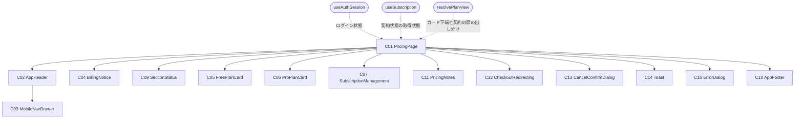
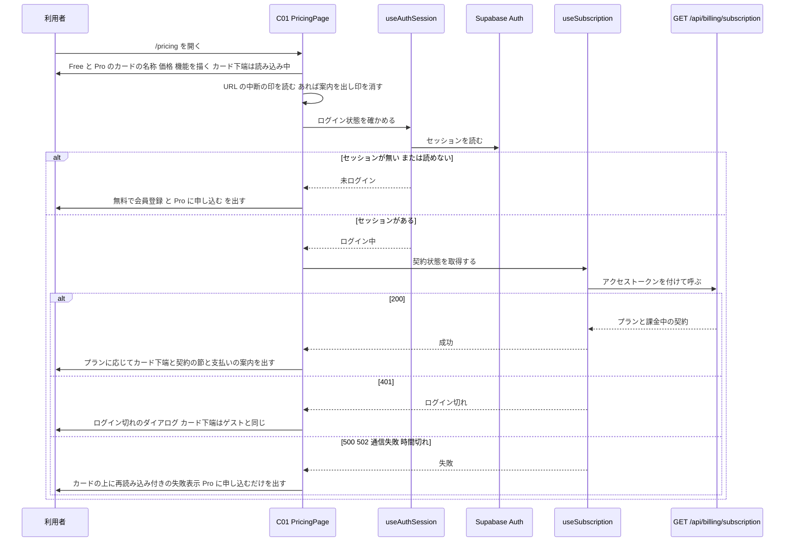
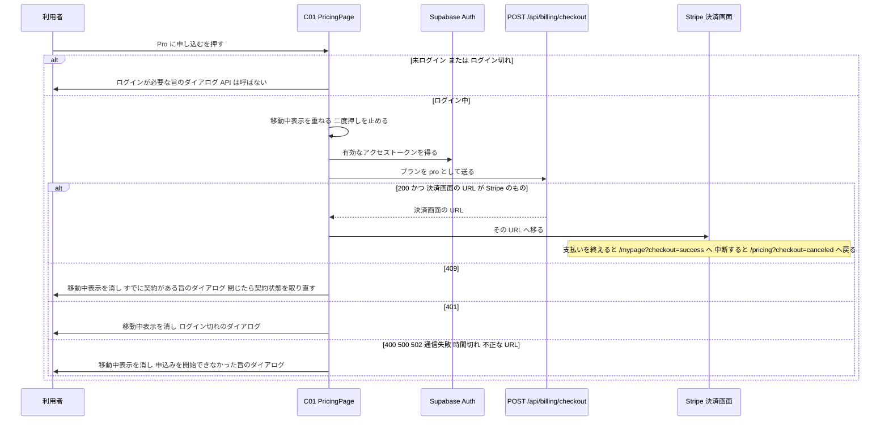
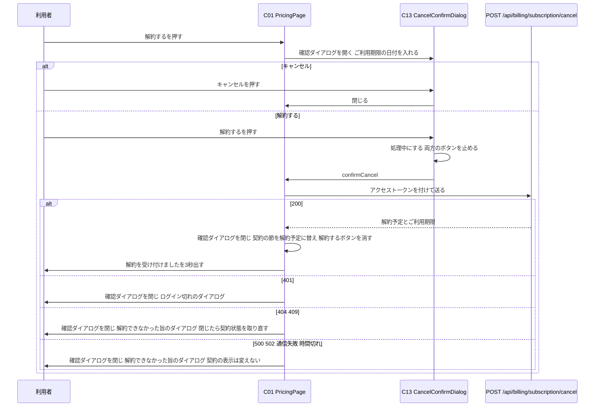

# FE詳細設計書 — P107 料金

## 0. 文書情報

| 項目 | 値 |
| :--- | :--- |
| 設計書ID | P107-FE |
| 親ID | P107 |
| 親設計書 | `screens/画面.P107.画面基本設計.md` |
| 版 | 1.0（新規作成） |
| 作成日 | 2026-10-27 |
| 更新日 | 2026-10-27 |
| 作成方法 | 上流の画面基本設計書（P107）、確定済みの `docs/基本設計書_概要.md`、`source/` 配下の企画資料をもとに設計した（creating-frontend-detailed-design v1.5.0 準拠）。API の応答の形は作成済みの BE詳細設計書 `detail/be/BE.F12.BE詳細設計.md`（申込み・契約状態の取得・解約）と `detail/be/BE.F06.BE詳細設計.md`（ヘッダーのプラン）に合わせた。P101〜P106 と共用する部品・関数（共通ヘッダー・フッター・状態表示・ダイアログ、ログイン状態の取得、有効なアクセストークンの取得、API呼び出しの共通処理、失敗の振り分け、日付の整形、ログイン画面の URL の組み立て）は `detail/fe/FE.P101.FE詳細設計.md`・`detail/fe/FE.P102.FE詳細設計.md`・`detail/fe/FE.P106.FE詳細設計.md` の定義を使う。本書には、P107 でどう使うかと P107 固有の部分、共用部品に足す拡張点を書く |
| インプットの性質 | `source/` にあるのは企画・初期設計案の Markdown 6ファイルだけで、本画面のソースコード（ページ・コンポーネント・フック・ルーティング定義）は1行も無い（`source/README.md:5-10`、上流 概要書 §前提）。このため本書は**新規設計**であり、ファイルパス・関数名・State名・型はすべて実装時の命名案（※推測）である。技術スタックは Next.js / TypeScript / Tailwind CSS / shadcn/ui（`source/03_システム構成.md:6`）、認証は Supabase Auth（`source/03_システム構成.md:10`）、決済は Stripe（`source/03_システム構成.md:15`）。プランの中身と価格案の出典は `source/04_収益化とロードマップ.md:4-8`、利用量上限は同 `:28` |
| 既存資料の突合 | `legacy/` は空のディレクトリ（ファイル0件）で、突合する既存の設計・業務資料は無い。本書の既存版（`docs/detail/fe/FE.P107.FE詳細設計.md`）も無かったため、消さずに残すべき既存の記述は無い。引き継いだIDは上流設計書で採番済みのものだけである（画面 P101〜P107、コンポーネント C01〜C07・C09〜C14・C16、項目 H01〜H43、イベント E01〜E18、様式①〜④、API08、IF05〜IF07、機能 F02〜F04・F06〜F12・F18、業務フロー BF06・BF12・BF13・EX04〜EX07、テーブル T005・T010、方式 ARC008・ARC009、顧客確認事項 Q03・Q04・Q06・Q08・Q09・Q14・Q24・Q27・Q28・Q33） |

## 1. フロントエンド構成・ルーティング設計

* **対象ドメイン**: 料金系（pricing） — Free と Pro の違いを並べて比べ、Pro への申込み（Stripe の決済画面への移動）と、Pro 契約中の利用者の契約状態の確認・解約を行う画面（上流 P107 §1、`source/01_企画概要.md:30`）。本書が扱うのは次の範囲である。プランの比較の表示（ゲストにも見せる）、ログイン状態の確認と契約状態の取得、利用者の状態に応じたカード下端の出し分け、申込みと決済画面への移動、申込みを中断して戻ったときの案内、支払い遅延の案内、解約の確認と依頼。決済画面での支払い・契約の成立の反映・プランの書き換えは Stripe と BE.F12 の責務とする（上流 BF12・IF06・IF07）。遷移先の画面（P101 ホーム・P102 新着論文・P103 論文検索・P106 マイページ、Stripe の決済画面、および※上流未定義のログイン・会員登録画面と利用規約ページ）の中身は、各画面・外部の責務とする。
* **対象画面ID**: P107
* **ディレクトリ/ファイル構造**（※推測: 実装は未着手。P101〜P106 と同じく `web/` 配下の Next.js App Router 構成とする。本画面で使うファイルは全25件で、内訳は次の2つ。(1) 本画面で新設する13件: `app/pricing/page.tsx`、`components/pricing/` の8件、`hooks/useSubscription.ts`、`lib/api/billingClient.ts`、`lib/pricing/` の2件。(2) 他の設計書で定義済みのファイルのうち本画面でも使う共用12件: C02・C03・C10・C09・C16 の部品5件、`hooks/useAuthSession.ts`、`lib/supabase/browserClient.ts`、`lib/api/requestJson.ts`、`lib/api/meClient.ts`（useAuthSession が使う）、`lib/mypage/apiError.ts`、`lib/format/display.ts`、`lib/papers/filterCondition.ts`。論文カード C08 は本画面では使わず、C15 は上流で欠番。下の木では各ファイルに「新設」「共用」を付ける）:

```
web/
├── app/
│   └── pricing/
│       └── page.tsx                     … 新設: C01 PricingPage（パス `/pricing` のページ）
├── components/
│   ├── layout/
│   │   ├── AppHeader.tsx                … 共用: C02 共通ヘッダー（P101 で定義、P102 で Props を追加）
│   │   ├── MobileNavDrawer.tsx          … 共用: C03 モバイル幅のナビゲーションドロワー
│   │   └── AppFooter.tsx                … 共用: C10 共通フッター
│   ├── common/
│   │   ├── SectionStatus.tsx            … 共用: C09 取得中・失敗の表示（P106 で拡張。本書で枠の形を1つ追加）
│   │   └── ErrorDialog.tsx              … 共用: C16 ダイアログ（P106 で汎用化。本書で「ログインが必要」の文言を渡せるようにする）
│   └── pricing/
│       ├── BillingNotice.tsx            … 新設: C04 申込み中断・支払い遅延の案内
│       ├── FreePlanCard.tsx             … 新設: C05 Free のカード
│       ├── ProPlanCard.tsx              … 新設: C06 Pro のカード
│       ├── SubscriptionManagement.tsx   … 新設: C07 ご契約中のプラン
│       ├── PricingNotes.tsx             … 新設: C11 支払い・決済手段の注記
│       ├── CheckoutRedirecting.tsx      … 新設: C12 決済画面への移動中表示
│       ├── CancelConfirmDialog.tsx      … 新設: C13 解約の確認ダイアログ
│       └── Toast.tsx                    … 新設: C14 解約受付完了メッセージ
├── hooks/
│   ├── useAuthSession.ts                … 共用: ログイン状態と利用者表示の取得（P101 で定義）
│   └── useSubscription.ts               … 新設: 契約状態の取得の状態管理
└── lib/
    ├── supabase/browserClient.ts        … 共用: ブラウザ用 Supabase クライアントと有効なアクセストークンの取得（P101 で定義、P106 で getFreshAccessToken を追加）
    ├── api/
    │   ├── requestJson.ts               … 共用: API呼び出しの共通処理（P104・P106 で拡張済み）
    │   ├── meClient.ts                  … 共用: GET /api/me の呼び出し（useAuthSession がヘッダーのプランに使う）
    │   └── billingClient.ts             … 新設: GET /api/billing/subscription・POST /api/billing/checkout・POST /api/billing/subscription/cancel の呼び出しと、決済画面の URL の確認
    ├── pricing/
    │   ├── planCatalog.ts               … 新設: Free・Pro の機能一覧・提供状況・価格（定数と設定値）
    │   └── viewState.ts                 … 新設: カード下端・契約の節・案内の出し分けの判定、契約状態のラベル、失敗時のダイアログの組み立て、URL の中断の印の読み取り
    ├── mypage/apiError.ts               … 共用: API の失敗をログイン切れ／操作の失敗へ振り分ける（P106 で定義）
    ├── papers/filterCondition.ts        … 共用: ログイン画面の URL の組み立て（P102 で定義）
    └── format/display.ts                … 共用: 日付の整形（P101 で定義）
```

* **ルーティング定義**（総件数: 1件。全数である根拠: 本書の対象は P107 の1画面だけで、上流 概要書 §3.1 の P107 行のパスは `/pricing` の1件である。申込み中断の印〈クエリ `checkout=canceled`〉は同じページへの付加情報であり、別のルートにはしない）:

| パス | コンポーネント | 認証要否 | ルートファイル |
| :--- | :--- | :--- | :--- |
| `/pricing`（※推測。上流 概要書 §3.1・付録 Q03 の仮置き）。Stripe の決済画面で申込みを中断して戻ったときは `/pricing?checkout=canceled`（BE.F12 §0 確認事項 No.11 の中断時の戻り先）で開かれる | PricingPage（C01） | 不要（プランの比較は誰でも見られる。申込みと解約だけログインが要り、その判定はボタンを押したときとサーバ側で行う — 上流 P107 §1） | `web/app/pricing/page.tsx` |

## 2. コンポーネント設計

* **コンポーネントツリー図**（上流 P107 §3.1 の木をそのまま引き継ぐ。点線は本書で決めた状態の受け渡し）:



* **コンポーネントロースター**（総件数: 14件。全数である根拠: 上流 P107 §3.2 コンポーネント一覧の C01〜C07・C09〜C14・C16 の全14件と1対1で対応させた。本書で追加・統合した部品は無い。C08（論文カード）と C15 は上流で本画面の欠番。C02・C03・C09・C10・C16 は P101〜P106 と同じ部品を共用し、C04〜C07・C11〜C14 は他画面の同じ番号の部品とは別物である — 上流 P107 §3.2。shadcn/ui の汎用部品（Card・Button・Badge・AlertDialog・Sheet・Skeleton・Toast）は画面固有のコンポーネントではないため数えず、使う箇所を各コンポーネントの役割に記す）:

| コンポーネントID | コンポーネント名 | 種類 | ファイルパス | 概要 | 定義状況 | 詳細の所在 |
| :--- | :--- | :--- | :--- | :--- | :--- | :--- |
| C01 | PricingPage | Page | `web/app/pricing/page.tsx` | 料金画面全体。比較はすぐに描き、ログイン中なら契約状態を取得してカード下端・契約の節・案内を出し分ける。申込み・解約・ダイアログ・移動中表示を束ねる | 詳細 | §2 コンポーネント詳細定義、§4 |
| C02 | AppHeader | Layout | `web/components/layout/AppHeader.tsx` | 全画面共通のヘッダー。本画面では「料金」を選択中の見た目にする | 詳細 | §2 コンポーネント詳細定義（P107 での使い方）、`detail/fe/FE.P101.FE詳細設計.md` §2 C02、`detail/fe/FE.P102.FE詳細設計.md` §2 C02 |
| C03 | MobileNavDrawer | UI | `web/components/layout/MobileNavDrawer.tsx` | モバイル幅でメニューボタンを押したときに開く導線の収納先 | 詳細 | §2 コンポーネント詳細定義（P107 での使い方）、`detail/fe/FE.P101.FE詳細設計.md` §2 C03 |
| C04 | BillingNotice | UI | `web/components/pricing/BillingNotice.tsx` | 申込みを中断して戻ったとき、または支払いが確認できていない契約があるときに、リード文の下へ案内の帯を出す | 詳細 | §2 コンポーネント詳細定義、§4 applyCanceledMarker・resolvePlanView |
| C05 | FreePlanCard | UI | `web/components/pricing/FreePlanCard.tsx` | Free の名称・価格・機能を示し、カード下端に「現在のプラン」か「無料で会員登録」か読み込み中表示を出す | 詳細 | §2 コンポーネント詳細定義、§4 resolvePlanView |
| C06 | ProPlanCard | UI | `web/components/pricing/ProPlanCard.tsx` | Pro の名称・価格・機能・準備中の印・利用量上限の注記を示し、カード下端に申込みボタンか「現在のプラン」か読み込み中表示を出す | 詳細 | §2 コンポーネント詳細定義、§4 resolvePlanView・startCheckout |
| C07 | SubscriptionManagement | UI | `web/components/pricing/SubscriptionManagement.tsx` | Pro 契約中の利用者に契約状態と次回更新日（解約予定ならご利用期限）を示し、解約ボタンを置く | 詳細 | §2 コンポーネント詳細定義、§4 resolvePlanView |
| C09 | SectionStatus | UI | `web/components/common/SectionStatus.tsx` | 契約状態の取得中（カード下端の位置）と失敗（カードの上）の表示 | 詳細 | §2 コンポーネント詳細定義（P107 での使い方）、`detail/fe/FE.P101.FE詳細設計.md` §2 C09、`detail/fe/FE.P106.FE詳細設計.md` §2 C09 |
| C10 | AppFooter | Layout | `web/components/layout/AppFooter.tsx` | 全画面共通のフッター。arXiv との関係の注記（H42）と利用規約へのリンク（H43）を常に同じ形で出す。Props・内部State を持たず分岐が無い（P101 と同じ部品をそのまま使う） | 簡易 | 本表、`detail/fe/FE.P101.FE詳細設計.md` §2 ロースター C10 |
| C11 | PricingNotes | UI | `web/components/pricing/PricingNotes.tsx` | カードの下に、支払いと解約の扱い（H29）と決済を Stripe で行う旨（H30）を小さな文字で常に出す。固定文言2つだけで Props・内部State・分岐を持たない（上流 P107 C11 簡易） | 簡易 | 本表 |
| C12 | CheckoutRedirecting | UI | `web/components/pricing/CheckoutRedirecting.tsx` | 申込みを始めてから決済画面へ移るまで、画面全体を覆って移動中であることを示し、他の操作を止める | 詳細 | §2 コンポーネント詳細定義、§4 startCheckout・resetRedirectOnPageShow |
| C13 | CancelConfirmDialog | UI | `web/components/pricing/CancelConfirmDialog.tsx` | 解約すると期限まで Pro を使えてその後 Free になることを示し、確定かキャンセルを選ばせるダイアログ。処理中は両方のボタンを押せなくする | 詳細 | §2 コンポーネント詳細定義、§4 confirmCancel |
| C14 | Toast | UI | `web/components/pricing/Toast.tsx` | 解約の受付に成功したことを画面下部に3秒間（※推測）出して自動で消す。受け取った文言を出して時間で消すだけで、出し分けの分岐を持たない（上流 P107 C14 簡易。中身は P106 C14 SaveToast と同じ作り） | 簡易 | 本表、§4 関数ロースター scheduleToastHide |
| C16 | ErrorDialog | UI | `web/components/common/ErrorDialog.tsx` | ログインが必要なとき・ログインが切れていたとき・申込みや解約が失敗したときに画面中央に重ねるダイアログ | 詳細 | §2 コンポーネント詳細定義、`detail/fe/FE.P106.FE詳細設計.md` §2 C16、§4 openDialog・closeDialog |

* **コンポーネント詳細定義**（ロースターのうち定義状況＝詳細の11件。共用部品は「P107 での使い方」と、他画面の定義から変わる点だけを書く。Props の型は §3 型定義を参照）:

| コンポーネントID | コンポーネント名 | 種類(Page/UI/HOC等) | ファイルパス | 担当項目ID | Props (型) | 内部State (型) | 役割・概要 |
| :--- | :--- | :--- | :--- | :--- | :--- | :--- | :--- |
| C01 | PricingPage | Page | `web/app/pricing/page.tsx` | H09, H10 | なし（URL のクエリは `useSearchParams` から読む） | dialog: DialogState（初期値 null）、isCancelDialogOpen: boolean（初期値 false）、isRedirecting: boolean（初期値 false）、toast: ToastState（初期値 null）、showCanceledNotice: boolean（初期値 false）、reloadOnDialogCloseRef: boolean（useRef、初期値 false）。ほかの状態は2つのフックが持つ（§3 ローカルステート定義） | ページ見出し「料金プラン」（H09。見出し要素 h1。中央寄せ）とリード文（H10。モバイル幅では短い文言に替える）を出し、ブラウザのタブのページタイトルを「料金プラン｜サービス名」にする（上流 P107 H09 ※推測）。Free・Pro のカードの名称・価格・機能は、ログイン状態にも契約状態にも関係なく最初から描く（上流 P107 E01）。ログイン状態（useAuthSession）がログイン中に決まると useSubscription が契約状態を取得し、resolvePlanView でカード下端（C05・C06）、契約の節（C07）、支払い遅延の案内（C04）を出し分ける。開いたときに URL の中断の印を読み、あれば案内を出して印を消す（applyCanceledMarker）。レイアウトは、デスクトップ（lg 1024px 以上 ※推測）で幅420pxのカード2枚を横に並べて中央に寄せ、モバイルで Free・Pro の順に縦に積む（上流 P107 §2.3 ※推測）。カードの下に C07（出すときだけ）、その下に C11 を置く。契約状態の取得に失敗したときは C09 をリード文の下・カードの上に出す。申込みの処理中（isRedirecting）は C12 を重ねる。クライアントコンポーネントとする（ブラウザに残る Supabase のセッションを読むため。`'use client'` ※推測） |
| C02 | AppHeader | Layout | `web/components/layout/AppHeader.tsx` | H01, H02, H03, H04, H05, H06, H07, H08 | auth: AuthState、activeNav: 'pricing'、loginReturnTo: string（`/pricing`）、onActiveNavClick: (event: React.MouseEvent) => void（handlePricingNavClick）。いずれも P102 で追加した任意の Props | isDrawerOpen: boolean（初期値 false） | P101・P102 の定義どおり、サービス名・導線・ログイン状態を出す。本画面では「料金」（H04）を選択中の見た目（太字・下線、`aria-current="page"`）にし、押したときは onActiveNavClick で本画面を開き直す（E13）。「マイページ」（H05）はログイン中だけ出す（上流 P107 H05。P101 の定義どおり）。ログインボタン（H06）は本画面のパスを戻り先にしたログイン画面へ移る（E15）。利用者表示（H07）のプランは useAuthSession の値を使う。解約を受け付けても期間の終わりまでは Pro のまま（上流 P107 E05）のため、解約の後にヘッダーを取り直す処理は置かない |
| C03 | MobileNavDrawer | UI | `web/components/layout/MobileNavDrawer.tsx` | H02, H03, H04, H05, H06, H07 | open: boolean、onOpenChange: (open: boolean) => void、auth: AuthState、activeNav: 'pricing'、loginReturnTo: string、onActiveNavClick: (event: React.MouseEvent) => void | なし | P101・P102 の定義どおり。本画面では「料金」を選択中の見た目にし、押すとドロワーを閉じてから onActiveNavClick を呼ぶ（E13）。他のリンクはドロワーを閉じてから移る（E11・E12・E14・E15） |
| C04 | BillingNotice | UI | `web/components/pricing/BillingNotice.tsx` | H11, H12 | showCanceled: boolean、showPaymentIssue: boolean | なし | リード文の下に案内の帯（`role="status"`）を出す。showCanceled が真なら「Pro のお申し込みは完了していません。もう一度お申し込みいただけます。」（H11）。showPaymentIssue が真なら「お支払いが確認できていません。Stripe から届くメールの案内に沿ってお支払い方法をご確認ください。」（H12）。両方が真のときは H12 を上、H11 を下に並べる（支払いの問題のほうが利用者の対処を要するため ※推測）。どちらも偽なら何も描かない。文言は上流 P107 H11・H12 の※推測のとおり。帯には閉じるボタンを置かない（上流 P107 §4 に閉じる項目が無いため） |
| C05 | FreePlanCard | UI | `web/components/pricing/FreePlanCard.tsx` | H13, H14, H15, H16, H17 | footer: 'currentPlan' \| 'signup' \| 'loading' \| 'none'、signupHref: string | なし | shadcn/ui の Card で、プラン名「Free」（H13）、価格「0円 / 月」（H14）、機能一覧（H15。PLAN_CATALOG の Free の5行を「✓」付きで縦に並べる）を出す。カード下端は footer で1つだけ出す。'currentPlan' なら灰色の押せない枠の「現在のプラン」（H16）、'signup' なら「無料で会員登録」（H17。signupHref への Link — E02）、'loading' なら C09 の読み込み中表示（H31。ボタン形の枠）、'none' なら何も出さない（Pro 会員のとき・契約状態の取得に失敗したとき — 上流 P107 H16） |
| C06 | ProPlanCard | UI | `web/components/pricing/ProPlanCard.tsx` | H18, H19, H20, H21, H22, H23, H24 | footer: 'checkout' \| 'currentPlan' \| 'loading'、isRedirecting: boolean、onCheckout: () => void | なし | shadcn/ui の Card で、プラン名「Pro」（H18）、価格（H19。formatPrice の結果「980円 / 月」）、機能一覧（H20。PLAN_CATALOG の Pro の5行を「✓」付きで並べる）を出す。機能一覧の各行のうち、提供前（`released` が偽）の行の末尾にだけ黄色の Badge「準備中」（H21）を付ける。一覧の下に利用量上限の注記（H22）を出す。カード下端は footer で1つだけ出す。'checkout' なら「Pro に申し込む」（H23。押すと onCheckout — E03。isRedirecting が真の間は押せない）、'currentPlan' なら灰色の押せない枠の「現在のプラン」（H24）、'loading' なら C09 の読み込み中表示（H31） |
| C07 | SubscriptionManagement | UI | `web/components/pricing/SubscriptionManagement.tsx` | H25, H26, H27, H28 | subscription: SubscriptionModel、onRequestCancel: () => void | なし | 節見出し「ご契約中のプラン」（H25）、契約状態のラベル（H26。toStatusLabel の結果を Badge で出す）、日付（H27。getPeriodLabel の語〈「次回更新日」または「ご利用期限」〉に続けて formatJstDate の結果）を出す。契約状態が「有効」または「支払い遅延」のときだけ「解約する」（H28。押すと onRequestCancel — E04）を出し、「解約予定」のときは出さない（上流 P107 H28）。C01 は resolvePlanView が契約の節を出すと決めたときだけ本部品を描く |
| C09 | SectionStatus | UI | `web/components/common/SectionStatus.tsx` | H31, H32, H33 | status: 'loading' \| 'error'、errorMessage?: string、onReload?: () => void、skeletonVariant?: 'cards' \| 'rows' \| 'fields' \| 'button'（'button' は本書で追加） | なし | P101・P106 の定義どおり。本画面では2か所で使う。(1) 取得中: C05・C06 のカード下端の位置に、ボタン形の灰色の枠1本（skeletonVariant 'button'。上流 P107 H31「ボタンの形をした灰色の枠」）を出す。(2) 失敗: リード文の下・カードの上に、赤色の帯で「契約状態を読み込めませんでした。時間をおいて再読み込みしてください。」（H32）と、その横に「再読み込み」（H33 — E07）を出す（様式②の本画面での読み替え — 上流 P107 §5.1）。0件の表示は使わない（上流 P107 C09） |
| C12 | CheckoutRedirecting | UI | `web/components/pricing/CheckoutRedirecting.tsx` | H40 | open: boolean | なし | open が真の間、画面全体を半透明の層で覆い（`fixed inset-0`）、中央に回転する印と「決済画面へ移動しています…」（H40）を出す。層は下の画面の押下を受け止め、申込みボタンの二度押しを防ぐ（上流 P107 H40）。読み上げソフトに伝わるよう `role="status"`・`aria-live="polite"` を付ける。open が偽なら何も描かない |
| C13 | CancelConfirmDialog | UI | `web/components/pricing/CancelConfirmDialog.tsx` | H37, H38, H39 | open: boolean、periodEnd: string \| null、onConfirm: () => Promise<void>、onCancel: () => void | isProcessing: boolean（初期値 false） | shadcn/ui の AlertDialog で画面中央に重ねる。メッセージ（H37）は「Pro プランを解約しますか？ YYYY-MM-DD まで Pro の機能を使えます。その後は Free プランになります。」とし、日付には periodEnd を formatJstDate で直した値（日付部分だけ）を入れる。periodEnd が無いときは「現在のお支払い期間の終わりまで Pro の機能を使えます。」に替える（※推測）。「解約する」（H38。赤系）を押すと handleCancelConfirm で処理中にしてから onConfirm を待ち、終わるまで「処理中…」にして H38・H39 を押せなくする（二重送信の防止 — 上流 P107 H38）。「キャンセル」（H39）は onCancel を呼ぶ（E06）。処理中は Esc キーと背景の押下でも閉じない |
| C16 | ErrorDialog | UI | `web/components/common/ErrorDialog.tsx` | H34, H35, H36 | dialog: DialogState（null のとき閉じる）、onLogin: () => void、onClose: () => void、onLeave: () => void（本画面では離脱確認を使わないため何もしない関数を渡す） | なし | P106 の定義どおり、種類で中身を変える。本画面で使うのは3種類。(1) ログインが必要: メッセージ（H34）は渡された文言「Pro プランへのお申し込みにはログインが必要です。」（本書で、この種類に文言を渡せるようにする。渡さないときは P104 の文言のまま）、「ログイン」（H35 — E08）、「閉じる」（H36 — E09）。(2) ログイン切れ: H34「ログインの有効期限が切れました。もう一度ログインしてください。」、「ログイン」（H35）、「閉じる」（H36）。(3) 操作の失敗: H34 に渡された文言（§6 UIエラーフィードバック）、「OK」（H36）だけ。上流 P107 §5.1 の「ログインが必要」と「ログイン切れ」は、どちらも「ログイン」と「閉じる」を出す点で同じ形になる |

## 3. 状態管理（State）設計

* **型定義**（※推測: §3・§4 の表で使う型。AuthState・ApiRequestError は `detail/fe/FE.P101.FE詳細設計.md` §3、DialogState・ToastState・UserFacingError は `detail/fe/FE.P106.FE詳細設計.md` §3 の定義を使う。API の応答のキー名は BE.F12 §2 に合わせた）:

```ts
type Plan = 'free' | 'pro';                                  // P106 と同じ

// 課金中の契約（fetchSubscription が返す。BE.F12 GET /api/billing/subscription の subscription）
type SubscriptionModel = {
  status: string;                                            // Stripe の定期課金の状態（画面では表示に使わない）
  displayStatus: 'active' | 'past_due' | 'canceling' | 'unpaid' | 'paused';
  currentPeriodEnd: string | null;                           // ISO 8601（UTC）。読めないときは null
  cancelAtPeriodEnd: boolean;
};

type SubscriptionInfo = { plan: Plan | null; subscription: SubscriptionModel | null };

// 契約状態の取得の状態（useSubscription が持つ）
type SubscriptionState =
  | { status: 'idle' }                                       // ログイン状態の確認中・未ログイン（取得しない）
  | { status: 'loading' } | { status: 'error' }
  | { status: 'unauthorized' }                               // 401。ゲストと同じ出し分けにする
  | { status: 'success'; info: SubscriptionInfo };

// 画面の出し分け（resolvePlanView が返す）
type PlanView = {
  freeFooter: 'currentPlan' | 'signup' | 'loading' | 'none';
  proFooter: 'checkout' | 'currentPlan' | 'loading';
  management: SubscriptionModel | null;                      // null のとき C07 を出さない
  showPaymentIssue: boolean;                                 // H12 を出すか
  showStatusError: boolean;                                  // H32・H33 を出すか
};

// ErrorDialog の DialogState（P106 の定義に、本書で「ログインが必要」の文言を足す）
//   | { kind: 'loginRequired'; message?: string }
```

* **グローバルステート / Context定義**（総件数: 1件。全数である根拠: 本画面で画面の外と共有される状態は、Supabase Auth のクライアントが持つログインのセッション〈P101 と同じ〉だけである。本画面はセッションを読むだけで、ログアウトの導線を持たない。URL の中断の印は読んだ後に URL から消す〈§4 applyCanceledMarker〉。React の Context・状態管理ライブラリは使わない）:

| State名 | 型 | スコープ | 初期値 | 更新タイミング | 管理方法 |
| :--- | :--- | :--- | :--- | :--- | :--- |
| Supabase のログインセッション | Session \| null（Supabase の型） | アプリ全体（全画面。ブラウザのタブをまたいで共有） | セッションの Cookie があればその内容、無ければ null | ログイン・ログアウト・トークンの自動更新のとき（Supabase のクライアントが更新する。本画面は読むだけで書き換えない） | `@supabase/ssr` のブラウザ用クライアントを1つだけ作って使い回す（getBrowserSupabaseClient）。読み出しは `auth.getSession()`（※推測） |

* **ローカルステート定義**（総件数: 14件。全数である根拠: コンポーネントロースターの全14件を対象に、状態を持つものを数えた。C01 は10件。内訳は、ページ自身の6件〈ダイアログ・解約確認の開閉・申込みの処理中・解約受付完了メッセージ・中断の案内・ダイアログを閉じたときの取り直しの印〉と、2つのフックの4件〈useAuthSession 2件、useSubscription 2件〉。C02 は1件〈ドロワーの開閉〉、C13 は1件〈解約の処理中〉、C14 は2件〈表示中かどうか・消すタイマー〉。再描画を伴わない値〈useRef〉も、古い応答による上書きや取り直しの判断に効くものは数える〈P101〜P106 と同じ基準〉。C03・C04・C05・C06・C07・C09・C10・C11・C12・C16 の10件は状態を持たない）:

| コンポーネント | State名 | 型 | 初期値 | 用途 |
| :--- | :--- | :--- | :--- | :--- |
| C01 PricingPage | dialog | DialogState | null | 画面中央に出すダイアログ（C16）の種類と文言。ログイン切れを他の種類より優先して残す（openDialog） |
| C01 PricingPage | isCancelDialogOpen | boolean | false | 解約の確認ダイアログ（C13）が開いているか。解約するボタン（E04）で開き、キャンセル（E06）・解約の成否（E05）で閉じる |
| C01 PricingPage | isRedirecting | boolean | false | 申込みの処理中（決済セッションを作ってから決済画面へ移るまで）か。真の間は C12 を重ね、申込みボタンを押せなくする（上流 P107 E03「申込みの処理中は受け付けない」）。失敗したとき、決済画面からブラウザの戻る操作で本画面がそのまま復元されたときに偽へ戻す |
| C01 PricingPage | toast | ToastState | null | 解約受付完了メッセージ（C14）に出す文言と通し番号（P106 と同じ型） |
| C01 PricingPage | showCanceledNotice | boolean | false | 申込み中断の案内（H11）を出すか。中断の印を読んだときだけ真にし、URL から印を消した後も、本画面を開いている間は出し続ける。開き直し（E13）で偽に戻す |
| C01 PricingPage | reloadOnDialogCloseRef | boolean（useRef） | false | 次にダイアログを閉じたとき（E09）に契約状態を取り直すか。申込みが 409 を返したとき・解約で契約が見つからなかったときに立て、閉じたときに下ろす（上流 P107 E09） |
| C01 PricingPage（useAuthSession 内） | auth | AuthState | `{ status: 'loading' }` | ログイン中かどうかと、ヘッダーに出す利用者の表示。確認中・未ログイン・ログイン中で、カード下端の出し分けと契約状態の取得の開始が決まる（P101 の定義のまま） |
| C01 PricingPage（useAuthSession 内） | requestSeqRef | number（useRef） | 0 | ログイン状態の確認ごとに増やす通し番号。古い確認の結果で状態を上書きしないために使う（P101 の定義のまま） |
| C01 PricingPage（useSubscription 内） | state | SubscriptionState | `{ status: 'idle' }` | 契約状態の取得状態と結果。ログイン状態の確認中と未ログインでは取得しないため idle のままにする |
| C01 PricingPage（useSubscription 内） | abortRef | AbortController \| null（useRef） | null | 進行中の契約状態の取得を取り消すための制御。再読み込み・開き直し・画面離脱のときに前の要求を取り消し、古い応答が後から届いて表示を上書きするのを防ぐ |
| C02 AppHeader | isDrawerOpen | boolean | false | モバイル幅のドロワー（C03）が開いているか（P101 の定義のまま） |
| C03 MobileNavDrawer | なし | — | — | 開閉状態は C02 から Props で受け取る |
| C04 BillingNotice | なし | — | — | どの案内を出すかは Props で受け取る |
| C05 FreePlanCard | なし | — | — | カード下端に何を出すかは Props で受け取る。機能一覧は定数 |
| C06 ProPlanCard | なし | — | — | カード下端に何を出すかと申込みの処理中かどうかは Props で受け取る |
| C07 SubscriptionManagement | なし | — | — | 契約は Props で受け取る |
| C09 SectionStatus | なし | — | — | どの状態を出すかは Props で受け取る |
| C10 AppFooter | なし | — | — | 固定文言とリンクだけを出す |
| C11 PricingNotes | なし | — | — | 固定文言だけを出す |
| C12 CheckoutRedirecting | なし | — | — | 出すかどうかは Props で受け取る |
| C13 CancelConfirmDialog | isProcessing | boolean | false | 解約の処理中か。処理中は確定・キャンセルの両方を押せなくし、ダイアログも閉じさせない |
| C14 Toast | isVisible | boolean | false | 解約受付完了メッセージを出しているか。受け取った文言の通し番号が変わったら真にし、3秒後（※推測）に偽にする |
| C14 Toast | hideTimerRef | number \| null（useRef） | null | メッセージを消すタイマー。画面を離れるときに止める |
| C16 ErrorDialog | なし | — | — | ダイアログの種類と文言は C01 から Props で受け取る |

* **永続化ステート**（総件数: 1件。全数である根拠: 本画面が自分で localStorage・sessionStorage・Cookie に書き込む値は無い。決済画面の URL や申込みの処理中の状態も保存しない。本画面が読むのは Supabase Auth がログイン時に保存したセッションの Cookie だけである〈P101 と同じ〉。カード情報は本画面にも本サービスにも渡らない — 上流 IF06）:

| キー | 保存先 | 型 | 用途 | 有効期限 |
| :--- | :--- | :--- | :--- | :--- |
| `sb-<SupabaseプロジェクトID>-auth-token`（※推測: `@supabase/ssr` の既定の Cookie 名） | Cookie（Supabase のライブラリが書き込む。本画面は読むだけ） | string（アクセストークンと更新用トークンを含む JSON を符号化した値） | 本画面を開いたときにログイン中かどうかを判定し、契約状態の取得・申込み・解約の API へ付けるアクセストークンを取り出す | Supabase Auth の設定に従う（既定ではアクセストークン1時間・更新用トークンで延長 ※推測。上流 概要書 §8「セッションの有効期限は未定義」） |

## 4. クライアント側機能・処理ロジック設計（IPO設計）

* **処理フロー図**（画面を開いたとき — E01。比較はすぐに描き、ログイン中なら契約状態を取ってカード下端を決める）:



* **処理フロー図**（申込み — E03。決済セッションを作り、Stripe の決済画面へ移る）:



* **処理フロー図**（解約 — E04〜E06。確認ダイアログを挟み、期間の終わりで止める設定を依頼する）:



* **関数・フックロースター**（総件数: 40件。内訳は本書で新設する28件と、他の設計書で定義済みのものを本画面でも使う12件〈P101 定義9件・P102 定義1件・P106 定義2件〉。定義状況は詳細20件・簡易20件。全数である根拠: ソースコードが無いため、上流 P107 §5 のイベント E01〜E18 の処理と、§4 の表示項目の出し分け・整形規則〈H11・H12・H15〜H17・H19〜H21・H23〜H28・H37〉を、1つの責務を1関数として分けた設計上の全数である。イベントとの対応は次のとおり。E01→readCheckoutCanceled・applyCanceledMarker・useAuthSession・fetchMe・getBrowserSupabaseClient・getFreshAccessToken・requestJson・useSubscription・fetchSubscription・resolvePlanView・toUserFacingError・openDialog、E03→startCheckout・createCheckout・isTrustedCheckoutUrl・toCheckoutFailureDialog・resetRedirectOnPageShow、E04→openCancelDialog、E05→handleCancelConfirm・confirmCancel・cancelSubscription・applyCancellation・toCancelFailureDialog・showToast、E06→closeCancelDialog、E07→reloadSubscription、E08→handleDialogLogin・buildLoginHref、E09→closeDialog、E13→handlePricingNavClick・refreshSession、E16→toggleDrawer、E17→closeDrawer、ドロワー内の E11・E12・E14・E15→handleDrawerLinkClick。表示の整形→PLAN_CATALOG・formatPrice・toStatusLabel・getPeriodLabel・formatJstDate・scheduleToastHide。E02・E10〜E12・E14・E15・E18 は Next.js の Link が遷移するだけで本書の関数を持たない〈E02・E15 の行き先は buildLoginHref が決める〉。関数には上流で採番されたIDが無いため、本書では番号を振らず、関数名を識別子として扱う）:

| 関数名 | 種類 | 所属 | ファイルパス | 概要 | 定義状況 | 詳細の所在 |
| :--- | :--- | :--- | :--- | :--- | :--- | :--- |
| readCheckoutCanceled | 変換関数 | C01 | `web/lib/pricing/viewState.ts` | URL のクエリに申込み中断の印（`checkout=canceled`。BE.F12 §0 確認事項 No.11）があるかを真偽値で返す。値を比べるだけで分岐を持たない | 簡易 | 本表 |
| applyCanceledMarker | ページ内処理 | C01 | `web/app/pricing/page.tsx` | 開いたときに中断の印を読み、あれば案内（H11）を出して印を URL から消す | 詳細 | 本章 IPO定義 |
| useSubscription | フック | C01 | `web/hooks/useSubscription.ts` | ログイン中に決まったら契約状態を取得し、取得状態にする。再読み込みと、解約の成功を反映する関数を返す | 詳細 | 本章 IPO定義 |
| fetchSubscription | APIクライアント | 共通 | `web/lib/api/billingClient.ts` | GET /api/billing/subscription を呼び、プランと課金中の契約を返す | 詳細 | 本章 IPO定義 |
| reloadSubscription | フック内関数 | C01（C09 から onReload として、closeDialog から呼ばれる） | `web/hooks/useSubscription.ts` | 契約状態だけを取り直す（E07・E09）。ログイン中のときだけ、進行中の取得を取り消して取得中に戻し、useSubscription の取得手順（手順2〜5）を呼び直す。ログイン状態の確認中・未ログインのときは何もしない（ゲストの契約状態は取得しないため。呼び出し元の条件に関わらず、誤ってログイン切れのダイアログを出さないようにする）。この1つの条件のほかに分岐を持たない | 簡易 | 本表（取得手順は useSubscription） |
| applyCancellation | フック内関数 | C01（confirmCancel から呼ばれる） | `web/hooks/useSubscription.ts` | 解約の成功時に、取得済みの契約状態のうち課金中の契約を、応答の表示状態（解約予定）・請求期間の終わり・解約の予約ありで置き換える（E05）。契約状態が成功で課金中の契約があるときだけ置き換え、それ以外は何もしない（この1つの条件のほかに分岐を持たない）。取り直さずに表示を替えるのは、サーバの DB は期間の終わりまで有効のままで、取り直しても同じ表示になるため（BE.F12 §2 手順6） | 簡易 | 本表 |
| resolvePlanView | 判定関数 | C01 | `web/lib/pricing/viewState.ts` | ログイン状態と契約状態から、2枚のカードの下端・契約の節・支払いの案内・失敗表示を決める | 詳細 | 本章 IPO定義 |
| toStatusLabel | 整形関数 | C07 | `web/lib/pricing/viewState.ts` | 契約状態の値を表示ラベルにする。`active` は「有効」、`past_due` は「支払い遅延」、`canceling` は「解約予定」（上流 P107 H26）、`unpaid` は「未払い」、`paused` は「一時停止」（この2つは※上流要確認 — BE.F12 §2 GET /api/billing/subscription）。5つの値の対応表で、それ以外の分岐を持たない | 簡易 | 本表 |
| getPeriodLabel | 整形関数 | C07 | `web/lib/pricing/viewState.ts` | 日付の前に付ける語を返す。解約の予約が入っていれば「ご利用期限」、入っていなければ「次回更新日」（上流 P107 H27）。2つの語の切り替えだけで、ほかの分岐を持たない | 簡易 | 本表 |
| formatPrice | 整形関数 | C06 | `web/lib/pricing/planCatalog.ts` | Pro の月額を「980円 / 月」の形にする（H19。3桁ごとのカンマ区切り）。値は設定値 `NEXT_PUBLIC_PRO_PRICE_JPY` から読み、読めない・正の整数でないときは980円とする（※推測。上流 P107 H19「価格は画面に固定で書かず設定値から表示」。この環境変数は上流 概要書 §9 に無い — ※上流未定義）。変換と既定値の補いだけで、ほかの分岐を持たない | 簡易 | 本表 |
| PLAN_CATALOG | 定数 | C05・C06 | `web/lib/pricing/planCatalog.ts` | Free と Pro の機能一覧（各5行の文言）と、Pro の各行が提供済みかどうか（`released`）を持つ（上流 P107 H15・H20・H21）。提供状況は、機能の提供開始のリリースで書き換える（※推測。提供状況を API から取る手段は上流に無い） | 簡易 | 本表（行の中身は上流 P107 §4 H15・H20 の「制約・初期値」） |
| startCheckout | イベントハンドラ | C01（C06 から onCheckout として呼ばれる） | `web/app/pricing/page.tsx` | 未ログインならログインを促し、ログイン中なら移動中表示を出して決済セッションを作り、Stripe の決済画面へ移る（E03） | 詳細 | 本章 IPO定義 |
| createCheckout | APIクライアント | 共通 | `web/lib/api/billingClient.ts` | POST /api/billing/checkout（API08）を呼び、決済画面の URL を返す | 詳細 | 本章 IPO定義 |
| isTrustedCheckoutUrl | 判定関数 | C01 | `web/lib/api/billingClient.ts` | 決済画面の URL が Stripe の決済画面のものかを確かめる | 詳細 | 本章 IPO定義 |
| resetRedirectOnPageShow | ページ内処理（useEffect） | C01 | `web/app/pricing/page.tsx` | 決済画面からブラウザの戻る操作で本画面がそのまま復元されたとき、移動中表示を消す | 詳細 | 本章 IPO定義 |
| toCheckoutFailureDialog | 変換関数 | C01 | `web/lib/pricing/viewState.ts` | 申込みの失敗を、出すダイアログと、閉じたときに契約状態を取り直すかどうかに変える | 詳細 | 本章 IPO定義 |
| openCancelDialog | イベントハンドラ | C01（C07 から onRequestCancel として呼ばれる） | `web/app/pricing/page.tsx` | 解約の確認ダイアログを開く（E04）。開閉の状態を真にするだけで分岐を持たない。日付は C01 が契約の節に出している契約の請求期間の終わりを C13 へ渡す | 簡易 | 本表 |
| closeCancelDialog | イベントハンドラ | C01（C13 から onCancel として呼ばれる） | `web/app/pricing/page.tsx` | 何もせずに解約の確認ダイアログを閉じる（E06）。処理中は C13 がキャンセルを押せなくしているため、開閉の状態を偽にするだけで分岐を持たない | 簡易 | 本表 |
| handleCancelConfirm | イベントハンドラ | C13 | `web/components/pricing/CancelConfirmDialog.tsx` | 処理中にしてから onConfirm（confirmCancel）を待ち、終わったら処理中を解く（E05）。成否の扱いは confirmCancel が行い、本関数は待つだけで分岐を持たない | 簡易 | 本表 |
| confirmCancel | ページ内処理 | C01（C13 から onConfirm として呼ばれる） | `web/app/pricing/page.tsx` | 解約を依頼し、成功したら契約の節を解約予定に替えて完了メッセージを出す。失敗したら確認ダイアログを閉じて失敗の種類に応じたダイアログを出す（E05） | 詳細 | 本章 IPO定義 |
| cancelSubscription | APIクライアント | 共通 | `web/lib/api/billingClient.ts` | POST /api/billing/subscription/cancel を呼び、解約予定の状態とご利用期限を返す | 詳細 | 本章 IPO定義 |
| toCancelFailureDialog | 変換関数 | C01 | `web/lib/pricing/viewState.ts` | 解約の失敗を、出すダイアログと、閉じたときに契約状態を取り直すかどうかに変える | 詳細 | 本章 IPO定義 |
| openDialog | ページ内処理 | C01 | `web/app/pricing/page.tsx` | ダイアログを出す。ログイン切れのダイアログを他の種類より優先する（P106 openDialog と同じ規則。本画面には離脱確認が無いため、その規則は使わない） | 詳細 | 本章 IPO定義 |
| closeDialog | イベントハンドラ | C01（C16 から onClose として呼ばれる） | `web/app/pricing/page.tsx` | ダイアログを閉じ、取り直しの印が立っていれば契約状態を取り直す（E09） | 詳細 | 本章 IPO定義 |
| handleDialogLogin | イベントハンドラ | C01（C16 から onLogin として呼ばれる） | `web/app/pricing/page.tsx` | ダイアログを閉じ、取り直しの印を下ろしてから、本画面のパス（`/pricing`）を戻り先にしたログイン画面（buildLoginHref）へ `router.push` で移る（E08）。分岐を持たない | 簡易 | 本表 |
| handlePricingNavClick | イベントハンドラ | C01（C02・C03 から onActiveNavClick として呼ばれる） | `web/app/pricing/page.tsx` | ヘッダーの「料金」を押したときに、同じ URL への遷移を止めて本画面を開き直す（E13）。既定の遷移を止め、中断の案内を消し、画面の先頭へ戻してから refreshSession を呼ぶ。ログイン状態が確認中を経て決まり直すと、useSubscription がその変化で契約状態を取り直す（useSubscription 手順1。reloadSubscription は呼ばない）。順に呼ぶだけで分岐を持たない | 簡易 | 本表 |
| showToast | ページ内処理 | C01 | `web/app/pricing/page.tsx` | 解約受付完了メッセージの文言を受け取り、通し番号を1つ増やして toast に入れる（E05）。値を入れるだけで分岐を持たない | 簡易 | 本表 |
| scheduleToastHide | フック内処理（useEffect） | C14 | `web/components/pricing/Toast.tsx` | 文言の通し番号が変わるたびに表示して3秒（※推測）のタイマーを掛け直し、時間が来たら消す。画面を離れるときはタイマーを止める（P106 C14 と同じ手順）。毎回同じ手順で、出し分けの分岐を持たない | 簡易 | 本表 |
| useAuthSession | フック | C01 | `web/hooks/useAuthSession.ts` | ブラウザに残るセッションからログイン状態を確かめ、ログイン中ならプランを取得して表示用の利用者情報を作る | 詳細 | `detail/fe/FE.P101.FE詳細設計.md` §4 IPO定義 |
| refreshSession | フック内関数 | C01 | `web/hooks/useAuthSession.ts` | ログイン状態の確認をやり直す（E13 で handlePricingNavClick から呼ぶ） | 簡易 | `detail/fe/FE.P101.FE詳細設計.md` §4 関数ロースター |
| fetchMe | APIクライアント | 共通 | `web/lib/api/meClient.ts` | GET /api/me を呼んで、ヘッダーに出すプランを得る | 詳細 | `detail/fe/FE.P101.FE詳細設計.md` §4 IPO定義 |
| requestJson | APIクライアント | 共通 | `web/lib/api/requestJson.ts` | API呼び出しの共通処理（POST・アクセストークン・エラーコードは P104、時間切れの秒数の指定は P106 で拡張済み。本書で足す処理は無い） | 詳細 | `detail/fe/FE.P101.FE詳細設計.md` §4 IPO定義、`detail/fe/FE.P104.FE詳細設計.md` §4・`detail/fe/FE.P106.FE詳細設計.md` §4「requestJson の拡張点」 |
| getBrowserSupabaseClient | 共通関数 | 共通 | `web/lib/supabase/browserClient.ts` | ブラウザ用の Supabase クライアントを1つだけ作って返す | 簡易 | `detail/fe/FE.P101.FE詳細設計.md` §4 関数ロースター |
| getFreshAccessToken | 認証補助関数 | 共通 | `web/lib/supabase/browserClient.ts` | API を呼ぶ直前に、期限の切れていないアクセストークンを得る。得られなければ「トークンが得られない」失敗を投げる | 詳細 | `detail/fe/FE.P106.FE詳細設計.md` §4 IPO定義 |
| toUserFacingError | 判定関数 | C01 | `web/lib/mypage/apiError.ts` | API の失敗を「ログイン切れ」「操作の失敗」「無視する（取り消し）」に振り分ける | 詳細 | `detail/fe/FE.P106.FE詳細設計.md` §4 IPO定義 |
| formatJstDate | 整形関数 | C07・C13 | `web/lib/format/display.ts` | 日時を日本時間の日付 `YYYY-MM-DD（JST）` にする（H27・H37） | 詳細 | `detail/fe/FE.P101.FE詳細設計.md` §4 IPO定義 |
| buildLoginHref | 変換関数 | C01 → C02・C03・C05 | `web/lib/papers/filterCondition.ts` | 渡された URL を戻り先として付けたログイン画面の URL `/login?next=…` を返す（E02・E08・E15） | 簡易 | `detail/fe/FE.P102.FE詳細設計.md` §4 関数ロースター |
| toggleDrawer | イベントハンドラ | C02 | `web/components/layout/AppHeader.tsx` | ドロワーの開閉状態を反転する（E16） | 簡易 | `detail/fe/FE.P101.FE詳細設計.md` §4 関数ロースター |
| closeDrawer | イベントハンドラ | C02 → C03 | `web/components/layout/AppHeader.tsx` | ドロワーを閉じる（E17） | 簡易 | `detail/fe/FE.P101.FE詳細設計.md` §4 関数ロースター |
| handleDrawerLinkClick | イベントハンドラ | C03 | `web/components/layout/MobileNavDrawer.tsx` | ドロワー内のリンクを押したときにドロワーを閉じる（E11・E12・E14・E15） | 簡易 | `detail/fe/FE.P101.FE詳細設計.md` §4 関数ロースター |

* **入力・処理・出力（IPO）定義**（ロースターの詳細20件のうち、本書で新設する14件。他の設計書で定義済みの共用の詳細6件〈useAuthSession・fetchMe・requestJson・getFreshAccessToken・toUserFacingError・formatJstDate〉は定義元の IPO定義を正とする。簡易20件〈新設14件・共用6件〉はロースターの概要欄で定義を完結している）:

| 関数名 | 所属コンポーネント | 引数 (型) | 処理フロー (ステップ単位で具体的に) | 戻り値 | 発生しうるエラー |
| :--- | :--- | :--- | :--- | :--- | :--- |
| applyCanceledMarker | C01 | searchParams: URLSearchParams | 1. 画面を開いた直後に1回だけ動かす。ログイン状態の確認は待たない（中断の案内はゲストでも意味を持つため。申込みにはログインが要るが、ログインが切れていても案内は正しい）。<br>2. readCheckoutCanceled が真なら showCanceledNotice を真にする（H11）。<br>3. 続けて、クエリを外した URL（`/pricing`）に履歴を置き換える（`router.replace`、画面は送らない）。開き直しや再読み込みで案内が再び出ないようにするため（上流 P107 H11「本画面を開き直したときは出さない」）。<br>4. 印が無ければ何もしない | void | なし |
| useSubscription | C01 | auth: AuthState、onSessionExpired: () => void | 1. 取得のきっかけはログイン状態の種類（`auth.status`）の変化と再読み込み（reloadSubscription）だけとし、トークンの自動更新では取り直さない。ログイン状態が確認中のとき（画面を開いた直後と、開き直し E13 で refreshSession が確認をやり直したとき）は、進行中の取得を取り消して状態を idle にする。未ログインに決まったら idle のままにする（ゲストの契約状態は取得しない）。ログイン中に決まったら手順2へ進む（P106 useAccountInfo 手順1と同じ規則）。<br>2. 進行中の取得があれば取り消し（abortRef）、新しい取り消し制御を作って状態を取得中にする。<br>3. getFreshAccessToken でアクセストークンを得る。得られなければ状態を unauthorized にして onSessionExpired を呼ぶ。<br>4. fetchSubscription を呼び、成功したら結果を入れて状態を成功にする。<br>5. 失敗したら toUserFacingError で振り分ける。取り消しなら何もしない。ログイン切れなら状態を unauthorized にして onSessionExpired を呼ぶ（C01 がログイン切れのダイアログを出し、カード下端はゲストと同じ表示になる — 上流 P107 E01）。それ以外（500・502・400、通信失敗・時間切れ・応答形式不正）は状態を失敗にする（様式②。502 も 500 と同じ扱い — BE.F12 §0 確認事項 No.7）。<br>6. 画面を離れるときは進行中の取得を取り消す。<br>7. 再読み込み（reloadSubscription）と、解約の成功を反映する関数（applyCancellation）を返す | { state: SubscriptionState; reload: () => void; applyCancellation: (result: { currentPeriodEnd: string \| null; cancelAtPeriodEnd: boolean }) => void } | なし（失敗はすべて状態で表す） |
| fetchSubscription | useSubscription | accessToken: string、signal: AbortSignal | 1. requestJson で GET /api/billing/subscription を、アクセストークンを付けて呼ぶ（`cache: 'no-store'`。本人専用の情報のため — BE.F12 §2）。時間切れは15秒にする（※推測。課金中の契約があるとサーバが Stripe へ問い合わせるため、P101 の既定10秒より長くする — P106 で拡張した `timeoutMs`）。<br>2. `plan` を小文字にし、`free` か `pro` 以外なら null にする（P101 fetchMe と同じ扱い）。<br>3. `subscription` が null なら契約なしとする。オブジェクトなら、`displayStatus` が5つの値（有効・支払い遅延・解約予定・未払い・一時停止）のどれかでなければ応答形式不正の例外にする（出し分けを決められないため）。<br>4. `currentPeriodEnd` は文字列ならそのまま、それ以外は null にする（日付が出せないだけで、ほかの表示は続ける ※推測）。`cancelAtPeriodEnd` は真偽値でなければ、`displayStatus` が解約予定かどうかで補う。<br>5. SubscriptionInfo にして返す。Stripe の顧客ID・定期課金IDは応答に含まれない（BE.F12 §2「Stripe の識別子をブラウザに渡さない」） | Promise<SubscriptionInfo> | ApiRequestError（401・500・502、通信失敗・時間切れ・応答形式不正 — BE.F12 §2 GET /api/billing/subscription） |
| resolvePlanView | C01 | auth: AuthState、state: SubscriptionState | 1. ログイン状態が確認中なら、2枚のカード下端を読み込み中にし、契約の節・案内・失敗表示は出さない（確認中に「無料で会員登録」が一瞬出てから切り替わるちらつきを避けるため ※推測）。<br>2. 未ログイン、または契約状態が unauthorized（401）なら、Free の下端を「無料で会員登録」、Pro の下端を申込みボタンにする（上流 P107 §7 ゲスト・E01 の 401 時）。<br>3. ログイン中で契約状態が idle か取得中なら、2枚とも読み込み中にする（上流 P107 H31）。<br>4. 取得に失敗していれば、Free の下端は出さず、Pro の下端を申込みボタンにし、失敗表示を出す（上流 P107 §7「取得に失敗したときは申込みボタンだけを出す」。すでに Pro の利用者が押してもサーバが 409 で断るため、二重契約にはならない）。<br>5. 取得に成功し、プランが Pro なら、Free の下端は出さず、Pro の下端を「現在のプラン」にする。課金中の契約があれば契約の節に渡す（上流 P107 H24・H25）。<br>6. 取得に成功し、プランが Free（または不明）なら、Free の下端を「現在のプラン」、Pro の下端を申込みボタンにし、契約の節は出さない（上流 P107 H16・H23）。<br>7. 支払いの案内（H12）は、課金中の契約の表示状態が支払い遅延・未払い・一時停止のどれかのときに出す。上流 P107 H12 は Pro 会員の支払い遅延だけを挙げるが、未払い・一時停止はプランが Free に戻ったうえで契約が残る状態（BE.F12 §0 確認事項 No.3・No.10）で、新しい申込みも 409 で断られるため、同じ案内で支払いを促す（※上流要確認） | PlanView | なし |
| startCheckout | C01 | なし | 1. 申込みの処理中（isRedirecting が真）なら何もしない（二度押しの防止 — 上流 P107 E03）。<br>2. ログイン状態が未ログイン、または契約状態が unauthorized なら、API を呼ばずに「ログインが必要」のダイアログを、文言「Pro プランへのお申し込みにはログインが必要です。」で出す（上流 P107 E03・EX05。ログイン状態の確認中は申込みボタン自体が出ていない）。<br>3. isRedirecting を真にする（C12 を重ねる — H40）。<br>4. getFreshAccessToken でトークンを得て、createCheckout を呼ぶ。<br>5. 成功したら、返った URL を isTrustedCheckoutUrl で確かめる。Stripe の決済画面の URL なら、その URL へ移る（`window.location.assign`。同じタブで移る。新しいタブにすると、決済後の戻り先〈マイページ〉が別のタブに開き、元のタブに移動中表示が残るため）。isRedirecting は真のまま残す（画面を離れるまで二度押しを止め続ける）。<br>6. URL が確かめられなければ、移らずに isRedirecting を偽に戻し、「お申し込みを開始できませんでした。時間をおいて再度お試しください。」のダイアログを出す（※推測。サーバの不具合や改ざんで別のサイトへ移すのを防ぐため）。<br>7. 失敗したら isRedirecting を偽に戻し、toCheckoutFailureDialog の結果のダイアログを openDialog で出し、閉じたときに取り直すかどうかを reloadOnDialogCloseRef に入れる | Promise<void> | なし（失敗はダイアログで表す） |
| createCheckout | startCheckout | accessToken: string | 1. requestJson で POST /api/billing/checkout（API08）を、アクセストークンと本文 `{ "plan": "pro" }` を付けて呼ぶ（BE.F12 §2。トークンをヘッダーで送るのは CSRF 対策 — 上流 概要書 §8）。時間切れは25秒にする（※推測。サーバは Stripe へ決済セッションの作成を頼み、10秒の時間切れと再送1回を持つため — BE.F12 §4 createCheckoutSession）。取り消しの信号は付けない（送った申込みは結果まで待つ）。<br>2. 応答の `checkoutUrl` が空でない文字列でなければ応答形式不正の例外にする。<br>3. 決済画面の URL を返す（有効期限 `expiresAt` は画面で使わない） | Promise<string> | ApiRequestError（400 `INVALID_REQUEST`・401・409 `ALREADY_SUBSCRIBED`／`SUBSCRIPTION_NEEDS_ATTENTION`・500・502 `STRIPE_UNAVAILABLE`、通信失敗・時間切れ・応答形式不正 — BE.F12 §2 POST /api/billing/checkout） |
| isTrustedCheckoutUrl | startCheckout | url: string | 1. URL として読めなければ偽を返す。<br>2. 方式が `https` でなければ偽を返す。<br>3. ホスト名が `checkout.stripe.com` でなければ偽を返す（BE.F12 §2 の応答の例 `https://checkout.stripe.com/c/pay/…`。※推測: Stripe の決済画面のホスト。独自ドメインの決済画面を使う場合は、許すホストを設定値で足す）。<br>4. ここまで通れば真を返す | boolean | なし |
| resetRedirectOnPageShow | C01 | なし（`pageshow` イベントを受ける） | 1. 画面を開いたときに、ブラウザの `pageshow` を受ける処理を登録し、画面を離れるときに外す。<br>2. `pageshow` の `persisted` が真で、かつ isRedirecting が真のとき（申込みで決済画面へ移った後に、ブラウザの戻る操作で本画面が移動前の状態のまま復元されたとき）だけ、isRedirecting を偽に戻して移動中表示を消し、契約状態を取り直す（reloadSubscription。決済画面で支払いを終えてから戻る操作をした場合に備える ※推測）。<br>3. それ以外（通常の読み込み、申込みをしていない状態での復元）は何もしない。別の画面から戻る操作で復元されただけのときに取り直さないのは、無駄な通信を避けるためで、ゲストのときは reloadSubscription もログイン状態を見て何もしない | void | なし |
| toCheckoutFailureDialog | startCheckout | error: unknown | 1. toUserFacingError が「無視する」なら null を返す（ダイアログを出さない）。<br>2. 「ログイン切れ」ならログイン切れのダイアログを返し、取り直しはしない。<br>3. HTTPエラーで 409 かつエラーコードが `ALREADY_SUBSCRIBED` なら、操作の失敗のダイアログ「すでに Pro プランをご契約中です。」と、閉じたら取り直す印を返す（上流 P107 E03・E09）。<br>4. 409 かつエラーコードが `SUBSCRIPTION_NEEDS_ATTENTION` なら、操作の失敗のダイアログ「お支払いが確認できていないご契約があります。Stripe から届くメールの案内に沿ってお支払いください。」と、閉じたら取り直す印を返す（※上流未定義: 上流 P107 §5.1 にこの場合の文言が無い。BE.F12 §0 確認事項 No.10）。エラーコードが読めない 409 は手順3と同じ扱いにする。<br>5. それ以外（400・500・502、通信失敗・時間切れ・応答形式不正）は、操作の失敗のダイアログ「お申し込みを開始できませんでした。時間をおいて再度お試しください。」を返し、取り直しはしない（上流 P107 §5.1） | { dialog: DialogState; reloadOnClose: boolean } \| null | なし |
| confirmCancel | C01 | なし | 1. getFreshAccessToken でトークンを得る。得られなければ、確認ダイアログを閉じてログイン切れのダイアログを出し、終える。<br>2. cancelSubscription を呼ぶ。<br>3. 成功したら、確認ダイアログを閉じ、cancelSubscription の結果を useSubscription の applyCancellation に渡して、課金中の契約を解約予定に置き換える（契約状態を取り直さずに画面を替える）。これで契約状態のラベルは「解約予定」、日付の語は「ご利用期限」になり、解約するボタンが消える（上流 P107 E05）。続けて showToast に「解約を受け付けました。ご利用期限まで Pro の機能を使えます。」を渡す（H41）。プランとヘッダーの表示は Pro のまま変えない（Free に戻るのは期間の終わりに届く Stripe の通知による — 上流 P107 E05）。<br>4. 失敗したら、確認ダイアログを閉じ、toCancelFailureDialog の結果のダイアログを openDialog で出し、閉じたときに取り直すかどうかを reloadOnDialogCloseRef に入れる。契約の表示は変えない（上流 P107 E05） | Promise<void>（C13 の処理中の表示を解く合図） | なし（失敗はダイアログで表す） |
| cancelSubscription | confirmCancel | accessToken: string | 1. requestJson で POST /api/billing/subscription/cancel を、アクセストークンを付けて呼ぶ。本文は送らない（サーバは読まない — BE.F12 §2）。時間切れは25秒にする（※推測。サーバが Stripe へ解約の予約を頼むため）。取り消しの信号は付けない。<br>2. 応答の `displayStatus` が `canceling` でなければ応答形式不正の例外にする（解約の予約が入ったことを確かめられないため）。<br>3. `currentPeriodEnd`（文字列でなければ null）と `cancelAtPeriodEnd` を返す。同じ操作を2回送っても 200 で同じ内容が返る（同じ操作を何度送っても結果が変わらない作り — BE.F12 §2） | Promise<{ currentPeriodEnd: string \| null; cancelAtPeriodEnd: boolean }> | ApiRequestError（401・404 `SUBSCRIPTION_NOT_FOUND`・409 `NOT_CANCELABLE`・500・502、通信失敗・時間切れ・応答形式不正 — BE.F12 §2 POST /api/billing/subscription/cancel） |
| toCancelFailureDialog | confirmCancel | error: unknown | 1. toUserFacingError が「無視する」なら null を返す。<br>2. 「ログイン切れ」ならログイン切れのダイアログを返し、取り直しはしない。<br>3. HTTPエラーで 404（課金中の契約が無い。期間の終わりを過ぎて解約済みになった場合）または 409（未払い・一時停止で解約の予約を受け付けない）なら、操作の失敗のダイアログ「解約の手続きができませんでした。時間をおいて再度お試しください。」と、閉じたら取り直す印を返す（※推測。画面の表示が古いために起きる失敗で、取り直せば正しい契約の状態が出るため。上流 P107 §5.1 は 500・通信失敗だけを挙げている）。<br>4. それ以外（500・502、通信失敗・時間切れ・応答形式不正）は、同じ文言のダイアログを返し、取り直しはしない（解約の予約は入っておらず、解約するボタンからやり直せる — BE.F12 §2 の 502） | { dialog: DialogState; reloadOnClose: boolean } \| null | なし |
| openDialog | C01 | next: Exclude<DialogState, null> | 1. いま出ているダイアログがログイン切れなら、次がログイン切れ以外でも置き換えない（ログインし直さない限り、どの操作も成功しないため — P106 openDialog と同じ規則）。<br>2. それ以外は次のダイアログで置き換える。<br>3. 解約の確認ダイアログが開いていれば閉じる（ダイアログを重ねないため。confirmCancel は先に閉じているが、契約状態の取得で 401 が返った場合に備える） | void | なし |
| closeDialog | C01 | なし | 1. ダイアログを閉じる（E09。Esc キーと「閉じる」「OK」のどれでも同じ）。<br>2. reloadOnDialogCloseRef が立っていれば下ろし、reloadSubscription で契約状態を取り直す（上流 P107 E09「409 の後は閉じた後に契約状態を取り直す」）。取り直している間はカード下端に読み込み中表示が出る。取り直しに失敗したときは、E01 と同じ失敗表示（様式②）になる。<br>3. 印が立っていなければ何もしない（操作前の画面に戻る） | void | なし |

### 4.1 呼出API 全数ロースター（BE詳細設計書への入口）

本画面から見て「この先はバックエンド（または外部サービス）」となる境界は、総件数6件である。全数である根拠: 上流 P107 §5 呼出APIロースターの全4件（API08・IF05・※上流未定義の2件）と、上流 P107 §5 遷移先ロースターで外部への遷移とされた Stripe の決済画面（IF06）を1行ずつ挙げ、さらに共用のヘッダーがプランの表示のために呼ぶ GET /api/me（useAuthSession の fetchMe）を加えた。GET /api/me は上流 P107 §5 の呼出APIロースターに無い（※上流未定義。P101〜P106 のヘッダーと同じ呼び出しで、上流 P107 H07「プランは T005 users.plan の値」の取得経路に当たる）。上流の未定義の2件には、作成済みの BE.F12 がパスを仮置きしている（パスは※推測）。上流 概要書 §7 内部API一覧の API01〜API07 は本画面から呼ばない。Stripe からの通知の受け口（POST /api/billing/webhook）は Stripe が呼ぶもので、本画面からは呼ばない。FE内で完結する処理は4件で、合わせて10行になる。

| 上流ID | メソッド | エンドポイント | 対応機能ID | BE詳細設計書 | 呼び出す処理・取得するもの | 責務の所在 |
| :--- | :--- | :--- | :--- | :--- | :--- | :--- |
| IF05 | —（SDK） | Supabase Auth `auth.getSession()`（トークンの自動更新を含む） | F06 | `detail/be/BE.F06.BE詳細設計.md` | ブラウザに残るセッションから、ログイン中かどうか・利用者・アクセストークンを得る（E01、各APIの呼び出しの直前 — useAuthSession・getFreshAccessToken） | 外部（Supabase Auth。FE から SDK で直接呼ぶ） |
| —（※上流未定義） | GET | `/api/me` | F06 | `detail/be/BE.F06.BE詳細設計.md` | ヘッダーの利用者表示（H07）に出すプランを取得する（E01・E13 — fetchMe） | BE |
| —（※上流未定義） | GET | `/api/billing/subscription` | F12 | `detail/be/BE.F12.BE詳細設計.md` | 本人のプランと、課金中の契約の表示状態・請求期間の終わり・解約の予約の有無を取得する（E01・E07・E09・E13 — fetchSubscription） | BE |
| API08 | POST | `/api/billing/checkout` | F12 | `detail/be/BE.F12.BE詳細設計.md` | Pro の決済セッションを作り、Stripe の決済画面の URL を得る（E03 — createCheckout） | BE |
| IF06 | —（画面遷移） | Stripe の決済画面（`https://checkout.stripe.com/…`） | F12 | `detail/be/BE.F12.BE詳細設計.md` | 得た URL へ同じタブで移り、支払い情報の入力を Stripe に任せる。支払い後は `/mypage?checkout=success`、中断時は `/pricing?checkout=canceled` へ戻る（E03 — startCheckout） | 外部（Stripe） |
| —（※上流未定義） | POST | `/api/billing/subscription/cancel` | F12 | `detail/be/BE.F12.BE詳細設計.md` | 本人の定期課金を、支払い済み期間の終わりで止める設定にする（E05 — cancelSubscription） | BE |
| — | — | — | F12, F18 | — | 利用者の状態に応じたカード下端・契約の節・支払いの案内の出し分け、契約状態のラベルと日付の語（resolvePlanView・toStatusLabel・getPeriodLabel） | **FE完結** |
| — | — | — | F04, F09, F10, F11, F12, F18 | — | Free・Pro の機能一覧・準備中の印・価格・利用量上限の注記の表示（PLAN_CATALOG・formatPrice。提供状況と価格はリリースと設定値で決める） | **FE完結** |
| — | — | — | F12 | `detail/be/BE.F12.BE詳細設計.md` | 申込みを中断して戻ったときの案内と URL の印の消去、決済画面の URL の確認、戻る操作で復元されたときの移動中表示の解除（readCheckoutCanceled・applyCanceledMarker・isTrustedCheckoutUrl・resetRedirectOnPageShow。戻り先の印の名前は BE.F12 が決める — BE.F12 §0 確認事項 No.11） | **FE完結** |
| — | — | — | F06 | — | ヘッダーのログイン状態の出し分けと、ログイン後の戻り先の付与（C02・C03・buildLoginHref） | **FE完結** |

* **BE詳細設計書の列**: 上流 概要書 §4 機能一覧の F06・F12 行の「BE詳細設計書」列の値を転記した。概要書では「（未作成）」と書かれているが、`docs/detail/be/` に作成済みであることを確かめたため、注記を外して記載した。F04・F09・F10・F11・F18 は FE完結の表示（機能の紹介）にだけ関わり、本画面はそれらの API を呼ばないため `—` とした。
* **※上流要確認（本書で生じたもの）**:
  1. 本画面が呼ぶ3件のAPI（GET /api/me、GET /api/billing/subscription、POST /api/billing/subscription/cancel）を上流 概要書 §7 内部API一覧に加えて番号を振るか（上流 付録 Q27。BE.F12 §0 確認事項 No.1）。あわせて、上流 P107 §5 の呼出APIロースターに GET /api/me を加えるか。
  2. 契約状態の表示状態のうち「未払い」「一時停止」のラベル（上流 P107 H26 は3つだけ）と、その状態の利用者への支払いの案内（H12）の出し方（BE.F12 §2 GET /api/billing/subscription）。
  3. 申込みが 409（`SUBSCRIPTION_NEEDS_ATTENTION`）を返したときの文言（上流 P107 §5.1 に無い）。
  4. 上流 P107 §5.1 の失敗条件に 502（Stripe との通信失敗）を契約状態の取得・解約にも加えること（BE.F12 §0 確認事項 No.7。本書は 500 と同じ扱いにした）。
  5. Pro の価格の設定値（`NEXT_PUBLIC_PRO_PRICE_JPY`）を上流 概要書 §9 環境変数一覧に加えるか（※上流未定義）。サーバ側の価格ID（`STRIPE_PRICE_ID_PRO`）と金額が食い違わないよう、同じリリースで書き換える運用にする（※推測）。
  6. C16 ErrorDialog の「ログインが必要」の種類に文言を渡せるようにする拡張と、C09 SectionStatus の枠の形 'button' の追加を、P104・P106 FE詳細設計の定義へ反映すること。C14 は P106 の SaveToast と同じ作りのため、共用部品にまとめるか。

## 5. イベントハンドラ・アクション定義

* **ユーザーアクションマッピング**（総件数: 18件。全数である根拠: 上流 P107 §5 イベント定義の E01〜E18 の全18件と1対1で対応させた。本書で追加したイベントは無い。対象項目ID列は上流 P107 §5 の対象項目ID をそのまま引き継いだ）:

| 画面ID | 対応イベントID | 対象コンポーネントID | 対象項目ID | 要素 | トリガー | 発火関数名 | 処理の概要 | 遷移先 |
| :--- | :--- | :--- | :--- | :--- | :--- | :--- | :--- | :--- |
| P107 | E01 | C01 | — | ページ | ページロード（ヘッダーの「料金」、P101 からの導線、P104 の Pro 案内、P106 のプランの確認、Stripe の決済画面からの中断の戻り、直接アクセス、ブラウザの戻る操作で本画面が表示されたとき） | applyCanceledMarker・useAuthSession → useSubscription → resolvePlanView | Free・Pro のカードの名称・価格・機能をすぐに描く。中断の印があれば案内（H11）を出して印を URL から消す。ログイン状態を確かめ、ログイン中なら契約状態を取得し、カード下端（H16・H17・H23・H24）・契約の節（H25〜H28）・支払いの案内（H12）を出し分ける。取得に失敗したらカードの上に失敗表示と再読み込みを出し（様式②）、401 ならログイン切れのダイアログを出してゲストと同じ下端にする（様式①）。未ログインならゲストの下端にする | なし |
| P107 | E02 | C05 | H17 | 無料で会員登録ボタン | Click | なし（Link が遷移。行き先は buildLoginHref が決める） | ログイン・会員登録の画面へ移る。本画面のパスを戻り先として付け、登録後に本画面へ戻す（上流 P107 E02 ※推測） | ログイン・会員登録画面（`/login?next=/pricing` ※推測。※上流未定義 — 上流 付録 Q04） |
| P107 | E03 | C06 | H23 | Pro に申し込むボタン | Click | startCheckout（getFreshAccessToken → createCheckout → isTrustedCheckoutUrl／toCheckoutFailureDialog） | 未ログインなら API を呼ばずにログインが必要な旨のダイアログを出す（様式①）。ログイン中なら移動中表示（H40）を重ね、POST /api/billing/checkout（API08）で決済セッションを作り、返った Stripe の決済画面の URL を確かめてから同じタブで移る。失敗したら移動中表示を消し、401 はログイン切れ、409 はすでに契約がある旨（閉じたら契約状態を取り直す）、それ以外は申込みを開始できなかった旨のダイアログを出す（様式①）。処理中は押せない | 成功時: Stripe の決済画面（外部。IF06）。支払い後は P106（`/mypage?checkout=success`）、中断時は本画面（`/pricing?checkout=canceled`）へ Stripe が戻す／失敗時: なし |
| P107 | E04 | C07 | H28 | 解約するボタン | Click | openCancelDialog | 解約の確認ダイアログ（C13）を開く。メッセージには請求期間の終わりの日付を入れ、その日まで Pro を使える旨を示す | なし |
| P107 | E05 | C13 | H38 | 解約確定ボタン | Click | handleCancelConfirm → confirmCancel（getFreshAccessToken → cancelSubscription／toCancelFailureDialog） → showToast | POST /api/billing/subscription/cancel で期間の終わりで止める設定を依頼する。処理中は確定・キャンセルを押せない。成功したら確認ダイアログを閉じ、契約状態を「解約予定」、日付の語を「ご利用期限」に替え、解約するボタンを消し、「解約を受け付けました。…」を3秒出す（H41）。失敗したら確認ダイアログを閉じ、401 はログイン切れ、それ以外は解約できなかった旨のダイアログを出す（様式①。404・409 は閉じたら契約状態を取り直す）。契約の表示は変えない | なし |
| P107 | E06 | C13 | H39 | 解約キャンセルボタン | Click | closeCancelDialog | 何もせずに確認ダイアログを閉じる。処理中は押せない | なし |
| P107 | E07 | C09 | H33 | 再読み込みボタン | Click | reloadSubscription | 契約状態だけを取り直す。取り直している間はカード下端に読み込み中表示（H31）を出す。再び失敗すれば同じ失敗表示を出し直す（回数の上限は設けない ※推測）。401 ならログイン切れのダイアログを出す | なし |
| P107 | E08 | C16 | H35 | ダイアログのログインボタン | Click | handleDialogLogin（buildLoginHref） | ダイアログを閉じ、本画面のパスを戻り先にしたログイン画面へ移る。ログインが必要な旨とログイン切れのどちらのダイアログでも同じ | ログイン・会員登録画面（`/login?next=/pricing` ※推測。※上流未定義） |
| P107 | E09 | C16 | H36 | ダイアログの閉じるボタン | Click（Esc キーを含む） | closeDialog（→ reloadSubscription） | ダイアログを閉じる。申込みの 409・解約の 404・409 の後のダイアログのときは、閉じた後に契約状態を取り直す（409 の後は Pro 会員の表示に切り替わる）。取り直しに失敗したら E01 と同じ失敗表示を出す（様式②） | なし |
| P107 | E10 | C02 | H01 | サービス名（ロゴ） | Click | なし（Link が遷移） | ホーム画面へ移る | P101（`/`） |
| P107 | E11 | C02、C03 | H02 | ナビ「新着論文」 | Click | デスクトップ: なし（Link が遷移）／モバイル: handleDrawerLinkClick | 新着論文一覧へ移る。モバイル幅ではドロワーを閉じてから移る | P102（`/papers`） |
| P107 | E12 | C02、C03 | H03 | ナビ「論文検索」 | Click | デスクトップ: なし（Link が遷移）／モバイル: handleDrawerLinkClick | 論文検索へ移る。扱いは E11 と同じ | P103（`/search`） |
| P107 | E13 | C02、C03 | H04 | ナビ「料金」 | Click | handlePricingNavClick（→ refreshSession） | 同じ URL への遷移を止め、中断の案内を消して画面の先頭へ戻し、ログイン状態の確認と契約状態の取得を最初からやり直す（E01 と同じ処理）。モバイル幅ではドロワーを閉じる | 本画面（P107）を開き直す |
| P107 | E14 | C02、C03 | H05 | ナビ「マイページ」 | Click | デスクトップ: なし（Link が遷移）／モバイル: handleDrawerLinkClick | マイページへ移る。ログイン中のときだけ出ている | P106（`/mypage`） |
| P107 | E15 | C02、C03 | H06 | ログインボタン | Click | デスクトップ: なし（Link が遷移。行き先は buildLoginHref が決める）／モバイル: handleDrawerLinkClick | ログイン・会員登録画面へ移る。本画面のパスを戻り先として付ける | ログイン・会員登録画面（`/login?next=/pricing` ※推測。※上流未定義） |
| P107 | E16 | C02 | H08 | メニューボタン | Click | toggleDrawer | ドロワー（C03）を開閉する | なし |
| P107 | E17 | C03 | — | ドロワーの外側（半透明の背景） | Click（タップ） | closeDrawer | 遷移せずにドロワーを閉じる | なし |
| P107 | E18 | C10 | H43 | 利用規約リンク | Click | なし（Link が遷移） | 利用規約のページへ移る | 利用規約ページ（※上流未定義。パスは P101 FE詳細設計の C10 の定義に従う） |

## 6. バリデーション・エラーフィードバック設計

* **クライアント側バリデーション**（総件数: 0件。根拠: 本画面には入力項目が無い。上流 P107 §4 の43項目は表示・リンク・ボタンだけで構成され、上流 P107 §6 も「該当なし」としている。プランの選択肢は Pro の1つだけで、支払い情報は Stripe の決済画面で入力する。申込みの可否〈ログイン中か、すでに Pro か〉はサーバ側が判断し、401・409 を様式①で扱う。決済画面の URL の確認〈isTrustedCheckoutUrl〉は利用者の入力の検査ではないため、ここでは数えず §6 UIエラーフィードバックに載せた）:

| 画面ID | 対象項目ID | 対象フィールド | ルール | 正規表現 / 条件 | エラーメッセージ |
| :--- | :--- | :--- | :--- | :--- | :--- |
| P107 | — | 該当なし | — | — | — |

* **UIエラーフィードバック**（総件数: 17件。全数である根拠: 本画面が呼ぶ境界6件〈§4.1 の API・外部連携の行〉それぞれについて、画面上の扱いが変わる応答と失敗の種類を数えた。内訳は次のとおり。セッションの取得1行。ヘッダーのプランの取得1行。契約状態の取得3行〈401・それ以外の失敗・ダイアログを閉じた後の取り直しの失敗〉。申込み6行〈未ログイン・401・409 契約あり・409 支払い要・それ以外の失敗・決済画面の URL が確かめられない〉。Stripe の決済画面への遷移1行〈戻る操作での復元〉。解約3行〈401・404/409・それ以外の失敗〉。ブラウザ内の処理の取り消し1行。さらに、上流 P107 §5.1 で「該当なし」とされた様式③・様式④を1行ずつ加えた。様式①〜④の使い分けは上流 P107 §5.1 のとおり）:

| エラー種別 | HTTPステータス | エラー表示様式 | UI挙動 | 表示コンポーネント |
| :--- | :--- | :--- | :--- | :--- |
| 未ログイン（セッションが無い・読めない） | —（ブラウザ内の処理） | 該当様式なし | エラーを出さず未ログインとして扱い、Free の下端に「無料で会員登録」、Pro の下端に申込みボタンを出す（上流 P107 E01「セッション取得そのものの失敗は未ログインとして扱う」） | C05 FreePlanCard、C06 ProPlanCard |
| ヘッダーのプランの取得失敗 | 500・401・応答なしのすべて | 該当様式なし | エラーを出さず、ヘッダーの利用者表示（H07）からプランだけを省く（P101 と同じ）。カード下端は契約状態の取得で決まる | C02 AppHeader、C03 MobileNavDrawer |
| 契約状態の取得でログイン切れ | 401（`UNAUTHORIZED`）、またはトークンが得られない | 様式① | 画面中央に「ログインの有効期限が切れました。もう一度ログインしてください。」と「ログイン」「閉じる」のダイアログを出す。カード下端はゲストと同じ表示（H17・H23）にする（上流 P107 E01） | C16 ErrorDialog、C05・C06 |
| 契約状態の取得失敗 | 500（`INTERNAL_ERROR`・`AUTH_UNAVAILABLE`）・502（`STRIPE_UNAVAILABLE`）ほかの 200〜299 以外、通信失敗・時間切れ（15秒）・応答形式不正 | 様式② | リード文の下・カードの上に、赤色の帯で「契約状態を読み込めませんでした。時間をおいて再読み込みしてください。」と「再読み込み」を出す。カードの比較は表示を続け、カード下端には申込みボタン（H23）だけを出す（上流 P107 §5.1・§7）。502 も 500 と同じ表示にする（BE.F12 §0 確認事項 No.7） | C09 SectionStatus |
| ダイアログを閉じた後の契約状態の取り直しの失敗 | 500・502 ほか、通信失敗・時間切れ・応答形式不正 | 様式② | 上の行と同じ表示（上流 P107 E09） | C09 SectionStatus |
| 未ログインで申し込もうとした | —（API を呼ばない） | 様式① | 画面中央に「Pro プランへのお申し込みにはログインが必要です。」と「ログイン」「閉じる」のダイアログを出す（上流 P107 §5.1、上流 EX05） | C16 ErrorDialog |
| 申込みでログイン切れ | 401、またはトークンが得られない | 様式① | 移動中表示を消し、ログイン切れのダイアログを出す | C16 ErrorDialog |
| 申込みですでに Pro 契約中 | 409（`ALREADY_SUBSCRIBED`、またはエラーコードが読めない 409） | 様式① | 移動中表示を消し、「すでに Pro プランをご契約中です。」と「OK」のダイアログを出す。閉じると契約状態を取り直し、Pro 会員の表示（H24・契約の節）に切り替わる（上流 P107 §5.1・E09） | C16 ErrorDialog |
| 申込みで支払いの確認できない契約がある | 409（`SUBSCRIPTION_NEEDS_ATTENTION`） | 様式① | 移動中表示を消し、「お支払いが確認できていないご契約があります。Stripe から届くメールの案内に沿ってお支払いください。」と「OK」のダイアログを出す。閉じると契約状態を取り直す（※上流未定義: 上流 P107 §5.1 に文言が無い — §4.1 ※上流要確認 3） | C16 ErrorDialog |
| 申込みの失敗 | 502（`STRIPE_UNAVAILABLE`）・500・400 ほか、通信失敗・時間切れ（25秒）・応答形式不正 | 様式① | 移動中表示を消し、「お申し込みを開始できませんでした。時間をおいて再度お試しください。」と「OK」のダイアログを出す。申込みボタンからやり直せる（上流 P107 §5.1） | C16 ErrorDialog |
| 決済画面の URL が確かめられない | 200（URL が Stripe の決済画面のものでない） | 様式① | 移らずに移動中表示を消し、上の行と同じダイアログを出す（※推測。別のサイトへ移すのを防ぐため） | C16 ErrorDialog |
| 決済画面から戻る操作で本画面が復元された | —（ブラウザ内の処理） | 該当様式なし | 申込みの処理中だったときだけ、移動中表示を消して申込みボタンを押せる状態に戻し、契約状態を取り直す（resetRedirectOnPageShow ※推測） | C12 CheckoutRedirecting、C06 ProPlanCard |
| 解約でログイン切れ | 401、またはトークンが得られない | 様式① | 解約の確認ダイアログを閉じ、ログイン切れのダイアログを出す | C16 ErrorDialog |
| 解約できない状態（表示が古い） | 404（`SUBSCRIPTION_NOT_FOUND`）・409（`NOT_CANCELABLE`） | 様式① | 解約の確認ダイアログを閉じ、「解約の手続きができませんでした。時間をおいて再度お試しください。」と「OK」のダイアログを出す。閉じると契約状態を取り直し、正しい契約の状態を出す（※推測。上流 P107 §5.1 は 500・通信失敗だけを挙げている） | C16 ErrorDialog |
| 解約の失敗 | 500・502 ほか、通信失敗・時間切れ（25秒）・応答形式不正 | 様式① | 解約の確認ダイアログを閉じ、上の行と同じ文言のダイアログを出す。契約の表示は変えず、解約するボタンからやり直せる（上流 P107 §5.1。502 は解約の予約が入っていない — BE.F12 §2） | C16 ErrorDialog |
| 取得の取り消し（再読み込み・開き直し・画面離脱） | —（ブラウザ内の処理） | 該当様式なし | 何も表示しない。最後に始めた取得の結果だけが表示される | —（useSubscription が状態を変えない） |
| 全画面エラー・入力欄下表示の対象 | — | 様式③・様式④（該当なし） | 使わない。比較は固定の内容で取得に失敗しても表示でき、契約状態の失敗は様式②に閉じ込める（様式③）。入力項目が無い（様式④）（上流 P107 §5.1） | — |

## 7. 利用する方式（共通基盤）

| 方式ID | 名称 | 本書での利用箇所 |
| :--- | :--- | :--- |
| ARC008 | プラン別機能制御・利用量上限 | Free・Pro で使える機能の比較と準備中の印（PLAN_CATALOG、C05 の H15・C06 の H20・H21）、Pro 機能の利用量上限の注記（C06 の H22）、申込み（startCheckout・createCheckout、H23・E03、API08）と解約（confirmCancel・cancelSubscription、H28・E05）、プランと契約状態による表示の出し分け（resolvePlanView、H16・H24〜H28）。プランの判定と書き換えはサーバ側（BE.F12）が行い、本画面はその結果を表示するだけ。上流の適用範囲「F12, F18 / API08 / T005, T010」に該当する |
| ARC009 | 表示・編集ポリシー（出典・版・日付・ブランド表記） | 次回更新日・ご利用期限を日本時間に直してタイムゾーンを併記する（formatJstDate、C07 の H27・C13 の H37）。フッターに arXiv との関係の注記を常に出す（C10 の H42）。上流の適用範囲「P101〜P107 全画面」に該当する |

**総件数: 2件。根拠**: 上流 概要書 §11.1 の全10件（ARC001〜ARC010）のうち、本書の処理がその決まりに従っているものを挙げた。上流 P107 §8 の2件（ARC008・ARC009）と同じである。ARC001〜ARC007 は論文の収集・要約の生成と検証・ライセンス・ジョブ・外部APIの仕組みで、本画面は論文を扱わないため関係しない。ARC010（個人データ最小化・削除方針）の適用範囲は F15・F16 と T005〜T008・T010 で、本画面は T010 の内容を表示するが、記録・削除は行わない（カード情報も扱わない — §3 永続化ステート）。
