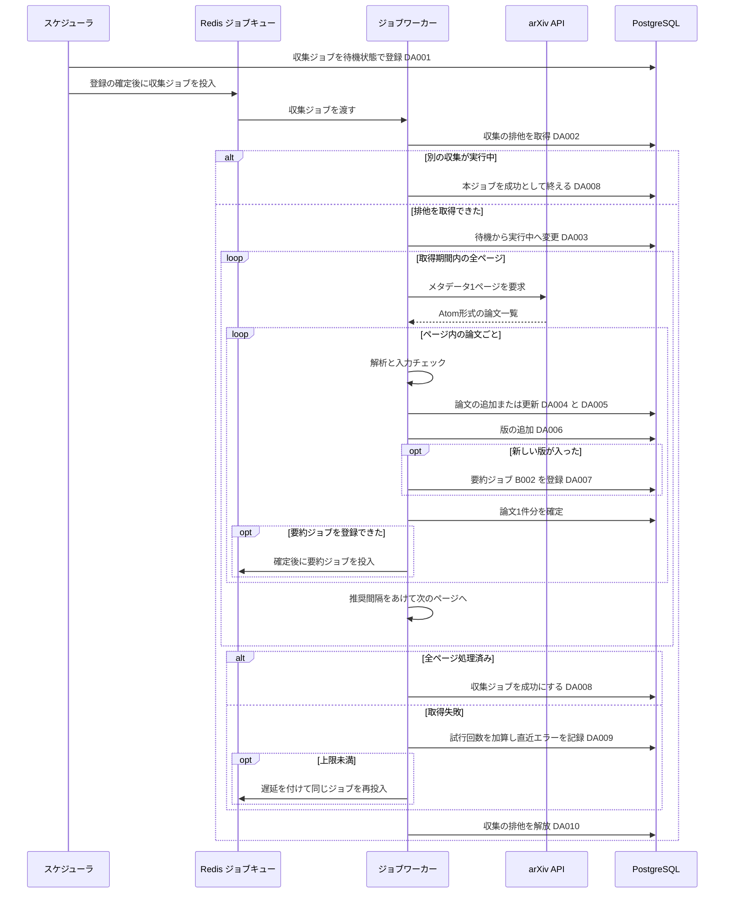
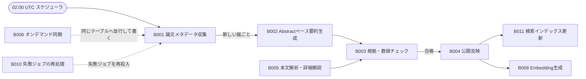

# バッチ詳細設計書 — B001 論文メタデータ収集

## 0. 文書情報

| 項目 | 値 |
| :--- | :--- |
| 設計書ID | B001-BE |
| 親ID | B001 |
| 親設計書 | `基本設計書_概要.md` §4 機能設計「バッチ処理設計」B001 行 |
| バッチ名 | 論文メタデータ収集（上流 §4 バッチ処理設計の区分「定期実行」） |
| 対応する機能ID | F01 新着論文取得（上流 §4 機能一覧。F01 の実体が本バッチ） |
| 関連する業務フローID | BF01 論文収集・日本語化（定期）、EX01 arXiv APIの取得失敗・レート制限（上流 §2） |
| 版 | 1.0 |
| 作成日 / 更新日 | 2026-10-27 / 2026-10-27 |
| 作成方法 | creating-backend-detailed-design v1.5.0 準拠。上流の確定設計書と `source/` の企画資料からの新規設計 |
| インプット | (a) `source/02_機能要求定義.md:6,44-50,57-58`、`source/03_システム構成.md:11,16,19-23,35-36,43,57`、`source/04_収益化とロードマップ.md:27,44`／(b) `docs/基本設計書_概要.md` §2 BF01・EX01、§4 F01・B001・B002・バッチID命名規則・バッチ共通の方針、§6 T001・T002・T009・CRUD図、§7 IF01、§8、§9 環境変数一覧、§10 運用監視、§11 ARC001・ARC005・ARC006・ARC007、付録 Q02・Q18・Q19・Q24・Q35・Q36／関連する確定済み設計書: `docs/detail/be/BE.F01.BE詳細設計.md`（F01-BE）、`docs/db/DB.T001.DB物理設計.md`・`DB.T002.DB物理設計.md`・`DB.T009.DB物理設計.md`／(c) `legacy/`（空） |

* **インプットの性質（source/ の突合結果）**: `source/` に入っているのは企画・初期設計案の Markdown 6ファイル（計227行）だけです。依頼にあるスケジュール定義 `config/schedule.rb`（whenever）と rake タスクの実装 `lib/tasks/` は**存在しません**（`source/` 配下の実ファイルは6件で、Ruby のファイルは0件）。そもそも本システムの推奨スタックは Python のジョブワーカー（Redis + Celery または RQ）であり、Rails の whenever・rake は使いません（`source/03_システム構成.md:7,11`）。このため本書は**リバースエンジニアリングではなく新規設計**です。whenever の定義に当たるものは §5「スケジュール定義」に、rake タスクに当たるものは §4 のジョブ関数に置き換えて設計しています。資料と上流に無い値（関数名、ファイル配置、実行時刻、件数、上限値）は「※推測」を付けています。
* **既存版**: `docs/detail/batch/BT.B001.バッチ詳細設計.md` の旧版はありません（作業開始時点で `docs/detail/batch/` ディレクトリ自体が無いことを確認）。本書が初版で、消さずに残すべき既存記述はありません。
* **legacy/ との突合**: `legacy/` は空ディレクトリです（ファイル0件。上流 §4 バッチID命名規則・§10 にも「`legacy/` は空」と記載）。突合する既存のバッチ設計書・業務意図・非機能の記述はありません。
* **F01-BE との分担と継承**: 本バッチの処理ロジックは、上流 F01 の BE詳細設計書（F01-BE）で関数・データアクセス・発行SQLとして定義済みです。F01-BE は「起動スケジュール・運用手順・監視はバッチ詳細設計書の責務」としています（F01-BE §0）。本書は、F01-BE で採番済みの **DA-ID（DA001〜DA010）と関数名をそのまま引き継ぎ**、バッチとしての起動契機・スケジュール・多重起動制御・処理ステップ・性能・依存ジョブ順序・ログと監視を加えて、本書だけでバッチを実装・運用できる形に展開します。両書で内容が食い違った場合は、処理ロジックは F01-BE、起動と運用は本書を正とします。ただし、本書で見直した3点（再投入の遅延、再試行の遅延の段階、着手前の DB 接続失敗の扱い）は本書を正とし、F01-BE への取り込みを §6 確認事項 No.14 に挙げています。
* **本書で確定する事項**: DB物理設計書 T002 §4.3 (3) が「キーの最終的な一覧は収集バッチの設計で確定する」とした、論文バージョンのメタデータスナップショット（`paper_versions.metadata_snapshot`）のキー一覧を §2 で確定します。

## 1. バックエンド構成・モジュール設計

* **対象ドメイン**: 論文収集（定期バッチ） — 定期スケジュールによる収集ジョブの起動、多重起動の防止、arXiv API からの新着論文メタデータの取得、arXiv ID と版での重複排除、論文（`papers`）と論文バージョン（`paper_versions`）への保存、新しい版ごとの要約ジョブ（B002）の登録、収集ジョブ自身の状態とリトライの管理、実行結果のログ出力と監視（上流 F01・B001・BF01・EX01）。
* **対象APIエンドポイント**: なし。本バッチは画面や外部から HTTP で呼ばれず、スケジューラからジョブキューへの投入で起動します（根拠は §2 APIエンドポイント一覧）。
* **実行基盤**: Pythonワーカー上のジョブです（Redis + Celery または RQ。どちらにするかは未決定、上流 Q02）。スケジューラは Celery beat または rq-scheduler です（※推測）。DB は Supabase 上の PostgreSQL に、行単位アクセス制御を通らないサーバ側のサービスロールで、トランザクションモードのプーラーを通さない直接接続でつなぎます（DB物理設計書 T001・T002・T009 §7、§3 DA002 の注意）。
* **ディレクトリ/ファイル構造**（※推測: 実装時のディレクトリ構成は未定義。上流 §9 の想定 `worker/` に置く。F01-BE §1 と同じ配置）:

```
worker/
├── schedule.py                 # スケジュール定義（whenever の config/schedule.rb に当たる。§5 スケジュール定義）
├── jobs/
│   ├── scheduler.py            # enqueue_collect_metadata（定期実行と手動実行の起点）
│   ├── collect_metadata.py     # run_collect_metadata / resolve_window / iter_entries / validate_record / upsert_paper_version
│   └── job_state.py            # dispatch_job / mark_job_succeeded / record_job_failure / sanitize_error（ARC006 のジョブ共通処理）
├── integrations/
│   └── arxiv_client.py         # ArxivClient.fetch_page / parse_entry（IF01 arXiv API）
├── db/
│   └── session.py              # PostgreSQL への直接接続
└── config.py                   # ARXIV_REQUEST_INTERVAL_SEC ほか設定値の読み込み（§6 設定値一覧）
```

* **処理シーケンス図**（上流 BF01 のうち B001 の範囲と EX01 を、起動から終了まで展開。※推測を含む）:



## 2. API・インターフェース詳細設計

* **APIエンドポイント一覧（全数ロースター）**:

| API ID | メソッド | エンドポイント | 概要 | 定義状況 | 詳細の所在 |
| :--- | :--- | :--- | :--- | :--- | :--- |
| — | — | 該当なし | — | — | — |

**総件数: 0件。根拠**: 上流 `docs/基本設計書_概要.md` §7 内部API一覧の全8件（API01〜API08。`source/03_システム構成.md:46-54` の API設計案8行と1対1）に、B001 を起動・操作するものはありません。上流 §2 BF01 の起点は「定期ジョブ（B001）」で、起動はスケジューラからジョブキューへの投入で行います。手動の期間指定実行（§5 起動契機 No.2）もワーカー上のコマンドで行い、HTTP の受け口は設けません（※推測。§6 確認事項 No.1）。

* **外部サービス連携一覧（全数ロースター）**: 上流 §7 外部連携一覧の全9件に対し、B001 で使うかを示します。

| IF ID | 連携先 | B001 での利用 | 概要 | 定義状況 | 詳細の所在 |
| :--- | :--- | :--- | :--- | :--- | :--- |
| IF01 | arXiv API | 利用する | 収集対象カテゴリと取得期間を指定して、新着と改訂の論文メタデータをページ単位で取得する | 詳細 | 本節 外部サービス連携仕様、§4 `ArxivClient.fetch_page` |
| IF02 | arXiv（論文本文PDF） | 利用しない | 本文PDFの取得は本文解析（B005）の責務 | - | `docs/detail/batch/BT.B005.バッチ詳細設計.md`（未作成） |
| IF03 | arXiv 原文ページ | 利用しない | 画面からのリンク遷移でサーバ処理を伴わない。本バッチは遷移先URLを論文の原文URLとして保存するだけ | - | - |
| IF04 | LLM API | 利用しない | 要約生成は B002 以降の責務で、本バッチはジョブの登録まで | - | `docs/detail/batch/BT.B002.バッチ詳細設計.md`（未作成） |
| IF05 | Supabase Auth | 利用しない | 利用者の認証は本バッチに関係しない。DBへはサービスロールで接続する | - | - |
| IF06 | Stripe（決済セッション） | 利用しない | 課金（F12）の責務 | - | - |
| IF07 | Stripe（契約状態の通知） | 利用しない | 課金（F12）の責務 | - | - |
| IF08 | GitHub | 利用しない | GitHub関連付け（B009）の責務 | - | - |
| IF09 | 通知配信手段 | 利用しない | 通知・ダイジェスト配信（B007）の責務 | - | - |

**総件数: 9件（B001 で利用するもの1件）。根拠**: 上流 §7 外部連携一覧の IF01〜IF09 の全9行と1対1で対応します。上流 §2 BF01 のシーケンスのうち B001 の範囲に登場する外部の相手は arXiv API だけです。Redis（ジョブキュー）と PostgreSQL は上流 §7 で本システムの構成要素（内部）とされているため外部連携に含めません。

* **外部サービス連携仕様**（B001 で利用する IF01 の1件。F01-BE §2 と同じ仕様）:

| IF ID | 連携先 | 連携方式 | エンドポイント / 接続先 | 認証方式 | タイムアウト | リトライ方針 | エラー時の挙動 |
| :--- | :--- | :--- | :--- | :--- | :--- | :--- | :--- |
| IF01 | arXiv API | REST API（HTTP GET。応答は Atom 形式のXML）（※推測: 上流 IF01 自体が「arXiv公式APIのHTTP GET」を※推測としている） | `https://export.arxiv.org/api/query`（※推測）。問い合わせは「収集対象カテゴリのいずれかに属し、かつ最終更新日時が取得期間に入る論文」を最終更新日時の古い順に求め、取得位置と1ページの件数でページを送る（`search_query=(cat:cs.LG OR …) AND lastUpdatedDate:[開始 TO 終了]&sortBy=lastUpdatedDate&sortOrder=ascending&start=N&max_results=200`。1ページ200件は※推測） | 認証なし（上流 IF01、※推測） | 1リクエスト30秒（※推測） | arXiv の推奨に従い、リクエストとリクエストの間を設定値の秒数（※推測: 3秒以上）だけ必ずあける。個々のリクエストでは再試行せず、収集ジョブ全体を失敗として試行回数を1増やし、上限未満なら遅延を付けてジョブごと再実行する（上流 EX01。上限は※推測で3回、上流 Q19）。取り込みは冪等なので、再実行しても同じ論文が二重に入ることはない（§6 冪等性） | 応答が無い・接続できない・サーバ側の一時的な失敗（HTTP 5xx）・アクセス過多（HTTP 429）・全件数に満たない空のページのときは、再試行できる失敗として試行回数を加算し再実行を待つ。問い合わせ条件の誤り（HTTP 429 を除く 400〜499 のすべて）は再実行しても直らないため、試行回数にかかわらずその場で失敗にして失敗キューへ送る（※推測）。どの場合もエラー内容から認証情報や長い応答本文を取り除いて直近エラーに残す（§4 `sanitize_error`） |

* **IF01 の受信データと保存先の対応**（※推測: arXiv API の Atom 応答の要素名。資料に定義なし）:

| Atom の要素 | 意味 | 保存先 | 変換のしかた |
| :--- | :--- | :--- | :--- |
| `entry/id` | 版番号つきの論文URL（例: `http://arxiv.org/abs/2401.12345v2`） | `papers.arxiv_id`、`paper_versions.version`、`papers.latest_version` | URL の `/abs/` より後ろを取り出し、末尾の「v＋数字」を版番号として切り離して、残りを arXiv ID にする。旧形式のID（例: `hep-th/9901001v1`）も同じ規則で切り離す（DB物理設計書 T001 §4.3 (1)、T002 §4.3 (2)） |
| `entry/title` | 原題 | `papers.title`、スナップショット | 改行と連続する空白を1つの空白にまとめ、前後の空白を取る（T001 §4.3 (2)） |
| `entry/summary` | Abstract | `papers.abstract`、スナップショット | 原題と同じ整形だけを行い、LaTeX 記法や HTML に見える文字列はそのまま保存する。無害化は表示する画面側で行う（上流 §8 XSS） |
| `entry/author/name`（複数） | 著者名 | `papers.authors`、スナップショット | 記載の順番のまま文字列の配列にする（T001 §4.3 (3)） |
| `entry/arxiv:primary_category` と `entry/category`（複数） | 主カテゴリと全カテゴリ | `papers.categories`、スナップショット | 主カテゴリを先頭に置き、残りを応答の順で後ろに並べ、重複を除く（T001 §4.3 (4)） |
| `entry/published` | v1 の投稿日時 | `papers.submitted_at` | UTC の日時として保存する |
| `entry/updated` | この版の公開日時 | `papers.updated_at`、スナップショット | UTC の日時として保存する |
| （ライセンス） | 利用許諾 | `paper_versions.license_type`、スナップショット | arXiv API の検索応答にはライセンスが含まれないことがある（※推測）。含まれない場合は空のまま保存し、本文の利用は許可されていないものとして扱う。値の補完は本文解析（B005）の前に別の手段で行う（DB物理設計書 T002 §4.3 (5)。※上流要確認: ライセンスの取得手段。§6 確認事項 No.4） |

**総件数: 8行（受け取る Atom の要素の単位）。根拠**: 本バッチが arXiv から受け取って保存する値の出どころとなる要素を、1要素（または1つの意味を持つ要素の組）につき1行で挙げたものです。保存先の列で数えると、T001 `papers` の10列のうち、自動採番の `id` と arXiv ID から組み立てる `original_url`（§4 `parse_entry` 手順6）を除く8列と、T002 `paper_versions` の `version`・`license_type`・`metadata_snapshot` の3列の、計11列がこの8行のいずれかに対応します（`entry/id` の1行が `arxiv_id`・`version`・`latest_version` の3列に対応するため、行数と列数は一致しません）。

* **メタデータスナップショットのキー定義**（本書で確定。DB物理設計書 T002 §4.3 (3) の委譲を受ける。キー名は※推測）: 版を取り込んだ時点でarXivから受け取った内容を、変更しない記録として JSON のオブジェクトで残します。

| キー | 型 | 必須 | 入れる値 | 説明 |
| :--- | :--- | :--- | :--- | :--- |
| `title` | 文字列 | ○ | その版の原題（整形後） | 親の `papers.title` は最新版で上書きされるため、版ごとの原題はここにだけ残る |
| `abstract` | 文字列 | ○ | その版の Abstract（整形後） | 版ごとの要約（B002）の材料を後から確かめるために残す |
| `authors` | 文字列の配列 | ○ | その版の著者名（記載順） | 版の間で著者が変わった経緯を追えるようにする |
| `categories` | 文字列の配列 | ○ | その版のカテゴリ（主カテゴリが先頭） | — |
| `version_updated_at` | 文字列（ISO 8601、UTC） | ○ | その版が arXiv で公開された日時（`entry/updated`） | 親の `papers.updated_at` は最新版の値になるため、版ごとの公開日時はここで引く |
| `license` | 文字列または null | ○ | 取り込み時点で受け取ったライセンスの値。受け取れなければ null | 取り込み時の記録として残すだけで、本文の利用可否の判断には使わない。判断に使う正の値は `paper_versions.license_type`（T002 §4.3 (5)） |
| `fetched_at` | 文字列（ISO 8601、UTC） | ○ | 本バッチがこの版を取り込んだ日時 | 取り込みが遅れた版の調査と、新着から速報公開までの時間（`source/04_収益化とロードマップ.md:44`）の起点に使う |
| `source` | 文字列 | ○ | 取り込んだ処理を表す固定値。本バッチは `B001`、オンデマンド同期は `B006` | 同じテーブルに書くオンデマンド同期（B006）の取り込みと区別する（T002 §4.3 (3)） |

**総件数: 8キー。根拠**: DB物理設計書 T002 §4.3 (3) が最低限持たせるとした4項目（原題・Abstract・著者・カテゴリ／公開日時／ライセンス／取り込んだ日時と処理）を、1値1キーに分けたものです。F01-BE §4 `parse_entry` 手順8 のスナップショットの中身と一致します。

* **API詳細仕様**: 該当なし（APIエンドポイント0件のため。根拠は上の一覧の直後に記載）。ジョブとしての入出力（ジョブキューへ投入するメッセージの内容）は §4 の `enqueue_collect_metadata`・`run_collect_metadata` と §5 の入出力一覧に記載します。

## 3. データアクセス（ORM / クエリ）設計

* **データアクセス一覧（全数ロースター）**: DA-ID は F01-BE §3 で採番済みのものをそのまま引き継ぎます。

| DA-ID | 処理名 | 呼出元（関数/API） | テーブルID | 対象物理テーブル | 種別 (SELECT/INSERT/UPDATE/DELETE) | 定義状況 (詳細/簡易) | 詳細の所在 |
| :--- | :--- | :--- | :--- | :--- | :--- | :--- | :--- |
| DA001 | 収集ジョブの登録 | `enqueue_collect_metadata` | T009 | jobs | INSERT | 詳細 | §3 詳細定義 DA001・発行SQL DA001 |
| DA002 | 収集の排他取得 | `run_collect_metadata` | — | （テーブルなし。PostgreSQL のアドバイザリロック） | SELECT | 詳細 | §3 詳細定義 DA002・発行SQL DA002 |
| DA003 | 収集ジョブの着手 | `run_collect_metadata` | T009 | jobs | UPDATE | 詳細 | §3 詳細定義 DA003・発行SQL DA003 |
| DA004 | 論文の追加または最新版での上書き | `upsert_paper_version` | T001 | papers | INSERT（衝突時 UPDATE） | 詳細 | §3 詳細定義 DA004・発行SQL DA004 |
| DA005 | arXiv IDでの論文ID取得 | `upsert_paper_version` | T001 | papers | SELECT | 簡易 | 発行SQL DA005 |
| DA006 | 論文の版の追加 | `upsert_paper_version` | T002 | paper_versions | INSERT（衝突時は何もしない） | 詳細 | §3 詳細定義 DA006・発行SQL DA006 |
| DA007 | 要約ジョブ（B002）の登録 | `upsert_paper_version` | T009 | jobs | INSERT（衝突時は何もしない） | 詳細 | §3 詳細定義 DA007・発行SQL DA007 |
| DA008 | 収集ジョブの成功記録 | `mark_job_succeeded`（`run_collect_metadata` から呼ぶ） | T009 | jobs | UPDATE | 詳細 | §3 詳細定義 DA008・発行SQL DA008 |
| DA009 | 収集ジョブの失敗記録 | `record_job_failure`（`run_collect_metadata` から呼ぶ） | T009 | jobs | UPDATE | 詳細 | §3 詳細定義 DA009・発行SQL DA009 |
| DA010 | 収集の排他解放 | `run_collect_metadata` | — | （テーブルなし。PostgreSQL のアドバイザリロック） | SELECT | 簡易 | 発行SQL DA010 |

**総件数: 10件（詳細8件・簡易2件）。全数である根拠**: §4 関数一覧の全12関数のうち DB へ問い合わせる5関数（`enqueue_collect_metadata`・`run_collect_metadata`・`upsert_paper_version`・`mark_job_succeeded`・`record_job_failure`）の処理フローに現れる DB 操作を、§4 IPO定義の各手順から1件ずつ拾ったものです（`enqueue_collect_metadata`→DA001、`run_collect_metadata`→DA002・DA003・DA010、`upsert_paper_version`→DA004〜DA007、`mark_job_succeeded`→DA008、`record_job_failure`→DA009）。残りの7関数（`resolve_window`・`iter_entries`・`ArxivClient.fetch_page`・`parse_entry`・`validate_record`・`sanitize_error`・`dispatch_job`）は DB に触れません。本バッチは DELETE を発行しません。F01-BE §3 の DA001〜DA010 と件数・内容とも一致します。
**上流 CRUD図との突合**: 上流 §6 CRUD図の F01（＝B001）行は papers「CRU」、paper_versions「CR」、jobs「C」です。papers の C・U は DA004、R は DA005 と一致します。paper_versions の C は DA006、R は DA006 の一意制約の衝突判定に当たります。jobs の C は DA001・DA007 と一致しますが、**収集ジョブ自身の状態を変える DA003・DA008・DA009 の U が上流 CRUD図にありません**。上流 EX01 は「jobs の attempts を加算し last_error を記録」「jobs の status を失敗にする」と収集ジョブの更新を求めているため、※上流要確認: CRUD図の F01 の jobs を「CU」にするか（§6 確認事項 No.2。F01-BE 確認事項 No.2 と同じ）。
**定義状況の判定**（completeness 3-1）: DA001・DA003・DA004・DA006・DA007・DA008・DA009 は永続データを書き換える（3-1 の2）ため「詳細」です。DA002 はロックの取得結果で処理が分かれ（3-1 の1）、同時実行を防ぐ非自明な仕組み（3-1 の5）のため「詳細」です。DA005 は arXiv ID で1行を引くだけの単純な取得、DA010 はロックを外すだけの定型操作で、どちらも 3-1 の基準に当たらないため「簡易」です（DA005 を呼ぶかどうかの分岐は呼び出し元 `upsert_paper_version` の側にあり、§4 に記載）。

* **データアクセス詳細定義**（定義状況＝詳細の8件）:

| DA-ID | 処理名 | テーブルID | 対象物理テーブル | JOIN / Include | 抽出条件 (Where) / ソート | トランザクション境界 | N+1対策・性能上の注意 |
| :--- | :--- | :--- | :--- | :--- | :--- | :--- | :--- |
| DA001 | 収集ジョブの登録 | T009 | jobs | なし | 抽出条件なし。種別を「論文メタデータ収集」、版を空にして1行追加し、払い出されたジョブIDを受け取る。状態は初期値の待機、試行回数は初期値の0のまま（`job_type='collect_metadata'`, `paper_version_id=NULL`。DB物理設計書 T009 §6） | 1文で自動確定する。確定したあとにジョブキューへ投入する（確定前に投入すると、ワーカーがまだ見えない行を探して着手に失敗するため） | 版の無いジョブは重複実行を防ぐ一意インデックス（`uq_jobs_active_per_version`）の対象外のため、ここでは重複を止めない。同時に2つ動くことは DA002 の排他で防ぐ（T009 §5.2） |
| DA002 | 収集の排他取得 | — | （テーブルなし） | なし | 収集専用に決めた1つの鍵で、待たずに取れるかだけを試す。取れたら真、他の接続が持っていれば偽が返る（`pg_try_advisory_lock(hashtext('collect_metadata'))`。鍵の値は※推測） | トランザクションの外でセッション単位に取る。収集の処理の間ずっと同じ DB 接続で保持し、DA010 で明示的に外す。ワーカーが異常終了して接続が切れた場合は DB が自動で外す | セッション単位のロックは、接続をトランザクションごとに付け替える接続プール（Supabase のトランザクションモードのプーラー）を通すと保持できない。収集ジョブは DB へ直接つなぐ接続（またはセッションモード）を使う（※推測） |
| DA003 | 収集ジョブの着手 | T009 | jobs | なし | 指定のジョブIDで、状態が待機の行だけを実行中に変える。変えた行が1行なら処理を続け、0行なら他のワーカーが着手済みか終わっているため何もせずに終える（`WHERE id = :job_id AND status = 'pending'`） | 1文で自動確定する | ジョブキューは同じジョブを別のワーカーへもう一度渡すことがあり（T009 §4.3 (4)「実行の取り合い」）、この条件付きの更新で1つのワーカーだけが処理するようにする。主キーで1行を引くだけで性能上の問題はない |
| DA004 | 論文の追加または最新版での上書き | T001 | papers | なし | arXiv ID が未登録なら1行追加する。登録済みなら、取り込んだ版番号が登録済みの最新版以上で、かつ原題・Abstract・著者・カテゴリ・更新日時・最新版のどれかが登録済みの値と違うときだけ、その6列を上書きする。投稿日時・原文URL・arXiv ID は上書きしない。追加または上書きした行の論文IDを受け取る（`INSERT … ON CONFLICT (arxiv_id) DO UPDATE … WHERE EXCLUDED.latest_version >= papers.latest_version AND (…) IS DISTINCT FROM (…) RETURNING id`。発行SQL DA004） | 論文1件の取り込みトランザクション（DA004〜DA007）の1文目。後続が失敗したら一緒に取り消す | 上書きの条件で、古い版の取得結果が新しい内容を戻すのを防ぐ（T001 §4.3 (1)(2)(6)）。毎回の収集で取得期間が重なる（§4 `resolve_window`）ため同じ内容の論文を何度も受け取る。値が変わらないときは更新しない条件で、無駄な行の書き換えを避ける。条件に当たらず更新しなかったときは論文IDが返らないため、DA005 で引き直す |
| DA006 | 論文の版の追加 | T002 | paper_versions | なし | 論文IDと版番号の組がまだ無ければ、§2 で定めたスナップショットとライセンス種別を付けて1行追加する。本文取得状況は初期値の「Abstractのみ」のまま。すでにあれば何もしない。追加できたときだけ新しい版の論文バージョンIDが返る（`INSERT … ON CONFLICT (paper_id, version) DO NOTHING RETURNING id`） | 論文1件の取り込みトランザクションの2文目（DA005 を呼んだ場合は3文目） | 一意制約 `uq_paper_versions_paper_id_version` の衝突で重複を判定するため、並行して取り込んでも行は2つにならない（T002 §4.3 (2)、ARC001）。返った行の有無で「新しい版が入ったか」を判断し、入ったときだけ DA007 を発行する。スナップショットは一度書いたら変えない（T002 §4.3 (3)） |
| DA007 | 要約ジョブ（B002）の登録 | T009 | jobs | なし | DA006 で新しく入った版について、種別を「Abstractベース日本語要約生成」として待機状態の行を1行追加する。同じ版・同じ種別のジョブがすでに待機中か実行中なら何もしない（`job_type='summarize_abstract'`、`ON CONFLICT (paper_version_id, job_type) WHERE status IN ('pending','running') AND paper_version_id IS NOT NULL DO NOTHING RETURNING id`） | 論文1件の取り込みトランザクションの最後の文。確定したあとに、返ったジョブIDをジョブキューへ投入する（§4 `dispatch_job`） | 重複実行を防ぐ一意インデックス `uq_jobs_active_per_version` は部分インデックスのため、衝突の判定先として同じ条件を ON CONFLICT に書かないと DB が使うインデックスを決められずエラーになる（T009 §5.2）。版と要約ジョブを同じトランザクションで書き、版だけが入って要約ジョブが無い状態を作らない |
| DA008 | 収集ジョブの成功記録 | T009 | jobs | なし | 着手した収集の正常終了では、指定のジョブIDで状態が実行中の行だけを成功に変える（`WHERE id = :job_id AND status = 'running'`）。排他を取れずに処理を省いたとき（§4 `run_collect_metadata` 手順3）は、状態が待機の行を成功に変える（`AND status = 'pending'`） | 1文で自動確定する | 状態の条件を付けて、他のワーカーの結果を上書きしない（T009 §4.3 (4)）。直近エラーは消さない（T009 §4.3 (6)） |
| DA009 | 収集ジョブの失敗記録 | T009 | jobs | なし | 指定のジョブIDで状態が実行中の行について、試行回数を1増やし、認証情報を取り除いたエラーの要約を直近エラーに書く。増やした結果が上限に達したか、再実行しても直らない失敗なら状態を失敗にし、そうでなければ待機に戻す。変更後の状態と試行回数を受け取る（`SET attempts = attempts + 1, last_error = :error, status = CASE WHEN :non_retryable OR attempts + 1 >= :max_attempts THEN 'failed' ELSE 'pending' END WHERE id = :job_id AND status = 'running' RETURNING status, attempts`） | 1文で自動確定する。論文の取り込みトランザクションとは別に書く（取り込みの取り消しに巻き込まれないため） | 上限との比較を読む文と書く文に分けず1文で行い、読んでから書くまでの間に値が変わる問題を避ける。上限の値は※推測で3回（上流 Q19、T009 §4.3 (5)）。待機に戻した場合は、呼び出し元が再実行の遅延を付けてジョブキューへ再投入する |

* **発行SQL**: 全10件（DA001〜DA010）。すべて PostgreSQL 15 以上の文で、ORM を使う場合もこの文と同じ意味になるように書きます（※推測: ORM を使うかは未定）。プレースホルダは `:名前` で示し、値はすべてプレースホルダで渡します。

**DA001 収集ジョブの登録**
```sql
INSERT INTO jobs (job_type, paper_version_id)
VALUES ('collect_metadata', NULL)
RETURNING id;
```
組み立ての分岐: なし（固定の1文）。

**DA002 収集の排他取得**
```sql
SELECT pg_try_advisory_lock(hashtext('collect_metadata')) AS acquired;
```
組み立ての分岐: なし（固定の1文）。結果は真（取得できた）か偽（他の接続が保持中）の2通りです。

**DA003 収集ジョブの着手**
```sql
UPDATE jobs
   SET status = 'running'
 WHERE id = :job_id
   AND status = 'pending';
-- 更新件数が1なら処理を続け、0なら何もせず終える
```
組み立ての分岐: なし（固定の1文）。

**DA004 論文の追加または最新版での上書き**
```sql
INSERT INTO papers (
    arxiv_id, title, abstract, authors, categories,
    submitted_at, updated_at, latest_version, original_url
) VALUES (
    :arxiv_id, :title, :abstract, :authors::jsonb, :categories::text[],
    :submitted_at, :updated_at, :version, :original_url
)
ON CONFLICT (arxiv_id) DO UPDATE
   SET title          = EXCLUDED.title,
       abstract       = EXCLUDED.abstract,
       authors        = EXCLUDED.authors,
       categories     = EXCLUDED.categories,
       updated_at     = EXCLUDED.updated_at,
       latest_version = EXCLUDED.latest_version
 WHERE EXCLUDED.latest_version >= papers.latest_version
   AND (papers.title, papers.abstract, papers.authors, papers.categories,
        papers.updated_at, papers.latest_version)
       IS DISTINCT FROM
       (EXCLUDED.title, EXCLUDED.abstract, EXCLUDED.authors, EXCLUDED.categories,
        EXCLUDED.updated_at, EXCLUDED.latest_version)
RETURNING id;
-- 返る行が無い場合（登録済みで、古い版か内容が同じ）は DA005 で論文IDを引く
```
組み立ての分岐: 文の形は固定で、動的な組み立てはありません。結果は「新規追加して論文IDが返る」「上書きして論文IDが返る」「何もせず行が返らない」の3通りです。

**DA005 arXiv IDでの論文ID取得**
```sql
SELECT id
  FROM papers
 WHERE arxiv_id = :arxiv_id;
-- 一意制約 uq_papers_arxiv_id のインデックスで1行を引く
```
組み立ての分岐: なし（固定の1文）。

**DA006 論文の版の追加**
```sql
INSERT INTO paper_versions (paper_id, version, metadata_snapshot, license_type)
VALUES (:paper_id, :version, :metadata_snapshot::jsonb, :license_type)
ON CONFLICT (paper_id, version) DO NOTHING
RETURNING id;
-- 行が返ったときだけ新しい版が入ったと判断し、DA007 を発行する
```
組み立ての分岐: なし（固定の1文）。`:metadata_snapshot` は §2 のキー定義の8キーを持つ JSON です。

**DA007 要約ジョブ（B002）の登録**
```sql
INSERT INTO jobs (job_type, paper_version_id)
VALUES ('summarize_abstract', :paper_version_id)
ON CONFLICT (paper_version_id, job_type)
    WHERE status IN ('pending', 'running') AND paper_version_id IS NOT NULL
    DO NOTHING
RETURNING id;
-- 行が返ったときだけ、確定後にジョブキューへ投入する
```
組み立ての分岐: なし（固定の1文）。

**DA008 収集ジョブの成功記録**
```sql
-- 通常の終了（実行中から成功へ）
UPDATE jobs
   SET status = 'succeeded'
 WHERE id = :job_id
   AND status = 'running';

-- 排他を取れずに処理を省いたとき（待機から成功へ）
UPDATE jobs
   SET status = 'succeeded'
 WHERE id = :job_id
   AND status = 'pending';
```
組み立ての分岐: 呼び出し元が「着手したか（DA003 で実行中にしたか）」で2つの文のどちらかを選びます。生成され得る形は上の2通りだけです。

**DA009 収集ジョブの失敗記録**
```sql
UPDATE jobs
   SET attempts   = attempts + 1,
       last_error = :sanitized_error,
       status     = CASE
                        WHEN :non_retryable OR attempts + 1 >= :max_attempts THEN 'failed'
                        ELSE 'pending'
                    END
 WHERE id = :job_id
   AND status = 'running'
RETURNING status, attempts;
```
組み立ての分岐: なし（固定の1文）。状態の決め方は文の中の条件で切り替わります。

**DA010 収集の排他解放**
```sql
SELECT pg_advisory_unlock(hashtext('collect_metadata'));
```
組み立ての分岐: なし（固定の1文）。

## 4. サーバー側機能・処理ロジック設計（IPO設計）

* **関数一覧（全数ロースター）**: 関数名は F01-BE §4 で定義済みのものをそのまま引き継ぎます。

| 関数名 | 所属モジュール（※推測） | 概要 | 定義状況 | 詳細の所在 |
| :--- | :--- | :--- | :--- | :--- |
| `enqueue_collect_metadata` | `worker/jobs/scheduler.py` | 定期実行と手動実行の起点。収集ジョブを DB に登録し、ジョブキューへ投入する | 詳細 | §4 IPO定義 |
| `run_collect_metadata` | `worker/jobs/collect_metadata.py` | 収集ジョブの本体。排他を取り、取得期間内の論文を全ページ取り込み、ジョブの成否を記録する | 詳細 | §4 IPO定義 |
| `resolve_window` | `worker/jobs/collect_metadata.py` | 取得する最終更新日時の期間を決める | 詳細 | §4 IPO定義 |
| `iter_entries` | `worker/jobs/collect_metadata.py` | 取得期間の論文を、ページを送りながら1件ずつ取り出す | 詳細 | §4 IPO定義 |
| `ArxivClient.fetch_page` | `worker/integrations/arxiv_client.py` | arXiv API に1ページ分を問い合わせ、推奨間隔を守る | 詳細 | §4 IPO定義 |
| `parse_entry` | `worker/integrations/arxiv_client.py` | Atom の1件を、保存用の論文レコードに変換する | 詳細 | §4 IPO定義 |
| `validate_record` | `worker/jobs/collect_metadata.py` | 保存前に DB の制約に合うかを確かめ、合わない論文を除外する | 詳細 | §4 IPO定義 |
| `upsert_paper_version` | `worker/jobs/collect_metadata.py` | 論文1件を1トランザクションで保存し、新しい版なら要約ジョブを登録する | 詳細 | §4 IPO定義 |
| `dispatch_job` | `worker/jobs/job_state.py` | 登録済みのジョブをジョブキューへ投入する | 詳細 | §4 IPO定義 |
| `mark_job_succeeded` | `worker/jobs/job_state.py` | ジョブを成功として記録する | 詳細 | §4 IPO定義 |
| `record_job_failure` | `worker/jobs/job_state.py` | ジョブの失敗を記録し、再実行か失敗キュー行きかを決める | 詳細 | §4 IPO定義 |
| `sanitize_error` | `worker/jobs/job_state.py` | エラー内容から認証情報を除き、保存できる長さの要約にする | 詳細 | §4 IPO定義 |

**総件数: 12関数（全件 詳細）。全数である根拠**: 上流 §2 BF01（B001 の範囲）と EX01 のシーケンス、上流 §4 B001 の処理内容、DB物理設計書 T001・T002・T009 が B001 に課した書き込みの規則を、処理の段階ごとに1関数ずつ割り当てたものです（起動→`enqueue_collect_metadata`、ジョブ本体と排他→`run_collect_metadata`、取得期間→`resolve_window`、arXiv への問い合わせ→`ArxivClient.fetch_page`・`iter_entries`、メタデータの解釈→`parse_entry`・`validate_record`、重複判定と保存と要約ジョブ登録→`upsert_paper_version`、ジョブの投入と状態→`dispatch_job`・`mark_job_succeeded`・`record_job_failure`・`sanitize_error`）。F01-BE §4 の12関数と一致します。ソースコードが無いため実在の関数との突合はできず、関数名と分け方は※推測です。スケジュール定義（§5）は関数ではなく設定のため、本一覧には含めません。`dispatch_job`・`mark_job_succeeded`・`record_job_failure`・`sanitize_error` はジョブ実行基盤（ARC006）として他のバッチと共用する想定で、本書では B001 での使い方を定義します（共通部分の正は方式設計書 `docs/arch/方式.ARC006.方式設計.md`（未作成））。
**定義状況の判定**（completeness 3-1）: 12関数とも、永続データや外部への送信を伴う（3-1 の2: `enqueue_collect_metadata`・`run_collect_metadata`・`upsert_paper_version`・`dispatch_job`・`mark_job_succeeded`・`record_job_failure`）、外部との通信と失敗時の扱いを含む（3-1 の5・6: `ArxivClient.fetch_page`・`iter_entries`）、条件による分岐を含む（3-1 の1: `resolve_window`・`validate_record`）、非自明な業務ルールを含む（3-1 の7: `parse_entry`・`sanitize_error`）のいずれかに当たるため「詳細」です。

* **入力・処理・出力（IPO）定義**:

| 関数名 | 所属モジュール | 引数 (型) | 処理フロー (ステップ単位で具体的に) | 戻り値 | 発生しうるエラー |
| :--- | :--- | :--- | :--- | :--- | :--- |
| `enqueue_collect_metadata` | `worker/jobs/scheduler.py` | window_from: datetime または None（指定しないときは None）, window_to: datetime または None（指定しないときは None） | 1. スケジューラ（§5 スケジュール定義）から引数なしで呼ばれる。運用者が取りこぼした期間を取り直すときは、期間を指定して手動で呼ぶ（§5 起動契機 No.2、※推測）。<br>2. 収集ジョブを待機状態で1行登録し、ジョブIDを受け取る（DA001）。<br>3. 登録が確定したあとで、ジョブID・指定期間を引数にして `run_collect_metadata` をジョブキューへ投入する（`dispatch_job`）。<br>4. 登録したジョブIDと指定期間をログに出す（INFO。§5 ログ出力一覧 No.1）。 | 登録したジョブID（int） | DB 接続失敗: 例外をそのまま上げ、スケジューラのログに残す（ジョブは作られない。次回の定期実行で再び登録される）。ジョブキューへの投入失敗: ジョブの行は待機のまま残る。ERROR ログを出して例外を上げる（※上流要確認: 投入されなかった待機ジョブを拾い直す仕組み。§6 確認事項 No.3） |
| `run_collect_metadata` | `worker/jobs/collect_metadata.py` | job_id: int, window_from: datetime または None, window_to: datetime または None | 1. 収集専用の DB 接続（直接接続）を開く。<br>2. 収集の排他を待たずに取りにいく（DA002）。<br>3. 取れなかったときは、別の収集が実行中で同じ期間を取り込むため本ジョブの処理を省く。ジョブを待機から成功に変え（DA008 の2文目）、INFO ログに「他の収集が実行中のため処理を省いた」と出して終える。<br>4. 取れたときは、ジョブを待機から実行中に変える（DA003）。変えた行が0行なら、他のワーカーが着手済みか終わっているため、排他を外して（DA010）何もせず終える。<br>5. `resolve_window` で取得期間を決める。<br>6. `iter_entries` から論文を1件ずつ受け取り、`parse_entry` で変換し、`validate_record` で確かめる。不合格の論文は取り込まずに件数を数え、WARN ログに arXiv ID と理由を出して次へ進む。<br>7. 合格した論文は `upsert_paper_version` で保存する。保存の結果（新規の論文・上書きした論文・新しい版のみ・変化なし）を数える。DB の制約違反で1件の保存が取り消されたときは、その論文だけを除外として数え、WARN ログを出して次へ進む。<br>8. 全ページを最後まで処理したら、ジョブを成功にする（`mark_job_succeeded` → DA008 の1文目）。取得件数・新規論文数・上書き数・新しい版の数・要約ジョブ登録数・除外数・所要時間を INFO ログに出す（§5 ログ出力一覧 No.6）。<br>9. 着手後（手順5〜8）に arXiv への問い合わせ、または DB 接続が失敗したときは、そこで処理を打ち切り `record_job_failure` を呼ぶ。着手前（手順1〜4）の失敗は jobs に記録できないため、ERROR ログを出して終える（発生しうるエラー欄）。手順7までに確定した論文はそのまま残す（1件ごとに確定しているため）。<br>10. 成否にかかわらず最後に排他を外し（DA010）、接続を閉じる。 | なし（結果はジョブの状態とログに残す） | arXiv 取得失敗（タイムアウト・接続失敗・HTTP 5xx・HTTP 429・空のページ）: 再試行できる失敗として `record_job_failure`。arXiv の問い合わせ条件の誤り（HTTP 429 を除く 400〜499 のすべて）: 再試行しても直らない失敗として `record_job_failure`（すぐ失敗にする）。着手前（手順1〜4）の DB 接続失敗: ジョブはまだ待機のため `record_job_failure` では記録できない（DA009 は実行中の行だけを更新する）。ERROR ログ（§5 ログ No.9）を出して例外を上げ、ジョブは待機のまま残す。再投入はせず、論文は翌日の定期実行が3日分の取得期間で取り戻す（§6 確認事項 No.5）。着手後の DB 接続失敗: 再試行できる失敗として `record_job_failure`（記録自体ができない場合は ERROR ログだけ残し、ジョブは実行中のまま。§6 確認事項 No.5）。1件の論文の解釈失敗・制約違反: その1件を除外して続行。予期しない例外: 再試行できる失敗として扱い、スタックトレースはログにだけ出す |
| `resolve_window` | `worker/jobs/collect_metadata.py` | window_from: datetime または None, window_to: datetime または None, now: datetime（UTC） | 1. 期間が引数で指定されていればそれを使う（運用者による取り直し）。開始が終了より後なら、指定の誤りとして例外を上げる。<br>2. 指定が無ければ、終了を現在時刻、開始を現在時刻から設定値の日数（`ARXIV_LOOKBACK_DAYS`。※推測: 3日）さかのぼった時刻にする。前回の実行が成功したかどうかに関係なく毎回同じ幅で取り込む。取り込みは冪等（DA004・DA006）なので、前回分と重なっても重複は起きない。数日止まっていても、この幅の中なら次の実行で取り戻せる。<br>3. ジョブが設定日数より長く止まって取りこぼしが出るおそれがあるときは自動では補わず、運用者が手順1の指定で取り直す（※推測。§5 監視項目一覧 No.2 で検出する）。 | （開始日時, 終了日時）の組（UTC） | 期間の指定誤り（開始が終了より後）: 再試行しても直らない失敗として扱う |
| `iter_entries` | `worker/jobs/collect_metadata.py` | client: ArxivClient, categories: list[str], window: （開始, 終了） | 1. 収集対象のカテゴリ（設定値 `ARXIV_CATEGORIES`。※推測・※上流未定義: 上流は収集範囲を定義していない。§6 確認事項 No.6）のいずれかに属し、最終更新日時が期間内の論文を、最終更新日時の古い順に求める問い合わせ条件を作る。新規投稿だけでなく、既存論文の新しい版も最終更新日時で拾える。<br>2. 取得位置0から、1ページの件数（※推測: 200件）ずつ `ArxivClient.fetch_page` を呼ぶ。<br>3. 1ページ目の応答に含まれる全件数が、arXiv API で1つの問い合わせから取り出せる上限（※推測: 30,000件）を超える場合は、期間を1日ずつに分けて手順1から問い合わせ直す。<br>4. ページ内の論文を1件ずつ呼び出し元へ返す。<br>5. 取得位置が全件数に達するか、論文が0件のページが返ったら終える。全件数に達していないのに論文が0件のページが返ったときは、arXiv 側の一時的な取りこぼしとみなし、再試行できる失敗として例外を上げる（※推測）。 | 論文の Atom 要素を1件ずつ返す反復子 | arXiv 取得失敗（`ArxivClient.fetch_page` の例外をそのまま上げる）。全件数に満たない空ページ: 再試行できる失敗 |
| `ArxivClient.fetch_page` | `worker/integrations/arxiv_client.py` | query: str, start: int, max_results: int | 1. 前回の問い合わせから設定値の秒数（`ARXIV_REQUEST_INTERVAL_SEC`。※推測: 3秒以上）が経っていなければ、経つまで待つ。ワーカー1つの中で前回時刻を持つ。収集は DA002 の排他で同時に1つしか動かないため、プロセスをまたいだ間隔の管理は不要。<br>2. IF01 の接続先へ、問い合わせ条件・取得位置・件数を付けて GET を送る。タイムアウトは30秒（※推測）。<br>3. 応答の状態コードを確かめる。200 以外なら、状態コードに応じて再試行できる失敗か直らない失敗かを区別した例外を上げる（§2 IF01 のエラー時の挙動）。<br>4. 応答の XML を解釈し、全件数・取得位置・論文の要素の並びを取り出す。XML として読めなければ再試行できる失敗とする。<br>5. 問い合わせた時刻を記録する。 | ページ（全件数: int, 論文の Atom 要素の並び） | 接続失敗・タイムアウト・HTTP 5xx・HTTP 429・XML の解釈失敗: 再試行できる失敗。HTTP 429 を除く 400〜499 のすべて: 再試行しても直らない失敗 |
| `parse_entry` | `worker/integrations/arxiv_client.py` | entry: Atom 要素 | 1. 版番号つきの論文URLから、arXiv ID と版番号を切り離す（§2 IF01 の受信データと保存先の対応）。版番号が付いていなければ解釈できない論文として例外を上げる。<br>2. 原題・Abstract の空白を整える。<br>3. 著者名を記載順の文字列の配列にする。<br>4. 主カテゴリを先頭にしたカテゴリの配列を作り、重複を除く。<br>5. v1 の投稿日時と、この版の公開日時を UTC の日時に変換する。<br>6. 原文URLを版番号なしの形で組み立てる（`https://arxiv.org/abs/{arXiv ID}`。T001 §4.3 (7)）。<br>7. ライセンスを応答から取れれば取り、取れなければ空にする。<br>8. §2 のキー定義に従い、8キーのスナップショットを作る（`source` は `B001`、`fetched_at` は現在時刻）。 | 論文レコード（arXiv ID, 版番号, 原題, Abstract, 著者, カテゴリ, 投稿日時, 更新日時, 原文URL, ライセンス, スナップショット） | 必須の要素が無い・論文URLから版番号を切り離せない・日時を解釈できない: 解釈できない論文として例外を上げる（呼び出し元が1件だけ除外する） |
| `validate_record` | `worker/jobs/collect_metadata.py` | record: 論文レコード | 1. arXiv ID が新形式（年月4桁.連番4〜5桁）か旧形式（分野名/年月連番7桁）で、版番号を含まないかを確かめる（DB の `ck_papers_arxiv_id_format` と同じ規則。T001 §4.3 (1)）。<br>2. 版番号が1以上かを確かめる。<br>3. 原題・Abstract が空でないかを確かめる。<br>4. 著者が1人以上いて、すべて文字列かを確かめる（`ck_papers_authors_array` と同じ規則）。<br>5. カテゴリが1件以上あるかを確かめる（`ck_papers_categories_not_empty` と同じ規則）。<br>6. 更新日時があるときは投稿日時より前でないかを確かめる（`ck_papers_updated_after_submitted` と同じ規則）。<br>7. 1つでも外れたら、外れた規則の名前を理由として返す。DB の制約で止まる前にアプリ側で除外し、どの規則で外れたかをログで追えるようにする。 | 合否（bool）と、不合格の理由（str または None） | なし（不合格は戻り値で返す） |
| `upsert_paper_version` | `worker/jobs/collect_metadata.py` | conn: DB 接続, record: 論文レコード | 1. トランザクションを始める。<br>2. 論文を追加するか、取り込んだ版が登録済みの最新版以上で内容が変わったときだけ上書きし、論文IDを受け取る（DA004）。<br>3. 論文IDが返らなかった（登録済みで、古い版か内容が同じ）ときは、arXiv ID で論文IDを引く（DA005）。<br>4. 版がまだ無ければ追加する（DA006）。版が返らなかった（すでにある）ときは、生成済みの要約を使い回すため要約ジョブは登録せずに確定して終える（上流 BF01「登録済みの同じ版」、ARC001）。<br>5. 版が新しく入ったときは、その版の要約ジョブ（B002）を登録する（DA007）。同じ版の要約ジョブがすでに待機中か実行中なら何もしない。<br>6. 確定する。<br>7. 手順5でジョブIDが返っていれば、確定のあとで `dispatch_job` でジョブキューへ投入する。<br>8. 古い版を後から受け取った場合（取り込んだ版番号が登録済みの最新版より小さい）も、その版が未登録なら手順4で版を追加し、手順5で要約ジョブを登録する（※推測: 古い版にも要約を作るか、最新版だけに作るかは §6 確認事項 No.7）。 | 結果の種別（新規の論文 / 上書きした論文 / 新しい版のみ / 変化なし）と、登録した要約ジョブID（int または None） | 制約違反（CHECK・外部キー）: トランザクションを取り消し、その論文を除外として例外を上げる（呼び出し元が1件だけ除外する）。DB 接続失敗: トランザクションを取り消し、再試行できる失敗として例外を上げる |
| `dispatch_job` | `worker/jobs/job_state.py` | job_id: int, job_type: str, args: dict（指定は任意）, delay_sec: int（指定は任意。既定は0） | 1. ジョブ種別に対応するキューの処理（収集なら `run_collect_metadata`、要約生成なら B002 の処理）を、ジョブIDと引数を付けてジョブキューへ投入する。遅延が指定されていれば、その秒数だけ後に実行されるように投入する。<br>2. DB の行は書き換えない（行は呼び出し元が先に確定済み）。 | なし | ジョブキュー（Redis）への接続失敗: ERROR ログを出し例外を上げる。DB の行は待機のまま残る（§6 確認事項 No.3） |
| `mark_job_succeeded` | `worker/jobs/job_state.py` | job_id: int, claimed: bool | 1. 着手済み（実行中に変えた）なら、実行中の行を成功に変える（DA008 の1文目）。<br>2. 着手していない（排他を取れずに省いた）なら、待機の行を成功に変える（DA008 の2文目）。<br>3. 変えた行が0行なら、他の処理が状態を変えたものとして WARN ログを出し、何もしない。 | なし | DB 接続失敗: ERROR ログを出し例外を上げる（ジョブは実行中のまま残る。§6 確認事項 No.5） |
| `record_job_failure` | `worker/jobs/job_state.py` | job_id: int, error: Exception, non_retryable: bool | 1. `sanitize_error` でエラーの要約を作る。<br>2. 試行回数を1増やし、直近エラーを書き、上限に達したか直らない失敗なら失敗、そうでなければ待機にする（DA009）。<br>3. 待機に戻したときは、再実行の遅延（※推測: 試行回数が1なら5分、2なら15分）を付けて、同じジョブIDと同じ期間の引数で `dispatch_job` に再投入する。arXiv のアクセス制限を受けた直後に間を置かずに問い合わせ直さないためです（上流 EX01「推奨間隔以上あけて再試行」）。<br>4. 失敗にしたときは、失敗キューへ送る（ジョブキューの失敗キューにジョブIDと期間の引数を入れる。上流 EX01「失敗キューへ移す」）。ERROR ログを出す（監視の対象）。<br>5. 変えた行が0行なら、他の処理が状態を変えたものとして WARN ログを出し、何もしない。 | 変更後の状態（pending / failed） | DB 接続失敗: ERROR ログに元のエラーとあわせて出し、例外を上げる |
| `sanitize_error` | `worker/jobs/job_state.py` | error: Exception | 1. エラーの種類と短い説明を「arXiv API がタイムアウトした」のような1文にまとめる。<br>2. URL に含まれる認証情報（ユーザー名・パスワード・トークンを含む問い合わせパラメータ）と、APIキー・接続文字列に見える値を伏せ字に置き換える（T009 §4.3 (6)）。<br>3. 長さを上限（※推測: 2,000文字）で切る。スタックトレースは含めない（ログにだけ出す）。 | 保存用のエラー要約（str） | なし |

## 5. バッチ処理・非同期タスク設計

* **起動契機一覧（全数ロースター）**: 本バッチの収集ジョブ（`run_collect_metadata`）が動き出す経路をすべて挙げます。

| No | 起動契機 | 起動する主体 | 起動の方法 | 取得期間 | 概要 | 定義状況 | 詳細の所在 |
| :--- | :--- | :--- | :--- | :--- | :--- | :--- | :--- |
| 1 | 定期実行 | スケジューラ（Celery beat または rq-scheduler。※推測） | 毎日決まった時刻に `enqueue_collect_metadata` を引数なしで呼ぶ | 直近の設定日数（※推測: 3日） | 上流 B001 の「定期実行」そのもの。新しいジョブ行を1つ作って投入する | 詳細 | 本節 スケジュール定義・処理ステップ詳細 |
| 2 | 手動の期間指定実行 | 運用者 | ワーカーのホスト上で `enqueue_collect_metadata` を期間付きで呼ぶコマンドを実行する（※推測: `python -m worker.jobs.scheduler --from 2026-10-01T00:00:00Z --to 2026-10-04T00:00:00Z`） | 運用者が指定した期間 | 設定日数より長く止まったときの取りこぼしを取り直す（§4 `resolve_window` 手順3）。新しいジョブ行を1つ作って投入する | 詳細 | §4 `enqueue_collect_metadata`・`resolve_window` |
| 3 | 自動再試行 | 収集ジョブ自身（`record_job_failure`） | 再試行できる失敗で試行回数が上限未満のとき、同じジョブIDを遅延付きで再投入する | 元のジョブと同じ引数を引き継ぐ。定期実行のジョブは期間の引数を持たないため、再試行した時点の現在時刻から直近3日分を計算し直す（取得期間が遅延の分だけ後ろへずれるが、3日の幅に収まるため取りこぼしは起きない） | 上流 EX01 の「推奨間隔以上あけて再試行」。ジョブ行は新しく作らない | 詳細 | §4 `record_job_failure`、§6 リトライ方針 |
| 4 | 失敗ジョブの再処理 | 運用者が起動する失敗ジョブの再処理（B010） | 失敗のジョブを待機に戻し、失敗キューに残したジョブIDと期間の引数で再投入する（上流 B010、DB物理設計書 T009 §4.3 (4)） | 失敗キューに残した元の引数（※上流要確認: T009 §9 No.2。§6 確認事項 No.10） | 原因を取り除いた後の再実行。ジョブ行は新しく作らない | 詳細 | `docs/detail/batch/BT.B010.バッチ詳細設計.md`（未作成）。本バッチ側の受け方は §4 `run_collect_metadata` |

**総件数: 4件。全数である根拠**: 上流 §4 B001 の実行タイミング（定期実行）、上流 EX01 の再試行、上流 B010（失敗キューのジョブの再実行）に、本書 §4 `resolve_window` 手順3 が求める取り直しの手段を加えたものです。HTTP での起動は設けていません（§2 APIエンドポイント0件）。収集ジョブ行を作るのは No.1・No.2 の2経路（`enqueue_collect_metadata` → DA001）だけで、No.3・No.4 は既存のジョブ行を使います。
**定義状況の判定**（completeness 3-1）: 4件とも収集ジョブを起動して永続データを書き換える（3-1 の2）ため「詳細」です。

* **スケジュール定義**（whenever の `config/schedule.rb` に当たる定義。※推測: 資料に頻度・時刻・タイムゾーンの定義は無く、上流 B001 の「※推測: arXivの新着公開に合わせて1日1回」と上流 Q18・§4 バッチ共通の方針「スケジュールはUTCで定義」に従って仮置き）:

| 項目 | 値 | 説明 |
| :--- | :--- | :--- |
| スケジュールの置き場所 | `worker/schedule.py`（※推測） | Celery beat なら `beat_schedule`、rq-scheduler なら起動時の登録処理に書く |
| 定義名 | `collect-metadata-daily`（※推測） | — |
| 呼び出す処理 | `worker.jobs.scheduler.enqueue_collect_metadata`（引数なし） | スケジューラは収集そのものを実行せず、ジョブ行の登録と投入だけを行う。重い処理をスケジューラのプロセスで動かさないため |
| 実行周期 | 毎日1回 | arXiv の新着は平日に1日1回公開される。公開の無い日も実行するが、取り込みは冪等なので変化なしで終わる |
| 実行時刻 | 02:00 UTC（日本時間 11:00）。cron 式 `0 2 * * *` | arXiv の新着公開は米国東部時間 20:00（夏時間は UTC 00:00、冬時間は UTC 01:00）で、どちらの場合も公開から1時間以上あけて取り込むため |
| タイムゾーン | UTC（スケジューラの設定 `timezone = "UTC"`） | 夏時間の切り替えで実行時刻がずれないようにする。画面表示は日本時間に変換する（上流 §4 バッチ共通の方針） |
| 実行するホスト（専用サーバ判定） | スケジューラのプロセスは本番環境で1つだけ起動する（※推測・※上流未定義: Pythonワーカーのホスティング先が未定。上流 Q02） | whenever の `roles` による専用サーバ判定に当たる。スケジューラが2つ動くと同じ時刻にジョブ行が2つできる。その場合でも下の多重起動制御で収集は1回しか走らないが、余分な「成功（処理を省いた）」のジョブ行が残る |
| 実行環境 | production だけで有効にする。staging・development では自動実行せず、手動の期間指定実行（起動契機 No.2）で試す（※推測） | 本番以外の環境から arXiv に定期アクセスし、推奨間隔の管理が環境ごとに分かれるのを避けるため（ARC007） |

Celery beat を使う場合の定義例（※推測）:
```python
# worker/schedule.py
from celery.schedules import crontab

beat_schedule = {
    "collect-metadata-daily": {
        "task": "worker.jobs.scheduler.enqueue_collect_metadata",
        "schedule": crontab(minute=0, hour=2),  # 毎日 02:00 UTC
    },
}
timezone = "UTC"
```

* **多重起動制御**: 収集が同時に2つ動くと、arXiv への問い合わせ間隔が守れなくなり（ARC007）、同じ論文を並行して書き込むことになります。次の3段階で防ぎます。

| No | 段階 | 防ぐもの | 方法 | 防げなかったときの結果 |
| :--- | :--- | :--- | :--- | :--- |
| 1 | スケジューラ | 同じ時刻に収集ジョブが2つ作られること | スケジューラのプロセスを本番で1つだけ動かす（スケジュール定義の「実行するホスト」） | ジョブ行が2つできるが、No.2 で収集は1つしか走らない |
| 2 | 収集の排他 | 別々の収集ジョブ（定期・手動・再試行・再処理）が同時に走ること | 収集専用のアドバイザリロックを待たずに取りにいき、取れなければ処理を省いて成功で終える（DA002・DA010） | — （DB が保証する） |
| 3 | 着手の取り合い | 同じ収集ジョブがジョブキューから2つのワーカーへ渡ること | 状態が待機の行だけを実行中に変える条件付きの更新で、勝った1つだけが処理する（DA003） | — （DB が保証する） |

**総件数: 3段階。根拠**: 多重起動の原因になる「ジョブ行の重複作成」「別ジョブの同時実行」「同一ジョブの重複配送」の3つに1段階ずつ対応させたものです。

* **入出力一覧（IPO: 対象テーブル・外部連携）**: 本バッチが読み書きするものをすべて挙げます。

| 区分 | ID | 名称 | 物理名・接続先 | 操作 | 内容 |
| :--- | :--- | :--- | :--- | :--- | :--- |
| 入力 | IF01 | arXiv API | `https://export.arxiv.org/api/query`（※推測） | 受信 | 取得期間・収集対象カテゴリに当たる論文のメタデータ（§2 受信データと保存先の対応） |
| 入力 | — | ジョブキューのメッセージ | Redis（`REDIS_URL`） | 受信 | 収集ジョブのジョブIDと、指定があれば取得期間 |
| 入力 | — | 設定値 | ワーカーの環境変数 | 参照 | §6 設定値一覧の6件 |
| 入力・出力 | T001 | 論文 | papers | 追加・上書き・参照（DA004・DA005） | arXiv ID ごとの最新のメタデータ |
| 出力 | T002 | 論文バージョン | paper_versions | 追加（DA006） | 新しい版の行。スナップショットとライセンス種別を持つ |
| 出力 | T009 | ジョブ | jobs | 収集ジョブの追加と状態変更（DA001・DA003・DA008・DA009）、要約ジョブの追加（DA007） | 収集ジョブの状態・試行回数・直近エラーと、新しい版ごとの要約ジョブ |
| 出力 | — | ジョブキュー | Redis（`REDIS_URL`） | 送信 | 収集ジョブの投入・再投入、要約ジョブ（B002）の投入、上限到達時の失敗キューへの投入 |
| 出力 | — | 構造化ログ | ワーカーの標準出力（※推測: ホスティング先のログ収集に任せる） | 出力 | 本節 ログ出力一覧の9種類 |

**総件数: 8件（入力3件・入出力1件・出力4件）。根拠**: テーブルは上流 §6 CRUD図の F01 行で操作のある3テーブル（T001・T002・T009）と一致し、外部連携は §2 外部サービス連携一覧で「利用する」の1件と一致します。ジョブキュー・設定値・ログは §4 の IPO 定義の引数と処理フローに現れる入出力を拾ったものです。

* **処理ステップ詳細**: 定期実行（起動契機 No.1）の1回分を、起動から終了まで順に示します。手動の期間指定実行（No.2）は手順2の取得期間だけが違い、再試行・再処理（No.3・No.4）は手順1〜3を行わず手順4から始まります。

| 手順 | 処理 | 対象（ID） | DA-ID / 関数 | 成功時の次の手順 | 失敗時の扱い |
| :--- | :--- | :--- | :--- | :--- | :--- |
| 1 | スケジューラが毎日 02:00 UTC に起動処理を呼ぶ | — | `enqueue_collect_metadata` | 2 | スケジューラのログに残る。次回の定期実行で再び起動する |
| 2 | 収集ジョブを待機状態で1行登録する | T009 | DA001 | 3 | ジョブは作られない。例外がスケジューラのログに残る（§4 `enqueue_collect_metadata` の発生しうるエラー）。次回の定期実行で再び登録される |
| 3 | 登録が確定したあとで、収集ジョブをジョブキューへ投入する | Redis | `dispatch_job` | 4 | ジョブ行は待機のまま残る。ERROR ログ（No.8）。§6 確認事項 No.3 |
| 4 | ワーカーが収集ジョブを受け取り、直接接続で DB につなぐ | — | `run_collect_metadata` | 5 | 接続できなければ、着手前のため失敗を jobs に記録できない（DA009 は実行中の行だけを更新する）。ERROR ログ（No.9）を出して終え、ジョブは待機のまま残る。論文は翌日の定期実行が3日分の取得期間で取り戻す（§6 確認事項 No.5） |
| 5 | 収集の排他を待たずに取りにいく | — | DA002 | 取れた: 6／取れない: 処理を省いて成功にし（DA008 の2文目）、INFO ログ（No.2）を出して終了 | 接続失敗は、着手前のため失敗を jobs に記録できない（DA009 は実行中の行だけを更新する）。ERROR ログ（No.9）を出して終え、ジョブは待機のまま残る。論文は翌日の定期実行が3日分の取得期間で取り戻す（§6 確認事項 No.5） |
| 6 | ジョブを待機から実行中に変える | T009 | DA003 | 1行変えた: 7／0行: 排他を外して（DA010）INFO ログ（No.3）を出して終了 | 接続失敗は、着手前のため失敗を jobs に記録できない（DA009 は実行中の行だけを更新する）。ERROR ログ（No.9）を出して終え、ジョブは待機のまま残る。論文は翌日の定期実行が3日分の取得期間で取り戻す（§6 確認事項 No.5）。排他は接続が切れた時点で DB が自動で外す |
| 7 | 取得期間を決める | — | `resolve_window` | 8 | 期間の指定誤りは直らない失敗（手順14） |
| 8 | 収集対象カテゴリと取得期間で arXiv に1ページ分を問い合わせる。前回の問い合わせから設定秒数をあける | IF01 | `iter_entries`・`ArxivClient.fetch_page` | 9 | 取得失敗は再試行できる失敗、問い合わせ条件の誤りは直らない失敗（手順14） |
| 9 | ページ内の論文を1件ずつ変換し、入力チェックを行う | — | `parse_entry`・`validate_record` | 合格: 10／不合格: その1件を除外し WARN ログ（No.4）、次の論文へ | — （1件の除外でジョブは止めない） |
| 10 | 論文1件を1トランザクションで、論文の追加または上書き、版の追加、新しい版なら要約ジョブの登録まで行い確定する | T001・T002・T009 | `upsert_paper_version`（DA004〜DA007） | 11 | 制約違反はその1件を除外し WARN ログ（No.5）、次の論文へ。接続失敗は再試行できる失敗（手順14） |
| 11 | 要約ジョブを登録できたときは、確定のあとでジョブキューへ投入する | Redis | `dispatch_job` | ページ内の次の論文があれば 9、ページの終わりなら 8（次のページ）、全ページの終わりなら 12 | ERROR ログ（No.8）を出し、取り込みは続ける |
| 12 | 全ページを処理し終えたら、ジョブを実行中から成功に変える | T009 | `mark_job_succeeded`（DA008 の1文目） | 13 | 接続失敗は ERROR ログ（No.9）。ジョブは実行中のまま残る（§6 確認事項 No.5） |
| 13 | 件数と所要時間を出し、排他を外して接続を閉じる | — | DA010 | 終了（INFO ログ No.6） | 接続が切れていても DB が排他を自動で外す |
| 14 | 着手後（手順7〜12）の失敗を記録する。上限未満なら遅延を付けて同じジョブを再投入し、上限到達か直らない失敗なら失敗キューへ送る。最後に排他を外す | T009・Redis | `record_job_failure`（DA009）・`sanitize_error`・`dispatch_job`・DA010 | 終了（WARN ログ No.7 または ERROR ログ No.7） | 記録できない場合は ERROR ログ（No.9）だけ残し、ジョブは実行中のまま（§6 確認事項 No.5） |

**総件数: 14手順。根拠**: §4 の `enqueue_collect_metadata`（手順1〜4）と `run_collect_metadata`（手順1〜10）の処理フローを、DB 操作・外部連携・分岐の単位で1行ずつ並べたものです。DA001〜DA010 の全10件が少なくとも1つの手順に現れます（DA001: 手順2、DA002: 5、DA003: 6、DA004〜DA007: 10、DA008: 5・12、DA009: 14、DA010: 6・13・14）。

* **ジョブ実行定義**:

| バッチID | ジョブ名 | 実行タイミング | 対象テーブル | 処理概要 | タイムアウト |
| :--- | :--- | :--- | :--- | :--- | :--- |
| B001 | 論文メタデータ収集 | 毎日 02:00 UTC（※推測。上流 Q18 で確認待ち）。ほかに手動の期間指定実行、自動再試行、失敗ジョブの再処理（起動契機一覧の4件） | papers（追加・上書き・参照）、paper_versions（追加）、jobs（収集ジョブの追加・状態変更、要約ジョブの追加） | 直近の設定日数（※推測: 3日）に最終更新された収集対象カテゴリの論文をすべて取得し、arXiv ID と版で重複を除いて保存する。新しい版が入ったときだけ要約ジョブ（B002）を登録し、同じ版はスキップして生成済みの要約を使い回す（上流 BF01、ARC001）。失敗したときはジョブ全体を再実行し、上限に達したら失敗キューへ送る（上流 EX01） | 60分（※推測。定期実行は最大ケースでも約3分、期間の取り直しで全カテゴリの1か月分を取るときの約30分に余裕を持たせた値）。超えたときはジョブキューが処理を止め、再試行できる失敗として扱う |
| B002 | Abstractベース日本語要約生成（B001 は登録と投入のみ） | B001 の取り込みで新しい版が入り、その確定の直後にジョブキューへ投入される | jobs（B001 が要約ジョブを1行追加） | B001 は版ごとに待機状態の要約ジョブを1行登録して投入するだけ。要約の生成・保存・状態の変更は B002 が行う | B002 のバッチ詳細設計書で定める（B001 では定めない） |

* **依存ジョブ順序（全数ロースター）**: 上流 §4 バッチ処理設計の全11件について、B001 との前後関係を示します。

| バッチID | 名称 | B001 との関係 | 順序 | 概要 | 定義状況 | 詳細の所在 |
| :--- | :--- | :--- | :--- | :--- | :--- | :--- |
| B001 | 論文メタデータ収集 | 本バッチ | 起点（先行するジョブなし） | 定期実行で論文と版を保存し、新しい版ごとに B002 を登録する | 詳細 | 本書 |
| B002 | Abstractベース日本語要約生成 | 直接の後続 | B001 の論文1件の確定直後に投入される。収集ジョブ全体の終了は待たない | 新しい版ごとに 30秒要約・3分要約を作る | 簡易（本書での扱い。登録の仕様は DA007 で定義済み） | `docs/detail/batch/BT.B002.バッチ詳細設計.md`（未作成） |
| B003 | 要約の根拠・数値チェック | 間接の後続 | B002 の完了後（上流 §4 B003） | 生成された要約をスキーマで検証し、原文を超えた断定や数値の食い違いが無いかを確かめる。B001 はこのジョブを登録しない | 簡易 | `docs/detail/batch/BT.B003.バッチ詳細設計.md`（未作成） |
| B004 | 公開反映 | 間接の後続 | B003 の合格後（上流 §4 B004） | 検証に合格した要約を公開用データとして確定し、画面の API から返せるようにする。B001 はこのジョブを登録しない | 簡易 | `docs/detail/batch/BT.B004.バッチ詳細設計.md`（未作成） |
| B005 | 本文解析・詳細解説生成 | 間接の後続 | 人気論文の判定か利用者のリクエストで登録される。B001 が保存したライセンス種別を判断に使う（上流 §4 B005） | ライセンスで本文の利用が許される論文に限り、本文PDFを解析して10分解説を作る。B001 はこのジョブを登録しない | 簡易 | `docs/detail/batch/BT.B005.バッチ詳細設計.md`（未作成） |
| B006 | arXivオンデマンド同期 | 並行（同じテーブルへ書く） | 順序の制約なし。B001 と同時に動いてもよい | 自前DBに無い論文が検索で必要になったとき、arXiv から該当論文だけを取り込む。同じ arXiv ID・版を同時に書いても、DA004・DA006 と同じ一意制約の衝突判定で重複しない（DB物理設計書 T001 §4.3 (1)、T002 §4.3 (2)）。B006 は収集の排他（DA002）を取らない（※推測。B006 の問い合わせ間隔は B006 側で守る。§6 確認事項 No.11） | 簡易 | `docs/detail/batch/BT.B006.バッチ詳細設計.md`（未作成） |
| B007 | 通知・ダイジェスト配信 | 間接の後続 | B001 から公開反映（B004）までが終わった論文を配信する。時刻の前後関係は B007 側で定める（※推測） | 通知を希望する利用者ごとに、関心分野の新着論文をまとめて送る。B001 はこのジョブを登録しない | 簡易 | `docs/detail/batch/BT.B007.バッチ詳細設計.md`（未作成） |
| B008 | 論文Embedding生成 | 間接の後続 | B004 の後（※推測。上流 §4 B008） | 将来の推薦のため、論文ごとの Embedding を作って pgvector へ保存する。B001 はこのジョブを登録しない | 簡易 | `docs/detail/batch/BT.B008.バッチ詳細設計.md`（未作成） |
| B009 | GitHub公式実装の関連付け | 関係なし | 起動契機は上流で未定義 | 論文の公式実装リポジトリを探して関連付け、コード解説を作る。B001 はこのジョブを登録しない | 簡易 | `docs/detail/batch/BT.B009.バッチ詳細設計.md`（未作成） |
| B010 | 失敗ジョブの再処理 | 再起動の主体 | B001 の失敗ジョブを運用者の起動で再投入する（起動契機 No.4） | 失敗キューに溜まったジョブを調べ、原因を取り除いたものを再実行する。B001 の収集ジョブも対象になる | 簡易 | `docs/detail/batch/BT.B010.バッチ詳細設計.md`（未作成） |
| B011 | 検索インデックス更新 | 間接の後続 | B004 の完了後（上流 §4 B011） | 公開反映が済んだ論文を検索インデックスに加え、検索と新着一覧から見つかるようにする。B001 はこのジョブを登録しない | 簡易 | `docs/detail/batch/BT.B011.バッチ詳細設計.md`（未作成） |

**総件数: 11件。全数である根拠**: 上流 §4 バッチ処理設計の B001〜B011 の全11行と1対1で対応します。定義状況は本書で扱う範囲で判定しており、各バッチ自体の詳細はそれぞれのバッチ詳細設計書の責務です（委譲）。B001 自身を除く10件は、本書では B001 との順序関係だけを述べるため「簡易」です。
**順序の図**（上流 BF01・§4 バッチ処理設計から作図。B007・B008 の位置は※推測）:



* **性能（バッチウィンドウ・想定件数）**（※推測: 資料に件数・時間の目標値は無い。上流 Q31 で確認待ち。件数は DB物理設計書 T001 §4 想定件数「全カテゴリで年に約25万〜30万行」と T002 §4 想定件数「papers の1.3〜1.5倍」を起点に計算）:

| 項目 | 標準ケース（AI・IT系のカテゴリに絞った場合） | 最大ケース（全カテゴリを収集した場合） | 根拠・計算 |
| :--- | :--- | :--- | :--- |
| 1日の新規論文数 | 約270本 | 約800本 | 最大は T001 の年25万〜30万行を365日で割った値（約700〜820本）。標準はその約3分の1と見込む（※推測。収集範囲は §6 確認事項 No.6） |
| 1日の新しい版の数（要約ジョブの登録数） | 約400件 | 約1,200件 | 新規論文数に T002 の1.3〜1.5倍を掛け、改訂で増える版を含めた値 |
| 1回で受け取る論文数 | 約1,200件 | 約3,600件 | 取得期間3日分の新しい版。前回までと2日分が重なるため、受け取った分のうち約3分の2は「変化なし」で終わる |
| arXiv への問い合わせ回数 | 6回 | 18回 | 受け取る件数を1ページ200件で割った数 |
| arXiv の待ち時間 | 約1分 | 約2.5分 | 1回あたり問い合わせ間隔3秒＋応答5秒（※推測）を回数に掛けた値 |
| DB の書き込み時間 | 約0.2分 | 約0.6分 | 論文1件のトランザクションを約10ミリ秒（※推測）として件数を掛けた値 |
| 所要時間の見込み（1回の実行） | 約1.5分 | 約3分 | 上の2つの合計。期間の取り直しで全カテゴリの1か月分（約36,000件）を取るときは、1つの問い合わせの上限（※推測: 30,000件）を超えるため1日ずつに分けて問い合わせ、180回×8秒＋DB約6分で約30分 |
| バッチウィンドウ（定期実行） | 02:00〜02:10 UTC | 再試行を含めた最悪で 02:00〜05:30 UTC | 最悪はタイムアウト60分で3回失敗する場合で、60分×3回＋再試行の遅延5分＋15分＝200分（3時間20分）で 05:20 に終わる。これに余裕を足した 05:30 を監視の締め時刻にする（監視項目一覧 No.2） |
| テーブルの増加量 | papers 1日約270行（年約10万行）、paper_versions 1日約400行、jobs 1日約400行＋収集ジョブ1行 | papers 1日約800行（年約25万〜30万行。T001 と一致）、paper_versions 1日約1,200行（T002 と一致）、jobs 1日約1,200行＋収集ジョブ1行 | 新しい版ごとに papers は新規論文のときだけ1行、paper_versions と要約ジョブ（jobs）は1行ずつ増える。jobs は B002 以降の後続ジョブでさらに増える（DB物理設計書 T009 §4 想定件数） |

* **ログ出力一覧（全数ロースター）**: 構造化ログ（※推測: JSON 形式で、ジョブID・ジョブ種別・試行回数・arXiv ID（論文単位のログのみ）を項目として持つ）で出します。

| No | 出す時点 | レベル | 出す内容 | 用途 | 定義状況 | 詳細の所在 |
| :--- | :--- | :--- | :--- | :--- | :--- | :--- |
| 1 | 収集ジョブを登録して投入したとき | INFO | ジョブID、指定期間（定期実行では無し） | 実行の記録。手動実行の期間を後から確かめる | 簡易 | - |
| 2 | 排他を取れず処理を省いたとき | INFO | ジョブID、「他の収集が実行中のため処理を省いた」 | 多重起動の発生を把握する。成功の記録だけでは本当に取り込んだ実行と区別できないため、件数の集計はこのログと No.6 で行う | 簡易 | - |
| 3 | 着手できずに終えたとき | INFO | ジョブID、「他のワーカーが着手済み」 | ジョブキューの重複配送の発生を把握する | 簡易 | - |
| 4 | 論文1件を入力チェックで除外したとき | WARN | arXiv ID、外れた規則の名前 | arXiv 側のデータ不備やアプリの規則の誤りを調べる | 簡易 | - |
| 5 | 論文1件を DB の制約違反で除外したとき | WARN | arXiv ID、制約名 | 入力チェックと DB 制約の食い違いを調べる | 簡易 | - |
| 6 | 収集ジョブが成功で終わったとき | INFO | 取得期間、取得件数、新規論文数、上書き数、新しい版の数、要約ジョブ登録数、除外数、問い合わせ回数、所要時間 | 監視項目一覧 No.3〜No.5 の集計元 | 詳細 | 本節 監視項目一覧 |
| 7 | 収集ジョブが失敗したとき | 上限未満は WARN、上限到達・直らない失敗は ERROR | ジョブID、試行回数、エラーの要約（伏せ字済み）、再試行までの遅延、ERROR のときはスタックトレース | 失敗の原因調査。ERROR は監視の通知対象 | 詳細 | §6 例外処理、本節 監視項目一覧 |
| 8 | ジョブキューへの投入に失敗したとき | ERROR | ジョブID、ジョブ種別（収集か要約か） | 待機のまま残ったジョブを運用者が手で投入し直す（§6 確認事項 No.3） | 詳細 | §6 例外処理 |
| 9 | DB 接続の失敗でジョブの状態を記録できなかったとき（着手前の失敗で待機のまま残る場合と、着手後の失敗で実行中のまま残る場合の両方） | ERROR | ジョブID、失敗した時点（着手前か着手後か）、元のエラー | 待機または実行中のまま残ったジョブを運用者が見つける（§6 確認事項 No.5） | 詳細 | §6 例外処理 |

**総件数: 9種類。根拠**: §4 IPO 定義の処理フローと発生しうるエラーの欄で「ログを出す」と定めた箇所を、出す時点ごとに1行ずつ拾ったものです。定義状況は、運用者の対応や監視の判断に使うもの（3-1 の5「失敗時の扱い」）を「詳細」、記録だけのものを「簡易」としています。

* **監視項目一覧（全数ロースター）**（上流 §8 アプリケーション保護「バッチは監視対象にし、失敗したジョブは失敗キューに集める」、§10 運用監視。監視の手段・通知先は未定義で上流 Q35 で確認待ち）:

| No | 監視項目 | 検出の方法 | しきい値（※推測） | 通知・対応 | 定義状況 | 詳細の所在 |
| :--- | :--- | :--- | :--- | :--- | :--- | :--- |
| 1 | 収集ジョブの失敗 | ERROR ログ（No.7）と、状態が失敗の収集ジョブ（DB物理設計書 T009 の失敗の行だけを持つ索引 `idx_jobs_failed` で抽出） | 1件でも発生したら | 運用者へ通知し、原因を取り除いてから失敗ジョブの再処理（B010）で戻す | 詳細 | §6 例外処理 |
| 2 | 定期実行の未完了 | 成功ログ（No.6）が当日 05:30 UTC までに1件も出ていないこと。05:30 は、3回とも60分のタイムアウトで失敗する最悪の場合（3時間20分、05:20 終了）でも結果が出ている時刻（§5 性能 バッチウィンドウ） | 1日分の欠落 | 運用者へ通知する。止まった日数が設定日数（3日）を超えたら手動の期間指定実行で取り直す（起動契機 No.2） | 詳細 | §4 `resolve_window` |
| 3 | 取得件数の異常 | 成功ログ（No.6）の取得件数 | 0件が平日に2日続く | 収集対象カテゴリの設定や arXiv の問い合わせ条件の変化を疑い、運用者が確認する | 詳細 | - |
| 4 | 除外数の異常 | 成功ログ（No.6）の除外数と取得件数の比 | 除外が取得件数の1%を超える | 入力チェックの規則と arXiv の応答形式の食い違いを調べる | 詳細 | - |
| 5 | 所要時間の増加 | 定期実行（起動契機 No.1）の成功ログ（No.6）の所要時間。手動の期間指定実行は対象外 | 30分を超える（タイムアウト60分の半分。定期実行の見込みは最大ケースでも約3分） | 取得期間・収集範囲・問い合わせ間隔を見直す | 詳細 | 本節 性能 |
| 6 | 投入されなかったジョブ | ERROR ログ（No.8） | 1件でも発生したら | 運用者がジョブIDを手で投入し直す | 詳細 | §6 確認事項 No.3 |
| 7 | 待機または実行中のまま止まったジョブ | ERROR ログ（No.9）。jobs に登録日時・開始日時の列が無いため、DB の行だけでは検出できない（DB物理設計書 T009 §9 No.1） | 1件でも発生したら | 運用者が状態を確かめる。待機のまま残った行は論文の取り込みには影響しない（翌日の定期実行が取り戻す）ため記録として残し、実行中のまま残った行は失敗ジョブの再処理（B010）で扱う | 詳細 | §6 確認事項 No.5 |

**総件数: 7件。根拠**: 上流 §8・§10 が求めるバッチ監視（失敗・失敗キュー）に、本バッチが自分で検出できない異常（ジョブが起動しない、件数が変わる、時間が延びる、投入・記録に失敗する）を、ログ出力一覧の ERROR と成功ログの集計項目ごとに1つずつ対応させたものです。新着から日本語速報公開までの時間（`source/04_収益化とロードマップ.md:44`）は B004 までを通した指標のため、本バッチではスナップショットの取り込み日時（§2 `fetched_at`）を起点として残すところまでを受け持ちます。

## 6. 例外処理・セキュリティ設計

* **エラーハンドリング**: 本バッチは利用者へ応答を返さないため、「クライアント応答」には、失敗が画面や運用者からどう見えるかを書きます。

| 例外種別 | 対応方法 | ログ出力 | クライアント応答 |
| :--- | :--- | :--- | :--- |
| arXiv API の接続失敗・タイムアウト | 処理を打ち切り、再試行できる失敗として試行回数を加算する。上限未満なら遅延を付けて再実行し、上限に達したら失敗にして失敗キューへ送る（`record_job_failure`、上流 EX01） | 上限未満は WARN、上限到達は ERROR（監視の対象。§5 ログ No.7） | 利用者への応答なし。それまでに確定した論文は新着一覧に出る。失敗したジョブは処理状況（F17）と失敗キューで運用者が確認する |
| arXiv API のサーバ側の失敗（HTTP 5xx）・アクセス過多（HTTP 429）・全件数に満たない空ページ | 接続失敗と同じく再試行できる失敗として扱う。再実行の遅延で推奨間隔より長く間を置く（上流 EX01、ARC007） | 上限未満は WARN、上限到達は ERROR（監視の対象）。HTTP 429 のときは応答の待ち時間の指示（Retry-After）があれば併記する（※推測） | 利用者への応答なし。それまでに確定した論文は新着一覧に出る。失敗したジョブは処理状況（F17）と失敗キューで運用者が確認する |
| arXiv API の問い合わせ条件の誤り（HTTP 429 を除く 400〜499 のすべて） | 再試行しても直らないため、試行回数にかかわらずすぐ失敗にして失敗キューへ送る（※推測） | ERROR（問い合わせ条件を含める。認証情報は含まれない） | 運用者が設定値（カテゴリ・期間）を直してから失敗ジョブの再処理（B010）で戻す |
| 応答の XML を解釈できない | 再試行できる失敗として扱う（一時的な不完全な応答とみなす） | WARN（上限到達は ERROR） | 利用者への応答なし。それまでに確定した論文は新着一覧に出る。失敗したジョブは処理状況（F17）と失敗キューで運用者が確認する |
| 取得期間の指定誤り（手動実行で開始が終了より後） | 再試行しても直らないため、すぐ失敗にする | ERROR（指定された期間） | 運用者が期間を直して手動の期間指定実行をやり直す |
| 論文1件の解釈失敗・入力チェック不合格 | その1件だけを取り込まずに除外し、残りの論文の処理を続ける。ジョブ全体は失敗にしない | WARN（arXiv ID と外れた規則の名前） | その論文は一覧に出ない。除外数はジョブの終了ログで運用者が確認する |
| 論文1件の保存での DB 制約違反（CHECK・外部キー） | その論文のトランザクションを取り消し、1件だけ除外して続ける | WARN（arXiv ID と制約名） | その論文は一覧に出ない。除外数はジョブの終了ログで運用者が確認する |
| 一意制約の衝突（同じ論文・同じ版・同じ要約ジョブ） | 例外にしない。衝突したら上書きしないか何もしない文で書いており、重複の正常な結果として扱う（DA004・DA006・DA007） | なし（件数だけを終了ログに出す） | 生成済みの要約がそのまま使われる |
| DB 接続失敗（着手前。接続・排他の取得・着手の更新のいずれかで失敗） | ジョブがまだ待機のため失敗を jobs に記録できない（DA009 は実行中の行だけを更新する）。例外を上げて処理を終え、ジョブは待機のまま残す。自動の再投入はしない。論文は翌日の定期実行が3日分の取得期間で取り戻す（※上流要確認: 待機のまま残る行の扱い。§6 確認事項 No.3・No.5） | ERROR（§5 ログ No.9） | 利用者への応答なし。その日の新着は翌日の定期実行まで一覧に出ない。運用者が監視（§5 監視項目 No.7）で検出し、急ぐ場合は手動の期間指定実行で取り込む |
| DB 接続失敗（着手後の取り込みの途中） | その論文のトランザクションを取り消し、処理を打ち切る。再試行できる失敗として記録する。記録もできない場合はジョブが実行中のまま残る（※上流要確認: 実行中のまま止まったジョブの検出。DB物理設計書 T009 §9 No.1。§6 確認事項 No.5） | ERROR | 運用者が監視（§5 監視項目 No.7）で検出する |
| ジョブキュー（Redis）への投入失敗 | DB の行は確定済みで待機のまま残る。取り込みは続け、投入できなかったジョブIDを ERROR ログに残す（※上流要確認: 待機のまま残ったジョブを拾い直す仕組み。§6 確認事項 No.3） | ERROR（ジョブID） | その版の要約が作られず、論文は速報なしのまま一覧に出る（上流 ARC002 の「未処理論文」の表示） |
| 収集の排他を取れない（別の収集が実行中） | 本ジョブの処理を省き、成功として記録する（実行中の収集が同じ期間を取り込むため） | INFO | なし |
| 着手できない（他のワーカーが着手済み） | 何もせずに終える（DA003 の更新件数0） | INFO | なし |
| ジョブのタイムアウト | ジョブキューが処理を止める。再試行できる失敗として扱う。止められた時点までに確定した論文は残り、再実行は冪等 | ERROR | 止められた時点までに確定した論文は新着一覧に出る。残りは再実行で取り込まれる。上限に達したジョブは処理状況（F17）と失敗キューで運用者が確認する |
| 予期しない例外 | 再試行できる失敗として記録する。直近エラーには要約だけを入れ、スタックトレースはログにだけ出す | ERROR（スタックトレース付き） | 利用者への応答なし。それまでに確定した論文は新着一覧に出る。失敗したジョブは処理状況（F17）と失敗キューで運用者が確認する |

**総件数: 15種類。根拠**: §4 IPO 定義の「発生しうるエラー」欄に挙げた失敗を、扱いの違いごとに1行にまとめたものです（F01-BE §6 の13種類に、手動の期間指定実行で起きる「取得期間の指定誤り」と、ジョブを記録できない「着手前の DB 接続失敗」を加えた。後者は F01-BE では着手後の DB 接続失敗と1行にまとめられている）。

* **リトライ方針**（上流 EX01、§4 バッチ共通の方針「すべてのジョブにリトライ・重複排除・失敗キュー・監視を備える」）:

| 項目 | 値 | 説明 |
| :--- | :--- | :--- |
| 再試行の単位 | 収集ジョブ全体 | 個々の HTTP リクエストでは再試行しない。ジョブ全体をやり直しても、取り込みが冪等で確定済みの論文は「変化なし」になるだけのため |
| 試行回数の上限 | 3回（※推測。上流 Q19、`JOB_MAX_ATTEMPTS`） | 1回目の失敗で試行回数が1、3回目の失敗で上限に達して失敗になる |
| 再試行までの遅延 | 1回目の失敗の後は5分、2回目の失敗の後は15分（※推測） | arXiv のアクセス制限を受けた直後に問い合わせを続けないため。遅延の間に次の定期実行が来ることはない（3回とも60分のタイムアウトで失敗する最悪の場合でも、2回の遅延と実行時間の合計は3時間20分）。F01-BE §4 `record_job_failure` は3回目の遅延として45分も挙げているが、上限3回では3回目の失敗で失敗になり再投入しないため使われない |
| 再試行しない失敗 | 問い合わせ条件の誤り（HTTP 429 を除く 400〜499）、取得期間の指定誤り | 同じ条件で何度やり直しても直らないため、すぐ失敗にする |
| 上限到達後 | 失敗キューへ送り、運用者が原因を取り除いてから失敗ジョブの再処理（B010）で待機に戻す | 再処理で試行回数を0に戻すかは B010 の設計で決める（DB物理設計書 T009 §9 No.8、上流 Q36） |

* **冪等性**: 同じ期間・同じ論文を何度取り込んでも、結果が1回取り込んだときと同じになるようにします。毎回の定期実行で取得期間が3日分重なること（§4 `resolve_window`）と、失敗時にジョブ全体を再実行すること（リトライ方針）は、この性質を前提にしています。

| No | 対象 | 二重に処理されたときの結果 | 冪等にしている仕組み |
| :--- | :--- | :--- | :--- |
| 1 | 論文（papers） | 2回目以降は内容が同じなら何も書き換えない。古い版の情報で新しい内容を戻すこともない | arXiv ID の一意制約に当たったら、版番号が登録済み以上で内容が違うときだけ上書きする1文（DA004） |
| 2 | 論文の版（paper_versions） | 2回目以降は何もしない。スナップショットは最初に取り込んだときのまま | 論文IDと版番号の一意制約に当たったら何もしない1文（DA006） |
| 3 | 要約ジョブ（B002 の jobs 行） | 版が新しく入ったときだけ登録するため、同じ版に2回目の登録は起きない。万一重なっても、待機中か実行中の同じ版・同じ種別のジョブがあれば何もしない | DA006 で行が返ったときだけ DA007 を発行する。DA007 自体も部分一意インデックスで重複を止める |
| 4 | 収集ジョブの実行 | 同じジョブが2つのワーカーに渡っても、処理するのは1つだけ。別のジョブが同時に動いても、収集は1つだけ | 着手の条件付き更新（DA003）と収集の排他（DA002） |
| 5 | ジョブの状態の記録 | 成功・失敗の記録が二重に来ても、状態が実行中の行しか変えないため、2回目は0行になり何もしない | 状態を条件にした更新（DA008・DA009） |

**総件数: 5件。根拠**: 本バッチが書き込む3テーブル（T001・T002・T009）の行の種類（論文・版・要約ジョブ・収集ジョブ）と、収集ジョブの状態の記録を、書き込みの単位ごとに1行ずつ挙げたものです。

* **トランザクション制御**:

| 処理名 | トランザクション範囲 | ロールバック条件 |
| :--- | :--- | :--- |
| 収集ジョブの登録 | jobs への1行追加（DA001）だけ。1文で確定し、確定のあとでジョブキューへ投入する | 追加の失敗（DB 接続失敗）。ロールバックするものは無く、ジョブは作られない |
| 論文1件の取り込み | papers の追加または上書き（DA004、必要なら DA005 の参照）、paper_versions の追加（DA006）、jobs への要約ジョブの追加（DA007）を1つのトランザクションにする。論文だけ入って版が無い状態や、版だけ入って要約ジョブが無い状態を作らないため（DB物理設計書 T002 §4.3 (1)、上流 BF01） | いずれかの文が制約違反か DB 接続失敗で失敗した場合、その論文の文をまとめて取り消す。一意制約の衝突は文の中で「何もしない」として処理するため、ロールバックの原因にならない |
| 収集全体 | 1つのトランザクションにはしない（意図した設計）。論文1件ごとに確定するため、途中で失敗しても確定済みの論文は残り、再実行は冪等な書き込みで同じ結果になる。数千件を1トランザクションにすると、ロックを長く持ち、失敗時にすべてやり直しになるため | — |
| ジョブの状態変更 | 着手（DA003）・成功（DA008）・失敗（DA009）はそれぞれ1文で確定する。論文の取り込みのトランザクションとは分ける | 1文のため部分的な失敗は無い。DB 接続失敗なら状態は変わらない |
| 収集の排他 | トランザクションではなく、DB 接続（セッション）に結びつくロック（DA002〜DA010）。収集の間ずっと同じ接続を使う | 接続が切れたら DB が自動で外す |

* **セキュリティ設計**（上流 §8 のうち B001 に関わるもの）:
  * **外部APIの規約遵守**: arXiv の推奨間隔を守り（`ArxivClient.fetch_page` 手順1）、検索のたびに arXiv を呼ばず定期同期した結果を自前DBに置きます（上流 §8「外部APIの規約違反・遮断」、ARC007、`source/03_システム構成.md:57`）。本番以外の環境では定期実行を有効にしません（§5 スケジュール定義）。
  * **外部由来テキスト**: 原題・Abstract・著者名は加工せずに保存し、画面側で無害化して表示します（上流 §8「XSS」、T001 §4.3 (2)）。DB への書き込みはすべてプレースホルダで値を渡し、SQL を文字列連結で組み立てません。
  * **機密情報**: DB 接続文字列（`DATABASE_URL`）・サービスロールの鍵（`SUPABASE_SERVICE_ROLE_KEY`）・ジョブキューの接続先（`REDIS_URL`）はワーカーの環境変数にだけ置きます（上流 §8 機密情報管理、§9 環境変数一覧）。直近エラーとログに認証情報を残しません（`sanitize_error`）。
  * **権限**: 論文・版・ジョブの書き込みは、行単位アクセス制御を通らないサーバ側のサービスロールだけが行います。ブラウザのロールには論文・版の読み取りだけが許され、ジョブは読み書きとも許されません（DB物理設計書 T001・T002・T009 §7）。

* **設定値一覧**（B001 が使うもの。※推測を含む）:

| 設定値 | 上流での定義 | 用途 | 既定値（※推測） |
| :--- | :--- | :--- | :--- |
| ARXIV_REQUEST_INTERVAL_SEC | 上流 §9 環境変数一覧に定義あり | arXiv API への問い合わせ間隔 | 3 |
| DATABASE_URL | 上流 §9 に定義あり | PostgreSQL への接続。収集は直接接続（セッション単位のロックを保持できる接続）を使う | — |
| REDIS_URL | 上流 §9 に定義あり | ジョブキューの接続先 | — |
| ARXIV_CATEGORIES | ※上流未定義 | 収集対象のカテゴリの並び | 未定（例: `cs.LG`。§6 確認事項 No.6） |
| ARXIV_LOOKBACK_DAYS | ※上流未定義 | 毎回の取得期間の日数 | 3 |
| JOB_MAX_ATTEMPTS | ※上流未定義（値は上流 Q19） | 再試行の上限回数 | 3 |

**総件数: 6件。根拠**: §4 IPO 定義の処理フローで参照する設定値をすべて拾ったものです。F01-BE §6 設定値一覧の6件と一致します。スケジュールの時刻とタイムゾーンは環境変数ではなくスケジュール定義（§5）に置きます。

* **確認事項**（本書で※推測・※上流要確認・※上流未定義とした事項）:

| No | 確認事項 | 本書での仮置き | 関連する上流の確認事項 |
| :--- | :--- | :--- | :--- |
| 1 | 定期実行の起動方式（ワーカー側のスケジューラか、外部の cron サービスから HTTP で起動するか）と、手動の期間指定実行のコマンド | ワーカー側のスケジューラ（Celery beat または rq-scheduler）。HTTP の受け口は設けない。手動実行はワーカーのホスト上のコマンド | Q02・Q18 |
| 2 | 上流 CRUD図の F01 の jobs を「C」から「CU」にするか（収集ジョブ自身の着手・成功・失敗の記録） | 本書は U を行う（DA003・DA008・DA009）（※上流要確認） | —（※上流未定義） |
| 3 | DB に登録済みでジョブキューへの投入に失敗した待機ジョブを拾い直す仕組み（登録日時の列が無く、古い待機ジョブを見分けられない） | 拾い直さない。ERROR ログで運用者が検出し、手で投入し直す（※上流要確認。DB物理設計書 T009 §9 No.1 と同じ根） | Q36 |
| 4 | ライセンスの取得手段（arXiv API の検索応答にライセンスが含まれない場合） | 空のまま保存し、本文解析（B005）の前に補う（※上流要確認） | Q13 |
| 5 | 待機または実行中のまま止まったジョブ（ワーカーの異常終了・DB 接続失敗）の検出と復旧。着手前の失敗は jobs に記録できず待機のまま残る | 収集は排他が DB で自動に外れるため次回の実行は止まらない。論文は翌日の定期実行が3日分の取得期間で取り戻す。止まった行は ERROR ログで検出し、実行中のまま残った行は運用者が失敗ジョブの再処理（B010）で扱い、待機のまま残った行は記録として残す（※上流要確認。T009 §9 No.1） | Q36 |
| 6 | 収集対象のカテゴリの範囲（全カテゴリか、AI・IT系に絞るか） | 設定値で指定。値は未定 | Q18 |
| 7 | 古い版を後から受け取ったとき（最新版より小さい版が未登録だった場合）に、その版にも要約ジョブを登録するか | 登録する（版ごとに要約を持つ方針に合わせる）（※推測） | —（※上流未定義） |
| 8 | 実行時刻・取得期間の日数・1ページの件数・タイムアウト・再試行の上限と遅延 | §5・§6 のとおり（02:00 UTC、3日、200件、60分、3回、5分・15分） | Q18・Q19 |
| 9 | arXiv API の検索条件で、最終更新日時（`lastUpdatedDate`）による期間指定が使えるか。使えない場合は、投稿日時（`submittedDate`）で新規投稿を取り、既存論文の新しい版は別の手段（※推測: OAI-PMH の更新日指定での取得）で取る方式に切り替える | 最終更新日時で期間指定できる前提（※推測） | Q02 |
| 10 | 失敗ジョブの再処理（B010）で収集ジョブを戻すとき、元の取得期間をどこから得るか（jobs に処理対象を残す列が無い） | 失敗キューに残したジョブ引数（取得期間）を使う。引数が失われていた場合は、定期実行と同じ直近3日分で再実行する（※上流要確認。DB物理設計書 T009 §9 No.2） | Q36 |
| 11 | オンデマンド同期（B006）と本バッチが同時に arXiv へ問い合わせるとき、推奨間隔を合計で守る仕組みが必要か | B006 は本バッチの排他を取らず、間隔は各バッチで別々に守る（※推測。合計で守る必要があれば、問い合わせ時刻を Redis で共有する方式に改める） | Q10 |
| 12 | 排他を取れずに処理を省いた収集ジョブも「成功」と記録されるため、処理状況（F17）や監視で本当に取り込んだ実行と区別できない。区別用の状態値を jobs に加えるか | 状態は成功のまま。区別は INFO ログ（§5 ログ No.2）と成功ログ（No.6）の件数で行う（※上流要確認。DB物理設計書 T009 §6、上流 Q24） | Q24 |
| 13 | スケジューラのプロセスを本番で1つだけ動かす方法（Pythonワーカーのホスティング先が未定） | ホスティング先が決まった時点で、スケジューラ専用のプロセスを1つ置く構成にする（※推測・※上流未定義） | Q02・Q34 |
| 14 | F01-BE §4 との差分の取り込み: 本書は `dispatch_job` に遅延の引数を加え、`record_job_failure` の再試行の遅延を5分・15分の2段階とした（上限3回では3段階目の45分は使われないため）。着手前の DB 接続失敗を独立した例外として扱った（§6 エラーハンドリング） | この3点は本書を正とし、F01-BE の次回改訂で本書に合わせる（※上流要確認） | —（※上流未定義） |

## 7. 利用する方式（共通基盤）

| 方式ID | 名称 | 本書での利用箇所 |
| :--- | :--- | :--- |
| ARC001 | 生成物キャッシュ・重複排除方式 | 論文を arXiv ID で、版を論文IDと版番号の組で一意にし、同じ版を受け取ったときは何もしない書き込み（DA004・DA006）で重複を除く。新しい版が入ったときだけ要約ジョブを登録し（DA007）、同じ版の要約を二度作らない（§4 `upsert_paper_version` 手順4・5、§6 冪等性） |
| ARC005 | ライセンス・権利ゲート | 収集時に版ごとのライセンス種別を保存する（DA006。取れないときは空）。本バッチはゲートの判断材料を用意する側で、本文解析・全文翻訳公開の可否の判断は B005・F05 が行う |
| ARC006 | ジョブ実行基盤（キュー・リトライ・失敗キュー・監視） | 収集ジョブと要約ジョブを jobs に登録してジョブキューへ投入し（DA001・DA007・`dispatch_job`）、着手の取り合い（DA003）、試行回数と直近エラーの記録、上限到達時の失敗キュー送り（DA009・`record_job_failure`）、ログと監視（§5 ログ出力一覧・監視項目一覧）を行う |
| ARC007 | 外部APIアクセス制御（レート制限遵守・同期キャッシュ） | arXiv API への問い合わせ間隔を設定値で守り（`ArxivClient.fetch_page` 手順1）、収集を排他で同時に1つに限ることで間隔の管理を1か所にする（DA002、§5 多重起動制御）。本番以外では定期実行しない。取得結果を自前DBに保存し、検索・一覧の画面は arXiv を呼ばずに済むようにする |

**総件数: 4件。根拠**: 上流 §11 方式設計一覧の全10件（ARC001〜ARC010）の「適用範囲」を確認し、B001・F01・T001・T002・T009・IF01 のいずれかを含むもの（ARC001: B001〜B005・F01・T002、ARC005: T002.license_type、ARC006: B001〜B011・T009、ARC007: B001・F01・IF01）を挙げました。ARC002（段階的生成）・ARC003（要約スキーマ）・ARC004（LLM出力検証）は B002 以降の要約処理、ARC008（プラン別機能制御）は Pro 機能、ARC009（表示・編集ポリシー）は画面、ARC010（個人データ最小化）は利用者データに適用され、本バッチは利用しません。
