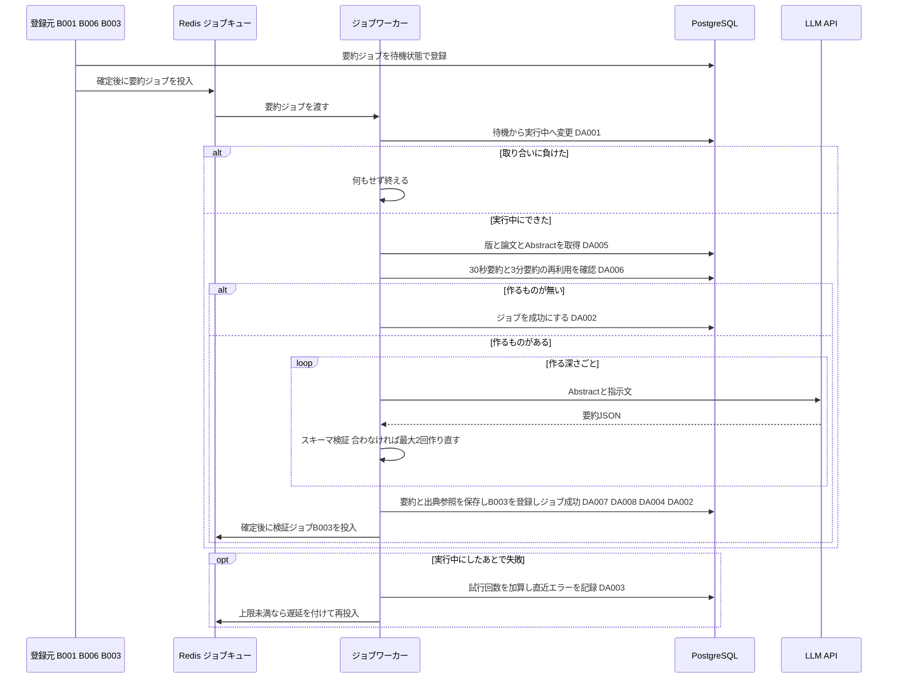
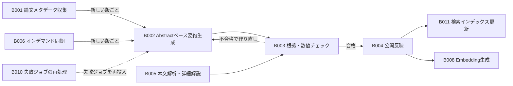

# バッチ詳細設計書 — B002 Abstractベース日本語要約生成

## 0. 文書情報

| 項目 | 値 |
| :--- | :--- |
| 設計書ID | B002-BE |
| 親ID | B002 |
| 親設計書 | `基本設計書_概要.md` §4 機能設計「バッチ処理設計」B002 行 |
| バッチ名 | Abstractベース日本語要約生成（上流 §4 バッチ処理設計の区分「非同期ジョブ」） |
| 対応する機能ID | F04 日本語構造化要約（上流 §4 機能一覧。B002 は F04 の30秒要約・3分要約を作る部分） |
| 関連する業務フローID | BF01 論文収集・日本語化（定期）、EX01 arXiv APIの取得失敗・レート制限（ジョブの再試行の扱い）、EX02 要約のスキーマ検証・根拠チェックで不合格（上流 §2） |
| 版 | 1.0 |
| 作成日 / 更新日 | 2026-10-27 / 2026-10-27 |
| 作成方法 | creating-backend-detailed-design v1.5.0 準拠。上流の確定設計書と `source/` の企画資料からの新規設計 |
| インプット | (a) `source/02_機能要求定義.md:9,21-29,45-47,57-58`、`source/03_システム構成.md:11-12,24,37-38,43,58,60`、`source/01_企画概要.md:33-36`、`source/04_収益化とロードマップ.md:25,27,44,47`／(b) `docs/基本設計書_概要.md` §1 用語集、§2 BF01・EX01・EX02、§4 F04・B002・B003・バッチ共通の方針、§6 T001〜T004・T009・CRUD図、§7 IF04、§8、§9 環境変数一覧、§10 運用監視、§11 ARC001〜ARC004・ARC006・ARC009、付録 Q19・Q24・Q29・Q31・Q35・Q36／関連する確定済み設計書: `docs/detail/be/BE.F04.BE詳細設計.md`（F04-BE。B002 の処理ロジックの定義元）、`docs/detail/be/BE.F01.BE詳細設計.md`・`docs/detail/batch/BT.B001.バッチ詳細設計.md`（B002 の登録元）、`docs/detail/be/BE.F03.BE詳細設計.md`（B006 の登録条件）、`docs/db/DB.T001`〜`T004`・`T009.DB物理設計.md`／(c) `legacy/`（空） |

* **インプットの性質（source/ の突合結果）**: `source/` は企画・初期設計案の Markdown 6ファイル（計227行）だけで、前の単位（B001）の作業時から変更はありません（ファイル数6件を再確認）。依頼にあるスケジュール定義 `config/schedule.rb`（whenever）と rake タスクの実装 `lib/tasks/` は**存在しません**（Ruby のファイル0件）。本システムのジョブは Python のワーカー（Redis + Celery または RQ）で動きます（`source/03_システム構成.md:7,11`）。さらに B002 は時刻で起動する定期実行ではなく、ジョブキューに登録されたときに動く**非同期ジョブ**です（上流 §4 B002「ジョブキュー」）。このため whenever に当たるスケジュール定義は B002 には無く（§5 スケジュール定義で「該当なし」と根拠を記載）、rake タスクに当たるものは §4 のジョブ関数に置き換えています。本書は**リバースエンジニアリングではなく新規設計**です。資料と上流に無い値には「※推測」を付けています。
* **既存版**: `docs/detail/batch/BT.B002.バッチ詳細設計.md` の旧版はありません（作業開始時点の `docs/detail/batch/` は B001 の1ファイルだけ）。本書が初版で、消さずに残すべき既存記述はありません。
* **legacy/ との突合**: `legacy/` は空ディレクトリです（ファイル0件。B001 の作業時から変更なし）。突合する既存のバッチ設計書・業務意図・非機能の記述はありません。
* **F04-BE との分担と継承**: B002 の処理ロジックは、上流 F04 の BE詳細設計書（F04-BE）で B002〜B005 をまとめて定義済みです。本書は、そのうち B002 が使う **DA-ID（F04-BE の DA001〜DA008）、関数（F04-BE §4 の No.1〜11・No.21）、トランザクションID（TX01・TX02・TX06）をそのまま引き継ぎ**、B002 単独で実装・運用できる形に展開します。そのうえで、起動契機・ワーカーの配置・多重起動制御・処理ステップ・性能・依存ジョブ順序・ログと監視を加えます。
  * **DA-ID の読み方**: DA-ID は設計書ごとの採番です。本書の DA001〜DA008 は **F04-BE の番号**であり、B001 のバッチ詳細設計書（F01-BE の番号）の DA001〜DA010 とは別のものです。B001 側の処理を指すときは「F01-BE DA007」のように設計書を添えます。
  * **食い違いの扱い**: 処理ロジックは F04-BE、起動と運用は本書を正とします。ただし、本書で見直した5点（§6 確認事項 No.9 に列挙）は本書を正とし、F04-BE への取り込みを求めます。
* **上流との差分**（※上流要確認）: 上流 §4 B003 は「生成された要約をスキーマで検証し…」とスキーマ検証を B003 の担当にしていますが、DB物理設計書 T003 §4.3 (4) と F04-BE は、スキーマ検証を保存前の B002 側へ移しています（スキーマに合わない出力を保存しないため。T003 §9 No.4）。本書もこの設計に従います（§6 確認事項 No.1）。

## 1. バックエンド構成・モジュール設計

* **対象ドメイン**: 要約系（Abstractベースの速報要約） — 論文の版ごとに、Abstract を材料として LLM で30秒要約（`short`）と3分要約（`standard`）を作り、要約スキーマに合うことを確かめてから未検証として保存し、根拠・数値チェック（B003）のジョブを登録する。すでに合格済みか検証待ちの要約がある深さは作らない（上流 B002・BF01・EX02、ARC001〜ARC003）。
* **対象APIエンドポイント**: なし。B002 は画面や外部から HTTP で呼ばれず、ジョブキューから取り出されて動きます（根拠は §2 APIエンドポイント一覧）。
* **実行基盤**: Pythonワーカー上の非同期ジョブです（Redis + Celery または RQ。どちらにするかは未決定、上流 Q02）。DB は Supabase 上の PostgreSQL に、行単位アクセス制御を通らないサーバ側のサービスロールで接続します（DB物理設計書 T003 §7「書き込みはサーバ側のサービスロール（ジョブワーカー）だけ」）。
* **ディレクトリ/ファイル構造**（※推測: F04-BE §1 の配置案のうち B002 が使うもの）:

```
worker/
├── jobs/
│   ├── runner.py                 # run（ジョブ共通の実行枠。ARC006）
│   └── summarize_abstract.py     # summarize_abstract（B002 の本処理）
├── summary/
│   ├── reuse.py                  # find_reusable_summary（生成物の使い回し確認。ARC001）
│   └── schema.py                 # validate_schema（要約スキーマ検証。ARC003）
├── llm/
│   ├── client.py                 # generate_structured（IF04 LLM API）
│   └── prompts.py                # build_prompt（深さ別の指示文）
└── repositories/
    ├── job_repository.py         # claim / mark_succeeded / mark_failed_or_retry / enqueue（DA001〜DA004）
    ├── paper_version_repository.py  # find_with_paper（DA005）
    └── summary_repository.py     # save_with_citations（DA007・DA008）
```

* **処理シーケンス図**（上流 BF01 のうち B002 の範囲と EX02 のスキーマ不一致を、ジョブの受け取りから終了まで展開。※推測を含む）:



## 2. API・インターフェース詳細設計

* **APIエンドポイント一覧（全数ロースター）**:

| API ID | メソッド | エンドポイント | 概要 | 定義状況 | 詳細の所在 |
| :--- | :--- | :--- | :--- | :--- | :--- |
| — | — | 該当なし | — | — | — |

**総件数: 0件。根拠**: 上流 `docs/基本設計書_概要.md` §7 内部API一覧の全8件（API01〜API08）に、B002 を起動・操作するものはありません。B002 の起動は登録元（B001・B006・B003）がジョブ行を登録してジョブキューへ投入することで行います（§5 起動契機一覧）。B002 が作った要約を画面へ返す API04 `GET /api/papers/{arxivId}/summary` は、要約を読む側の API で、仕様は F05 の BE詳細設計書が持ちます（F04-BE §2 API ロースター）。B002 は API04 と直接やり取りせず、`summaries`・`summary_citations` の行を介してつながります。

* **外部サービス連携一覧（全数ロースター）**: 上流 §7 外部連携一覧の全9件に対し、B002 で使うかを示します。

| IF ID | 連携先 | B002 での利用 | 概要 | 定義状況 | 詳細の所在 |
| :--- | :--- | :--- | :--- | :--- | :--- |
| IF01 | arXiv API | 利用しない | メタデータの取得は登録元の B001・B006 の責務。B002 は保存済みの Abstract だけを材料にする | - | `docs/detail/batch/BT.B001.バッチ詳細設計.md` |
| IF02 | arXiv（論文本文PDF） | 利用しない | 本文の取得は本文解析（B005）の責務。B002 は本文を読まない（ARC002） | - | `docs/detail/batch/BT.B005.バッチ詳細設計.md`（未作成） |
| IF03 | arXiv 原文ページ | 利用しない | 画面からのリンク遷移。B002 は出典URLとして版番号付きの論文ページのURLを保存するだけで、通信はしない | - | - |
| IF04 | LLM API | 利用する | Abstract と指示文を送り、30秒要約・3分要約の要約JSONを受け取る | 詳細 | 本節 外部サービス連携仕様、§4 No.9 `generate_structured` |
| IF05 | Supabase Auth | 利用しない | 利用者の認証は B002 に関係しない。DBへはサービスロールで接続する | - | - |
| IF06 | Stripe（決済セッション） | 利用しない | 課金（F12）の責務 | - | - |
| IF07 | Stripe（契約状態の通知） | 利用しない | 課金（F12）の責務 | - | - |
| IF08 | GitHub | 利用しない | GitHub関連付け（B009）の責務 | - | - |
| IF09 | 通知配信手段 | 利用しない | 通知・ダイジェスト配信（B007）の責務 | - | - |

**総件数: 9件（B002 で利用するもの1件）。根拠**: 上流 §7 外部連携一覧の IF01〜IF09 の全9行と1対1で対応します。上流 §2 BF01 のシーケンスのうち B002 の範囲（「B002 Abstractベースの日本語構造化要約を依頼」）に登場する外部の相手は LLM API だけです。Redis と PostgreSQL は上流 §7 で本システムの構成要素（内部）とされているため外部連携に含めません。

* **外部サービス連携仕様**（B002 で利用する IF04 の1件。F04-BE §2 のうち B002 に関わる値）:

| IF ID | 連携先 | 連携方式 | エンドポイント / 接続先 | 認証方式 | タイムアウト | リトライ方針 | エラー時の挙動 |
| :--- | :--- | :--- | :--- | :--- | :--- | :--- | :--- |
| IF04 | LLM API | REST API（※推測。上流 IF04 自体が※推測） | 提供元は未定（上流 Q29）。使うモデルは環境変数 `LLM_MODEL_ID` で指定する | APIキー（環境変数 `LLM_API_KEY`。※推測） | 1回の呼び出しにつき60秒（30秒要約・3分要約とも。※推測） | 通信のタイムアウト・接続失敗・提供元の混雑（HTTP 429）・提供元の障害（HTTP 5xx）のときだけ、2秒・4秒・8秒と間隔を倍にして最大3回まで呼び直す。それ以外の 400〜499（指示文の不備・認証失敗）は呼び直さない（※推測）。出力が要約スキーマに合わないときは、保存せずに最大2回まで作り直しを依頼する（上流 EX02。回数は※推測） | 呼び直しを使い切っても失敗したら例外を上げ、ジョブ共通の失敗処理（DA003）で試行回数を1増やす。上限未満ならジョブごと遅延を付けて再実行される（上流 EX01 と同じ扱い）。スキーマに合わない出力が3回続いたときも同じくジョブの失敗として扱う |

* **IF04 の送受信データと保存先の対応**（※推測: 項目の最終的な定義は要約スキーマの方式設計書 `docs/arch/方式.ARC003.方式設計.md`（未作成）が持つ。ここでは DB物理設計書 T003 §4.3 (4)・T004 §4.3 と F04-BE §4 No.8・No.10 で決まっている範囲を示す）:

| 区分 | データ | 出どころ・保存先 | 決め方 |
| :--- | :--- | :--- | :--- |
| 送信 | 原題 | `papers.title`（DA005 で読む） | 日本語タイトルに原題を併記させるため、材料として渡す（`source/02_機能要求定義.md:23`） |
| 送信 | Abstract | `papers.abstract`（DA005 で読む） | 唯一の材料。指示文とは区切って渡し、Abstract の中の文を指示として扱わないよう明記する（F04-BE §4 No.8 手順5） |
| 送信 | 深さごとの指示と出力形式 | プログラム内の指示文（`build_prompt`） | 30秒要約は結論中心、3分要約は研究背景・手法・主要結果・限界（`source/02_機能要求定義.md:24-25`）。共通して、日本語で書く・原題を併記する・主張ごとに主張IDと事実か推測かの区分を付ける・材料に無いことを事実として断定しない・数値とベンチマーク名を原文の表記のまま残す（`source/01_企画概要.md:33-35`、`source/03_システム構成.md:60`）。出力形式として要約スキーマの JSON Schema を付ける |
| 受信 | 要約JSON（日本語タイトル・原題・深さに応じた項目・主張の一覧） | `summaries.json_content` | スキーマ検証（`validate_schema`）を通ったものだけを、出典参照の配列を取り分けたうえで保存する。保存後は書き換えない（T003 §4.3 (4)） |
| 受信 | 使ったモデル名 | `summaries.model_id` | LLM の応答に含まれるモデル名をそのまま記録する。モデルごとの誤り率の比較に使う（T003 §4.3 (5)） |
| 受信 | 主張ごとの主張ID | `summary_citations.claim_id` | 要約JSONの主張の主張IDをそのまま使う。同じ要約の中で重複せず64文字以内であることをスキーマ検証で確かめる（T004 一意制約・桁数） |
| 固定値 | 出典の章 | `summary_citations.source_section` | LLM の出力に任せず、プログラムで「Abstract」を入れる。B002 の材料は Abstract だけで、章は存在しないため（T004 §4.3 (3)。※推測） |
| 固定値 | 出典ページ | `summary_citations.source_page` | 空（NULL）を入れる。Abstract にはページ番号が無いため（上流 §6 T004「Abstractベースでは空」） |
| 固定値 | 出典URL | `summary_citations.source_url` | LLM の出力に任せず、プログラムで要約した版の論文ページのURLを組み立てて入れる（`https://arxiv.org/abs/{arXiv ID}v{版番号}`。T004 §4.3 (4)。※推測）。LLM が不正なリンクを作っても保存されないようにするため |
| 固定値 | 要約種別・解析範囲・言語・検証状態・生成日時 | `summaries.summary_type`・`source_scope`・`language`・`validation_status`・`generated_at` | 要約種別は作った深さ（`short` か `standard`）、解析範囲は「Abstractのみ」（`abstract_only`）。言語は日本語（`ja`）、検証状態は未検証（`pending`）、生成日時は保存時刻で、いずれも列の初期値に任せる（T003 §6、F04-BE DA007） |

**総件数: 10行（送信3・受信3・固定値4）。根拠**: 送信は上流 IF04「送信: Abstract」と F04-BE §4 No.8 の指示文の構成要素、受信は上流 IF04「受信: 要約JSON」を保存先の列ごとに分けたもの、固定値は B002 が書く `summaries`（T003）と `summary_citations`（T004）の列のうち LLM の出力から取らない列です。`summaries` の7列（自動採番の `id` と、ジョブが指す版から決まる `paper_version_id` を除く）と `summary_citations` の4列（自動採番の `id` と、保存時に決まる `summary_id` を除く）がこの10行のいずれかに対応します。

* **API詳細仕様**: 該当なし（APIエンドポイント0件のため。根拠は上の一覧の直後に記載）。ジョブとしての入出力（ジョブキューへ投入するメッセージの内容）は §4 No.1 `run`・No.6 `summarize_abstract` と §5 の入出力一覧に記載します。

## 3. データアクセス（ORM / クエリ）設計

* **データアクセス一覧（全数ロースター）**: DA-ID は F04-BE §3 の採番をそのまま引き継ぎます（§0「DA-ID の読み方」）。F04-BE の DA009〜DA014 は B003〜B005 だけが使うため、本書には含めません。

| DA-ID | 処理名 | 呼出元（関数/API） | テーブルID | 対象物理テーブル | 種別 (SELECT/INSERT/UPDATE/DELETE) | 定義状況 (詳細/簡易) | 詳細の所在 |
| :--- | :--- | :--- | :--- | :--- | :--- | :--- | :--- |
| DA001 | ジョブの実行開始 | No.2 `claim`（No.1 `run` から呼ぶ） | T009 | jobs | UPDATE | 詳細 | §3 詳細定義 DA001・発行SQL DA001 |
| DA002 | ジョブの成功記録 | No.3 `mark_succeeded`（No.6 `summarize_abstract` から呼ぶ） | T009 | jobs | UPDATE | 詳細 | §3 詳細定義 DA002・発行SQL DA002 |
| DA003 | ジョブの失敗記録 | No.4 `mark_failed_or_retry`（No.1 `run` から呼ぶ） | T009 | jobs | UPDATE | 詳細 | §3 詳細定義 DA003・発行SQL DA003 |
| DA004 | 後続ジョブ（B003）の登録 | No.5 `enqueue`（No.6 `summarize_abstract` から呼ぶ） | T009 | jobs | INSERT（衝突時は何もしない） | 詳細 | §3 詳細定義 DA004・発行SQL DA004 |
| DA005 | 対象の版と論文の取得 | No.21 `find_with_paper` | T002・T001 | paper_versions, papers | SELECT | 詳細 | §3 詳細定義 DA005・発行SQL DA005 |
| DA006 | 再利用できる要約の確認 | No.7 `find_reusable_summary` | T003 | summaries | SELECT | 詳細 | §3 詳細定義 DA006・発行SQL DA006 |
| DA007 | 要約の保存 | No.11 `save_with_citations` | T003 | summaries | INSERT | 詳細 | §3 詳細定義 DA007・発行SQL DA007 |
| DA008 | 出典参照の保存 | No.11 `save_with_citations` | T004 | summary_citations | INSERT | 詳細 | §3 詳細定義 DA008・発行SQL DA008 |

**総件数: 8件（SELECT 2件・INSERT 3件・UPDATE 3件・DELETE 0件。全件 詳細）。全数である根拠**: §4 関数一覧の全12関数のうち DB へ問い合わせる7関数（No.2・3・4・5・7・11・21）の処理フローに現れる DB 操作を1件1行で数えたものです（No.2→DA001、No.3→DA002、No.4→DA003、No.5→DA004、No.21→DA005、No.7→DA006、No.11→DA007・DA008）。残りの5関数（No.1・6・8・9・10）は DB へ直接問い合わせず、これらの関数を呼ぶだけです。F04-BE §3 の DA001〜DA008 と内容が一致します。B002 は DELETE を発行しません（作った要約は不合格になっても誤り率の集計のため消さない。T003 §6）。
**上流 CRUD図との突合**: 上流 §6 CRUD図には B002 単独の行は無く、F04 行（papers R、paper_versions RU、summaries CRU、summary_citations C、jobs RU）にまとめられています。B002 の操作は papers R（DA005）、paper_versions R（DA005）、summaries CR（DA006・DA007）、summary_citations C（DA008）、jobs CU（DA001〜DA004）で、いずれも F04 行の範囲に収まります。ただし jobs の C（DA004 の検証ジョブの登録）は F04 行に無く、※上流要確認です（F04-BE §0 確認事項 No.2、DB物理設計書 T009 §9 No.5 と同じ事項。本書 §6 確認事項 No.2）。
**定義状況の判定**（completeness 3-1）: DA001〜DA004・DA007・DA008 は永続データを書き換える（3-1 の2）、DA005 は2テーブルを結合する（3-1 の3）、DA006 は作るかどうかを決める業務ルールを含む（3-1 の7）ため、8件とも「詳細」です。

* **データアクセス詳細定義**（定義状況＝詳細の8件）:

| DA-ID | 処理名 | テーブルID | 対象物理テーブル | JOIN / Include | 抽出条件 (Where) / ソート | トランザクション境界 | N+1対策・性能上の注意 |
| :--- | :--- | :--- | :--- | :--- | :--- | :--- | :--- |
| DA001 | ジョブの実行開始 | T009 | jobs | なし | 指定のジョブで状態が待機の行だけを実行中に変え、版ID・種別・試行回数を受け取る（`WHERE id = $1 AND status = 'pending' RETURNING …`） | 単独で即時に確定する（TX01）。他のワーカーに実行中であることを早く見せるため、本処理のトランザクションに含めない | 更新できた行が0件なら、他のワーカーが実行中か完了済みなので何もせずに終える（T009 §4.3 (4)「実行の取り合い」）。主キーで1行 |
| DA002 | ジョブの成功記録 | T009 | jobs | なし | 指定のジョブで状態が実行中の行だけを成功に変える（`WHERE id = $1 AND status = 'running'`） | 要約の保存と同じトランザクション（TX02）、または何も作らずに終えるときの単独のトランザクション（TX06）。保存と成功を同時に確定し、保存したのにジョブが待機へ戻って二重に生成することを防ぐ | 更新が0件なら他の処理が状態を変えたものとして例外（JobStateConflict）を上げ、保存ごと取り消す |
| DA003 | ジョブの失敗記録 | T009 | jobs | なし | 指定のジョブで状態が実行中の行について、試行回数を1増やし直近エラーを書く。増やした結果が上限以上なら失敗、未満なら待機に戻す（`SET attempts = attempts + 1, last_error = $2, status = CASE WHEN attempts + 1 >= $3 THEN 'failed' ELSE 'pending' END WHERE id = $1 AND status = 'running'`） | 単独で即時に確定する（TX01）。本処理のトランザクションを取り消した後に実行する | 上限は環境変数 `JOB_MAX_ATTEMPTS`（※推測: 3）。再試行しても結果が変わらない例外では、呼び出し元が上限を「今の試行回数＋1」にして必ず失敗にする（F04-BE §4 No.4）。直近エラーには APIキーや認証付きURLを取り除いた要約文だけを書く（T009 §4.3 (6)） |
| DA004 | 後続ジョブ（B003）の登録 | T009 | jobs | なし | 抽出条件なし。版を指定して種別「要約の根拠・数値チェック」の待機ジョブを1行追加する。同じ版・同じ種別で待機中か実行中の行があれば何もしない（`job_type = 'validate_summary'`、`ON CONFLICT (paper_version_id, job_type) WHERE status IN ('pending','running') AND paper_version_id IS NOT NULL DO NOTHING RETURNING id`） | 要約の保存と同じトランザクション（TX02）。確定した後に、登録できた行のジョブIDだけをジョブキューへ入れる | 部分一意インデックス `uq_jobs_active_per_version` に合わせて ON CONFLICT に同じ条件を書く（T009 §5.2）。登録されなかった（同じ版の検証ジョブが待機中か実行中）場合も、その検証ジョブが本書の保存した要約を拾う（B003 は版の未検証の要約をすべて対象にする。F04-BE §4 No.12）。実行中の検証ジョブが未検証の要約を読み終えた後に本書が保存した場合は、その検証ジョブが自身の確定後に未検証の要約の残りを読み直し、検証ジョブを登録し直す（F04-BE §4 No.12 手順7）ため、取りこぼされない |
| DA005 | 対象の版と論文の取得 | T002・T001 | paper_versions, papers | 版の論文IDで論文を内部結合する（`paper_versions.paper_id = papers.id`） | ジョブが指す版1件（`paper_versions.id = $1`）。ソートなし | なし（参照のみ） | 主キーで1行。Abstract は長い文字列だが1行なので問題にならない。0行ならジョブが存在しない版を指しているため、再試行しても変わらない失敗にする |
| DA006 | 再利用できる要約の確認 | T003 | summaries | なし | 指定の版・深さ・解析範囲（Abstractのみ）で、日本語かつ合格済みか検証待ちの要約が1件でもあるかを調べる（`paper_version_id = $1 AND summary_type = $2 AND source_scope = $3 AND language = 'ja' AND validation_status IN ('passed','pending') LIMIT 1`） | なし（参照のみ）。30秒要約と3分要約で1回ずつ、計2回発行する | 合格済みなら作り直さない（ARC001）。検証待ちがあるときも、二重に費用をかけないため作らない（※推測。検証待ちのまま残った場合は §6 確認事項 No.5）。不合格だけのとき、または要約が無いときは作る。`idx_summaries_lookup` の先頭2列で絞れる |
| DA007 | 要約の保存 | T003 | summaries | なし | 抽出条件なし。版・深さ・要約JSON・生成モデル・解析範囲（Abstractのみ）を指定して1行追加し、要約IDを受け取る。検証状態・言語・生成日時は列の初期値に任せる | TX02。作った深さの数（1件または2件）だけ発行し、出典参照（DA008）・後続ジョブ（DA004）・ジョブ成功（DA002）と同時に確定する | 深さと解析範囲の組み合わせは CHECK 制約で守られる（Abstractのみで作れるのは30秒要約・3分要約だけ。`ck_summaries_deep_requires_full_text`） |
| DA008 | 出典参照の保存 | T004 | summary_citations | なし | 抽出条件なし。保存した要約の主張ごとに1行、章「Abstract」・ページ空・版番号付きURLで追加する | DA007 と同じトランザクション（TX02）。要約だけが保存されて出典参照が無い状態を作らない（T004 §4.3 (1)） | 主張の数だけ1回ずつ発行せず、配列で渡して1文で全件を追加する（N+1 を避ける）。主張IDの重複は保存前のスキーマ検証で除いておく（`uq_summary_citations_summary_id_claim_id`） |

* **発行SQL**: 全8件（DA001〜DA008）。すべてプレースホルダ（`$1` から始まる番号付きの引数）に値を渡す固定の文で、実行時に文の構造を組み立てる動的SQLはありません（深さや解析範囲は値として渡すだけで、条件句の有無は変わらない）。F04-BE §3 の発行SQLと同じ文です。

**DA001 ジョブの実行開始**
```sql
UPDATE jobs
SET status = 'running'
WHERE id = $1
  AND status = 'pending'
RETURNING id, paper_version_id, job_type, attempts;
-- 行が返らなければ取り合いに負けたものとして何もせず終える
```
組み立ての分岐: なし（固定の1文）。

**DA002 ジョブの成功記録**
```sql
UPDATE jobs
SET status = 'succeeded'
WHERE id = $1
  AND status = 'running';
-- 更新件数が0なら JobStateConflict を上げて保存ごと取り消す
```
組み立ての分岐: なし（固定の1文）。

**DA003 ジョブの失敗記録**（`$2` は直近エラーの要約文、`$3` は試行回数の上限）
```sql
UPDATE jobs
SET attempts   = attempts + 1,
    last_error = $2,
    status     = CASE WHEN attempts + 1 >= $3 THEN 'failed' ELSE 'pending' END
WHERE id = $1
  AND status = 'running'
RETURNING status, attempts;
```
組み立ての分岐: なし（固定の1文）。再試行しても変わらない例外のときは、`$3` に「今の試行回数＋1」を渡して必ず失敗にします（値の違いだけで文は同じ）。

**DA004 後続ジョブ（B003）の登録**
```sql
INSERT INTO jobs (paper_version_id, job_type)
VALUES ($1, 'validate_summary')
ON CONFLICT (paper_version_id, job_type)
  WHERE status IN ('pending', 'running') AND paper_version_id IS NOT NULL
  DO NOTHING
RETURNING id;
-- 行が返ったときだけ、確定後にジョブキューへ投入する
```
組み立ての分岐: なし（固定の1文）。F04-BE は種別を `$2` で渡す共通の文としていますが、B002 が登録するのは `validate_summary` だけです。

**DA005 対象の版と論文の取得**
```sql
SELECT pv.id AS paper_version_id, pv.version, pv.content_status, pv.license_type,
       p.id AS paper_id, p.arxiv_id, p.title, p.abstract
FROM paper_versions pv
JOIN papers p
  ON p.id = pv.paper_id
WHERE pv.id = $1;
```
組み立ての分岐: なし（固定の1文）。

**DA006 再利用できる要約の確認**（`$2` は `short` か `standard`、`$3` は B002 では常に `abstract_only`）
```sql
SELECT id, validation_status
FROM summaries
WHERE paper_version_id = $1
  AND summary_type = $2
  AND source_scope = $3
  AND language = 'ja'
  AND validation_status IN ('passed', 'pending')
LIMIT 1;
```
組み立ての分岐: なし（固定の1文を深さごとに2回発行する）。

**DA007 要約の保存**（`$5` は B002 では常に `abstract_only`）
```sql
INSERT INTO summaries (paper_version_id, summary_type, json_content, model_id, source_scope)
VALUES ($1, $2, $3::jsonb, $4, $5)
RETURNING id;
```
組み立ての分岐: なし（固定の1文を作った深さの数だけ発行する）。

**DA008 出典参照の保存**（主張の配列を4つの配列パラメータで渡し、1文で追加する。B002 では `$3` の要素はすべて `Abstract`、`$4` の要素はすべて NULL）
```sql
INSERT INTO summary_citations (summary_id, claim_id, source_section, source_page, source_url)
SELECT $1, c.claim_id, c.source_section, c.source_page, c.source_url
FROM unnest($2::varchar[], $3::text[], $4::int[], $5::text[])
     AS c(claim_id, source_section, source_page, source_url);
```
組み立ての分岐: なし（固定の1文）。主張が0件の要約はスキーマ検証で不合格にするため、空の配列で発行されることはありません。

## 4. サーバー側機能・処理ロジック設計（IPO設計）

* **関数一覧（全数ロースター）**: No と関数名は F04-BE §4 の採番をそのまま引き継ぎます。F04-BE の No.12〜20・22〜25 は B003〜B005 だけが使うため、本書には含めません。

| No | 関数名 | 所属モジュール（※推測） | 概要 | 定義状況 | 詳細の所在 |
| :--- | :--- | :--- | :--- | :--- | :--- |
| 1 | `run` | `worker/jobs/runner.py`（JobRunner） | ジョブ共通の実行枠。取り合い、本処理の呼び出し、失敗時の記録と遅延付きの再投入を受け持つ | 詳細 | §4 IPO定義 |
| 2 | `claim` | `worker/repositories/job_repository.py` | 待機中のジョブを実行中に変え、取り合いに勝ったときだけジョブの内容を返す（DA001） | 詳細 | §4 IPO定義 |
| 3 | `mark_succeeded` | `worker/repositories/job_repository.py` | 保存と同じトランザクションの中で、実行中のジョブを成功にする（DA002） | 詳細 | §4 IPO定義 |
| 4 | `mark_failed_or_retry` | `worker/repositories/job_repository.py` | 失敗の回数を数え、上限未満なら待機へ戻し、上限に達したら失敗にする（DA003） | 詳細 | §4 IPO定義 |
| 5 | `enqueue` | `worker/repositories/job_repository.py` | 検証ジョブ（B003）を重複なく登録し、確定後にジョブキューへ入れる（DA004） | 詳細 | §4 IPO定義 |
| 6 | `summarize_abstract` | `worker/jobs/summarize_abstract.py` | B002 の本処理。Abstract から30秒要約と3分要約のうち未作成のものを作って保存する | 詳細 | §4 IPO定義 |
| 7 | `find_reusable_summary` | `worker/summary/reuse.py` | 同じ版・深さで合格済みか検証待ちの要約があるかを調べ、作り直しが不要かを判定する（DA006） | 詳細 | §4 IPO定義 |
| 8 | `build_prompt` | `worker/llm/prompts.py` | 深さと材料に応じた LLM への指示文を組み立てる | 詳細 | §4 IPO定義 |
| 9 | `generate_structured` | `worker/llm/client.py`（LlmClient） | LLM API を呼んで JSON を受け取る。通信の呼び直しを受け持つ | 詳細 | §4 IPO定義 |
| 10 | `validate_schema` | `worker/summary/schema.py` | LLM の出力が要約スキーマに合うかを確かめ、保存用の要約と出典参照に分ける | 詳細 | §4 IPO定義 |
| 11 | `save_with_citations` | `worker/repositories/summary_repository.py` | 要約を未検証として追加し、その主張の出典参照をまとめて追加する（DA007・DA008） | 詳細 | §4 IPO定義 |
| 21 | `find_with_paper` | `worker/repositories/paper_version_repository.py` | ジョブが指す版と、その論文の原題・Abstract をまとめて読む（DA005） | 詳細 | §4 IPO定義 |

**総件数: 12関数（全件 詳細）。全数である根拠**: F04-BE §4 関数ロースターの全25件のうち、B002 の処理（F04-BE §4 No.6 `summarize_abstract` の処理フロー）から呼ばれる関数と、B002 を含むジョブ共通の実行枠（No.1〜5）を、呼び出し関係をたどって拾ったものです（`run`→`claim`・`summarize_abstract`・`mark_failed_or_retry`、`summarize_abstract`→`find_with_paper`・`find_reusable_summary`・`build_prompt`・`generate_structured`・`validate_schema`・`save_with_citations`・`enqueue`・`mark_succeeded`）。残りの13関数（No.12〜20・22〜25）は B003・B004・B005 からだけ呼ばれます。ソースコードが無いため実在の関数との突合はできず、関数名と分け方は※推測です。
**定義状況の判定**（completeness 3-1）: 分岐を持つもの（No.1・6〜10）、状態を書き換えるもの（No.2〜5・11）、複数テーブルを結合するもの（No.21）で、12関数とも「詳細」です（F04-BE §4 の判定と同じ）。

* **入力・処理・出力（IPO）定義**:

| No | 関数名 | 所属モジュール | 引数 (型) | 処理フロー (ステップ単位で具体的に) | 戻り値 | 発生しうるエラー |
| :--- | :--- | :--- | :--- | :--- | :--- | :--- |
| 1 | `run` | JobRunner | job_id: int, handler: 本処理の関数（B002 では `summarize_abstract`） | 1. `claim` で待機中のジョブを実行中にする。取り合いに負けた（null）なら INFO ログ（§5 ログ No.1）を残して終える。<br>2. `claim` 自体が DB の失敗で例外を上げたときは、ジョブはまだ待機で失敗を jobs に記録できない（DA003 は実行中の行だけを更新する）。ERROR ログ（§5 ログ No.9）を出し、例外をジョブキューへ返す。ジョブキューの再配送で同じジョブIDがもう一度渡される（※推測: Celery では、処理完了後に受け取りを確認する設定 `acks_late=True` と、例外で終わったタスクを確認済みにしない設定 `task_acks_on_failure_or_timeout=False` の両方が要る。前者だけでは例外で終わったタスクも確認済みになり再配送されない。RQ では例外で終わったジョブが失敗ジョブの登録簿に移るため、その登録簿から再投入する仕組みを ARC006 で用意する）。<br>3. 本処理を呼ぶ。本処理は自身のトランザクションで保存・後続ジョブ登録・ジョブ成功を確定する。<br>4. 本処理が例外を上げたら、トランザクションを取り消してから `mark_failed_or_retry` を呼ぶ。試行回数の上限によらずすぐ失敗にするのは、ジョブが指す版が無い（PaperVersionNotFound）ときだけである（何度やり直しても版は現れないため）。LlmPermanentError（認証失敗・指示文の不備）を含むほかの例外は、運用者が設定を直した後の再処理で回復できるよう、試行回数の上限まで再試行する（§6 リトライ方針・エラーハンドリング）。JobStateConflict は失敗を記録せずに終える（No.3）。<br>5. 戻ってきた状態が待機なら、試行回数に応じた遅延（1回目の失敗の後は1分、2回目の失敗の後は5分。※推測）を付けて、同じジョブIDをジョブキューへ再投入する。失敗なら失敗キューへ送り、ERROR ログ（§5 ログ No.6）を残す（上流 EX01、ARC006） | なし | なし（本処理の例外はここで受け止め、ジョブの状態として残す。`claim` の DB 失敗だけは手順2のとおりジョブキューへ返す） |
| 2 | `claim` | JobRepository | job_id: int | 1. DA001 を発行し、即時に確定する。<br>2. 更新できた行があればジョブの内容を、無ければ null を返す | { id, paperVersionId, jobType, attempts } または null | DB の接続・問い合わせ失敗（例外を上げる。`run` 手順2） |
| 3 | `mark_succeeded` | JobRepository | conn: トランザクション中の接続, job_id: int | 1. 呼び出し側のトランザクションの中で DA002 を発行する。<br>2. 更新が0件なら（他のワーカーが状態を変えた）JobStateConflict を上げて、保存ごと取り消させる | なし | JobStateConflict（→ `run` が WARN ログを残して終える。失敗記録はしない） |
| 4 | `mark_failed_or_retry` | JobRepository | job_id: int, error: Exception, force_fail: bool | 1. エラーの種類と要約から直近エラーの文を作る。APIキー・認証付きURL・スタックトレースは取り除き、2,000文字（※推測）で切る（スタックトレースはアプリのログにだけ出す。T009 §4.3 (6)）。<br>2. 上限を決める。再試行しても変わらない例外（force_fail が真）なら上限を「今の試行回数＋1」にして必ず失敗にし、それ以外は環境変数 `JOB_MAX_ATTEMPTS`（※推測: 3）を使う。<br>3. DA003 を発行し、即時に確定する。<br>4. 更新後の状態と試行回数を返す。更新が0件なら null を返す | { status: 'pending' または 'failed', attempts: int } または null | DB の接続・問い合わせ失敗（ERROR ログ（§5 ログ No.9）。ジョブは実行中のまま残る。§6 確認事項 No.4） |
| 5 | `enqueue` | JobRepository | conn: トランザクション中の接続, paper_version_id: int, job_type: str（B002 では `validate_summary`） | 1. 呼び出し側のトランザクションの中で DA004 を発行する。<br>2. 登録できたジョブIDを、確定後にジョブキューへ入れる予約リストに積む。登録されなかった（同じ版の検証ジョブが待機中か実行中）ときは何もしない。<br>3. 呼び出し側の確定が成功したら、予約リストのジョブIDをジョブキューへ投入する | 登録したジョブID または null | ジョブキュー（Redis）への投入失敗（ERROR ログ（§5 ログ No.8）。ジョブ行は待機のまま残る。§6 確認事項 No.3） |
| 6 | `summarize_abstract` | `worker/jobs/summarize_abstract.py` | job: { id, paperVersionId } | 1. `find_with_paper` で版・論文・原題・Abstract を得る。<br>2. 30秒要約と3分要約のそれぞれについて、`find_reusable_summary`（解析範囲は Abstract のみ）で作り直しが不要か確かめ、不要な深さは飛ばす（ARC001）。<br>3. 作る深さが1つも無ければ、要約の保存と検証ジョブの登録をせずに `mark_succeeded` だけを行って確定し（TX06）、INFO ログ（§5 ログ No.2）を出して終える。<br>4. 作る深さごとに、`build_prompt` で指示文を作り、`generate_structured` で LLM を呼び（1回60秒）、`validate_schema` で確かめる。合わなければ WARN ログ（§5 ログ No.3）を出し、最大2回まで作り直しを依頼する（上流 EX02。※推測）。3回とも合わなければ SchemaMismatchError を上げる（すでに作り終えた深さの結果も保存しない）。LLM の呼び出しはトランザクションの外で行う。<br>5. 出典参照の章・ページ・URLを、LLM の出力によらずプログラムで「Abstract」・空・版番号付きの論文ページのURLに置き換える（§2 IF04 の送受信データと保存先の対応）。<br>6. 1つのトランザクション（TX02）で、作った深さごとに `save_with_citations`（解析範囲は Abstract のみ）、`enqueue` で検証ジョブ（B003）、`mark_succeeded` を行い確定する。<br>7. 確定の後で、登録できた検証ジョブをジョブキューへ投入する（`enqueue` 手順3）。<br>8. 作った深さ・主張の数・LLM の所要時間と使ったトークン数・ジョブの所要時間を INFO ログ（§5 ログ No.5）に出す | なし | PaperVersionNotFound（再試行しても変わらない）、LlmTransientError、LlmPermanentError、SchemaMismatchError、JobStateConflict、DB の接続失敗・制約違反（いずれも `run` が受け止める） |
| 7 | `find_reusable_summary` | `worker/summary/reuse.py` | conn, paper_version_id: int, summary_type: str（`short` か `standard`）, source_scope: str（B002 では `abstract_only`） | 1. DA006 を発行する。<br>2. 合格済みか検証待ちの要約があれば「作り直し不要」を返す。不合格の要約しか無い、または要約が無ければ「作る」を返す。<br>3. 検証待ちを「作り直し不要」とするのは、検証の途中で同じ要約を二重に作って費用をかけないため。検証ジョブが失敗で終わって検証待ちが残った場合は、その深さの作り直しが止まる。回復は失敗ジョブの再処理（B010）で検証ジョブを待機に戻して行う（§6 確認事項 No.5） | boolean（作り直し不要なら true） | DB の接続失敗 |
| 8 | `build_prompt` | `worker/llm/prompts.py` | summary_type: str, material: { title, abstract } | 1. 深さに応じて求める項目を決める。30秒要約は結論中心、3分要約は研究背景・手法・主要結果・限界（`source/02_機能要求定義.md:24-25`）。<br>2. 共通の指示として、日本語で書く・原題を併記する・主張ごとに主張IDと事実か推測かの区分を付ける・材料に書かれていないことを事実として断定しない・推測は推測と明示する・数値とベンチマーク名を原文の表記のまま残すことを加える（`source/01_企画概要.md:33-35`、`source/03_システム構成.md:60`）。<br>3. 出力形式として要約スキーマ（ARC003）の JSON Schema を付ける。<br>4. Abstract は指示文と区切って渡し、Abstract の中の文を指示として扱わないよう明記する（§6 セキュリティ設計「指示文への割り込み」） | { system: str, user: str, json_schema: dict } | なし |
| 9 | `generate_structured` | LlmClient | prompt: `build_prompt` の戻り値, timeout_sec: int（B002 では60） | 1. 環境変数 `LLM_MODEL_ID`・`LLM_API_KEY` で LLM API を呼ぶ（IF04）。<br>2. タイムアウト・接続失敗・HTTP 429・HTTP 5xx のときは2秒・4秒・8秒と間隔をあけて最大3回まで呼び直す。呼び直すたびに WARN ログ（§5 ログ No.4）を出す。<br>3. それ以外の失敗、または呼び直しを使い切ったら例外を上げる。<br>4. 応答の本文を JSON として読み取り、読めなければスキーマ不一致として扱う。<br>5. 使ったモデル名と、応答に含まれる入力・出力のトークン数を戻り値に含める（モデル名は要約の生成モデル列に、トークン数はログに残すため） | { content: dict, model_id: str, input_tokens: int または None, output_tokens: int または None } | LlmTransientError（呼び直しを使い切った）、LlmPermanentError（認証失敗・指示文の不備）、SchemaMismatchError（JSON として読めない） |
| 10 | `validate_schema` | `worker/summary/schema.py` | content: dict, summary_type: str | 1. 要約スキーマ（ARC003）の JSON Schema で項目の有無と型を確かめる。<br>2. 日本語タイトルと原題があるか、深さに必要な項目がそろっているかを確かめる。<br>3. 主張が1件以上あり、主張ごとに主張IDがあり、同じ要約の中で重複せず、64文字以内かを確かめる（T004 一意制約・桁数）。<br>4. 主張ごとに事実か推測かの区分があるかを確かめる（ARC004）。<br>5. 1つでも外れたら理由の一覧を付けてスキーマ不一致とする。<br>6. 通ったら、要約本文（主張の一覧を含む）と、主張ごとの出典参照の配列に分けて返す。出典の章・ページ・URLは B002 では呼び出し元が置き換えるため、ここでは形式だけを確かめる（F04-BE §4 No.10 手順5の URL 形式の確認は、置き換えた後の値で必ず通る） | { content: dict, citations: [{ claim_id, source_section, source_page, source_url }] } | SchemaMismatchError（理由の一覧付き） |
| 11 | `save_with_citations` | SummaryRepository | conn, paper_version_id: int, summary_type: str, source_scope: str, content: dict, model_id: str, citations: 出典参照の配列 | 1. DA007 で要約を未検証として追加し、要約IDを得る。<br>2. DA008 で出典参照の全件を1文で追加する。<br>3. 確定は呼び出し側（TX02）が行う | 要約ID | DB の制約違反（深さと解析範囲の組み合わせ違反・主張IDの重複・URL形式違反。保存前の検証で防いでいるため、起きたら実装の誤りとして扱う）、DB の接続失敗 |
| 21 | `find_with_paper` | PaperVersionRepository | conn, paper_version_id: int | 1. DA005 を発行する。<br>2. 0行なら PaperVersionNotFound を上げる（ジョブが存在しない版を指している） | { paperVersionId, version, contentStatus, licenseType, paperId, arxivId, title, abstract } | PaperVersionNotFound、DB の接続失敗 |

## 5. バッチ処理・非同期タスク設計

* **起動契機一覧（全数ロースター）**: B002 のジョブ行が作られ、ジョブキューから取り出されて動き出す経路をすべて挙げます。

| No | 起動契機 | 登録・投入する主体 | 登録の条件 | 概要 | 定義状況 | 詳細の所在 |
| :--- | :--- | :--- | :--- | :--- | :--- | :--- |
| 1 | 定期収集で新しい版が入った | 論文メタデータ収集（B001） | 論文1件の取り込みで新しい版が追加されたとき（F01-BE DA006 で行が返ったとき） | 版と同じトランザクションで要約ジョブを登録し、確定後に投入する（F01-BE DA007、BT.B001 §5 処理ステップ 手順10・11） | 詳細 | `docs/detail/batch/BT.B001.バッチ詳細設計.md` §3 DA007、本書 §5 処理ステップ詳細 |
| 2 | オンデマンド同期で新しい版が入った | arXivオンデマンド同期（B006） | 検索で必要になった論文を取り込み、新しい版が追加されたとき（DB物理設計書 T001 §4.3「B001・B006 は…要約ジョブ（B002）を登録します」、F03-BE §5「取り込み後の要約生成（B002）以降は通常の流れに乗る」） | 登録の書き方は B001 と同じ（※推測。B006 の設計書で確定する） | 詳細 | `docs/detail/batch/BT.B006.バッチ詳細設計.md`（未作成） |
| 3 | 検証で不合格になり作り直しが決まった | 要約の根拠・数値チェック（B003） | 30秒要約か3分要約が不合格で、その版・深さの不合格の件数が上限（※推測: 2）未満のとき（F04-BE §4 No.12 手順6・No.15） | 検証結果と同じトランザクションで要約ジョブを登録する。B002 は不合格の深さだけを作り直す（DA006 は不合格の要約を「作る」と判定する） | 詳細 | `docs/detail/batch/BT.B003.バッチ詳細設計.md`（未作成）、F04-BE §4 No.12 |
| 4 | 自動再試行 | B002 自身（`run`） | 再試行できる失敗で試行回数が上限未満のとき | 同じジョブIDを遅延付きで再投入する。ジョブ行は新しく作らない（上流 EX01 と同じ扱い） | 詳細 | §4 No.1 `run`、§6 リトライ方針 |
| 5 | 失敗ジョブの再処理 | 運用者が起動する失敗ジョブの再処理（B010） | 失敗で終わった要約ジョブの原因を取り除いたとき | 失敗のジョブを待機に戻して再投入する。ジョブ行は新しく作らない（上流 B010、DB物理設計書 T009 §4.3 (4)） | 詳細 | `docs/detail/batch/BT.B010.バッチ詳細設計.md`（未作成） |

**総件数: 5件。全数である根拠**: DB物理設計書 T009 §4.6 と各設計書で `summarize_abstract` の行を登録すると定義された処理（B001: F01-BE DA007、B006: T001 §4.3、B003: F04-BE §4 No.12）の3件と、既存の行を再投入する経路（自動再試行: F04-BE §4 No.1、再処理: 上流 B010）の2件です。利用者の操作や画面から直接 B002 を登録する経路はありません（上流 §7 内部API一覧に該当なし）。
**定義状況の判定**（completeness 3-1）: 5件とも B002 を起動して永続データを書き換える（3-1 の2）ため「詳細」です。

* **スケジュール定義**（whenever の `config/schedule.rb` に当たる定義）: **該当なし**。B002 は時刻で起動する定期実行ではなく、登録元がジョブ行を登録したときに動く非同期ジョブです（上流 §4 B002 の実行タイミング「ジョブキュー」）。cron 式・実行時刻・タイムゾーンの設定はありません。実際に動く時間帯は、登録元の大半を占める定期収集（B001、毎日 02:00 UTC）の直後になります（§5 性能）。

* **ワーカーの配置**（whenever の `roles` による専用サーバ判定に当たる定義。※推測・※上流未定義: キュー名と並列数は上流で未定義。上流 §4 B002「キュー名は未定義」、Q02）:

| 項目 | 値 | 説明 |
| :--- | :--- | :--- |
| キュー | B002 専用のキュー `summarize`（※推測） | F04-BE §5 は「B002〜B004 は同じキュー、B005 は別のキュー（例 `fulltext`）」としているが、本書は B002 を専用のキューに分ける。収集の直後に数百〜千件余りの B002 がまとめて入り、同じキューの B003 と取り合うと、検証・公開が遅れて新着から速報公開までの時間（`source/04_収益化とロードマップ.md:44`）が伸びるため。また、LLM の呼び出し量を B002 単独の並列数で抑えられるようにする（§6 確認事項 No.9） |
| 処理するワーカー | `summarize` キューを購読するワーカーのプロセス。本番では1つ以上のホストに置いてよい | 定期実行ではないため、1か所に限る必要はない。同じジョブが2つのワーカーに渡っても、DA001 の取り合いで1つだけが処理する |
| 並列数 | 全ワーカーの合計で8（※推測。設定値 `SUMMARY_WORKER_CONCURRENCY`） | LLM 提供元の毎分の呼び出し回数とトークン数の上限（未定。上流 Q29）を超えないよう、B002 全体の同時実行数で抑える。8並列で毎分約24回の呼び出し・約5.4万トークンの見込み（§5 性能） |
| 実行環境 | production・staging・development のどれでも動く。staging・development では、LLM の費用を抑えるため、登録元（定期収集）を止めるか、検証用の少数の版だけを登録する（※推測） | B002 は自分からは動かないため、環境ごとの有効・無効は登録元の側で決まる |

* **多重起動制御**: 同じ版の要約を二重に作ると LLM の費用が二重にかかります（`source/04_収益化とロードマップ.md:27`）。次の4段階で防ぎます。

| No | 段階 | 防ぐもの | 方法 | 防げなかったときの結果 |
| :--- | :--- | :--- | :--- | :--- |
| 1 | 登録 | 同じ版の要約ジョブが2つ待機・実行されること | 同じ版・同じ種別で待機中か実行中の行は1件までしか作れない部分一意インデックス（`uq_jobs_active_per_version`）に当たったら、登録を取りやめる（F01-BE DA007、B003 の登録も同じ書き方） | — （DB が保証する） |
| 2 | 着手の取り合い | 同じジョブがジョブキューから2つのワーカーへ渡ること | 状態が待機の行だけを実行中に変える条件付きの更新で、勝った1つだけが処理する（DA001） | — （DB が保証する） |
| 3 | 作り直しの判定 | 合格済みか検証待ちの要約がある深さを、もう一度作ること | LLM を呼ぶ前に、版・深さごとに再利用できる要約を確かめる（DA006） | 段階1により同じ版の B002 は同時に1つしか動かないため、判定と保存の間に別の B002 が同じ深さを保存することはない |
| 4 | 成功の記録 | 保存した後で、他の処理がジョブの状態を変えていた場合に二重の結果を残すこと | 成功の記録を状態が実行中の行に限り、0件なら保存ごと取り消す（DA002・JobStateConflict） | — （DB が保証する） |

**総件数: 4段階。根拠**: 二重生成の原因になる「ジョブ行の重複登録」「同一ジョブの重複配送」「作成済みの深さの再生成」「状態が変わった後の保存」の4つに1段階ずつ対応させたものです。

* **入出力一覧（IPO: 対象テーブル・外部連携）**: B002 が読み書きするものをすべて挙げます。

| 区分 | ID | 名称 | 物理名・接続先 | 操作 | 内容 |
| :--- | :--- | :--- | :--- | :--- | :--- |
| 入力 | — | ジョブキューのメッセージ | Redis の `summarize` キュー（`REDIS_URL`） | 受信 | 要約ジョブのジョブID |
| 入力 | T001 | 論文 | papers | 参照（DA005） | 原題・Abstract・arXiv ID |
| 入力 | T002 | 論文バージョン | paper_versions | 参照（DA005） | 版番号（出典URLの組み立てに使う） |
| 入力・出力 | T003 | 要約 | summaries | 参照・追加（DA006・DA007） | 再利用できる要約の有無の確認と、30秒要約・3分要約の追加 |
| 出力 | T004 | 要約出典参照 | summary_citations | 追加（DA008） | 主張ごとの出典参照 |
| 入力・出力 | T009 | ジョブ | jobs | 自身の状態変更（DA001〜DA003）、検証ジョブの追加（DA004） | 要約ジョブの状態・試行回数・直近エラーと、検証ジョブ（B003） |
| 入力・出力 | IF04 | LLM API | 提供元は未定（`LLM_MODEL_ID`・`LLM_API_KEY`） | 送受信 | 送信: 原題・Abstract・指示文、受信: 要約JSON・モデル名・トークン数（§2） |
| 入力 | — | 設定値 | ワーカーの環境変数 | 参照 | §6 設定値一覧の7件 |
| 出力 | — | ジョブキュー | Redis（`REDIS_URL`） | 送信 | 検証ジョブ（B003）の投入、自身の再投入、上限到達時の失敗キューへの投入 |
| 出力 | — | 構造化ログ | ワーカーの標準出力（※推測: ホスティング先のログ収集に任せる） | 出力 | 本節 ログ出力一覧の9種類 |

**総件数: 10件（入力4件・入出力3件・出力3件）。根拠**: テーブルは §3 データアクセス一覧の8件が触れる5テーブル（T001・T002・T003・T004・T009）と一致し、外部連携は §2 外部サービス連携一覧で「利用する」の1件と一致します。ジョブキュー・設定値・ログは §4 の IPO 定義の引数と処理フローに現れる入出力を拾ったものです。

* **処理ステップ詳細**: 起動契機 No.1（定期収集で新しい版が入った）の1件分を、ジョブの受け取りから終了まで順に示します。起動契機 No.2・No.3 は登録元が違うだけで手順1から同じです。No.4・No.5 は既存のジョブ行を再投入するもので、同じく手順1から始まります。

| 手順 | 処理 | 対象（ID） | DA-ID / 関数 | 成功時の次の手順 | 失敗時の扱い |
| :--- | :--- | :--- | :--- | :--- | :--- |
| 1 | ワーカーが `summarize` キューから要約ジョブを受け取る | Redis | No.1 `run` | 2 | — （受け取れないジョブは Redis に残る） |
| 2 | ジョブを待機から実行中に変える | T009 | DA001（No.2 `claim`） | 1行変えた: 3／0行: INFO ログ（No.1）を出して終了 | DB の失敗は、ジョブがまだ待機のため jobs に記録できない。ERROR ログ（No.9）を出してジョブキューへ例外を返し、再配送に任せる（※推測。§6 確認事項 No.4） |
| 3 | 版・論文・原題・Abstract を読む | T002・T001 | DA005（No.21 `find_with_paper`） | 4 | 版が無ければ再試行しても変わらない失敗として手順12（必ず失敗にする）。DB の失敗は再試行できる失敗として手順12 |
| 4 | 30秒要約を作る必要があるかを確かめる | T003 | DA006（No.7） | 5 | DB の失敗は再試行できる失敗として手順12 |
| 5 | 3分要約を作る必要があるかを確かめる | T003 | DA006（No.7） | 作るものあり: 7／作るもの無し: 6 | DB の失敗は再試行できる失敗として手順12 |
| 6 | 何も作らずにジョブを成功にして確定する | T009 | DA002（No.3、TX06） | 終了（INFO ログ No.2） | DB の失敗は再試行できる失敗として手順12 |
| 7 | 作る深さごとに指示文を作る | — | No.8 `build_prompt` | 8 | — |
| 8 | LLM に要約を依頼する。通信の失敗は2秒・4秒・8秒の間隔で最大3回呼び直す | IF04 | No.9 `generate_structured` | 9 | 呼び直しを使い切ったら再試行できる失敗として手順12。認証失敗・指示文の不備も手順12 |
| 9 | 要約スキーマに合うかを確かめる | — | No.10 `validate_schema` | 合う: 次の深さがあれば 7、全部そろえば 10／合わない: WARN ログ（No.3）を出し、作り直しが2回未満なら 8 | 3回とも合わなければ再試行できる失敗として手順12（作り終えた深さも保存しない） |
| 10 | 出典の章・ページ・URLを「Abstract」・空・版番号付きURLに置き換え、1つのトランザクションで要約と出典参照の保存、検証ジョブの登録、ジョブの成功を確定する | T003・T004・T009 | DA007・DA008（No.11）、DA004（No.5）、DA002（No.3）、TX02 | 11 | どれかが失敗したら全体を取り消し、再試行できる失敗として手順12。成功の記録が0件（JobStateConflict）なら全体を取り消し、WARN ログ（No.7）を出して終了（失敗記録はしない） |
| 11 | 確定の後で、登録できた検証ジョブをジョブキューへ投入する | Redis | No.5 `enqueue` | 終了（INFO ログ No.5） | ERROR ログ（No.8）。検証ジョブの行は待機のまま残る（§6 確認事項 No.3）。B002 自身は成功のまま |
| 12 | 実行中にした後の失敗を記録する。上限未満なら遅延を付けて同じジョブを再投入し、上限到達か再試行しても変わらない失敗なら失敗キューへ送る | T009・Redis | DA003（No.4）、No.1 `run` | 終了（WARN または ERROR ログ No.6） | 記録できない場合は ERROR ログ（No.9）だけ残し、ジョブは実行中のまま（§6 確認事項 No.4） |

**総件数: 12手順。根拠**: §4 の No.1 `run`（手順1〜5）と No.6 `summarize_abstract`（手順1〜8）の処理フローを、DB 操作・外部連携・分岐の単位で1行ずつ並べたものです。DA001〜DA008 の全8件が少なくとも1つの手順に現れます（DA001: 手順2、DA002: 6・10、DA003: 12、DA004: 10、DA005: 3、DA006: 4・5、DA007・DA008: 10）。

* **ジョブ実行定義**:

| バッチID | ジョブ名 | 実行タイミング | 対象テーブル | 処理概要 | タイムアウト |
| :--- | :--- | :--- | :--- | :--- | :--- |
| B002 | Abstractベース日本語要約生成（`summarize_abstract`） | 登録元（B001・B006・B003）がジョブを登録して投入したとき。ほかに自動再試行と失敗ジョブの再処理（起動契機一覧の5件）。大半は定期収集（B001、毎日 02:00 UTC）の直後に入る | papers（参照）、paper_versions（参照）、summaries（参照・追加）、summary_citations（追加）、jobs（自身の状態変更、検証ジョブの追加） | 版の Abstract から、合格済み・検証待ちの要約がまだ無い深さ（30秒要約・3分要約）だけを LLM で作り、スキーマ検証に通ったものを未検証として保存して検証ジョブ（B003）を登録する（上流 B002・BF01・EX02、ARC001〜ARC003） | 10分（※推測。LLM の呼び出し1回60秒×深さ2つ×スキーマ不一致による作り直しを含む最大3回＝6分に、DB と呼び出し間の時間の余裕を加えた値。F04-BE §5 の5分は、この6分を下回るため見直した（§6 確認事項 No.9））。通信の呼び直しが重なってこれを超えたときは、ジョブキューが処理を止め、再試行できる失敗として扱う |

* **依存ジョブ順序（全数ロースター）**: 上流 §4 バッチ処理設計の全11件について、B002 との前後関係を示します。

| バッチID | 名称 | B002 との関係 | 順序 | 概要 | 定義状況 | 詳細の所在 |
| :--- | :--- | :--- | :--- | :--- | :--- | :--- |
| B001 | 論文メタデータ収集 | 直接の先行（登録元） | B001 の論文1件の確定直後に B002 が投入される。収集ジョブ全体の終了は待たない | 定期実行で論文と版を保存し、新しい版ごとに B002 を登録する | 簡易 | `docs/detail/batch/BT.B001.バッチ詳細設計.md` |
| B002 | Abstractベース日本語要約生成 | 本バッチ | — | Abstract から30秒要約と3分要約を作り、未検証として保存して B003 を登録する | 詳細 | 本書 |
| B003 | 要約の根拠・数値チェック | 直接の後続であり、作り直しの登録元 | B002 の確定直後に投入される。不合格で作り直しが決まると B002 を登録し直す | 生成された要約の出典・数値・固有名・断定を調べ、合格・不合格を記録する | 簡易 | `docs/detail/batch/BT.B003.バッチ詳細設計.md`（未作成） |
| B004 | 公開反映 | 間接の後続 | B003 の合格後（上流 §4 B004） | 検証に合格した要約を公開用データとして確定し、画面の API から返せるようにする | 簡易 | `docs/detail/batch/BT.B004.バッチ詳細設計.md`（未作成） |
| B005 | 本文解析・詳細解説生成 | 並行（同じテーブルへ書く） | 順序の制約なし。同じ版で B002 と同時に動いてもよい | 本文から10分解説を作る。B002 とは深さ（`deep`）と解析範囲（`full_text`）が違うため、DA006 の判定も保存する行も重ならない。両方が同じ版の B003 を登録しようとしても、1件にまとまる（DA004） | 簡易 | `docs/detail/batch/BT.B005.バッチ詳細設計.md`（未作成） |
| B006 | arXivオンデマンド同期 | 直接の先行（登録元） | B006 の取り込みの確定直後に B002 が投入される（※推測） | 自前DBに無い論文が検索で必要になったとき、arXiv から該当論文だけを取り込む | 簡易 | `docs/detail/batch/BT.B006.バッチ詳細設計.md`（未作成） |
| B007 | 通知・ダイジェスト配信 | 間接の後続 | B002 から公開反映（B004）までが終わった論文を配信する。時刻の前後関係は B007 側で定める（※推測） | 通知を希望する利用者ごとに、関心分野の新着論文をまとめて送る | 簡易 | `docs/detail/batch/BT.B007.バッチ詳細設計.md`（未作成） |
| B008 | 論文Embedding生成 | 間接の後続 | B004 の後（※推測。上流 §4 B008） | 将来の推薦のため、論文ごとの Embedding を作って pgvector へ保存する | 簡易 | `docs/detail/batch/BT.B008.バッチ詳細設計.md`（未作成） |
| B009 | GitHub公式実装の関連付け | 関係なし | 起動契機は上流で未定義 | 論文の公式実装リポジトリを探して関連付け、コード解説を作る | 簡易 | `docs/detail/batch/BT.B009.バッチ詳細設計.md`（未作成） |
| B010 | 失敗ジョブの再処理 | 再起動の主体 | B002 の失敗ジョブを運用者の起動で再投入する（起動契機 No.5）。B003 の失敗ジョブを戻すと、検証待ちのまま止まった深さの作り直しが再開する（§6 確認事項 No.5） | 失敗キューに溜まったジョブを調べ、原因を取り除いたものを再実行する | 簡易 | `docs/detail/batch/BT.B010.バッチ詳細設計.md`（未作成） |
| B011 | 検索インデックス更新 | 間接の後続 | B004 の完了後（上流 §4 B011） | 公開反映が済んだ論文を検索インデックスに加え、検索と新着一覧から見つかるようにする | 簡易 | `docs/detail/batch/BT.B011.バッチ詳細設計.md`（未作成） |

**総件数: 11件。全数である根拠**: 上流 §4 バッチ処理設計の B001〜B011 の全11行と1対1で対応します。B002 自身を除く10件は、本書では B002 との順序関係だけを述べるため「簡易」とし、各バッチの詳細はそれぞれのバッチ詳細設計書に委ねます。
**順序の図**（上流 BF01・§4 バッチ処理設計から作図。B006 からの登録と B007・B008 の位置は※推測）:



* **性能（バッチウィンドウ・想定件数）**（※推測: 資料に件数・時間の目標値は無い。上流 Q31 で確認待ち。件数は `docs/detail/batch/BT.B001.バッチ詳細設計.md` §5 性能の「1日の新しい版の数」を起点に計算）:

| 項目 | 標準ケース（AI・IT系のカテゴリに絞った場合） | 最大ケース（全カテゴリを収集した場合） | 根拠・計算 |
| :--- | :--- | :--- | :--- |
| 1日の要約ジョブ数 | 約420件 | 約1,260件 | B001 の1日の新しい版（約400件／約1,200件）に、オンデマンド同期（B006）と検証不合格による作り直し（B003）の分として約5%を加えた値 |
| 1件あたりの LLM 呼び出し | 2回 | 2回 | 30秒要約と3分要約で1回ずつ。作り直しの分はスキーマ不一致の率（※推測: 5%以下）として無視できる |
| 1件あたりのトークン数 | 入力約3,000・出力約1,500 | 同左 | 1回の入力は指示文と JSON Schema 約1,100＋原題と Abstract 約400、出力は30秒要約約300・3分要約約1,200（※推測） |
| 1件あたりの所要時間 | 約40秒 | 約40秒 | LLM の応答が30秒要約約10秒・3分要約約30秒（※推測）。DB の読み書きは合わせて0.1秒程度 |
| 処理能力 | 毎分約12件 | 毎分約12件 | 並列数8（§5 ワーカーの配置）×1件40秒 |
| 1日分の処理時間 | 約35分 | 約105分 | ジョブ数を処理能力で割った値。ジョブは B001 の 02:00〜02:03 UTC の間にほぼすべて投入される |
| バッチウィンドウ | 02:00〜02:40 UTC | 02:00〜03:50 UTC。再試行を含めた最悪で 04:30 UTC まで | 最後に処理したジョブが3回とも失敗した場合の上乗せは、タイムアウト10分×3回＋再試行の遅延1分＋5分＝36分。03:50 にこれを足した 04:26 に余裕を加え、04:30 を監視の締め時刻にする（監視項目一覧 No.2） |
| LLM の呼び出し量 | 毎分約24回・約5.4万トークン | 同左 | 呼び出し回数は処理能力 毎分12件×1件あたり2回、トークン数は毎分12件×1件あたり4,500トークン（入力約3,000＋出力約1,500）。提供元の上限（未定。上流 Q29）がこれより低い場合は並列数を下げ、1日分の処理時間が延びる |
| 1日の LLM トークン数 | 入力約126万・出力約63万 | 入力約378万・出力約189万 | ジョブ数×1件あたりのトークン数。1論文あたり生成コスト（`source/04_収益化とロードマップ.md:47`）の見積もりに使う。単価はモデルが未定のため計算しない |
| テーブルの増加量 | summaries 1日約840行、summary_citations 1日約4,200〜16,800行 | summaries 1日約2,520行、summary_citations 1日約12,600〜50,400行 | summaries はジョブ1件につき2行（DB物理設計書 T003 §4「版の行数の2〜3倍」と一致）。summary_citations は要約1件あたりの主張5〜20件（T004 §4「summaries の5〜20倍」と一致） |

* **ログ出力一覧（全数ロースター）**: 構造化ログ（※推測: JSON 形式で、ジョブID・ジョブ種別・版ID・試行回数を項目として持つ）で出します。

| No | 出す時点 | レベル | 出す内容 | 用途 | 定義状況 | 詳細の所在 |
| :--- | :--- | :--- | :--- | :--- | :--- | :--- |
| 1 | 取り合いに負けて何もせず終えたとき | INFO | ジョブID、「他のワーカーが実行中か完了済み」 | ジョブキューの重複配送の発生を把握する | 簡易 | - |
| 2 | 作る深さが無く、何も作らずに成功で終えたとき | INFO | ジョブID、版ID、再利用した要約の深さと検証状態 | 作り直しの登録が空振りした件数を把握する。検証待ちのまま止まった深さ（§6 確認事項 No.5）の手がかりにする | 詳細 | 本節 監視項目一覧 No.6 |
| 3 | LLM の出力がスキーマに合わなかったとき | WARN | ジョブID、深さ、何回目か、合わなかった理由の一覧 | 指示文や要約スキーマの不備を調べる | 詳細 | 本節 監視項目一覧 No.3 |
| 4 | LLM の通信を呼び直したとき | WARN | ジョブID、深さ、HTTP の状態コードまたは例外の種類、何回目か | 提供元の混雑と障害を把握する | 簡易 | - |
| 5 | 要約を保存して成功で終えたとき | INFO | ジョブID、版ID、作った深さ、深さごとの主張の数、使ったモデル名、深さごとの LLM の所要時間と入力・出力のトークン数、ジョブの所要時間 | 監視項目一覧 No.4・No.5 の集計元。1論文あたり生成コスト（`source/04_収益化とロードマップ.md:47`）の算出に使う（※上流未定義: トークン数を保存する列が無いためログで持つ。§6 確認事項 No.7） | 詳細 | 本節 監視項目一覧 |
| 6 | ジョブが失敗したとき | 上限未満は WARN、上限到達・再試行しても変わらない失敗は ERROR。LlmPermanentError（認証失敗・指示文の不備）は、すべてのジョブで同時に起きる設定の誤りのため、上限未満でも ERROR | ジョブID、試行回数、エラーの要約（伏せ字済み）、再試行までの遅延、ERROR のときはスタックトレース | 失敗の原因調査。ERROR は監視の通知対象 | 詳細 | §6 エラーハンドリング、本節 監視項目一覧 No.1 |
| 7 | 成功の記録が0件で保存を取り消したとき | WARN | ジョブID、「他の処理がジョブの状態を変えた」 | 状態の取り合いの発生を把握する | 簡易 | - |
| 8 | ジョブキューへの投入に失敗したとき | ERROR | ジョブID、投入しようとしたジョブの種別（検証ジョブか、自身の再投入か） | 待機のまま残ったジョブを運用者が手で投入し直す（§6 確認事項 No.3） | 詳細 | §6 エラーハンドリング |
| 9 | DB の失敗でジョブの状態を記録できなかったとき（実行中にする前の失敗で待機のまま残る場合と、失敗の記録ができず実行中のまま残る場合の両方） | ERROR | ジョブID、失敗した時点（実行中にする前か後か）、元のエラー | 待機または実行中のまま残ったジョブを運用者が見つける（§6 確認事項 No.4） | 詳細 | §6 エラーハンドリング |

**総件数: 9種類。根拠**: §4 IPO 定義の処理フローと発生しうるエラーの欄で「ログを出す」と定めた箇所と、F04-BE §6 エラーハンドリング表のログ出力欄を、出す時点ごとに1行ずつ拾ったものです。定義状況は、運用者の対応や監視の判断に使うもの（3-1 の5「失敗時の扱い」・7「業務ルール」）を「詳細」、記録だけのものを「簡易」としています。

* **監視項目一覧（全数ロースター）**（上流 §8 アプリケーション保護「バッチは監視対象にし、失敗したジョブは失敗キューに集める」、§10 運用監視。監視の手段・通知先は未定義で上流 Q35 で確認待ち。しきい値は※推測）:

| No | 監視項目 | 検出の方法 | しきい値 | 通知・対応 | 定義状況 | 詳細の所在 |
| :--- | :--- | :--- | :--- | :--- | :--- | :--- |
| 1 | 要約ジョブの失敗 | ERROR ログ（No.6）と、状態が失敗の要約ジョブ（DB物理設計書 T009 の失敗の行だけを持つ索引 `idx_jobs_failed` で、種別 `summarize_abstract` を抽出） | 1件でも発生したら | 運用者へ通知する。原因（LLM の設定・提供元の障害・スキーマの不備）を取り除いてから失敗ジョブの再処理（B010）で戻す | 詳細 | §6 エラーハンドリング |
| 2 | 処理の滞留 | `summarize` キューに残っているジョブの数（Redis のキューの長さ。jobs に登録日時の列が無く、DB の行では待機の古さが分からないため） | 04:30 UTC に1件以上残っている | 並列数・LLM 提供元の上限・障害を確かめる。速報の公開が遅れているため、急ぐ場合は並列数を上げる | 詳細 | 本節 性能 |
| 3 | スキーマ不一致の増加 | WARN ログ（No.3）の件数と LLM 呼び出し回数の比 | 1日で10%を超える | 指示文・要約スキーマ・モデルの変更の影響を調べる | 詳細 | §4 No.10 |
| 4 | LLM の使用量 | 成功ログ（No.5）のトークン数の1日の合計 | 性能の見込み（最大ケース 入力約378万・出力約189万）の1.5倍を超える | 想定外の作り直しや登録の重複を調べ、費用の超過を防ぐ | 詳細 | 本節 性能 |
| 5 | 1件あたりの所要時間の増加 | 成功ログ（No.5）のジョブの所要時間の1日の中央値 | 2分を超える（見込みの約40秒の3倍） | LLM 提供元の応答の遅れを疑い、1日分の処理時間とバッチウィンドウへの影響を確かめる | 詳細 | 本節 性能 |
| 6 | 作り直しの空振りの増加 | INFO ログ（No.2）のうち、再利用した要約の検証状態が「検証待ち」だった件数 | 1日で10件を超える | 検証ジョブ（B003）の失敗で検証待ちのまま止まった深さを疑い、B003 の失敗ジョブを再処理する（§6 確認事項 No.5） | 詳細 | §4 No.7 |
| 7 | 投入されなかったジョブ・状態を記録できなかったジョブ | ERROR ログ（No.8・No.9） | 1件でも発生したら | 運用者がジョブIDを確かめ、待機のまま残った行は手で投入し直し、実行中のまま残った行は失敗ジョブの再処理（B010）で扱う | 詳細 | §6 確認事項 No.3・No.4 |

**総件数: 7件。根拠**: 上流 §8・§10 が求めるバッチ監視（失敗・失敗キュー）に、B002 で起きうる異常（処理が追いつかない、出力の質が落ちる、費用が膨らむ、応答が遅くなる、作り直しが止まる、投入・記録に失敗する）を、ログ出力一覧の WARN・ERROR と成功ログの集計項目ごとに1つずつ対応させたものです。

## 6. 例外処理・セキュリティ設計

* **エラーハンドリング**: B002 は利用者へ応答を返さないため、「クライアント応答」には、失敗が画面や運用者からどう見えるかを書きます。画面への影響は、その版の30秒要約・3分要約がまだ公開されないことだけで、論文詳細（API04）は原題と処理中の表示を出します（上流 §4 オンライン処理設計「未処理論文の扱い」、ARC002）。

| 例外種別 | 対応方法 | ログ出力 | クライアント応答 |
| :--- | :--- | :--- | :--- |
| 取り合いに負けた（実行開始の更新が0件） | 何もせずに終える | INFO（§5 ログ No.1） | なし（他のワーカーが処理する） |
| 実行中にする前の DB の失敗（`claim` の失敗） | ジョブがまだ待機のため jobs に記録できない（DA003 は実行中の行だけを更新する）。例外をジョブキューへ返し、再配送に任せる（※推測。再配送されなければ待機のまま残る。§6 確認事項 No.4） | ERROR（§5 ログ No.9） | その版の要約の公開が遅れる。再配送されなければ運用者が監視（§5 監視項目 No.7）で見つけて手で投入し直す |
| PaperVersionNotFound（ジョブが指す版が無い） | 再試行しても変わらないため、試行回数によらず失敗にして失敗キューへ送る | ERROR（§5 ログ No.6） | 版が無いため画面に影響しない。運用者が登録元の誤りを調べる |
| LlmTransientError（LLM の通信失敗・混雑・障害で呼び直しを使い切った） | ジョブ全体を失敗記録へ回し、上限未満なら遅延を付けて再実行する | 上限未満は WARN、上限到達は ERROR（§5 ログ No.6） | その版の要約の公開が遅れる。上限に達したジョブは処理状況（F17）と失敗キューで運用者が確認する |
| LlmPermanentError（認証失敗・指示文の不備） | ジョブを失敗記録へ回す。設定の誤りのため再試行しても変わらないが、運用者が直したあとの再処理（B010）で回復できるよう、ほかの失敗と同じく試行回数で扱う（F04-BE §6 No.4。※推測） | ERROR（§5 ログ No.6）。すべてのジョブで同時に起きるため、1件目で通知する | すべての新しい版の要約が作られなくなる。運用者が `LLM_API_KEY`・`LLM_MODEL_ID` を直して再処理する |
| SchemaMismatchError（スキーマに合わない出力が3回続いた） | 保存せず、ジョブ全体を失敗記録へ回して再試行する（上流 EX02） | 各回 WARN（§5 ログ No.3）、ジョブの失敗は WARN または ERROR（§5 ログ No.6） | その版の要約の公開が遅れる。上限に達したジョブは処理状況（F17）と失敗キューで運用者が確認する |
| DB の接続失敗・保存時の制約違反（TX02 の途中） | トランザクションを取り消し、ジョブを失敗記録へ回す。制約違反は保存前の検証と出典の置き換えで防いでいるため、起きたら実装の誤りとして扱う | ERROR とスタックトレース（§5 ログ No.6） | その版の要約の公開が遅れる。上限に達したジョブは処理状況（F17）と失敗キューで運用者が確認する |
| JobStateConflict（成功の記録が0件） | 保存ごと取り消して終える。他のワーカーの結果を優先し、失敗記録はしない | WARN（§5 ログ No.7） | なし（他の処理の結果が残る） |
| ジョブキュー（Redis）への投入失敗（検証ジョブの投入、または自身の再投入） | DB の確定は取り消さない。投入できなかったジョブの行は待機のまま残る（※上流要確認。§6 確認事項 No.3） | ERROR（§5 ログ No.8） | 検証ジョブの場合は、要約が未検証のまま公開されない。運用者が監視（§5 監視項目 No.7）で見つけて手で投入し直す |
| ジョブのタイムアウト（10分） | ジョブキューが処理を止める。再試行できる失敗として扱う。止められた時点では TX02 は確定していないため、保存は1件も残らない | ERROR（§5 ログ No.6） | その版の要約の公開が遅れる。上限に達したジョブは処理状況（F17）と失敗キューで運用者が確認する |
| 失敗の記録自体の DB の失敗（`mark_failed_or_retry` の失敗） | 記録できず、ジョブは実行中のまま残る（※上流要確認: 実行中のまま止まったジョブの検出。DB物理設計書 T009 §9 No.1。§6 確認事項 No.4） | ERROR（§5 ログ No.9） | その版の要約が作られないまま残る。運用者が監視（§5 監視項目 No.7）で見つけて再処理（B010）する |
| 予期しない例外 | 再試行できる失敗として記録する。直近エラーには要約だけを入れ、スタックトレースはログにだけ出す | ERROR とスタックトレース（§5 ログ No.6） | その版の要約の公開が遅れる。上限に達したジョブは処理状況（F17）と失敗キューで運用者が確認する |

**総件数: 12種類。根拠**: §4 IPO 定義の「発生しうるエラー」欄に挙げた失敗を、扱いの違いごとに1行にまとめたものです。F04-BE §6 の12件のうち B002 で起きる8件（取り合い・JobStateConflict・LlmTransientError・LlmPermanentError・SchemaMismatchError・PaperVersionNotFound・DB の失敗・Redis への投入失敗）に、実行中にする前の DB の失敗、ジョブのタイムアウト、失敗の記録自体の失敗、予期しない例外の4件を加えました。F04-BE の残り4件（検証不合格・本文の利用不可・PDF の取得失敗・PDF の解析失敗）は B003・B005 だけで起きます。

* **リトライ方針**（上流 EX01・EX02、§4 バッチ共通の方針「すべてのジョブにリトライ・重複排除・失敗キュー・監視を備える」）:

| 項目 | 値 | 説明 |
| :--- | :--- | :--- |
| 通信の呼び直し（LLM の1回の呼び出しの中） | 最大3回、間隔2秒・4秒・8秒（※推測） | タイムアウト・接続失敗・HTTP 429・HTTP 5xx のときだけ。一時的な混雑で数秒以内に回復する失敗を、ジョブ全体のやり直しにせずに吸収する |
| スキーマ不一致の作り直し | 最大2回（※推測。上流 Q19） | LLM の出力の揺れで形が崩れた場合に、同じ材料で依頼し直す。3回目も合わなければジョブの失敗とする |
| ジョブの再試行の単位 | 要約ジョブ全体 | 1つのトランザクション（TX02）で保存するため、途中まで保存された状態は無い。やり直すと、作り直しが必要な深さをすべて作り直す |
| ジョブの試行回数の上限 | 3回（※推測。上流 Q19、`JOB_MAX_ATTEMPTS`） | 1回目の失敗で試行回数が1、3回目の失敗で上限に達して失敗になる |
| 再試行までの遅延 | 1回目の失敗の後は1分、2回目の失敗の後は5分（※推測） | 提供元の混雑が続く間に問い合わせを重ねないため。F04-BE §4 No.1 は3段階目として15分も挙げているが、上限3回では3回目の失敗で失敗になり再投入しないため使われない |
| 再試行しない失敗 | ジョブが指す版が無い（PaperVersionNotFound） | 何度やり直しても版は現れないため、すぐ失敗にする |
| 上限到達後 | 失敗キューへ送り、運用者が原因を取り除いてから失敗ジョブの再処理（B010）で待機に戻す | 再処理で試行回数を0に戻すかは B010 の設計で決める（DB物理設計書 T009 §9 No.8、上流 Q36） |

* **冪等性**: 同じ要約ジョブが二重に渡されたり、失敗して再実行されたりしても、結果が1回成功したときと同じになるようにします。

| No | 対象 | 二重に処理されたときの結果 | 冪等にしている仕組み |
| :--- | :--- | :--- | :--- |
| 1 | 要約（summaries） | 合格済みか検証待ちの要約がある深さは作らないため、同じ版・深さの要約が二重に増えることはない。不合格の深さだけが新しい行として作り直される（意図した動作） | LLM を呼ぶ前の再利用の確認（DA006）。同じ版の B002 が同時に1つしか動かないこと（多重起動制御 No.1・No.2） |
| 2 | 出典参照（summary_citations） | 要約と同じトランザクションでしか追加しないため、要約の無い出典参照や、同じ要約への二重の追加は起きない | TX02 と、要約ごとの主張IDの一意制約（`uq_summary_citations_summary_id_claim_id`） |
| 3 | 検証ジョブ（B003 の jobs 行） | 同じ版の検証ジョブが待機中か実行中なら登録しない。登録しなくても、そのジョブが本書の保存した要約を拾う | DA004 の部分一意インデックス（`uq_jobs_active_per_version`） |
| 4 | 要約ジョブの状態の記録 | 成功・失敗の記録が二重に来ても、状態が実行中の行しか変えないため、2回目は0行になり何もしない | 状態を条件にした更新（DA001〜DA003） |
| 5 | LLM の費用 | TX02 が確定する前に失敗して再試行すると、その回に作った要約は捨てられ、次の回で作り直すため費用が二重にかかる。確定した後の再配送では DA001 の取り合いで処理しないため費用はかからない | 保存の単位を1トランザクションにして、データの冪等性を優先している（費用の二重化は失敗時だけに限られる。§5 監視項目 No.4 で量を見る） |

**総件数: 5件。根拠**: B002 が書き込む3テーブル（T003・T004・T009）の行の種類（要約・出典参照・検証ジョブ・要約ジョブの状態）と、外部への送信（IF04）で生じる費用を、書き込み・送信の単位ごとに1行ずつ挙げたものです。

* **トランザクション制御**（ID は F04-BE §6 の TX ID をそのまま引き継ぐ）:

| 処理名 | トランザクション範囲 | ロールバック条件 |
| :--- | :--- | :--- |
| TX01 ジョブの実行開始・失敗記録 | jobs UPDATE 1件（DA001 または DA003）。それぞれ単独で即時に確定する | 更新が0件でも取り消しはしない（取り合いに負けた、または他のワーカーが記録済みとして扱う） |
| TX02 要約の保存 | summaries INSERT（作った深さの数だけ。1件または2件。DA007）、summary_citations INSERT（要約ごとに1文。DA008）、jobs INSERT（検証ジョブ。DA004）、jobs UPDATE（自身を成功。DA002）を1つのトランザクションにする。LLM の呼び出しはこの外で済ませ、結果がそろってから短く確定する | いずれかが失敗したら全体を取り消す。要約と出典参照の片方だけが残る状態、30秒要約だけが残って3分要約が無い状態、保存したのにジョブが待機へ戻って二重に生成する状態を作らない。成功の記録が0件（JobStateConflict）のときも全体を取り消す。取り消し後は TX01 で失敗を記録する（JobStateConflict を除く） |
| TX06 何も作らずに終える | jobs UPDATE（自身を成功。DA002）だけ。30秒要約と3分要約のどちらも作る必要が無かったとき | 失敗したら取り消し、TX01 で失敗を記録する |

* **外部呼び出しとトランザクションの関係**: LLM API の呼び出しはトランザクションの外で行い、結果がそろってから TX02 で保存します。長い外部呼び出しの間、DB の接続とロックを持ち続けないためです（F04-BE §6）。ジョブキューへの投入は、DB の確定が成功した後に行います（確定前に投入すると、ワーカーがまだ見えないジョブ行を取りに行くため）。

* **セキュリティ設計**（上流 §8 のうち B002 に関わるもの）:
  * **誤情報**: 要約は必ず未検証で保存し、根拠・数値チェック（B003）に合格したものだけを公開対象にします。未検証・不合格の要約は行単位アクセス制御でブラウザから読めません（上流 §8「LLMによる誤情報」、ARC004、DB物理設計書 T003 §7）。指示文で「材料に無いことを事実として断定しない」「事実か推測かを区別する」を求め、スキーマで区分を必須にします。
  * **指示文への割り込み**（※推測）: Abstract は外部の文章で、LLM への指示を書き換える文が含まれうるため、指示文と区切って渡し、出力はスキーマ検証と根拠チェックを通ったものだけを使います（F04-BE §6）。
  * **不正なリンク**: 出典URLは LLM の出力を使わず、プログラムで版番号付きの arXiv の論文ページのURLを組み立てます。LLM が `javascript:` のような不正なリンクを出しても画面に出ません（DB物理設計書 T004 §4.3 (4)、上流 §8「XSS」）。
  * **不正な値の混入**: SQL にはすべてプレースホルダで値を渡します。要約本文は LLM の出力を文字列のまま JSON で保存し、HTML へ変換しません。画面側で標準のエスケープを通して表示します（上流 §8「XSS」）。
  * **機密情報**: `LLM_API_KEY`・`DATABASE_URL`・`SUPABASE_SERVICE_ROLE_KEY`・`REDIS_URL` はワーカーの環境変数にだけ置き、ログと直近エラーに出しません（上流 §8 機密情報管理、§9 環境変数一覧、`mark_failed_or_retry` 手順1）。
  * **外部への送信内容**: LLM API へ送るのは公開済みの論文の原題と Abstract だけで、利用者の個人情報は送りません（上流 ARC010 の対象外であることの確認）。

* **設定値一覧**（B002 が使うもの。※推測を含む）:

| 設定値 | 上流での定義 | 用途 | 既定値（※推測） |
| :--- | :--- | :--- | :--- |
| LLM_API_KEY | 上流 §9 環境変数一覧に定義あり | LLM API の認証 | — |
| LLM_MODEL_ID | 上流 §9 に定義あり | 要約に使うモデル。要約の生成モデル列に記録される | 未定（上流 Q29） |
| DATABASE_URL | 上流 §9 に定義あり | PostgreSQL への接続 | — |
| REDIS_URL | 上流 §9 に定義あり | ジョブキューの接続先 | — |
| SUPABASE_SERVICE_ROLE_KEY | 上流 §9 に定義あり | 行単位アクセス制御を通らないサービスロールで DB を書くための鍵 | — |
| JOB_MAX_ATTEMPTS | ※上流未定義（値は上流 Q19） | ジョブの再試行の上限回数 | 3 |
| SUMMARY_WORKER_CONCURRENCY | ※上流未定義 | `summarize` キューを処理するワーカーの並列数の合計 | 8 |

**総件数: 7件。根拠**: §4 IPO 定義と §5 ワーカーの配置で参照する設定値をすべて拾ったものです。LLM のタイムアウト（60秒）、通信の呼び直しの回数と間隔、スキーマ不一致の作り直しの回数は、F04-BE と同じく設定値ではなくプログラム内の定数としています（※推測）。

* **確認事項**（本書で※推測・※上流要確認・※上流未定義とした事項）:

| No | 確認事項 | 本書での仮置き | 関連する上流の確認事項 |
| :--- | :--- | :--- | :--- |
| 1 | 上流 §4 B003 の処理内容は「スキーマで検証し」とスキーマ検証を B003 の担当にしているが、本書・F04-BE・DB物理設計書 T003 はスキーマ検証を保存前の B002 に置いている（※上流要確認） | B002 で保存前に検証し、合わない出力は保存しない（T003 §9 No.4） | —（※上流未定義） |
| 2 | 上流 CRUD図の F04 行で jobs が「RU」になっているが、B002 は検証ジョブを登録する（C）（※上流要確認） | 本書は C を行う（DA004）。F04-BE §0 確認事項 No.2、DB物理設計書 T009 §9 No.5 と同じ事項 | —（※上流未定義） |
| 3 | DB に登録済みでジョブキューへの投入に失敗した待機ジョブ（検証ジョブ、自身の再投入）を拾い直す仕組み（jobs に登録日時の列が無く、古い待機ジョブを見分けられない） | 自動では拾い直さない。ERROR ログで運用者が検出し、手で投入し直す（※上流要確認。F04-BE §0 確認事項 No.11 は「ARC006 の方式設計書で決める」としている） | Q19・Q36 |
| 4 | 実行中にする前の DB の失敗（待機のまま残る）と、失敗の記録自体の失敗（実行中のまま残る）からの復旧 | 前者はジョブキューの再配送に任せる（※推測: Celery は `acks_late=True` と `task_acks_on_failure_or_timeout=False` を設定する。RQ は失敗ジョブの登録簿から再投入する仕組みを ARC006 で用意する。§4 No.1 手順2）。後者は ERROR ログで運用者が検出し、再処理（B010）で扱う（※上流要確認。DB物理設計書 T009 §9 No.1） | Q36 |
| 5 | 検証ジョブ（B003）が上限に達して失敗すると、要約が検証待ちのまま残り、B002 はその深さを「作り直し不要」と判定し続けるため、その深さの要約が作られないまま止まる | 自動では回復しない。監視（§5 監視項目 No.6）で見つけ、B003 の失敗ジョブを再処理（B010）して戻す（F04-BE §0 確認事項 No.10 と同じ） | Q36 |
| 6 | ジョブの試行回数の上限、再試行の遅延、通信の呼び直しの回数と間隔、スキーマ不一致の作り直しの回数、LLM のタイムアウト | §6 リトライ方針のとおり（3回、1分・5分、3回・2秒/4秒/8秒、2回、60秒） | Q19・Q29 |
| 7 | 1論文あたり生成コスト（`source/04_収益化とロードマップ.md:47`）を求めるための LLM のトークン数を、どこに残すか（保存する列が無い） | 成功ログ（§5 ログ No.5）に深さごとの入力・出力のトークン数を出し、ログの集計で求める（※上流未定義） | —（※上流未定義） |
| 8 | 使う LLM の提供元・モデル・呼び出しの上限（毎分の回数とトークン数） | 並列数8で毎分約24回・約5.4万トークンの見込み。上限がこれより低ければ並列数を下げる | Q29 |
| 9 | F04-BE §4・§5 との差分の取り込み: (1) B002 を専用のキュー `summarize` に分けた（F04-BE は B002〜B004 を同じキュー）、(2) ジョブのタイムアウトを5分から10分に見直した（作り直しを含む LLM の待ち時間の上限6分を5分が下回っていたため）、(3) Abstract 由来の出典の章・ページ・URLを LLM の出力によらずプログラムで決める、(4) LLM のトークン数を戻り値とログに加えた、(5) ジョブキューへの投入失敗のログを WARN から ERROR に上げた（待機のまま残るジョブは運用者の対応が要るため） | この5点は本書を正とし、F04-BE の次回改訂で本書に合わせる（※上流要確認） | —（※上流未定義） |
| 10 | 新しい版の要約が合格するまで、論文詳細で前の版の要約を表示するか | B002 は新しい版の要約を作るだけで、表示の決め方は API04（F05）に従う（F04-BE §2「F04 が API04 に保証する事項」6） | Q26 |

## 7. 利用する方式（共通基盤）

| 方式ID | 名称 | 本書での利用箇所 |
| :--- | :--- | :--- |
| ARC001 | 生成物キャッシュ・重複排除方式 | LLM を呼ぶ前に、同じ版・深さ・言語・解析範囲で合格済みか検証待ちの要約があれば作らない（DA006、No.7 `find_reusable_summary`）。同じ版の要約ジョブを二重に登録しない（多重起動制御 No.1）。作った要約は版ごとに保存され、画面表示のたびに LLM を呼ばずに使い回される |
| ARC002 | 段階的生成・公開方式（速報版→詳細版） | 本文を読まずに Abstract だけで30秒要約・3分要約を先に作り、解析範囲を「Abstractのみ」として保存する（DA007）。B002 を専用のキューで動かし、速報の公開を他の処理で遅らせない（§5 ワーカーの配置）。10分解説は B005 に任せる |
| ARC003 | 要約スキーマ（構造化要約の出力仕様） | LLM への出力形式の指定（No.8 `build_prompt`）と、保存前のスキーマ検証（No.10 `validate_schema`）がこのスキーマに従う |
| ARC004 | LLM出力検証方式（事実と推測の区別） | 主張ごとに事実か推測かの区分を必須にし（No.10）、要約を未検証で保存して検証ジョブ（B003）を登録する（DA004・DA007）。検証そのものは B003 が行う |
| ARC006 | ジョブ実行基盤（キュー・リトライ・失敗キュー・監視） | 実行の取り合い・成功と失敗の記録・遅延付きの再試行・失敗キューへの移動・後続ジョブの登録（No.1〜5、DA001〜DA004）、ログと監視（§5 ログ出力一覧・監視項目一覧） |
| ARC009 | 表示・編集ポリシー（出典・版・日付・ブランド表記） | 画面が「Abstractベース」・対象の版・主張ごとの出典・生成日時を表示できるよう、解析範囲を材料どおりに記録し、出典参照を版番号付きのURLで必ず保存し、原題を要約本文に併記させる（§2 IF04 の送受信データと保存先の対応） |

**総件数: 6件。根拠**: 上流 §11 方式設計一覧の全10件（ARC001〜ARC010）の「適用範囲」を確認し、B002・F04・T003・T004・T009 のいずれかを含むもの（ARC001: B001〜B005・F04、ARC002: B002・F04、ARC003: B002・T003・T004、ARC004: F04・T003.validation_status、ARC006: B001〜B011・T009）と、B002 が保存する値で画面の表記を支える ARC009 を挙げました。ARC005（ライセンス・権利ゲート）は本文を使う B005、ARC007（外部APIアクセス制御）は arXiv へ問い合わせる B001・B005・B006、ARC008（プラン別機能制御）は Pro 機能、ARC010（個人データ最小化）は利用者データに適用され、B002 は利用しません（B002 は arXiv へ問い合わせず、Abstract は全プランで公開する要約の材料で、利用者データを扱わないため）。
