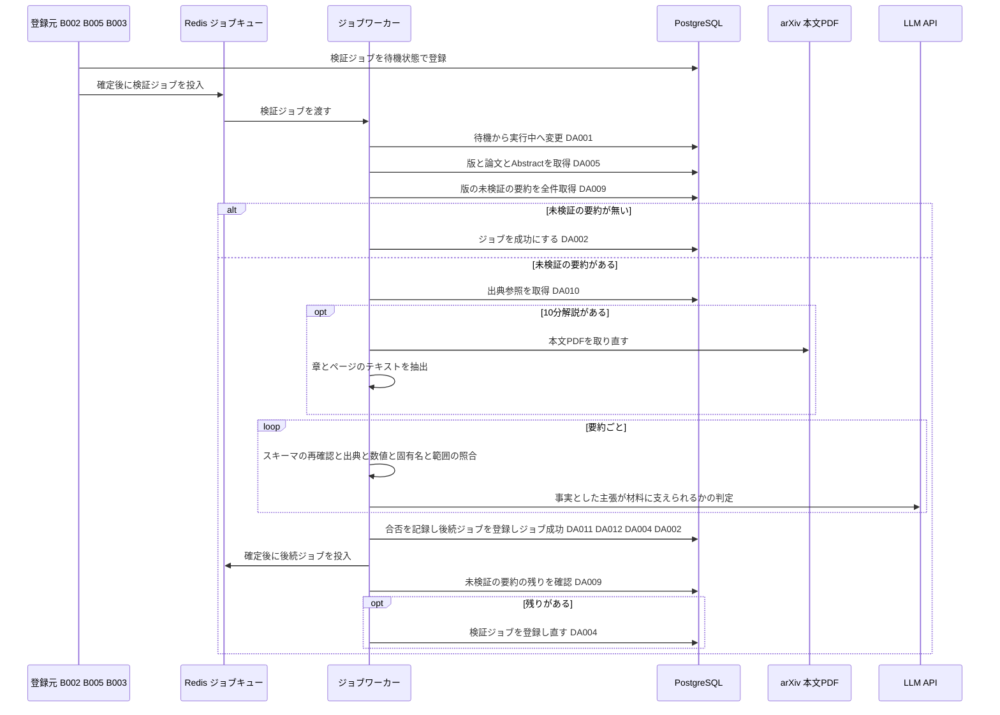
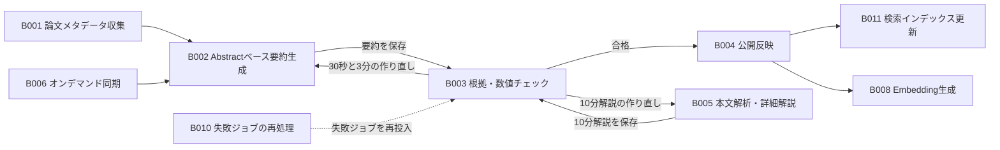

# バッチ詳細設計書 — B003 要約の根拠・数値チェック

## 0. 文書情報

| 項目 | 値 |
| :--- | :--- |
| 設計書ID | B003-BE |
| 親ID | B003 |
| 親設計書 | `基本設計書_概要.md` §4 機能設計「バッチ処理設計」B003 行 |
| バッチ名 | 要約の根拠・数値チェック（上流 §4 バッチ処理設計の区分「非同期ジョブ」） |
| 対応する機能ID | F04 日本語構造化要約（上流 §4 機能一覧。B003 は F04 の検証工程） |
| 関連する業務フローID | BF01 論文収集・日本語化（定期）、BF02 本文解析・詳細解説の生成、EX01 arXiv APIの取得失敗・レート制限（ジョブの再試行の扱い）、EX02 要約のスキーマ検証・根拠チェックで不合格（上流 §2） |
| 版 | 1.0 |
| 作成日 / 更新日 | 2026-10-27 / 2026-10-27 |
| 作成方法 | creating-backend-detailed-design v1.5.0 準拠。上流の確定設計書と `source/` の企画資料からの新規設計 |
| インプット | (a) `source/02_機能要求定義.md:9,21-29,46-47,57-58`、`source/03_システム構成.md:11-13,24-27,29-31,37-38,43,57,60`、`source/01_企画概要.md:33-35`、`source/04_収益化とロードマップ.md:44,47-48`／(b) `docs/基本設計書_概要.md` §1 用語集、§2 BF01・BF02・EX01・EX02、§4 F04・B002〜B005・B010・バッチ共通の方針、§6 T001〜T004・T009・CRUD図、§7 IF02・IF04、§8、§9 環境変数一覧、§10 運用監視、§11 ARC001〜ARC007・ARC009、付録 Q19・Q22〜Q24・Q29・Q31・Q35・Q36／関連する確定済み設計書: `docs/detail/be/BE.F04.BE詳細設計.md`（F04-BE。B003 の処理ロジックの定義元）、`docs/detail/batch/BT.B002.バッチ詳細設計.md`（登録元・作り直しの登録先）、`docs/detail/batch/BT.B001.バッチ詳細設計.md`（件数の起点）、`docs/db/DB.T001`〜`T004`・`T009.DB物理設計.md`／(c) `legacy/`（空） |

* **インプットの性質（source/ の突合結果）**: `source/` は企画・初期設計案の Markdown 6ファイル（計227行）だけで、前の単位（B001・B002）の作業時から変更はありません（ファイル数6件を再確認）。依頼にあるスケジュール定義 `config/schedule.rb`（whenever）と rake タスクの実装 `lib/tasks/` は**存在しません**（Ruby のファイル0件）。本システムのジョブは Python のワーカー（Redis + Celery または RQ）で動きます（`source/03_システム構成.md:7,11`）。B003 は時刻で起動する定期実行ではなく、要約の保存を受けてジョブキューに登録される**非同期ジョブ**です（上流 §4 B003「ジョブキュー（B002・B005 の完了後）」）。このため whenever に当たるスケジュール定義は B003 には無く（§5 スケジュール定義で「該当なし」と根拠を記載）、rake タスクに当たるものは §4 のジョブ関数に置き換えています。本書は**リバースエンジニアリングではなく新規設計**です。資料と上流に無い値には「※推測」を付けています。
* **既存版**: `docs/detail/batch/BT.B003.バッチ詳細設計.md` の旧版はありません（作業開始時点の `docs/detail/batch/` は B001・B002 の2ファイルだけ）。本書が初版で、消さずに残すべき既存記述はありません。
* **legacy/ との突合**: `legacy/` は空ディレクトリです（ファイル0件。B001・B002 の作業時から変更なし）。突合する既存のバッチ設計書・業務意図・非機能の記述はありません。
* **F04-BE との分担と継承**: B003 の処理ロジックは、上流 F04 の BE詳細設計書（F04-BE）で B002〜B005 をまとめて定義済みです。本書は、そのうち B003 が使う **DA-ID（F04-BE の DA001〜DA005・DA009〜DA012）、関数（F04-BE §4 の No.1〜5・9・10・12〜15・19〜21・23・24）、トランザクションID（TX01・TX03・TX06）をそのまま引き継ぎ**、B003 単独で実装・運用できる形に展開します。そのうえで、起動契機・ワーカーの配置・多重起動制御・処理ステップ・性能・依存ジョブ順序・ログと監視を加えます。
  * **DA-ID の読み方**: DA-ID は設計書ごとの採番です。本書の DA-ID は **F04-BE の番号**で、BT.B002 と同じ番号体系です（BT.B002 の DA001〜DA008 と本書の DA001〜DA005 は同じもの）。BT.B001（F01-BE の番号）の DA-ID とは別のものです。
  * **食い違いの扱い**: 処理ロジックは F04-BE、起動と運用は本書を正とします。ただし、本書で見直した6点（§6 確認事項 No.11 に列挙）は本書を正とし、F04-BE への取り込みを求めます。
* **上流との差分**（※上流要確認）:
  * 上流 §4 B003 は「生成された要約をスキーマで検証し、原文を超えた断定が無いか、数値・比較対象・ベンチマーク名が原文と合うかを確かめて検証結果を記録する」としています。DB物理設計書 T003 §4.3 (4) と F04-BE・BT.B002 は、スキーマ検証の主な担当を保存前の生成側（B002・B005）に移しています。本書はそのうえで、T003 §4.3 (8)「B003 が保存済みの要約にスキーマとの不一致を見つけた場合（スキーマを改訂した後の再検証で起こりうる）は、その要約を failed にする」に従い、B003 でもスキーマの再確認を行います。これで上流 B003 の記述とも矛盾しません（§6 確認事項 No.1）。
  * 上流 BF01 の図は「B003 スキーマ検証と根拠・数値チェック」の後に「summaries と summary_citations を保存（検証結果つき）」と描いていますが、DB物理設計書 T003 §0 のとおり、B002 が未検証で保存し、B003 が検証結果で書き換える順序で設計しています。

## 1. バックエンド構成・モジュール設計

* **対象ドメイン**: 要約系（検証） — 論文の版に属する未検証の要約（30秒要約・3分要約・10分解説）を、出典の対応・数値・固有名・断定・出典の範囲の5観点と要約スキーマの再確認で調べ、合格か不合格を記録する。合格があれば公開反映（B004）を、作り直してよい不合格があれば要約生成（B002）か本文解析（B005）を登録する（上流 B003・BF01・BF02・EX02、ARC004）。
* **対象APIエンドポイント**: なし。B003 は画面や外部から HTTP で呼ばれず、ジョブキューから取り出されて動きます（根拠は §2 APIエンドポイント一覧）。
* **実行基盤**: Pythonワーカー上の非同期ジョブです（Redis + Celery または RQ。どちらにするかは未決定、上流 Q02）。DB は Supabase 上の PostgreSQL に、行単位アクセス制御を通らないサーバ側のサービスロールで接続します（DB物理設計書 T003 §7）。
* **ディレクトリ/ファイル構造**（※推測: F04-BE §1 の配置案のうち B003 が使うもの）:

```
worker/
├── jobs/
│   ├── runner.py                    # run（ジョブ共通の実行枠。ARC006）
│   └── validate_summary.py          # validate_summary（B003 の本処理）
├── summary/
│   ├── reuse.py                     # count_failed_attempts（作り直してよいかの判定）
│   ├── schema.py                    # validate_schema（要約スキーマの再確認。ARC003）
│   └── checker.py                   # check_grounding（根拠・数値チェック。ARC004）
├── llm/
│   └── client.py                    # generate_structured（IF04 LLM API。断定の照合）
├── arxiv/pdf_client.py              # fetch_pdf（IF02。10分解説の検証で本文を取り直す。ARC007）
├── pdf/parser.py                    # parse_pdf（本文PDFの解析）
└── repositories/
    ├── job_repository.py            # claim / mark_succeeded / mark_failed_or_retry / enqueue（DA001〜DA004）
    ├── paper_version_repository.py  # find_with_paper（DA005）
    ├── summary_repository.py        # find_pending_by_version / mark_validation_result（DA009・DA011）
    └── citation_repository.py       # find_by_summary_ids（DA010）
```

* **処理シーケンス図**（上流 BF01・BF02 のうち B003 の範囲と EX02 の不合格を、ジョブの受け取りから終了まで展開。※推測を含む）:



## 2. API・インターフェース詳細設計

* **APIエンドポイント一覧（全数ロースター）**:

| API ID | メソッド | エンドポイント | 概要 | 定義状況 | 詳細の所在 |
| :--- | :--- | :--- | :--- | :--- | :--- |
| — | — | 該当なし | — | — | — |

**総件数: 0件。根拠**: 上流 `docs/基本設計書_概要.md` §7 内部API一覧の全8件（API01〜API08）に、B003 を起動・操作するものはありません。B003 の起動は、登録元（B002・B005・B003 自身）がジョブ行を登録してジョブキューへ投入することで行います（§5 起動契機一覧）。B003 が合格とした要約を画面へ返すのは API04（F05）で、B003 とは `summaries.validation_status` を介してつながります（F04-BE §2「F04 が API04 に保証する事項」1）。

* **外部サービス連携一覧（全数ロースター）**: 上流 §7 外部連携一覧の全9件に対し、B003 で使うかを示します。

| IF ID | 連携先 | B003 での利用 | 概要 | 定義状況 | 詳細の所在 |
| :--- | :--- | :--- | :--- | :--- | :--- |
| IF01 | arXiv API | 利用しない | メタデータの取得は B001・B006 の責務。B003 は保存済みの Abstract を材料にする | - | `docs/detail/batch/BT.B001.バッチ詳細設計.md` |
| IF02 | arXiv（論文本文PDF） | 利用する | 未検証の10分解説があるときだけ、版番号付きの本文PDFを取り直して照合の材料にする（本文のテキストを保存する場所が無いため。§6 確認事項 No.4） | 詳細 | 本節 外部サービス連携仕様、§4 No.19 `fetch_pdf` |
| IF03 | arXiv 原文ページ | 利用しない | 画面からのリンク遷移で、サーバ処理を伴わない | - | - |
| IF04 | LLM API | 利用する | 要約ごとに、事実と区分された主張が材料だけから言えるかを判定させる | 詳細 | 本節 外部サービス連携仕様、§4 No.9 `generate_structured`・No.13 `check_grounding` |
| IF05 | Supabase Auth | 利用しない | 利用者の認証は B003 に関係しない。DBへはサービスロールで接続する | - | - |
| IF06 | Stripe（決済セッション） | 利用しない | 課金（F12）の責務 | - | - |
| IF07 | Stripe（契約状態の通知） | 利用しない | 課金（F12）の責務 | - | - |
| IF08 | GitHub | 利用しない | GitHub関連付け（B009）の責務 | - | - |
| IF09 | 通知配信手段 | 利用しない | 通知・ダイジェスト配信（B007）の責務 | - | - |

**総件数: 9件（B003 で利用するもの2件）。根拠**: 上流 §7 外部連携一覧の IF01〜IF09 の全9行と1対1で対応します。B003 が呼ぶのは、断定の照合に使う LLM API（F04-BE §4 No.13 手順4）と、10分解説の照合の材料を取り直す arXiv の本文PDF（F04-BE §4 No.12 手順4）の2つです。定義状況は2件とも外部への送信と失敗時の扱い（completeness 3-1 の2・5）に当たるため「詳細」です。

* **外部サービス連携仕様**（B003 で利用する2件。F04-BE §2 のうち B003 に関わる値）:

| IF ID | 連携先 | 連携方式 | エンドポイント / 接続先 | 認証方式 | タイムアウト | リトライ方針 | エラー時の挙動 |
| :--- | :--- | :--- | :--- | :--- | :--- | :--- | :--- |
| IF04 | LLM API | REST API（※推測。上流 IF04 自体が※推測） | 提供元は未定（上流 Q29）。使うモデルは環境変数 `LLM_MODEL_ID` で指定する（B002 と同じモデル。※推測） | APIキー（環境変数 `LLM_API_KEY`。※推測） | 判定1回につき60秒（※推測） | 通信のタイムアウト・接続失敗・提供元の混雑（HTTP 429）・提供元の障害（HTTP 5xx）のときだけ、2秒・4秒・8秒と間隔を倍にして最大3回まで呼び直す。それ以外の 400〜499 は呼び直さない。判定の応答が決めた形の JSON として読めないときは、最大2回まで判定を依頼し直す（※推測） | 呼び直しを使い切っても失敗したら例外を上げ、ジョブ共通の失敗処理（DA003）でジョブの試行回数を1増やす。上限未満ならジョブごと遅延を付けて再実行される。検証結果は1件も記録されずに取り消され、再実行で全件をやり直す |
| IF02 | arXiv（論文本文PDF） | HTTPダウンロード（※推測） | `https://arxiv.org/pdf/{arXiv ID}v{版番号}`（※推測: 版番号付きで取得し、要約した版と本文を一致させる） | 認証なし（※推測） | 60秒（※推測） | 問い合わせの前に、前回の arXiv への問い合わせから環境変数 `ARXIV_REQUEST_INTERVAL_SEC`（※推測: 3秒）以上あける。間隔はワーカー間で共有するため、最後に問い合わせた時刻を Redis に置く（F04-BE §4 No.19）。通信失敗・HTTP 5xx・HTTP 429 は、ジョブ内では呼び直さず、ジョブ共通の失敗処理で後から再実行する（arXiv に短時間で問い合わせを重ねないため。ARC007） | 取得できなければ例外を上げ、ジョブを失敗扱いにする（DA003）。HTTP 404（版が無い）は再試行しても変わらないため、試行回数によらずジョブを失敗にする（※推測） |

* **IF04 の送受信データ**（断定の照合。※推測: 判定の指示文と応答の形は ARC004 の方式設計書 `docs/arch/方式.ARC004.方式設計.md`（未作成）で確定する）:

| 区分 | データ | 出どころ・使い道 | 決め方 |
| :--- | :--- | :--- | :--- |
| 送信 | 材料 | Abstract のみの要約では `papers.abstract`（DA005）、10分解説では取り直した本文の章ごとのテキスト（`parse_pdf`） | 要約の解析範囲と同じ材料だけを渡す。材料は指示文と区切り、材料の中の文を指示として扱わないよう明記する（§6 セキュリティ設計） |
| 送信 | 事実と区分された主張の一覧 | `summaries.json_content`（DA009）の主張のうち、事実と区分されたもの | 1件の要約の事実の主張をまとめて1回で判定させる（主張ごとに呼ぶと呼び出し回数が5〜20倍になるため。※推測。§6 確認事項 No.11）。推測と区分された主張は送らない（ARC004） |
| 送信 | 判定の指示と応答の形 | プログラム内の指示文 | 「材料だけから言えるか」を主張ごとに「言える」「言えない」で答えさせ、言えないときは理由を1文で付けさせる。応答は主張IDをキーにした JSON とする |
| 受信 | 主張ごとの判定と理由 | 合否の判断に使う。保存はしない | 1件でも「言えない」があれば、その要約を不合格の理由に加える。理由は保存する列が無いため INFO ログにだけ出す（§6 確認事項 No.5） |
| 受信 | 使ったトークン数 | ログに出す | 1論文あたり生成コスト（`source/04_収益化とロードマップ.md:47`）の算出に使う（BT.B002 と同じ扱い） |

**総件数: 5行（送信3・受信2）。根拠**: F04-BE §4 No.13 手順4「事実と区分された主張について、LLM に『材料だけから言えるか』を判定させる」の入力（材料・主張・指示）と出力（判定・トークン数）を、1項目1行で挙げたものです。IF02 の送受信は、送信が版番号付きのURL、受信が本文PDFの1件だけのため、表にしていません（連携仕様表に記載）。

* **API詳細仕様**: 該当なし（APIエンドポイント0件のため。根拠は上の一覧の直後に記載）。ジョブとしての入出力は §4 No.1 `run`・No.12 `validate_summary` と §5 の入出力一覧に記載します。

## 3. データアクセス（ORM / クエリ）設計

* **データアクセス一覧（全数ロースター）**: DA-ID は F04-BE §3 の採番をそのまま引き継ぎます（§0「DA-ID の読み方」）。F04-BE の DA006〜DA008・DA013・DA014 は B002・B004・B005 だけが使うため、本書には含めません。

| DA-ID | 処理名 | 呼出元（関数/API） | テーブルID | 対象物理テーブル | 種別 (SELECT/INSERT/UPDATE/DELETE) | 定義状況 (詳細/簡易) | 詳細の所在 |
| :--- | :--- | :--- | :--- | :--- | :--- | :--- | :--- |
| DA001 | ジョブの実行開始 | No.2 `claim`（No.1 `run` から呼ぶ） | T009 | jobs | UPDATE | 詳細 | §3 詳細定義 DA001・発行SQL DA001 |
| DA002 | ジョブの成功記録 | No.3 `mark_succeeded`（No.12 `validate_summary` から呼ぶ） | T009 | jobs | UPDATE | 詳細 | §3 詳細定義 DA002・発行SQL DA002 |
| DA003 | ジョブの失敗記録 | No.4 `mark_failed_or_retry`（No.1 `run` から呼ぶ） | T009 | jobs | UPDATE | 詳細 | §3 詳細定義 DA003・発行SQL DA003 |
| DA004 | 後続ジョブの登録（B004・B002・B005・B003） | No.5 `enqueue`（No.12 `validate_summary` から呼ぶ） | T009 | jobs | INSERT（衝突時は何もしない） | 詳細 | §3 詳細定義 DA004・発行SQL DA004 |
| DA005 | 対象の版と論文の取得 | No.21 `find_with_paper` | T002・T001 | paper_versions, papers | SELECT | 詳細 | §3 詳細定義 DA005・発行SQL DA005 |
| DA009 | 未検証の要約の取得 | No.23 `find_pending_by_version` | T003 | summaries | SELECT | 簡易 | 発行SQL DA009 |
| DA010 | 出典参照の取得（検証） | No.24 `find_by_summary_ids` | T004 | summary_citations | SELECT | 簡易 | 発行SQL DA010 |
| DA011 | 検証結果の記録 | No.14 `mark_validation_result` | T003 | summaries | UPDATE | 詳細 | §3 詳細定義 DA011・発行SQL DA011 |
| DA012 | 不合格回数の集計 | No.15 `count_failed_attempts` | T003 | summaries | SELECT | 詳細 | §3 詳細定義 DA012・発行SQL DA012 |

**総件数: 9件（SELECT 5件・INSERT 1件・UPDATE 3件・DELETE 0件。詳細7件・簡易2件）。全数である根拠**: §4 関数一覧の全16関数のうち DB へ問い合わせる9関数（No.2・3・4・5・14・15・21・23・24）の処理フローに現れる DB 操作を1件1行で数えたものです（No.2→DA001、No.3→DA002、No.4→DA003、No.5→DA004、No.21→DA005、No.23→DA009、No.24→DA010、No.14→DA011、No.15→DA012）。残りの7関数（No.1・9・10・12・13・19・20）は DB へ直接問い合わせず、これらの関数を呼ぶか、外部と通信するだけです。F04-BE §3 の同じ DA-ID と内容が一致します。B003 は DELETE を発行しません（不合格の要約も誤り率の集計のため消さない。T003 §6）。
**上流 CRUD図との突合**: 上流 §6 CRUD図には B003 単独の行は無く、F04 行（papers R、paper_versions RU、summaries CRU、summary_citations C、jobs RU）にまとめられています。B003 の操作は papers R・paper_versions R（DA005）、summaries RU（DA009・DA011・DA012）、summary_citations R（DA010）、jobs CU（DA001〜DA004）です。このうち **summary_citations の R と jobs の C は F04 行に無く**、※上流要確認です（DB物理設計書 T004 §9 No.4、T009 §9 No.5、F04-BE §0 確認事項 No.2 と同じ事項。本書 §6 確認事項 No.2）。
**定義状況の判定**（completeness 3-1）: DA001〜DA004・DA011 は永続データを書き換える（3-1 の2）、DA005 は2テーブルを結合する（3-1 の3）、DA012 は作り直しの可否を決める業務ルールを含む（3-1 の7）ため「詳細」です。DA009・DA010 はキー1つで行を読むだけで、3-1 の基準に当たらないため「簡易」です（F04-BE §3 の判定と同じ）。

* **データアクセス詳細定義**（定義状況＝詳細の7件）:

| DA-ID | 処理名 | テーブルID | 対象物理テーブル | JOIN / Include | 抽出条件 (Where) / ソート | トランザクション境界 | N+1対策・性能上の注意 |
| :--- | :--- | :--- | :--- | :--- | :--- | :--- | :--- |
| DA001 | ジョブの実行開始 | T009 | jobs | なし | 指定のジョブで状態が待機の行だけを実行中に変え、版ID・種別・試行回数を受け取る（`WHERE id = $1 AND status = 'pending' RETURNING …`） | 単独で即時に確定する（TX01） | 更新できた行が0件なら、他のワーカーが実行中か完了済みなので何もせずに終える（T009 §4.3 (4)）。主キーで1行 |
| DA002 | ジョブの成功記録 | T009 | jobs | なし | 指定のジョブで状態が実行中の行だけを成功に変える（`WHERE id = $1 AND status = 'running'`） | 検証結果の記録と同じトランザクション（TX03）、または未検証の要約が無いときの単独のトランザクション（TX06） | 更新が0件なら他の処理が状態を変えたものとして JobStateConflict を上げ、検証結果ごと取り消す |
| DA003 | ジョブの失敗記録 | T009 | jobs | なし | 指定のジョブで状態が実行中の行について、試行回数を1増やし直近エラーを書く。増やした結果が上限以上なら失敗、未満なら待機に戻す（`SET attempts = attempts + 1, last_error = $2, status = CASE WHEN attempts + 1 >= $3 THEN 'failed' ELSE 'pending' END WHERE id = $1 AND status = 'running'`） | 単独で即時に確定する（TX01）。本処理のトランザクションを取り消した後に実行する | 上限は環境変数 `JOB_MAX_ATTEMPTS`（※推測: 3）。再試行しても変わらない例外では、上限を「今の試行回数＋1」にして必ず失敗にする。直近エラーには APIキーや認証付きURLを取り除いた要約文だけを書く（T009 §4.3 (6)） |
| DA004 | 後続ジョブの登録（B004・B002・B005・B003） | T009 | jobs | なし | 抽出条件なし。版を指定して、種別「公開反映」「Abstractベース日本語要約生成」「本文解析・詳細解説生成」「要約の根拠・数値チェック」のいずれかの待機ジョブを1行追加する。同じ版・同じ種別で待機中か実行中の行があれば何もしない（`job_type` は `publish_summary`・`summarize_abstract`・`analyze_full_text`・`validate_summary` のいずれか。`ON CONFLICT (paper_version_id, job_type) WHERE status IN ('pending','running') AND paper_version_id IS NOT NULL DO NOTHING RETURNING id`） | 公開反映と作り直しの登録は検証結果と同じトランザクション（TX03）。検証ジョブの登録し直しは、TX03 の確定後の短い別のトランザクション | 部分一意インデックス `uq_jobs_active_per_version` に合わせて ON CONFLICT に同じ条件を書く（T009 §5.2）。同じ版で30秒要約と3分要約の両方を作り直すときも、要約生成ジョブは1件にまとまる（B002 は作り直しが必要な深さをすべて作る）。検証ジョブの登録し直しは、本ジョブがすでに成功で確定した後に行うため、自分自身に当たって取りやめになることはない |
| DA005 | 対象の版と論文の取得 | T002・T001 | paper_versions, papers | 版の論文IDで論文を内部結合する（`paper_versions.paper_id = papers.id`） | ジョブが指す版1件（`paper_versions.id = $1`）。ソートなし | なし（参照のみ） | 主キーで1行。0行ならジョブが存在しない版を指しているため、再試行しても変わらない失敗にする |
| DA011 | 検証結果の記録 | T003 | summaries | なし | 指定の要約で状態が未検証の行だけを、合格か不合格に変える（`WHERE id = $1 AND validation_status = 'pending'`） | TX03。今回対象にした要約すべての結果と、後続ジョブの登録（DA004）、ジョブの成功（DA002）を同時に確定する | 未検証以外の行は書き換えない（合格・不合格からは他の値へ移らない。T003 §6）。0件更新なら他のワーカーが記録済みとして、その要約を後続の判定から外す。要約の数（通常2件、10分解説を含めて最大3件）だけ発行し、主キーで1行ずつ |
| DA012 | 不合格回数の集計 | T003 | summaries | なし | 指定の版・深さで不合格の要約の件数を数える（`paper_version_id = $1 AND summary_type = $2 AND validation_status = 'failed'`） | TX03 の中で、DA011 の直後に実行する（今回の不合格を数えに含めるため） | `idx_summaries_lookup` の先頭2列で絞れる。件数が上限（環境変数 `SUMMARY_MAX_REGENERATIONS`。※推測: 2）以上なら作り直しのジョブを登録しない。上限2では、最初の要約と作り直し1回が不合格になった時点（不合格2件）で止まり、作り直しは最大1回になる（§6 確認事項 No.6） |

* **発行SQL**: 全9件（DA001〜DA005・DA009〜DA012）。すべてプレースホルダ（`$1` から始まる番号付きの引数）に値を渡す固定の文で、実行時に文の構造を組み立てる動的SQLはありません。F04-BE §3 の発行SQLと同じ文です。監視のために運用者が発行する問い合わせ（§5 監視項目 No.6）は B003 が発行するものではないため、本一覧には含めず、監視項目の欄に記載します。

**DA001 ジョブの実行開始**
```sql
UPDATE jobs
SET status = 'running'
WHERE id = $1
  AND status = 'pending'
RETURNING id, paper_version_id, job_type, attempts;
```
組み立ての分岐: なし（固定の1文）。

**DA002 ジョブの成功記録**
```sql
UPDATE jobs
SET status = 'succeeded'
WHERE id = $1
  AND status = 'running';
-- 更新件数が0なら JobStateConflict を上げて検証結果ごと取り消す
```
組み立ての分岐: なし（固定の1文）。

**DA003 ジョブの失敗記録**（`$2` は直近エラーの要約文、`$3` は試行回数の上限）
```sql
UPDATE jobs
SET attempts   = attempts + 1,
    last_error = $2,
    status     = CASE WHEN attempts + 1 >= $3 THEN 'failed' ELSE 'pending' END
WHERE id = $1
  AND status = 'running'
RETURNING status, attempts;
```
組み立ての分岐: なし（固定の1文）。再試行しても変わらない例外のときは、`$3` に「今の試行回数＋1」を渡します（値の違いだけで文は同じ）。

**DA004 後続ジョブの登録**（`$2` は `publish_summary`・`summarize_abstract`・`analyze_full_text`・`validate_summary` のいずれか）
```sql
INSERT INTO jobs (paper_version_id, job_type)
VALUES ($1, $2)
ON CONFLICT (paper_version_id, job_type)
  WHERE status IN ('pending', 'running') AND paper_version_id IS NOT NULL
  DO NOTHING
RETURNING id;
-- 行が返ったときだけ、確定後にジョブキューへ投入する
```
組み立ての分岐: なし（固定の1文。種別は値として渡す）。

**DA005 対象の版と論文の取得**
```sql
SELECT pv.id AS paper_version_id, pv.version, pv.content_status, pv.license_type,
       p.id AS paper_id, p.arxiv_id, p.title, p.abstract
FROM paper_versions pv
JOIN papers p
  ON p.id = pv.paper_id
WHERE pv.id = $1;
```
組み立ての分岐: なし（固定の1文）。

**DA009 未検証の要約の取得**
```sql
SELECT id, summary_type, json_content, source_scope
FROM summaries
WHERE paper_version_id = $1
  AND validation_status = 'pending'
ORDER BY id;
-- 本処理の始めと、TX03 の確定後の残りの確認の2か所で発行する
```
組み立ての分岐: なし（固定の1文）。

**DA010 出典参照の取得（検証）**
```sql
SELECT summary_id, claim_id, source_section, source_page, source_url
FROM summary_citations
WHERE summary_id = ANY($1::bigint[])
ORDER BY summary_id, id;
-- 要約ごとに発行せず、対象の要約IDの配列で1回だけ発行する（N+1 を避ける）
```
組み立ての分岐: なし（固定の1文）。

**DA011 検証結果の記録**（`$2` は `passed` か `failed`）
```sql
UPDATE summaries
SET validation_status = $2
WHERE id = $1
  AND validation_status = 'pending';
```
組み立ての分岐: なし（固定の1文を要約の数だけ発行する）。

**DA012 不合格回数の集計**
```sql
SELECT count(*) AS failed_count
FROM summaries
WHERE paper_version_id = $1
  AND summary_type = $2
  AND validation_status = 'failed';
```
組み立ての分岐: なし（固定の1文を不合格になった深さの数だけ発行する）。

## 4. サーバー側機能・処理ロジック設計（IPO設計）

* **関数一覧（全数ロースター）**: No と関数名は F04-BE §4 の採番をそのまま引き継ぎます。F04-BE の No.6〜8・11・16〜18・22・25 は B002・B004・B005 だけが使うため、本書には含めません。

| No | 関数名 | 所属モジュール（※推測） | 概要 | 定義状況 | 詳細の所在 |
| :--- | :--- | :--- | :--- | :--- | :--- |
| 1 | `run` | `worker/jobs/runner.py`（JobRunner） | ジョブ共通の実行枠。取り合い、本処理の呼び出し、失敗時の記録と遅延付きの再投入を受け持つ | 詳細 | §4 IPO定義 |
| 2 | `claim` | `worker/repositories/job_repository.py` | 待機中のジョブを実行中に変え、取り合いに勝ったときだけジョブの内容を返す（DA001） | 詳細 | §4 IPO定義 |
| 3 | `mark_succeeded` | `worker/repositories/job_repository.py` | 検証結果と同じトランザクションの中で、実行中のジョブを成功にする（DA002） | 詳細 | §4 IPO定義 |
| 4 | `mark_failed_or_retry` | `worker/repositories/job_repository.py` | 失敗の回数を数え、上限未満なら待機へ戻し、上限に達したら失敗にする（DA003） | 詳細 | §4 IPO定義 |
| 5 | `enqueue` | `worker/repositories/job_repository.py` | 後続ジョブを重複なく登録し、確定後にジョブキューへ入れる（DA004） | 詳細 | §4 IPO定義 |
| 9 | `generate_structured` | `worker/llm/client.py`（LlmClient） | LLM API を呼んで JSON を受け取る。通信の呼び直しを受け持つ（B003 では断定の照合に使う） | 詳細 | §4 IPO定義 |
| 10 | `validate_schema` | `worker/summary/schema.py` | 要約本文が要約スキーマに合うかを確かめる（B003 では保存済みの要約の再確認に使う） | 詳細 | §4 IPO定義 |
| 12 | `validate_summary` | `worker/jobs/validate_summary.py` | B003 の本処理。版の未検証の要約を調べ、結果に応じて次のジョブを登録する | 詳細 | §4 IPO定義 |
| 13 | `check_grounding` | `worker/summary/checker.py` | 1件の要約が材料を超えた断定や数値の不一致を含まないかを調べる | 詳細 | §4 IPO定義 |
| 14 | `mark_validation_result` | `worker/repositories/summary_repository.py` | 未検証の要約を合格か不合格に書き換える（DA011） | 詳細 | §4 IPO定義 |
| 15 | `count_failed_attempts` | `worker/summary/reuse.py` | 版・深さごとの不合格の件数を数え、作り直してよいかを判定する（DA012） | 詳細 | §4 IPO定義 |
| 19 | `fetch_pdf` | `worker/arxiv/pdf_client.py`（ArxivPdfClient） | arXiv の問い合わせ間隔を守って本文PDFを取得する | 詳細 | §4 IPO定義 |
| 20 | `parse_pdf` | `worker/pdf/parser.py` | 本文PDFから章・ページごとのテキストを取り出す | 詳細 | §4 IPO定義 |
| 21 | `find_with_paper` | `worker/repositories/paper_version_repository.py` | ジョブが指す版と、その論文の原題・Abstract をまとめて読む（DA005） | 詳細 | §4 IPO定義 |
| 23 | `find_pending_by_version` | `worker/repositories/summary_repository.py` | 版に属する未検証の要約を古い順に全件読む（DA009） | 簡易 | - |
| 24 | `find_by_summary_ids` | `worker/repositories/citation_repository.py` | 指定した要約すべての出典参照をまとめて読む（DA010） | 簡易 | - |

**総件数: 16関数（詳細14件・簡易2件）。全数である根拠**: F04-BE §4 関数ロースターの全25件のうち、B003 の本処理（F04-BE §4 No.12 `validate_summary`）から呼び出し関係をたどって届く関数と、ジョブ共通の実行枠（No.1〜5）を拾ったものです（`run`→`claim`・`validate_summary`・`mark_failed_or_retry`、`validate_summary`→`find_with_paper`・`find_pending_by_version`・`find_by_summary_ids`・`fetch_pdf`・`parse_pdf`・`validate_schema`・`check_grounding`・`mark_validation_result`・`count_failed_attempts`・`enqueue`・`mark_succeeded`、`check_grounding`→`generate_structured`）。`validate_schema` は F04-BE では B002・B005 の保存前だけで使いますが、本書では B003 の再確認にも使います（§0 上流との差分、§6 確認事項 No.11）。残りの9関数（No.6〜8・11・16〜18・22・25）は B002・B004・B005 からだけ呼ばれます。ソースコードが無いため実在の関数との突合はできず、関数名と分け方は※推測です。
**定義状況の判定**（completeness 3-1）: 分岐を持つもの（No.1・9・10・12・13・15・19・20）、状態を書き換えるもの（No.2〜5・14）、複数テーブルを結合するもの（No.21）を「詳細」としました。キー1つで行を読んで返すだけの No.23・24 は「簡易」です（F04-BE §4 の判定と同じ）。

* **入力・処理・出力（IPO）定義**（ロースターは上表。本表は定義状況＝詳細の14件）:

| No | 関数名 | 所属モジュール | 引数 (型) | 処理フロー (ステップ単位で具体的に) | 戻り値 | 発生しうるエラー |
| :--- | :--- | :--- | :--- | :--- | :--- | :--- |
| 1 | `run` | JobRunner | job_id: int, handler: 本処理の関数（B003 では `validate_summary`） | 1. `claim` で待機中のジョブを実行中にする。取り合いに負けた（null）なら INFO ログ（§5 ログ No.1）を残して終える。<br>2. `claim` 自体が DB の失敗で例外を上げたときは、ジョブはまだ待機で失敗を jobs に記録できない（DA003 は実行中の行だけを更新する）。ERROR ログ（§5 ログ No.10）を出し、例外をジョブキューへ返して再配送に任せる（※推測: Celery では `acks_late=True` と `task_acks_on_failure_or_timeout=False` の両方を設定する。RQ では失敗ジョブの登録簿から再投入する仕組みを ARC006 で用意する。BT.B002 と同じ）。<br>3. 本処理を呼ぶ。本処理は自身のトランザクションで検証結果・後続ジョブ登録・ジョブ成功を確定する。<br>4. 本処理が例外を上げたら、トランザクションを取り消してから `mark_failed_or_retry` を呼ぶ。試行回数の上限によらずすぐ失敗にするのは、再試行しても結果が変わらない例外のうち、ジョブが指す版が無い（PaperVersionNotFound）ときだけである。F04-BE §4 No.1 手順3 は本文PDFの版が無い・テキストが取れない失敗も挙げているが、B003 ではこの2つを本処理の中で10分解説の不合格として扱い、`run` へは上げない（No.12 手順4。30秒要約・3分要約の検証を止めないため）。LlmPermanentError を含むほかの例外は試行回数の上限まで再試行する。JobStateConflict は失敗を記録せずに終える（No.3）。<br>5. 戻ってきた状態が待機なら、試行回数に応じた遅延（1回目の失敗の後は1分、2回目の失敗の後は5分。※推測）を付けて、同じジョブIDをジョブキューへ再投入する。失敗なら失敗キューへ送り、ERROR ログ（§5 ログ No.7）を残す（上流 EX01、ARC006） | なし | なし（本処理の例外はここで受け止め、ジョブの状態として残す。`claim` の DB 失敗だけは手順2のとおりジョブキューへ返す） |
| 2 | `claim` | JobRepository | job_id: int | 1. DA001 を発行し、即時に確定する。<br>2. 更新できた行があればジョブの内容を、無ければ null を返す | { id, paperVersionId, jobType, attempts } または null | DB の接続・問い合わせ失敗（例外を上げる。`run` 手順2） |
| 3 | `mark_succeeded` | JobRepository | conn: トランザクション中の接続, job_id: int | 1. 呼び出し側のトランザクションの中で DA002 を発行する。<br>2. 更新が0件なら JobStateConflict を上げて、検証結果ごと取り消させる | なし | JobStateConflict（→ `run` が WARN ログ（§5 ログ No.8）を残して終える。失敗記録はしない） |
| 4 | `mark_failed_or_retry` | JobRepository | job_id: int, error: Exception, force_fail: bool | 1. エラーの種類と要約から直近エラーの文を作る。APIキー・認証付きURL・スタックトレースは取り除き、2,000文字（※推測）で切る（T009 §4.3 (6)）。<br>2. 再試行しても変わらない例外（force_fail が真）なら上限を「今の試行回数＋1」にして必ず失敗にし、それ以外は環境変数 `JOB_MAX_ATTEMPTS`（※推測: 3）を使う。<br>3. DA003 を発行し、即時に確定する。<br>4. 更新後の状態と試行回数を返す。更新が0件なら null を返す | { status: 'pending' または 'failed', attempts: int } または null | DB の接続・問い合わせ失敗（ERROR ログ（§5 ログ No.10）。ジョブは実行中のまま残る。§6 確認事項 No.7） |
| 5 | `enqueue` | JobRepository | conn: トランザクション中の接続, paper_version_id: int, job_type: str（B003 では `publish_summary`・`summarize_abstract`・`analyze_full_text`・`validate_summary`） | 1. 呼び出し側のトランザクションの中で DA004 を発行する。<br>2. 登録できたジョブIDを、確定後にジョブキューへ入れる予約リストに積む。登録されなかった（同じ版・同じ種別のジョブが待機中か実行中）ときは何もしない。<br>3. 呼び出し側の確定が成功したら、予約リストのジョブIDを種別に応じたキューへ投入する（要約生成は `summarize`、本文解析は本文解析用のキュー、公開反映と検証は `default`。§5 ワーカーの配置） | 登録したジョブID または null | ジョブキュー（Redis）への投入失敗（ERROR ログ（§5 ログ No.9）。ジョブ行は待機のまま残る。§6 確認事項 No.7） |
| 9 | `generate_structured` | LlmClient | prompt: 判定の指示文と材料と主張の一覧, timeout_sec: int（B003 では60） | 1. 環境変数 `LLM_MODEL_ID`・`LLM_API_KEY` で LLM API を呼ぶ（IF04）。<br>2. タイムアウト・接続失敗・HTTP 429・HTTP 5xx のときは2秒・4秒・8秒と間隔をあけて最大3回まで呼び直す。呼び直すたびに WARN ログ（§5 ログ No.5）を出す。<br>3. それ以外の失敗、または呼び直しを使い切ったら例外を上げる。<br>4. 応答の本文を JSON として読み取り、読めなければスキーマ不一致として例外を上げる（呼び出し元の `check_grounding` が判定を依頼し直す）。<br>5. 使ったモデル名と、入力・出力のトークン数を戻り値に含める | { content: dict, model_id: str, input_tokens: int または None, output_tokens: int または None } | LlmTransientError（呼び直しを使い切った）、LlmPermanentError（認証失敗・指示文の不備）、SchemaMismatchError（JSON として読めない） |
| 10 | `validate_schema` | `worker/summary/schema.py` | content: dict, summary_type: str | 1. 要約スキーマ（ARC003）の JSON Schema で項目の有無と型を確かめる。<br>2. 日本語タイトルと原題があるか、深さに必要な項目がそろっているかを確かめる。<br>3. 主張が1件以上あり、主張ごとに主張IDがあり、同じ要約の中で重複せず、64文字以内かを確かめる。<br>4. 主張ごとに事実か推測かの区分があるかを確かめる（ARC004）。<br>5. 1つでも外れたら理由の一覧を付けてスキーマ不一致とする。B003 では例外にせず、その要約の不合格の理由として扱う（保存前に通った要約が、その後のスキーマの改訂で合わなくなった場合に起こる。T003 §4.3 (8)） | 合否と理由の一覧（B003 から呼ぶとき） | なし（B003 では不一致を戻り値で返す） |
| 12 | `validate_summary` | `worker/jobs/validate_summary.py` | job: { id, paperVersionId } | 1. `find_with_paper` で版・論文・原題・Abstract を得る。<br>2. `find_pending_by_version` で版の未検証の要約を全件得る。0件なら、`mark_succeeded` だけを行って確定し（TX06）、INFO ログ（§5 ログ No.2）を出して終える。<br>3. `find_by_summary_ids` で、それらの出典参照をまとめて得る。<br>4. 未検証の要約に10分解説（解析範囲が本文取得済み）があれば、`fetch_pdf` と `parse_pdf` で本文を取り直して、その要約の材料にする（本文の保存先が無いため。§6 確認事項 No.4）。取り直しに失敗しても、30秒要約・3分要約の検証は止めない（速報の公開を本文解析の都合で遅らせないため。ARC002）。版が無い（HTTP 404）・テキストが取れない失敗は、再試行しても変わらないため、10分解説を不合格（理由「材料を取得できない」）と決め、作り直しは登録しない（B005 も同じ PDF で失敗するため）。それ以外の一時的な失敗は、10分解説を今回の対象から外し、「部分確定」の印を立てる。<br>5. 要約ごとに、`validate_schema` で要約スキーマを再確認し、続けて `check_grounding` で根拠・数値を調べる。どちらかで外れたら不合格とする。手順4・5の外部呼び出しはトランザクションの外で行う。<br>6. 1つのトランザクション（TX03）で、要約ごとに `mark_validation_result` で合格・不合格を記録する（0件更新の要約は他のワーカーが記録済みとして後続の判定から外す）。不合格の要約は `count_failed_attempts` で作り直してよいかを判定する。今回合格した要約が1件でもあれば、`enqueue` で公開反映（B004）を登録する。作り直してよい不合格があれば、深さが30秒要約・3分要約なら要約生成（B002）、10分解説なら本文解析（B005）を `enqueue` で登録する。作り直さない不合格があれば WARN ログ（§5 ログ No.4）を出す。最後に `mark_succeeded` を行って確定する。ただし「部分確定」の印が立っているときは `mark_succeeded` を行わずに確定し、手順7の投入の後で一時的な失敗の例外（PdfFetchError）を上げる。`run` がジョブの失敗を記録して遅延付きで再投入し、次の回では未検証で残った10分解説だけを検証する（30秒要約・3分要約はすでに記録済みのため対象に入らない）。<br>7. 確定の後で、登録できた後続ジョブをジョブキューへ投入する（`enqueue` 手順3）。<br>8. 確定の後で（部分確定のときは行わない） `find_pending_by_version` をもう一度呼び、手順2の後に新しく保存された未検証の要約が残っていれば、`enqueue` で検証ジョブ（B003）を登録し直して短いトランザクションで確定し、投入する。本ジョブはすでに成功なので、登録が自分自身に当たって取りやめになることはない。B002 と B005 の保存が重なったとき、その検証ジョブの登録が実行中の本ジョブに当たって取りこぼされるのを防ぐためである（※推測）。この登録し直しが失敗しても TX03 の結果は取り消さず、WARN ログ（§5 ログ No.11）を出す。<br>9. 合格・不合格の件数、作り直しと公開反映の登録の有無、LLM のトークン数、ジョブの所要時間を INFO ログ（§5 ログ No.6）に出す | なし | PaperVersionNotFound、LlmTransientError、LlmPermanentError、SchemaMismatchError（判定の応答が読めない状態が3回続いた）、PdfFetchError（一時的な失敗。30秒要約・3分要約の結果を部分確定した後に上げる）、JobStateConflict、DB の接続失敗（いずれも `run` が受け止める。部分確定の場合を除き、検証結果は1件も記録されずに取り消され、再試行で全件やり直す）。本文PDFの版が無い・テキストが取れない失敗は、10分解説の不合格として扱い、例外として上げない |
| 13 | `check_grounding` | `worker/summary/checker.py` | summary: { summaryType, jsonContent, sourceScope }, citations: 出典参照の配列, material: Abstract または本文の章ごとのテキスト | 1. 出典の対応: 主張がすべて出典参照を持ち、出典参照の主張IDがすべて要約本文に実在するかを確かめる（T004 §4.3 (2)）。<br>2. 数値の照合: 要約に出てくる数値（整数・小数・百分率）を取り出し、全角半角・桁区切り・百分率表記の揺れをそろえたうえで、材料に同じ数値があるかを確かめる。<br>3. 固有名の照合: ベンチマーク名・データセット名・比較対象の手法名（英字の固有名）が材料に出てくるかを確かめる（`source/01_企画概要.md:34`）。<br>4. 断定の照合: 事実と区分された主張をまとめて、材料と一緒に1回の判定として `generate_structured` に渡し（タイムアウト60秒）、主張ごとに「材料だけから言えるか」を答えさせる。応答が決めた形で読めなければ最大2回まで依頼し直す。言えない主張があれば不合格の理由にする。推測と区分された主張は対象にしない（ARC004。※推測）。<br>5. 出典の範囲: 本文由来の要約では、出典ページが本文のページ数の範囲に収まるかを確かめる。Abstract のみの要約では、出典ページが空で章が「Abstract」であることを確かめる（T004 §4.3 (3)）。<br>6. 手順1〜3・5で外れたものがあれば、手順4の LLM 呼び出しを省いて不合格とする（費用を抑えるため。※推測）。<br>7. 不合格の理由の一覧を INFO ログ（§5 ログ No.3）に残す（理由を保存する列が無いため。§6 確認事項 No.5）。<br>※推測: 各照合の具体的な方法と閾値は ARC004 の方式設計書で確定する（§6 確認事項 No.9） | { passed: bool, reasons: list[str], input_tokens: int, output_tokens: int } | LlmTransientError・LlmPermanentError（断定の照合の通信失敗）、SchemaMismatchError（判定の応答が3回とも読めない） |
| 14 | `mark_validation_result` | SummaryRepository | conn, summary_id: int, result: 'passed' または 'failed' | 1. DA011 を発行する。<br>2. 更新が0件なら（すでに検証済み）その要約は記録済みとして扱い、後続の判定から外す | 更新できたか（boolean） | DB の接続失敗 |
| 15 | `count_failed_attempts` | `worker/summary/reuse.py` | conn, paper_version_id: int, summary_type: str | 1. DA012 を発行する。<br>2. 不合格の件数が上限（環境変数 `SUMMARY_MAX_REGENERATIONS`。※推測: 2）未満なら「作り直してよい」、以上なら「作り直さない」を返す | boolean（作り直してよいなら true） | DB の接続失敗 |
| 19 | `fetch_pdf` | ArxivPdfClient | arxiv_id: str, version: int | 1. 前回の arXiv への問い合わせから環境変数 `ARXIV_REQUEST_INTERVAL_SEC` 以上たっていなければ待つ。間隔はワーカー間で共有するため、Redis に最後の問い合わせ時刻を置く（※推測。ARC007）。<br>2. 版番号付きのURLで本文PDFを取得する（タイムアウト60秒）。<br>3. HTTP 200 で PDF の形式であれば本文を返す。HTTP 404 は版が無いものとして再試行しない例外、それ以外の失敗は再試行できる例外を上げる | bytes（PDF） | PdfFetchError（再試行できるか否かの区別付き） |
| 20 | `parse_pdf` | `worker/pdf/parser.py` | pdf: bytes | 1. PDF解析ライブラリ（PyMuPDF / Docling / GROBID のいずれか。上流 Q02）でページごとのテキストを取り出す。<br>2. 章の見出しを判定し、章ごと・ページごとのテキストに分ける。見出しが取れない論文は章を空にする（T004 §4.3 (3)）。<br>3. テキストが取れない（画像だけのPDF・壊れたPDF）ときは例外を上げる | { page_count: int, sections: [{ heading, page, text }] } | PdfParseError（再試行しても変わらないため、`run` は試行回数によらず失敗にする。※推測） |
| 21 | `find_with_paper` | PaperVersionRepository | conn, paper_version_id: int | 1. DA005 を発行する。<br>2. 0行なら PaperVersionNotFound を上げる | { paperVersionId, version, contentStatus, licenseType, paperId, arxivId, title, abstract } | PaperVersionNotFound、DB の接続失敗 |

## 5. バッチ処理・非同期タスク設計

* **起動契機一覧（全数ロースター）**: B003 のジョブ行が作られ、ジョブキューから取り出されて動き出す経路をすべて挙げます。

| No | 起動契機 | 登録・投入する主体 | 登録の条件 | 概要 | 定義状況 | 詳細の所在 |
| :--- | :--- | :--- | :--- | :--- | :--- | :--- |
| 1 | 30秒要約・3分要約が保存された | Abstractベース日本語要約生成（B002） | B002 が1件以上の要約を未検証で保存したとき（BT.B002 §4 No.6 手順6） | 要約の保存と同じトランザクションで検証ジョブを登録し、確定後に投入する（BT.B002 DA004） | 詳細 | `docs/detail/batch/BT.B002.バッチ詳細設計.md` §3 DA004 |
| 2 | 10分解説が保存された | 本文解析・詳細解説生成（B005） | B005 が10分解説を未検証で保存したとき（F04-BE §4 No.17 手順6） | 解説の保存と同じトランザクションで検証ジョブを登録する（F04-BE TX05） | 詳細 | `docs/detail/batch/BT.B005.バッチ詳細設計.md`（未作成）、F04-BE §4 No.17 |
| 3 | 検証の後に未検証の要約が残っていた | B003 自身（`validate_summary`） | TX03 の確定後に、手順2の後で新しく保存された未検証の要約が見つかったとき（§4 No.12 手順8） | 検証ジョブを登録し直して投入する。B002 と B005 の保存が重なった場合の取りこぼしを防ぐ | 詳細 | §4 No.12 手順8 |
| 4 | 自動再試行 | B003 自身（`run`） | 再試行できる失敗で試行回数が上限未満のとき | 同じジョブIDを遅延付きで再投入する。ジョブ行は新しく作らない（上流 EX01 と同じ扱い） | 詳細 | §4 No.1 `run`、§6 リトライ方針 |
| 5 | 失敗ジョブの再処理 | 運用者が起動する失敗ジョブの再処理（B010） | 失敗で終わった検証ジョブの原因を取り除いたとき | 失敗のジョブを待機に戻して再投入する。ジョブ行は新しく作らない（上流 B010、T009 §4.3 (4)）。検証待ちのまま止まった要約の検証が再開し、B002・B005 の作り直しの判定も動き出す（§6 確認事項 No.8） | 詳細 | `docs/detail/batch/BT.B010.バッチ詳細設計.md`（未作成） |

**総件数: 5件。全数である根拠**: 上流 §4 B003 の実行タイミング「B002・B005 の完了後」に当たる登録元2件（BT.B002 DA004、F04-BE TX05）、F04-BE §4 No.12 手順7 の登録し直し1件、既存の行を再投入する経路（自動再試行: F04-BE §4 No.1、再処理: 上流 B010）2件です。利用者の操作や画面から直接 B003 を登録する経路はありません（上流 §7 内部API一覧に該当なし）。
**定義状況の判定**（completeness 3-1）: 5件とも B003 を起動して永続データを書き換える（3-1 の2）ため「詳細」です。

* **スケジュール定義**（whenever の `config/schedule.rb` に当たる定義）: **該当なし**。B003 は時刻で起動する定期実行ではなく、要約が保存されたときに登録される非同期ジョブです（上流 §4 B003 の実行タイミング「ジョブキュー（B002・B005 の完了後）」）。cron 式・実行時刻・タイムゾーンの設定はありません。実際に動く時間帯は、登録元の大半を占める B002 が動く毎日 02:00〜03:50 UTC ごろです（BT.B002 §5 性能、本書 §5 性能）。

* **ワーカーの配置**（whenever の `roles` による専用サーバ判定に当たる定義。※推測・※上流未定義: キュー名と並列数は上流で未定義。上流 §4、Q02）:

| 項目 | 値 | 説明 |
| :--- | :--- | :--- |
| キュー | `default`（※推測）。公開反映（B004）と共用する | F04-BE §5 は「B002〜B004 は同じキュー、B005 は別のキュー」とし、BT.B002 は B002 を専用の `summarize` に分けた。本書は残る B003・B004 を `default` に置く。B004 は1件が数十ミリ秒で終わる軽い処理のため、B003 の処理能力を大きく削らない |
| 処理するワーカー | `default` キューを購読するワーカーのプロセス。本番では1つ以上のホストに置いてよい | 定期実行ではないため、1か所に限る必要はない。同じジョブが2つのワーカーに渡っても、DA001 の取り合いで1つだけが処理する |
| 並列数 | 全ワーカーの合計で4（※推測。設定値 `DEFAULT_WORKER_CONCURRENCY`） | B002 が毎分約12件の速さで要約を保存するため、同じ速さで検証できる並列数にする。1件約20秒×毎分12件÷60秒＝4（§5 性能）。LLM の呼び出しは B002 と同じ提供元の上限を分け合う（§6 確認事項 No.10） |
| 実行環境 | production・staging・development のどれでも動く | B003 は自分からは動かず、登録元（B002・B005）が動いた分だけ動く |

* **多重起動制御**: 同じ要約を二重に検証すると、LLM の費用が二重にかかり、後続ジョブが二重に登録されるおそれがあります。次の4段階で防ぎます。

| No | 段階 | 防ぐもの | 方法 | 防げなかったときの結果 |
| :--- | :--- | :--- | :--- | :--- |
| 1 | 登録 | 同じ版の検証ジョブが2つ待機・実行されること | 同じ版・同じ種別で待機中か実行中の行は1件までしか作れない部分一意インデックス（`uq_jobs_active_per_version`）に当たったら、登録を取りやめる（DA004、BT.B002 DA004、F04-BE TX05） | — （DB が保証する）。取りやめになった登録元の要約は、実行中の検証ジョブの確定後の残りの確認（起動契機 No.3）で拾われる |
| 2 | 着手の取り合い | 同じジョブがジョブキューから2つのワーカーへ渡ること | 状態が待機の行だけを実行中に変える条件付きの更新で、勝った1つだけが処理する（DA001） | — （DB が保証する） |
| 3 | 検証結果の記録 | 検証済みの要約の結果を上書きすること | 状態が未検証の要約だけを合格か不合格に変え、0件更新なら後続の判定から外す（DA011） | — （DB が保証する） |
| 4 | 成功の記録 | 他の処理がジョブの状態を変えた後に、二重の結果と後続ジョブを残すこと | 成功の記録を状態が実行中の行に限り、0件なら検証結果ごと取り消す（DA002・JobStateConflict） | — （DB が保証する） |

**総件数: 4段階。根拠**: 二重検証の原因になる「ジョブ行の重複登録」「同一ジョブの重複配送」「検証済みの要約の再記録」「状態が変わった後の確定」の4つに1段階ずつ対応させたものです。

* **入出力一覧（IPO: 対象テーブル・外部連携）**: B003 が読み書きするものをすべて挙げます。

| 区分 | ID | 名称 | 物理名・接続先 | 操作 | 内容 |
| :--- | :--- | :--- | :--- | :--- | :--- |
| 入力 | — | ジョブキューのメッセージ | Redis の `default` キュー（`REDIS_URL`） | 受信 | 検証ジョブのジョブID |
| 入力 | T001 | 論文 | papers | 参照（DA005） | arXiv ID・原題・Abstract（Abstract のみの要約の材料） |
| 入力 | T002 | 論文バージョン | paper_versions | 参照（DA005） | 版番号（本文PDFのURLの組み立てに使う） |
| 入力・出力 | T003 | 要約 | summaries | 参照・更新（DA009・DA011・DA012） | 未検証の要約の読み取り、合格・不合格の記録、不合格の件数 |
| 入力 | T004 | 要約出典参照 | summary_citations | 参照（DA010） | 主張ごとの出典参照 |
| 入力・出力 | T009 | ジョブ | jobs | 自身の状態変更（DA001〜DA003）、後続ジョブの追加（DA004） | 検証ジョブの状態・試行回数・直近エラーと、公開反映・作り直し・検証の登録し直しのジョブ |
| 入力・出力 | IF04 | LLM API | 提供元は未定（`LLM_MODEL_ID`・`LLM_API_KEY`） | 送受信 | 送信: 材料・事実の主張・判定の指示、受信: 主張ごとの判定・トークン数（§2） |
| 入力 | IF02 | arXiv（論文本文PDF） | `https://arxiv.org/pdf/{arXiv ID}v{版番号}`（※推測） | 受信 | 10分解説の照合の材料にする本文PDF |
| 入力 | — | 設定値 | ワーカーの環境変数 | 参照 | §6 設定値一覧の9件 |
| 出力 | — | ジョブキュー | Redis（`REDIS_URL`） | 送信 | 後続ジョブの投入、自身の再投入、上限到達時の失敗キューへの投入、arXiv への最後の問い合わせ時刻 |
| 出力 | — | 構造化ログ | ワーカーの標準出力（※推測: ホスティング先のログ収集に任せる） | 出力 | 本節 ログ出力一覧の11種類 |

**総件数: 11件（入力5件・入出力4件・出力2件）。根拠**: テーブルは §3 データアクセス一覧の9件が触れる5テーブル（T001・T002・T003・T004・T009）と一致し、外部連携は §2 外部サービス連携一覧で「利用する」の2件と一致します。ジョブキュー・設定値・ログは §4 の IPO 定義の引数と処理フローに現れる入出力を拾ったものです。

* **処理ステップ詳細**: 起動契機 No.1（B002 が要約を保存した）の1件分を、ジョブの受け取りから終了まで順に示します。起動契機 No.2〜No.5 も登録元が違うだけで手順1から同じです。

| 手順 | 処理 | 対象（ID） | DA-ID / 関数 | 成功時の次の手順 | 失敗時の扱い |
| :--- | :--- | :--- | :--- | :--- | :--- |
| 1 | ワーカーが `default` キューから検証ジョブを受け取る | Redis | No.1 `run` | 2 | — （受け取れないジョブは Redis に残る） |
| 2 | ジョブを待機から実行中に変える | T009 | DA001（No.2 `claim`） | 1行変えた: 3／0行: INFO ログ（No.1）を出して終了 | DB の失敗は、ジョブがまだ待機のため jobs に記録できない。ERROR ログ（No.10）を出してジョブキューへ例外を返し、再配送に任せる（※推測。§6 確認事項 No.7） |
| 3 | 版・論文・原題・Abstract を読む | T002・T001 | DA005（No.21） | 4 | 版が無ければ再試行しても変わらない失敗として手順13（必ず失敗にする）。DB の失敗は再試行できる失敗として手順13 |
| 4 | 版の未検証の要約を全件読む | T003 | DA009（No.23） | 1件以上: 5／0件: ジョブを成功にして確定し（DA002、TX06）、INFO ログ（No.2）を出して終了 | DB の失敗は再試行できる失敗として手順13 |
| 5 | 未検証の要約の出典参照をまとめて読む | T004 | DA010（No.24） | 10分解説あり: 6／なし: 7 | DB の失敗は再試行できる失敗として手順13 |
| 6 | 本文PDFを取り直して、章・ページごとのテキストにする | IF02 | No.19 `fetch_pdf`・No.20 `parse_pdf` | 7 | 失敗しても30秒要約・3分要約の検証は続け、10分解説だけを切り離す（§5 合否と後続ジョブの決め方 No.7・No.8）。版が無い（HTTP 404）・テキストが取れないときは、10分解説を不合格（材料を取得できない）と決めて手順7へ。それ以外の一時的な取得失敗は、10分解説を今回の対象から外して手順7へ進み、手順9を部分確定で行う |
| 7 | 要約ごとに要約スキーマを再確認する | — | No.10 `validate_schema` | 合う要約: 8 | 合わない要約は不合格と決め、その要約だけ手順8（LLM の判定を含む照合）を省く。他の要約は手順8へ進む |
| 8 | 要約ごとに出典の対応・数値・固有名・出典の範囲を照合し、外れが無ければ事実の主張を LLM で判定させる | IF04 | No.13 `check_grounding`（No.9 `generate_structured`） | 9 | LLM の失敗は再試行できる失敗として手順13。判定の応答が3回とも読めないときも手順13 |
| 9 | 1つのトランザクションで、要約ごとの合否の記録、不合格の深さの不合格件数の確認、公開反映と作り直しの登録、ジョブの成功を確定する。手順6で10分解説を一時的な失敗で切り離したときは、ジョブの成功の記録を除いて確定し（部分確定）、手順10の投入の後で一時的な失敗の例外を上げる | T003・T009 | DA011（No.14）、DA012（No.15）、DA004（No.5）、DA002（No.3）、TX03 | 10（部分確定のときは、手順10の後に手順13） | どれかが失敗したら全体を取り消し、再試行できる失敗として手順13。成功の記録が0件（JobStateConflict）なら全体を取り消し、WARN ログ（No.8）を出して終了（失敗記録はしない） |
| 10 | 確定の後で、登録できた後続ジョブを種別に応じたキューへ投入する | Redis | No.5 `enqueue` | 11 | ERROR ログ（No.9）。ジョブの行は待機のまま残る（§6 確認事項 No.7）。B003 自身は成功のまま |
| 11 | 確定の後で、未検証の要約の残りを確かめる | T003 | DA009（No.23） | 残りあり: 12／なし: 終了（INFO ログ No.6） | 確かめられなければ WARN ログ（No.11）を出して終了。TX03 の結果は取り消さない |
| 12 | 検証ジョブを登録し直して短いトランザクションで確定し、投入する | T009・Redis | DA004（No.5） | 終了（INFO ログ No.6） | WARN ログ（No.11）を出して終了。TX03 の結果は取り消さない（残った要約は監視項目 No.6 で見つける） |
| 13 | 実行中にした後の失敗を記録する。上限未満なら遅延を付けて同じジョブを再投入し、上限到達か再試行しても変わらない失敗なら失敗キューへ送る | T009・Redis | DA003（No.4）、No.1 `run` | 終了（WARN または ERROR ログ No.7） | 記録できない場合は ERROR ログ（No.10）だけ残し、ジョブは実行中のまま（§6 確認事項 No.7） |

**総件数: 13手順。根拠**: §4 の No.1 `run`（手順1〜5）と No.12 `validate_summary`（手順1〜9）の処理フローを、DB 操作・外部連携・分岐の単位で1行ずつ並べたものです。DA-ID の全9件が少なくとも1つの手順に現れます（DA001: 手順2、DA002: 4・9、DA003: 13、DA004: 9・12、DA005: 3、DA009: 4・11、DA010: 5、DA011: 9、DA012: 9）。

* **合否と後続ジョブの決め方**（手順9の業務ルール。F04-BE §4 No.12 手順6・No.15 を1件の版について展開したもの）:

| No | 今回の検証の結果 | 不合格の深さの不合格件数 | 登録する後続ジョブ | 説明 |
| :--- | :--- | :--- | :--- | :--- |
| 1 | 合格が1件以上 | — | 公開反映（B004） | 合格した深さを公開対象にし、検索インデックス更新（B011）へつなぐ。同じ版の B004 が待機中か実行中なら1件にまとまる |
| 2 | 30秒要約か3分要約が不合格 | 上限（※推測: 2）未満 | 要約生成（B002） | 不合格の深さだけが作り直される（B002 は不合格の要約しか無い深さを「作る」と判定する）。両方が不合格でも B002 は1件にまとまる |
| 3 | 30秒要約か3分要約が不合格 | 上限以上 | 登録しない | WARN ログ（No.4）を出す。その深さは公開されないまま残り、運用者が原因（指示文・モデル・材料）を調べる |
| 4 | 10分解説が不合格 | 上限未満 | 本文解析（B005） | B005 が10分解説を作り直す（10分解説は本文が材料のため、B002 では作れない） |
| 5 | 10分解説が不合格 | 上限以上 | 登録しない | WARN ログ（No.4）を出す。10分解説は公開されないまま残る |
| 6 | 全件が他のワーカーによって記録済み（DA011 が全件0件更新） | — | 登録しない | 結果は他のワーカーのものを正とし、本ジョブは成功で終える |
| 7 | 10分解説の本文PDFが再試行しても取れない（版が無い・テキストが取れない） | — | 登録しない | 10分解説を不合格（材料を取得できない）として記録する。B005 で作り直しても同じ PDF で失敗するため登録せず、WARN ログ（No.4）を出す。30秒要約・3分要約は No.1〜No.3 のとおり扱う |
| 8 | 10分解説の本文PDFが一時的に取れない | — | 30秒要約・3分要約の分だけ No.1〜No.3 のとおり登録する | 10分解説は未検証のまま残し、ジョブを成功にせずに部分確定する。ジョブの再試行で10分解説だけを検証し直す。上限に達したらジョブは失敗になり、10分解説は未検証のまま残る（監視項目 No.1・No.6） |

**総件数: 8通り。根拠**: 1件の要約の結果（合格／不合格）と深さ（30秒・3分／10分）と不合格件数（上限未満／以上）の組み合わせを後続ジョブが変わる単位でまとめた6通りに、10分解説の材料（本文PDF）を取り直せなかった場合の2通りを加えたものです。合格と不合格が混ざったときは、該当する行の後続ジョブをすべて登録します（例: 30秒要約が合格、3分要約が不合格で上限未満なら、B004 と B002 の両方を登録する）。

* **ジョブ実行定義**:

| バッチID | ジョブ名 | 実行タイミング | 対象テーブル | 処理概要 | タイムアウト |
| :--- | :--- | :--- | :--- | :--- | :--- |
| B003 | 要約の根拠・数値チェック（`validate_summary`） | 登録元（B002・B005・B003 自身）がジョブを登録して投入したとき。ほかに自動再試行と失敗ジョブの再処理（起動契機一覧の5件）。大半は B002 が動く毎日 02:00〜03:50 UTC ごろに入る | papers（参照）、paper_versions（参照）、summaries（参照・更新）、summary_citations（参照）、jobs（自身の状態変更、後続ジョブの追加） | 版の未検証の要約をすべて、要約スキーマの再確認と、出典の対応・数値・固有名・断定・出典の範囲の5観点で調べて合格・不合格を記録する。合格があれば公開反映を、作り直してよい不合格があれば要約生成か本文解析を登録する（上流 B003・EX02、ARC004） | 10分（※推測。F04-BE §5 と同じ。最も重い10分解説を含む版で、本文PDFの取得60秒・解析（※推測: 最大2分）・判定3件×60秒＝最大6分に余裕を加えた値）。通信の呼び直しが重なってこれを超えたときは、ジョブキューが処理を止め、再試行できる失敗として扱う |

* **依存ジョブ順序（全数ロースター）**: 上流 §4 バッチ処理設計の全11件について、B003 との前後関係を示します。

| バッチID | 名称 | B003 との関係 | 順序 | 概要 | 定義状況 | 詳細の所在 |
| :--- | :--- | :--- | :--- | :--- | :--- | :--- |
| B001 | 論文メタデータ収集 | 間接の先行 | B001 → B002 → B003 の順。B001 は B003 を直接登録しない | 定期実行で論文と版を保存し、新しい版ごとに B002 を登録する | 簡易 | `docs/detail/batch/BT.B001.バッチ詳細設計.md` |
| B002 | Abstractベース日本語要約生成 | 直接の先行（登録元）であり、作り直しの登録先 | B002 の確定直後に B003 が投入される。B003 が30秒要約・3分要約の作り直しを決めると B002 を登録する | Abstract から30秒要約と3分要約を作り、未検証として保存する | 簡易 | `docs/detail/batch/BT.B002.バッチ詳細設計.md` |
| B003 | 要約の根拠・数値チェック | 本バッチ | — | 未検証の要約を調べて合格・不合格を記録し、後続ジョブを登録する | 詳細 | 本書 |
| B004 | 公開反映 | 直接の後続 | B003 が合格を記録したトランザクションで登録され、確定直後に投入される | 検証に合格した要約を公開用データとして確定し、画面の API から返せるようにする | 簡易 | `docs/detail/batch/BT.B004.バッチ詳細設計.md`（未作成） |
| B005 | 本文解析・詳細解説生成 | 直接の先行（登録元）であり、作り直しの登録先 | B005 の確定直後に B003 が投入される。B003 が10分解説の作り直しを決めると B005 を登録する | ライセンスで本文の利用が許される論文に限り、本文PDFを解析して10分解説を作る | 簡易 | `docs/detail/batch/BT.B005.バッチ詳細設計.md`（未作成） |
| B006 | arXivオンデマンド同期 | 間接の先行 | B006 → B002 → B003 の順 | 自前DBに無い論文が検索で必要になったとき、arXiv から該当論文だけを取り込む | 簡易 | `docs/detail/batch/BT.B006.バッチ詳細設計.md`（未作成） |
| B007 | 通知・ダイジェスト配信 | 間接の後続 | B003 の合格から B004 までが終わった論文を配信する。時刻の前後関係は B007 側で定める（※推測） | 通知を希望する利用者ごとに、関心分野の新着論文をまとめて送る | 簡易 | `docs/detail/batch/BT.B007.バッチ詳細設計.md`（未作成） |
| B008 | 論文Embedding生成 | 間接の後続 | B004 の後（※推測。上流 §4 B008） | 将来の推薦のため、論文ごとの Embedding を作って pgvector へ保存する | 簡易 | `docs/detail/batch/BT.B008.バッチ詳細設計.md`（未作成） |
| B009 | GitHub公式実装の関連付け | 関係なし | 起動契機は上流で未定義 | 論文の公式実装リポジトリを探して関連付け、コード解説を作る | 簡易 | `docs/detail/batch/BT.B009.バッチ詳細設計.md`（未作成） |
| B010 | 失敗ジョブの再処理 | 再起動の主体 | B003 の失敗ジョブを運用者の起動で再投入する（起動契機 No.5） | 失敗キューに溜まったジョブを調べ、原因を取り除いたものを再実行する | 簡易 | `docs/detail/batch/BT.B010.バッチ詳細設計.md`（未作成） |
| B011 | 検索インデックス更新 | 間接の後続 | B004 の完了後（上流 §4 B011） | 公開反映が済んだ論文を検索インデックスに加え、検索と新着一覧から見つかるようにする | 簡易 | `docs/detail/batch/BT.B011.バッチ詳細設計.md`（未作成） |

**総件数: 11件。全数である根拠**: 上流 §4 バッチ処理設計の B001〜B011 の全11行と1対1で対応します。B003 自身を除く10件は、本書では B003 との順序関係だけを述べるため「簡易」とし、各バッチの詳細はそれぞれのバッチ詳細設計書に委ねます。
**順序の図**（上流 BF01・BF02・§4 バッチ処理設計から作図。B008 の位置は※推測）:



* **性能（バッチウィンドウ・想定件数）**（※推測: 資料に件数・時間の目標値は無い。上流 Q31 で確認待ち。件数は `docs/detail/batch/BT.B002.バッチ詳細設計.md` §5 性能を起点に計算）:

| 項目 | 標準ケース（AI・IT系のカテゴリに絞った場合） | 最大ケース（全カテゴリを収集した場合） | 根拠・計算 |
| :--- | :--- | :--- | :--- |
| 1日の検証ジョブ数 | 約430件 | 約1,290件 | B002 の1日の要約ジョブ（約420件／約1,260件）が1件ずつ登録し、B005 の10分解説の保存（※推測: 新しい版の約2%）と登録し直し（ごくわずか）を加えた値 |
| 1件あたりの検証する要約の数 | 2件（10分解説を含む版は3件） | 同左 | B002 が1回で30秒要約と3分要約を保存するため |
| 1件あたりの LLM 呼び出し | 2回 | 2回 | 要約1件につき断定の照合を1回（§4 No.13 手順4）。出典・数値・固有名で外れた要約は呼ばない |
| 1件あたりのトークン数 | 入力約5,000・出力約600 | 同左 | 1回の入力は指示文約500＋Abstract 約400＋要約本文と主張約1,600、出力は主張ごとの判定約300（※推測） |
| 1件あたりの所要時間 | 約20秒 | 約20秒 | LLM の判定1回約10秒×2回（※推測）。10分解説を含む版は本文PDFの取得と解析で1〜3分増える |
| 処理能力 | 毎分約12件 | 毎分約12件 | 並列数4（§5 ワーカーの配置）×60秒÷20秒 |
| 1日分の処理時間 | B002 とほぼ同時に終わる（約35分） | B002 とほぼ同時に終わる（約105分） | B002 の処理能力（毎分約12件）と同じ速さで検証できるため、B002 の保存から数十秒遅れで追いかける |
| バッチウィンドウ | 02:00〜02:45 UTC | 02:00〜04:00 UTC。再試行を含めた最悪で 05:15 UTC まで | 通常は B002 の最後の要約が 03:50 ごろに保存され、その検証が数十秒で終わる。最悪は、B002 の最後のジョブが3回とも失敗して再試行の上乗せ36分（BT.B002 §5 性能）で 04:26 に保存され、その検証も3回とも失敗する場合で、B003 の上乗せ（タイムアウト10分×3回＋再試行の遅延1分＋5分＝36分）を足して 05:02 に終わる。これに余裕を加えた 05:15 を監視の締め時刻にする（監視項目一覧 No.2） |
| LLM の呼び出し量 | 毎分約24回・約6.7万トークン | 同左 | 呼び出し回数は処理能力 毎分12件×2回、トークン数は毎分12件×1件あたり5,600トークン（入力約5,000＋出力約600）。B002 の毎分約5.4万トークンと合わせて毎分約12万トークンを同じ提供元から使う（§6 確認事項 No.10） |
| 1日の LLM トークン数 | 入力約215万・出力約26万 | 入力約645万・出力約77万 | 検証ジョブ数×1件あたりのトークン数 |
| 不合格率の想定 | 要約1件あたり約2% | 同左 | BT.B002 が作り直しの分として見込んだ約5%（B006 の分を含む）と合う値。実際の値は検証指標「要約の誤り率」（`source/04_収益化とロードマップ.md:48`）で測り、見直す（§6 確認事項 No.12） |
| テーブルの変化量 | summaries の更新 1日約860行、jobs の追加 1日約450行 | summaries の更新 1日約2,580行、jobs の追加 1日約1,350行 | summaries は検証ジョブ1件につき2行の検証状態を書き換える（行は増えない）。jobs は検証ジョブ1件につき公開反映1件と、不合格の分の作り直しを追加する |

* **ログ出力一覧（全数ロースター）**: 構造化ログ（※推測: JSON 形式で、ジョブID・ジョブ種別・版ID・試行回数を項目として持つ）で出します。

| No | 出す時点 | レベル | 出す内容 | 用途 | 定義状況 | 詳細の所在 |
| :--- | :--- | :--- | :--- | :--- | :--- | :--- |
| 1 | 取り合いに負けて何もせず終えたとき | INFO | ジョブID、「他のワーカーが実行中か完了済み」 | ジョブキューの重複配送の発生を把握する | 簡易 | - |
| 2 | 未検証の要約が無く、何もせずに成功で終えたとき | INFO | ジョブID、版ID | 他の検証ジョブが先に済ませた件数を把握する | 簡易 | - |
| 3 | 要約が不合格になったとき | INFO | ジョブID、要約ID、深さ、外れた観点（スキーマ・出典の対応・数値・固有名・断定・出典の範囲）と理由の一覧、使ったモデル名 | 不合格の理由を残す唯一の記録（保存する列が無い。§6 確認事項 No.5）。誤り率の集計と指示文の改善に使う | 詳細 | 本節 監視項目一覧 No.3 |
| 4 | 不合格だが作り直さなかったとき（作り直しの上限に達した、または10分解説の材料の本文PDFを取得できない） | WARN | ジョブID、版ID、深さ、不合格の件数、作り直さなかった理由 | 公開されないまま残る深さを運用者が調べる | 詳細 | 本節 監視項目一覧 No.4 |
| 5 | LLM の通信を呼び直したとき | WARN | ジョブID、HTTP の状態コードまたは例外の種類、何回目か | 提供元の混雑と障害を把握する | 簡易 | - |
| 6 | 検証を終えて成功で確定したとき | INFO | ジョブID、版ID、検証した要約の数、合格数、不合格数、登録した後続ジョブの種別、LLM の入力・出力のトークン数、本文PDFを取り直したか、ジョブの所要時間 | 監視項目一覧 No.3・No.5 の集計元。1論文あたり生成コストの算出に使う | 詳細 | 本節 監視項目一覧 |
| 7 | ジョブが失敗したとき | 上限未満は WARN、上限到達・再試行しても変わらない失敗は ERROR。LlmPermanentError は上限未満でも ERROR | ジョブID、試行回数、エラーの要約（伏せ字済み）、再試行までの遅延、ERROR のときはスタックトレース | 失敗の原因調査。ERROR は監視の通知対象 | 詳細 | §6 エラーハンドリング、本節 監視項目一覧 No.1 |
| 8 | 成功の記録が0件で検証結果を取り消したとき | WARN | ジョブID、「他の処理がジョブの状態を変えた」 | 状態の取り合いの発生を把握する | 簡易 | - |
| 9 | ジョブキューへの投入に失敗したとき | ERROR | ジョブID、投入しようとしたジョブの種別（公開反映・要約生成・本文解析・検証、または自身の再投入） | 待機のまま残ったジョブを運用者が手で投入し直す（§6 確認事項 No.7） | 詳細 | §6 エラーハンドリング |
| 10 | DB の失敗でジョブの状態を記録できなかったとき（実行中にする前の失敗で待機のまま残る場合と、失敗の記録ができず実行中のまま残る場合の両方） | ERROR | ジョブID、失敗した時点（実行中にする前か後か）、元のエラー | 待機または実行中のまま残ったジョブを運用者が見つける（§6 確認事項 No.7） | 詳細 | §6 エラーハンドリング |
| 11 | 確定後の残りの確認・検証ジョブの登録し直しに失敗したとき | WARN | ジョブID、版ID、元のエラー | 未検証のまま残った要約を運用者が見つける手がかりにする | 詳細 | 本節 監視項目一覧 No.6 |

**総件数: 11種類。根拠**: §4 IPO 定義の処理フローと発生しうるエラーの欄で「ログを出す」と定めた箇所と、F04-BE §6 エラーハンドリング表のログ出力欄のうち B003 で起きるものを、出す時点ごとに1行ずつ拾ったものです。定義状況は、運用者の対応や監視の判断に使うもの（3-1 の5「失敗時の扱い」・7「業務ルール」）を「詳細」、記録だけのものを「簡易」としています。

* **監視項目一覧（全数ロースター）**（上流 §8 アプリケーション保護、§10 運用監視「要約の誤り率」。監視の手段・通知先は未定義で上流 Q35 で確認待ち。しきい値は※推測）:

| No | 監視項目 | 検出の方法 | しきい値 | 通知・対応 | 定義状況 | 詳細の所在 |
| :--- | :--- | :--- | :--- | :--- | :--- | :--- |
| 1 | 検証ジョブの失敗 | ERROR ログ（No.7）と、状態が失敗の検証ジョブ（DB物理設計書 T009 の失敗の行だけを持つ索引 `idx_jobs_failed` で、種別 `validate_summary` を抽出） | 1件でも発生したら | 運用者へ通知する。検証ジョブが失敗のまま残ると、その版の要約は未検証のまま公開されず、B002 も作り直しを止めるため、原因を取り除いてすぐに再処理（B010）で戻す（§6 確認事項 No.8） | 詳細 | §6 エラーハンドリング |
| 2 | 処理の滞留 | `default` キューに残っているジョブの数（Redis のキューの長さ） | 05:15 UTC に1件以上残っている（再試行を含めた最悪の終了時刻 05:02 の後。§5 性能） | 並列数・LLM 提供元の上限・障害を確かめる | 詳細 | 本節 性能 |
| 3 | 不合格率の増加 | 成功ログ（No.6）の不合格数の合計÷検証した要約の数の合計（1日単位）。不合格の理由の内訳は INFO ログ（No.3）で見る | 1日で10%を超える（想定の約2%の5倍） | 指示文・モデル・要約スキーマの変更の影響を調べる。検証指標「要約の誤り率」（`source/04_収益化とロードマップ.md:48`）として毎日記録する | 詳細 | 本節 性能「不合格率の想定」 |
| 4 | 作り直しの上限到達 | WARN ログ（No.4） | 1日で1件以上 | その深さの要約は公開されないまま残るため、運用者が原因を調べ、必要なら指示文やモデルを直してから手で作り直しを登録する | 詳細 | 本節 合否と後続ジョブの決め方 No.3・No.5 |
| 5 | LLM の使用量 | 成功ログ（No.6）のトークン数の1日の合計 | 性能の見込み（最大ケース 入力約645万・出力約77万）の1.5倍を超える | 想定外の再検証や登録の重複を調べ、費用の超過を防ぐ | 詳細 | 本節 性能 |
| 6 | 未検証のまま残った要約 | 運用者が1日1回、生成から24時間を過ぎても未検証の要約の件数を数える（生成日時の索引 `idx_summaries_generated_at` で読む範囲を絞るため、生成日時が7日前から24時間前までの間にあり、検証状態が未検証の要約を数える。`SELECT count(*) FROM summaries WHERE generated_at >= now() - interval '7 days' AND generated_at < now() - interval '24 hours' AND validation_status = 'pending'`。7日より前に取り残された要約は、毎日の監視で先に見つかっているため範囲に含めない） | 1件以上 | 検証ジョブの失敗・投入漏れ・登録し直しの失敗のどれかで取り残された要約。その版の検証ジョブを手で登録し直す（§6 確認事項 No.7・No.8） | 詳細 | §4 No.12 手順8 |
| 7 | 投入されなかったジョブ・状態を記録できなかったジョブ | ERROR ログ（No.9・No.10） | 1件でも発生したら | 運用者がジョブIDを確かめ、待機のまま残った行は手で投入し直し、実行中のまま残った行は失敗ジョブの再処理（B010）で扱う | 詳細 | §6 確認事項 No.7 |

**総件数: 7件。根拠**: 上流 §8・§10 が求めるバッチ監視（失敗・失敗キュー）と検証指標「要約の誤り率」に、B003 で起きうる異常（処理が追いつかない、不合格が増える、作り直しが止まる、費用が膨らむ、要約が取り残される、投入・記録に失敗する）を、ログ出力一覧の WARN・ERROR と成功ログの集計項目ごとに1つずつ対応させたものです。No.6 の問い合わせは運用者が監視のために発行するもので、B003 は発行しません（§3 発行SQL の注記）。

## 6. 例外処理・セキュリティ設計

* **エラーハンドリング**: B003 は利用者へ応答を返さないため、「クライアント応答」には、失敗が画面や運用者からどう見えるかを書きます。画面への影響は、その版の要約がまだ公開されないことだけで、論文詳細（API04）は原題と処理中の表示を出します（上流 §4 オンライン処理設計「未処理論文の扱い」、ARC002）。

| 例外種別 | 対応方法 | ログ出力 | クライアント応答 |
| :--- | :--- | :--- | :--- |
| 取り合いに負けた（実行開始の更新が0件） | 何もせずに終える | INFO（§5 ログ No.1） | なし（他のワーカーが処理する） |
| 実行中にする前の DB の失敗（`claim` の失敗） | ジョブがまだ待機のため jobs に記録できない（DA003 は実行中の行だけを更新する）。例外をジョブキューへ返し、再配送に任せる（※推測。再配送されなければ待機のまま残る。§6 確認事項 No.7） | ERROR（§5 ログ No.10） | その版の要約の公開が遅れる。再配送されなければ運用者が監視（§5 監視項目 No.6・No.7）で見つける |
| PaperVersionNotFound（ジョブが指す版が無い） | 再試行しても変わらないため、試行回数によらず失敗にして失敗キューへ送る | ERROR（§5 ログ No.7） | 版が無いため画面に影響しない。運用者が登録元の誤りを調べる |
| LlmTransientError（LLM の通信失敗・混雑・障害で呼び直しを使い切った） | ジョブ全体を失敗記録へ回し、上限未満なら遅延を付けて再実行する。検証結果は1件も記録されない | 上限未満は WARN、上限到達は ERROR（§5 ログ No.7） | その版の要約の公開が遅れる。上限に達したジョブは処理状況（F17）と失敗キューで運用者が確認する |
| LlmPermanentError（認証失敗・指示文の不備） | ジョブを失敗記録へ回す。設定の誤りのため再試行しても変わらないが、運用者が直したあとの再処理（B010）で回復できるよう、ほかの失敗と同じく試行回数で扱う（F04-BE §6 No.4） | ERROR（§5 ログ No.7）。すべてのジョブで同時に起きるため、上限未満でも ERROR | すべての要約が公開されなくなる。運用者が `LLM_API_KEY`・`LLM_MODEL_ID` を直して再処理する |
| SchemaMismatchError（判定の応答が3回とも決めた形で読めない） | ジョブ全体を失敗記録へ回して再試行する（※推測） | WARN（上限到達は ERROR。§5 ログ No.7） | その版の要約の公開が遅れる。上限に達したジョブは処理状況（F17）と失敗キューで運用者が確認する |
| PdfFetchError（本文PDFの取得失敗） | 30秒要約・3分要約の検証は止めずに確定させる。版が無い（HTTP 404）なら10分解説を不合格（材料を取得できない）として記録し、作り直しは登録しない。それ以外の一時的な失敗は、10分解説を外して部分確定した後に例外を上げ、ジョブの再試行で10分解説だけを検証し直す（§5 合否と後続ジョブの決め方 No.7・No.8） | HTTP 404 は WARN（§5 ログ No.4）。一時的な失敗は上限未満が WARN、上限到達が ERROR（§5 ログ No.7） | 30秒要約・3分要約は通常どおり公開される。10分解説だけ公開が遅れるか、HTTP 404 のときは公開されない |
| PdfParseError（本文PDFからテキストが取れない） | 再試行しても変わらないため、10分解説を不合格（材料を取得できない）として記録し、作り直しは登録しない。30秒要約・3分要約の検証は止めずに確定させる（※推測） | WARN（§5 ログ No.4） | 30秒要約・3分要約は通常どおり公開される。10分解説は公開されない。運用者が PDF を確かめる（10分解説を作れた PDF のため通常は起きない） |
| 要約スキーマとの不一致（保存済みの要約の再確認） | 例外にせず、その要約を不合格として記録する。作り直しの上限未満なら生成ジョブを登録する（T003 §4.3 (8)） | INFO（§5 ログ No.3） | その深さの要約は作り直されるまで公開されない |
| 根拠・数値チェックで不合格 | 例外にせず、その要約を不合格として記録する。作り直しの上限未満なら生成ジョブを登録する（上流 EX02） | INFO（§5 ログ No.3）。作り直しの上限に達したら WARN（§5 ログ No.4） | その深さの要約は作り直されるまで公開されない。上限に達した深さは公開されないまま残る |
| DB の接続失敗（TX03 の途中） | トランザクションを取り消し、ジョブを失敗記録へ回す。検証結果は1件も記録されず、再試行で全件やり直す | ERROR とスタックトレース（§5 ログ No.7） | その版の要約の公開が遅れる |
| JobStateConflict（成功の記録が0件） | 検証結果ごと取り消して終える。他のワーカーの結果を優先し、失敗記録はしない | WARN（§5 ログ No.8） | なし（他の処理の結果が残る） |
| ジョブキュー（Redis）への投入失敗（後続ジョブの投入、または自身の再投入） | DB の確定は取り消さない。投入できなかったジョブの行は待機のまま残る（※上流要確認。§6 確認事項 No.7） | ERROR（§5 ログ No.9） | 公開反映の場合は合格した要約が検索に出ない。作り直しの場合は要約が作り直されない。運用者が監視（§5 監視項目 No.7）で見つけて手で投入し直す |
| 確定後の残りの確認・登録し直しの失敗 | TX03 の結果は取り消さず、WARN を出して終える | WARN（§5 ログ No.11） | 残った要約が未検証のまま公開されない。監視（§5 監視項目 No.6）で見つけて検証ジョブを登録し直す |
| ジョブのタイムアウト（10分） | ジョブキューが処理を止める。再試行できる失敗として扱う。止められた時点では TX03 は確定していないため、検証結果は1件も残らない | ERROR（§5 ログ No.7） | その版の要約の公開が遅れる |
| 失敗の記録自体の DB の失敗（`mark_failed_or_retry` の失敗） | 記録できず、ジョブは実行中のまま残る（※上流要確認: DB物理設計書 T009 §9 No.1。§6 確認事項 No.7） | ERROR（§5 ログ No.10） | その版の要約が未検証のまま残る。運用者が監視（§5 監視項目 No.6・No.7）で見つけて再処理（B010）する |
| 予期しない例外 | 再試行できる失敗として記録する。直近エラーには要約だけを入れ、スタックトレースはログにだけ出す | ERROR とスタックトレース（§5 ログ No.7） | その版の要約の公開が遅れる |

**総件数: 17種類。根拠**: §4 IPO 定義の「発生しうるエラー」欄に挙げた失敗と、例外にせず結果として扱う2つ（要約スキーマとの不一致・根拠・数値チェックの不合格）を、扱いの違いごとに1行にまとめたものです。F04-BE §6 の12件のうち B003 で起きる10件（取り合い・JobStateConflict・LlmTransientError・LlmPermanentError・検証不合格・PdfFetchError・PdfParseError・PaperVersionNotFound・DB の失敗・Redis への投入失敗）に、実行中にする前の DB の失敗、判定の応答が読めない、スキーマの再確認での不一致、確定後の残りの確認の失敗、ジョブのタイムアウト、失敗の記録自体の失敗、予期しない例外の7件を加えました。F04-BE の残り2件（SchemaMismatchError の生成時の扱い・本文の利用不可）は B002・B005 だけで起きます。

* **リトライ方針**（上流 EX01・EX02、§4 バッチ共通の方針）:

| 項目 | 値 | 説明 |
| :--- | :--- | :--- |
| 通信の呼び直し（LLM の1回の呼び出しの中） | 最大3回、間隔2秒・4秒・8秒（※推測） | タイムアウト・接続失敗・HTTP 429・HTTP 5xx のときだけ |
| 判定の応答の依頼し直し | 最大2回（※推測） | 応答が決めた形の JSON で読めないとき。3回目も読めなければジョブの失敗とする |
| 本文PDFの取得 | ジョブ内では呼び直さない | arXiv に短時間で問い合わせを重ねないため、ジョブの再試行に任せる（ARC007）。その前に30秒要約・3分要約の結果を部分確定し、再試行では10分解説だけを検証し直す |
| ジョブの再試行の単位 | 検証ジョブ全体 | 1つのトランザクション（TX03）で記録するため、途中まで記録された状態は無い。やり直すと、版の未検証の要約をすべて検証し直す |
| ジョブの試行回数の上限 | 3回（※推測。上流 Q19、`JOB_MAX_ATTEMPTS`） | 1回目の失敗で試行回数が1、3回目の失敗で上限に達して失敗になる |
| 再試行までの遅延 | 1回目の失敗の後は1分、2回目の失敗の後は5分（※推測） | BT.B002 と同じ。F04-BE §4 No.1 は3段階目として15分も挙げているが、上限3回では使われない |
| 再試行しない失敗 | ジョブが指す版が無い（ジョブをすぐ失敗にする）。本文PDFの版が無い（HTTP 404）・本文PDFからテキストが取れない（ジョブは失敗にせず、10分解説だけを不合格にする） | 何度やり直しても結果が変わらないため。本文PDFの失敗で30秒要約・3分要約の検証まで止めないよう、影響を10分解説だけに閉じ込める（ARC002） |
| 検証不合格からの作り直し | 版・深さごとの不合格が2件に達するまで（※推測。`SUMMARY_MAX_REGENERATIONS`） | 作り直しはジョブの再試行とは別の仕組みで、新しい要約を作って検証し直す。最初の要約を含めて最大2つの要約を作る（作り直しは最大1回）。上限を超える作り直しは費用がかさむため行わない |
| 上限到達後 | 失敗キューへ送り、運用者が原因を取り除いてから失敗ジョブの再処理（B010）で待機に戻す | 再処理で試行回数を0に戻すかは B010 の設計で決める（DB物理設計書 T009 §9 No.8、上流 Q36） |

* **冪等性**: 同じ検証ジョブが二重に渡されたり、失敗して再実行されたりしても、結果が1回成功したときと同じになるようにします。

| No | 対象 | 二重に処理されたときの結果 | 冪等にしている仕組み |
| :--- | :--- | :--- | :--- |
| 1 | 検証結果（summaries.validation_status） | 一度合格・不合格になった要約は書き換えないため、2回目の検証で結果が変わることはない | 状態が未検証の行だけを更新する条件（DA011）と、合格・不合格から他の値へ移らない状態遷移（T003 §6） |
| 2 | 公開反映ジョブ（B004） | 同じ版の B004 が待機中か実行中なら登録しない。B004 は合格した要約の有無を確かめて動くため、二重に動いても結果は同じ | DA004 の部分一意インデックス（`uq_jobs_active_per_version`） |
| 3 | 作り直しのジョブ（B002・B005） | 同じ版・同じ種別のジョブは1件にまとまる。不合格の件数で作り直しを止めるため、際限なく作り直すことはない | DA004 の部分一意インデックスと、不合格件数の上限（DA012） |
| 4 | 検証ジョブの状態の記録 | 成功・失敗の記録が二重に来ても、状態が実行中の行しか変えないため、2回目は0行になり何もしない | 状態を条件にした更新（DA001〜DA003） |
| 5 | LLM の費用と arXiv へのアクセス | TX03 が確定する前に失敗して再試行すると、その回の判定と本文PDFの取得が無駄になり、次の回でやり直すため二重にかかる。確定した後の再配送では DA001 の取り合いで処理しないためかからない | 記録の単位を1トランザクションにして、データの冪等性を優先している（二重の費用は失敗時だけに限られる。§5 監視項目 No.5 で量を見る） |

**総件数: 5件。根拠**: B003 が書き込む2テーブル（T003・T009）の行の種類（検証結果・公開反映ジョブ・作り直しのジョブ・検証ジョブの状態）と、外部への送信（IF04・IF02）で生じる費用とアクセスを、書き込み・送信の単位ごとに1行ずつ挙げたものです。

* **トランザクション制御**（ID は F04-BE §6 の TX ID をそのまま引き継ぐ）:

| 処理名 | トランザクション範囲 | ロールバック条件 |
| :--- | :--- | :--- |
| TX01 ジョブの実行開始・失敗記録 | jobs UPDATE 1件（DA001 または DA003）。それぞれ単独で即時に確定する | 更新が0件でも取り消しはしない（取り合いに負けた、または他のワーカーが記録済みとして扱う） |
| TX03 検証結果の記録 | summaries UPDATE（今回対象にした未検証の要約の数だけ。DA011）、summaries SELECT（不合格の件数。DA012）、jobs INSERT（公開反映・作り直し。DA004）、jobs UPDATE（自身を成功。DA002）を1つのトランザクションにする。LLM と arXiv の呼び出しはこの外で済ませ、結果がそろってから短く確定する。確定の後に、未検証の要約の残りがあれば jobs INSERT（検証ジョブの登録し直し。DA004）だけを別の短いトランザクションで行う。本文PDFの一時的な失敗で10分解説を切り離したときは、jobs UPDATE（自身を成功）だけを除いて確定する（部分確定）。ジョブは実行中のまま残り、続けて TX01 で失敗を記録して再試行に回す | いずれかが失敗したら全体を取り消す。一部の要約だけが検証済みになり、残りが後続ジョブの無いまま残る状態や、合格を記録したのに公開反映が登録されない状態を作らない。成功の記録が0件（JobStateConflict）のときも全体を取り消す。確定後の登録し直しが失敗しても、TX03 の結果は取り消さない（WARN ログ。§5 監視項目 No.6 で回収する） |
| TX06 何もせずに終える | jobs UPDATE（自身を成功。DA002）だけ。版に未検証の要約が無かったとき | 失敗したら取り消し、TX01 で失敗を記録する |

* **外部呼び出しとトランザクションの関係**: LLM API と arXiv の本文PDFの呼び出しはトランザクションの外で行い、結果がそろってから TX03 で記録します。長い外部呼び出しの間、DB の接続とロックを持ち続けないためです（F04-BE §6）。このため、外部呼び出しの間に別の B002・B005 が同じ版に要約を保存することがありますが、その要約は手順4で読んでいないため TX03 の対象にならず、確定後の残りの確認（§4 No.12 手順8）で拾います。ジョブキューへの投入は、DB の確定が成功した後に行います。

* **セキュリティ設計**（上流 §8 のうち B003 に関わるもの）:
  * **誤情報**: B003 は、原文を超えた断定や数値の取り違えが画面に出るのを防ぐ関門です（上流 §8「LLMによる誤情報」、ARC004）。合格と記録した要約だけが行単位アクセス制御でブラウザから読めるようになり、未検証・不合格の要約は読めません（DB物理設計書 T003 §7）。照合で外れた要約は、LLM の判定を待たずに不合格とします。
  * **指示文への割り込み**（※推測）: Abstract・本文・要約本文は外部由来または LLM 由来の文章で、判定の指示を書き換える文が含まれうるため、材料と主張は指示文と区切って渡します。判定の応答は決めた形の JSON だけを受け付けます。
  * **権利**: 本文PDFを取り直すのは、すでに10分解説がある版（本文取得済みで、ライセンスの判定を通った版）だけです。本文のテキストは照合に使うだけで、保存も公開もしません（上流 ARC005、§8「権利侵害」）。
  * **外部APIの規約遵守**: arXiv への本文PDFの問い合わせは、ワーカー全体で間隔を守ります（`fetch_pdf`、ARC007）。
  * **不正な値の混入**: SQL にはすべてプレースホルダで値を渡します。B003 が書き換えるのは検証状態の列だけで、要約本文は書き換えません。
  * **機密情報**: `LLM_API_KEY`・`DATABASE_URL`・`SUPABASE_SERVICE_ROLE_KEY`・`REDIS_URL` はワーカーの環境変数にだけ置き、ログと直近エラーに出しません（上流 §8 機密情報管理、§9 環境変数一覧）。
  * **外部への送信内容**: LLM API へ送るのは公開済みの論文の材料と、それを要約した文章だけで、利用者の個人情報は送りません。

* **設定値一覧**（B003 が使うもの。※推測を含む）:

| 設定値 | 上流での定義 | 用途 | 既定値（※推測） |
| :--- | :--- | :--- | :--- |
| LLM_API_KEY | 上流 §9 環境変数一覧に定義あり | LLM API の認証 | — |
| LLM_MODEL_ID | 上流 §9 に定義あり | 断定の照合に使うモデル（B002 と同じ） | 未定（上流 Q29） |
| DATABASE_URL | 上流 §9 に定義あり | PostgreSQL への接続 | — |
| REDIS_URL | 上流 §9 に定義あり | ジョブキューの接続先と、arXiv への最後の問い合わせ時刻の置き場所 | — |
| SUPABASE_SERVICE_ROLE_KEY | 上流 §9 に定義あり | 行単位アクセス制御を通らないサービスロールで DB を書くための鍵 | — |
| ARXIV_REQUEST_INTERVAL_SEC | 上流 §9 に定義あり | arXiv への本文PDFの問い合わせ間隔 | 3 |
| JOB_MAX_ATTEMPTS | ※上流未定義（値は上流 Q19） | ジョブの再試行の上限回数 | 3 |
| SUMMARY_MAX_REGENERATIONS | ※上流未定義（値は上流 Q19。F04-BE §4 No.15） | 版・深さごとの不合格の件数の上限。これに達したら作り直さない | 2 |
| DEFAULT_WORKER_CONCURRENCY | ※上流未定義 | `default` キューを処理するワーカーの並列数の合計 | 4 |

**総件数: 9件。根拠**: §4 IPO 定義と §5 ワーカーの配置で参照する設定値をすべて拾ったものです。LLM のタイムアウト（60秒）、通信の呼び直しと判定の依頼し直しの回数と間隔、本文PDFのタイムアウト（60秒）は、F04-BE と同じく設定値ではなくプログラム内の定数としています（※推測）。

* **確認事項**（本書で※推測・※上流要確認・※上流未定義とした事項）:

| No | 確認事項 | 本書での仮置き | 関連する上流の確認事項 |
| :--- | :--- | :--- | :--- |
| 1 | 上流 §4 B003 は「スキーマで検証し」としているが、DB物理設計書 T003・F04-BE・BT.B002 はスキーマ検証の主な担当を保存前の生成側に置いている（※上流要確認） | 生成側で保存前に検証し、B003 でも保存済みの要約を再確認する。再確認で合わなければ不合格にする（T003 §4.3 (8)）。両方で行うことで上流の記述とも矛盾しない | —（※上流未定義） |
| 2 | 上流 CRUD図の F04 行で、summary_citations が「C」のみ、jobs が「RU」だが、B003 は出典参照を読み（R）、後続ジョブを登録する（C）（※上流要確認） | 本書は R と C を行う（DA010・DA004）。DB物理設計書 T004 §9 No.4、T009 §9 No.5、F04-BE §0 確認事項 No.2 と同じ事項 | —（※上流未定義） |
| 3 | jobs は版しか指せず、どの要約を検証するかを指定できない（※上流要確認） | B003 は版の未検証の要約をすべて対象にする（F04-BE §0 確認事項 No.3） | Q22 |
| 4 | 本文から取り出したテキストを保存するテーブルが無い（※上流要確認） | 10分解説を検証するときだけ本文PDFを取り直して解析する。費用と arXiv へのアクセスが増える（F04-BE §0 確認事項 No.4） | Q23 |
| 5 | 不合格の理由を保存する列が無い（※上流要確認） | INFO ログ（§5 ログ No.3）にだけ残す。誤り率の内訳はログの集計で求める（F04-BE §0 確認事項 No.6） | Q22 |
| 6 | ジョブの試行回数の上限、再試行の遅延、通信の呼び直し、判定の依頼し直しの回数、作り直しの上限、LLM と本文PDFのタイムアウト | §6 リトライ方針のとおり（3回、1分・5分、3回・2秒/4秒/8秒、2回、不合格2件、60秒） | Q19・Q29 |
| 7 | DB に登録済みでジョブキューへの投入に失敗した待機ジョブと、実行中にする前・失敗の記録の DB の失敗で残ったジョブの拾い直し（jobs に登録日時の列が無い） | 前者と実行中にする前の失敗はジョブキューの再配送と運用者の手での投入、失敗の記録の失敗は再処理（B010）で扱う。取り残された要約は監視項目 No.6 で見つける（※上流要確認。DB物理設計書 T009 §9 No.1、F04-BE §0 確認事項 No.11、BT.B002 §6 確認事項 No.3・No.4 と同じ事項） | Q19・Q36 |
| 8 | 検証ジョブが失敗で終わると、要約が未検証のまま残り、B002 はその深さを「作り直し不要」と判定し続ける | 自動では回復しない。監視項目 No.1 で通知し、再処理（B010）で戻す。監視項目 No.6 でも見つける（F04-BE §0 確認事項 No.10、BT.B002 §6 確認事項 No.5 と同じ事項） | Q36 |
| 9 | 数値・固有名の照合で許す表記の揺れ、断定の照合の指示文、判定の応答の形 | §4 No.13 のとおり。具体的な方法と閾値は ARC004 の方式設計書で確定する（※推測） | —（※上流未定義） |
| 10 | B002 と B003 が同じ LLM 提供元の上限を分け合う（合わせて毎分約48回・約12万トークン） | 提供元の上限がこれより低ければ、B002 と B003 の並列数を同じ割合で下げる（※推測） | Q29 |
| 11 | F04-BE §4・§5 との差分の取り込み: (1) B003 でも要約スキーマを再確認する（T003 §4.3 (8)）、(2) 断定の照合を要約1件につき1回の呼び出しにまとめる、(3) 出典・数値・固有名・範囲で外れた要約は LLM の判定を省く、(4) 判定の応答が読めないときに最大2回まで依頼し直す、(5) ジョブキューへの投入失敗のログを WARN から ERROR に上げた（BT.B002 と同じ）、(6) 本文PDFの取得・解析の失敗を10分解説だけに閉じ込め、30秒要約・3分要約の結果は確定させる（F04-BE はジョブ全体を失敗にする。一時的な失敗は部分確定の後に再試行し、再試行しても変わらない失敗は10分解説の不合格とする） | この6点は本書を正とし、F04-BE の次回改訂で本書に合わせる（※上流要確認） | —（※上流未定義） |
| 12 | 不合格率の想定 | 要約1件あたり約2%（BT.B002 の作り直しの見込みと合わせた値）。実際の値を検証指標「要約の誤り率」で測って見直す（※推測） | Q31 |
| 13 | 作り直しの上限（不合格2件）の数え方。F04-BE は「上限（2）以上なら作り直さない」としており、最初の要約と作り直し1回の計2つが不合格になった時点で止まる（作り直しは最大1回）。F04-BE §0 確認事項 No.7 の「検証不合格時の作り直し2回」と回数の読み方が食い違う（※上流要確認） | 本書は F04-BE §4 No.15 の判定（不合格の件数が上限以上なら作り直さない）に従い、作り直しは最大1回とする。作り直しを2回にしたい場合は上限を3にする | Q19 |

## 7. 利用する方式（共通基盤）

| 方式ID | 名称 | 本書での利用箇所 |
| :--- | :--- | :--- |
| ARC001 | 生成物キャッシュ・重複排除方式 | 同じ版の検証ジョブ・公開反映・作り直しのジョブを二重に登録しない（DA004、多重起動制御 No.1）。不合格の件数で作り直しを止め、同じ版・深さの要約を際限なく作らない（DA012） |
| ARC002 | 段階的生成・公開方式（速報版→詳細版） | 30秒要約・3分要約の作り直しは B002、10分解説の作り直しは B005 に振り分ける（§5 合否と後続ジョブの決め方）。合格した深さから順に公開反映へ回し、10分解説の検証を待たずに速報を公開できるようにする。本文PDFの取得・解析の失敗は10分解説だけに閉じ込め、30秒要約・3分要約の検証と公開を止めない（§5 合否と後続ジョブの決め方 No.7・No.8） |
| ARC003 | 要約スキーマ（構造化要約の出力仕様） | 保存済みの要約をスキーマで再確認し、合わなければ不合格にする（No.10 `validate_schema`、T003 §4.3 (8)） |
| ARC004 | LLM出力検証方式（事実と推測の区別） | B003 の中核。出典の対応・数値・固有名・断定・出典の範囲の5観点の照合（No.13 `check_grounding`）と、検証状態の記録（DA011）。事実と区分された主張だけを断定の照合にかける |
| ARC005 | ライセンス・権利ゲート | 本文PDFを取り直すのは、ライセンスの判定を通って10分解説が作られた版だけに限る。取り直した本文は照合に使うだけで、保存も公開もしない |
| ARC006 | ジョブ実行基盤（キュー・リトライ・失敗キュー・監視） | 実行の取り合い・成功と失敗の記録・遅延付きの再試行・失敗キューへの移動・後続ジョブの登録（No.1〜5、DA001〜DA004）、ログと監視（§5 ログ出力一覧・監視項目一覧） |
| ARC007 | 外部APIアクセス制御（レート制限遵守・同期キャッシュ） | 本文PDFを取り直すとき、ワーカー全体で arXiv への問い合わせ間隔を守る（No.19 `fetch_pdf`）。取得の失敗はジョブ内で呼び直さず、ジョブの再試行に任せる |
| ARC009 | 表示・編集ポリシー（出典・版・日付・ブランド表記） | 出典の範囲の照合で、Abstract 由来の要約の出典が「Abstract」・ページ空であること、本文由来の要約の出典ページが本文の範囲に収まることを確かめ、画面に出る出典表示の正しさを保証する（No.13 手順5） |

**総件数: 8件。根拠**: 上流 §11 方式設計一覧の全10件（ARC001〜ARC010）の「適用範囲」を確認し、B003・F04・T002〜T004・T009・IF02 のいずれかを含むもの（ARC001: B001〜B005・F04、ARC002: F04、ARC003: B003・T003・T004、ARC004: B003・F04、ARC005: F04・T002.license_type、ARC006: B001〜B011・T009、ARC007: IF02）と、B003 の照合で画面の出典表示を支える ARC009 を挙げました。ARC008（プラン別機能制御）は Pro 機能、ARC010（個人データ最小化）は利用者データに適用され、B003 は利用しません（B003 は利用者の情報を扱わないため）。
