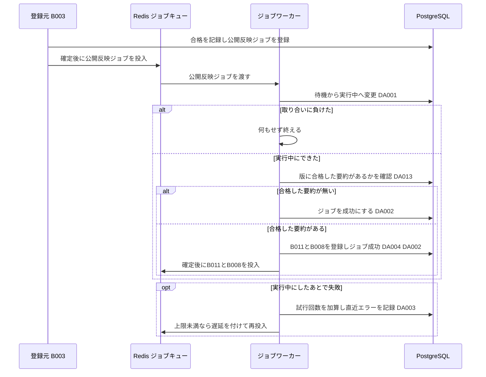
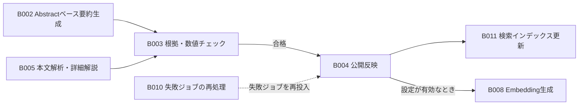

# バッチ詳細設計書 — B004 公開反映

## 0. 文書情報

| 項目 | 値 |
| :--- | :--- |
| 設計書ID | B004-BE |
| 親ID | B004 |
| 親設計書 | `基本設計書_概要.md` §4 機能設計「バッチ処理設計」B004 行 |
| バッチ名 | 公開反映（上流 §4 バッチ処理設計の区分「非同期ジョブ」） |
| 対応する機能ID | F04 日本語構造化要約（上流 §4 機能一覧。B004 は F04 の公開工程） |
| 関連する業務フローID | BF01 論文収集・日本語化（定期）、BF02 本文解析・詳細解説の生成、EX01 arXiv APIの取得失敗・レート制限（ジョブの再試行の扱い）（上流 §2） |
| 版 | 1.0 |
| 作成日 / 更新日 | 2026-10-27 / 2026-10-27 |
| 作成方法 | creating-backend-detailed-design v1.5.0 準拠。上流の確定設計書と `source/` の企画資料からの新規設計 |
| インプット | (a) `source/03_システム構成.md:11,26-28,37,43`、`source/02_機能要求定義.md:40,45-46,58`、`source/04_収益化とロードマップ.md:44`／(b) `docs/基本設計書_概要.md` §2 BF01・BF02・EX01、§4 F04・B003・B004・B008・B011・バッチ共通の方針、§6 T003・T009・CRUD図、§8、§9 環境変数一覧、§10 運用監視、§11 ARC001・ARC002・ARC004・ARC006、付録 Q19・Q20・Q21・Q35・Q36／関連する確定済み設計書: `docs/detail/be/BE.F04.BE詳細設計.md`（F04-BE。B004 の処理ロジックの定義元）、`docs/detail/be/BE.F05.BE詳細設計.md`（API04 が合格した要約を読む条件）、`docs/detail/be/BE.F02.BE詳細設計.md`・`BE.F03.BE詳細設計.md`・`BE.F08.BE詳細設計.md`（B011・B008 を使う側）、`docs/detail/batch/BT.B003.バッチ詳細設計.md`（登録元）、`docs/db/DB.T003.DB物理設計.md`・`DB.T009.DB物理設計.md`／(c) `legacy/`（空） |

* **インプットの性質（source/ の突合結果）**: `source/` は企画・初期設計案の Markdown 6ファイル（計227行）だけで、前の単位（B001〜B003）の作業時から変更はありません（ファイル数6件を再確認）。依頼にあるスケジュール定義 `config/schedule.rb`（whenever）と rake タスクの実装 `lib/tasks/` は**存在しません**（Ruby のファイル0件）。本システムのジョブは Python のワーカー（Redis + Celery または RQ）で動きます（`source/03_システム構成.md:7,11`）。B004 は時刻で起動する定期実行ではなく、検証の合格を受けてジョブキューに登録される**非同期ジョブ**です（上流 §4 B004「ジョブキュー（B003 の合格後）」）。このため whenever に当たるスケジュール定義は B004 には無く（§5 スケジュール定義で「該当なし」と根拠を記載）、rake タスクに当たるものは §4 のジョブ関数に置き換えています。本書は**リバースエンジニアリングではなく新規設計**です。資料と上流に無い値には「※推測」を付けています。
* **既存版**: `docs/detail/batch/BT.B004.バッチ詳細設計.md` の旧版はありません（作業開始時点の `docs/detail/batch/` は B001〜B003 の3ファイルだけ）。本書が初版で、消さずに残すべき既存記述はありません。
* **legacy/ との突合**: `legacy/` は空ディレクトリです（ファイル0件。B001〜B003 の作業時から変更なし）。突合する既存のバッチ設計書・業務意図・非機能の記述はありません。
* **F04-BE との分担と継承**: B004 の処理ロジックは、F04-BE §4 No.16 `publish_summary` で定義済みです。本書は、B004 が使う **DA-ID（F04-BE の DA001〜DA004・DA013）、関数（F04-BE §4 の No.1〜5・16・25）、トランザクションID（TX01・TX04・TX06）をそのまま引き継ぎ**、B004 単独で実装・運用できる形に展開します。そのうえで、起動契機・ワーカーの配置・多重起動制御・処理ステップ・性能・依存ジョブ順序・ログと監視を加えます。
  * **DA-ID の読み方**: DA-ID は設計書ごとの採番です。本書の DA-ID は **F04-BE の番号**で、BT.B002・BT.B003 と同じ番号体系です。BT.B001（F01-BE の番号）の DA-ID とは別のものです。
  * **食い違いの扱い**: 処理ロジックは F04-BE、起動と運用は本書を正とします。ただし、本書で見直した2点（§6 確認事項 No.9 に列挙）は本書を正とし、F04-BE への取り込みを求めます。
* **上流との差分**（※上流要確認）: 上流 §4 B004 は「検証に合格した要約を公開用データとして確定し、画面のAPIから返せる状態にする」とし、上流 BF01 の図も「B004 公開用データとして確定」と描いています。しかし `summaries` には公開済みを表す列が無く（上流 §6 T003）、画面の API04 は検証状態が「合格」の要約を、合格を記録した時点で返します（F05-BE §3 DA004「検証に合格した要約のうち生成日時が最も新しい1件」）。このため DB物理設計書 T003 §4.3 (8)・§9 No.3 と F04-BE は「合格＝公開対象」とし、B004 は `summaries` を書き換えず、合格した要約を検索とおすすめから見つかるようにする後続処理（B011・B008）の起点と位置づけています。本書もこの設計に従います（§6 確認事項 No.1）。

## 1. バックエンド構成・モジュール設計

* **対象ドメイン**: 要約系（公開） — 根拠・数値チェック（B003）で合格が記録された論文の版について、合格した要約が実際にあることを確かめ、検索インデックス更新（B011）と、設定が有効なら論文Embedding生成（B008）のジョブを登録する。要約そのものは書き換えない（上流 B004、DB物理設計書 T003 §4.3 (8)、F04-BE §0 確認事項 No.5）。
* **対象APIエンドポイント**: なし。B004 は画面や外部から HTTP で呼ばれず、ジョブキューから取り出されて動きます（根拠は §2 APIエンドポイント一覧）。
* **実行基盤**: Pythonワーカー上の非同期ジョブです（Redis + Celery または RQ。どちらにするかは未決定、上流 Q02）。DB は Supabase 上の PostgreSQL に、行単位アクセス制御を通らないサーバ側のサービスロールで接続します（DB物理設計書 T009 §7）。
* **ディレクトリ/ファイル構造**（※推測: F04-BE §1 の配置案のうち B004 が使うもの）:

```
worker/
├── jobs/
│   ├── runner.py                 # run（ジョブ共通の実行枠。ARC006）
│   └── publish_summary.py        # publish_summary（B004 の本処理）
└── repositories/
    ├── job_repository.py         # claim / mark_succeeded / mark_failed_or_retry / enqueue（DA001〜DA004）
    └── summary_repository.py     # exists_passed（DA013）
```

* **処理シーケンス図**（上流 BF01 のうち B004 の範囲を、ジョブの受け取りから終了まで展開。※推測を含む）:



## 2. API・インターフェース詳細設計

* **APIエンドポイント一覧（全数ロースター）**:

| API ID | メソッド | エンドポイント | 概要 | 定義状況 | 詳細の所在 |
| :--- | :--- | :--- | :--- | :--- | :--- |
| — | — | 該当なし | — | — | — |

**総件数: 0件。根拠**: 上流 `docs/基本設計書_概要.md` §7 内部API一覧の全8件（API01〜API08）に、B004 を起動・操作するものはありません。B004 の起動は、B003 が合格を記録したトランザクションでジョブ行を登録し、ジョブキューへ投入することで行います（§5 起動契機一覧）。合格した要約を画面へ返す API04 は、B004 の完了を待たずに合格した要約を返します（§0 上流との差分）。

* **外部サービス連携一覧（全数ロースター）**: 上流 §7 外部連携一覧の全9件に対し、B004 で使うかを示します。

| IF ID | 連携先 | B004 での利用 | 概要 | 定義状況 | 詳細の所在 |
| :--- | :--- | :--- | :--- | :--- | :--- |
| IF01 | arXiv API | 利用しない | メタデータの取得は B001・B006 の責務 | - | `docs/detail/batch/BT.B001.バッチ詳細設計.md` |
| IF02 | arXiv（論文本文PDF） | 利用しない | 本文の取得は B005・B003 の責務 | - | `docs/detail/batch/BT.B003.バッチ詳細設計.md` |
| IF03 | arXiv 原文ページ | 利用しない | 画面からのリンク遷移で、サーバ処理を伴わない | - | - |
| IF04 | LLM API | 利用しない | 要約の生成・検証は B002・B003・B005 の責務。B004 は LLM を呼ばない | - | `docs/detail/batch/BT.B002.バッチ詳細設計.md`、`docs/detail/batch/BT.B003.バッチ詳細設計.md` |
| IF05 | Supabase Auth | 利用しない | 利用者の認証は B004 に関係しない。DBへはサービスロールで接続する | - | - |
| IF06 | Stripe（決済セッション） | 利用しない | 課金（F12）の責務 | - | - |
| IF07 | Stripe（契約状態の通知） | 利用しない | 課金（F12）の責務 | - | - |
| IF08 | GitHub | 利用しない | GitHub関連付け（B009）の責務 | - | - |
| IF09 | 通知配信手段 | 利用しない | 通知・ダイジェスト配信（B007）の責務 | - | - |

**総件数: 9件（B004 で利用するもの0件）。根拠**: 上流 §7 外部連携一覧の IF01〜IF09 の全9行と1対1で対応します。上流 §2 BF01 のシーケンスで B004 の範囲（「B004 公開用データとして確定」）に登場する相手は PostgreSQL だけで、外部の相手はいません。Redis と PostgreSQL は上流 §7 で本システムの構成要素（内部）とされているため外部連携に含めません。

* **外部サービス連携仕様**: 該当なし（B004 が利用する外部連携は0件。根拠は上の一覧の直後に記載）。
* **API詳細仕様**: 該当なし（APIエンドポイント0件のため）。ジョブとしての入出力は §4 No.1 `run`・No.16 `publish_summary` と §5 の入出力一覧に記載します。

## 3. データアクセス（ORM / クエリ）設計

* **データアクセス一覧（全数ロースター）**: DA-ID は F04-BE §3 の採番をそのまま引き継ぎます（§0「DA-ID の読み方」）。F04-BE の DA005〜DA012・DA014 は B002・B003・B005 だけが使うため、本書には含めません。

| DA-ID | 処理名 | 呼出元（関数/API） | テーブルID | 対象物理テーブル | 種別 (SELECT/INSERT/UPDATE/DELETE) | 定義状況 (詳細/簡易) | 詳細の所在 |
| :--- | :--- | :--- | :--- | :--- | :--- | :--- | :--- |
| DA001 | ジョブの実行開始 | No.2 `claim`（No.1 `run` から呼ぶ） | T009 | jobs | UPDATE | 詳細 | §3 詳細定義 DA001・発行SQL DA001 |
| DA002 | ジョブの成功記録 | No.3 `mark_succeeded`（No.16 `publish_summary` から呼ぶ） | T009 | jobs | UPDATE | 詳細 | §3 詳細定義 DA002・発行SQL DA002 |
| DA003 | ジョブの失敗記録 | No.4 `mark_failed_or_retry`（No.1 `run` から呼ぶ） | T009 | jobs | UPDATE | 詳細 | §3 詳細定義 DA003・発行SQL DA003 |
| DA004 | 後続ジョブの登録（B011・B008） | No.5 `enqueue`（No.16 `publish_summary` から呼ぶ） | T009 | jobs | INSERT（衝突時は何もしない） | 詳細 | §3 詳細定義 DA004・発行SQL DA004 |
| DA013 | 合格した要約の有無確認 | No.25 `exists_passed` | T003 | summaries | SELECT | 簡易 | 発行SQL DA013 |

**総件数: 5件（SELECT 1件・INSERT 1件・UPDATE 3件・DELETE 0件。詳細4件・簡易1件）。全数である根拠**: §4 関数一覧の全7関数のうち DB へ問い合わせる5関数（No.2・3・4・5・25）の処理フローに現れる DB 操作を1件1行で数えたものです（No.2→DA001、No.3→DA002、No.4→DA003、No.5→DA004、No.25→DA013）。残りの2関数（No.1・16）は DB へ直接問い合わせず、これらの関数を呼ぶだけです。F04-BE §3 の同じ DA-ID と内容が一致します。B004 は `summaries` を書き換えず（§0 上流との差分）、DELETE も発行しません。
**上流 CRUD図との突合**: 上流 §6 CRUD図には B004 の行が無く、F04 行（summaries CRU、jobs RU ほか）にまとめられています。B004 の操作は summaries R（DA013）と jobs CU（DA001〜DA004）で、summaries R は F04 行の範囲に収まります。jobs の C（DA004 の B011・B008 の登録）は F04 行に無く、※上流要確認です（DB物理設計書 T009 §9 No.5、F04-BE §0 確認事項 No.2 と同じ事項。本書 §6 確認事項 No.2）。
**定義状況の判定**（completeness 3-1）: DA001〜DA004 は永続データを書き換える（3-1 の2）ため「詳細」です。DA013 は版のキー1つで合格した要約の有無を返すだけで、3-1 の基準に当たらないため「簡易」です（F04-BE §3 の判定と同じ）。

* **データアクセス詳細定義**（定義状況＝詳細の4件）:

| DA-ID | 処理名 | テーブルID | 対象物理テーブル | JOIN / Include | 抽出条件 (Where) / ソート | トランザクション境界 | N+1対策・性能上の注意 |
| :--- | :--- | :--- | :--- | :--- | :--- | :--- | :--- |
| DA001 | ジョブの実行開始 | T009 | jobs | なし | 指定のジョブで状態が待機の行だけを実行中に変え、版ID・種別・試行回数を受け取る（`WHERE id = $1 AND status = 'pending' RETURNING …`） | 単独で即時に確定する（TX01） | 更新できた行が0件なら、他のワーカーが実行中か完了済みなので何もせずに終える（T009 §4.3 (4)）。主キーで1行 |
| DA002 | ジョブの成功記録 | T009 | jobs | なし | 指定のジョブで状態が実行中の行だけを成功に変える（`WHERE id = $1 AND status = 'running'`） | 後続ジョブの登録と同じトランザクション（TX04）、または合格した要約が無いときの単独のトランザクション（TX06） | 更新が0件なら他の処理が状態を変えたものとして JobStateConflict を上げ、後続ジョブの登録ごと取り消す |
| DA003 | ジョブの失敗記録 | T009 | jobs | なし | 指定のジョブで状態が実行中の行について、試行回数を1増やし直近エラーを書く。増やした結果が上限以上なら失敗、未満なら待機に戻す（`SET attempts = attempts + 1, last_error = $2, status = CASE WHEN attempts + 1 >= $3 THEN 'failed' ELSE 'pending' END WHERE id = $1 AND status = 'running'`） | 単独で即時に確定する（TX01）。本処理のトランザクションを取り消した後に実行する | 上限は環境変数 `JOB_MAX_ATTEMPTS`（※推測: 3）。直近エラーには、APIキー・認証付きURL・接続文字列に見える値を取り除いた要約文だけを書く（T009 §4.3 (6)） |
| DA004 | 後続ジョブの登録（B011・B008） | T009 | jobs | なし | 抽出条件なし。版を指定して、種別「検索インデックス更新」の待機ジョブを1行追加する。設定 `EMBEDDING_ENABLED` が有効なら、種別「論文Embedding生成」も1行追加する。同じ版・同じ種別で待機中か実行中の行があれば何もしない（`job_type` は `update_search_index` と `generate_embedding`。`ON CONFLICT (paper_version_id, job_type) WHERE status IN ('pending','running') AND paper_version_id IS NOT NULL DO NOTHING RETURNING id`） | TX04。ジョブの成功（DA002）と同時に確定し、確定した後に、登録できた行のジョブIDだけをジョブキューへ入れる | 部分一意インデックス `uq_jobs_active_per_version` に合わせて ON CONFLICT に同じ条件を書く（T009 §5.2）。同じ版の B011・B008 がすでに待機中か実行中なら、その実行が今回の合格分も拾うため、登録しなくてよい（※推測: B011・B008 は実行時点の合格した要約を読む前提。§6 確認事項 No.8） |

* **発行SQL**: 全5件（DA001〜DA004・DA013）。すべてプレースホルダ（`$1` から始まる番号付きの引数）に値を渡す固定の文で、実行時に文の構造を組み立てる動的SQLはありません。F04-BE §3 の発行SQLと同じ文です。監視のために運用者が発行する問い合わせ（§5 監視項目 No.4）は B004 が発行するものではないため、本一覧には含めず、監視項目の欄に記載します。

**DA001 ジョブの実行開始**
```sql
UPDATE jobs
SET status = 'running'
WHERE id = $1
  AND status = 'pending'
RETURNING id, paper_version_id, job_type, attempts;
```
組み立ての分岐: なし（固定の1文）。

**DA002 ジョブの成功記録**
```sql
UPDATE jobs
SET status = 'succeeded'
WHERE id = $1
  AND status = 'running';
-- 更新件数が0なら JobStateConflict を上げて後続ジョブの登録ごと取り消す
```
組み立ての分岐: なし（固定の1文）。

**DA003 ジョブの失敗記録**（`$2` は直近エラーの要約文、`$3` は試行回数の上限）
```sql
UPDATE jobs
SET attempts   = attempts + 1,
    last_error = $2,
    status     = CASE WHEN attempts + 1 >= $3 THEN 'failed' ELSE 'pending' END
WHERE id = $1
  AND status = 'running'
RETURNING status, attempts;
```
組み立ての分岐: なし（固定の1文）。

**DA004 後続ジョブの登録**（`$2` は `update_search_index` か `generate_embedding`）
```sql
INSERT INTO jobs (paper_version_id, job_type)
VALUES ($1, $2)
ON CONFLICT (paper_version_id, job_type)
  WHERE status IN ('pending', 'running') AND paper_version_id IS NOT NULL
  DO NOTHING
RETURNING id;
-- 行が返ったときだけ、確定後にジョブキューへ投入する
```
組み立ての分岐: 文は固定です。設定 `EMBEDDING_ENABLED` が無効なら `update_search_index` で1回、有効なら `update_search_index` と `generate_embedding` で計2回発行します。生成され得る形は上の1文だけです。

**DA013 合格した要約の有無確認**
```sql
SELECT EXISTS (
  SELECT 1
  FROM summaries
  WHERE paper_version_id = $1
    AND validation_status = 'passed'
) AS has_passed;
-- idx_summaries_lookup の先頭列（paper_version_id）で版の要約だけを読む
```
組み立ての分岐: なし（固定の1文）。

## 4. サーバー側機能・処理ロジック設計（IPO設計）

* **関数一覧（全数ロースター）**: No と関数名は F04-BE §4 の採番をそのまま引き継ぎます。F04-BE の No.6〜15・17〜24 は B002・B003・B005 だけが使うため、本書には含めません。

| No | 関数名 | 所属モジュール（※推測） | 概要 | 定義状況 | 詳細の所在 |
| :--- | :--- | :--- | :--- | :--- | :--- |
| 1 | `run` | `worker/jobs/runner.py`（JobRunner） | ジョブ共通の実行枠。取り合い、本処理の呼び出し、失敗時の記録と遅延付きの再投入を受け持つ | 詳細 | §4 IPO定義 |
| 2 | `claim` | `worker/repositories/job_repository.py` | 待機中のジョブを実行中に変え、取り合いに勝ったときだけジョブの内容を返す（DA001） | 詳細 | §4 IPO定義 |
| 3 | `mark_succeeded` | `worker/repositories/job_repository.py` | 後続ジョブの登録と同じトランザクションの中で、実行中のジョブを成功にする（DA002） | 詳細 | §4 IPO定義 |
| 4 | `mark_failed_or_retry` | `worker/repositories/job_repository.py` | 失敗の回数を数え、上限未満なら待機へ戻し、上限に達したら失敗にする（DA003） | 詳細 | §4 IPO定義 |
| 5 | `enqueue` | `worker/repositories/job_repository.py` | 後続ジョブ（B011・B008）を重複なく登録し、確定後にジョブキューへ入れる（DA004） | 詳細 | §4 IPO定義 |
| 16 | `publish_summary` | `worker/jobs/publish_summary.py` | B004 の本処理。合格した要約がある版について、検索インデックス更新と Embedding 生成のジョブを登録する | 詳細 | §4 IPO定義 |
| 25 | `exists_passed` | `worker/repositories/summary_repository.py` | 版に合格した要約が1件でもあるかを返す（DA013） | 簡易 | - |

**総件数: 7関数（詳細6件・簡易1件）。全数である根拠**: F04-BE §4 関数ロースターの全25件のうち、B004 の本処理（F04-BE §4 No.16 `publish_summary`）から呼び出し関係をたどって届く関数と、ジョブ共通の実行枠（No.1〜5）を拾ったものです（`run`→`claim`・`publish_summary`・`mark_failed_or_retry`、`publish_summary`→`exists_passed`・`enqueue`・`mark_succeeded`）。残りの18関数は B002・B003・B005 からだけ呼ばれます。ソースコードが無いため実在の関数との突合はできず、関数名と分け方は※推測です。
**定義状況の判定**（completeness 3-1）: 分岐を持つもの（No.1・16）、状態を書き換えるもの（No.2〜5）を「詳細」としました。キー1つで有無を返すだけの No.25 は「簡易」です（F04-BE §4 の判定と同じ）。

* **入力・処理・出力（IPO）定義**（ロースターは上表。本表は定義状況＝詳細の6件）:

| No | 関数名 | 所属モジュール | 引数 (型) | 処理フロー (ステップ単位で具体的に) | 戻り値 | 発生しうるエラー |
| :--- | :--- | :--- | :--- | :--- | :--- | :--- |
| 1 | `run` | JobRunner | job_id: int, handler: 本処理の関数（B004 では `publish_summary`） | 1. `claim` で待機中のジョブを実行中にする。取り合いに負けた（null）なら INFO ログ（§5 ログ No.1）を残して終える。<br>2. `claim` 自体が DB の失敗で例外を上げたときは、ジョブはまだ待機で失敗を jobs に記録できない（DA003 は実行中の行だけを更新する）。ERROR ログ（§5 ログ No.7）を出し、例外をジョブキューへ返して再配送に任せる（※推測: Celery では `acks_late=True` と `task_acks_on_failure_or_timeout=False` の両方を設定する。RQ では失敗ジョブの登録簿から再投入する仕組みを ARC006 で用意する。BT.B002・BT.B003 と同じ）。<br>3. 本処理を呼ぶ。本処理は自身のトランザクションで後続ジョブ登録・ジョブ成功を確定する。<br>4. 本処理が例外を上げたら、トランザクションを取り消してから `mark_failed_or_retry` を呼ぶ。B004 には再試行しても結果が変わらない例外は無いため、すべて試行回数の上限まで再試行する。JobStateConflict は失敗を記録せずに終える（No.3）。<br>5. 戻ってきた状態が待機なら、試行回数に応じた遅延（1回目の失敗の後は1分、2回目の失敗の後は5分。※推測）を付けて、同じジョブIDをジョブキューへ再投入する。失敗なら失敗キューへ送り、ERROR ログ（§5 ログ No.4）を残す（上流 EX01、ARC006） | なし | なし（本処理の例外はここで受け止め、ジョブの状態として残す。`claim` の DB 失敗だけは手順2のとおりジョブキューへ返す） |
| 2 | `claim` | JobRepository | job_id: int | 1. DA001 を発行し、即時に確定する。<br>2. 更新できた行があればジョブの内容を、無ければ null を返す | { id, paperVersionId, jobType, attempts } または null | DB の接続・問い合わせ失敗（例外を上げる。`run` 手順2） |
| 3 | `mark_succeeded` | JobRepository | conn: トランザクション中の接続, job_id: int | 1. 呼び出し側のトランザクションの中で DA002 を発行する。<br>2. 更新が0件なら JobStateConflict を上げて、後続ジョブの登録ごと取り消させる | なし | JobStateConflict（→ `run` が WARN ログ（§5 ログ No.5）を残して終える。失敗記録はしない） |
| 4 | `mark_failed_or_retry` | JobRepository | job_id: int, error: Exception, force_fail: bool（B004 では常に偽） | 1. エラーの種類と要約から直近エラーの文を作る。APIキー・認証付きURL・接続文字列に見える値とスタックトレースは取り除き、2,000文字（※推測）で切る（T009 §4.3 (6)）。<br>2. 上限に環境変数 `JOB_MAX_ATTEMPTS`（※推測: 3）を使う。<br>3. DA003 を発行し、即時に確定する。<br>4. 更新後の状態と試行回数を返す。更新が0件なら null を返す | { status: 'pending' または 'failed', attempts: int } または null | DB の接続・問い合わせ失敗（ERROR ログ（§5 ログ No.7）。ジョブは実行中のまま残る。§6 確認事項 No.6） |
| 5 | `enqueue` | JobRepository | conn: トランザクション中の接続, paper_version_id: int, job_type: str（B004 では `update_search_index` か `generate_embedding`） | 1. 呼び出し側のトランザクションの中で DA004 を発行する。<br>2. 登録できたジョブIDを、確定後にジョブキューへ入れる予約リストに積む。登録されなかった（同じ版・同じ種別のジョブが待機中か実行中）ときは何もしない。<br>3. 呼び出し側の確定が成功したら、予約リストのジョブIDをジョブキューへ投入する（B011・B008 とも `default` キュー。※推測。§5 ワーカーの配置） | 登録したジョブID または null | ジョブキュー（Redis）への投入失敗（ERROR ログ（§5 ログ No.6）。ジョブ行は待機のまま残る。§6 確認事項 No.6） |
| 16 | `publish_summary` | `worker/jobs/publish_summary.py` | job: { id, paperVersionId } | 1. `exists_passed` で、版に合格した要約が1件でもあるかを確かめる。<br>2. 無ければ、何も登録せずに `mark_succeeded` だけを行って確定し（TX06）、INFO ログ（§5 ログ No.2）を出して終える。B004 は B003 が合格を記録したトランザクションの中でだけ登録されるため通常は起きず、失敗ジョブの再処理（B010）で手動で起動された場合の備えである（F04-BE §4 No.16 手順2）。<br>3. あれば1つのトランザクション（TX04）で、`enqueue` で検索インデックス更新（B011）を登録する。<br>4. 設定値 `EMBEDDING_ENABLED`（※推測: 既定 false。推薦の Embedding は将来機能のため。`source/02_機能要求定義.md:40`）が有効なら、`enqueue` で論文Embedding生成（B008）も登録する。<br>5. `mark_succeeded` を行って確定する。<br>6. 確定の後で、登録できた後続ジョブをジョブキューへ投入する（`enqueue` 手順3）。<br>7. 登録した後続ジョブの種別と、既存のジョブがあって登録しなかった種別を INFO ログ（§5 ログ No.3）に出す。<br>8. `summaries` の列は書き換えない。合格した要約は API04 からすでに返せる状態にあり、公開反映は検索やおすすめから見つかるようにする後続処理の起点と位置づける（§0 上流との差分） | なし | JobStateConflict、DB の接続失敗（いずれも `run` が受け止める） |

## 5. バッチ処理・非同期タスク設計

* **起動契機一覧（全数ロースター）**: B004 のジョブ行が作られ、ジョブキューから取り出されて動き出す経路をすべて挙げます。

| No | 起動契機 | 登録・投入する主体 | 登録の条件 | 概要 | 定義状況 | 詳細の所在 |
| :--- | :--- | :--- | :--- | :--- | :--- | :--- |
| 1 | 検証で合格が記録された | 要約の根拠・数値チェック（B003） | B003 の1回の検証で、合格と記録した要約が1件以上あったとき（BT.B003 §5 合否と後続ジョブの決め方 No.1。本文PDFの一時的な失敗で部分確定したときも、30秒要約・3分要約の合格分で登録される） | 合格の記録と同じトランザクションで公開反映ジョブを登録し、確定後に投入する（BT.B003 DA004、TX03） | 詳細 | `docs/detail/batch/BT.B003.バッチ詳細設計.md` §3 DA004・§5 |
| 2 | 自動再試行 | B004 自身（`run`） | 失敗して試行回数が上限未満のとき | 同じジョブIDを遅延付きで再投入する。ジョブ行は新しく作らない（上流 EX01 と同じ扱い） | 詳細 | §4 No.1 `run`、§6 リトライ方針 |
| 3 | 失敗ジョブの再処理 | 運用者が起動する失敗ジョブの再処理（B010） | 失敗で終わった公開反映ジョブの原因を取り除いたとき | 失敗のジョブを待機に戻して再投入する。ジョブ行は新しく作らない（上流 B010、T009 §4.3 (4)） | 詳細 | `docs/detail/batch/BT.B010.バッチ詳細設計.md`（未作成） |

**総件数: 3件。全数である根拠**: 上流 §4 B004 の実行タイミング「B003 の合格後」に当たる登録元1件（BT.B003 DA004）と、既存の行を再投入する経路（自動再試行: F04-BE §4 No.1、再処理: 上流 B010）2件です。DB物理設計書 T009 §6 も `publish_summary` の登録を「検証に合格したときに登録する」の1つだけとしています。利用者の操作や画面から直接 B004 を登録する経路はありません（上流 §7 内部API一覧に該当なし）。
**定義状況の判定**（completeness 3-1）: 3件とも B004 を起動して永続データを書き換える（3-1 の2）ため「詳細」です。

* **スケジュール定義**（whenever の `config/schedule.rb` に当たる定義）: **該当なし**。B004 は時刻で起動する定期実行ではなく、検証の合格を受けて登録される非同期ジョブです（上流 §4 B004 の実行タイミング「ジョブキュー（B003 の合格後）」）。cron 式・実行時刻・タイムゾーンの設定はありません。実際に動く時間帯は、登録元の B003 が動く毎日 02:00〜04:00 UTC ごろです（BT.B003 §5 性能、本書 §5 性能）。

* **ワーカーの配置**（whenever の `roles` による専用サーバ判定に当たる定義。※推測・※上流未定義: キュー名と並列数は上流で未定義。上流 §4、Q02）:

| 項目 | 値 | 説明 |
| :--- | :--- | :--- |
| キュー | `default`（※推測）。要約の根拠・数値チェック（B003）と共用する | BT.B003 §5 ワーカーの配置で決めたとおり。B004 は1件が数十ミリ秒で終わるため、専用のキューを設けるほどの負荷は無い |
| 処理するワーカー | `default` キューを購読するワーカーのプロセス。本番では1つ以上のホストに置いてよい | 定期実行ではないため、1か所に限る必要はない。同じジョブが2つのワーカーに渡っても、DA001 の取り合いで1つだけが処理する |
| 並列数 | B003 と合わせて全ワーカーの合計で4（設定値 `DEFAULT_WORKER_CONCURRENCY`。BT.B003 と同じ値） | B004 単独の並列数は設けない。B004 の負荷は B003 の約400分の1（§5 性能）で、B003 の処理能力をほとんど削らない |
| 後続ジョブのキュー | B011・B008 とも `default`（※推測。それぞれの設計書で別のキューに分けてもよい） | B004 は投入先のキュー名を種別ごとの対応表で決める（`enqueue` 手順3）。B011・B008 の設計書で専用のキューを決めた場合は、その表を直す |
| 実行環境 | production・staging・development のどれでも動く | B004 は自分からは動かず、B003 が合格を記録した分だけ動く |

* **多重起動制御**: 同じ版の公開反映が二重に動くと、検索インデックス更新と Embedding 生成が二重に登録されるおそれがあります。次の4段階で防ぎます。

| No | 段階 | 防ぐもの | 方法 | 防げなかったときの結果 |
| :--- | :--- | :--- | :--- | :--- |
| 1 | 登録 | 同じ版の公開反映ジョブが2つ待機・実行されること | 同じ版・同じ種別で待機中か実行中の行は1件までしか作れない部分一意インデックス（`uq_jobs_active_per_version`）に当たったら、登録を取りやめる（BT.B003 DA004） | — （DB が保証する）。取りやめになっても、待機中か実行中の公開反映ジョブが同じ版の B011・B008 を登録する |
| 2 | 着手の取り合い | 同じジョブがジョブキューから2つのワーカーへ渡ること | 状態が待機の行だけを実行中に変える条件付きの更新で、勝った1つだけが処理する（DA001） | — （DB が保証する） |
| 3 | 後続ジョブの登録 | 同じ版の B011・B008 が2つ待機・実行されること | B004 から B011・B008 を登録するときも、同じ部分一意インデックスに当たったら取りやめる（DA004） | — （DB が保証する） |
| 4 | 成功の記録 | 他の処理がジョブの状態を変えた後に、二重の後続ジョブを残すこと | 成功の記録を状態が実行中の行に限り、0件なら後続ジョブの登録ごと取り消す（DA002・JobStateConflict） | — （DB が保証する） |

**総件数: 4段階。根拠**: 二重実行の原因になる「公開反映ジョブの重複登録」「同一ジョブの重複配送」「後続ジョブの重複登録」「状態が変わった後の確定」の4つに1段階ずつ対応させたものです。

* **入出力一覧（IPO: 対象テーブル・外部連携）**: B004 が読み書きするものをすべて挙げます。

| 区分 | ID | 名称 | 物理名・接続先 | 操作 | 内容 |
| :--- | :--- | :--- | :--- | :--- | :--- |
| 入力 | — | ジョブキューのメッセージ | Redis の `default` キュー（`REDIS_URL`） | 受信 | 公開反映ジョブのジョブID |
| 入力 | T003 | 要約 | summaries | 参照（DA013） | 版に合格した要約があるか |
| 入力・出力 | T009 | ジョブ | jobs | 自身の状態変更（DA001〜DA003）、後続ジョブの追加（DA004） | 公開反映ジョブの状態・試行回数・直近エラーと、検索インデックス更新（B011）・論文Embedding生成（B008）のジョブ |
| 入力 | — | 設定値 | ワーカーの環境変数 | 参照 | §6 設定値一覧の6件 |
| 出力 | — | ジョブキュー | Redis（`REDIS_URL`） | 送信 | 後続ジョブ（B011・B008）の投入、自身の再投入、上限到達時の失敗キューへの投入 |
| 出力 | — | 構造化ログ | ワーカーの標準出力（※推測: ホスティング先のログ収集に任せる） | 出力 | 本節 ログ出力一覧の7種類 |

**総件数: 6件（入力3件・入出力1件・出力2件）。根拠**: テーブルは §3 データアクセス一覧の5件が触れる2テーブル（T003・T009）と一致し、外部連携は §2 で0件です。ジョブキュー・設定値・ログは §4 の IPO 定義の引数と処理フローに現れる入出力を拾ったものです。

* **処理ステップ詳細**: 起動契機 No.1（B003 が合格を記録した）の1件分を、ジョブの受け取りから終了まで順に示します。起動契機 No.2・No.3 も手順1から同じです。

| 手順 | 処理 | 対象（ID） | DA-ID / 関数 | 成功時の次の手順 | 失敗時の扱い |
| :--- | :--- | :--- | :--- | :--- | :--- |
| 1 | ワーカーが `default` キューから公開反映ジョブを受け取る | Redis | No.1 `run` | 2 | — （受け取れないジョブは Redis に残る） |
| 2 | ジョブを待機から実行中に変える | T009 | DA001（No.2 `claim`） | 1行変えた: 3／0行: INFO ログ（No.1）を出して終了 | DB の失敗は、ジョブがまだ待機のため jobs に記録できない。ERROR ログ（No.7）を出してジョブキューへ例外を返し、再配送に任せる（※推測。§6 確認事項 No.6） |
| 3 | 版に合格した要約があるかを確かめる | T003 | DA013（No.25 `exists_passed`） | あり: 4／なし: ジョブを成功にして確定し（DA002、TX06）、INFO ログ（No.2）を出して終了 | DB の失敗は再試行できる失敗として手順7 |
| 4 | 1つのトランザクションで、検索インデックス更新（B011）の登録、設定が有効なら論文Embedding生成（B008）の登録、ジョブの成功を確定する | T009 | DA004（No.5）、DA002（No.3）、TX04 | 5 | どれかが失敗したら全体を取り消し、再試行できる失敗として手順7。成功の記録が0件（JobStateConflict）なら全体を取り消し、WARN ログ（No.5）を出して終了（失敗記録はしない） |
| 5 | 確定の後で、登録できた後続ジョブをジョブキューへ投入する | Redis | No.5 `enqueue` | 6 | ERROR ログ（No.6）。後続ジョブの行は待機のまま残る（§6 確認事項 No.6）。B004 自身は成功のまま |
| 6 | 登録した後続ジョブの種別を記録して終える | — | No.16 `publish_summary` | 終了（INFO ログ No.3） | — |
| 7 | 実行中にした後の失敗を記録する。上限未満なら遅延を付けて同じジョブを再投入し、上限到達なら失敗キューへ送る | T009・Redis | DA003（No.4）、No.1 `run` | 終了（WARN または ERROR ログ No.4） | 記録できない場合は ERROR ログ（No.7）だけ残し、ジョブは実行中のまま（§6 確認事項 No.6） |

**総件数: 7手順。根拠**: §4 の No.1 `run`（手順1〜5）と No.16 `publish_summary`（手順1〜8）の処理フローを、DB 操作・ジョブキューへの投入・分岐の単位で1行ずつ並べたものです。DA-ID の全5件が少なくとも1つの手順に現れます（DA001: 手順2、DA002: 3・4、DA003: 7、DA004: 4、DA013: 3）。

* **ジョブ実行定義**:

| バッチID | ジョブ名 | 実行タイミング | 対象テーブル | 処理概要 | タイムアウト |
| :--- | :--- | :--- | :--- | :--- | :--- |
| B004 | 公開反映（`publish_summary`） | B003 が合格を記録してジョブを投入したとき。ほかに自動再試行と失敗ジョブの再処理（起動契機一覧の3件）。大半は B003 が動く毎日 02:00〜04:00 UTC ごろに入る | summaries（参照）、jobs（自身の状態変更、後続ジョブの追加） | 版に合格した要約があることを確かめ、検索インデックス更新（B011）と、設定が有効なら論文Embedding生成（B008）のジョブを登録する。要約は書き換えない（上流 B004、F04-BE §4 No.16） | 1分（※推測。F04-BE §5 と同じ。DB の問い合わせ3〜4文と Redis への投入だけで、通常は0.1秒以内に終わる）。超えたときはジョブキューが処理を止め、再試行できる失敗として扱う |

* **依存ジョブ順序（全数ロースター）**: 上流 §4 バッチ処理設計の全11件について、B004 との前後関係を示します。

| バッチID | 名称 | B004 との関係 | 順序 | 概要 | 定義状況 | 詳細の所在 |
| :--- | :--- | :--- | :--- | :--- | :--- | :--- |
| B001 | 論文メタデータ収集 | 間接の先行 | B001 → B002 → B003 → B004 の順 | 定期実行で論文と版を保存し、新しい版ごとに B002 を登録する | 簡易 | `docs/detail/batch/BT.B001.バッチ詳細設計.md` |
| B002 | Abstractベース日本語要約生成 | 間接の先行 | B002 → B003 → B004 の順 | Abstract から30秒要約と3分要約を作り、未検証として保存する | 簡易 | `docs/detail/batch/BT.B002.バッチ詳細設計.md` |
| B003 | 要約の根拠・数値チェック | 直接の先行（登録元） | B003 が合格を記録したトランザクションで登録され、確定直後に投入される | 未検証の要約を調べて合格・不合格を記録し、合格があれば B004 を登録する | 簡易 | `docs/detail/batch/BT.B003.バッチ詳細設計.md` |
| B004 | 公開反映 | 本バッチ | — | 合格した要約がある版について、B011 と B008 を登録する | 詳細 | 本書 |
| B005 | 本文解析・詳細解説生成 | 間接の先行 | B005 → B003 → B004 の順。10分解説が後から合格すると、同じ版の B004 がもう一度動く | ライセンスで本文の利用が許される論文に限り、本文PDFを解析して10分解説を作る | 簡易 | `docs/detail/batch/BT.B005.バッチ詳細設計.md`（未作成） |
| B006 | arXivオンデマンド同期 | 間接の先行 | B006 → B002 → B003 → B004 の順 | 自前DBに無い論文が検索で必要になったとき、arXiv から該当論文だけを取り込む | 簡易 | `docs/detail/batch/BT.B006.バッチ詳細設計.md`（未作成） |
| B007 | 通知・ダイジェスト配信 | 間接の後続 | 合格した要約がある論文を配信する。B004 の完了との前後関係は B007 側で定める（※推測） | 通知を希望する利用者ごとに、関心分野の新着論文をまとめて送る | 簡易 | `docs/detail/batch/BT.B007.バッチ詳細設計.md`（未作成） |
| B008 | 論文Embedding生成 | 直接の後続 | 設定 `EMBEDDING_ENABLED` が有効なときだけ、B004 の確定直後に投入される（※推測。上流 §4 B008「B004 の後に起動」） | 将来の推薦のため、論文ごとの Embedding を作って pgvector へ保存する | 簡易 | `docs/detail/batch/BT.B008.バッチ詳細設計.md`（未作成） |
| B009 | GitHub公式実装の関連付け | 関係なし | 起動契機は上流で未定義 | 論文の公式実装リポジトリを探して関連付け、コード解説を作る | 簡易 | `docs/detail/batch/BT.B009.バッチ詳細設計.md`（未作成） |
| B010 | 失敗ジョブの再処理 | 再起動の主体 | B004 の失敗ジョブを運用者の起動で再投入する（起動契機 No.3） | 失敗キューに溜まったジョブを調べ、原因を取り除いたものを再実行する | 簡易 | `docs/detail/batch/BT.B010.バッチ詳細設計.md`（未作成） |
| B011 | 検索インデックス更新 | 直接の後続 | B004 の確定直後に投入される（上流 §4 B011「B004 の完了後」） | 公開反映が済んだ論文を検索インデックスに加え、検索と新着一覧から見つかるようにする | 簡易 | `docs/detail/batch/BT.B011.バッチ詳細設計.md`（未作成） |

**総件数: 11件。全数である根拠**: 上流 §4 バッチ処理設計の B001〜B011 の全11行と1対1で対応します。B004 自身を除く10件は、本書では B004 との順序関係だけを述べるため「簡易」とし、各バッチの詳細はそれぞれのバッチ詳細設計書に委ねます。
**順序の図**（上流 BF01・BF02・§4 バッチ処理設計から作図。B008 の起動条件は※推測）:



* **性能（バッチウィンドウ・想定件数）**（※推測: 資料に件数・時間の目標値は無い。上流 Q31 で確認待ち。件数は `docs/detail/batch/BT.B003.バッチ詳細設計.md` §5 性能を起点に計算）:

| 項目 | 標準ケース（AI・IT系のカテゴリに絞った場合） | 最大ケース（全カテゴリを収集した場合） | 根拠・計算 |
| :--- | :--- | :--- | :--- |
| 1日の公開反映ジョブ数 | 約430件 | 約1,290件 | B003 の1日の検証ジョブ（約430件／約1,290件）のうち、合格が1件以上あるもの。不合格率は要約1件あたり約2%（BT.B003）で、30秒要約と3分要約の両方が不合格になる版はごくわずかのため、ほぼ全件とみなす |
| 1件あたりの所要時間 | 約50ミリ秒 | 約50ミリ秒 | DB の問い合わせ3〜4文（主キーまたは索引で1行）と Redis への投入1〜2回（※推測） |
| 1日分の処理時間の合計 | 約22秒 | 約65秒 | ジョブ数×1件あたりの所要時間。`default` キューで B003（1件約20秒）と同じワーカーを使うが、B003 の処理時間（1日約2.4時間分／約7.2時間分のワーカー時間）に比べて0.3%程度で、B003 の処理能力をほとんど削らない |
| バッチウィンドウ | 02:00〜02:45 UTC | 02:00〜04:00 UTC。再試行を含めた最悪で 05:15 UTC まで | B003 の確定直後に投入され、数秒以内に終わる。最悪は、B003 が再試行を含めて 05:02 に合格を記録し（BT.B003 §5 性能）、B004 自身も3回とも失敗する場合で、B004 の上乗せ（タイムアウト1分×3回＋再試行の遅延1分＋5分＝9分）を足して 05:11 に終わる。B003 と同じ `default` キューの監視の締め時刻 05:15 に収まる（監視項目一覧 No.2） |
| テーブルの変化量 | jobs の追加 1日約430行（B011）。B008 を有効にすると約860行 | jobs の追加 1日約1,290行。B008 を有効にすると約2,580行 | 公開反映ジョブ1件につき B011 を1行、設定が有効なら B008 を1行追加する。すでに同じ版の待機中・実行中のジョブがあれば追加しない。summaries は書き換えない |

* **ログ出力一覧（全数ロースター）**: 構造化ログ（※推測: JSON 形式で、ジョブID・ジョブ種別・版ID・試行回数を項目として持つ）で出します。

| No | 出す時点 | レベル | 出す内容 | 用途 | 定義状況 | 詳細の所在 |
| :--- | :--- | :--- | :--- | :--- | :--- | :--- |
| 1 | 取り合いに負けて何もせず終えたとき | INFO | ジョブID、「他のワーカーが実行中か完了済み」 | ジョブキューの重複配送の発生を把握する | 簡易 | - |
| 2 | 合格した要約が無く、何も登録せずに成功で終えたとき | INFO | ジョブID、版ID、「合格した要約が無い」 | 通常は起きない。再処理（B010）での手動起動か、登録元の誤りを疑う手がかりにする | 簡易 | - |
| 3 | 後続ジョブを登録して成功で終えたとき | INFO | ジョブID、版ID、登録した後続ジョブの種別とジョブID、既存のジョブがあって登録しなかった種別、`EMBEDDING_ENABLED` の値、ジョブの所要時間 | 版ごとに検索インデックス更新・Embedding 生成がいつ登録されたかを追う。新着から公開までの時間（`source/04_収益化とロードマップ.md:44`）の区切りの1つとして使う | 詳細 | 本節 監視項目一覧 No.4 |
| 4 | ジョブが失敗したとき | 上限未満は WARN、上限到達は ERROR | ジョブID、試行回数、エラーの要約（伏せ字済み）、再試行までの遅延、ERROR のときはスタックトレース | 失敗の原因調査。ERROR は監視の通知対象 | 詳細 | §6 エラーハンドリング、本節 監視項目一覧 No.1 |
| 5 | 成功の記録が0件で後続ジョブの登録を取り消したとき | WARN | ジョブID、「他の処理がジョブの状態を変えた」 | 状態の取り合いの発生を把握する | 簡易 | - |
| 6 | ジョブキューへの投入に失敗したとき | ERROR | ジョブID、投入しようとしたジョブの種別（検索インデックス更新・Embedding 生成、または自身の再投入） | 待機のまま残ったジョブを運用者が手で投入し直す（§6 確認事項 No.6） | 詳細 | §6 エラーハンドリング |
| 7 | DB の失敗でジョブの状態を記録できなかったとき（実行中にする前の失敗で待機のまま残る場合と、失敗の記録ができず実行中のまま残る場合の両方） | ERROR | ジョブID、失敗した時点（実行中にする前か後か）、元のエラー | 待機または実行中のまま残ったジョブを運用者が見つける（§6 確認事項 No.6） | 詳細 | §6 エラーハンドリング |

**総件数: 7種類。根拠**: §4 IPO 定義の処理フローと発生しうるエラーの欄で「ログを出す」と定めた箇所を、出す時点ごとに1行ずつ拾ったものです。定義状況は、運用者の対応や監視の判断に使うもの（3-1 の5「失敗時の扱い」）を「詳細」、記録だけのものを「簡易」としています。

* **監視項目一覧（全数ロースター）**（上流 §8 アプリケーション保護「バッチは監視対象にし、失敗したジョブは失敗キューに集める」、§10 運用監視。監視の手段・通知先は未定義で上流 Q35 で確認待ち。しきい値は※推測）:

| No | 監視項目 | 検出の方法 | しきい値 | 通知・対応 | 定義状況 | 詳細の所在 |
| :--- | :--- | :--- | :--- | :--- | :--- | :--- |
| 1 | 公開反映ジョブの失敗 | ERROR ログ（No.4）と、状態が失敗の公開反映ジョブ（DB物理設計書 T009 の失敗の行だけを持つ索引 `idx_jobs_failed` で、種別 `publish_summary` を抽出） | 1件でも発生したら | 運用者へ通知する。合格した要約は論文詳細（API04）には出るが、検索とおすすめから見つからないままになるため、原因（DB・Redis の障害）を取り除いて再処理（B010）で戻す | 詳細 | §6 エラーハンドリング |
| 2 | 処理の滞留 | `default` キューに残っているジョブの数（Redis のキューの長さ。B003 と共用のため、BT.B003 §5 監視項目 No.2 と同じ監視） | 05:15 UTC に1件以上残っている | 並列数・障害を確かめる | 詳細 | 本節 性能 |
| 3 | 投入されなかったジョブ・状態を記録できなかったジョブ | ERROR ログ（No.6・No.7） | 1件でも発生したら | 運用者がジョブIDを確かめ、待機のまま残った行は手で投入し直し、実行中のまま残った行は失敗ジョブの再処理（B010）で扱う | 詳細 | §6 確認事項 No.6 |
| 4 | 合格したのに公開反映が済んでいない版 | 運用者が1日1回、直近7日に作られた合格した要約を持つ版のうち、成功した公開反映ジョブが1件も無い版を数える（生成日時の索引 `idx_summaries_generated_at` で範囲を絞り、版と種別の索引 `idx_jobs_paper_version_id_job_type` で公開反映ジョブの有無を引く。`SELECT count(DISTINCT s.paper_version_id) FROM summaries s WHERE s.generated_at >= now() - interval '7 days' AND s.generated_at < now() - interval '24 hours' AND s.validation_status = 'passed' AND NOT EXISTS (SELECT 1 FROM jobs j WHERE j.paper_version_id = s.paper_version_id AND j.job_type = 'publish_summary' AND j.status = 'succeeded')`） | 1件以上 | B003 の登録漏れ・B004 の失敗・投入漏れのどれかで公開反映が止まった版。その版の公開反映ジョブを手で登録して投入する。この問い合わせは「成功した公開反映ジョブが1件も無い版」を数えるため、30秒・3分要約の合格で一度成功した版で、後から合格した10分解説の公開反映が漏れた場合は検出できない。補うには、版ごとに最も新しく合格した要約の検証ジョブより大きいジョブIDの成功した公開反映ジョブがあるかで判定する（jobs に日時の列が無いため、ジョブIDの大小を登録順の代わりに使う。※推測） | 詳細 | §6 確認事項 No.6 |

**総件数: 4件。根拠**: 上流 §8・§10 が求めるバッチ監視（失敗・失敗キュー）に、B004 で起きうる異常（処理が追いつかない、投入・記録に失敗する、合格したのに後続が始まらない）を、ログ出力一覧の ERROR と、DB の行の状態ごとに1つずつ対応させたものです。No.4 の問い合わせは運用者が監視のために発行するもので、B004 は発行しません（§3 発行SQL の注記）。

## 6. 例外処理・セキュリティ設計

* **エラーハンドリング**: B004 は利用者へ応答を返さないため、「クライアント応答」には、失敗が画面や運用者からどう見えるかを書きます。B004 が失敗しても、合格した要約は論文詳細（API04）にそのまま出ます。影響は、検索インデックス更新（B011）と Embedding 生成（B008）が始まらず、検索とおすすめから見つかるのが遅れることです。

| 例外種別 | 対応方法 | ログ出力 | クライアント応答 |
| :--- | :--- | :--- | :--- |
| 取り合いに負けた（実行開始の更新が0件） | 何もせずに終える | INFO（§5 ログ No.1） | なし（他のワーカーが処理する） |
| 実行中にする前の DB の失敗（`claim` の失敗） | ジョブがまだ待機のため jobs に記録できない（DA003 は実行中の行だけを更新する）。例外をジョブキューへ返し、再配送に任せる（※推測。再配送されなければ待機のまま残る。§6 確認事項 No.6） | ERROR（§5 ログ No.7） | 論文詳細には要約が出る。検索・おすすめへの反映が遅れる。再配送されなければ運用者が監視（§5 監視項目 No.3・No.4）で見つける |
| 合格した要約が無い（通常は起きない） | 例外にせず、何も登録せずにジョブを成功にする（TX06） | INFO（§5 ログ No.2） | なし（公開する要約が無い） |
| DB の接続失敗（TX04 の途中） | トランザクションを取り消し、ジョブを失敗記録へ回す。上限未満なら遅延を付けて再実行する | 上限未満は WARN、上限到達は ERROR とスタックトレース（§5 ログ No.4） | 論文詳細には要約が出る。検索・おすすめへの反映が遅れる。上限に達したジョブは処理状況（F17）と失敗キューで運用者が確認する |
| JobStateConflict（成功の記録が0件） | 後続ジョブの登録ごと取り消して終える。他のワーカーの結果を優先し、失敗記録はしない | WARN（§5 ログ No.5） | なし（他の処理の結果が残る） |
| ジョブキュー（Redis）への投入失敗（後続ジョブの投入、または自身の再投入） | DB の確定は取り消さない。投入できなかったジョブの行は待機のまま残る（※上流要確認。§6 確認事項 No.6） | ERROR（§5 ログ No.6） | 論文詳細には要約が出る。検索・おすすめへの反映が止まる。運用者が監視（§5 監視項目 No.3）で見つけて手で投入し直す |
| ジョブのタイムアウト（1分） | ジョブキューが処理を止める。再試行できる失敗として扱う。止められた時点では TX04 は確定していないため、後続ジョブは登録されていない | ERROR（§5 ログ No.4） | 論文詳細には要約が出る。検索・おすすめへの反映が遅れる |
| 失敗の記録自体の DB の失敗（`mark_failed_or_retry` の失敗） | 記録できず、ジョブは実行中のまま残る（※上流要確認: DB物理設計書 T009 §9 No.1。§6 確認事項 No.6） | ERROR（§5 ログ No.7） | 論文詳細には要約が出る。検索・おすすめへの反映が止まる。運用者が監視（§5 監視項目 No.3・No.4）で見つけて再処理（B010）する |
| 予期しない例外 | 再試行できる失敗として記録する。直近エラーには要約だけを入れ、スタックトレースはログにだけ出す | ERROR とスタックトレース（§5 ログ No.4） | 論文詳細には要約が出る。検索・おすすめへの反映が遅れる |

**総件数: 9種類。根拠**: §4 IPO 定義の「発生しうるエラー」欄に挙げた失敗と、例外にせず結果として扱う「合格した要約が無い」を、扱いの違いごとに1行にまとめたものです。F04-BE §6 の12件のうち B004 で起きるのは4件（取り合い・JobStateConflict・DB の失敗・Redis への投入失敗）で、これに、実行中にする前の DB の失敗、合格した要約が無い、ジョブのタイムアウト、失敗の記録自体の失敗、予期しない例外の5件を加えました。F04-BE の残り8件（LLM・スキーマ・検証不合格・本文・PDF・版が無い）は、LLM・本文・版の詳細を扱わない B004 では起きません（DA013 は版が無ければ「合格した要約が無い」を返すだけで、例外にならない）。

* **リトライ方針**（上流 EX01、§4 バッチ共通の方針）:

| 項目 | 値 | 説明 |
| :--- | :--- | :--- |
| ジョブの再試行の単位 | 公開反映ジョブ全体 | 1つのトランザクション（TX04）で記録するため、途中まで記録された状態は無い |
| ジョブの試行回数の上限 | 3回（※推測。上流 Q19、`JOB_MAX_ATTEMPTS`） | 1回目の失敗で試行回数が1、3回目の失敗で上限に達して失敗になる |
| 再試行までの遅延 | 1回目の失敗の後は1分、2回目の失敗の後は5分（※推測） | BT.B002・BT.B003 と同じ。B004 の失敗は DB・Redis の一時的な障害がほとんどのため、短い間隔で回復を待つ |
| 再試行しない失敗 | なし | B004 は外部と通信せず、版が無くても例外にならないため、何度やり直しても変わらない失敗が無い |
| 上限到達後 | 失敗キューへ送り、運用者が原因を取り除いてから失敗ジョブの再処理（B010）で待機に戻す | 再処理で試行回数を0に戻すかは B010 の設計で決める（DB物理設計書 T009 §9 No.8、上流 Q36） |

* **冪等性**: 同じ公開反映ジョブが二重に渡されたり、失敗して再実行されたりしても、結果が1回成功したときと同じになるようにします。

| No | 対象 | 二重に処理されたときの結果 | 冪等にしている仕組み |
| :--- | :--- | :--- | :--- |
| 1 | 検索インデックス更新ジョブ（B011） | 同じ版の B011 が待機中か実行中なら登録しない。その B011 が実行時点の合格した要約を読むため、結果は同じになる | DA004 の部分一意インデックス（`uq_jobs_active_per_version`） |
| 2 | 論文Embedding生成ジョブ（B008） | 同じく、同じ版の B008 が待機中か実行中なら登録しない | DA004 の部分一意インデックス |
| 3 | 公開反映ジョブの状態の記録 | 成功・失敗の記録が二重に来ても、状態が実行中の行しか変えないため、2回目は0行になり何もしない | 状態を条件にした更新（DA001〜DA003） |
| 4 | 要約（summaries） | B004 は書き換えないため、何度動いても要約は変わらない | 参照だけの問い合わせ（DA013） |

**総件数: 4件。根拠**: B004 が書き込むテーブル（T009）の行の種類（B011・B008・公開反映ジョブの状態）と、読むだけのテーブル（T003）を、行の種類ごとに1行ずつ挙げたものです。B011・B008 がすでに成功で終わった後に同じ版の B004 がもう一度動いた場合（10分解説が後から合格した場合）は、B011・B008 が新しく登録されてもう一度動きます。これは新しく合格した要約を検索とおすすめに反映するための意図した動作で、B011・B008 の側が冪等に作られている前提です（§6 確認事項 No.8）。

* **トランザクション制御**（ID は F04-BE §6 の TX ID をそのまま引き継ぐ）:

| 処理名 | トランザクション範囲 | ロールバック条件 |
| :--- | :--- | :--- |
| TX01 ジョブの実行開始・失敗記録 | jobs UPDATE 1件（DA001 または DA003）。それぞれ単独で即時に確定する | 更新が0件でも取り消しはしない（取り合いに負けた、または他のワーカーが記録済みとして扱う） |
| TX04 後続ジョブの登録 | jobs INSERT（B011、設定が有効なら B008。DA004）、jobs UPDATE（自身を成功。DA002）を1つのトランザクションにする。合格した要約の有無の確認（DA013）は、この直前にトランザクションの外で行う | いずれかが失敗したら全体を取り消す。後続ジョブだけが登録されてジョブが待機へ戻り、再実行でもう一度登録しようとする状態や、成功したのに後続ジョブが無い状態を作らない。成功の記録が0件（JobStateConflict）のときも全体を取り消す。取り消し後は TX01 で失敗を記録する（JobStateConflict を除く） |
| TX06 何もせずに終える | jobs UPDATE（自身を成功。DA002）だけ。版に合格した要約が無かったとき | 失敗したら取り消し、TX01 で失敗を記録する |

* **確認と登録の間の変化**: 合格した要約の有無の確認（DA013）と登録（TX04）の間に、同じ版の要約の状態が変わることはありません。合格・不合格から他の値へは移らないためです（T003 §6）。このため、確認の後に合格が取り消されて、合格した要約の無い版に B011 を登録することは起きません。

* **セキュリティ設計**（上流 §8 のうち B004 に関わるもの）:
  * **誤情報**: B004 は検証に合格した版についてだけ後続ジョブを登録し、未検証・不合格の要約を検索やおすすめへ広げる経路を作りません（上流 §8「LLMによる誤情報」、ARC004）。合格の確認は DA013 で行います。
  * **不正な値の混入**: SQL にはすべてプレースホルダで値を渡します。B004 が書き込むのは jobs の行だけです。
  * **機密情報**: `DATABASE_URL`・`SUPABASE_SERVICE_ROLE_KEY`・`REDIS_URL` はワーカーの環境変数にだけ置き、ログと直近エラーに出しません（上流 §8 機密情報管理、§9 環境変数一覧）。
  * **外部への送信**: B004 は外部と通信しません（§2 外部サービス連携一覧）。

* **設定値一覧**（B004 が使うもの。※推測を含む）:

| 設定値 | 上流での定義 | 用途 | 既定値（※推測） |
| :--- | :--- | :--- | :--- |
| DATABASE_URL | 上流 §9 環境変数一覧に定義あり | PostgreSQL への接続 | — |
| REDIS_URL | 上流 §9 に定義あり | ジョブキューの接続先 | — |
| SUPABASE_SERVICE_ROLE_KEY | 上流 §9 に定義あり | 行単位アクセス制御を通らないサービスロールで DB を書くための鍵 | — |
| JOB_MAX_ATTEMPTS | ※上流未定義（値は上流 Q19） | ジョブの再試行の上限回数 | 3 |
| EMBEDDING_ENABLED | ※上流未定義（F04-BE §4 No.16） | 論文Embedding生成（B008）を登録するかどうか。推薦の Embedding は将来機能（`source/02_機能要求定義.md:40`）のため、使い始めるまで無効にしておく | false |
| DEFAULT_WORKER_CONCURRENCY | ※上流未定義（BT.B003 で定義） | `default` キューを処理するワーカーの並列数の合計（B003 と共用） | 4 |

**総件数: 6件。根拠**: §4 IPO 定義と §5 ワーカーの配置で参照する設定値をすべて拾ったものです。B004 は LLM・arXiv を呼ばないため、`LLM_API_KEY`・`LLM_MODEL_ID`・`ARXIV_REQUEST_INTERVAL_SEC` は使いません。

* **確認事項**（本書で※推測・※上流要確認・※上流未定義とした事項）:

| No | 確認事項 | 本書での仮置き | 関連する上流の確認事項 |
| :--- | :--- | :--- | :--- |
| 1 | 上流 §4 B004 は「公開用データとして確定し、画面のAPIから返せる状態にする」とするが、`summaries` に公開を表す列が無く、API04 は合格した要約を合格の時点で返す。合格と公開を分けて管理する（公開日時の列を設け、B004 が書く）かどうか（※上流要確認） | 合格＝公開対象とし、B004 は要約を書き換えず、B011・B008 の起点とする（DB物理設計書 T003 §4.3 (8)・§9 No.3、F04-BE §0 確認事項 No.5） | Q20 |
| 2 | 上流 CRUD図に B004 の行が無く、F04 行の jobs は「RU」だが、B004 は B011・B008 を登録する（C）（※上流要確認） | 本書は C を行う（DA004）。DB物理設計書 T009 §9 No.5、F04-BE §0 確認事項 No.2 と同じ事項 | —（※上流未定義） |
| 3 | 公開反映（B004）と検索インデックス更新（B011）を別ジョブで実装してよいか | 別ジョブとする（上流 §4 B011 の根拠「第1回レビューで B004 から分けた」、上流 Q20 の仮置き） | Q20 |
| 4 | 論文Embedding生成（B008）を、いつから B004 の後に登録するか（推薦の Embedding 照合は将来機能） | 設定 `EMBEDDING_ENABLED` で切り替え、既定は無効（F04-BE §4 No.16、F08-BE §5 では Phase 2 の推薦は Embedding を使わない） | Q29 |
| 5 | 上流 §4 B011 は「検索と新着一覧から見つかるようにする」とするが、F02-BE は新着一覧が検索インデックスに依存しないとしている（※上流要確認。F02-BE §6 確認事項 No.5） | B004 は B011 を登録するだけで、新着一覧の表示には関わらない。新着一覧は B004 を待たずに合格した要約を表示する | Q21 |
| 6 | DB に登録済みでジョブキューへの投入に失敗した待機ジョブと、実行中にする前・失敗の記録の DB の失敗で残ったジョブの拾い直し（jobs に登録日時の列が無い） | 実行中にする前の失敗はジョブキューの再配送、投入漏れは運用者の手での投入、失敗の記録の失敗は再処理（B010）で扱う。公開反映が止まった版は監視項目 No.4 で見つける（※上流要確認。DB物理設計書 T009 §9 No.1、BT.B002・BT.B003 と同じ事項） | Q19・Q36 |
| 7 | ジョブの試行回数の上限、再試行の遅延、タイムアウト | §6 リトライ方針・§5 ジョブ実行定義のとおり（3回、1分・5分、1分） | Q19 |
| 8 | 同じ版の B004 が、10分解説の後からの合格でもう一度動き、成功済みの B011・B008 を再び登録する。B011・B008 は同じ版を何度処理しても結果が変わらない作りにする必要がある | B011・B008 は実行時点の合格した要約を読み、版ごとに上書きで反映する前提とする（※推測。BT.B011・BT.B008 の設計で確定する） | Q21 |
| 9 | F04-BE §4・§5 との差分の取り込み: (1) ジョブキューへの投入失敗のログを WARN から ERROR に上げた（BT.B002・BT.B003 と同じ）、(2) キューを `default` と名付け、B003 と並列数を共用することを明記した | この2点は本書を正とし、F04-BE の次回改訂で本書に合わせる（※上流要確認） | —（※上流未定義） |
| 10 | 合格した要約の有無の確認（DA013）は言語を条件にしていないが、API04 は日本語の要約だけを返す（F05-BE §3 DA004） | 現在の要約は日本語だけを作る（`summaries.language` の初期値 `ja`）ため、結果は変わらない。他の言語の要約を作るようになったら、DA013 に日本語の条件を加える（※推測） | —（※上流未定義） |

## 7. 利用する方式（共通基盤）

| 方式ID | 名称 | 本書での利用箇所 |
| :--- | :--- | :--- |
| ARC001 | 生成物キャッシュ・重複排除方式 | 同じ版の B011・B008 を二重に登録しない（DA004、多重起動制御 No.3）。要約を書き換えず、合格した要約をそのまま後続処理に使い回す |
| ARC002 | 段階的生成・公開方式（速報版→詳細版） | 30秒要約・3分要約が合格した時点で B004 が動き、検索への反映を始める。10分解説が後から合格すると同じ版の B004 がもう一度動き、詳細版の内容も反映する（§5 依存ジョブ順序 B005 行） |
| ARC004 | LLM出力検証方式（事実と推測の区別） | 検証に合格した版についてだけ後続処理を始める（DA013）。未検証・不合格の要約を検索やおすすめへ広げない |
| ARC006 | ジョブ実行基盤（キュー・リトライ・失敗キュー・監視） | 実行の取り合い・成功と失敗の記録・遅延付きの再試行・失敗キューへの移動・後続ジョブの登録（No.1〜5、DA001〜DA004）、ログと監視（§5 ログ出力一覧・監視項目一覧） |

**総件数: 4件。根拠**: 上流 §11 方式設計一覧の全10件（ARC001〜ARC010）の「適用範囲」を確認し、B004・F04・T003・T009 のいずれかを含むもの（ARC001: B001〜B005・F04、ARC002: F04、ARC004: F04・T003.validation_status、ARC006: B001〜B011・T009）を挙げました。ARC003（要約スキーマ）は要約本文を作る・検証する B002・B003・B005、ARC005（ライセンス・権利ゲート）は本文を使う B005、ARC007（外部APIアクセス制御）は arXiv へ問い合わせる処理、ARC008（プラン別機能制御）は Pro 機能、ARC009（表示・編集ポリシー）は画面の表記、ARC010（個人データ最小化）は利用者データに適用され、要約の中身も外部も画面も扱わない B004 は利用しません。
