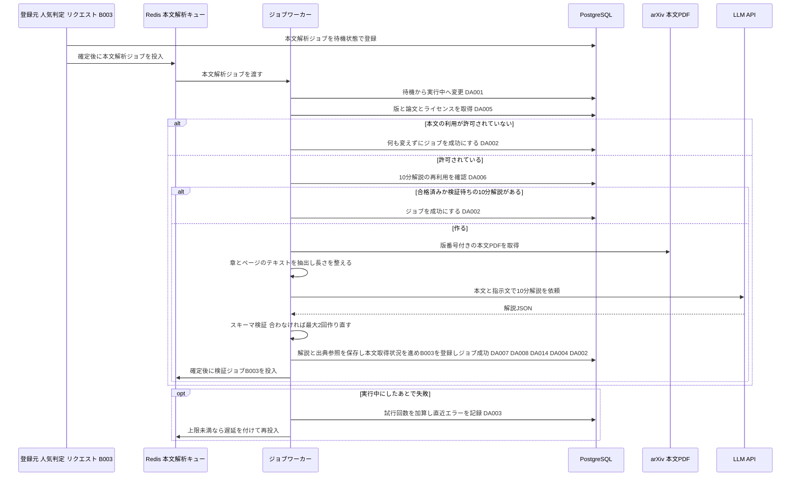
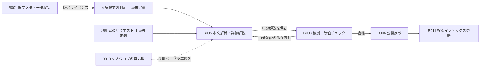

# バッチ詳細設計書 — B005 本文解析・詳細解説生成

## 0. 文書情報

| 項目 | 値 |
| :--- | :--- |
| 設計書ID | B005-BE |
| 親ID | B005 |
| 親設計書 | `基本設計書_概要.md` §4 機能設計「バッチ処理設計」B005 行 |
| バッチ名 | 本文解析・詳細解説生成（上流 §4 バッチ処理設計の区分「非同期ジョブ」） |
| 対応する機能ID | F04 日本語構造化要約（上流 §4 機能一覧。B005 は F04 の10分解説を作る部分。10分解説は Phase 3） |
| 関連する業務フローID | BF02 本文解析・詳細解説の生成、EX01 arXiv APIの取得失敗・レート制限（ジョブの再試行の扱い）、EX02 要約のスキーマ検証・根拠チェックで不合格、EX03 本文の利用条件が確認できない（上流 §2） |
| 版 | 1.0 |
| 作成日 / 更新日 | 2026-10-27 / 2026-10-27 |
| 作成方法 | creating-backend-detailed-design v1.5.0 準拠。上流の確定設計書と `source/` の企画資料からの新規設計 |
| インプット | (a) `source/03_システム構成.md:13,29-31,36-38,57,59-60`、`source/02_機能要求定義.md:26-29,45-47,50`、`source/04_収益化とロードマップ.md:19-20,25-27,38,47`、`source/01_企画概要.md:28,33-35`／(b) `docs/基本設計書_概要.md` §1 用語集・技術スタック、§2 BF02・EX01〜EX03、§4 F04・B003・B005・バッチ共通の方針、§6 T001〜T004・T009・CRUD図、§7 IF02・IF04、§8、§9 環境変数一覧、§10 運用監視、§11 ARC001〜ARC007・ARC009、付録 Q02・Q09・Q13・Q19・Q23・Q29・Q31・Q35・Q36／関連する確定済み設計書: `docs/detail/be/BE.F04.BE詳細設計.md`（F04-BE。B005 の処理ロジックの定義元）、`docs/detail/be/BE.F05.BE詳細設計.md`（10分解説を読む側・リクエストの扱い）、`docs/detail/be/BE.F17.BE詳細設計.md`（処理状況の表示）、`docs/detail/batch/BT.B002.バッチ詳細設計.md`・`BT.B003.バッチ詳細設計.md`（同じ規則の先例・登録元）、`docs/db/DB.T002`〜`T004`・`T009.DB物理設計.md`／(c) `legacy/`（空） |

* **インプットの性質（source/ の突合結果）**: `source/` は企画・初期設計案の Markdown 6ファイル（計227行）だけで、前の単位（B001〜B004）の作業時から変更はありません（ファイル数6件を再確認）。依頼にあるスケジュール定義 `config/schedule.rb`（whenever）と rake タスクの実装 `lib/tasks/` は**存在しません**（Ruby のファイル0件）。本システムのジョブは Python のワーカー（Redis + Celery または RQ）で動きます（`source/03_システム構成.md:7,11`）。B005 は時刻で起動する定期実行ではなく、人気論文の判定・利用者のリクエスト・検証での作り直しを受けてジョブキューに登録される**非同期ジョブ**です（上流 §4 B005「ジョブキュー（起動契機: 人気論文の判定・利用者のリクエスト。判定基準は未定義）」）。このため whenever に当たるスケジュール定義は B005 には無く（§5 スケジュール定義で「該当なし」と根拠を記載）、rake タスクに当たるものは §4 のジョブ関数に置き換えています。本書は**リバースエンジニアリングではなく新規設計**です。資料と上流に無い値には「※推測」を付けています。
* **既存版**: `docs/detail/batch/BT.B005.バッチ詳細設計.md` の旧版はありません（作業開始時点の `docs/detail/batch/` は B001〜B004 の4ファイルだけ）。本書が初版で、消さずに残すべき既存記述はありません。
* **legacy/ との突合**: `legacy/` は空ディレクトリです（ファイル0件。B001〜B004 の作業時から変更なし）。突合する既存のバッチ設計書・業務意図・非機能の記述はありません。
* **F04-BE との分担と継承**: B005 の処理ロジックは、F04-BE §4 No.17 `analyze_full_text` で定義済みです。本書は、B005 が使う **DA-ID（F04-BE の DA001〜DA008・DA014）、関数（F04-BE §4 の No.1〜5・7〜11・17〜22）、トランザクションID（TX01・TX05・TX06）をそのまま引き継ぎ**、B005 単独で実装・運用できる形に展開します。そのうえで、起動契機・ワーカーの配置・多重起動制御・処理ステップ・性能・依存ジョブ順序・ログと監視を加えます。
  * **DA-ID の読み方**: DA-ID は設計書ごとの採番です。本書の DA-ID は **F04-BE の番号**で、BT.B002〜BT.B004 と同じ番号体系です。BT.B001（F01-BE の番号）の DA-ID とは別のものです。
  * **食い違いの扱い**: 処理ロジックは F04-BE、起動と運用は本書を正とします。ただし、本書で見直した5点（§6 確認事項 No.12 に列挙）は本書を正とし、F04-BE への取り込みを求めます。
* **上流との差分**（※上流要確認）:
  * 上流 BF02 の図は、10分解説の作成の後に「B003 根拠・数値チェック」を行ってから summaries を保存し、本文取得状況を更新する順に描いています。DB物理設計書 T003 §0・F04-BE・BT.B003 は、B005 が10分解説を**未検証で保存し、同じトランザクションで本文取得状況を進め、検証ジョブ（B003）を登録する**順にしています。本書もこれに従います（BT.B003 §0 上流との差分と同じ扱い）。
  * 上流 BF02 の図は本文から「章・ページ・数式・参考文献を抽出」としていますが、上流 §4 B005 の処理内容は「本文PDFを取得・解析して10分解説を作る」で、数式解説・参考文献・日本語全文（Appendix の中身。F05・P105）の保存先テーブルは上流に無く（上流 §6、Q23）、全文翻訳は Phase 3 です（`source/04_収益化とロードマップ.md:38`）。本書の B005 は10分解説だけを作り、数式と参考文献は10分解説の材料として読むにとどめます（§6 確認事項 No.3）。
  * 上流 B005 の起動契機「人気論文の判定」「利用者のリクエスト」は、判定基準もリクエストの手段も未定義です（上流 Q13）。登録する主体を定めた設計書も無く、F05-BE 末尾の確認事項 No.8 は「利用者が10分解説を求めたことをリクエストとして扱うか」を※上流要確認とし、F05 からはジョブを登録しないとしています。本書は B005 側の受け口（登録のしかたと条件）を定め、登録する主体は※上流未定義として残します（§5 起動契機一覧 No.1・No.2、§6 確認事項 No.1）。

## 1. バックエンド構成・モジュール設計

* **対象ドメイン**: 要約系（本文解析・詳細解説） — ライセンスで本文の利用が許される論文の版に限り、版番号付きの本文PDFを取得・解析し、章・ページ付きの本文を材料に LLM で10分解説（`deep`）を作る。要約スキーマに合うことを確かめて未検証で保存し、同じトランザクションで版の本文取得状況を「本文取得済み」に進め、根拠・数値チェック（B003）のジョブを登録する。全論文を全文解析すると費用がかさむため、人気論文とリクエストされた論文だけを対象にする（上流 B005・BF02・EX03、ARC002・ARC005、`source/04_収益化とロードマップ.md:25-26`）。
* **対象APIエンドポイント**: なし。B005 は画面や外部から HTTP で呼ばれず、ジョブキューから取り出されて動きます（根拠は §2 APIエンドポイント一覧）。
* **実行基盤**: Pythonワーカー上の非同期ジョブです（Redis + Celery または RQ。どちらにするかは未決定、上流 Q02）。PDF解析ライブラリは PyMuPDF / Docling / GROBID のどれかで未決定です（上流 Q02）。DB は Supabase 上の PostgreSQL に、行単位アクセス制御を通らないサーバ側のサービスロールで接続します（DB物理設計書 T002・T003 §7）。
* **ディレクトリ/ファイル構造**（※推測: F04-BE §1 の配置案のうち B005 が使うもの）:

```
worker/
├── jobs/
│   ├── runner.py                    # run（ジョブ共通の実行枠。ARC006）
│   └── analyze_full_text.py         # analyze_full_text（B005 の本処理）
├── summary/
│   ├── reuse.py                     # find_reusable_summary（10分解説の使い回し確認。ARC001）
│   └── schema.py                    # validate_schema（要約スキーマ検証。ARC003）
├── llm/
│   ├── client.py                    # generate_structured（IF04 LLM API）
│   └── prompts.py                   # build_prompt（10分解説の指示文）
├── license/gate.py                  # is_full_text_allowed（本文利用の可否判定。ARC005）
├── arxiv/pdf_client.py              # fetch_pdf（IF02。ARC007）
├── pdf/parser.py                    # parse_pdf（本文PDFの解析）
└── repositories/
    ├── job_repository.py            # claim / mark_succeeded / mark_failed_or_retry / enqueue（DA001〜DA004）
    ├── paper_version_repository.py  # find_with_paper / mark_full_text（DA005・DA014）
    └── summary_repository.py        # save_with_citations（DA007・DA008）
```

* **処理シーケンス図**（上流 BF02・EX03 のうち B005 の範囲を、ジョブの受け取りから終了まで展開。※推測を含む）:



## 2. API・インターフェース詳細設計

* **APIエンドポイント一覧（全数ロースター）**:

| API ID | メソッド | エンドポイント | 概要 | 定義状況 | 詳細の所在 |
| :--- | :--- | :--- | :--- | :--- | :--- |
| — | — | 該当なし | — | — | — |

**総件数: 0件。根拠**: 上流 `docs/基本設計書_概要.md` §7 内部API一覧の全8件（API01〜API08）に、B005 を起動・操作するものはありません。利用者が本文解析をリクエストする API も上流に無く（上流 Q13）、F05-BE は API04 で10分解説を求められてもジョブを登録しないとしています（F05-BE 末尾の確認事項 No.8）。B005 が作った10分解説は、検証に合格した後に API04（`depth=deep`）が読みます。

* **外部サービス連携一覧（全数ロースター）**: 上流 §7 外部連携一覧の全9件に対し、B005 で使うかを示します。

| IF ID | 連携先 | B005 での利用 | 概要 | 定義状況 | 詳細の所在 |
| :--- | :--- | :--- | :--- | :--- | :--- |
| IF01 | arXiv API | 利用しない | メタデータの取得は B001・B006 の責務。B005 は保存済みの版番号とライセンスを使う | - | `docs/detail/batch/BT.B001.バッチ詳細設計.md` |
| IF02 | arXiv（論文本文PDF） | 利用する | ライセンスで許された版について、版番号付きの本文PDFを取得する | 詳細 | 本節 外部サービス連携仕様、§4 No.19 `fetch_pdf` |
| IF03 | arXiv 原文ページ | 利用しない | 画面からのリンク遷移。B005 は出典URLとして版番号付きの論文ページのURLを保存するだけで、通信はしない | - | - |
| IF04 | LLM API | 利用する | 本文と指示文を送り、10分解説の JSON を受け取る | 詳細 | 本節 外部サービス連携仕様、§4 No.9 `generate_structured` |
| IF05 | Supabase Auth | 利用しない | 利用者の認証は B005 に関係しない。DBへはサービスロールで接続する | - | - |
| IF06 | Stripe（決済セッション） | 利用しない | 課金（F12）の責務 | - | - |
| IF07 | Stripe（契約状態の通知） | 利用しない | 課金（F12）の責務 | - | - |
| IF08 | GitHub | 利用しない | GitHub関連付け（B009）の責務 | - | - |
| IF09 | 通知配信手段 | 利用しない | 通知・ダイジェスト配信（B007）の責務 | - | - |

**総件数: 9件（B005 で利用するもの2件）。根拠**: 上流 §7 外部連携一覧の IF01〜IF09 の全9行と1対1で対応します。上流 §2 BF02 のシーケンスに登場する外部の相手は arXiv（本文PDF）と LLM API の2つです。PDF解析ライブラリは本システムの内部構成要素で、外部連携に含めません（上流 §7 の根拠。GROBID を外部サービスとして使う場合は上流 Q02 で外部連携に加える）。定義状況は2件とも外部への送信と失敗時の扱い（completeness 3-1 の2・5）に当たるため「詳細」です。

* **外部サービス連携仕様**（B005 で利用する2件。F04-BE §2 のうち B005 に関わる値）:

| IF ID | 連携先 | 連携方式 | エンドポイント / 接続先 | 認証方式 | タイムアウト | リトライ方針 | エラー時の挙動 |
| :--- | :--- | :--- | :--- | :--- | :--- | :--- | :--- |
| IF02 | arXiv（論文本文PDF） | HTTPダウンロード（※推測） | `https://arxiv.org/pdf/{arXiv ID}v{版番号}`（※推測: 版番号付きで取得し、要約する版と本文を一致させる） | 認証なし（※推測） | 60秒（※推測） | 問い合わせの前に、前回の arXiv への問い合わせから環境変数 `ARXIV_REQUEST_INTERVAL_SEC`（※推測: 3秒）以上あける。間隔はワーカー間で共有するため、最後に問い合わせた時刻を Redis に置く（F04-BE §4 No.19）。通信失敗・HTTP 5xx・HTTP 429 は、ジョブ内では呼び直さず、ジョブ共通の失敗処理で後から再実行する（arXiv に短時間で問い合わせを重ねないため。ARC007） | HTTP 404（版が無い）は再試行しても変わらないため、試行回数によらずジョブを失敗にする。応答が PDF で無いとき、大きさが上限（※推測: 50MB。設定値 `FULLTEXT_MAX_PDF_MB`）を超えるときも同じく失敗にする（※推測）。それ以外の失敗は再試行できる失敗としてジョブの再試行に任せる |
| IF04 | LLM API | REST API（※推測。上流 IF04 自体が※推測） | 提供元は未定（上流 Q29）。使うモデルは環境変数 `LLM_MODEL_ID` で指定する（B002・B003 と同じモデル。※推測） | APIキー（環境変数 `LLM_API_KEY`。※推測） | 1回の呼び出しにつき180秒（F04-BE §2。※推測） | 通信のタイムアウト・接続失敗・提供元の混雑（HTTP 429）・提供元の障害（HTTP 5xx）のときだけ、2秒・4秒・8秒と間隔を倍にして最大3回まで呼び直す。それ以外の 400〜499（指示文の不備・認証失敗）は呼び直さない。出力が要約スキーマに合わないときは、保存せずに最大2回まで作り直しを依頼する（上流 EX02。※推測） | 呼び直しを使い切っても失敗したら例外を上げ、ジョブ共通の失敗処理（DA003）で試行回数を1増やす。上限未満ならジョブごと遅延を付けて再実行される。スキーマに合わない出力が3回続いたときも同じく扱う |

* **IF04 の送受信データと保存先の対応**（※推測: 項目の最終的な定義は要約スキーマの方式設計書 `docs/arch/方式.ARC003.方式設計.md`（未作成）が持つ。ここでは DB物理設計書 T003 §4.3 (4)・T004 §4.3 と F04-BE §4 No.8・No.10 で決まっている範囲を示す）:

| 区分 | データ | 出どころ・保存先 | 決め方 |
| :--- | :--- | :--- | :--- |
| 送信 | 原題 | `papers.title`（DA005 で読む） | 日本語タイトルに原題を併記させるため、材料として渡す（`source/02_機能要求定義.md:23`） |
| 送信 | 本文（章の見出しとページ番号付きのテキスト） | 本文PDFを解析した結果（`parse_pdf`）。保存はしない（保存先が無い。上流 Q23） | 章ごとに見出しとページ番号を付けて渡し、主張ごとに章とページを出典として答えさせる。入力の上限（※推測: 10万トークン。設定値 `FULLTEXT_MAX_INPUT_TOKENS`）を超える本文は、参考文献と付録の章を外し、それでも超えるときは本文の後ろの章から外して上限に収める（§4 No.17 手順5。※推測） |
| 送信 | 10分解説の指示と出力形式 | プログラム内の指示文（`build_prompt`） | 技術的詳細・数式・比較実験を解説する（`source/02_機能要求定義.md:26`）。共通して、日本語で書く・原題を併記する・主張ごとに主張IDと事実か推測かの区分と出典の章・ページを付ける・材料に無いことを事実として断定しない・数値とベンチマーク名を原文の表記のまま残す（`source/01_企画概要.md:33-35`、`source/03_システム構成.md:60`）。出力形式として要約スキーマの JSON Schema を付ける |
| 受信 | 解説JSON（日本語タイトル・原題・技術的詳細・数式・比較実験・主張の一覧） | `summaries.json_content` | スキーマ検証（`validate_schema`）を通ったものだけを、出典参照の配列を取り分けたうえで保存する。保存後は書き換えない（T003 §4.3 (4)） |
| 受信 | 使ったモデル名 | `summaries.model_id` | LLM の応答に含まれるモデル名をそのまま記録する（T003 §4.3 (5)） |
| 受信 | 主張ごとの主張ID | `summary_citations.claim_id` | 解説JSONの主張の主張IDをそのまま使う。同じ解説の中で重複せず64文字以内であることをスキーマ検証で確かめる |
| 受信 | 主張ごとの出典の章 | `summary_citations.source_section` | LLM が答えた章の見出しを入れる。本文の章の見出しに無い値は空にする（T004 §4.3 (3)「見出しが取れない論文は章を空にする」。※推測） |
| 受信 | 主張ごとの出典ページ | `summary_citations.source_page` | LLM が答えたページ番号を入れる。1以上で本文のページ数以下であることを保存前に確かめ、外れていればスキーマ不一致として作り直しを依頼する（B003 の出典の範囲の照合で不合格になるのを先に防ぐため。§6 確認事項 No.12。※推測） |
| 固定値 | 出典URL | `summary_citations.source_url` | LLM の出力に任せず、プログラムで要約した版の論文ページのURLを組み立てて入れる（`https://arxiv.org/abs/{arXiv ID}v{版番号}`。T004 §4.3 (4)。BT.B002 と同じ扱い。※推測） |
| 固定値 | 要約種別・解析範囲・言語・検証状態・生成日時 | `summaries.summary_type`・`source_scope`・`language`・`validation_status`・`generated_at` | 要約種別は10分解説（`deep`）、解析範囲は本文取得済み（`full_text`）。言語は日本語（`ja`）、検証状態は未検証（`pending`）、生成日時は保存時刻で、いずれも列の初期値に任せる（T003 §6、F04-BE DA007） |

**総件数: 10行（送信3・受信5・固定値2）。根拠**: 送信は上流 IF04「送信: 本文」と F04-BE §4 No.8 の指示文の構成要素、受信は上流 IF04「受信: 解説」を保存先の列ごとに分けたもの、固定値は B005 が書く `summaries`（T003）と `summary_citations`（T004）の列のうち LLM の出力から取らない列です。`summaries` の7列（自動採番の `id` と、ジョブが指す版から決まる `paper_version_id` を除く）と `summary_citations` の4列（自動採番の `id` と、保存時に決まる `summary_id` を除く）がこの10行のいずれかに対応します。

* **API詳細仕様**: 該当なし（APIエンドポイント0件のため。根拠は上の一覧の直後に記載）。ジョブとしての入出力は §4 No.1 `run`・No.17 `analyze_full_text` と §5 の入出力一覧に記載します。

## 3. データアクセス（ORM / クエリ）設計

* **データアクセス一覧（全数ロースター）**: DA-ID は F04-BE §3 の採番をそのまま引き継ぎます（§0「DA-ID の読み方」）。F04-BE の DA009〜DA013 は B003・B004 だけが使うため、本書には含めません。

| DA-ID | 処理名 | 呼出元（関数/API） | テーブルID | 対象物理テーブル | 種別 (SELECT/INSERT/UPDATE/DELETE) | 定義状況 (詳細/簡易) | 詳細の所在 |
| :--- | :--- | :--- | :--- | :--- | :--- | :--- | :--- |
| DA001 | ジョブの実行開始 | No.2 `claim`（No.1 `run` から呼ぶ） | T009 | jobs | UPDATE | 詳細 | §3 詳細定義 DA001・発行SQL DA001 |
| DA002 | ジョブの成功記録 | No.3 `mark_succeeded`（No.17 `analyze_full_text` から呼ぶ） | T009 | jobs | UPDATE | 詳細 | §3 詳細定義 DA002・発行SQL DA002 |
| DA003 | ジョブの失敗記録 | No.4 `mark_failed_or_retry`（No.1 `run` から呼ぶ） | T009 | jobs | UPDATE | 詳細 | §3 詳細定義 DA003・発行SQL DA003 |
| DA004 | 後続ジョブ（B003）の登録 | No.5 `enqueue`（No.17 `analyze_full_text` から呼ぶ） | T009 | jobs | INSERT（衝突時は何もしない） | 詳細 | §3 詳細定義 DA004・発行SQL DA004 |
| DA005 | 対象の版と論文の取得 | No.21 `find_with_paper` | T002・T001 | paper_versions, papers | SELECT | 詳細 | §3 詳細定義 DA005・発行SQL DA005 |
| DA006 | 再利用できる要約の確認 | No.7 `find_reusable_summary` | T003 | summaries | SELECT | 詳細 | §3 詳細定義 DA006・発行SQL DA006 |
| DA007 | 要約の保存 | No.11 `save_with_citations` | T003 | summaries | INSERT | 詳細 | §3 詳細定義 DA007・発行SQL DA007 |
| DA008 | 出典参照の保存 | No.11 `save_with_citations` | T004 | summary_citations | INSERT | 詳細 | §3 詳細定義 DA008・発行SQL DA008 |
| DA014 | 本文取得状況の更新 | No.22 `mark_full_text` | T002 | paper_versions | UPDATE | 詳細 | §3 詳細定義 DA014・発行SQL DA014 |

**総件数: 9件（SELECT 2件・INSERT 3件・UPDATE 4件・DELETE 0件。全件 詳細）。全数である根拠**: §4 関数一覧の全16関数のうち DB へ問い合わせる8関数（No.2・3・4・5・7・11・21・22）の処理フローに現れる DB 操作を1件1行で数えたものです（No.2→DA001、No.3→DA002、No.4→DA003、No.5→DA004、No.21→DA005、No.7→DA006、No.11→DA007・DA008、No.22→DA014）。残りの8関数（No.1・8・9・10・17・18・19・20）は DB へ直接問い合わせず、これらの関数を呼ぶか、外部と通信するだけです。F04-BE §3 の同じ DA-ID と内容が一致します。B005 は DELETE を発行しません。
**上流 CRUD図との突合**: 上流 §6 CRUD図には B005 単独の行は無く、F04 行（papers R、paper_versions RU、summaries CRU、summary_citations C、jobs RU）にまとめられています。B005 の操作は papers R・paper_versions RU（DA005・DA014）、summaries CR（DA006・DA007）、summary_citations C（DA008）、jobs CU（DA001〜DA004）です。jobs の C（DA004 の検証ジョブの登録）は F04 行に無く、※上流要確認です（DB物理設計書 T009 §9 No.5、F04-BE §0 確認事項 No.2 と同じ事項。本書 §6 確認事項 No.2）。
**定義状況の判定**（completeness 3-1）: DA001〜DA004・DA007・DA008・DA014 は永続データを書き換える（3-1 の2）、DA005 は2テーブルを結合する（3-1 の3）、DA006 は作るかどうかを決める業務ルールを含む（3-1 の7）ため、9件とも「詳細」です。

* **データアクセス詳細定義**（定義状況＝詳細の9件）:

| DA-ID | 処理名 | テーブルID | 対象物理テーブル | JOIN / Include | 抽出条件 (Where) / ソート | トランザクション境界 | N+1対策・性能上の注意 |
| :--- | :--- | :--- | :--- | :--- | :--- | :--- | :--- |
| DA001 | ジョブの実行開始 | T009 | jobs | なし | 指定のジョブで状態が待機の行だけを実行中に変え、版ID・種別・試行回数を受け取る（`WHERE id = $1 AND status = 'pending' RETURNING …`） | 単独で即時に確定する（TX01） | 更新できた行が0件なら、他のワーカーが実行中か完了済みなので何もせずに終える（T009 §4.3 (4)）。主キーで1行 |
| DA002 | ジョブの成功記録 | T009 | jobs | なし | 指定のジョブで状態が実行中の行だけを成功に変える（`WHERE id = $1 AND status = 'running'`） | 10分解説の保存と同じトランザクション（TX05）、または何も作らずに終えるときの単独のトランザクション（TX06） | 更新が0件なら他の処理が状態を変えたものとして JobStateConflict を上げ、保存ごと取り消す |
| DA003 | ジョブの失敗記録 | T009 | jobs | なし | 指定のジョブで状態が実行中の行について、試行回数を1増やし直近エラーを書く。増やした結果が上限以上なら失敗、未満なら待機に戻す（`SET attempts = attempts + 1, last_error = $2, status = CASE WHEN attempts + 1 >= $3 THEN 'failed' ELSE 'pending' END WHERE id = $1 AND status = 'running'`） | 単独で即時に確定する（TX01）。本処理のトランザクションを取り消した後に実行する | 上限は環境変数 `JOB_MAX_ATTEMPTS`（※推測: 3）。再試行しても変わらない例外では、上限を「今の試行回数＋1」にして必ず失敗にする。直近エラーには、APIキー・認証付きURL・接続文字列に見える値を取り除いた要約文だけを書く（T009 §4.3 (6)） |
| DA004 | 後続ジョブ（B003）の登録 | T009 | jobs | なし | 抽出条件なし。版を指定して種別「要約の根拠・数値チェック」の待機ジョブを1行追加する。同じ版・同じ種別で待機中か実行中の行があれば何もしない（`job_type = 'validate_summary'`、`ON CONFLICT (paper_version_id, job_type) WHERE status IN ('pending','running') AND paper_version_id IS NOT NULL DO NOTHING RETURNING id`） | TX05。確定した後に、登録できた行のジョブIDだけを `default` キューへ入れる | 部分一意インデックス `uq_jobs_active_per_version` に合わせて ON CONFLICT に同じ条件を書く（T009 §5.2）。登録されなかった（同じ版の検証ジョブが待機中か実行中）場合も、その検証ジョブが本書の保存した10分解説を拾う。読み終えた後に保存した場合は、その検証ジョブの確定後の残りの確認で拾われる（BT.B003 §4 No.12 手順8） |
| DA005 | 対象の版と論文の取得 | T002・T001 | paper_versions, papers | 版の論文IDで論文を内部結合する（`paper_versions.paper_id = papers.id`） | ジョブが指す版1件（`paper_versions.id = $1`）。ソートなし | なし（参照のみ） | 主キーで1行。版番号（PDF の URL）、本文取得状況、ライセンス種別（本文利用の可否）、arXiv ID・原題を読む。0行ならジョブが存在しない版を指しているため、再試行しても変わらない失敗にする |
| DA006 | 再利用できる要約の確認 | T003 | summaries | なし | 指定の版で、深さが10分解説・解析範囲が本文取得済み・日本語で、合格済みか検証待ちの要約が1件でもあるかを調べる（`paper_version_id = $1 AND summary_type = 'deep' AND source_scope = 'full_text' AND language = 'ja' AND validation_status IN ('passed','pending') LIMIT 1`） | なし（参照のみ）。本文PDFを取得する前に1回発行する | 合格済みか検証待ちの10分解説があれば作らない（ARC001）。本文PDFの取得・解析・LLM 呼び出しの費用（`source/04_収益化とロードマップ.md:20`）を二重にかけないため、取得より前に確かめる。不合格だけのとき、または無いときは作る。`idx_summaries_lookup` の先頭2列で絞れる |
| DA007 | 要約の保存 | T003 | summaries | なし | 抽出条件なし。版・深さ（10分解説）・解説JSON・生成モデル・解析範囲（本文取得済み）を指定して1行追加し、要約IDを受け取る。検証状態・言語・生成日時は列の初期値に任せる | TX05。出典参照（DA008）・本文取得状況の更新（DA014）・後続ジョブ（DA004）・ジョブ成功（DA002）と同時に確定する | 10分解説は本文取得済みの解析範囲でしか作れないことを CHECK 制約が守る（`ck_summaries_deep_requires_full_text`） |
| DA008 | 出典参照の保存 | T004 | summary_citations | なし | 抽出条件なし。保存した解説の主張ごとに1行、LLM が答えた章・ページと、版番号付きURLで追加する | DA007 と同じトランザクション（TX05）。解説だけが保存されて出典参照が無い状態を作らない（T004 §4.3 (1)） | 主張の数だけ1回ずつ発行せず、配列で渡して1文で全件を追加する（N+1 を避ける）。10分解説は主張が多くなりやすい（※推測: 20〜40件）が1文で足りる |
| DA014 | 本文取得状況の更新 | T002 | paper_versions | なし | 指定の版で、本文取得状況がまだ「Abstractのみ」の行だけを「本文取得済み」に進める（`WHERE id = $1 AND content_status = 'abstract_only'`） | TX05。10分解説の保存（DA007・DA008）と同時に確定する（T002 §4.3 (4)「10分解説を保存したときだけ進める」） | 0件更新（すでに本文取得済み。作り直しの場合）でもエラーにしない。ライセンスが空の版は CHECK 制約 `ck_paper_versions_full_text_requires_license` で本文取得済みにできないが、B005 はライセンスで許された版だけを処理するため通常は当たらない |

* **発行SQL**: 全9件（DA001〜DA008・DA014）。すべてプレースホルダ（`$1` から始まる番号付きの引数）に値を渡す固定の文で、実行時に文の構造を組み立てる動的SQLはありません。F04-BE §3 の発行SQLと同じ文です。

**DA001 ジョブの実行開始**
```sql
UPDATE jobs
SET status = 'running'
WHERE id = $1
  AND status = 'pending'
RETURNING id, paper_version_id, job_type, attempts;
```
組み立ての分岐: なし（固定の1文）。

**DA002 ジョブの成功記録**
```sql
UPDATE jobs
SET status = 'succeeded'
WHERE id = $1
  AND status = 'running';
-- 更新件数が0なら JobStateConflict を上げて保存ごと取り消す
```
組み立ての分岐: なし（固定の1文）。

**DA003 ジョブの失敗記録**（`$2` は直近エラーの要約文、`$3` は試行回数の上限）
```sql
UPDATE jobs
SET attempts   = attempts + 1,
    last_error = $2,
    status     = CASE WHEN attempts + 1 >= $3 THEN 'failed' ELSE 'pending' END
WHERE id = $1
  AND status = 'running'
RETURNING status, attempts;
```
組み立ての分岐: なし（固定の1文）。再試行しても変わらない例外のときは、`$3` に「今の試行回数＋1」を渡します（値の違いだけで文は同じ）。

**DA004 後続ジョブ（B003）の登録**
```sql
INSERT INTO jobs (paper_version_id, job_type)
VALUES ($1, 'validate_summary')
ON CONFLICT (paper_version_id, job_type)
  WHERE status IN ('pending', 'running') AND paper_version_id IS NOT NULL
  DO NOTHING
RETURNING id;
-- 行が返ったときだけ、確定後に default キューへ投入する
```
組み立ての分岐: なし（固定の1文）。

**DA005 対象の版と論文の取得**
```sql
SELECT pv.id AS paper_version_id, pv.version, pv.content_status, pv.license_type,
       p.id AS paper_id, p.arxiv_id, p.title, p.abstract
FROM paper_versions pv
JOIN papers p
  ON p.id = pv.paper_id
WHERE pv.id = $1;
```
組み立ての分岐: なし（固定の1文）。

**DA006 再利用できる要約の確認**（B005 では `$2` は常に `deep`、`$3` は常に `full_text`）
```sql
SELECT id, validation_status
FROM summaries
WHERE paper_version_id = $1
  AND summary_type = $2
  AND source_scope = $3
  AND language = 'ja'
  AND validation_status IN ('passed', 'pending')
LIMIT 1;
```
組み立ての分岐: なし（固定の1文）。

**DA007 要約の保存**（B005 では `$2` は常に `deep`、`$5` は常に `full_text`）
```sql
INSERT INTO summaries (paper_version_id, summary_type, json_content, model_id, source_scope)
VALUES ($1, $2, $3::jsonb, $4, $5)
RETURNING id;
```
組み立ての分岐: なし（固定の1文）。

**DA008 出典参照の保存**（主張の配列を4つの配列パラメータで渡し、1文で追加する）
```sql
INSERT INTO summary_citations (summary_id, claim_id, source_section, source_page, source_url)
SELECT $1, c.claim_id, c.source_section, c.source_page, c.source_url
FROM unnest($2::varchar[], $3::text[], $4::int[], $5::text[])
     AS c(claim_id, source_section, source_page, source_url);
```
組み立ての分岐: なし（固定の1文）。

**DA014 本文取得状況の更新**
```sql
UPDATE paper_versions
SET content_status = 'full_text'
WHERE id = $1
  AND content_status = 'abstract_only';
-- 0件更新（すでに本文取得済み）でもエラーにしない
```
組み立ての分岐: なし（固定の1文）。

## 4. サーバー側機能・処理ロジック設計（IPO設計）

* **関数一覧（全数ロースター）**: No と関数名は F04-BE §4 の採番をそのまま引き継ぎます。F04-BE の No.6・12〜16・23〜25 は B002・B003・B004 だけが使うため、本書には含めません。

| No | 関数名 | 所属モジュール（※推測） | 概要 | 定義状況 | 詳細の所在 |
| :--- | :--- | :--- | :--- | :--- | :--- |
| 1 | `run` | `worker/jobs/runner.py`（JobRunner） | ジョブ共通の実行枠。取り合い、本処理の呼び出し、失敗時の記録と遅延付きの再投入を受け持つ | 詳細 | §4 IPO定義 |
| 2 | `claim` | `worker/repositories/job_repository.py` | 待機中のジョブを実行中に変え、取り合いに勝ったときだけジョブの内容を返す（DA001） | 詳細 | §4 IPO定義 |
| 3 | `mark_succeeded` | `worker/repositories/job_repository.py` | 保存と同じトランザクションの中で、実行中のジョブを成功にする（DA002） | 詳細 | §4 IPO定義 |
| 4 | `mark_failed_or_retry` | `worker/repositories/job_repository.py` | 失敗の回数を数え、上限未満なら待機へ戻し、上限に達したら失敗にする（DA003） | 詳細 | §4 IPO定義 |
| 5 | `enqueue` | `worker/repositories/job_repository.py` | 検証ジョブ（B003）を重複なく登録し、確定後にジョブキューへ入れる（DA004） | 詳細 | §4 IPO定義 |
| 7 | `find_reusable_summary` | `worker/summary/reuse.py` | 版で合格済みか検証待ちの10分解説があるかを調べ、作り直しが不要かを判定する（DA006） | 詳細 | §4 IPO定義 |
| 8 | `build_prompt` | `worker/llm/prompts.py` | 10分解説と本文に応じた LLM への指示文を組み立てる | 詳細 | §4 IPO定義 |
| 9 | `generate_structured` | `worker/llm/client.py`（LlmClient） | LLM API を呼んで JSON を受け取る。通信の呼び直しを受け持つ | 詳細 | §4 IPO定義 |
| 10 | `validate_schema` | `worker/summary/schema.py` | LLM の出力が要約スキーマに合うかを確かめ、保存用の解説と出典参照に分ける | 詳細 | §4 IPO定義 |
| 11 | `save_with_citations` | `worker/repositories/summary_repository.py` | 解説を未検証として追加し、その主張の出典参照をまとめて追加する（DA007・DA008） | 詳細 | §4 IPO定義 |
| 17 | `analyze_full_text` | `worker/jobs/analyze_full_text.py` | B005 の本処理。ライセンスで許された版の本文PDFを解析し、10分解説を作って保存する | 詳細 | §4 IPO定義 |
| 18 | `is_full_text_allowed` | `worker/license/gate.py` | 版のライセンスで本文の解析が許されるかを判定する | 詳細 | §4 IPO定義 |
| 19 | `fetch_pdf` | `worker/arxiv/pdf_client.py`（ArxivPdfClient） | arXiv の問い合わせ間隔を守って本文PDFを取得する | 詳細 | §4 IPO定義 |
| 20 | `parse_pdf` | `worker/pdf/parser.py` | 本文PDFから章・ページごとのテキストを取り出す | 詳細 | §4 IPO定義 |
| 21 | `find_with_paper` | `worker/repositories/paper_version_repository.py` | ジョブが指す版と、その論文の原題・ライセンスをまとめて読む（DA005） | 詳細 | §4 IPO定義 |
| 22 | `mark_full_text` | `worker/repositories/paper_version_repository.py` | 10分解説の保存と同じトランザクションで、版の本文取得状況を「本文取得済み」に進める（DA014） | 詳細 | §4 IPO定義 |

**総件数: 16関数（全件 詳細）。全数である根拠**: F04-BE §4 関数ロースターの全25件のうち、B005 の本処理（F04-BE §4 No.17 `analyze_full_text`）から呼び出し関係をたどって届く関数と、ジョブ共通の実行枠（No.1〜5）を拾ったものです（`run`→`claim`・`analyze_full_text`・`mark_failed_or_retry`、`analyze_full_text`→`find_with_paper`・`is_full_text_allowed`・`find_reusable_summary`・`fetch_pdf`・`parse_pdf`・`build_prompt`・`generate_structured`・`validate_schema`・`save_with_citations`・`mark_full_text`・`enqueue`・`mark_succeeded`）。残りの9関数（No.6・12〜16・23〜25）は B002・B003・B004 からだけ呼ばれます。ソースコードが無いため実在の関数との突合はできず、関数名と分け方は※推測です。
**定義状況の判定**（completeness 3-1）: 分岐を持つもの（No.1・7〜10・17〜20）、状態を書き換えるもの（No.2〜5・11・22）、複数テーブルを結合するもの（No.21）で、16関数とも「詳細」です（F04-BE §4 の判定と同じ）。

* **入力・処理・出力（IPO）定義**:

| No | 関数名 | 所属モジュール | 引数 (型) | 処理フロー (ステップ単位で具体的に) | 戻り値 | 発生しうるエラー |
| :--- | :--- | :--- | :--- | :--- | :--- | :--- |
| 1 | `run` | JobRunner | job_id: int, handler: 本処理の関数（B005 では `analyze_full_text`） | 1. `claim` で待機中のジョブを実行中にする。取り合いに負けた（null）なら INFO ログ（§5 ログ No.1）を残して終える。<br>2. `claim` 自体が DB の失敗で例外を上げたときは、ジョブはまだ待機で失敗を jobs に記録できない（DA003 は実行中の行だけを更新する）。ERROR ログ（§5 ログ No.12）を出し、例外をジョブキューへ返して再配送に任せる（※推測: Celery では `acks_late=True` と `task_acks_on_failure_or_timeout=False` の両方を設定する。RQ では失敗ジョブの登録簿から再投入する仕組みを ARC006 で用意する。BT.B002〜BT.B004 と同じ）。<br>3. 本処理を呼ぶ。本処理は自身のトランザクションで保存・本文取得状況の更新・後続ジョブ登録・ジョブ成功を確定する。<br>4. 本処理が例外を上げたら、トランザクションを取り消してから `mark_failed_or_retry` を呼ぶ。試行回数の上限によらずすぐ失敗にするのは、再試行しても結果が変わらない3種類の例外（ジョブが指す版が無い PaperVersionNotFound、本文PDFの版が無い HTTP 404・応答が PDF で無い・大きさが上限を超えるのいずれかの PdfFetchError、本文PDFからテキストが取れない PdfParseError。条件で数えると5つ）だけである（F04-BE §4 No.1 手順3 の3つの条件に、PDF の形式と大きさの2つの条件を加えた）。LlmPermanentError を含むほかの例外は試行回数の上限まで再試行する。JobStateConflict は失敗を記録せずに終える（No.3）。<br>5. 戻ってきた状態が待機なら、試行回数に応じた遅延（1回目の失敗の後は1分、2回目の失敗の後は5分。※推測）を付けて、同じジョブIDを `fulltext` キューへ再投入する。失敗なら失敗キューへ送り、ERROR ログ（§5 ログ No.9）を残す（上流 EX01、ARC006） | なし | なし（本処理の例外はここで受け止め、ジョブの状態として残す。`claim` の DB 失敗だけは手順2のとおりジョブキューへ返す） |
| 2 | `claim` | JobRepository | job_id: int | 1. DA001 を発行し、即時に確定する。<br>2. 更新できた行があればジョブの内容を、無ければ null を返す | { id, paperVersionId, jobType, attempts } または null | DB の接続・問い合わせ失敗（例外を上げる。`run` 手順2） |
| 3 | `mark_succeeded` | JobRepository | conn: トランザクション中の接続, job_id: int | 1. 呼び出し側のトランザクションの中で DA002 を発行する。<br>2. 更新が0件なら JobStateConflict を上げて、保存ごと取り消させる | なし | JobStateConflict（→ `run` が WARN ログ（§5 ログ No.10）を残して終える。失敗記録はしない） |
| 4 | `mark_failed_or_retry` | JobRepository | job_id: int, error: Exception, force_fail: bool | 1. エラーの種類と要約から直近エラーの文を作る。APIキー・認証付きURL・接続文字列に見える値とスタックトレースは取り除き、2,000文字（※推測）で切る（T009 §4.3 (6)）。<br>2. 再試行しても変わらない例外（force_fail が真）なら上限を「今の試行回数＋1」にして必ず失敗にし、それ以外は環境変数 `JOB_MAX_ATTEMPTS`（※推測: 3）を使う。<br>3. DA003 を発行し、即時に確定する。<br>4. 更新後の状態と試行回数を返す。更新が0件なら null を返す | { status: 'pending' または 'failed', attempts: int } または null | DB の接続・問い合わせ失敗（ERROR ログ（§5 ログ No.12）。ジョブは実行中のまま残る。§6 確認事項 No.8） |
| 5 | `enqueue` | JobRepository | conn: トランザクション中の接続, paper_version_id: int, job_type: str（B005 では `validate_summary`） | 1. 呼び出し側のトランザクションの中で DA004 を発行する。<br>2. 登録できたジョブIDを、確定後にジョブキューへ入れる予約リストに積む。登録されなかった（同じ版の検証ジョブが待機中か実行中）ときは何もしない。<br>3. 呼び出し側の確定が成功したら、予約リストのジョブIDを `default` キューへ投入する（BT.B003 §5 ワーカーの配置） | 登録したジョブID または null | ジョブキュー（Redis）への投入失敗（ERROR ログ（§5 ログ No.11）。ジョブ行は待機のまま残る。§6 確認事項 No.8） |
| 7 | `find_reusable_summary` | `worker/summary/reuse.py` | conn, paper_version_id: int, summary_type: str（B005 では `deep`）, source_scope: str（B005 では `full_text`） | 1. DA006 を発行する。<br>2. 合格済みか検証待ちの10分解説があれば「作り直し不要」を返す。不合格の10分解説しか無い、または無ければ「作る」を返す。<br>3. 検証待ちを「作り直し不要」とするのは、検証の途中で同じ解説を二重に作って費用をかけないため。検証ジョブが失敗で終わって検証待ちが残った場合は、作り直しが止まる（§6 確認事項 No.9） | boolean（作り直し不要なら true） | DB の接続失敗 |
| 8 | `build_prompt` | `worker/llm/prompts.py` | summary_type: str（`deep`）, material: { title, sections: [{ heading, page, text }] } | 1. 10分解説として、技術的詳細・数式・比較実験を求める（`source/02_機能要求定義.md:26`）。<br>2. 共通の指示として、日本語で書く・原題を併記する・主張ごとに主張IDと事実か推測かの区分と出典の章・ページを付ける・材料に書かれていないことを事実として断定しない・推測は推測と明示する・数値とベンチマーク名を原文の表記のまま残すことを加える（`source/01_企画概要.md:33-35`、`source/03_システム構成.md:60`）。<br>3. 出力形式として要約スキーマ（ARC003）の JSON Schema を付ける。<br>4. 本文は章の見出しとページ番号を付けたテキストとして、指示文と区切って渡し、本文の中の文を指示として扱わないよう明記する（§6 セキュリティ設計） | { system: str, user: str, json_schema: dict } | なし |
| 9 | `generate_structured` | LlmClient | prompt: `build_prompt` の戻り値, timeout_sec: int（B005 では180） | 1. 環境変数 `LLM_MODEL_ID`・`LLM_API_KEY` で LLM API を呼ぶ（IF04）。<br>2. タイムアウト・接続失敗・HTTP 429・HTTP 5xx のときは2秒・4秒・8秒と間隔をあけて最大3回まで呼び直す。呼び直すたびに WARN ログ（§5 ログ No.7）を出す。<br>3. それ以外の失敗、または呼び直しを使い切ったら例外を上げる。<br>4. 応答の本文を JSON として読み取り、読めなければスキーマ不一致として扱う。<br>5. 使ったモデル名と、入力・出力のトークン数を戻り値に含める | { content: dict, model_id: str, input_tokens: int または None, output_tokens: int または None } | LlmTransientError（呼び直しを使い切った）、LlmPermanentError（認証失敗・指示文の不備）、SchemaMismatchError（JSON として読めない） |
| 10 | `validate_schema` | `worker/summary/schema.py` | content: dict, summary_type: str（`deep`）, page_count: int | 1. 要約スキーマ（ARC003）の JSON Schema で項目の有無と型を確かめる。<br>2. 日本語タイトルと原題があるか、10分解説に必要な項目（技術的詳細・数式・比較実験）がそろっているかを確かめる。<br>3. 主張が1件以上あり、主張ごとに主張IDがあり、同じ解説の中で重複せず、64文字以内かを確かめる（T004 一意制約・桁数）。<br>4. 主張ごとに事実か推測かの区分があるかを確かめる（ARC004）。<br>5. 出典ページが空か、1以上で本文のページ数以下の整数かを確かめる（T004 CHECK 制約。ページ数の上限は B005 で加えた確認。§6 確認事項 No.12）。<br>6. 1つでも外れたら理由の一覧を付けてスキーマ不一致とする。<br>7. 通ったら、解説本文（主張の一覧を含む）と、主張ごとの出典参照の配列に分けて返す | { content: dict, citations: [{ claim_id, source_section, source_page, source_url }] } | SchemaMismatchError（理由の一覧付き） |
| 11 | `save_with_citations` | SummaryRepository | conn, paper_version_id: int, summary_type: str, source_scope: str, content: dict, model_id: str, citations: 出典参照の配列 | 1. DA007 で解説を未検証として追加し、要約IDを得る。<br>2. DA008 で出典参照の全件を1文で追加する。<br>3. 確定は呼び出し側（TX05）が行う | 要約ID | DB の制約違反（深さと解析範囲の組み合わせ違反・主張IDの重複・URL形式違反・ページの範囲違反。保存前の検証で防いでいるため、起きたら実装の誤りとして扱う）、DB の接続失敗 |
| 17 | `analyze_full_text` | `worker/jobs/analyze_full_text.py` | job: { id, paperVersionId } | 1. `find_with_paper` で版・論文・原題・ライセンスを得る。<br>2. `is_full_text_allowed` で本文の解析が許されるかを判定する。許されなければ、本文を取得せず、本文取得状況も変えず、`mark_succeeded` だけを行って確定し（TX06）、INFO ログ（§5 ログ No.2）を残して終える（上流 EX03「content_status を据え置く」。失敗にしないのは、再試行しても結果が変わらず失敗キューを無駄に増やすため）。<br>3. `find_reusable_summary`（10分解説・本文取得済み）で作り直しが不要か確かめ、不要なら `mark_succeeded` だけを行って確定し（TX06）、INFO ログ（§5 ログ No.3）を残して終える。<br>4. `fetch_pdf` で版番号付きの本文PDFを取得し、`parse_pdf` で章・ページごとのテキストにする。ページ数と文字数を INFO ログ（§5 ログ No.4）に出す。<br>5. 本文の長さが入力の上限（設定値 `FULLTEXT_MAX_INPUT_TOKENS`。※推測: 10万トークン）を超えるときは、参考文献と付録の章を外し、それでも超えるときは本文の後ろの章から外して上限に収める。外した章を WARN ログ（§5 ログ No.5）に出す（※推測。§6 確認事項 No.12）。<br>6. `build_prompt`（10分解説・本文）と `generate_structured`（タイムアウト180秒）で解説を作り、`validate_schema`（本文のページ数付き）で確かめる。合わなければ WARN ログ（§5 ログ No.6）を出し、最大2回まで作り直しを依頼する。3回とも合わなければ SchemaMismatchError を上げる。PDF の取得から LLM の呼び出しまでは、すべてトランザクションの外で行う。<br>7. 出典URLを、LLM の出力によらずプログラムで版番号付きの論文ページのURLに置き換える。<br>8. 1つのトランザクション（TX05）で、`save_with_citations`（10分解説・本文取得済み）、`mark_full_text`、`enqueue` で検証ジョブ（B003）、`mark_succeeded` を行い確定する（上流 BF02）。<br>9. 確定の後で、登録できた検証ジョブを `default` キューへ投入する（`enqueue` 手順3）。<br>10. 主張の数、本文のページ数、外した章の有無、LLM の所要時間とトークン数、ジョブの所要時間を INFO ログ（§5 ログ No.8）に出す | なし | PaperVersionNotFound、PdfFetchError、PdfParseError、LlmTransientError、LlmPermanentError、SchemaMismatchError、JobStateConflict、DB の接続失敗・制約違反（いずれも `run` が受け止める） |
| 18 | `is_full_text_allowed` | `worker/license/gate.py` | license_type: str または None | 1. ライセンスが空なら許可しない（上流 EX03「許可なしまたは不明」）。<br>2. 判定表（※推測: DB物理設計書 T002 §6 の案。CC BY・CC BY-SA・CC0 は許可、arXiv への配布許諾だけのもの・CC BY-NC-SA・CC BY-NC-ND は顧客確認まで許可しない）でライセンスのURLを引く。<br>3. 判定表に無い値は許可しない（T002 §6「判定表に無い値は許可されていないものとして扱う」）。<br>※推測: 判定表は権利に関わるため、運用前に顧客の確認が要る（上流 ARC005・Q13。§6 確認事項 No.5） | boolean | なし |
| 19 | `fetch_pdf` | ArxivPdfClient | arxiv_id: str, version: int | 1. 前回の arXiv への問い合わせから環境変数 `ARXIV_REQUEST_INTERVAL_SEC` 以上たっていなければ待つ。間隔はワーカー間で共有するため、Redis に最後の問い合わせ時刻を置く（※推測。ARC007）。<br>2. 版番号付きのURLで本文PDFを取得する（タイムアウト60秒）。受け取る大きさが上限（設定値 `FULLTEXT_MAX_PDF_MB`。※推測: 50MB）を超えたら受け取りを打ち切る。<br>3. HTTP 200 で PDF の形式であれば本文を返す。HTTP 404・PDF で無い応答・大きさの上限超えは再試行しない例外、それ以外の失敗は再試行できる例外を上げる | bytes（PDF） | PdfFetchError（再試行できるか否かの区別付き） |
| 20 | `parse_pdf` | `worker/pdf/parser.py` | pdf: bytes | 1. PDF解析ライブラリ（PyMuPDF / Docling / GROBID のいずれか。上流 Q02）でページごとのテキストを取り出す。<br>2. 章の見出しを判定し、章ごと・ページごとのテキストに分ける。見出しが取れない論文は章を空にする（T004 §4.3 (3)）。<br>3. 数式はテキストとして残す（10分解説で数式を扱うため）。参考文献と付録の章には、長さを整えるときに外せるよう印を付ける（※推測）。<br>4. テキストが取れない（画像だけのPDF・壊れたPDF）ときは例外を上げる | { page_count: int, sections: [{ heading, page, text, kind: 'body' または 'references' または 'appendix' }] } | PdfParseError（再試行しても変わらないため、`run` は試行回数によらず失敗にする。※推測） |
| 21 | `find_with_paper` | PaperVersionRepository | conn, paper_version_id: int | 1. DA005 を発行する。<br>2. 0行なら PaperVersionNotFound を上げる | { paperVersionId, version, contentStatus, licenseType, paperId, arxivId, title, abstract } | PaperVersionNotFound、DB の接続失敗 |
| 22 | `mark_full_text` | PaperVersionRepository | conn, paper_version_id: int | 1. 呼び出し側のトランザクションの中で DA014 を発行する。<br>2. 0件更新（すでに本文取得済み）でもエラーにしない | なし | DB の制約違反（ライセンスが空。通常は起きない）、DB の接続失敗 |

## 5. バッチ処理・非同期タスク設計

* **起動契機一覧（全数ロースター）**: B005 のジョブ行が作られ、ジョブキューから取り出されて動き出す経路をすべて挙げます。

| No | 起動契機 | 登録・投入する主体 | 登録の条件 | 概要 | 定義状況 | 詳細の所在 |
| :--- | :--- | :--- | :--- | :--- | :--- | :--- |
| 1 | 人気論文の判定 | ※上流未定義（判定する処理も主体も上流に無い。上流 Q13） | 判定基準は未定義（上流 Q13）。登録の書き方は本節「登録の受け口」に従う | 費用を抑えるため、閲覧の多い論文だけを本文解析の対象にする（`source/04_収益化とロードマップ.md:26`）。判定する処理の候補として、閲覧イベント（T008）を集計する定期処理が考えられる（※推測） | 詳細 | 本節「登録の受け口」。判定する側の設計は※上流未定義 |
| 2 | 利用者のリクエスト | ※上流未定義（リクエストの手段が上流に無い。上流 Q13。F05-BE 末尾の確認事項 No.8 は API04 からは登録しないとしている） | 手段は未定義。登録の書き方は本節「登録の受け口」に従う | 利用者が求めた論文を本文解析の対象にする（`source/04_収益化とロードマップ.md:26`）。10分解説を Pro 限定にするか（上流 Q09）とあわせて決める | 詳細 | 本節「登録の受け口」。リクエストを受ける側の設計は※上流未定義 |
| 3 | 検証で10分解説の作り直しが決まった | 要約の根拠・数値チェック（B003） | 10分解説が不合格で、その版の10分解説の不合格の件数が上限（※推測: 2）未満のとき（BT.B003 §5 合否と後続ジョブの決め方 No.4） | 検証結果と同じトランザクションでジョブを登録する。B005 は不合格の10分解説しか無い版を「作る」と判定し、作り直す | 詳細 | `docs/detail/batch/BT.B003.バッチ詳細設計.md` §5 |
| 4 | 自動再試行 | B005 自身（`run`） | 再試行できる失敗で試行回数が上限未満のとき | 同じジョブIDを遅延付きで再投入する。ジョブ行は新しく作らない（上流 EX01 と同じ扱い） | 詳細 | §4 No.1 `run`、§6 リトライ方針 |
| 5 | 失敗ジョブの再処理 | 運用者が起動する失敗ジョブの再処理（B010） | 失敗で終わった本文解析ジョブの原因を取り除いたとき | 失敗のジョブを待機に戻して再投入する。ジョブ行は新しく作らない（上流 B010、T009 §4.3 (4)） | 詳細 | `docs/detail/batch/BT.B010.バッチ詳細設計.md`（未作成） |

**総件数: 5件。全数である根拠**: 上流 §4 B005 の起動契機「人気論文の判定・利用者のリクエスト」の2件、DB物理設計書 T009 §6 の `analyze_full_text` の登録条件「人気論文の判定か利用者のリクエストで登録する」と F04-BE §4 No.12 の作り直しの登録（BT.B003）の1件、既存の行を再投入する経路（自動再試行: F04-BE §4 No.1、再処理: 上流 B010）の2件です。No.1・No.2 は登録する主体が上流で未定義のため、B005 側の受け口だけを本書で定めます（§6 確認事項 No.1）。
**定義状況の判定**（completeness 3-1）: 5件とも B005 を起動して永続データを書き換える（3-1 の2）ため「詳細」です。

* **登録の受け口**（起動契機 No.1〜No.3 の登録元が守る決まり。※推測・※上流未定義: 登録元の No.1・No.2 は上流で未定義のため、先に B005 の側で決めておく）:

| No | 決まり | 内容 | 理由 |
| :--- | :--- | :--- | :--- |
| 1 | 登録のしかた | 版を指定して、種別「本文解析・詳細解説生成」の待機ジョブを1行追加し、同じ版・同じ種別で待機中か実行中の行があれば何もしない（`INSERT INTO jobs (paper_version_id, job_type) VALUES ($1, 'analyze_full_text') ON CONFLICT (paper_version_id, job_type) WHERE status IN ('pending','running') AND paper_version_id IS NOT NULL DO NOTHING RETURNING id`）。確定の後で、返ったジョブIDを `fulltext` キューへ投入する | BT.B003 の作り直しの登録（DA004）と同じ書き方にし、どの登録元からでも同じ版のジョブが二重にならないようにする（多重起動制御 No.1） |
| 2 | 対象にする版 | 論文の最新版（`papers.latest_version` に当たる版）だけを登録する（※推測） | 古い版の10分解説を作っても画面に出さないため、費用の無駄になる |
| 3 | 登録前の絞り込み | ライセンスで本文の解析が許されない版、すでに合格済みか検証待ちの10分解説がある版は、登録元でも登録しないことが望ましい。登録されても B005 が何もせずに成功で終えるため、誤りにはならない | 登録元で絞ると、空振りのジョブで `fulltext` キューを埋めずに済む |
| 4 | 1日の登録数の上限 | 起動契機 No.1・No.2 の登録は、合わせて1日あたり設定値 `FULLTEXT_DAILY_LIMIT`（※推測: 50件）までにする。上限は登録元で数える | 本文解析は LLM の入力が大きく費用がかさむため（`source/04_収益化とロードマップ.md:19-20,25-26`）、費用の上限を設ける。作り直し（No.3）は検証の結果のため、この上限に含めない |

**総件数: 4件。根拠**: 登録元が決めなければならない事項を、登録の文の形（No.1）、登録する版（No.2）、無駄な登録の抑止（No.3）、費用の上限（No.4）の観点ごとに1行ずつ挙げたものです。

* **スケジュール定義**（whenever の `config/schedule.rb` に当たる定義）: **該当なし**。B005 は時刻で起動する定期実行ではなく、登録元が登録したときに動く非同期ジョブです（上流 §4 B005 の実行タイミング「ジョブキュー」）。cron 式・実行時刻・タイムゾーンの設定はありません。人気論文の判定（起動契機 No.1）を定期処理で行う場合は、その処理の側にスケジュール定義を置きます（※上流未定義）。

* **ワーカーの配置**（whenever の `roles` による専用サーバ判定に当たる定義。※推測・※上流未定義: キュー名と並列数は上流で未定義。上流 §4、Q02）:

| 項目 | 値 | 説明 |
| :--- | :--- | :--- |
| キュー | B005 専用のキュー `fulltext`（※推測。F04-BE §5 の例のとおり） | 本文解析は1件が数分かかるため、速報要約（`summarize`）・検証と公開反映（`default`）と別のキューに分け、本文解析が詰まっても速報の公開が遅れないようにする（上流 ARC002、F04-BE §5） |
| 処理するワーカー | `fulltext` キューを購読するワーカーのプロセス。PDF 解析ライブラリを入れたホストに置く（※推測） | PDF 解析はメモリを多く使うため（※推測: 1件あたり最大1GB）、速報要約のワーカーと分けると、メモリ不足で速報要約まで止まることを防げる |
| 並列数 | 全ワーカーの合計で2（※推測。設定値 `FULLTEXT_WORKER_CONCURRENCY`） | 1日の件数が少なく（§5 性能）、1件の LLM 入力が大きいため、提供元の毎分のトークン数の上限を圧迫しないよう少なくする |
| 実行環境 | production・staging・development のどれでも動く。staging・development では、LLM と arXiv の費用・負荷を抑えるため、検証用の少数の版だけを登録する（※推測） | B005 は自分からは動かず、登録元が登録した分だけ動く |

* **多重起動制御**: 同じ版の10分解説を二重に作ると、本文の取得・解析と大きな LLM 入力の費用が二重にかかります。次の4段階で防ぎます。

| No | 段階 | 防ぐもの | 方法 | 防げなかったときの結果 |
| :--- | :--- | :--- | :--- | :--- |
| 1 | 登録 | 同じ版の本文解析ジョブが2つ待機・実行されること | 同じ版・同じ種別で待機中か実行中の行は1件までしか作れない部分一意インデックス（`uq_jobs_active_per_version`）に当たったら、登録を取りやめる（登録の受け口 No.1） | — （DB が保証する） |
| 2 | 着手の取り合い | 同じジョブがジョブキューから2つのワーカーへ渡ること | 状態が待機の行だけを実行中に変える条件付きの更新で、勝った1つだけが処理する（DA001） | — （DB が保証する） |
| 3 | 作り直しの判定 | 合格済みか検証待ちの10分解説がある版で、もう一度作ること | 本文PDFを取得する前に、再利用できる10分解説を確かめる（DA006） | 段階1により同じ版の B005 は同時に1つしか動かないため、判定と保存の間に別の B005 が同じ版の10分解説を保存することはない |
| 4 | 成功の記録 | 保存した後で、他の処理がジョブの状態を変えていた場合に二重の結果を残すこと | 成功の記録を状態が実行中の行に限り、0件なら保存ごと取り消す（DA002・JobStateConflict） | — （DB が保証する） |

**総件数: 4段階。根拠**: 二重生成の原因になる「ジョブ行の重複登録」「同一ジョブの重複配送」「作成済みの10分解説の再生成」「状態が変わった後の保存」の4つに1段階ずつ対応させたものです。

* **入出力一覧（IPO: 対象テーブル・外部連携）**: B005 が読み書きするものをすべて挙げます。

| 区分 | ID | 名称 | 物理名・接続先 | 操作 | 内容 |
| :--- | :--- | :--- | :--- | :--- | :--- |
| 入力 | — | ジョブキューのメッセージ | Redis の `fulltext` キュー（`REDIS_URL`） | 受信 | 本文解析ジョブのジョブID |
| 入力 | T001 | 論文 | papers | 参照（DA005） | arXiv ID・原題 |
| 入力・出力 | T002 | 論文バージョン | paper_versions | 参照・更新（DA005・DA014） | 版番号・ライセンス種別・本文取得状況の読み取りと、本文取得状況の「本文取得済み」への更新 |
| 入力・出力 | T003 | 要約 | summaries | 参照・追加（DA006・DA007） | 再利用できる10分解説の有無の確認と、10分解説の追加 |
| 出力 | T004 | 要約出典参照 | summary_citations | 追加（DA008） | 主張ごとの出典参照（章・ページ・版番号付きURL） |
| 入力・出力 | T009 | ジョブ | jobs | 自身の状態変更（DA001〜DA003）、検証ジョブの追加（DA004） | 本文解析ジョブの状態・試行回数・直近エラーと、検証ジョブ（B003） |
| 入力 | IF02 | arXiv（論文本文PDF） | `https://arxiv.org/pdf/{arXiv ID}v{版番号}`（※推測） | 受信 | 版番号付きの本文PDF |
| 入力・出力 | IF04 | LLM API | 提供元は未定（`LLM_MODEL_ID`・`LLM_API_KEY`） | 送受信 | 送信: 原題・章とページ付きの本文・指示文、受信: 解説JSON・モデル名・トークン数（§2） |
| 入力 | — | 設定値 | ワーカーの環境変数 | 参照 | §6 設定値一覧の11件 |
| 出力 | — | ジョブキュー | Redis（`REDIS_URL`） | 送信 | 検証ジョブ（B003）の投入、自身の再投入、上限到達時の失敗キューへの投入、arXiv への最後の問い合わせ時刻 |
| 出力 | — | 構造化ログ | ワーカーの標準出力（※推測: ホスティング先のログ収集に任せる） | 出力 | 本節 ログ出力一覧の12種類 |

**総件数: 11件（入力4件・入出力4件・出力3件）。根拠**: テーブルは §3 データアクセス一覧の9件が触れる5テーブル（T001・T002・T003・T004・T009）と一致し、外部連携は §2 外部サービス連携一覧で「利用する」の2件と一致します。ジョブキュー・設定値・ログは §4 の IPO 定義の引数と処理フローに現れる入出力を拾ったものです。本文PDFと解析したテキストは処理の中でだけ使い、保存しません（上流 Q23）。

* **処理ステップ詳細**: 起動契機 No.3（B003 が10分解説の作り直しを決めた）の1件分を、ジョブの受け取りから終了まで順に示します。起動契機 No.1・No.2 は登録元が違うだけで手順1から同じです。No.4・No.5 は既存のジョブ行を再投入するもので、同じく手順1から始まります。

| 手順 | 処理 | 対象（ID） | DA-ID / 関数 | 成功時の次の手順 | 失敗時の扱い |
| :--- | :--- | :--- | :--- | :--- | :--- |
| 1 | ワーカーが `fulltext` キューから本文解析ジョブを受け取る | Redis | No.1 `run` | 2 | — （受け取れないジョブは Redis に残る） |
| 2 | ジョブを待機から実行中に変える | T009 | DA001（No.2 `claim`） | 1行変えた: 3／0行: INFO ログ（No.1）を出して終了 | DB の失敗は、ジョブがまだ待機のため jobs に記録できない。ERROR ログ（No.12）を出してジョブキューへ例外を返し、再配送に任せる（※推測。§6 確認事項 No.8） |
| 3 | 版・論文・原題・ライセンスを読む | T002・T001 | DA005（No.21） | 4 | 版が無ければ再試行しても変わらない失敗として手順13（必ず失敗にする）。DB の失敗は再試行できる失敗として手順13 |
| 4 | ライセンスで本文の解析が許されるかを判定する | — | No.18 `is_full_text_allowed` | 許される: 5／許されない: 本文取得状況を変えずにジョブを成功にして確定し（DA002、TX06）、INFO ログ（No.2）を出して終了 | — |
| 5 | 合格済みか検証待ちの10分解説があるかを確かめる | T003 | DA006（No.7） | 作る: 6／作り直し不要: ジョブを成功にして確定し（DA002、TX06）、INFO ログ（No.3）を出して終了 | DB の失敗は再試行できる失敗として手順13 |
| 6 | 版番号付きの本文PDFを取得する | IF02 | No.19 `fetch_pdf` | 7 | 版が無い（HTTP 404）・PDF で無い・大きさの上限超えは再試行しても変わらない失敗として手順13（必ず失敗にする）。それ以外は再試行できる失敗として手順13 |
| 7 | 章・ページごとのテキストにする | — | No.20 `parse_pdf` | 8（INFO ログ No.4） | テキストが取れなければ再試行しても変わらない失敗として手順13（必ず失敗にする） |
| 8 | 本文の長さを入力の上限に収める | — | No.17 手順5 | 9（外した章があれば WARN ログ No.5） | — |
| 9 | 10分解説の指示文を作る | — | No.8 `build_prompt` | 10 | — |
| 10 | LLM に10分解説を依頼する。通信の失敗は2秒・4秒・8秒の間隔で最大3回呼び直す | IF04 | No.9 `generate_structured` | 11 | 呼び直しを使い切ったら再試行できる失敗として手順13。認証失敗・指示文の不備も手順13 |
| 11 | 要約スキーマとページの範囲に合うかを確かめる | — | No.10 `validate_schema` | 合う: 12／合わない: WARN ログ（No.6）を出し、作り直しが2回未満なら 10 | 3回とも合わなければ再試行できる失敗として手順13 |
| 12 | 出典URLを版番号付きURLに置き換え、1つのトランザクションで解説と出典参照の保存、本文取得状況の更新、検証ジョブの登録、ジョブの成功を確定する。確定の後で検証ジョブを `default` キューへ投入する | T003・T004・T002・T009・Redis | DA007・DA008（No.11）、DA014（No.22）、DA004（No.5）、DA002（No.3）、TX05 | 終了（INFO ログ No.8） | どれかが失敗したら全体を取り消し、再試行できる失敗として手順13。成功の記録が0件（JobStateConflict）なら全体を取り消し、WARN ログ（No.10）を出して終了。確定後の投入の失敗は ERROR ログ（No.11）を出し、B005 自身は成功のまま（§6 確認事項 No.8） |
| 13 | 実行中にした後の失敗を記録する。上限未満なら遅延を付けて同じジョブを再投入し、上限到達か再試行しても変わらない失敗なら失敗キューへ送る | T009・Redis | DA003（No.4）、No.1 `run` | 終了（WARN または ERROR ログ No.9） | 記録できない場合は ERROR ログ（No.12）だけ残し、ジョブは実行中のまま（§6 確認事項 No.8） |

**総件数: 13手順。根拠**: §4 の No.1 `run`（手順1〜5）と No.17 `analyze_full_text`（手順1〜10）の処理フローを、DB 操作・外部連携・分岐の単位で1行ずつ並べたものです。DA-ID の全9件が少なくとも1つの手順に現れます（DA001: 手順2、DA002: 4・5・12、DA003: 13、DA004: 12、DA005: 3、DA006: 5、DA007・DA008: 12、DA014: 12）。

* **ジョブ実行定義**:

| バッチID | ジョブ名 | 実行タイミング | 対象テーブル | 処理概要 | タイムアウト |
| :--- | :--- | :--- | :--- | :--- | :--- |
| B005 | 本文解析・詳細解説生成（`analyze_full_text`） | 登録元（人気論文の判定・利用者のリクエスト・B003 の作り直し）がジョブを登録して投入したとき。ほかに自動再試行と失敗ジョブの再処理（起動契機一覧の5件）。時刻は決まっていない | papers（参照）、paper_versions（参照・更新）、summaries（参照・追加）、summary_citations（追加）、jobs（自身の状態変更、検証ジョブの追加） | ライセンスで本文の解析が許される版に限り、本文PDFを取得・解析して10分解説を作り、未検証として保存し、版の本文取得状況を「本文取得済み」に進めて検証ジョブを登録する（上流 B005・BF02・EX03） | 15分（※推測。F04-BE §5 と同じ。PDF の取得60秒・解析（※推測: 最大2分）・LLM の呼び出し180秒×スキーマ不一致による作り直しを含む最大3回＝9分の合計約12分に余裕を加えた値）。通信の呼び直しが重なってこれを超えたときは、ジョブキューが処理を止め、再試行できる失敗として扱う |

* **依存ジョブ順序（全数ロースター）**: 上流 §4 バッチ処理設計の全11件について、B005 との前後関係を示します。

| バッチID | 名称 | B005 との関係 | 順序 | 概要 | 定義状況 | 詳細の所在 |
| :--- | :--- | :--- | :--- | :--- | :--- | :--- |
| B001 | 論文メタデータ収集 | 間接の先行 | B001 が版とライセンスを保存した後でなければ、B005 は動けない（ライセンスで判定するため） | 定期実行で論文と版を保存し、新しい版ごとに B002 を登録する | 簡易 | `docs/detail/batch/BT.B001.バッチ詳細設計.md` |
| B002 | Abstractベース日本語要約生成 | 並行（同じテーブルへ書く） | 順序の制約なし。同じ版で B002 と同時に動いてもよい | Abstract から30秒要約と3分要約を作る。B005 とは深さと解析範囲が違うため、保存する行は重ならない。両方が同じ版の B003 を登録しようとしても1件にまとまる | 簡易 | `docs/detail/batch/BT.B002.バッチ詳細設計.md` |
| B003 | 要約の根拠・数値チェック | 直接の後続であり、作り直しの登録元 | B005 の確定直後に B003 が投入される。B003 が10分解説の作り直しを決めると B005 を登録する | 未検証の要約を調べて合格・不合格を記録する。10分解説の検証では本文PDFを取り直す | 簡易 | `docs/detail/batch/BT.B003.バッチ詳細設計.md` |
| B004 | 公開反映 | 間接の後続 | B005 → B003 → B004 の順。10分解説が合格すると同じ版の B004 がもう一度動く | 検証に合格した要約がある版について、検索インデックス更新と Embedding 生成を登録する | 簡易 | `docs/detail/batch/BT.B004.バッチ詳細設計.md` |
| B005 | 本文解析・詳細解説生成 | 本バッチ | — | ライセンスで許された版の本文PDFを解析し、10分解説を作る | 詳細 | 本書 |
| B006 | arXivオンデマンド同期 | 間接の先行 | B006 が取り込んだ版も、B001 と同じく登録の対象になる | 自前DBに無い論文が検索で必要になったとき、arXiv から該当論文だけを取り込む | 簡易 | `docs/detail/batch/BT.B006.バッチ詳細設計.md`（未作成） |
| B007 | 通知・ダイジェスト配信 | 関係なし | 通知は30秒要約・3分要約を使い、10分解説を待たない（※推測） | 通知を希望する利用者ごとに、関心分野の新着論文をまとめて送る | 簡易 | `docs/detail/batch/BT.B007.バッチ詳細設計.md`（未作成） |
| B008 | 論文Embedding生成 | 間接の後続 | B005 → B003 → B004 → B008 の順（※推測） | 将来の推薦のため、論文ごとの Embedding を作って pgvector へ保存する | 簡易 | `docs/detail/batch/BT.B008.バッチ詳細設計.md`（未作成） |
| B009 | GitHub公式実装の関連付け | 関係なし | 起動契機は上流で未定義 | 論文の公式実装リポジトリを探して関連付け、コード解説を作る | 簡易 | `docs/detail/batch/BT.B009.バッチ詳細設計.md`（未作成） |
| B010 | 失敗ジョブの再処理 | 再起動の主体 | B005 の失敗ジョブを運用者の起動で再投入する（起動契機 No.5） | 失敗キューに溜まったジョブを調べ、原因を取り除いたものを再実行する | 簡易 | `docs/detail/batch/BT.B010.バッチ詳細設計.md`（未作成） |
| B011 | 検索インデックス更新 | 間接の後続 | B005 → B003 → B004 → B011 の順 | 公開反映が済んだ論文を検索インデックスに加え、検索と新着一覧から見つかるようにする | 簡易 | `docs/detail/batch/BT.B011.バッチ詳細設計.md`（未作成） |

**総件数: 11件。全数である根拠**: 上流 §4 バッチ処理設計の B001〜B011 の全11行と1対1で対応します。B005 自身を除く10件は、本書では B005 との順序関係だけを述べるため「簡易」とし、各バッチの詳細はそれぞれのバッチ詳細設計書に委ねます。
**順序の図**（上流 BF02・§4 バッチ処理設計から作図。登録元の人気論文の判定とリクエストは※上流未定義）:



* **性能（バッチウィンドウ・想定件数）**（※推測: 資料に件数・時間の目標値は無く、人気論文の判定基準も未定義。上流 Q13・Q31 で確認待ち）:

| 項目 | 標準ケース（AI・IT系のカテゴリに絞った場合） | 最大ケース（全カテゴリを収集した場合） | 根拠・計算 |
| :--- | :--- | :--- | :--- |
| 1日の本文解析ジョブ数 | 約8件 | 約24件 | BT.B003 §5 性能で見込んだ「新しい版の約2%」（約400件／約1,200件の2%）。登録の受け口 No.4 の1日の上限（50件）に収まる。作り直しは不合格率約2%で1件未満 |
| 1件あたりの本文 | 約15ページ・入力約3万トークン | 同左 | 論文1本の本文（※推測）。上限10万トークンを超える論文は、参考文献・付録を外して収める |
| 1件あたりのトークン数 | 入力約3万・出力約3,000 | 同左 | 10分解説の出力は30秒・3分要約より長い（※推測） |
| 1件あたりの所要時間 | 約2分 | 約2分 | arXiv の問い合わせ間隔3秒＋PDF の取得約5秒＋解析約30秒＋LLM の応答約90秒（※推測） |
| 処理能力 | 毎時約60件 | 毎時約60件 | 並列数2（§5 ワーカーの配置）×60分÷2分 |
| 1日分の処理時間 | 約8分 | 約24分 | ジョブ数を処理能力で割った値。登録が1日に分散すれば、待ち時間はほぼ0 |
| バッチウィンドウ | 時刻の決まりは無い（登録の時刻に従う）。1件は登録から約2分で保存される | 同左。再試行を含めた最悪は登録から約51分 | 最悪はタイムアウト15分で3回失敗する場合で、15分×3回＋再試行の遅延1分＋5分＝51分。速報（30秒・3分要約）の公開は別のキューのため影響しない |
| LLM の呼び出し量 | 最大で毎分約1回・約3.3万トークン | 同左 | 並列数2×1件あたり約3.3万トークン÷2分。B002（毎分約5.4万）・B003（毎分約6.7万）と同じ時間帯に動くと、合わせて毎分約15.4万トークンになる（§6 確認事項 No.10） |
| 1日の LLM トークン数 | 入力約24万・出力約2.4万 | 入力約72万・出力約7.2万 | ジョブ数×1件あたりのトークン数。1論文あたり生成コスト（`source/04_収益化とロードマップ.md:47`）の見積もりに使う |
| arXiv への問い合わせ | 1日約8回（B003 の取り直しを含めて約16回） | 1日約24回（同約48回） | 本文PDFの取得1回。B003 が10分解説の検証で同じPDFをもう1回取得する（BT.B003 §2 IF02） |
| テーブルの増加量 | summaries 1日約8行、summary_citations 1日約160〜320行、paper_versions の更新 1日約8行 | summaries 1日約24行、summary_citations 1日約480〜960行、paper_versions の更新 1日約24行 | 10分解説1件につき主張20〜40件（※推測） |

* **ログ出力一覧（全数ロースター）**: 構造化ログ（※推測: JSON 形式で、ジョブID・ジョブ種別・版ID・試行回数を項目として持つ）で出します。

| No | 出す時点 | レベル | 出す内容 | 用途 | 定義状況 | 詳細の所在 |
| :--- | :--- | :--- | :--- | :--- | :--- | :--- |
| 1 | 取り合いに負けて何もせず終えたとき | INFO | ジョブID、「他のワーカーが実行中か完了済み」 | ジョブキューの重複配送の発生を把握する | 簡易 | - |
| 2 | ライセンスで本文の解析が許されず、何もせずに成功で終えたとき | INFO | ジョブID、版ID、ライセンス種別（空のときは「不明」） | 登録元の絞り込み（登録の受け口 No.3）の効き具合と、判定表に無いライセンスの出現を把握する | 詳細 | 本節 監視項目一覧 No.3 |
| 3 | 合格済みか検証待ちの10分解説があり、何もせずに成功で終えたとき | INFO | ジョブID、版ID、再利用した10分解説の検証状態 | 空振りの登録の件数を把握する | 簡易 | - |
| 4 | 本文PDFを取得して解析したとき | INFO | ジョブID、版ID、PDF の大きさ、ページ数、文字数、取得と解析の所要時間 | 1件あたりの負荷と、上限の設定値の妥当性を確かめる | 簡易 | - |
| 5 | 本文が入力の上限を超え、章を外したとき | WARN | ジョブID、版ID、外した章の見出し、外す前と後のトークン数 | 10分解説の材料が欠けた論文を把握する。上限の見直しに使う | 詳細 | §6 確認事項 No.12 |
| 6 | LLM の出力がスキーマに合わなかったとき | WARN | ジョブID、何回目か、合わなかった理由の一覧 | 指示文や要約スキーマの不備を調べる | 簡易 | - |
| 7 | LLM の通信を呼び直したとき | WARN | ジョブID、HTTP の状態コードまたは例外の種類、何回目か | 提供元の混雑と障害を把握する | 簡易 | - |
| 8 | 10分解説を保存して成功で終えたとき | INFO | ジョブID、版ID、主張の数、本文のページ数、章を外したか、使ったモデル名、LLM の所要時間と入力・出力のトークン数、ジョブの所要時間 | 監視項目一覧 No.4・No.5 の集計元。1論文あたり生成コストの算出に使う | 詳細 | 本節 監視項目一覧 |
| 9 | ジョブが失敗したとき | 上限未満は WARN、上限到達・再試行しても変わらない失敗は ERROR。LlmPermanentError は上限未満でも ERROR | ジョブID、試行回数、エラーの要約（伏せ字済み）、再試行までの遅延、ERROR のときはスタックトレース | 失敗の原因調査。ERROR は監視の通知対象 | 詳細 | §6 エラーハンドリング、本節 監視項目一覧 No.1・No.2 |
| 10 | 成功の記録が0件で保存を取り消したとき | WARN | ジョブID、「他の処理がジョブの状態を変えた」 | 状態の取り合いの発生を把握する | 簡易 | - |
| 11 | ジョブキューへの投入に失敗したとき | ERROR | ジョブID、投入しようとしたジョブの種別（検証ジョブか、自身の再投入か） | 待機のまま残ったジョブを運用者が手で投入し直す（§6 確認事項 No.8） | 詳細 | §6 エラーハンドリング |
| 12 | DB の失敗でジョブの状態を記録できなかったとき（実行中にする前の失敗で待機のまま残る場合と、失敗の記録ができず実行中のまま残る場合の両方） | ERROR | ジョブID、失敗した時点（実行中にする前か後か）、元のエラー | 待機または実行中のまま残ったジョブを運用者が見つける（§6 確認事項 No.8） | 詳細 | §6 エラーハンドリング |

**総件数: 12種類。根拠**: §4 IPO 定義の処理フローと発生しうるエラーの欄で「ログを出す」と定めた箇所を、出す時点ごとに1行ずつ拾ったものです。定義状況は、運用者の対応や監視の判断に使うもの（3-1 の5「失敗時の扱い」・7「業務ルール」）を「詳細」、記録だけのものを「簡易」としています。

* **監視項目一覧（全数ロースター）**（上流 §8 アプリケーション保護、§10 運用監視「1論文あたり生成コスト」。監視の手段・通知先は未定義で上流 Q35 で確認待ち。しきい値は※推測）:

| No | 監視項目 | 検出の方法 | しきい値 | 通知・対応 | 定義状況 | 詳細の所在 |
| :--- | :--- | :--- | :--- | :--- | :--- | :--- |
| 1 | 本文解析ジョブの失敗 | ERROR ログ（No.9）と、状態が失敗の本文解析ジョブ（DB物理設計書 T009 の失敗の行だけを持つ索引 `idx_jobs_failed` で、種別 `analyze_full_text` を抽出） | 1件でも発生したら | 運用者へ通知する。10分解説が作られないだけで速報には影響しないため、原因（LLM の設定・提供元の障害・PDF の不備）を確かめてから再処理（B010）で戻す。PDF の不備（版が無い・テキストが取れない）なら再処理しない | 詳細 | §6 エラーハンドリング |
| 2 | 処理の滞留 | `fulltext` キューに残っているジョブの数（Redis のキューの長さ） | 1時間続けて20件以上（処理能力 毎時約60件の3分の1を超えて積み上がった状態） | 登録元の暴走（上限の数え漏れ）か、LLM 提供元の障害を疑う | 詳細 | 本節 性能 |
| 3 | ライセンスで許されない登録の多さ | INFO ログ（No.2）の件数と本文解析ジョブ数の比 | 1日で50%を超える | 登録元の絞り込み（登録の受け口 No.3）が効いていない。判定表に無いライセンスが増えていれば、判定表の見直しを顧客に確認する（§6 確認事項 No.5） | 詳細 | 本節 登録の受け口 |
| 4 | LLM の使用量 | 成功ログ（No.8）のトークン数の1日の合計 | 性能の見込み（最大ケース 入力約72万・出力約7.2万）の1.5倍を超える | 登録の上限・長さの上限の設定を確かめ、費用の超過を防ぐ | 詳細 | 本節 性能 |
| 5 | 1件あたりの所要時間の増加 | 成功ログ（No.8）のジョブの所要時間の1日の中央値 | 6分を超える（見込みの約2分の3倍） | LLM 提供元の応答の遅れや、本文の長い論文の増加を疑う | 詳細 | 本節 性能 |
| 6 | 投入されなかったジョブ・状態を記録できなかったジョブ | ERROR ログ（No.11・No.12） | 1件でも発生したら | 運用者がジョブIDを確かめ、待機のまま残った行は手で投入し直し、実行中のまま残った行は失敗ジョブの再処理（B010）で扱う | 詳細 | §6 確認事項 No.8 |

**総件数: 6件。根拠**: 上流 §8・§10 が求めるバッチ監視（失敗・失敗キュー）とコスト監視に、B005 で起きうる異常（処理が積み上がる、無駄な登録が増える、費用が膨らむ、応答が遅くなる、投入・記録に失敗する）を、ログ出力一覧の WARN・ERROR・INFO と成功ログの集計項目ごとに1つずつ対応させたものです。

## 6. 例外処理・セキュリティ設計

* **エラーハンドリング**: B005 は利用者へ応答を返さないため、「クライアント応答」には、失敗が画面や運用者からどう見えるかを書きます。B005 が失敗しても、30秒要約・3分要約の公開には影響しません。影響は、その版の10分解説が作られず、論文詳細で10分解説を選んでも「本文未取得」と表示されることです（F17-BE の処理状況の判定）。

| 例外種別 | 対応方法 | ログ出力 | クライアント応答 |
| :--- | :--- | :--- | :--- |
| 取り合いに負けた（実行開始の更新が0件） | 何もせずに終える | INFO（§5 ログ No.1） | なし（他のワーカーが処理する） |
| 実行中にする前の DB の失敗（`claim` の失敗） | ジョブがまだ待機のため jobs に記録できない（DA003 は実行中の行だけを更新する）。例外をジョブキューへ返し、再配送に任せる（※推測。再配送されなければ待機のまま残る。§6 確認事項 No.8） | ERROR（§5 ログ No.12） | 10分解説の作成が遅れる。再配送されなければ運用者が監視（§5 監視項目 No.6）で見つける |
| PaperVersionNotFound（ジョブが指す版が無い） | 再試行しても変わらないため、試行回数によらず失敗にして失敗キューへ送る | ERROR（§5 ログ No.9） | 版が無いため画面に影響しない。運用者が登録元の誤りを調べる |
| 本文の利用が許可されていない（ライセンスが空・判定表で許可されない） | 例外にせず、本文を取得せず、本文取得状況も変えずにジョブを成功にする（TX06。上流 EX03） | INFO（§5 ログ No.2） | 10分解説は作られず、Abstract ベースの要約だけが公開対象のまま（上流 EX03） |
| 合格済みか検証待ちの10分解説がある | 例外にせず、何もせずにジョブを成功にする（TX06） | INFO（§5 ログ No.3） | なし（既存の10分解説が使われる） |
| PdfFetchError（版が無い HTTP 404・PDF で無い応答・大きさの上限超え） | 再試行しても変わらないため、試行回数によらず失敗にして失敗キューへ送る（※推測） | ERROR（§5 ログ No.9） | その版の10分解説は作られない。運用者が arXiv の版と PDF を確かめる |
| PdfFetchError（通信失敗・HTTP 5xx・HTTP 429） | ジョブを失敗記録へ回し、上限未満なら遅延を付けて再実行する | 上限未満は WARN、上限到達は ERROR（§5 ログ No.9） | 10分解説の作成が遅れる |
| PdfParseError（本文PDFからテキストが取れない） | 再試行しても変わらないため、試行回数によらず失敗にする（※推測） | ERROR（§5 ログ No.9） | その版の10分解説は作られない。運用者が PDF を確かめる |
| 本文が入力の上限を超える | 例外にせず、参考文献・付録の章、次に本文の後ろの章を外して上限に収め、処理を続ける（※推測） | WARN（§5 ログ No.5） | 10分解説の材料の一部が欠ける。外した章に関する主張は作られない |
| LlmTransientError（LLM の通信失敗・混雑・障害で呼び直しを使い切った） | ジョブ全体を失敗記録へ回し、上限未満なら遅延を付けて再実行する | 上限未満は WARN、上限到達は ERROR（§5 ログ No.9） | 10分解説の作成が遅れる。上限に達したジョブは処理状況（F17）と失敗キューで運用者が確認する |
| LlmPermanentError（認証失敗・指示文の不備） | ジョブを失敗記録へ回す。設定の誤りのため再試行しても変わらないが、運用者が直したあとの再処理（B010）で回復できるよう、ほかの失敗と同じく試行回数で扱う（F04-BE §6 No.4） | ERROR（§5 ログ No.9）。上限未満でも ERROR | 10分解説が作られなくなる（同じ設定を使う B002・B003 も同時に止まる）。運用者が `LLM_API_KEY`・`LLM_MODEL_ID` を直して再処理する |
| SchemaMismatchError（スキーマ・ページの範囲に合わない出力が3回続いた） | 保存せず、ジョブ全体を失敗記録へ回して再試行する（上流 EX02） | 各回 WARN（§5 ログ No.6）、ジョブの失敗は WARN または ERROR（§5 ログ No.9） | 10分解説の作成が遅れる |
| DB の接続失敗・保存時の制約違反（TX05 の途中） | トランザクションを取り消し、ジョブを失敗記録へ回す。制約違反は保存前の検証と出典URLの置き換えで防いでいるため、起きたら実装の誤りとして扱う | ERROR とスタックトレース（§5 ログ No.9） | 10分解説の作成が遅れる。本文取得状況は変わらない（同じトランザクションのため） |
| JobStateConflict（成功の記録が0件） | 保存ごと取り消して終える。他のワーカーの結果を優先し、失敗記録はしない | WARN（§5 ログ No.10） | なし（他の処理の結果が残る） |
| ジョブキュー（Redis）への投入失敗（検証ジョブの投入、または自身の再投入） | DB の確定は取り消さない。投入できなかったジョブの行は待機のまま残る（※上流要確認。§6 確認事項 No.8） | ERROR（§5 ログ No.11） | 検証ジョブの場合は、10分解説が未検証のまま公開されない。運用者が監視（§5 監視項目 No.6）で見つけて手で投入し直す。BT.B003 §5 監視項目 No.6（未検証のまま残った要約）でも見つかる |
| ジョブのタイムアウト（15分） | ジョブキューが処理を止める。再試行できる失敗として扱う。止められた時点では TX05 は確定していないため、保存は1件も残らない | ERROR（§5 ログ No.9） | 10分解説の作成が遅れる |
| 失敗の記録自体の DB の失敗（`mark_failed_or_retry` の失敗） | 記録できず、ジョブは実行中のまま残る（※上流要確認: DB物理設計書 T009 §9 No.1。§6 確認事項 No.8） | ERROR（§5 ログ No.12） | 10分解説が作られないまま残る。運用者が監視（§5 監視項目 No.6）で見つけて再処理（B010）する |
| 予期しない例外 | 再試行できる失敗として記録する。直近エラーには要約だけを入れ、スタックトレースはログにだけ出す | ERROR とスタックトレース（§5 ログ No.9） | 10分解説の作成が遅れる |

**総件数: 18種類。根拠**: §4 IPO 定義の「発生しうるエラー」欄に挙げた失敗と、例外にせず結果として扱う3つ（本文の利用が許可されていない・10分解説がすでにある・本文が上限を超える）を、扱いの違いごとに1行にまとめたものです。F04-BE §6 の12件のうち B005 で起きる11件（検証不合格を除く）を、PdfFetchError を再試行の可否で2行に分けて含め、これに、実行中にする前の DB の失敗、10分解説がすでにある、本文が上限を超える、ジョブのタイムアウト、失敗の記録自体の失敗、予期しない例外の6件を加えました。

* **リトライ方針**（上流 EX01・EX02、§4 バッチ共通の方針）:

| 項目 | 値 | 説明 |
| :--- | :--- | :--- |
| 通信の呼び直し（LLM の1回の呼び出しの中） | 最大3回、間隔2秒・4秒・8秒（※推測） | タイムアウト・接続失敗・HTTP 429・HTTP 5xx のときだけ |
| スキーマ不一致の作り直し | 最大2回（※推測。上流 Q19） | 3回目も合わなければジョブの失敗とする |
| 本文PDFの取得 | ジョブ内では呼び直さない | arXiv に短時間で問い合わせを重ねないため、ジョブの再試行に任せる（ARC007） |
| ジョブの再試行の単位 | 本文解析ジョブ全体 | 1つのトランザクション（TX05）で保存するため、途中まで保存された状態は無い。やり直すと、本文PDFの取得から作り直す |
| ジョブの試行回数の上限 | 3回（※推測。上流 Q19、`JOB_MAX_ATTEMPTS`） | 1回目の失敗で試行回数が1、3回目の失敗で上限に達して失敗になる |
| 再試行までの遅延 | 1回目の失敗の後は1分、2回目の失敗の後は5分（※推測） | BT.B002〜BT.B004 と同じ。F04-BE §4 No.1 は3段階目として15分も挙げているが、上限3回では使われない |
| 再試行しない失敗 | ジョブが指す版が無い、本文PDFの版が無い（HTTP 404）・PDF で無い応答・大きさの上限超え、本文PDFからテキストが取れない | 何度やり直しても結果が変わらないため、すぐ失敗にする。大きな PDF と LLM の費用を無駄にかけない |
| 検証不合格からの作り直し | B003 が版の10分解説の不合格の件数で判定する（上限2件。作り直しは最大1回） | BT.B003 §6 リトライ方針・確認事項 No.13 と同じ |
| 上限到達後 | 失敗キューへ送り、運用者が原因を取り除いてから失敗ジョブの再処理（B010）で待機に戻す | 再処理で試行回数を0に戻すかは B010 の設計で決める（DB物理設計書 T009 §9 No.8、上流 Q36） |

* **冪等性**: 同じ本文解析ジョブが二重に渡されたり、失敗して再実行されたりしても、結果が1回成功したときと同じになるようにします。

| No | 対象 | 二重に処理されたときの結果 | 冪等にしている仕組み |
| :--- | :--- | :--- | :--- |
| 1 | 10分解説（summaries） | 合格済みか検証待ちの10分解説がある版では作らないため、二重に増えることはない。不合格だけの版では新しい行として作り直される（意図した動作） | 本文PDFを取得する前の再利用の確認（DA006）。同じ版の B005 が同時に1つしか動かないこと（多重起動制御 No.1・No.2） |
| 2 | 出典参照（summary_citations） | 解説と同じトランザクションでしか追加しないため、解説の無い出典参照や、同じ解説への二重の追加は起きない | TX05 と、要約ごとの主張IDの一意制約 |
| 3 | 本文取得状況（paper_versions.content_status） | 「Abstractのみ」の行だけを進めるため、2回目は0件更新で何も変わらない。戻ることもない | 条件付きの更新（DA014）と一方向の状態遷移（T002 §6） |
| 4 | 検証ジョブ（B003 の jobs 行） | 同じ版の検証ジョブが待機中か実行中なら登録しない。そのジョブが本書の保存した10分解説を拾う | DA004 の部分一意インデックス（`uq_jobs_active_per_version`） |
| 5 | 本文解析ジョブの状態の記録 | 成功・失敗の記録が二重に来ても、状態が実行中の行しか変えないため、2回目は0行になり何もしない | 状態を条件にした更新（DA001〜DA003） |
| 6 | LLM の費用と arXiv へのアクセス | TX05 が確定する前に失敗して再試行すると、その回の取得・解析・生成は捨てられ、次の回でやり直すため二重にかかる。確定した後の再配送では DA001 の取り合いで処理しないためかからない | 保存の単位を1トランザクションにして、データの冪等性を優先している。再試行しない失敗を広く取り、大きな費用を無駄にかける回数を減らしている（§5 監視項目 No.4 で量を見る） |

**総件数: 6件。根拠**: B005 が書き込む4テーブル（T002・T003・T004・T009）の行の種類（10分解説・出典参照・本文取得状況・検証ジョブ・本文解析ジョブの状態）と、外部への送信（IF02・IF04）で生じる費用とアクセスを、書き込み・送信の単位ごとに1行ずつ挙げたものです。

* **トランザクション制御**（ID は F04-BE §6 の TX ID をそのまま引き継ぐ）:

| 処理名 | トランザクション範囲 | ロールバック条件 |
| :--- | :--- | :--- |
| TX01 ジョブの実行開始・失敗記録 | jobs UPDATE 1件（DA001 または DA003）。それぞれ単独で即時に確定する | 更新が0件でも取り消しはしない（取り合いに負けた、または他のワーカーが記録済みとして扱う） |
| TX05 10分解説の保存 | summaries INSERT 1件（DA007）、summary_citations INSERT（DA008）、paper_versions UPDATE（本文取得状況。DA014）、jobs INSERT（検証ジョブ。DA004）、jobs UPDATE（自身を成功。DA002）を1つのトランザクションにする。本文PDFの取得・解析と LLM の呼び出しはこの外で済ませ、結果がそろってから短く確定する | いずれかが失敗したら全体を取り消す。本文取得済みなのに10分解説が無い版、10分解説だけがあって出典参照や検証ジョブが無い状態を作らない。成功の記録が0件（JobStateConflict）のときも全体を取り消す。取り消し後は TX01 で失敗を記録する（JobStateConflict を除く） |
| TX06 何も作らずに終える | jobs UPDATE（自身を成功。DA002）だけ。本文の利用が許可されないとき、合格済みか検証待ちの10分解説がすでにあるとき | 失敗したら取り消し、TX01 で失敗を記録する |

* **外部呼び出しとトランザクションの関係**: 本文PDFの取得・解析と LLM API の呼び出しはトランザクションの外で行い、結果がそろってから TX05 で保存します。数分かかる処理の間、DB の接続とロックを持ち続けないためです（F04-BE §6）。ジョブキューへの投入は、DB の確定が成功した後に行います。

* **セキュリティ設計**（上流 §8 のうち B005 に関わるもの）:
  * **権利侵害**: 本文の取得・解析は、ライセンスで許された版に限ります（`is_full_text_allowed`、上流 ARC005・§8「権利侵害」、`source/03_システム構成.md:59`、`source/02_機能要求定義.md:50`）。ライセンスが空・判定表に無い値は許可しません。取得した本文PDFと解析したテキストは処理の中でだけ使い、保存も公開もしません。日本語全文の翻訳公開は B005 の範囲外です（§0 上流との差分）。判定表は権利に関わるため、運用前に顧客の確認が要ります（§6 確認事項 No.5）。
  * **誤情報**: 10分解説は必ず未検証で保存し、根拠・数値チェック（B003）に合格したものだけを公開対象にします（上流 §8「LLMによる誤情報」、ARC004）。
  * **指示文への割り込み**（※推測）: 本文は外部の文章で、LLM への指示を書き換える文が含まれうるため、指示文と区切って渡し、出力はスキーマ検証と根拠チェックを通ったものだけを使います。
  * **不正なリンク**: 出典URLは LLM の出力を使わず、プログラムで版番号付きの arXiv の論文ページのURLを組み立てます（T004 §4.3 (4)）。
  * **外部APIの規約遵守**: arXiv への本文PDFの問い合わせは、ワーカー全体で間隔を守ります（`fetch_pdf`、ARC007）。
  * **資源の枯渇**: PDF の大きさに上限を設けて受け取りを打ち切り、本文の長さにも上限を設けて LLM の入力を抑えます。B005 を専用のキューとワーカーに分け、PDF 解析のメモリ消費が速報要約のワーカーに影響しないようにします（§5 ワーカーの配置）。
  * **不正な値の混入**: SQL にはすべてプレースホルダで値を渡します。解説本文は LLM の出力を文字列のまま JSON で保存し、HTML へ変換しません（上流 §8「XSS」）。
  * **機密情報**: `LLM_API_KEY`・`DATABASE_URL`・`SUPABASE_SERVICE_ROLE_KEY`・`REDIS_URL` はワーカーの環境変数にだけ置き、ログと直近エラーに出しません（上流 §8 機密情報管理、§9 環境変数一覧）。

* **設定値一覧**（B005 が使うもの。※推測を含む）:

| 設定値 | 上流での定義 | 用途 | 既定値（※推測） |
| :--- | :--- | :--- | :--- |
| LLM_API_KEY | 上流 §9 環境変数一覧に定義あり | LLM API の認証 | — |
| LLM_MODEL_ID | 上流 §9 に定義あり | 10分解説に使うモデル（B002・B003 と同じ） | 未定（上流 Q29） |
| DATABASE_URL | 上流 §9 に定義あり | PostgreSQL への接続 | — |
| REDIS_URL | 上流 §9 に定義あり | ジョブキューの接続先と、arXiv への最後の問い合わせ時刻の置き場所 | — |
| SUPABASE_SERVICE_ROLE_KEY | 上流 §9 に定義あり | 行単位アクセス制御を通らないサービスロールで DB を書くための鍵 | — |
| ARXIV_REQUEST_INTERVAL_SEC | 上流 §9 に定義あり | arXiv への本文PDFの問い合わせ間隔 | 3 |
| JOB_MAX_ATTEMPTS | ※上流未定義（値は上流 Q19） | ジョブの再試行の上限回数 | 3 |
| FULLTEXT_WORKER_CONCURRENCY | ※上流未定義 | `fulltext` キューを処理するワーカーの並列数の合計 | 2 |
| FULLTEXT_MAX_PDF_MB | ※上流未定義 | 受け取る本文PDFの大きさの上限 | 50 |
| FULLTEXT_MAX_INPUT_TOKENS | ※上流未定義 | LLM へ渡す本文の長さの上限 | 100000 |
| FULLTEXT_DAILY_LIMIT | ※上流未定義 | 人気論文の判定と利用者のリクエストによる1日の登録数の上限（登録元が数える） | 50 |

**総件数: 11件。根拠**: §4 IPO 定義、§5 ワーカーの配置・登録の受け口で参照する設定値をすべて拾ったものです。LLM と本文PDFのタイムアウト（180秒・60秒）、通信の呼び直しとスキーマ不一致の作り直しの回数、ライセンスの判定表は、F04-BE と同じく設定値ではなくプログラム内の定数としています（※推測）。

* **確認事項**（本書で※推測・※上流要確認・※上流未定義とした事項）:

| No | 確認事項 | 本書での仮置き | 関連する上流の確認事項 |
| :--- | :--- | :--- | :--- |
| 1 | 人気論文の判定基準と判定する処理、利用者が本文解析をリクエストする手段（※上流未定義） | B005 側の受け口（登録の書き方・最新版だけ・1日の上限50件）だけを定める。判定・リクエストの側は未設計（F05-BE 末尾の確認事項 No.8 と同じ事項） | Q13 |
| 2 | 上流 CRUD図の F04 行で jobs が「RU」だが、B005 は検証ジョブを登録する（C）（※上流要確認） | 本書は C を行う（DA004）。DB物理設計書 T009 §9 No.5、F04-BE §0 確認事項 No.2 と同じ事項 | —（※上流未定義） |
| 3 | 上流 BF02 の「章・ページ・数式・参考文献を抽出」のうち、数式解説・参考文献・日本語全文（Appendix の中身）を誰が作り、どこに保存するか（※上流要確認） | B005 は10分解説だけを作る。数式と参考文献は10分解説の材料として読むだけで保存しない。Appendix の中身の生成と保存先は未設計 | Q23 |
| 4 | 本文から取り出したテキストを保存するテーブルが無い（※上流要確認） | 保存しない。B003 が10分解説を検証するときに本文PDFを取り直す（BT.B003 §6 確認事項 No.4）。arXiv へのアクセスと解析の費用が2回分かかる | Q23 |
| 5 | ライセンスの判定表（どのライセンスなら本文を解析してよいか） | DB物理設計書 T002 §6 の案（CC BY・CC BY-SA・CC0 を許可、それ以外は許可しない）。権利に関わるため運用前に顧客の確認が要る（※推測） | Q13 |
| 6 | DB物理設計書 T002 §4.6 は「B005 が空のライセンスを埋める」としているが、ライセンスを取得する手段が上流に無い（※上流要確認） | B005 はライセンスを埋めない。空の版は本文の利用が許可されていないものとして扱う（F04-BE §0 確認事項 No.9 と同じ） | Q13 |
| 7 | ジョブの試行回数の上限、再試行の遅延、通信の呼び直し、スキーマ不一致の作り直しの回数、LLM と本文PDFのタイムアウト、ジョブのタイムアウト | §6 リトライ方針・§5 ジョブ実行定義のとおり（3回、1分・5分、3回・2秒/4秒/8秒、2回、180秒・60秒、15分） | Q19・Q29 |
| 8 | DB に登録済みでジョブキューへの投入に失敗した待機ジョブと、実行中にする前・失敗の記録の DB の失敗で残ったジョブの拾い直し（jobs に登録日時の列が無い） | 実行中にする前の失敗はジョブキューの再配送、投入漏れは運用者の手での投入、失敗の記録の失敗は再処理（B010）で扱う（※上流要確認。DB物理設計書 T009 §9 No.1、BT.B002〜BT.B004 と同じ事項） | Q19・Q36 |
| 9 | 検証ジョブ（B003）が失敗で終わると、10分解説が検証待ちのまま残り、B005 は「作り直し不要」と判定し続ける | 自動では回復しない。BT.B003 §5 監視項目 No.1・No.6 で見つけ、B003 の失敗ジョブを再処理（B010）して戻す（F04-BE §0 確認事項 No.10、BT.B003 §6 確認事項 No.8 と同じ事項） | Q36 |
| 10 | B002・B003・B005 が同じ LLM 提供元の上限を分け合う（同じ時間帯に動くと合わせて毎分約15.4万トークン） | 提供元の上限がこれより低ければ、各キューの並列数を下げる。B005 は速報に影響しないため、真っ先に並列数を下げる対象にする（※推測） | Q29 |
| 11 | arXiv への問い合わせ間隔の管理が、B001（収集の排他で同時に1つ）と、B003・B005（Redis で共有した最後の問い合わせ時刻）で分かれている。B001 と B003・B005 が同時に動くと、合計で推奨間隔を下回るおそれがある（BT.B001 §6 確認事項 No.11 と同じ根） | B001 の問い合わせ時刻も Redis に置いて共有する方式に揃えることを提案する（※推測。ARC007 の方式設計書で確定する） | Q02 |
| 12 | F04-BE §4・§5 との差分の取り込み: (1) 本文PDFの大きさの上限と、PDF で無い応答を再試行しない失敗にした、(2) 本文の長さの上限を設け、参考文献・付録・後ろの章の順に外す、(3) 出典ページが本文のページ数以下であることを保存前に確かめる、(4) 出典URLを LLM の出力によらずプログラムで決める（BT.B002 と同じ）、(5) ジョブキューへの投入失敗のログを WARN から ERROR に上げた（BT.B002〜BT.B004 と同じ） | この5点は本書を正とし、F04-BE の次回改訂で本書に合わせる（※上流要確認） | —（※上流未定義） |
| 13 | 10分解説を Pro 限定にするか（上流 Q09）。Pro 限定なら、利用者のリクエスト（起動契機 No.2）も Pro 会員に限るか | B005 はプランを扱わない。表示の可否は API04（F05）、リクエストの可否はリクエストを受ける側で決める | Q09 |

## 7. 利用する方式（共通基盤）

| 方式ID | 名称 | 本書での利用箇所 |
| :--- | :--- | :--- |
| ARC001 | 生成物キャッシュ・重複排除方式 | 本文PDFを取得する前に、同じ版で合格済みか検証待ちの10分解説があれば作らない（DA006、No.7 `find_reusable_summary`）。同じ版の本文解析ジョブを二重に登録しない（多重起動制御 No.1）。作った10分解説は版ごとに保存され、画面表示のたびに LLM を呼ばずに使い回される |
| ARC002 | 段階的生成・公開方式（速報版→詳細版） | 全論文ではなく、人気論文・リクエストされた論文・作り直しの版だけを本文解析の対象にし、1日の登録数に上限を設ける（§5 登録の受け口）。専用のキューで動かし、速報（30秒・3分要約）の公開を遅らせない（§5 ワーカーの配置） |
| ARC003 | 要約スキーマ（構造化要約の出力仕様） | LLM への出力形式の指定（No.8 `build_prompt`）と、保存前のスキーマ検証（No.10 `validate_schema`。出典ページの範囲の確認を含む）がこのスキーマに従う |
| ARC004 | LLM出力検証方式（事実と推測の区別） | 主張ごとに事実か推測かの区分を必須にし（No.10）、10分解説を未検証で保存して検証ジョブ（B003）を登録する（DA004・DA007）。検証そのものは B003 が行う |
| ARC005 | ライセンス・権利ゲート | 本文PDFを取得する前に、版のライセンスで本文の解析が許されるかを判定し、許されなければ本文に触れずに終える（No.18 `is_full_text_allowed`、上流 EX03）。本文を保存・公開しない |
| ARC006 | ジョブ実行基盤（キュー・リトライ・失敗キュー・監視） | 実行の取り合い・成功と失敗の記録・遅延付きの再試行・失敗キューへの移動・後続ジョブの登録（No.1〜5、DA001〜DA004）、ログと監視（§5 ログ出力一覧・監視項目一覧） |
| ARC007 | 外部APIアクセス制御（レート制限遵守・同期キャッシュ） | arXiv から本文PDFを取得するとき、ワーカー全体で問い合わせ間隔を守る（No.19 `fetch_pdf`）。取得の失敗はジョブ内で呼び直さず、ジョブの再試行に任せる |
| ARC009 | 表示・編集ポリシー（出典・版・日付・ブランド表記） | 画面が「本文取得済み」の10分解説として表示できるよう、解析範囲と本文取得状況を材料どおりに記録し、主張ごとの出典（章・ページ・版番号付きURL）を必ず保存し、原題を解説本文に併記させる（§2 IF04 の送受信データと保存先の対応） |

**総件数: 8件。根拠**: 上流 §11 方式設計一覧の全10件（ARC001〜ARC010）の「適用範囲」を確認し、B005・F04・T002〜T004・T009・IF02 のいずれかを含むもの（ARC001: B001〜B005、ARC002: B002・B005、ARC003: B005・T003・T004、ARC004: F04・T003.validation_status、ARC005: B005・T002.license_type、ARC006: B001〜B011・T009、ARC007: B005・IF02）と、B005 が保存する値で画面の表記を支える ARC009 を挙げました。ARC008（プラン別機能制御）は Pro 機能の利用可否（10分解説を Pro 限定にするかは API04 側の判断。確認事項 No.13）、ARC010（個人データ最小化）は利用者データに適用され、B005 は利用しません（B005 はプランも利用者の情報も扱わないため）。
