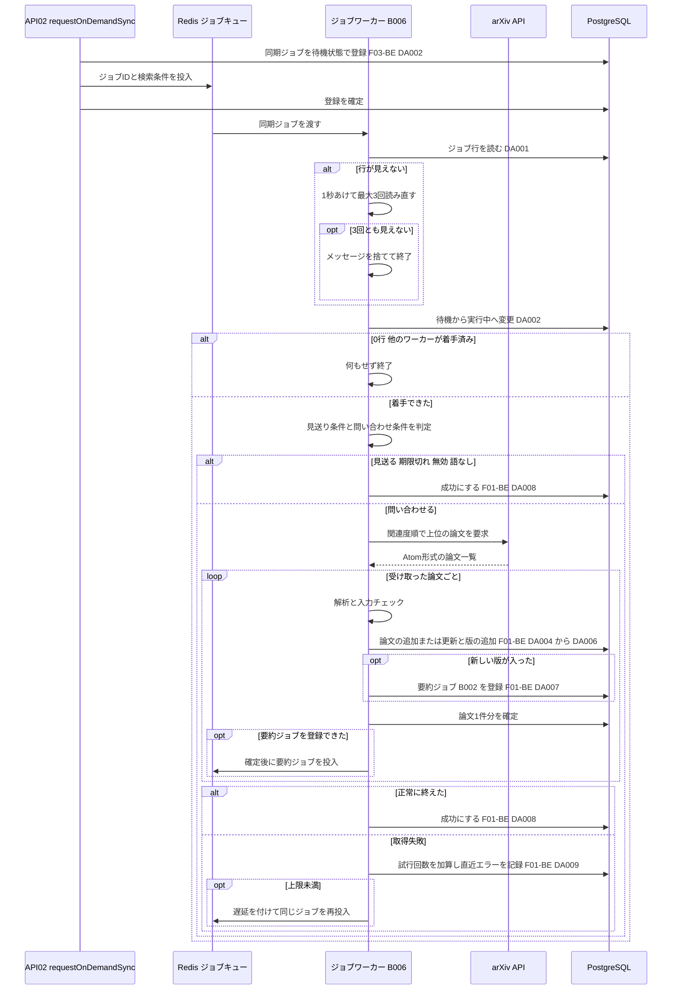
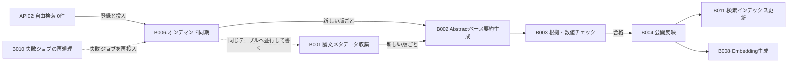

# バッチ詳細設計書 — B006 arXivオンデマンド同期

## 0. 文書情報

| 項目 | 値 |
| :--- | :--- |
| 設計書ID | B006-BE |
| 親ID | B006 |
| 親設計書 | `基本設計書_概要.md` §4 機能設計「バッチ処理設計」B006 行 |
| バッチ名 | arXivオンデマンド同期（上流 §4 バッチ処理設計の区分「非同期ジョブ」） |
| 対応する機能ID | F03 自由検索（本バッチの起動元。上流 §4 機能一覧 F03「必要なときだけarXiv APIと同期する」）。取り込みの処理は F01 新着論文取得と共用する（F01-BE の関数とデータアクセスを使う） |
| 関連する業務フローID | BF04 自由検索、EX01 arXiv APIの取得失敗・レート制限（上流 §2） |
| 版 | 1.1（第1回セルフレビュー `docs/reviews/batch_B006_review_applied.md` の Major 3件・Minor 3件を反映） |
| 作成日 / 更新日 | 2026-10-27 / 2026-10-27 |
| 作成方法 | creating-backend-detailed-design v1.5.0 準拠。上流の確定設計書と `source/` の企画資料からの新規設計 |
| インプット | (a) `source/02_機能要求定義.md:8,35,44-50,57-58`、`source/03_システム構成.md:7,11,21-23,35-36,43,48,57`、`source/04_収益化とロードマップ.md:19,24-27`（全6ファイル・計227行を確認）／(b) `docs/基本設計書_概要.md` §2 BF01・BF04・EX01、§4 F01・F03・B001・B002・B006・バッチ共通の方針、§6 T001・T002・T009、§7 IF01・API02、§8、§9 環境変数一覧、§10 運用監視、§11 ARC001・ARC005〜ARC007・ARC010、付録 Q02・Q10・Q19・Q24・Q31・Q35・Q36／関連する確定済み設計書: `docs/detail/be/BE.F03.BE詳細設計.md`（F03-BE。本バッチの登録側）、`docs/detail/be/BE.F01.BE詳細設計.md`（F01-BE。取り込みの関数とデータアクセスの定義元）、`docs/detail/batch/BT.B001.バッチ詳細設計.md`・`BT.B002.バッチ詳細設計.md`、`docs/db/DB.T001.DB物理設計.md`・`DB.T002.DB物理設計.md`・`DB.T009.DB物理設計.md`、`docs/screens/画面.P103.画面基本設計.md`／(c) `legacy/`（空） |

* **インプットの性質（source/ の突合結果）**: `source/` は企画・初期設計案の Markdown 6ファイル（計227行）だけです（ファイル数6件を再確認）。依頼にあるスケジュール定義 `config/schedule.rb`（whenever）と rake タスクの実装 `lib/tasks/` は**存在しません**（Ruby のファイル0件）。本システムのジョブは Python のワーカー（Redis + Celery または RQ）で動きます（`source/03_システム構成.md:7,11`）。B006 は時刻で起動する定期実行ではなく、自由検索（F03）で自前DBに該当が無かったときにジョブキューへ登録される**非同期ジョブ**です（上流 §4 B006「ジョブキュー（起動契機: 検索時。発動条件は未定義 ※推測）」、`source/02_機能要求定義.md:35`「初期は自前DBを検索し、必要時のみarXiv APIと同期」）。このため whenever に当たるスケジュール定義は B006 には無く（§5 スケジュール定義で「該当なし」と根拠を記載）、rake タスクに当たるものは §4 のジョブ関数に置き換えています。本書は**リバースエンジニアリングではなく新規設計**です。資料と上流に無い値には「※推測」を付けています。
* **既存版**: `docs/detail/batch/BT.B006.バッチ詳細設計.md` の旧版はありません（作業開始時点の `docs/detail/batch/` は B001〜B005 の5ファイルだけ）。本書が初版で、消さずに残すべき既存記述はありません。
* **legacy/ との突合**: `legacy/` は空ディレクトリです（ファイル0件）。突合する既存のバッチ設計書・業務意図・非機能の記述はありません。
* **F03-BE・F01-BE との分担と継承**:
  * **登録側（F03-BE）**: 同期ジョブの行の登録（F03-BE DA002）、ジョブキューへの投入、同じ検索条件の重複登録の抑止（10分）、全体の登録回数の上限（1分あたり30回）は F03-BE `requestOnDemandSync` が受け持ちます。F03-BE は「投入がコミットより先になるため、B006 はジョブIDの行が見えないとき1秒間隔で最大3回読み直し、それでも無ければ捨てる（BT.B006 で確定する）」と本書へ委ねており、本書の §4 `load_job_with_wait` でこれを確定します。
  * **取り込みの処理（F01-BE）**: arXiv の応答の解釈と、論文・版の保存、新しい版への要約ジョブ（B002）の登録は、定期収集（B001）と同じ規則で行う必要があります（DB物理設計書 T001 §4.3「B001・B006 はこの一意制約を使って『未登録なら追加、登録済みなら更新』の1文で書き込みます」）。そこで、F01-BE で採番済みの **DA-ID（DA004〜DA009）と関数（`ArxivClient.fetch_page`・`parse_entry`・`validate_record`・`upsert_paper_version`・`dispatch_job`・`mark_job_succeeded`・`record_job_failure`・`sanitize_error`）をそのまま引き継いで**使います。
  * **DA-ID の書き方**: 本書で引き継いだ DA-ID は、定義元の設計書IDを付けて「F01-BE DA004」のように書きます。本書が初めて定義するデータアクセスは「DA001」「DA002」と設計書IDを付けずに書き、本書（B006-BE）のIDであることを表します。同じ文に2つのIDを付けないためです。
* **上流との差分**（※上流要確認。§6 確認事項に集約）:
  * 上流 §6 CRUD図の F03 行は `papers`・`paper_versions` を「R」としていますが、B006 は両テーブルを追加・更新します（DB物理設計書 T001 §4.6・T002 §4.6 で既に※上流要確認として挙がっている事項と同じ）。
  * 上流 §11 ARC001（生成物キャッシュ・重複排除方式）の適用範囲は「B001〜B005」で B006 を含みませんが、B006 は B001 と同じ重複排除の書き込みを使います。
  * `jobs` に検索条件を残す列が無いため、失敗ジョブの再処理（B010）で検索条件を失うおそれがあります（F03-BE §3 DA002 の※上流要確認と同じ）。
  * F01-BE `parse_entry` はスナップショットの取り込み元を `B001` に固定していますが、B006 は `B006` を入れる必要があります（BT.B001 §2 のキー定義 `source` は「オンデマンド同期は `B006`」と定義済み）。
  * F03-BE が投入するメッセージ `{ jobId, q, category }` には登録日時がありません。本書は滞留したジョブを見送るために登録日時 `requestedAt` を求めます。

## 1. バックエンド構成・モジュール設計

* **対象ドメイン**: 論文収集（オンデマンド同期） — 自由検索で自前DBに該当が無かったときに登録された同期ジョブを受け取り、検索語とカテゴリから arXiv API への問い合わせ条件を作って関連度の高い論文を少数だけ取得し、arXiv ID と版で重複を除いて論文（`papers`）と論文バージョン（`paper_versions`）へ保存する。新しい版ごとに要約ジョブ（B002）を登録し、同期ジョブ自身の状態とリトライを管理する（上流 B006・BF04・EX01、ARC007、`source/02_機能要求定義.md:35`）。
* **対象APIエンドポイント**: なし。B006 は画面や外部から HTTP で呼ばれず、F03 の検索 API（API02）がジョブキューへ投入したメッセージを受け取って動きます（根拠は §2 APIエンドポイント一覧）。
* **実行基盤**: Pythonワーカー上の非同期ジョブです（Redis + Celery または RQ。どちらにするかは未決定、上流 Q02）。arXiv への問い合わせ間隔をワーカー1つの中で守れるよう、本バッチ専用のキューを並列数1で処理します（§5 ワーカーの配置）。DB は Supabase 上の PostgreSQL に、行単位アクセス制御を通らないサーバ側のサービスロールで接続します（DB物理設計書 T001・T002・T009 §7）。B001 と違いセッション単位のロックを使わないため、接続方式はプーラー経由でも直接接続でもかまいません（※推測）。
* **ディレクトリ/ファイル構造**（※推測: 実装時のディレクトリ構成は未定義。F03-BE §1 の配置案 `worker/jobs/sync_on_demand.py` と、F01-BE §1 の配置に合わせる）:

```
worker/
├── jobs/
│   ├── sync_on_demand.py       # run_sync_on_demand / load_job_with_wait / build_arxiv_query（本書で定義）
│   ├── collect_metadata.py     # validate_record / upsert_paper_version（F01-BE で定義。本バッチは呼び出して使う）
│   └── job_state.py            # dispatch_job / mark_job_succeeded / record_job_failure / sanitize_error（F01-BE で定義。ARC006 のジョブ共通処理）
├── integrations/
│   └── arxiv_client.py         # ArxivClient.fetch_page / parse_entry（F01-BE で定義。IF01 arXiv API）
├── queues.py                   # キュー名と並列数の定義（§5 ワーカーの配置。※推測）
└── config.py                   # 設定値の読み込み（§6 設定値一覧）
web/
└── lib/search/onDemandSync.ts  # requestOnDemandSync（登録側。F03-BE の対象で、本書では扱いを参照するだけ）
```

* **処理シーケンス図**（上流 BF04 の「B006 arXivオンデマンド同期を登録」より後ろと EX01 を、ジョブの受け取りから終了まで展開。※推測を含む）:



## 2. API・インターフェース詳細設計

* **APIエンドポイント一覧（全数ロースター）**:

| API ID | メソッド | エンドポイント | 概要 | 定義状況 | 詳細の所在 |
| :--- | :--- | :--- | :--- | :--- | :--- |
| — | — | 該当なし | — | — | — |

**総件数: 0件。根拠**: 上流 `docs/基本設計書_概要.md` §7 内部API一覧の全8件（API01〜API08。`source/03_システム構成.md:46-54` の API設計案8行と1対1）に、B006 を起動・操作する受け口はありません。B006 を起動するのは API02 `GET /api/papers/search` の処理の中の登録処理（F03-BE `requestOnDemandSync`）で、API02 自体は F03-BE が仕様を持ちます。B006 側に HTTP の受け口は設けません。

* **外部サービス連携一覧（全数ロースター）**: 上流 §7 外部連携一覧の全9件に対し、B006 で使うかを示します。

| IF ID | 連携先 | B006 での利用 | 概要 | 定義状況 | 詳細の所在 |
| :--- | :--- | :--- | :--- | :--- | :--- |
| IF01 | arXiv API | 利用する | 検索語とカテゴリから作った条件で、関連度の高い論文のメタデータを1回だけ取得する | 詳細 | 本節 外部サービス連携仕様、§4 `build_arxiv_query`・`ArxivClient.fetch_page` |
| IF02 | arXiv（論文本文PDF） | 利用しない | 本文PDFの取得は本文解析（B005）の責務 | - | `docs/detail/batch/BT.B005.バッチ詳細設計.md` |
| IF03 | arXiv 原文ページ | 利用しない | 画面からのリンク遷移でサーバ処理を伴わない。本バッチは遷移先URLを論文の原文URLとして保存するだけ | - | - |
| IF04 | LLM API | 利用しない | 要約生成は B002 以降の責務で、本バッチは要約ジョブの登録まで | - | `docs/detail/batch/BT.B002.バッチ詳細設計.md` |
| IF05 | Supabase Auth | 利用しない | 同期ジョブは利用者に結びつかない（登録側の API02 も認証不要）。DBへはサービスロールで接続する | - | - |
| IF06 | Stripe（決済セッション） | 利用しない | 課金（F12）の責務 | - | - |
| IF07 | Stripe（契約状態の通知） | 利用しない | 課金（F12）の責務 | - | - |
| IF08 | GitHub | 利用しない | GitHub関連付け（B009）の責務 | - | - |
| IF09 | 通知配信手段 | 利用しない | 通知・ダイジェスト配信（B007）の責務。取り込みの完了を利用者へ知らせる手段は上流に無い（P103 H32 の※推測） | - | - |

**総件数: 9件（B006 で利用するもの1件）。根拠**: 上流 §7 外部連携一覧の IF01〜IF09 の全9行と1対1で対応します。上流 §2 BF04 で B006 が登場した後に関わる外部の相手は arXiv API だけです（上流 §11 ARC007 の適用範囲「B006 / IF01」）。Redis（ジョブキュー）と PostgreSQL は上流 §7 で本システムの構成要素（内部）とされているため外部連携に含めません。

* **外部サービス連携仕様**（B006 で利用する IF01 の1件。接続先・タイムアウト・エラーの区別は F01-BE §2・BT.B001 §2 と同じで、問い合わせ条件と件数だけが異なる）:

| IF ID | 連携先 | 連携方式 | エンドポイント / 接続先 | 認証方式 | タイムアウト | リトライ方針 | エラー時の挙動 |
| :--- | :--- | :--- | :--- | :--- | :--- | :--- | :--- |
| IF01 | arXiv API | REST API（HTTP GET。応答は Atom 形式のXML）（※推測: 上流 IF01 自体が「arXiv公式APIのHTTP GET」を※推測としている） | `https://export.arxiv.org/api/query`（※推測）。検索語の各語がいずれかの項目（arXiv の `all:` が対象とする原題・著者・Abstract・コメント・誌名情報・報告番号・カテゴリ。※推測）に含まれ、カテゴリの指定があればそのカテゴリに属する論文を、関連度の高い順に先頭から設定件数だけ求める（`search_query=all:語1 AND all:語2 AND cat:cs.LG&sortBy=relevance&sortOrder=descending&start=0&max_results=5`。条件の作り方は §4 `build_arxiv_query`、件数5は※推測） | 認証なし（上流 IF01、※推測） | 1リクエスト30秒（※推測。F01-BE と同じ） | 前回の問い合わせから設定値の秒数（※推測: 3秒）を必ずあける。ジョブ1件につき問い合わせは1回だけで、個々のリクエストでは再試行しない。失敗したら同期ジョブ全体を失敗として試行回数を1増やし、上限未満なら遅延を付けてジョブごと再実行する（上流 EX01。上限は※推測で3回、上流 Q19） | 応答が無い・接続できない・サーバ側の一時的な失敗（HTTP 5xx）・アクセス過多（HTTP 429）・XMLとして読めない応答のときは、再試行できる失敗として扱う。問い合わせ条件の誤り（HTTP 429 を除く 400〜499 のすべて）は再実行しても直らないため、試行回数にかかわらずすぐ失敗にして失敗キューへ送る（※推測）。該当が0件の応答は失敗ではなく、取り込む論文が無かった正常な結果として扱う |

* **受け取るメッセージの定義**（F03-BE `requestOnDemandSync` がジョブキューへ投入する内容。キー名は F03-BE §3 DA002 の発行SQLの注記 `{ jobId, q, category }` に合わせる）:

| キー | 型 | 必須 | 入れる値 | 説明 |
| :--- | :--- | :--- | :--- | :--- |
| `jobId` | 整数 | ○ | F03-BE DA002 で採番された同期ジョブのジョブID | 本バッチはこのIDで `jobs` の行を読み、着手と結果の記録に使う |
| `q` | 文字列（1〜200文字） | ○ | 利用者が入力した検索語を F03-BE `parseSearchParams` で正規化したもの（前後の空白を除き、連続した空白を1つにまとめた形） | arXiv への問い合わせ条件の材料。利用者の識別子は入らない（F03-BE §6 個人データ） |
| `category` | 文字列または null | — | arXiv のカテゴリ表記（例: `cs.LG`）。指定が無ければ null | 指定があれば問い合わせ条件にカテゴリの絞り込みを加える。形の検査は F03-BE で済んでいるが、本バッチでも同じ規則で確かめ直す（§4 `build_arxiv_query` 手順4） |
| `requestedAt` | 文字列（ISO 8601、UTC）または無し | — | 登録した日時（※上流要確認: F03-BE のメッセージに無いキー。§6 確認事項 No.4） | 滞留して古くなった同期を見送る判定に使う。キーが無ければ見送りの判定を行わない。自動再試行・再処理の再投入では `record_job_failure` がこのキーを除く（再試行・再処理のジョブを見送らないため） |

**総件数: 4キー。根拠**: F03-BE §3 DA002 の発行SQLの注記に書かれた3キー（`jobId`・`q`・`category`）に、本書が求める1キー（`requestedAt`）を加えたものです。自動再試行（§5 起動契機 No.2）と失敗ジョブの再処理（No.3）では、`record_job_failure` が元のメッセージから `requestedAt` を除いた3キーで再投入・失敗キューへの格納を行います。

* **IF01 の受信データと保存先の対応**（※推測: arXiv API の Atom 応答の要素名。F01-BE §2・BT.B001 §2 と同じ規則で、スナップショットの取り込み元だけが異なる）:

| Atom の要素 | 意味 | 保存先 | 変換のしかた |
| :--- | :--- | :--- | :--- |
| `entry/id` | 版番号つきの論文URL（例: `http://arxiv.org/abs/2401.12345v2`） | `papers.arxiv_id`、`paper_versions.version`、`papers.latest_version` | URL の `/abs/` より後ろを取り出し、末尾の「v＋数字」を版番号として切り離して、残りを arXiv ID にする。旧形式のID（例: `hep-th/9901001v1`）も同じ規則で切り離す（DB物理設計書 T001 §4.3 (1)、T002 §4.3 (2)） |
| `entry/title` | 原題 | `papers.title`、スナップショット | 改行と連続する空白を1つの空白にまとめ、前後の空白を取る（T001 §4.3 (2)） |
| `entry/summary` | Abstract | `papers.abstract`、スナップショット | 原題と同じ整形だけを行い、LaTeX 記法や HTML に見える文字列はそのまま保存する。無害化は表示する画面側で行う（上流 §8 XSS） |
| `entry/author/name`（複数） | 著者名 | `papers.authors`、スナップショット | 記載の順番のまま文字列の配列にする（T001 §4.3 (3)） |
| `entry/arxiv:primary_category` と `entry/category`（複数） | 主カテゴリと全カテゴリ | `papers.categories`、スナップショット | 主カテゴリを先頭に置き、残りを応答の順で後ろに並べ、重複を除く（T001 §4.3 (4)） |
| `entry/published` | v1 の投稿日時 | `papers.submitted_at` | UTC の日時として保存する |
| `entry/updated` | この版の公開日時 | `papers.updated_at`、スナップショット | UTC の日時として保存する |
| （ライセンス） | 利用許諾 | `paper_versions.license_type`、スナップショット | 応答に含まれなければ空のまま保存し、本文の利用は許可されていないものとして扱う（DB物理設計書 T002 §4.3 (5)。BT.B001 §6 確認事項 No.4 と同じ未決事項） |

**総件数: 8行。根拠**: BT.B001 §2「IF01 の受信データと保存先の対応」の8行と同じです。B006 は同じ関数 `parse_entry` で変換するため、受け取る要素と保存先は B001 と一致します。違いはスナップショットのキー `source` に `B006` を入れることだけです（BT.B001 §2 メタデータスナップショットのキー定義「本バッチは `B001`、オンデマンド同期は `B006`」）。スナップショットの8キーの定義は BT.B001 §2 が正です。

* **API詳細仕様**: 該当なし（APIエンドポイント0件のため。根拠は上の一覧の直後に記載）。ジョブとしての入出力は本節の「受け取るメッセージの定義」、§4 `run_sync_on_demand`、§5 入出力一覧に記載します。

## 3. データアクセス（ORM / クエリ）設計

* **データアクセス一覧（全数ロースター）**: 「F01-BE DA00n」は F01-BE §3 で採番済みのものをそのまま引き継いだもの、「DA00n」は本書が定義するものです（§0「DA-ID の書き方」）。

| DA-ID | 処理名 | 呼出元（関数/API） | テーブルID | 対象物理テーブル | 種別 (SELECT/INSERT/UPDATE/DELETE) | 定義状況 (詳細/簡易) | 詳細の所在 |
| :--- | :--- | :--- | :--- | :--- | :--- | :--- | :--- |
| DA001 | 同期ジョブ行の読み込み | `load_job_with_wait`（`run_sync_on_demand` から呼ぶ） | T009 | jobs | SELECT | 詳細 | §3 詳細定義 DA001・発行SQL DA001 |
| DA002 | 同期ジョブの着手 | `run_sync_on_demand` | T009 | jobs | UPDATE | 詳細 | §3 詳細定義 DA002・発行SQL DA002 |
| F01-BE DA004 | 論文の追加または最新版での上書き | `upsert_paper_version` | T001 | papers | INSERT（衝突時 UPDATE） | 詳細 | §3 詳細定義 F01-BE DA004・発行SQL F01-BE DA004 |
| F01-BE DA005 | arXiv IDでの論文ID取得 | `upsert_paper_version` | T001 | papers | SELECT | 簡易 | 発行SQL F01-BE DA005 |
| F01-BE DA006 | 論文の版の追加 | `upsert_paper_version` | T002 | paper_versions | INSERT（衝突時は何もしない） | 詳細 | §3 詳細定義 F01-BE DA006・発行SQL F01-BE DA006 |
| F01-BE DA007 | 要約ジョブ（B002）の登録 | `upsert_paper_version` | T009 | jobs | INSERT（衝突時は何もしない） | 詳細 | §3 詳細定義 F01-BE DA007・発行SQL F01-BE DA007 |
| F01-BE DA008 | ジョブの成功記録（F01-BE での処理名は「収集ジョブの成功記録」） | `mark_job_succeeded`（`run_sync_on_demand` から呼ぶ） | T009 | jobs | UPDATE | 詳細 | §3 詳細定義 F01-BE DA008・発行SQL F01-BE DA008 |
| F01-BE DA009 | ジョブの失敗記録（F01-BE での処理名は「収集ジョブの失敗記録」） | `record_job_failure`（`run_sync_on_demand` から呼ぶ） | T009 | jobs | UPDATE | 詳細 | §3 詳細定義 F01-BE DA009・発行SQL F01-BE DA009 |

**総件数: 8件（本書で定義2件・F01-BE から継承6件。SELECT 2件・INSERT 3件・UPDATE 3件・DELETE 0件。詳細7件・簡易1件）。全数である根拠**: §4 関数一覧の全11関数のうち DB へ問い合わせる5関数（`load_job_with_wait`・`run_sync_on_demand`・`upsert_paper_version`・`mark_job_succeeded`・`record_job_failure`）の処理フローに現れる DB 操作を、§4 IPO定義の各手順から1件ずつ拾ったものです（`load_job_with_wait`→DA001、`run_sync_on_demand`→DA002、`upsert_paper_version`→F01-BE DA004〜DA007、`mark_job_succeeded`→F01-BE DA008、`record_job_failure`→F01-BE DA009）。残りの6関数（`build_arxiv_query`・`ArxivClient.fetch_page`・`parse_entry`・`validate_record`・`dispatch_job`・`sanitize_error`）は DB に触れません。F01-BE の DA001〜DA003・DA010（収集ジョブの登録・収集の排他・収集ジョブの着手・排他の解放）は B001 の収集ジョブだけが使い、B006 は使いません。同期ジョブ行の登録（F03-BE DA002）は登録側の API02 が発行するもので、B006 は発行しません（§5 起動契機一覧で扱う）。B006 は DELETE を発行しません。
**上流 CRUD図との突合**: 上流 §6 CRUD図の F03 行は papers「R」、paper_versions「R」、summaries「R」、jobs「C」です。B006 は papers を追加・上書き・参照（F01-BE DA004・DA005）、paper_versions を追加（F01-BE DA006）、jobs を参照・更新・追加（DA001・DA002・F01-BE DA007〜DA009）します。papers・paper_versions の C・U と jobs の R・U が上流 CRUD図にありません。※上流要確認: CRUD図に B006 の行を加えるか、F03 の欄を広げるか（§6 確認事項 No.1。DB物理設計書 T001 §9 No.6・T002 §9 No.7 と同じ事項）。
**定義状況の判定**（completeness 3-1）: DA001 は行が見えるかどうかと種別・状態で処理が分かれる（3-1 の1）うえ、登録側のコミットを待つ読み直しを伴う（3-1 の5）ため「詳細」です。DA002・F01-BE DA004・DA006〜DA009 は永続データを書き換える（3-1 の2）ため「詳細」です。F01-BE DA005 は arXiv ID で1行を引くだけの単純な取得で、3-1 の基準に当たらないため「簡易」です（呼ぶかどうかの分岐は呼び出し元 `upsert_paper_version` にあり、§4 に記載）。

* **データアクセス詳細定義**（定義状況＝詳細の7件）:

| DA-ID | 処理名 | テーブルID | 対象物理テーブル | JOIN / Include | 抽出条件 (Where) / ソート | トランザクション境界 | N+1対策・性能上の注意 |
| :--- | :--- | :--- | :--- | :--- | :--- | :--- | :--- |
| DA001 | 同期ジョブ行の読み込み | T009 | jobs | なし | 受け取ったジョブIDの行を1行だけ読み、種別・状態・試行回数を得る（`WHERE id = :job_id`）。行が無ければ、登録側がまだ確定していないか、確定に失敗して取り残されたメッセージとみなす | 1文の読み取りで、トランザクションは張らない（読み直しの間に登録側の確定が見えるようにするため） | 主キーで1行を引くだけで性能上の問題は無い。行が無いときは呼び出し元が1秒あけて最大3回まで読み直す（§4 `load_job_with_wait`）。読み直しは最大でも約3秒で終わり、ワーカーを長く占有しない |
| DA002 | 同期ジョブの着手 | T009 | jobs | なし | 指定のジョブIDで、種別がオンデマンド同期で状態が待機の行だけを実行中に変える。変えた行が1行なら処理を続け、0行なら他のワーカーが着手済みか終わっているため何もせずに終える（`WHERE id = :job_id AND job_type = 'sync_on_demand' AND status = 'pending'`） | 1文で自動確定する | ジョブキューは同じジョブを別のワーカーへもう一度渡すことがあり（T009 §4.3 (4)「実行の取り合い」）、この条件付きの更新で1つのワーカーだけが処理するようにする。種別を条件に入れ、誤って配送された別種別のジョブを実行中にしないようにする |
| F01-BE DA004 | 論文の追加または最新版での上書き | T001 | papers | なし | arXiv ID が未登録なら1行追加する。登録済みなら、取り込んだ版番号が登録済みの最新版以上で、かつ原題・Abstract・著者・カテゴリ・更新日時・最新版のどれかが登録済みの値と違うときだけ、その6列を上書きする。投稿日時・原文URL・arXiv ID は上書きしない。追加または上書きした行の論文IDを受け取る（`INSERT … ON CONFLICT (arxiv_id) DO UPDATE … WHERE EXCLUDED.latest_version >= papers.latest_version AND (…) IS DISTINCT FROM (…) RETURNING id`） | 論文1件の取り込みトランザクション（F01-BE DA004〜DA007）の1文目。後続が失敗したら一緒に取り消す | 定期収集（B001）と同じ論文を同時に書いても、arXiv ID の一意制約の衝突判定で行は1つになる。上書きの条件で、古い版の取得結果が新しい内容を戻すのを防ぐ（T001 §4.3 (1)(2)(6)）。条件に当たらず更新しなかったときは論文IDが返らないため、F01-BE DA005 で引き直す |
| F01-BE DA006 | 論文の版の追加 | T002 | paper_versions | なし | 論文IDと版番号の組がまだ無ければ、スナップショット（取り込み元は `B006`）とライセンス種別を付けて1行追加する。本文取得状況は初期値の「Abstractのみ」のまま。すでにあれば何もしない。追加できたときだけ新しい版の論文バージョンIDが返る（`INSERT … ON CONFLICT (paper_id, version) DO NOTHING RETURNING id`） | 論文1件の取り込みトランザクションの2文目（F01-BE DA005 を呼んだ場合は3文目） | 一意制約 `uq_paper_versions_paper_id_version` の衝突で重複を判定するため、B001 と並行して取り込んでも行は2つにならない（T002 §4.3 (2)、ARC001）。返った行の有無で「新しい版が入ったか」を判断し、入ったときだけ F01-BE DA007 を発行する |
| F01-BE DA007 | 要約ジョブ（B002）の登録 | T009 | jobs | なし | 新しく入った版について、種別を「Abstractベース日本語要約生成」として待機状態の行を1行追加する。同じ版・同じ種別のジョブがすでに待機中か実行中なら何もしない（`job_type='summarize_abstract'`、`ON CONFLICT (paper_version_id, job_type) WHERE status IN ('pending','running') AND paper_version_id IS NOT NULL DO NOTHING RETURNING id`） | 論文1件の取り込みトランザクションの最後の文。確定したあとに、返ったジョブIDをジョブキューへ投入する（§4 `dispatch_job`） | 部分一意インデックス `uq_jobs_active_per_version` と同じ条件を ON CONFLICT に書く（T009 §5.2）。1件の同期で登録する要約ジョブは取得件数（※推測: 5件）が上限で、LLM の費用が一度に膨らまないようにしている（§5 性能） |
| F01-BE DA008 | ジョブの成功記録 | T009 | jobs | なし | 指定のジョブIDで状態が実行中の行だけを成功に変える（`WHERE id = :job_id AND status = 'running'`）。B006 は必ず DA002 で着手してから成否を記録するため、F01-BE DA008 の2文目（待機から成功へ）は使わない | 1文で自動確定する | 状態の条件を付けて、他のワーカーの結果を上書きしない（T009 §4.3 (4)）。直近エラーは消さない（T009 §4.3 (6)） |
| F01-BE DA009 | ジョブの失敗記録 | T009 | jobs | なし | 指定のジョブIDで状態が実行中の行について、試行回数を1増やし、認証情報を取り除いたエラーの要約を直近エラーに書く。増やした結果が上限に達したか再実行しても直らない失敗なら状態を失敗に、そうでなければ待機に戻す。変更後の状態と試行回数を受け取る（`SET attempts = attempts + 1, last_error = :error, status = CASE WHEN :non_retryable OR attempts + 1 >= :max_attempts THEN 'failed' ELSE 'pending' END WHERE id = :job_id AND status = 'running' RETURNING status, attempts`） | 1文で自動確定する。論文の取り込みトランザクションとは別に書く | 上限との比較を1文の中で行い、読んでから書くまでの間に値が変わる問題を避ける。上限の値は※推測で3回（上流 Q19）。直近エラーには検索語の本文を入れない（§4 `sanitize_error`、ARC010） |

* **発行SQL**: 全8件（DA001・DA002・F01-BE DA004〜DA009）。すべて PostgreSQL 15 以上の文で、プレースホルダは `:名前` で示し、値はすべてプレースホルダで渡します。実行時に文の構造を組み立てる動的SQLはありません。F01-BE から引き継いだ6件は F01-BE §3（BT.B001 §3）の発行SQLと同じ文です。arXiv への問い合わせ条件は実行時に組み立てますが、これは SQL ではなく外部APIのパラメータで、組み立て方は §4 `build_arxiv_query` に記載します。

**DA001 同期ジョブ行の読み込み**
```sql
SELECT id, job_type, status, attempts
  FROM jobs
 WHERE id = :job_id;
-- 行が無ければ1秒あけて最大3回まで読み直す（§4 load_job_with_wait）
```
組み立ての分岐: なし（固定の1文）。

**DA002 同期ジョブの着手**
```sql
UPDATE jobs
   SET status = 'running'
 WHERE id = :job_id
   AND job_type = 'sync_on_demand'
   AND status = 'pending';
-- 更新件数が1なら処理を続け、0なら何もせず終える
```
組み立ての分岐: なし（固定の1文）。

**F01-BE DA004 論文の追加または最新版での上書き**
```sql
INSERT INTO papers (
    arxiv_id, title, abstract, authors, categories,
    submitted_at, updated_at, latest_version, original_url
) VALUES (
    :arxiv_id, :title, :abstract, :authors::jsonb, :categories::text[],
    :submitted_at, :updated_at, :version, :original_url
)
ON CONFLICT (arxiv_id) DO UPDATE
   SET title          = EXCLUDED.title,
       abstract       = EXCLUDED.abstract,
       authors        = EXCLUDED.authors,
       categories     = EXCLUDED.categories,
       updated_at     = EXCLUDED.updated_at,
       latest_version = EXCLUDED.latest_version
 WHERE EXCLUDED.latest_version >= papers.latest_version
   AND (papers.title, papers.abstract, papers.authors, papers.categories,
        papers.updated_at, papers.latest_version)
       IS DISTINCT FROM
       (EXCLUDED.title, EXCLUDED.abstract, EXCLUDED.authors, EXCLUDED.categories,
        EXCLUDED.updated_at, EXCLUDED.latest_version)
RETURNING id;
-- 返る行が無い場合（登録済みで、古い版か内容が同じ）は F01-BE DA005 で論文IDを引く
```
組み立ての分岐: 文の形は固定です。結果は「新規追加して論文IDが返る」「上書きして論文IDが返る」「何もせず行が返らない」の3通りです。

**F01-BE DA005 arXiv IDでの論文ID取得**
```sql
SELECT id
  FROM papers
 WHERE arxiv_id = :arxiv_id;
```
組み立ての分岐: なし（固定の1文）。

**F01-BE DA006 論文の版の追加**
```sql
INSERT INTO paper_versions (paper_id, version, metadata_snapshot, license_type)
VALUES (:paper_id, :version, :metadata_snapshot::jsonb, :license_type)
ON CONFLICT (paper_id, version) DO NOTHING
RETURNING id;
-- :metadata_snapshot の source キーは 'B006'
```
組み立ての分岐: なし（固定の1文）。

**F01-BE DA007 要約ジョブ（B002）の登録**
```sql
INSERT INTO jobs (job_type, paper_version_id)
VALUES ('summarize_abstract', :paper_version_id)
ON CONFLICT (paper_version_id, job_type)
    WHERE status IN ('pending', 'running') AND paper_version_id IS NOT NULL
    DO NOTHING
RETURNING id;
```
組み立ての分岐: なし（固定の1文）。

**F01-BE DA008 ジョブの成功記録**（B006 が使うのは1文目だけ）
```sql
UPDATE jobs
   SET status = 'succeeded'
 WHERE id = :job_id
   AND status = 'running';
```
組み立ての分岐: なし。F01-BE DA008 の2文目（待機から成功へ）は B001 で収集の排他を取れなかった場合専用で、B006 からは発行しません。

**F01-BE DA009 ジョブの失敗記録**
```sql
UPDATE jobs
   SET attempts   = attempts + 1,
       last_error = :sanitized_error,
       status     = CASE
                        WHEN :non_retryable OR attempts + 1 >= :max_attempts THEN 'failed'
                        ELSE 'pending'
                    END
 WHERE id = :job_id
   AND status = 'running'
RETURNING status, attempts;
```
組み立ての分岐: なし（固定の1文）。状態の決め方は文の中の条件で切り替わります。

## 4. サーバー側機能・処理ロジック設計（IPO設計）

* **関数一覧（全数ロースター）**: 本書で定義する3関数と、F01-BE §4 で定義済みの8関数（関数名をそのまま引き継ぐ）です。

| 関数名 | 所属モジュール（※推測） | 定義元 | 概要 | 定義状況 | 詳細の所在 |
| :--- | :--- | :--- | :--- | :--- | :--- |
| `run_sync_on_demand` | `worker/jobs/sync_on_demand.py` | 本書（※上流未定義の関数名） | 同期ジョブの本体。ジョブ行を確かめて着手し、見送りの判定、arXiv への1回の問い合わせ、論文の取り込み、成否の記録までを行う | 詳細 | §4 IPO定義 |
| `load_job_with_wait` | `worker/jobs/sync_on_demand.py` | 本書（※上流未定義の関数名） | 登録側の確定を待ちながらジョブ行を読み、処理してよいメッセージかを判定する | 詳細 | §4 IPO定義 |
| `build_arxiv_query` | `worker/jobs/sync_on_demand.py` | 本書（※上流未定義の関数名） | 検索語とカテゴリから arXiv API の問い合わせ条件を組み立てる | 詳細 | §4 IPO定義 |
| `ArxivClient.fetch_page` | `worker/integrations/arxiv_client.py` | F01-BE §4 | arXiv API に1ページ分を問い合わせ、推奨間隔を守る | 詳細 | §4 IPO定義（B006 での使い方） |
| `parse_entry` | `worker/integrations/arxiv_client.py` | F01-BE §4 | Atom の1件を保存用の論文レコードに変換する | 詳細 | §4 IPO定義（B006 での使い方） |
| `validate_record` | `worker/jobs/collect_metadata.py` | F01-BE §4 | 保存前に DB の制約に合うかを確かめ、合わない論文を除外する | 詳細 | §4 IPO定義（B006 での使い方） |
| `upsert_paper_version` | `worker/jobs/collect_metadata.py` | F01-BE §4 | 論文1件を1トランザクションで保存し、新しい版なら要約ジョブを登録する | 詳細 | §4 IPO定義（B006 での使い方） |
| `dispatch_job` | `worker/jobs/job_state.py` | F01-BE §4 | 登録済みのジョブをジョブキューへ投入する | 詳細 | §4 IPO定義（B006 での使い方） |
| `mark_job_succeeded` | `worker/jobs/job_state.py` | F01-BE §4 | ジョブを成功として記録する | 詳細 | §4 IPO定義（B006 での使い方） |
| `record_job_failure` | `worker/jobs/job_state.py` | F01-BE §4 | ジョブの失敗を記録し、再実行か失敗キュー行きかを決める | 詳細 | §4 IPO定義（B006 での使い方） |
| `sanitize_error` | `worker/jobs/job_state.py` | F01-BE §4 | エラー内容から認証情報と検索語を除き、保存できる長さの要約にする | 詳細 | §4 IPO定義（B006 での使い方） |

**総件数: 11関数（本書で定義3件・F01-BE から継承8件。全件 詳細）。全数である根拠**: 上流 §2 BF04 の「B006 arXivオンデマンド同期を登録」より後ろの処理と EX01、上流 §4 B006 の処理内容、F03-BE が本書に委ねた規則（コミット待ちの読み直し）、DB物理設計書 T001・T002・T009 が B006 に課した書き込みの規則を、処理の段階ごとに1関数ずつ割り当てたものです（ジョブ本体と着手→`run_sync_on_demand`、登録側の確定待ち→`load_job_with_wait`、問い合わせ条件→`build_arxiv_query`、arXiv への問い合わせ→`ArxivClient.fetch_page`、メタデータの解釈→`parse_entry`・`validate_record`、重複判定と保存と要約ジョブ登録→`upsert_paper_version`、ジョブの投入と状態→`dispatch_job`・`mark_job_succeeded`・`record_job_failure`・`sanitize_error`）。F01-BE §4 の12関数のうち `enqueue_collect_metadata`・`run_collect_metadata`・`resolve_window`・`iter_entries` の4関数は、定期収集の起動・取得期間・ページ送りに固有のため B006 では使いません（B006 は期間ではなく検索条件で、1ページだけを取得する）。ソースコードが無いため実在の関数との突合はできず、関数名と分け方は※推測です。
**定義状況の判定**（completeness 3-1）: 11関数とも、永続データや外部への送信を伴う（3-1 の2: `run_sync_on_demand`・`upsert_paper_version`・`dispatch_job`・`mark_job_succeeded`・`record_job_failure`）、外部との通信と失敗時の扱いを含む（3-1 の5・6: `ArxivClient.fetch_page`・`load_job_with_wait`）、実行時に問い合わせ条件を組み立てる（3-1 の4: `build_arxiv_query`）、条件による分岐を含む（3-1 の1: `validate_record`）、非自明な業務ルールを含む（3-1 の7: `parse_entry`・`sanitize_error`）のいずれかに当たるため「詳細」です。

* **入力・処理・出力（IPO）定義**: 継承した8関数は、B006 から呼ぶときの引数と処理を書きます。処理フローの定義元は F01-BE §4 で、B006 のための差分（`parse_entry` の取り込み元の引数、`sanitize_error` の検索語の伏せ字）は本書を正とし、F01-BE への取り込みを §6 確認事項 No.5 に挙げています。

| 関数名 | 所属モジュール | 引数 (型) | 処理フロー (ステップ単位で具体的に) | 戻り値 | 発生しうるエラー |
| :--- | :--- | :--- | :--- | :--- | :--- |
| `run_sync_on_demand` | `worker/jobs/sync_on_demand.py` | message: dict（§2 受け取るメッセージの定義の4キー） | 1. メッセージにジョブIDが無いか整数でなければ、処理できないメッセージとして WARN ログ（§5 ログ No.1）を出して捨てる（ジョブ行を特定できないため jobs には記録できない）。<br>2. `load_job_with_wait` でジョブ行を読む。「捨てる」と判定されたら終える。<br>3. ジョブを待機から実行中に変える（DA002）。変えた行が0行なら、他のワーカーが着手済みか終わっているため INFO ログ（No.4）を出して終える。<br>4. 次のどれかに当たれば arXiv へ問い合わせずに処理を見送る。見送った理由を INFO ログ（No.5）に出し、ジョブを成功にして（`mark_job_succeeded` → F01-BE DA008）終える。<br>　(a) 同期が無効になっている（本番以外の環境）（設定値 `ARXIV_ON_DEMAND_ENABLED` が偽）。本番以外の環境から arXiv へ問い合わせないため（ARC007）。<br>　(b) メッセージに登録日時があり、登録日時から設定値の秒数（`SYNC_ON_DEMAND_MAX_WAIT_SEC`。※推測: 1,800秒）を過ぎている。利用者はもう結果を待っておらず、キューの滞留を早く解消するため。登録日時は検索での登録（起動契機 No.1）のメッセージにだけ入り、自動再試行・再処理（No.2・No.3）のメッセージには入らない（`record_job_failure` が除いて渡す）ため、再試行・再処理のジョブはこの判定の対象にならない。試行回数では判定しない（再処理で試行回数を0に戻すかは B010 の設計で決まり、0に戻した場合に再処理したジョブまで見送られるのを防ぐため。DB物理設計書 T009 §9 No.8）。<br>5. メッセージに検索語が無いか空なら、再試行しても直らない失敗として `record_job_failure` を呼ぶ（失敗ジョブの再処理で検索条件が失われた場合。§6 確認事項 No.3）。<br>6. `build_arxiv_query` で問い合わせ条件を作る。問い合わせに使える語が1つも残らなかった（英字と数字を1文字も含まない検索語。日本語だけの検索語がこれに当たる）ときは、手順4と同じく理由を INFO ログ（No.5）に出し、成功にして終える。arXiv は英語の論文を英語で探すため、日本語の語で問い合わせても該当しないからです（※推測）。<br>7. `ArxivClient.fetch_page` で、作った条件・取得位置0・設定件数（`ARXIV_ON_DEMAND_MAX_RESULTS`。※推測: 5件）を指定して1回だけ問い合わせる。2ページ目以降は取得しない。<br>8. 受け取った論文を1件ずつ `parse_entry`（取り込み元 `B006`）で変換し、`validate_record` で確かめる。不合格の論文は取り込まずに件数を数え、WARN ログ（No.6）に arXiv ID と理由を出して次へ進む。<br>9. 合格した論文は `upsert_paper_version` で保存し、結果（新規の論文・上書きした論文・新しい版のみ・変化なし）を数える。DB の制約違反で1件の保存が取り消されたときは、その論文だけを除外として数え、WARN ログ（No.7）を出して次へ進む。<br>10. 全件を処理したら、ジョブを成功にする（`mark_job_succeeded` → F01-BE DA008）。受け取った件数・新規論文数・上書き数・新しい版の数・要約ジョブ登録数・除外数・登録から着手までの待ち時間・所要時間を INFO ログ（No.8）に出す。0件の応答も成功として同じログを出す。<br>11. 着手後（手順4〜10）に arXiv への問い合わせ、または DB 接続が失敗したときは、そこで処理を打ち切り `record_job_failure` を呼ぶ。それまでに確定した論文はそのまま残す（1件ごとに確定しているため）。 | なし（結果はジョブの状態とログに残す） | ジョブIDの欠落・型の誤り: メッセージを捨てる（WARN）。ジョブ行が見つからない・種別が違う: `load_job_with_wait` の判定で捨てる。arXiv 取得失敗（タイムアウト・接続失敗・HTTP 5xx・HTTP 429・XMLとして読めない応答）: 再試行できる失敗として `record_job_failure`。arXiv の問い合わせ条件の誤り（HTTP 429 を除く 400〜499 のすべて）: 再試行しても直らない失敗として `record_job_failure`。検索語の欠落: 再試行しても直らない失敗として `record_job_failure`。着手前（手順2〜3）の DB 接続失敗: ジョブは待機のため `record_job_failure` では記録できない（F01-BE DA009 は実行中の行だけを更新する）。ERROR ログ（No.11）を出して例外を上げ、ジョブは待機のまま残す。着手後の DB 接続失敗: 再試行できる失敗として `record_job_failure`（記録自体ができない場合は ERROR ログ No.11 だけ残し、ジョブは実行中のまま）。1件の論文の解釈失敗・制約違反: その1件を除外して続行。予期しない例外: 再試行できる失敗として扱い、スタックトレースはログにだけ出す |
| `load_job_with_wait` | `worker/jobs/sync_on_demand.py` | conn: DB 接続, job_id: int | 1. ジョブ行を読む（DA001）。<br>2. 行が無ければ1秒待って読み直す。読み直しは最大3回（最初の読み込みと合わせて4回）とする。登録側（F03-BE `requestOnDemandSync`）はジョブキューへの投入の直後に確定するため、確定より先にメッセージを受け取ることがあり、その待ちを吸収する（F03-BE §6 トランザクション制御）。<br>3. 3回読み直しても行が無ければ、登録側の確定が失敗して取り残されたメッセージとみなし、「捨てる」を返す。WARN ログ（No.2）にジョブIDを出す。<br>4. 行の種別がオンデマンド同期（`sync_on_demand`）でなければ、誤って本バッチのキューへ配送されたものとして「捨てる」を返し、ERROR ログ（No.3）にジョブIDと実際の種別を出す（他の種別の行の状態を本バッチが変えないため）。<br>5. それ以外は、読んだ行（状態・試行回数）を返す。状態が待機以外でもここでは捨てず、着手（DA002）の0行で判定する（判定を1か所にまとめるため）。 | 読んだジョブ行（id, job_type, status, attempts）または「捨てる」 | DB 接続失敗: 例外をそのまま上げる（呼び出し元が着手前の DB 接続失敗として扱う） |
| `build_arxiv_query` | `worker/jobs/sync_on_demand.py` | q: str, category: str または None | 1. 検索語を空白で語に分ける。<br>2. 各語から、英字・数字・ハイフン・ピリオド以外の文字を取り除く（※推測）。arXiv の問い合わせ構文で意味を持つ記号（括弧・コロン・引用符）を利用者の入力から入れさせず、構文を壊したり別の条件を差し込んだりさせないため。<br>3. 取り除いた結果が空になった語と、問い合わせ構文の演算子と同じ綴りの語（大文字小文字を区別せず AND・OR・ANDNOT）を捨て、重複を除き、先頭から最大8語（※推測）までにする。<br>4. カテゴリの指定があれば、F03-BE §2 と同じ arXiv のカテゴリ表記の規則（英小文字とハイフンからなる分野名に、任意でピリオドと英字の小区分が続く形。`^[a-z-]+(\.[A-Za-z-]+)?$`）に合うかを確かめ直す。合わなければカテゴリの条件を付けない（登録側で検査済みのため通常は起きない。※推測）。<br>5. 残った語が0語なら「問い合わせ不要」を返す（カテゴリだけで問い合わせると、検索語と関係のない新着論文を取り込んでしまうため）。<br>6. 各語を「いずれかの項目に含む」条件にし、すべての語を「かつ」でつなぐ。カテゴリがあれば「かつそのカテゴリに属する」条件を加える（`all:語1 AND all:語2 … AND cat:カテゴリ`）。<br>7. 並び順は関連度の高い順とする（`sortBy=relevance&sortOrder=descending`）。 | 問い合わせ条件（str）と、使った語の数（int）。または「問い合わせ不要」 | なし（不要の判定は戻り値で返す） |
| `ArxivClient.fetch_page` | `worker/integrations/arxiv_client.py` | query: str, start: int（B006 は常に0）, max_results: int（B006 は設定件数）, sort: str（B006 は関連度の高い順） | 1. 前回の問い合わせから設定値の秒数（`ARXIV_REQUEST_INTERVAL_SEC`。※推測: 3秒）が経っていなければ、経つまで待つ。前回時刻はワーカーのプロセスの中で持つ。B006 のキューは並列数1で処理する（§5 ワーカーの配置）ため、B006 の問い合わせどうしの間隔はこれで守られる。<br>2. IF01 の接続先へ、問い合わせ条件・取得位置・件数・並び順を付けて GET を送る。タイムアウトは30秒（※推測）。<br>3. 応答の状態コードを確かめる。200 以外なら、状態コードに応じて再試行できる失敗か直らない失敗かを区別した例外を上げる（§2 IF01 のエラー時の挙動）。<br>4. 応答の XML を解釈し、論文の要素の並びを取り出す。XML として読めなければ再試行できる失敗とする。<br>5. 問い合わせた時刻を記録する。 | ページ（全件数: int, 論文の Atom 要素の並び） | 接続失敗・タイムアウト・HTTP 5xx・HTTP 429・XML の解釈失敗: 再試行できる失敗。HTTP 429 を除く 400〜499 のすべて: 再試行しても直らない失敗 |
| `parse_entry` | `worker/integrations/arxiv_client.py` | entry: Atom 要素, source: str（B006 は `B006`。※上流要確認: F01-BE では引数が無く `B001` 固定） | 1. 版番号つきの論文URLから arXiv ID と版番号を切り離す。版番号が付いていなければ解釈できない論文として例外を上げる。<br>2. 原題・Abstract の空白を整える。<br>3. 著者名を記載順の文字列の配列にする。<br>4. 主カテゴリを先頭にしたカテゴリの配列を作り、重複を除く。<br>5. v1 の投稿日時と、この版の公開日時を UTC の日時に変換する。<br>6. 原文URLを版番号なしの形で組み立てる（`https://arxiv.org/abs/{arXiv ID}`。T001 §4.3 (7)）。<br>7. ライセンスを応答から取れれば取り、取れなければ空にする。<br>8. BT.B001 §2 のキー定義に従い8キーのスナップショットを作る。取り込み元（`source`）には引数の値（B006 では `B006`）を、取り込み日時（`fetched_at`）には現在時刻を入れる。 | 論文レコード（arXiv ID, 版番号, 原題, Abstract, 著者, カテゴリ, 投稿日時, 更新日時, 原文URL, ライセンス, スナップショット） | 必須の要素が無い・論文URLから版番号を切り離せない・日時を解釈できない: 解釈できない論文として例外を上げる（呼び出し元が1件だけ除外する） |
| `validate_record` | `worker/jobs/collect_metadata.py` | record: 論文レコード | 1. arXiv ID が新形式（年月4桁.連番4〜5桁）か旧形式（分野名/年月連番7桁）で、版番号を含まないかを確かめる（`ck_papers_arxiv_id_format` と同じ規則。T001 §4.3 (1)）。<br>2. 版番号が1以上かを確かめる。<br>3. 原題・Abstract が空でないかを確かめる。<br>4. 著者が1人以上いて、すべて文字列かを確かめる（`ck_papers_authors_array` と同じ規則）。<br>5. カテゴリが1件以上あるかを確かめる（`ck_papers_categories_not_empty` と同じ規則）。<br>6. 更新日時があるときは投稿日時より前でないかを確かめる（`ck_papers_updated_after_submitted` と同じ規則）。<br>7. 1つでも外れたら、外れた規則の名前を理由として返す。 | 合否（bool）と、不合格の理由（str または None） | なし（不合格は戻り値で返す） |
| `upsert_paper_version` | `worker/jobs/collect_metadata.py` | conn: DB 接続, record: 論文レコード | 1. トランザクションを始める。<br>2. 論文を追加するか、取り込んだ版が登録済みの最新版以上で内容が変わったときだけ上書きし、論文IDを受け取る（F01-BE DA004）。<br>3. 論文IDが返らなかったときは、arXiv ID で論文IDを引く（F01-BE DA005）。<br>4. 版がまだ無ければ追加する（F01-BE DA006）。版が返らなかった（すでにある）ときは、生成済みの要約を使い回すため要約ジョブは登録せずに確定して終える（上流 BF01「登録済みの同じ版」、ARC001）。検索で0件だったのに arXiv の結果が登録済みの版になるのは、検索語が英語全文の一致に当たらなかった場合や、カテゴリの絞り込みで外れた場合である。<br>5. 版が新しく入ったときは、その版の要約ジョブ（B002）を登録する（F01-BE DA007）。<br>6. 確定する。<br>7. 手順5でジョブIDが返っていれば、確定のあとで `dispatch_job` でジョブキューへ投入する。 | 結果の種別（新規の論文 / 上書きした論文 / 新しい版のみ / 変化なし）と、登録した要約ジョブID（int または None） | 制約違反（CHECK・外部キー）: トランザクションを取り消し、その論文を除外として例外を上げる（呼び出し元が1件だけ除外する）。DB 接続失敗: トランザクションを取り消し、再試行できる失敗として例外を上げる |
| `dispatch_job` | `worker/jobs/job_state.py` | job_id: int, job_type: str, args: dict（指定は任意）, delay_sec: int（指定は任意。既定は0） | 1. ジョブ種別に対応するキュー（オンデマンド同期なら本バッチ専用のキュー、要約生成なら B002 のキュー）へ、ジョブIDと引数を付けて投入する。遅延が指定されていれば、その秒数だけ後に実行されるように投入する。B006 では、要約ジョブ（B002）の投入と、自身の再試行の再投入（引数は登録日時を除いた3キー）に使う。<br>2. DB の行は書き換えない（行は呼び出し元が先に確定済み）。 | なし | ジョブキュー（Redis）への接続失敗: ERROR ログを出し例外を上げる。DB の行は待機のまま残る（§6 確認事項 No.8） |
| `mark_job_succeeded` | `worker/jobs/job_state.py` | job_id: int, claimed: bool（B006 は常に真） | 1. 実行中の行を成功に変える（F01-BE DA008 の1文目）。<br>2. 変えた行が0行なら、他の処理が状態を変えたものとして WARN ログを出し、何もしない。 | なし | DB 接続失敗: ERROR ログ（No.11）を出し例外を上げる（ジョブは実行中のまま残る） |
| `record_job_failure` | `worker/jobs/job_state.py` | job_id: int, error: Exception, non_retryable: bool, args: dict（B006 はメッセージから登録日時を除いた3キー） | 1. `sanitize_error` でエラーの要約を作る。<br>2. 試行回数を1増やし、直近エラーを書き、上限に達したか直らない失敗なら失敗、そうでなければ待機にする（F01-BE DA009）。<br>3. 待機に戻したときは、再実行の遅延（※推測: 試行回数が1なら5分、2なら15分。F01-BE・BT.B001 と同じ値）を付けて、同じジョブIDと、メッセージから登録日時（`requestedAt`）を除いた3キーで `dispatch_job` に再投入する。登録日時を除くのは、再試行のジョブを見送り判定（`run_sync_on_demand` 手順4(b)）の対象にしないため。arXiv のアクセス制限を受けた直後に問い合わせ直さないためです（上流 EX01）。<br>4. 失敗にしたときは、ジョブキューの失敗キューにジョブIDと、登録日時を除いた3キーを入れる（上流 EX01「失敗キューへ移す」）。再処理（B010）で戻したジョブも見送り判定の対象にしないため。ERROR ログを出す（監視の対象）。<br>5. 変えた行が0行なら、他の処理が状態を変えたものとして WARN ログを出し、何もしない。 | 変更後の状態（pending / failed） | DB 接続失敗: ERROR ログに元のエラーとあわせて出し、例外を上げる |
| `sanitize_error` | `worker/jobs/job_state.py` | error: Exception | 1. エラーの種類と短い説明を「arXiv API がタイムアウトした」のような1文にまとめる。<br>2. URL に含まれる認証情報と、APIキー・接続文字列に見える値を伏せ字に置き換える（T009 §4.3 (6)）。<br>3. arXiv への問い合わせURLの問い合わせ条件（`search_query` の値）を伏せ字に置き換える。検索語は利用者が入力した文字列で、運用の記録に残す必要が無いため（ARC010、F03-BE §6「ログにも検索語の本文を残さない」。※上流要確認: F01-BE の定義には無い手順。§6 確認事項 No.5）。<br>4. 長さを上限（※推測: 2,000文字）で切る。スタックトレースは含めない（ログにだけ出す）。 | 保存用のエラー要約（str） | なし |

## 5. バッチ処理・非同期タスク設計

* **起動契機一覧（全数ロースター）**: 本バッチの同期ジョブ（`run_sync_on_demand`）が動き出す経路をすべて挙げます。

| No | 起動契機 | 起動する主体 | 起動の方法 | 概要 | 定義状況 | 詳細の所在 |
| :--- | :--- | :--- | :--- | :--- | :--- | :--- |
| 1 | 自由検索で自前DBに該当が無い | 検索API（API02）の登録処理（F03-BE `requestOnDemandSync`） | 検索結果が0件で、同じ検索条件（小文字にした検索語とカテゴリの組）の登録が直近10分以内に無く、全体の登録の試行が1分あたり30回以内のとき、`jobs` に同期ジョブを待機・版なしで1行追加し（F03-BE DA002）、メッセージ（§2）をジョブキューへ投入してから確定する（※推測。発動条件は上流 Q10 の仮置き「自前DBに該当が無いとき」） | 上流 BF04 の「自前DBに該当なし → B006 arXivオンデマンド同期を登録」そのもの。新しいジョブ行を1つ作る | 詳細 | `docs/detail/be/BE.F03.BE詳細設計.md` §2・§4 `requestOnDemandSync`。本バッチ側の受け方は §4 `load_job_with_wait`・`run_sync_on_demand` |
| 2 | 自動再試行 | 同期ジョブ自身（`record_job_failure`） | 再試行できる失敗で試行回数が上限未満のとき、同じジョブIDと、登録日時を除いた3キーを遅延付きで再投入する | 上流 EX01 の「推奨間隔以上あけて再試行」。ジョブ行は新しく作らない。メッセージに登録日時が無いため、登録日時による見送りの判定は行わない（§4 `run_sync_on_demand` 手順4(b)） | 詳細 | §4 `record_job_failure`、§6 リトライ方針 |
| 3 | 失敗ジョブの再処理 | 運用者が起動する失敗ジョブの再処理（B010） | 失敗のジョブを待機に戻し、失敗キューに残したジョブIDと3キー（登録日時を除く）で再投入する（上流 B010、DB物理設計書 T009 §4.3 (4)） | 原因を取り除いた後の再実行。ジョブ行は新しく作らない。登録日時が無いため見送りの判定は行わない。検索条件が失われていた場合は直らない失敗としてすぐ失敗に戻す（§4 `run_sync_on_demand` 手順5。※上流要確認: §6 確認事項 No.3） | 詳細 | §4 `run_sync_on_demand`（本バッチ側の受け方）。B010 本体は -（未作成。予定パス `docs/detail/batch/BT.B010.バッチ詳細設計.md`） |

**総件数: 3件。全数である根拠**: 上流 §4 B006 の実行タイミング「ジョブキュー（起動契機: 検索時）」と上流 BF04 の登録（No.1）、上流 EX01 の再試行（No.2）、上流 B010 の失敗キューのジョブの再実行（No.3）です。DB物理設計書 T009 §4.6 で `jobs` に同期ジョブを作る（C）のは F03 だけで（T009 §4.6 No.2）、定期実行や運用者の手動登録の経路は上流にありません。同期ジョブ行を作るのは No.1 だけで、No.2・No.3 は既存のジョブ行を使います。
**定義状況の判定**（completeness 3-1）: 3件とも同期ジョブを起動して永続データを書き換える（3-1 の2）ため「詳細」です。

* **スケジュール定義**（whenever の `config/schedule.rb` に当たる定義）: **該当なし**。B006 は時刻で起動する定期実行ではなく、検索で必要になったときに登録される非同期ジョブです（上流 §4 B006 の実行タイミング「ジョブキュー（起動契機: 検索時）」）。cron 式・実行時刻・タイムゾーンの設定はありません。ジョブ行の日時の判定（§4 手順4(b)）は UTC で行います（上流 §4 バッチ共通の方針）。

* **ワーカーの配置**（whenever の `roles` による専用サーバ判定に当たる定義。※推測・※上流未定義: キュー名と並列数は上流で未定義。上流 §4、Q02）:

| 項目 | 値 | 説明 |
| :--- | :--- | :--- |
| キュー名 | `sync_on_demand`（※推測。ジョブ種別のコードと同じ） | B001〜B005 のキューと分ける。B002〜B005 のジョブ（LLM の呼び出しや本文解析を含み、1件に数分かかる）の後ろに並ばず、検索した利用者が待つ間に取り込みを終えるため |
| 並列数 | 1（本番環境でこのキューを処理するワーカーのプロセスを1つだけ置き、その中の同時実行数も1にする） | arXiv への問い合わせ間隔をプロセスの中の前回時刻だけで守れるようにする（§4 `ArxivClient.fetch_page` 手順1、ARC007）。並列数を増やすと、間隔の管理をプロセスの外（Redis）で共有する仕組みが要る |
| 実行するホスト（専用サーバ判定） | Pythonワーカーのホスト（ホスティング先は未定。上流 Q02）。B001〜B005 のワーカーと同じホストに置いてよいが、本キューだけを処理するプロセスを分ける（※推測） | B001 の収集はスケジューラで別プロセスとして動く。B006 と B001 が同時に arXiv へ問い合わせることはあり得る（§6 確認事項 No.6） |
| 実行環境 | すべての環境でキューを処理するが、arXiv へ問い合わせるのは設定値 `ARXIV_ON_DEMAND_ENABLED` が真の環境（本番）だけ（※推測） | 本番以外の環境で検索して0件になっても、同期ジョブは「同期が無効」として見送って成功で終える（§4 `run_sync_on_demand` 手順4(a)）。本番以外の環境から arXiv にアクセスし、推奨間隔の管理が環境ごとに分かれるのを避けるため（BT.B001 §5 と同じ方針） |

**総件数: 4項目。根拠**: whenever の定義で決める事項（何を・いつ・どこで・どの環境で動かすか）のうち、時刻を除く3つ（キュー名と並列数で「何を・どれだけ」、ホストで「どこで」、環境で「どの環境で」）を1行ずつ挙げたものです。

* **多重起動制御**: 同じ取り込みが重なると、arXiv への問い合わせが増えて推奨間隔を守れなくなり（ARC007）、同じ論文を並行して書き込むことになります。次の4段階で防ぎます。

| No | 段階 | 防ぐもの | 方法 | 防げなかったときの結果 |
| :--- | :--- | :--- | :--- | :--- |
| 1 | 登録（F03-BE） | 同じ検索条件の同期ジョブが短時間に何度も作られること、全体の登録が急に増えること | 同じ検索条件の重複防止キーを10分の有効期限付きで作り、あれば登録しない。全体の登録の試行を1分あたり30回までに抑える（F03-BE §2 手順5、※推測） | 同じ条件のジョブが複数できても、取り込みは冪等（§6 冪等性）で論文は重複しない。arXiv への問い合わせ回数だけが増える |
| 2 | 着手の取り合い | 同じ同期ジョブがジョブキューから2つのワーカーへ渡ること | 種別がオンデマンド同期で状態が待機の行だけを実行中に変える条件付きの更新で、勝った1つだけが処理する（DA002） | — （DB が保証する） |
| 3 | キューの並列数 | 別々の同期ジョブが同時に arXiv へ問い合わせること | 本バッチ専用のキューを並列数1で処理する（本節 ワーカーの配置） | 並列数を誤って増やすと、問い合わせ間隔がプロセスごとにしか守られない。監視項目 No.6（アクセス過多の応答）で検出する |
| 4 | 定期収集（B001）との同時書き込み | B001 と B006 が同じ論文・同じ版を同時に書いて行が2つになること | B006 は B001 の収集の排他（F01-BE DA002）を取らず、論文は arXiv ID、版は論文IDと版番号の一意制約の衝突判定で1行にする（F01-BE DA004・DA006） | — （DB が保証する） |

**総件数: 4段階。根拠**: 多重起動の原因になる「同じ条件のジョブ行の重複作成」「同一ジョブの重複配送」「別ジョブの同時実行」「他のバッチとの同時書き込み」の4つに1段階ずつ対応させたものです。

* **入出力一覧（IPO: 対象テーブル・外部連携）**: 本バッチが読み書きするものをすべて挙げます。

| 区分 | ID | 名称 | 物理名・接続先 | 操作 | 内容 |
| :--- | :--- | :--- | :--- | :--- | :--- |
| 入力 | IF01 | arXiv API | `https://export.arxiv.org/api/query`（※推測） | 受信 | 検索語とカテゴリに当たる論文のメタデータ（関連度の高い順に設定件数まで。§2 受信データと保存先の対応） |
| 入力 | — | ジョブキューのメッセージ | Redis（`REDIS_URL`）のキュー `sync_on_demand` | 受信 | §2 受け取るメッセージの定義の4キー |
| 入力 | — | 設定値 | ワーカーの環境変数 | 参照 | §6 設定値一覧の7件 |
| 入力・出力 | T001 | 論文 | papers | 追加・上書き・参照（F01-BE DA004・DA005） | arXiv ID ごとの最新のメタデータ |
| 出力 | T002 | 論文バージョン | paper_versions | 追加（F01-BE DA006） | 新しい版の行。取り込み元を `B006` としたスナップショットとライセンス種別を持つ |
| 入力・出力 | T009 | ジョブ | jobs | 同期ジョブの参照と状態変更（DA001・DA002・F01-BE DA008・DA009）、要約ジョブの追加（F01-BE DA007） | 同期ジョブの状態・試行回数・直近エラーと、新しい版ごとの要約ジョブ |
| 出力 | — | ジョブキュー | Redis（`REDIS_URL`） | 送信 | 要約ジョブ（B002）の投入、同期ジョブの再投入、上限到達時の失敗キューへの投入 |
| 出力 | — | 構造化ログ | ワーカーの標準出力（※推測: ホスティング先のログ収集に任せる） | 出力 | 本節 ログ出力一覧の11種類 |

**総件数: 8件（入力3件・入出力2件・出力3件）。根拠**: テーブルは §3 データアクセス一覧の8件が触れる3テーブル（T001・T002・T009）と一致し、外部連携は §2 外部サービス連携一覧で「利用する」の1件と一致します。ジョブキュー・設定値・ログは §4 の IPO 定義の引数と処理フローに現れる入出力を拾ったものです。

* **処理ステップ詳細**: 起動契機 No.1（検索での登録）の1件分を、ジョブの受け取りから終了まで順に示します。No.2・No.3 は既存のジョブ行を再投入するもので、手順1から同じです（メッセージに登録日時が無いため、手順5の見送りは起きない）。

| 手順 | 処理 | 対象（ID） | DA-ID / 関数 | 成功時の次の手順 | 失敗時の扱い |
| :--- | :--- | :--- | :--- | :--- | :--- |
| 1 | ワーカーがキュー `sync_on_demand` からメッセージを受け取り、ジョブIDの形を確かめる | Redis | `run_sync_on_demand` | 2 | ジョブIDが無いか整数でなければ、WARN ログ（No.1）を出してメッセージを捨てて終了 |
| 2 | ジョブ行を読む。見えなければ1秒あけて最大3回読み直す | T009 | `load_job_with_wait`（DA001） | 行があり種別が正しい: 3／3回とも無い: WARN ログ（No.2）を出して捨てて終了／種別が違う: ERROR ログ（No.3）を出して捨てて終了 | DB 接続失敗は着手前のため jobs に記録できない。ERROR ログ（No.11）を出して終え、ジョブは待機のまま残る（§6 確認事項 No.8） |
| 3 | ジョブを待機から実行中に変える | T009 | DA002 | 1行変えた: 4／0行: INFO ログ（No.4）を出して終了 | 手順2と同じ（着手前の DB 接続失敗） |
| 4 | 同期が無効の環境かを確かめる | — | `run_sync_on_demand` | 有効: 5／無効: 手順12（見送りとして成功） | — |
| 5 | メッセージに登録日時があれば、登録から設定秒数（1,800秒）を過ぎていないかを確かめる | — | `run_sync_on_demand` | 過ぎていない・登録日時なし（再試行・再処理を含む）: 6／過ぎている: 手順12（見送りとして成功） | — |
| 6 | 検索語がメッセージにあるかを確かめる | — | `run_sync_on_demand` | ある: 7 | 無い: 再試行しても直らない失敗（手順13） |
| 7 | 検索語とカテゴリから問い合わせ条件を作る | — | `build_arxiv_query` | 条件ができた: 8／使える語が無い: 手順12（見送りとして成功） | — |
| 8 | 前回の問い合わせから設定秒数をあけて、arXiv に1回だけ問い合わせる | IF01 | `ArxivClient.fetch_page` | 9（0件なら 11） | 取得失敗は再試行できる失敗、問い合わせ条件の誤りは直らない失敗（手順13） |
| 9 | 受け取った論文を1件ずつ変換し、入力チェックを行う | — | `parse_entry`・`validate_record` | 合格: 10／不合格: その1件を除外し WARN ログ（No.6）、次の論文へ | — （1件の除外でジョブは止めない） |
| 10 | 論文1件を1トランザクションで、論文の追加または上書き、版の追加、新しい版なら要約ジョブの登録まで行い確定する。要約ジョブを登録できたときは、確定のあとでジョブキューへ投入する | T001・T002・T009・Redis | `upsert_paper_version`（F01-BE DA004〜DA007）・`dispatch_job` | 次の論文があれば 9、無ければ 11 | 制約違反はその1件を除外し WARN ログ（No.7）、次の論文へ。投入の失敗は ERROR ログ（No.10）を出して続ける。接続失敗は再試行できる失敗（手順13） |
| 11 | ジョブを実行中から成功に変え、件数と時間を出す | T009 | `mark_job_succeeded`（F01-BE DA008） | 終了（INFO ログ No.8） | 接続失敗は ERROR ログ（No.11）。ジョブは実行中のまま残る |
| 12 | 見送った理由を出し、ジョブを実行中から成功に変える | T009 | `mark_job_succeeded`（F01-BE DA008） | 終了（INFO ログ No.5） | 接続失敗は ERROR ログ（No.11）。ジョブは実行中のまま残る |
| 13 | 着手後の失敗を記録する。上限未満なら遅延を付けて同じジョブを再投入し、上限到達か直らない失敗なら失敗キューへ送る | T009・Redis | `record_job_failure`（F01-BE DA009）・`sanitize_error`・`dispatch_job` | 終了（WARN ログ No.9 または ERROR ログ No.9） | 記録できない場合は ERROR ログ（No.11）だけ残し、ジョブは実行中のまま |

**総件数: 13手順。根拠**: §4 の `run_sync_on_demand` の処理フロー（手順1〜11）を、DB 操作・外部連携・分岐の単位で1行ずつ並べたものです。DA-ID の全8件が少なくとも1つの手順に現れます（DA001: 手順2、DA002: 3、F01-BE DA004〜DA007: 10、F01-BE DA008: 11・12、F01-BE DA009: 13）。F01-BE DA005 は手順10の中で論文IDが返らなかったときだけ発行します。

* **ジョブ実行定義**:

| バッチID | ジョブ名 | 実行タイミング | 対象テーブル | 処理概要 | タイムアウト |
| :--- | :--- | :--- | :--- | :--- | :--- |
| B006 | arXivオンデマンド同期（`sync_on_demand`） | 自由検索（API02）で自前DBに該当が無く、登録の抑止に当たらなかったとき、登録の直後にキュー `sync_on_demand` から取り出されて動く（発動条件は上流 Q10 の仮置き）。ほかに自動再試行と失敗ジョブの再処理（起動契機一覧の3件） | papers（追加・上書き・参照）、paper_versions（追加）、jobs（同期ジョブの参照・状態変更、要約ジョブの追加） | 検索語とカテゴリから arXiv への問い合わせ条件を作り、関連度の高い論文を設定件数（※推測: 5件）だけ取得して、arXiv ID と版で重複を除いて保存する。新しい版が入ったときだけ要約ジョブ（B002）を登録し、同じ版はスキップして生成済みの要約を使い回す（上流 BF01、ARC001）。取り込んだ論文は、要約の公開前から検索結果に速報版（原題のみ）として出る（F03-BE §2 手順6）。完了を画面へ知らせる手段は無く、利用者は時間をおいて検索し直す（P103 H32） | 2分（※推測。arXiv の問い合わせ1回の最大30秒＋間隔3秒に、論文5件の保存と読み直し最大3秒を加えた約40秒に余裕を持たせた値）。超えたときはジョブキューが処理を止め、再試行できる失敗として扱う |
| B002 | Abstractベース日本語要約生成（B006 は登録と投入のみ） | B006 の取り込みで新しい版が入り、その確定の直後にジョブキューへ投入される | jobs（B006 が要約ジョブを1行追加） | B006 は版ごとに待機状態の要約ジョブを1行登録して投入するだけ。要約の生成・保存・状態の変更は B002 が行う | B002 のバッチ詳細設計書で定める（BT.B002 §5 では10分） |

* **依存ジョブ順序（全数ロースター）**: 上流 §4 バッチ処理設計の全11件について、B006 との前後関係を示します。

| バッチID | 名称 | B006 との関係 | 順序 | 概要 | 定義状況 | 詳細の所在 |
| :--- | :--- | :--- | :--- | :--- | :--- | :--- |
| B001 | 論文メタデータ収集 | 並行（同じテーブルへ書く） | 順序の制約なし。B006 と同時に動いてもよい | 定期実行で新着論文を取り込む。B001 が後から同じ論文を取り込んでも、一意制約の衝突判定で行は1つになり、B006 が登録した要約ジョブは二重にならない（多重起動制御 No.4） | 簡易 | `docs/detail/batch/BT.B001.バッチ詳細設計.md` |
| B002 | Abstractベース日本語要約生成 | 直接の後続 | B006 の論文1件の確定直後に投入される。同期ジョブ全体の終了は待たない | 新しい版ごとに30秒要約・3分要約を作る（BT.B002 §5 起動契機 No.2 に B006 からの登録として定義済み） | 簡易（本書での扱い。登録の仕様は F01-BE DA007 で定義済み） | `docs/detail/batch/BT.B002.バッチ詳細設計.md` |
| B003 | 要約の根拠・数値チェック | 間接の後続 | B002 の完了後（上流 §4 B003） | 生成された要約をスキーマで検証する。B006 はこのジョブを登録しない | 簡易 | `docs/detail/batch/BT.B003.バッチ詳細設計.md` |
| B004 | 公開反映 | 間接の後続 | B003 の合格後（上流 §4 B004） | 検証に合格した要約を公開用データとして確定する。公開後、検索結果の論文に30秒要約が添えられる。B006 はこのジョブを登録しない | 簡易 | `docs/detail/batch/BT.B004.バッチ詳細設計.md` |
| B005 | 本文解析・詳細解説生成 | 間接の後続 | 人気論文の判定か利用者のリクエストで登録される。B006 が保存したライセンス種別を判断に使う（上流 §4 B005） | ライセンスで本文の利用が許される論文に限り10分解説を作る。B006 はこのジョブを登録しない | 簡易 | `docs/detail/batch/BT.B005.バッチ詳細設計.md` |
| B006 | arXivオンデマンド同期 | 本バッチ | 起点は検索での登録（起動契機 No.1）。先行するジョブはない | 自前DBに無い論文が検索で必要になったとき、arXiv から該当論文だけを取り込む | 詳細 | 本書 |
| B007 | 通知・ダイジェスト配信 | 関係なし（※推測） | — | 関心分野の新着論文をまとめて送る。B006 が古い論文を後から取り込んだ場合に新着として配信しないよう、B007 側で取り込み元（スナップショットの `source`）か投稿日時で除く必要がある（※上流要確認: §6 確認事項 No.9。DB物理設計書 T001 §9 No.4 と同じ事項） | 簡易 | -（未作成。予定パス `docs/detail/batch/BT.B007.バッチ詳細設計.md`） |
| B008 | 論文Embedding生成 | 間接の後続 | B004 の後（※推測。上流 §4 B008） | 論文ごとの Embedding を作る。B006 はこのジョブを登録しない | 簡易 | -（未作成。予定パス `docs/detail/batch/BT.B008.バッチ詳細設計.md`） |
| B009 | GitHub公式実装の関連付け | 関係なし | 起動契機は上流で未定義 | 論文の公式実装リポジトリを関連付ける。B006 はこのジョブを登録しない | 簡易 | -（未作成。予定パス `docs/detail/batch/BT.B009.バッチ詳細設計.md`） |
| B010 | 失敗ジョブの再処理 | 再起動の主体 | B006 の失敗ジョブを運用者の起動で再投入する（起動契機 No.3） | 失敗キューに溜まったジョブを調べ、原因を取り除いたものを再実行する。B006 の同期ジョブも対象になる | 簡易 | -（未作成。予定パス `docs/detail/batch/BT.B010.バッチ詳細設計.md`） |
| B011 | 検索インデックス更新 | 間接の後続 | B004 の完了後（上流 §4 B011） | 公開反映が済んだ論文を検索インデックスに加える。B006 はこのジョブを登録しない（※上流要確認: 検索インデックスが PostgreSQL の式インデックスなら、B006 が保存した時点で検索できる。F03-BE §5 の注記、上流 Q21） | 簡易 | -（未作成。予定パス `docs/detail/batch/BT.B011.バッチ詳細設計.md`） |

**総件数: 11件。全数である根拠**: 上流 §4 バッチ処理設計の B001〜B011 の全11行と1対1で対応します。B006 自身を除く10件は、本書では B006 との順序関係だけを述べるため「簡易」とし、各バッチの詳細はそれぞれのバッチ詳細設計書に委ねます（B001〜B005 は作成済み、B007〜B011 は未作成）。
**順序の図**（上流 BF01・BF04・§4 バッチ処理設計から作図。B008 の位置は※推測）:



* **性能（バッチウィンドウ・想定件数）**（※推測: 資料に件数・時間の目標値は無い。上流 Q31 で確認待ち。規模は上流 §8 の月間アクティブユーザー1,000〜30,000人を起点に計算）:

| 項目 | 標準ケース | 最大ケース | 根拠・計算 |
| :--- | :--- | :--- | :--- |
| 1日の検索回数 | 約100回 | 約3,000回 | 月間アクティブユーザーの1割が1日1回検索すると見込む（1,000人×10%×1回、30,000人×10%×1回）（※推測） |
| 1日の同期ジョブ数 | 約5件 | 約150件 | 検索の5%が自前DBで0件になり、重複防止で除かれずに登録されると見込む（※推測） |
| ピーク時の登録数 | 1分あたり1件未満 | 1分あたり30件（F03-BE の登録の上限） | 最大ケースでも1日150件の平均は1分あたり約0.1件。上限いっぱいの登録が続くのは検索が急に集中した場合だけ |
| 1件の所要時間 | 約8秒 | 約40秒 | 標準は問い合わせ間隔3秒＋応答5秒＋保存（5件×約10ミリ秒）。最大は応答のタイムアウト30秒に近い場合 |
| 処理能力（並列数1） | 1分あたり約7件 | 1分あたり約1.5件 | 60秒を1件の所要時間で割った値 |
| 待ち時間（登録から着手まで） | ほぼ0秒（1分以内に完了） | 上限いっぱいの登録が続くと増える。1分あたり30件の登録が10分続くと約300件が滞留し、処理に約40分かかる | 滞留したジョブのうち登録から30分（`SYNC_ON_DEMAND_MAX_WAIT_SEC`）を過ぎたものは問い合わせずに見送り、滞留を早く解消する（§4 手順4(b)）。登録の上限（F03-BE の1分あたり30回）が処理能力（約7件）を上回るため、上限を下げるかは §6 確認事項 No.7 |
| バッチウィンドウ | 時間帯の制約なし（検索のたびに動く） | 時間帯の制約なし（検索のたびに動く。最大ケースでも同じ） | B001 の実行時間帯（02:00〜02:10 UTC）と重なっても、多重起動制御 No.4 により書き込みは衝突しない。arXiv への問い合わせが2系統になる点は §6 確認事項 No.6 |
| 1日の取り込み論文数（要約ジョブの登録数の上限） | 約25件 | 約750件 | 同期ジョブ数×取得件数5件。実際には登録済みの版も含まれるため、要約ジョブはこれ以下になる。最大ケースは B001 の1日の新しい版（約1,200件。BT.B001 §5）の約6割に当たり、LLM の費用が増えるため監視する（監視項目 No.5。BT.B002 §5 は B006 と作り直しの分を約5%と見込んでいる。§6 確認事項 No.10） |
| テーブルの増加量 | papers・paper_versions・要約ジョブ（jobs）が1日約25行ずつ、同期ジョブ（jobs）が1日約5行 | 同じく1日約750行ずつ、同期ジョブが1日約150行 | 取り込んだ論文が新規ならそれぞれ1行ずつ増える。DB物理設計書 T001・T002 の想定件数（年25万〜30万行）に比べて小さい |

**総件数: 9項目。根拠**: 処理量（検索回数→同期ジョブ数→ピーク）、1件の時間と処理能力、利用者から見た待ち時間、時間帯、後続の負荷（取り込み論文数）、データ量（テーブルの増加量）を、上流 §8 の規模の前提から順に計算したものです。

* **ログ出力一覧（全数ロースター）**: 構造化ログ（※推測: JSON 形式で、ジョブID・ジョブ種別・試行回数・arXiv ID（論文単位のログのみ）を項目として持つ）で出します。検索語の本文はどのログにも出さず、語の数と文字数だけを出します（ARC010、F03-BE §6）。

| No | 出す時点 | レベル | 出す内容 | 用途 | 定義状況 | 詳細の所在 |
| :--- | :--- | :--- | :--- | :--- | :--- | :--- |
| 1 | メッセージのジョブIDが無いか整数でなく捨てたとき | WARN | 受け取ったメッセージのキーの一覧（値は出さない） | 登録側のメッセージの形の誤りを調べる | 簡易 | - |
| 2 | ジョブ行が3回読み直しても見つからず捨てたとき | WARN | ジョブID、読み直した回数 | 登録側の確定の失敗で取り残されたメッセージの発生を把握する（監視項目 No.3） | 詳細 | 本節 監視項目一覧 |
| 3 | ジョブ行の種別がオンデマンド同期でなく捨てたとき | ERROR | ジョブID、実際の種別 | キューの振り分けの誤りを調べる（監視項目 No.3） | 詳細 | 本節 監視項目一覧 |
| 4 | 着手できずに終えたとき | INFO | ジョブID、「他のワーカーが着手済み」 | ジョブキューの重複配送の発生を把握する | 簡易 | - |
| 5 | 問い合わせを見送って成功にしたとき | INFO | ジョブID、見送った理由（同期が無効・登録から時間が経ち過ぎ・問い合わせに使える語が無い）、登録から着手までの待ち時間 | 滞留による見送りの発生と、日本語だけの検索の割合を把握する（監視項目 No.4） | 詳細 | 本節 監視項目一覧 |
| 6 | 論文1件を入力チェックで除外したとき | WARN | arXiv ID、外れた規則の名前 | arXiv 側のデータ不備やアプリの規則の誤りを調べる | 簡易 | - |
| 7 | 論文1件を DB の制約違反で除外したとき | WARN | arXiv ID、制約名 | 入力チェックと DB 制約の食い違いを調べる | 簡易 | - |
| 8 | 同期ジョブが成功で終わったとき | INFO | 問い合わせに使った語の数、検索語の文字数、カテゴリ、受け取った件数、新規論文数、上書き数、新しい版の数、要約ジョブ登録数、除外数、登録から着手までの待ち時間、所要時間 | 監視項目 No.2・No.5 の集計元 | 詳細 | 本節 監視項目一覧 |
| 9 | 同期ジョブが失敗したとき | 上限未満は WARN、上限到達・直らない失敗は ERROR | ジョブID、試行回数、エラーの要約（伏せ字済み）、HTTP の状態コード、再試行までの遅延、ERROR のときはスタックトレース | 失敗の原因調査。ERROR は監視の通知対象（監視項目 No.1・No.6） | 詳細 | §6 例外処理、本節 監視項目一覧 |
| 10 | 要約ジョブのジョブキューへの投入に失敗したとき | ERROR | 要約ジョブのジョブID、論文の arXiv ID | 待機のまま残った要約ジョブを運用者が手で投入し直す（§6 確認事項 No.8） | 詳細 | §6 例外処理 |
| 11 | DB 接続の失敗でジョブの状態を記録できなかったとき（着手前で待機のまま残る場合と、着手後で実行中のまま残る場合の両方） | ERROR | ジョブID、失敗した時点（着手前か着手後か）、元のエラー | 待機または実行中のまま残ったジョブを運用者が見つける（監視項目 No.7） | 詳細 | §6 例外処理 |

**総件数: 11種類。根拠**: §4 IPO 定義の処理フローと発生しうるエラーの欄で「ログを出す」と定めた箇所を、出す時点ごとに1行ずつ拾ったものです（`run_sync_on_demand` 手順1・3・4・6・8・9・10・11 と発生しうるエラー欄、`load_job_with_wait` 手順3・4、`upsert_paper_version` から呼ぶ `dispatch_job` の失敗）。`mark_job_succeeded`・`record_job_failure` の「変えた行が0行」の WARN は F01-BE の共通処理が出すもので、No.4 と同じ重複配送の把握に使います。定義状況は、運用者の対応や監視の判断に使うもの（3-1 の5「失敗時の扱い」）を「詳細」、記録だけのものを「簡易」としています。

* **監視項目一覧（全数ロースター）**（上流 §8 アプリケーション保護「バッチは監視対象にし、失敗したジョブは失敗キューに集める」、§10 運用監視「1論文あたり生成コスト」。監視の手段・通知先は未定義で上流 Q35 で確認待ち。しきい値は※推測）:

| No | 監視項目 | 検出の方法 | しきい値（※推測） | 通知・対応 | 定義状況 | 詳細の所在 |
| :--- | :--- | :--- | :--- | :--- | :--- | :--- |
| 1 | 同期ジョブの失敗 | ERROR ログ（No.9）と、種別がオンデマンド同期で状態が失敗のジョブ（DB物理設計書 T009 の失敗の行だけを持つ索引 `idx_jobs_failed` で抽出） | 1時間に3件を超える（個々の失敗は利用者が検索し直せば再登録されるため、1件ごとには通知しない） | 運用者へ通知し、arXiv 側の障害か問い合わせ条件の誤りかを確かめる。急ぐ論文があれば失敗ジョブの再処理（B010）で戻す | 詳細 | §6 例外処理 |
| 2 | キューの滞留 | 成功ログ（No.8）と見送りログ（No.5）の「登録から着手までの待ち時間」、およびキュー `sync_on_demand` の長さ | 待ち時間が5分を超える、またはキューの長さが50件を超える | 運用者へ通知し、登録の急増（検索の集中・機械的なアクセス）を疑う。続く場合は登録の上限（F03-BE）を見直す | 詳細 | 本節 性能 |
| 3 | 捨てたメッセージ | WARN ログ（No.2）と ERROR ログ（No.3） | No.2 が1時間に5件を超える、または No.3 が1件でも発生 | 登録側の確定の失敗、またはキューの振り分けの誤りを調べる | 詳細 | §4 `load_job_with_wait` |
| 4 | 滞留による見送り | 見送りログ（No.5）のうち理由が「登録から時間が経ち過ぎ」のもの | 1日に1件でも発生 | 監視項目 No.2 とあわせて処理能力の不足を確かめる | 詳細 | §4 `run_sync_on_demand` 手順4(b) |
| 5 | 取り込み量の増加 | 成功ログ（No.8）の要約ジョブ登録数の1日の合計 | 1日300件を超える（B001 の標準ケースの新しい版 約400件に近づく量） | LLM の費用の増加として運用者へ知らせ、取得件数（`ARXIV_ON_DEMAND_MAX_RESULTS`）か発動条件（上流 Q10）を見直す | 詳細 | 本節 性能 |
| 6 | arXiv のアクセス過多の応答 | 失敗ログ（No.9）のうち HTTP 状態コードが 429 のもの | 1日に1件でも発生 | 問い合わせ間隔・並列数の設定と、B001 との同時アクセス（§6 確認事項 No.6）を見直す | 詳細 | §5 多重起動制御 No.3 |
| 7 | 待機または実行中のまま止まったジョブ | ERROR ログ（No.11）。jobs に登録日時・開始日時の列が無いため、DB の行だけでは検出できない（DB物理設計書 T009 §9 No.1） | 1件でも発生したら | 運用者が状態を確かめる。利用者が10分後に検索し直せば新しいジョブが登録されるため、止まった行は記録として残し、実行中のまま残った行は失敗ジョブの再処理（B010）で扱う | 詳細 | §6 確認事項 No.8 |

**総件数: 7件。根拠**: 上流 §8・§10 が求めるバッチ監視（失敗・失敗キュー）とコスト監視に、B006 で起きうる異常（処理が積み上がる、メッセージを捨てる、滞留で見送る、取り込みが増えて費用が膨らむ、arXiv に制限される、記録に失敗する）を、ログ出力一覧の WARN・ERROR と成功ログの集計項目ごとに1つずつ対応させたものです。

## 6. 例外処理・セキュリティ設計

* **エラーハンドリング**: B006 は利用者へ応答を返さないため、「クライアント応答」には、失敗が画面や運用者からどう見えるかを書きます。B006 が失敗しても検索 API（API02）の応答には影響しません（API02 は登録した時点で「取り込み中」を返し済み）。影響は、利用者が時間をおいて検索し直しても論文が見つからないことです。

| 例外種別 | 対応方法 | ログ出力 | クライアント応答 |
| :--- | :--- | :--- | :--- |
| メッセージのジョブIDが無い・整数でない | ジョブ行を特定できないためメッセージを捨てる。jobs には記録できない | WARN（§5 ログ No.1） | 利用者が検索し直すと、重複防止の10分を過ぎていれば新しいジョブが登録される |
| ジョブ行が3回読み直しても見つからない | 登録側の確定が失敗して取り残されたメッセージとみなして捨てる（F03-BE が本書に委ねた規則） | WARN（No.2） | 登録側はロールバック済みで「取り込み中」と答えていない（F03-BE は確定の失敗時に `syncTriggered` を false にする）ため、利用者への影響は無い |
| ジョブ行の種別がオンデマンド同期でない | 他の種別の行を変えないよう、何もせず捨てる | ERROR（No.3） | 利用者への影響は無い。誤って配送されたジョブは本来のキューで動かないため、運用者が監視（§5 監視項目 No.3）で検出して投入し直す |
| 着手できない（他のワーカーが着手済み・終了済み） | 何もせずに終える（DA002 の更新件数0） | INFO（No.4） | なし |
| 同期が無効の環境 | arXiv へ問い合わせず、成功として終える | INFO（No.5） | 本番以外の環境では取り込みが起きず、検索し直しても論文は見つからない |
| 登録から時間が経ち過ぎ（登録日時を持つ検索での登録のメッセージのみ） | arXiv へ問い合わせず、成功として終える | INFO（No.5） | 取り込みは行われない。利用者が検索し直すと、重複防止の10分を過ぎていれば新しいジョブが登録される |
| 問い合わせに使える語が無い（英字と数字を1文字も含まない検索語。日本語だけの検索語がこれに当たる） | arXiv へ問い合わせず、成功として終える | INFO（No.5） | 取り込みは行われず、検索し直しても該当なしのまま（※推測: 日本語の検索語では同期を登録しないよう F03-BE 側で判定するかは §6 確認事項 No.2） |
| 検索語がメッセージに無い（再処理で検索条件が失われた） | 再試行しても直らない失敗として、すぐ失敗にする | ERROR（No.9） | 利用者への影響は無い（元の検索から時間が経っている）。運用者は失敗ジョブを記録として残す |
| arXiv API の接続失敗・タイムアウト・サーバ側の失敗（HTTP 5xx）・アクセス過多（HTTP 429）・XMLとして読めない応答 | 処理を打ち切り、再試行できる失敗として試行回数を加算する。上限未満なら遅延（5分・15分）を付けて再実行し、上限に達したら失敗にして失敗キューへ送る（`record_job_failure`、上流 EX01） | 上限未満は WARN、上限到達は ERROR（No.9。HTTP 429 は監視項目 No.6） | 再試行で取り込めれば、利用者が5〜20分後に検索し直したときに見つかる。上限に達したジョブは処理状況と失敗キューで運用者が確認する |
| arXiv API の問い合わせ条件の誤り（HTTP 429 を除く 400〜499 のすべて） | 再試行しても直らないため、試行回数にかかわらずすぐ失敗にして失敗キューへ送る（※推測） | ERROR（No.9。問い合わせ条件の検索語の部分は伏せ字にする） | 取り込みは行われない。運用者が `build_arxiv_query` の規則を直してから、必要なら失敗ジョブの再処理（B010）で戻す |
| arXiv の該当が0件 | 例外にしない。取り込む論文が無かった正常な結果として成功にする | INFO（No.8。受け取った件数0） | 検索し直しても該当なしのまま |
| 論文1件の解釈失敗・入力チェック不合格 | その1件だけを取り込まずに除外し、残りの論文の処理を続ける。ジョブ全体は失敗にしない | WARN（No.6） | その論文は検索結果に出ない |
| 論文1件の保存での DB 制約違反（CHECK・外部キー） | その論文のトランザクションを取り消し、1件だけ除外して続ける | WARN（No.7） | その論文は検索結果に出ない |
| 一意制約の衝突（同じ論文・同じ版・同じ要約ジョブ） | 例外にしない。衝突したら上書きしないか何もしない文で書いており、重複の正常な結果として扱う（F01-BE DA004・DA006・DA007） | なし（件数だけを成功ログに出す） | 生成済みの要約がそのまま使われる |
| DB 接続失敗（着手前。ジョブ行の読み込み・着手の更新のいずれかで失敗） | ジョブがまだ待機のため失敗を jobs に記録できない（F01-BE DA009 は実行中の行だけを更新する）。例外を上げて処理を終え、ジョブは待機のまま残す。自動の再投入はしない（※上流要確認: 待機のまま残る行の扱い。§6 確認事項 No.8） | ERROR（No.11） | 取り込みは行われない。利用者が検索し直すと、重複防止の10分を過ぎていれば新しいジョブが登録される |
| DB 接続失敗（着手後の取り込みの途中） | その論文のトランザクションを取り消し、処理を打ち切る。再試行できる失敗として記録する。記録もできない場合はジョブが実行中のまま残る | ERROR（No.9 または No.11） | 確定済みの論文は検索結果に出る。残りは再試行で取り込まれる |
| ジョブキュー（Redis）への要約ジョブの投入失敗 | DB の行は確定済みで待機のまま残る。取り込みは続け、投入できなかったジョブIDを ERROR ログに残す（※上流要確認: 待機のまま残ったジョブを拾い直す仕組み。§6 確認事項 No.8） | ERROR（No.10） | 論文は検索結果に出るが、要約が作られず速報版（原題のみ）のまま残る（上流 ARC002 の「未処理論文」の表示） |
| ジョブのタイムアウト（2分） | ジョブキューが処理を止める。再試行できる失敗として扱う。止められた時点までに確定した論文は残り、再実行は冪等 | ERROR（No.9） | 確定済みの論文は検索結果に出る。残りは再試行で取り込まれる |
| 予期しない例外 | 再試行できる失敗として記録する。直近エラーには要約だけを入れ、スタックトレースはログにだけ出す | ERROR（No.9。スタックトレース付き） | 再試行で取り込めれば、利用者が検索し直したときに見つかる |

**総件数: 19種類。根拠**: §4 IPO 定義の「発生しうるエラー」欄に挙げた失敗と、例外にせず結果として扱うもの（着手できない・同期が無効・時間が経ち過ぎ・使える語が無い・該当0件・一意制約の衝突）を、扱いの違いごとに1行にまとめたものです。BT.B001 §6 の15種類のうち B006 で起きる11種類（排他・取得期間・全件数に満たない空ページに関わる4種類を除く）に、B006 に固有の8種類（ジョブIDの不正・行が見つからない・種別の違い・同期が無効・時間が経ち過ぎ・使える語が無い・検索語の欠落・該当0件）を加えました。

* **リトライ方針**（上流 EX01、§4 バッチ共通の方針「すべてのジョブにリトライ・重複排除・失敗キュー・監視を備える」）:

| 項目 | 値 | 説明 |
| :--- | :--- | :--- |
| 再試行の単位 | 同期ジョブ全体 | 問い合わせは1回だけで、個々の HTTP リクエストでは再試行しない。ジョブ全体をやり直しても、取り込みが冪等で確定済みの論文は「変化なし」になるだけのため |
| 試行回数の上限 | 3回（※推測。上流 Q19、`JOB_MAX_ATTEMPTS`） | 1回目の失敗で試行回数が1、3回目の失敗で上限に達して失敗になる |
| 再試行までの遅延 | 1回目の失敗の後は5分、2回目の失敗の後は15分（※推測。共通処理 `record_job_failure` の値で、B001 と同じ） | arXiv のアクセス制限を受けた直後に問い合わせを続けないため。検索した利用者は取り込みの完了を知る手段が無く、時間をおいて検索し直す前提のため、数分の遅延は許容する（P103 H32） |
| 再試行しない失敗 | 問い合わせ条件の誤り（HTTP 429 を除く 400〜499）、検索語の欠落 | 同じ条件で何度やり直しても直らないため、すぐ失敗にする |
| 再試行・再処理での見送りの判定 | 登録からの経過時間による見送りは、登録日時を持つ検索での登録のメッセージだけで判定する。再投入と失敗キューへの格納では登録日時を除く（`record_job_failure` 手順3・4） | 再試行の遅延（最大20分）や再処理までの時間で必ず時間が経つため。再試行・再処理まで見送ると、一時的な失敗のジョブが取り込まれずに「成功」で終わってしまう。試行回数で判定しないのは、B010 が試行回数を0に戻す設計になっても判定が変わらないようにするため |
| 上限到達後 | 失敗キューへ送り、運用者が原因を取り除いてから失敗ジョブの再処理（B010）で待機に戻す | 再処理で試行回数を0に戻すかは B010 の設計で決める（DB物理設計書 T009 §9 No.8、上流 Q36） |

* **冪等性**: 同じ同期ジョブが二重に渡されたり、失敗して再実行されたり、同じ検索条件の同期が別のジョブとして重なったりしても、結果が1回取り込んだときと同じになるようにします。

| No | 対象 | 二重に処理されたときの結果 | 冪等にしている仕組み |
| :--- | :--- | :--- | :--- |
| 1 | 論文（papers） | 2回目以降は内容が同じなら何も書き換えない。古い版の情報で新しい内容を戻すこともない | arXiv ID の一意制約に当たったら、版番号が登録済み以上で内容が違うときだけ上書きする1文（F01-BE DA004） |
| 2 | 論文の版（paper_versions） | 2回目以降は何もしない。スナップショットは最初に取り込んだときのまま（B001 が先に取り込んでいれば取り込み元は `B001` のまま） | 論文IDと版番号の一意制約に当たったら何もしない1文（F01-BE DA006） |
| 3 | 要約ジョブ（B002 の jobs 行） | 版が新しく入ったときだけ登録するため、同じ版に2回目の登録は起きない。万一重なっても、待機中か実行中の同じ版・同じ種別のジョブがあれば何もしない | F01-BE DA006 で行が返ったときだけ F01-BE DA007 を発行する。F01-BE DA007 自体も部分一意インデックスで重複を止める |
| 4 | 同期ジョブの実行 | 同じジョブが2つのワーカーに渡っても、処理するのは1つだけ | 着手の条件付き更新（DA002） |
| 5 | ジョブの状態の記録 | 成功・失敗の記録が二重に来ても、状態が実行中の行しか変えないため、2回目は0行になり何もしない | 状態を条件にした更新（F01-BE DA008・DA009） |
| 6 | arXiv への問い合わせ | 同じ検索条件で短時間に何度登録されても、問い合わせは10分に1回まで。問い合わせが重なっても上の No.1〜No.3 で保存結果は変わらない | 登録側の重複防止キー（F03-BE §2 手順5） |

**総件数: 6件。根拠**: 本バッチが書き込む3テーブル（T001・T002・T009）の行の種類（論文・版・要約ジョブ・同期ジョブ）と、同期ジョブの状態の記録、外部への送信（IF01）を、書き込み・送信の単位ごとに1行ずつ挙げたものです。

* **トランザクション制御**:

| 処理名 | トランザクション範囲 | ロールバック条件 |
| :--- | :--- | :--- |
| 同期ジョブの登録（F03-BE 側。参考） | `jobs` への1行追加（F03-BE DA002）から、ジョブキューへの投入の成功までを1つのトランザクションにし、投入の成功直後に確定する（F03-BE §6） | 追加または投入の失敗。投入が確定より先になるため、本バッチはジョブ行が見えないとき1秒あけて最大3回読み直す（§4 `load_job_with_wait`） |
| 同期ジョブ行の読み込み | トランザクションを張らない（DA001 の1文ずつ）。読み直しのたびに登録側の確定が見えるようにするため | — （読み取りのみ） |
| ジョブの状態変更 | 着手（DA002）・成功（F01-BE DA008）・失敗（F01-BE DA009）はそれぞれ1文で確定する。論文の取り込みのトランザクションとは分ける | 1文のため部分的な失敗は無い。DB 接続失敗なら状態は変わらない |
| 論文1件の取り込み | papers の追加または上書き（F01-BE DA004、必要なら DA005 の参照）、paper_versions の追加（F01-BE DA006）、jobs への要約ジョブの追加（F01-BE DA007）を1つのトランザクションにする。論文だけ入って版が無い状態や、版だけ入って要約ジョブが無い状態を作らないため（DB物理設計書 T002 §4.3 (1)、上流 BF01） | いずれかの文が制約違反か DB 接続失敗で失敗した場合、その論文の文をまとめて取り消す。一意制約の衝突は文の中で「何もしない」として処理するため、ロールバックの原因にならない |
| 同期全体 | 1つのトランザクションにはしない（意図した設計）。論文1件ごとに確定するため、途中で失敗しても確定済みの論文は残り、再実行は冪等な書き込みで同じ結果になる。arXiv への問い合わせ（最大30秒）の間に DB の接続とロックを持ち続けないため | — |

* **外部呼び出しとトランザクションの関係**: arXiv への問い合わせはトランザクションの外で行い、応答を受け取ってから論文1件ずつのトランザクションで保存します。要約ジョブのジョブキューへの投入は、論文1件分の確定が成功した後に行います（確定前に投入すると、B002 がまだ見えない行を探すため）。

* **セキュリティ設計**（上流 §8 のうち B006 に関わるもの）:
  * **外部APIの規約遵守**: arXiv の推奨間隔を守り（`ArxivClient.fetch_page` 手順1）、本バッチのキューを並列数1で処理します（§5 ワーカーの配置）。認証不要の検索 API から arXiv への問い合わせを無制限に起こさせないよう、登録側で重複防止と回数上限をかけ（F03-BE）、本バッチは1ジョブにつき問い合わせを1回・取得件数を設定値までに限ります（上流 §8「外部APIの規約違反・遮断」、ARC007、`source/03_システム構成.md:57`）。本番以外の環境では arXiv へ問い合わせません。
  * **問い合わせ条件への差し込みの防止**: 利用者が入力した検索語から、arXiv の問い合わせ構文で意味を持つ記号と演算子の語を取り除いてから条件を組み立てます（§4 `build_arxiv_query` 手順2・3）。問い合わせ条件は HTTP のクエリパラメータとして URL エンコードして送ります。
  * **外部由来テキスト**: 原題・Abstract・著者名は加工せずに保存し、画面側で無害化して表示します（上流 §8「XSS」、T001 §4.3 (2)）。DB への書き込みはすべてプレースホルダで値を渡し、SQL を文字列連結で組み立てません。
  * **個人データ**: 検索語は利用者の識別子と結びつけずにメッセージで受け取り、jobs・ログ・直近エラーのどこにも本文を残しません（ARC010、F03-BE §6、§4 `sanitize_error` 手順3）。arXiv へは検索語から作った問い合わせ条件だけを送り、利用者の情報は送りません。
  * **機密情報**: DB 接続文字列（`DATABASE_URL`）・サービスロールの鍵（`SUPABASE_SERVICE_ROLE_KEY`）・ジョブキューの接続先（`REDIS_URL`）はワーカーの環境変数にだけ置きます（上流 §8 機密情報管理、§9 環境変数一覧）。
  * **権限**: 論文・版・ジョブの書き込みは、行単位アクセス制御を通らないサーバ側のサービスロールだけが行います（DB物理設計書 T001・T002・T009 §7）。

* **設定値一覧**（B006 が使うもの。※推測を含む）:

| 設定値 | 上流での定義 | 用途 | 既定値（※推測） |
| :--- | :--- | :--- | :--- |
| ARXIV_REQUEST_INTERVAL_SEC | 上流 §9 環境変数一覧に定義あり | arXiv API への問い合わせ間隔 | 3 |
| DATABASE_URL | 上流 §9 に定義あり | PostgreSQL への接続 | — |
| REDIS_URL | 上流 §9 に定義あり | ジョブキューの接続先 | — |
| JOB_MAX_ATTEMPTS | ※上流未定義（値は上流 Q19。F01-BE・BT.B001 と共用） | 再試行の上限回数 | 3 |
| ARXIV_ON_DEMAND_ENABLED | ※上流未定義 | arXiv へのオンデマンド同期を行う環境かどうか | 本番は真、それ以外は偽 |
| ARXIV_ON_DEMAND_MAX_RESULTS | ※上流未定義 | 1回の同期で取得する論文の件数 | 5 |
| SYNC_ON_DEMAND_MAX_WAIT_SEC | ※上流未定義 | 検索での登録のメッセージ（登録日時を持つもの）で、登録からこの秒数を過ぎたジョブを見送るしきい値 | 1800 |

**総件数: 7件。根拠**: §4 IPO 定義の処理フローで参照する設定値をすべて拾ったものです。読み直しの回数と間隔（3回・1秒）、問い合わせに使う語の上限（8語）、ジョブのタイムアウト（2分）、arXiv のタイムアウト（30秒）は、F03-BE が本書に委ねた規則か F01-BE と共通の値のため、設定値ではなくプログラム内の定数とします（※推測）。

* **確認事項**（本書で※推測・※上流要確認・※上流未定義とした事項）:

| No | 確認事項 | 本書での仮置き | 関連する上流の確認事項 |
| :--- | :--- | :--- | :--- |
| 1 | 上流 CRUD図に B006 による papers・paper_versions の追加・更新と、jobs の参照・更新を反映するか | B006 は追加・更新する前提（※上流要確認。DB物理設計書 T001 §9 No.6・T002 §9 No.7 と同じ） | —（※上流未定義） |
| 2 | 同期を起動する条件（自前DBで0件のときだけか。日本語だけの検索語でも登録するか） | 0件のときに登録し、日本語だけの検索語は B006 で問い合わせずに見送る（※推測） | Q10 |
| 3 | 失敗ジョブの再処理（B010）で、検索条件をどこから得るか（jobs に処理の入力を残す列が無い） | 失敗キューに残したメッセージの3キー（登録日時を除く）を使う。失われていたら直らない失敗としてすぐ失敗にする（※上流要確認。F03-BE §3 DA002、DB物理設計書 T009 §9 No.2） | Q36 |
| 4 | 登録側（F03-BE）のメッセージに登録日時 `requestedAt` を加えるか | 加える前提で、無ければ見送る判定を行わない（※上流要確認） | —（※上流未定義） |
| 5 | F01-BE §4 との差分の取り込み: `parse_entry` に取り込み元の引数を加える（F01-BE は `B001` 固定）、`sanitize_error` に検索語の伏せ字の手順を加える、`record_job_failure` の引数にメッセージの引数を渡し、再投入と失敗キューへの格納では登録日時を除く | この3点は本書を正とし、F01-BE の次回改訂で本書に合わせる（※上流要確認） | —（※上流未定義） |
| 6 | B001 と B006 が同時に arXiv へ問い合わせるとき、推奨間隔を合計で守る仕組みが必要か | 間隔は各バッチで別々に守る（BT.B001 §6 確認事項 No.11 と同じ仮置き。合計で守る必要があれば、問い合わせ時刻を Redis で共有する方式に改める） | Q10 |
| 7 | 登録の上限（F03-BE の1分あたり30回）が B006 の処理能力（1分あたり約7件）を上回る。上限を下げるか、並列数を上げて問い合わせ間隔を Redis で共有するか | 上限はそのままにし、滞留したジョブを登録から30分で見送る（※推測） | Q19 |
| 8 | DB に登録済みでジョブキューへの投入に失敗した待機ジョブ（要約ジョブ）と、着手前の DB 接続失敗で待機のまま残った同期ジョブを拾い直す仕組み（登録日時の列が無く、古い待機ジョブを見分けられない） | 拾い直さない。ERROR ログで運用者が検出し、要約ジョブは手で投入し直す。同期ジョブは記録として残す（利用者の再検索で新しいジョブが作られる）（※上流要確認。DB物理設計書 T009 §9 No.1、BT.B001 §6 確認事項 No.3・No.5 と同じ根） | Q36 |
| 9 | B006 が古い論文を後から取り込んだとき、通知（B007）が新着として配信しないようにするか | B007 側で取り込み元か投稿日時で除く（※上流要確認。DB物理設計書 T001 §9 No.4 と同じ根） | Q15 |
| 10 | B006 から登録される要約ジョブの量の見込み（BT.B002 §5 は B006 と作り直しの分を約5%と見込んでいるが、最大ケースでは B001 の約6割になる） | 取得件数を5件に抑え、監視項目 No.5 で増加を検出する（※推測） | Q31 |
| 11 | 1回の同期で取得する件数（5件）・問い合わせに使う語の上限（8語）・関連度順での取得・タイムアウト（2分）・見送りのしきい値（30分）・キュー名と並列数 | §5・§6 のとおり（※推測） | Q02・Q19 |
| 12 | 上流 §11 ARC001・ARC010 の適用範囲に B006 を含めるか | 本書は利用する前提で §7 に挙げる（※上流要確認） | —（※上流未定義） |

## 7. 利用する方式（共通基盤）

| 方式ID | 名称 | 本書での利用箇所 |
| :--- | :--- | :--- |
| ARC001 | 生成物キャッシュ・重複排除方式 | 論文を arXiv ID で、版を論文IDと版番号の組で一意にし、登録済みの版を受け取ったときは何もしない書き込み（F01-BE DA004・DA006）で重複を除く。新しい版が入ったときだけ要約ジョブを登録し（F01-BE DA007）、B001 が先に取り込んだ版の要約を二度作らない（§4 `upsert_paper_version` 手順4・5、§6 冪等性）（※上流要確認: 上流の適用範囲は「B001〜B005」で B006 を含まない。§6 確認事項 No.12） |
| ARC005 | ライセンス・権利ゲート | 取り込み時に版ごとのライセンス種別を保存する（F01-BE DA006。取れないときは空）。本バッチはゲートの判断材料を用意する側で、本文解析・全文翻訳公開の可否の判断は B005・F05 が行う。上流の適用範囲「T002.license_type」に該当する |
| ARC006 | ジョブ実行基盤（キュー・リトライ・失敗キュー・監視） | 同期ジョブを専用キューで受け取り、登録側の確定を待つ読み直し（DA001）、着手の取り合い（DA002）、試行回数と直近エラーの記録、上限到達時の失敗キュー送り（F01-BE DA009・`record_job_failure`）、要約ジョブの登録と投入（F01-BE DA007・`dispatch_job`）、ログと監視（§5 ログ出力一覧・監視項目一覧）を行う。上流の適用範囲「B001〜B011 / T009」に該当する |
| ARC007 | 外部APIアクセス制御（レート制限遵守・同期キャッシュ） | 検索で必要になったときだけ arXiv へ問い合わせ、1ジョブにつき1回・設定件数までに限る。問い合わせ間隔を設定値で守り、キューを並列数1にして間隔の管理を1か所にする（§4 `ArxivClient.fetch_page`、§5 ワーカーの配置・多重起動制御）。取り込んだ結果を自前DBに保存し、次の検索からは arXiv を呼ばずに済むようにする。上流の適用範囲「B006 / F03 / IF01」に該当する |
| ARC010 | 個人データ最小化・削除方針 | 検索語を利用者に結びつけずに受け取り、jobs・ログ・直近エラーに本文を残さない（§4 `sanitize_error` 手順3、§5 ログ出力一覧）（※上流要確認: 上流の適用範囲は F08・F15・F16 で B006 の記載が無い。F03-BE §7 と同じ扱い。§6 確認事項 No.12） |

**総件数: 5件。根拠**: 上流 §11 方式設計一覧の全10件（ARC001〜ARC010）を1件ずつ照合し、本書の処理が使うものを挙げました。適用範囲に B006・T002・T009・IF01 のいずれかを含むもの（ARC005: T002.license_type、ARC006: B001〜B011・T009、ARC007: B006・IF01）と、適用範囲には無いが本書の処理が使うもの（ARC001: B001 と同じ重複排除の書き込み、ARC010: 検索語の扱い）です。ARC002（段階的生成）・ARC003（要約スキーマ）・ARC004（LLM出力検証）は B002 以降の要約処理、ARC008（プラン別機能制御）は Pro 機能、ARC009（表示・編集ポリシー）は画面と画面向け API に適用され、本バッチは利用しません（本バッチは要約を作らず、プランも画面の表示も扱わないため）。
