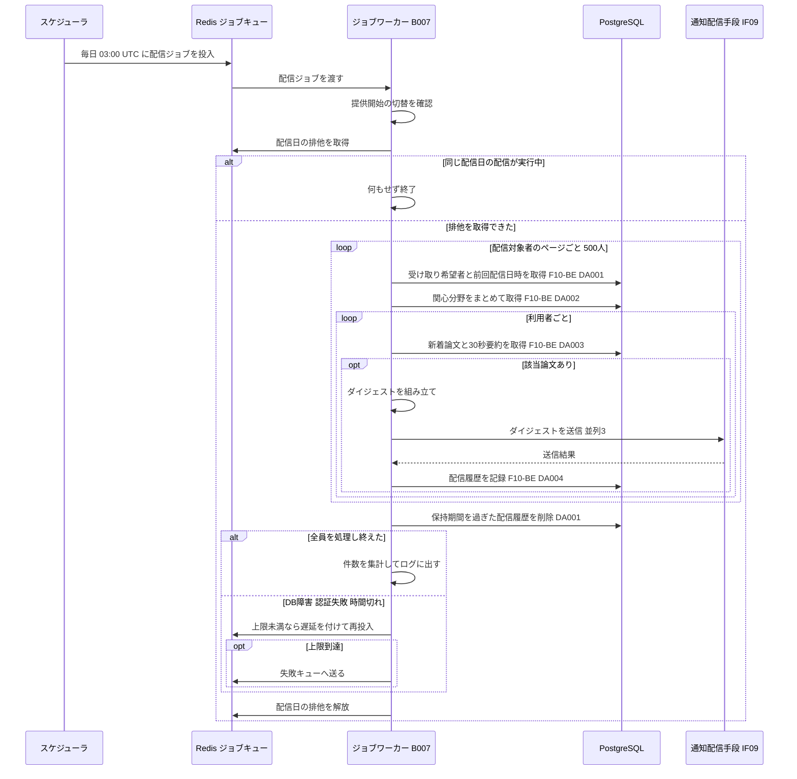
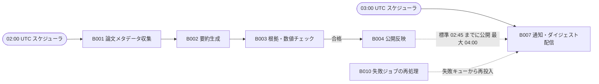

# バッチ詳細設計書 — B007 通知・ダイジェスト配信

## 0. 文書情報

| 項目 | 値 |
| :--- | :--- |
| 設計書ID | B007-BE |
| 親ID | B007 |
| 親設計書 | `基本設計書_概要.md` §4 機能設計「バッチ処理設計」B007 行 |
| バッチ名 | 通知・ダイジェスト配信（上流 §4 バッチ処理設計の区分「定期実行」） |
| 対応する機能ID | F10 通知・ダイジェスト（上流 §4 機能一覧。優先度 Later／※推測: Phase 3） |
| 関連する業務フローID | BF10 通知・ダイジェスト配信（上流 §2） |
| 版 | 1.2（セルフレビュー第1回の Major 3件・Minor 3件と、第2回 `docs/reviews/batch_B007_review_applied.md` の Major 1件を反映） |
| 作成日 / 更新日 | 2026-10-27 / 2026-10-27 |
| 作成方法 | creating-backend-detailed-design v1.5.0 準拠。上流の確定設計書と `source/` の企画資料からの新規設計 |
| インプット | (a) `source/02_機能要求定義.md:15,44-50`、`source/01_企画概要.md:29,36`、`source/03_システム構成.md:11,39-40,61`、`source/04_収益化とロードマップ.md:5,28`（全6ファイル・計227行。前単位 B006 の作業時から変更なし）／(b) `docs/基本設計書_概要.md` §2 BF10、§4 F10・B007・バッチ共通の方針、§6 T001・T002・T003・T005・T006・CRUD図、§7 IF05・IF09、§8、§9 環境変数一覧、§10 運用監視、§11 ARC004・ARC006・ARC008〜ARC010、付録 Q15・Q17・Q19・Q23・Q31・Q35・Q36／関連する確定済み設計書: `docs/detail/be/BE.F10.BE詳細設計.md`（F10-BE。B007 の処理ロジックの定義元）、`docs/db/DB.T001`・`T003`・`T005`・`T006`・`T009.DB物理設計.md`、`docs/detail/batch/BT.B001〜B006.バッチ詳細設計.md`（前後のバッチ）／(c) `legacy/`（空） |

* **インプットの性質（source/ の突合結果）**: `source/` は企画・初期設計案の Markdown 6ファイル（計227行）だけです。依頼にあるスケジュール定義 `config/schedule.rb`（whenever）と rake タスクの実装 `lib/tasks/` は**存在しません**（Ruby のファイル0件）。本システムのジョブは Python のワーカー（Redis + Celery または RQ）で動きます（`source/03_システム構成.md:7,11`）。B007 は上流 §4 で「定期実行」とされているため、whenever の定義に当たるものを §5「スケジュール定義」に、rake タスクに当たるものを §4 のジョブ関数に置き換えて設計しています。資料に通知の記述は「F-10 通知・ダイジェスト / Later / 関心分野の新着論文通知」（`source/02_機能要求定義.md:15`）と、マイページの「通知設定」（`source/01_企画概要.md:29`）の2か所だけで、配信手段・頻度・時刻・保存先はすべて未定義です（上流 付録 Q15）。本書は**リバースエンジニアリングではなく新規設計**で、資料と上流に無い値には「※推測」を付けています。
* **既存版**: `docs/detail/batch/BT.B007.バッチ詳細設計.md` の旧版はありません（作業開始時点の `docs/detail/batch/` は B001〜B006 の6ファイルだけ）。本書が初版で、消さずに残すべき既存記述はありません。
* **legacy/ との突合**: `legacy/` は空ディレクトリです（ファイル0件）。突合する既存のバッチ設計書・業務意図・非機能の記述はありません。
* **F10-BE との分担と継承**: 本バッチの処理ロジックは F10-BE で関数（FN01〜FN06）・データアクセス（DA001〜DA004）・発行SQLとして定義済みです。F10-BE §5 は「スケジュール定義、リトライ、監視の閾値はバッチ詳細設計書の責務」としています。本書は F10-BE で採番済みの **FN-ID・DA-ID をそのまま引き継ぎ**、起動契機・スケジュール・多重起動制御・処理ステップ・性能・依存ジョブ順序・ログと監視を加えて、本書だけでバッチを実装・運用できる形に展開します。F10-BE の FN07・FN08・DA005・DA006（通知設定の取得・保存API）は画面向けAPIの処理で、本バッチは使いません。
  * **IDの書き方**: 引き継いだIDは定義元の設計書IDを付けて「F10-BE FN01」「F10-BE DA003」と書きます。本書が初めて定義するデータアクセスは設計書IDを付けず「DA001」と書き、本書（B007-BE）のIDであることを表します（BT.B006 と同じ書き方）。関数は、本書で追加したものに FN-ID を振りません（※上流未定義。F10-BE の FN-ID の続き番号を本書で仮採番しないため）。
  * **両書が食い違った場合**: 処理ロジックは F10-BE、起動と運用は本書を正とします。本書で見直した点（新着の判定を取り込み日時に変更、送信の並列化、スケジューラからの引数、リトライの遅延、配信履歴の保持期間切れの削除）は本書を正とし、F10-BE への取り込みを §6 確認事項 No.9 に挙げています。
* **上流との差分**（※上流要確認・※上流未定義。§6 確認事項に集約）:
  * 通知設定と配信履歴の保存先テーブルが上流 §6 に無い（F10-BE §1 前提1、上流 付録 Q23）。本書も F10-BE と同じく物理名を付けず `{通知設定テーブル}`・`{配信履歴テーブル}` と書きます。
  * 上流 §6 CRUD図の F10 行に paper_versions の参照（R）と、配信履歴への追加・削除（C・D）が表せない（F10-BE §1 前提2）。
  * F10-BE DA003 は新着かどうかを投稿日時（`papers.submitted_at`）で判定しており、arXiv の投稿から公開・取り込みまでの間（週末をまたぐと数日）に前回配信を挟んだ論文が配信から漏れる。本書はこれを、論文を最初に取り込んだ日時（版のスナップショットの `fetched_at`。BT.B001 §2 で確定済みのキー）で判定する形に改めた（§3 F10-BE DA003、§6 確認事項 No.1。DB物理設計書 T001 §9 No.4・T002 への索引の追加を要する）。

## 1. バックエンド構成・モジュール設計

* **対象ドメイン**: 通知系（ダイジェスト配信の定期バッチ） — 定期スケジュールによる起動、同じ配信日の多重起動の防止、受け取りを希望する利用者の抽出、利用者ごとの関心分野に一致する新着論文の選定、ダイジェストの組み立てと通知配信手段（IF09）への送信、配信履歴の記録、保持期間を過ぎた配信履歴の削除、ジョブ全体のリトライと失敗キュー、実行結果のログ出力と監視（上流 F10・B007・BF10、F10-BE FN01〜FN06）。
* **対象APIエンドポイント**: なし。本バッチは画面や外部から HTTP で呼ばれず、スケジューラからの起動で動きます（根拠は §2 APIエンドポイント一覧）。
* **実行基盤**: Pythonワーカー上のジョブです（Redis + Celery または RQ。どちらにするかは未決定、上流 Q02）。スケジューラは BT.B001 と同じ Celery beat または rq-scheduler です（※推測）。DB は Supabase 上の PostgreSQL に、行単位アクセス制御を通らないサーバ側のサービスロールで接続します。全利用者のメールアドレスを Supabase Auth の管理表（`auth.users`）から読むためです（F10-BE §6 セキュリティ上の考慮）。B007 は利用者を単位に送る処理のため、ジョブ管理テーブル `jobs`（T009）には行を作りません（DB物理設計書 T009 §4.3「含めない処理」）。実行状況はジョブキューの記録・ログ・配信履歴で追います。
* **ディレクトリ/ファイル構造**（※推測: F10-BE §1 の配置案。スケジュール定義だけは、全バッチのスケジュールを1か所にまとめるため BT.B001 §1 の `worker/schedule.py` に置く。F10-BE は `worker/scheduler/schedule.py` としており、§6 確認事項 No.9 で揃える）:

```
worker/
├── schedule.py                  # スケジュール定義（whenever の config/schedule.rb に当たる。B001 と共用。§5 スケジュール定義）
├── jobs/
│   └── digest_delivery.py       # FN01 run_digest_delivery / purge_delivery_history（本書で追加）
├── notification/
│   ├── digest_repository.py     # FN02 fetch_digest_recipients / FN03 select_new_papers_for_user / FN06 record_delivery（F10-BE DA001〜DA004、本書 DA001）
│   ├── digest_composer.py       # FN04 compose_digest
│   └── mail_client.py           # FN05 send_digest（IF09 通知配信手段）
└── config.py                    # NOTIFICATION_ENABLED ほか設定値の読み込み（§6 設定値一覧）
```

* **処理シーケンス図**（上流 BF10 を、起動から終了まで展開。F10-BE §1 の配信部分に、多重起動の防止・リトライ・保持期間切れの削除を加えたもの。※推測を含む）:



## 2. API・インターフェース詳細設計

* **APIエンドポイント一覧（全数ロースター）**:

| API ID | メソッド | エンドポイント | 概要 | 定義状況 | 詳細の所在 |
| :--- | :--- | :--- | :--- | :--- | :--- |
| — | — | 該当なし | — | — | — |

**総件数: 0件。根拠**: 上流 §7 内部API一覧の全8件（API01〜API08）に、B007 を起動・操作するものはありません。上流 §2 BF10 の起点は「定期ジョブ（B007）」で、起動はスケジューラから行います。F10-BE の通知設定API 2件（GET・PUT `/api/me/notification-settings`。※上流未定義）は利用者が受け取り可否を変える画面向けAPIで、B007 はその保存結果を `{通知設定テーブル}` から読むだけです（F10-BE §2）。手動の再実行（§5 起動契機 No.2）もワーカー上のコマンドで行い、HTTP の受け口は設けません（※推測）。

* **外部サービス連携一覧（全数ロースター）**: 上流 §7 外部連携一覧の全9件に対し、B007 で使うかを示します。

| IF ID | 連携先 | B007 での利用 | 概要 | 定義状況 | 詳細の所在 |
| :--- | :--- | :--- | :--- | :--- | :--- |
| IF01 | arXiv API | 利用しない | 論文メタデータの取得は B001・B006 の責務。B007 は保存済みの論文を読むだけ | - | `docs/detail/batch/BT.B001.バッチ詳細設計.md` |
| IF02 | arXiv（論文本文PDF） | 利用しない | 本文の取得は B005 の責務 | - | `docs/detail/batch/BT.B005.バッチ詳細設計.md` |
| IF03 | arXiv 原文ページ | 利用しない（リンクを本文に載せるだけ） | ダイジェストの本文に原文ページへのリンクを載せる。サーバからの通信は無く、利用者がメールから開く | - | - |
| IF04 | LLM API | 利用しない | 生成済みの30秒要約を読むだけで、配信のたびに LLM を呼ばない（`source/02_機能要求定義.md:45`、上流 ARC001） | - | `docs/detail/batch/BT.B002.バッチ詳細設計.md` |
| IF05 | Supabase Auth | 利用する | 配信先のメールアドレスと確認済みかどうかを、認証基盤の管理表から読む（F10-BE DA001） | 詳細 | 本節 外部サービス連携仕様、F10-BE §2 IF05 |
| IF06 | Stripe（決済セッション） | 利用しない | 課金（F12）の責務。プランは `users.plan` から読む | - | - |
| IF07 | Stripe（契約状態の通知） | 利用しない | 課金（F12）の責務 | - | - |
| IF08 | GitHub | 利用しない | GitHub関連付け（B009）の責務 | - | - |
| IF09 | 通知配信手段 | 利用する | 利用者ごとのダイジェストを送信する（※推測: メール送信サービス） | 詳細 | 本節 外部サービス連携仕様、§4 F10-BE FN05 |

**総件数: 9件（B007 で利用するもの2件）。根拠**: 上流 §7 外部連携一覧の IF01〜IF09 の全9行と1対1で対応します。利用する2件は F10-BE §2 外部サービス連携仕様の2件（IF05・IF09）のうち、B007 側で使うもの（F10-BE の IF05 には API でのセッション確認も含まれるが、B007 はメールアドレスの読み出しだけを使う）と一致します。Redis（ジョブキュー）と PostgreSQL は上流 §7 で内部の構成要素とされているため含めません。

* **外部サービス連携仕様**（B007 で利用する2件。F10-BE §2 と同じ仕様のうち B007 に関わる値。並列数は本書で追加）:

| IF ID | 連携先 | 連携方式 | エンドポイント / 接続先 | 認証方式 | タイムアウト | リトライ方針 | エラー時の挙動 |
| :--- | :--- | :--- | :--- | :--- | :--- | :--- | :--- |
| IF09 | 通知配信手段 | ※推測: メール送信サービスの REST API（配信手段がメールかプッシュかは未定義。上流 付録 Q15） | ※推測: 送信サービスのメール送信API（サービスは未選定）。同時に送る数は設定値 `MAIL_SEND_CONCURRENCY`（※推測: 3）まで | ※推測: APIキー（環境変数 `MAIL_API_KEY`。上流 §9 の環境変数一覧に無いため※上流未定義） | ※推測: 1通あたり10秒 | 一時的な失敗（送信サービスの混雑・通信断・タイムアウト）のときだけ、1秒・2秒・4秒と間隔を空けて最大3回まで送り直す（※推測。F10-BE FN05）。同じ送信を二重に受け付けないための鍵（利用者IDと配信日をつないだ値）を毎回付ける | 一時的な失敗を3回繰り返したとき、または宛先不正・送信拒否のときは、その利用者を失敗として配信履歴に残し次の利用者へ進む。認証失敗は全員に影響するため、その時点でジョブを打ち切り、ジョブ全体の失敗として扱う（§6 リトライ方針） |
| IF05 | Supabase Auth | ※推測: 同じ Supabase プロジェクトの認証スキーマ `auth.users` を DB 上で参照する | `auth.users`（`id`・`email`・`email_confirmed_at` の3列だけを読む） | サービスロールの権限を持つ DB 接続（上流 §9 `DATABASE_URL`。Supabase のAPIは呼ばないため `SUPABASE_SERVICE_ROLE_KEY` は使わない） | DB 接続のタイムアウトに従う（※推測: 文のタイムアウト30秒） | 個別には送り直さない。DB 接続の失敗はジョブ全体の失敗として、ジョブごと再実行する | メールアドレスが無い、または確認が済んでいない利用者は配信対象から外す（F10-BE DA001） |

* **ジョブの引数の定義**（スケジューラまたは手動の再実行がジョブキューへ投入するメッセージ）:

| キー | 型 | 必須 | 入れる値 | 説明 |
| :--- | :--- | :--- | :--- | :--- |
| `run_at` | 文字列（ISO 8601、UTC）または無し | — | 新着を探す期間の終わり。定期実行では入れず、ジョブが最初に動いた時刻を入れて再投入に引き継ぐ | 再試行で期間の終わりがずれて、1回目と2回目で送る論文が変わるのを防ぐ。キーが無ければジョブの開始時刻を使う（F10-BE FN01 の引数 run_at） |
| `delivery_date` | 文字列（YYYY-MM-DD、日本時間の日付）または無し | — | 配信日。定期実行では入れず、ジョブが最初に動いた日の日本時間の日付を入れて再投入に引き継ぐ | 同じ利用者へ同じ日に二度送らない判定と、多重起動の排他の鍵に使う。キーが無ければ `run_at` の日本時間の日付を使う（F10-BE FN01 の引数 delivery_date） |
| `attempt` | 整数 | — | ジョブ全体の試行回数。初回は0（キーが無ければ0とみなす） | ジョブ管理テーブル `jobs` に行を持たないため、試行回数はメッセージで引き継ぐ（§6 リトライ方針） |

**総件数: 3キー。根拠**: F10-BE FN01 の引数2つ（run_at・delivery_date）と、jobs に行を持たない B007 がリトライの上限を判定するために本書で加えた1つ（attempt）です。F10-BE は「スケジューラが渡す」としていますが、スケジューラ（Celery beat）は起動のたびに変わる値を引数に組み立てられないため、引数が無いときはジョブ自身が決める形にしました（※上流要確認: F10-BE FN01 の引数の扱い。§6 確認事項 No.9）。

* **IF09 の送信内容と出どころの対応**（F10-BE FN04 の組み立てを、送信するメールの項目ごとに整理したもの。文言は※推測）:

| 送信する項目 | 入れる値 | 出どころ |
| :--- | :--- | :--- |
| 宛先 | 利用者の確認済みメールアドレス | `auth.users.email`（F10-BE DA001） |
| 送り主 | サービスの送信元アドレスと名称（サービス名は未決定。上流 付録 Q01） | 設定値 `MAIL_FROM_ADDRESS`（※上流未定義） |
| 件名 | 「【サービス名】{配信日} の新着論文 {件数}件」 | 配信日、F10-BE DA003 の件数 |
| 論文ごとの見出し | 30秒要約の日本語タイトルと原題の併記。要約が準備中なら原題だけ | `summaries.json_content`、`papers.title`（F10-BE DA003） |
| 論文ごとの要約 | 30秒要約の本文。Abstract だけで作った要約には「Abstractベース」を添える | `summaries.json_content`、`summaries.source_scope`（上流 ARC009、`source/01_企画概要.md:36`） |
| 論文ごとの付記 | カテゴリ、投稿日、版（v1/v2…） | `papers.categories`・`submitted_at`・`latest_version` |
| 論文ごとのリンク | 論文詳細画面（P104）と arXiv の原文ページ（IF03） | 設定値 `APP_BASE_URL`（※上流未定義）＋ arXiv ID、`papers.original_url` |
| 掲載しきれなかった件数 | 「ほか N 件は新着論文画面で」と新着論文画面（P102）へのリンク | F10-BE FN03 の掲載しきれなかった件数 |
| 末尾の案内 | 配信停止の方法（マイページ P106 の通知設定へのリンク）、送り主の名称と連絡先、arXiv と本サービスの関係を誤解させない注記 | 設定値 `APP_BASE_URL`、固定文言（`source/03_システム構成.md:61`） |
| 送信の重複防止の鍵 | 利用者IDと配信日をつないだ値 | F10-BE FN05 の idempotency_key |

**総件数: 10項目。根拠**: F10-BE FN04 の処理フロー手順1〜5（件名・論文ごとの見出しと要約と付記とリンク・掲載しきれなかった件数・末尾の案内）と、FN05 が送る宛先・重複防止の鍵、送信サービスが必須とする送り主を、送信する項目ごとに1行ずつ挙げたものです。

* **API詳細仕様**: 該当なし（APIエンドポイント0件のため。根拠は上の一覧の直後に記載）。ジョブとしての入出力は本節の「ジョブの引数の定義」、§4 F10-BE FN01、§5 入出力一覧に記載します。

## 3. データアクセス（ORM / クエリ）設計

* **データアクセス一覧（全数ロースター）**: 「F10-BE DA00n」は F10-BE §3 で採番済みのものをそのまま引き継いだもの、「DA001」は本書が定義するものです（§0「IDの書き方」）。

| DA-ID | 処理名 | 呼出元（関数/API） | テーブルID | 対象物理テーブル | 種別 (SELECT/INSERT/UPDATE/DELETE) | 定義状況 (詳細/簡易) | 詳細の所在 |
| :--- | :--- | :--- | :--- | :--- | :--- | :--- | :--- |
| F10-BE DA001 | 配信対象利用者の取得 | F10-BE FN02 `fetch_digest_recipients` | ※上流未定義, T005, ※上流未定義, ※上流未定義 | {通知設定テーブル}, users, auth.users, {配信履歴テーブル} | SELECT | 詳細 | §3 詳細定義 F10-BE DA001・発行SQL F10-BE DA001 |
| F10-BE DA002 | 配信対象者の関心分野の一括取得 | F10-BE FN02 `fetch_digest_recipients` | T006 | user_interests | SELECT | 詳細 | §3 詳細定義 F10-BE DA002・発行SQL F10-BE DA002 |
| F10-BE DA003 | 利用者ごとの新着論文と30秒要約の取得（新着の判定を本書で改訂） | F10-BE FN03 `select_new_papers_for_user` | T001, T002, T003 | papers, paper_versions, summaries | SELECT | 詳細 | §3 詳細定義 F10-BE DA003・発行SQL F10-BE DA003 |
| F10-BE DA004 | 配信履歴の記録 | F10-BE FN06 `record_delivery` | ※上流未定義 | {配信履歴テーブル} | INSERT（衝突時は何もしない） | 詳細 | §3 詳細定義 F10-BE DA004・発行SQL F10-BE DA004 |
| DA001 | 保持期間を過ぎた配信履歴の削除 | `purge_delivery_history`（F10-BE FN01 の最後に呼ぶ。※上流未定義） | ※上流未定義 | {配信履歴テーブル} | DELETE | 詳細 | §3 詳細定義 DA001・発行SQL DA001 |

**総件数: 5件（F10-BE から継承4件・本書で定義1件。SELECT 3件・INSERT 1件・DELETE 1件。全件 詳細）。全数である根拠**: §4 関数一覧の全7関数のうち DB へ問い合わせる4関数（F10-BE FN02→DA001・DA002、FN03→DA003、FN06→DA004、`purge_delivery_history`→本書 DA001）の処理フローに現れる DB 操作を1件1行で数えたものです。残りの3関数（F10-BE FN01・FN04・FN05）は DB に直接触れません（FN01 は他の関数を呼び、FN04 は組み立てだけ、FN05 は外部への送信だけ）。F10-BE の DA005・DA006 は通知設定API（FN07・FN08）だけが使い、B007 は使いません。本書 DA001 は、F10-BE §3 DA004 が「保持期間は未定義（※推測: 90日を過ぎた行は削除）」としたまま削除する処理を定めていなかったため、本書で補ったものです（上流 ARC010。※上流未定義）。多重起動の排他は Redis のキーで行い、DB には問い合わせません（§5 多重起動制御）。
**上流 CRUD図との突合**: 上流 §6 CRUD図の F10 行は papers「R」、summaries「R」、users「R」、user_interests「R」で、F10-BE DA001〜DA003 と一致します。paper_versions の R（F10-BE DA003 の結合）、`{通知設定テーブル}` の R、`{配信履歴テーブル}` の R・C・D（F10-BE DA001・DA004、本書 DA001）は上流 CRUD図に表せません（F10-BE §1 前提2 と同じ。※上流要確認、§6 確認事項 No.2）。
**定義状況の判定**（completeness 3-1）: F10-BE DA001 は4つの表にまたがり（3-1 の3）ページ単位で読む（3-1 の6）、DA002 は1ページ分をまとめて読む性能上の注意がある（3-1 の6）、DA003 は関心分野の種類で文を組み立てる（3-1 の4）、DA004 と本書 DA001 は永続データを書き換える（3-1 の2）ため、5件とも「詳細」です。

* **データアクセス詳細定義**（定義状況＝詳細の5件。F10-BE から継承した4件は F10-BE §3 と同じ内容で、B007 での使い方を加えている）:

| DA-ID | 処理名 | テーブルID | 対象物理テーブル | JOIN / Include | 抽出条件 (Where) / ソート | トランザクション境界 | N+1対策・性能上の注意 |
| :--- | :--- | :--- | :--- | :--- | :--- | :--- | :--- |
| F10-BE DA001 | 配信対象利用者の取得 | ※上流未定義, T005, ※上流未定義, ※上流未定義 | {通知設定テーブル}, users, auth.users, {配信履歴テーブル} | 受け取りを希望する通知設定の行に、利用者（プラン）と認証基盤のメールアドレスを内部結合し、利用者ごとに成功した配信の最新の日時を外部結合する | 受け取りを希望していて、メールアドレスが登録済みで確認も済んでいて、今回の配信日にまだ成功の履歴が無い利用者だけを、利用者IDの昇順に1ページ（500人）ずつ読む。前のページの最後の利用者IDより大きいものから読む（`ns.digest_enabled = TRUE AND au.email IS NOT NULL AND au.email_confirmed_at IS NOT NULL AND NOT EXISTS (今日の成功履歴) AND ns.user_id > :after_user_id ORDER BY ns.user_id LIMIT :page_size`） | なし（参照のみ） | 「今回の配信日にまだ成功の履歴が無い」条件があるため、再試行・再実行でも成功済みの利用者は自動的に外れる（§6 冪等性 No.1）。キーセット方式で読むため、送信の途中で通知設定が変わっても読み飛ばしや重複は起きない（変わった設定は次回から反映）。成功の最新日時は相関副問い合わせでなく集約して結合する |
| F10-BE DA002 | 配信対象者の関心分野の一括取得 | T006 | user_interests | なし | DA001 で読んだ1ページ分の利用者IDのどれかに一致する行を、利用者ID・重みの降順に読む（`user_id = ANY(:user_ids)`） | なし（参照のみ） | 利用者ごとに問い合わせず、1ページ分をまとめて読む（主キー `pk_user_interests` の先頭列で引ける）。関心分野が0件の利用者は結果に現れず、配信対象から外れる |
| F10-BE DA003 | 利用者ごとの新着論文と30秒要約の取得（新着の判定を本書で改訂） | T001, T002, T003 | papers, paper_versions, summaries | 論文を最初に取り込んだ版（その論文で最も小さい版番号の行）と論文を内部結合し、論文の最新版を内部結合し、その版の検証に合格した日本語の30秒要約のうち最新の1件を外部結合する | 定期収集（B001）が最初に取り込んだ日時が、前回の成功配信の日時より後でジョブの開始時刻（`run_at`）以前の論文のうち、利用者の関心分野（カテゴリはどれか1つでも含む、キーワードは原題か Abstract に大文字小文字を区別せず含む）に一致するものを、一致した関心の重みの合計が大きい順・投稿日時の新しい順に上位20件まで返す。投稿日時が探索期間の始まりより7日以上古い論文は、既存の論文の改訂を初めて取り込んだものとみなして除く。オンデマンド同期（B006）が取り込んだ論文は、検索で必要になった古い論文のため除く。初回は `run_at` の24時間前から、前回が7日より前なら7日前から探す（`fv.metadata_snapshot->>'source' = 'B001' AND fv.metadata_snapshot->>'fetched_at' > :since_text AND fv.metadata_snapshot->>'fetched_at' <= :until_text AND p.submitted_at >= :since - interval '7 days'`。組み立ての分岐は発行SQL F10-BE DA003） | なし（参照のみ） | 投稿日時ではなく取り込み日時で判定するのは、arXiv の投稿から公開・取り込みまで最大で数日（週末をまたぐ場合）あき、投稿日時で判定すると前回配信を挟んだ論文が届かなくなるため（§6 確認事項 No.1）。取り込み日時は ISO 8601 の UTC 表記（`YYYY-MM-DDTHH:MM:SSZ` の固定桁）で保存されるため、文字列のまま大小を比べられる。この比較を速くするため、版のスナップショットの取り込み日時を対象にした式の索引が要る（`CREATE INDEX idx_paper_versions_fetched_at ON paper_versions ((metadata_snapshot->>'fetched_at'))`。※上流要確認: DB物理設計書 T002 への追加。§6 確認事項 No.1）。カテゴリは `idx_papers_categories` で絞り、キーワードの部分一致は絞った後に照合する。利用者ごとに1回発行し、最大ケース（6,000人）で約10分かかる（§5 性能）。人数が増えたら、当日の新着論文を一括で読みワーカー側で突き合わせる方式へ切り替える（F10-BE §3、DB物理設計書 T006 §9 No.8。§6 確認事項 No.7） |
| F10-BE DA004 | 配信履歴の記録 | ※上流未定義 | {配信履歴テーブル} | なし | 1人分の送信が終わるたびに、利用者ID・配信日・配信日時・結果（成功または失敗）・掲載件数・失敗理由を1行追加する。同じ利用者・同じ配信日・同じ結果の行があれば何もしない（`ON CONFLICT (user_id, delivery_date, status) DO NOTHING`） | 1行ごとに自動確定する（送信は外部への通信で、DB のトランザクションに含められないため） | 送信を並列にしても（§5 ワーカーの配置）、利用者ごとに別の行を書くため互いに待たない。成功の行が次回の「前回配信日時」になる。メールアドレスと本文は残さない（上流 ARC010） |
| DA001 | 保持期間を過ぎた配信履歴の削除 | ※上流未定義 | {配信履歴テーブル} | なし | 配信日が今回の配信日から保持日数（設定値 `DIGEST_HISTORY_RETENTION_DAYS`。※推測: 90日）より前の行を、1回あたり最大5,000行ずつ、0行になるまで繰り返し削除する（`WHERE delivery_date < :delivery_date - :retention_days`）。ただし利用者ごとの最新の成功の行は残す（`AND (user_id, delivered_at) NOT IN (利用者ごとの成功の最新)`） | 5,000行の削除ごとに自動確定する（大量の行を1つのトランザクションで消して長くロックしないため） | 最新の成功の行を残すのは、90日以上届いていない利用者の「前回配信日時」を失わないため（失うと初回扱いになり、F10-BE DA003 の24時間に縮む）。配信日の範囲で消すため、配信日を先頭に持つ索引が要る（※上流未定義: `{配信履歴テーブル}` の索引。§6 確認事項 No.3）。1日の削除は送信数と同じ程度（最大約4,200行）で、通常は1回で終わる |

* **発行SQL**: 全5件（F10-BE DA001〜DA004、本書 DA001）。PostgreSQL 15 以上の文で、ORM を使う場合もこの文と同じ意味になるように書きます（ORM は未選定）。プレースホルダは `:名前` で示します。`{通知設定テーブル}`・`{配信履歴テーブル}` と、その列名（digest_enabled・delivery_date・delivered_at・status・paper_count・error_reason）はテーブルが上流で未定義のための置き場所で、名前はすべて※推測です（F10-BE §3 と同じ）。F10-BE から継承した4件は F10-BE §3 の発行SQLと同じ文です。

**F10-BE DA001 配信対象利用者の取得**（1ページ分。2ページ目以降は直前のページの最後の利用者IDを `:after_user_id` に渡す）
```sql
SELECT ns.user_id,
       u.plan,
       au.email,
       last_ok.last_delivered_at
FROM   {通知設定テーブル} ns
JOIN   users u        ON u.user_id = ns.user_id
JOIN   auth.users au  ON au.id = ns.user_id
LEFT JOIN (
         SELECT user_id, MAX(delivered_at) AS last_delivered_at
         FROM   {配信履歴テーブル}
         WHERE  status = 'sent'
         GROUP  BY user_id
       ) last_ok ON last_ok.user_id = ns.user_id
WHERE  ns.digest_enabled = TRUE
  AND  au.email IS NOT NULL
  AND  au.email_confirmed_at IS NOT NULL
  AND  NOT EXISTS (
         SELECT 1
         FROM   {配信履歴テーブル} h
         WHERE  h.user_id = ns.user_id
           AND  h.delivery_date = :delivery_date
           AND  h.status = 'sent'
       )
  AND  ns.user_id > :after_user_id
ORDER  BY ns.user_id
LIMIT  :page_size;
```
組み立ての分岐: なし（固定の1文）。最初のページは `:after_user_id` に利用者IDの最小値（UUID の全ビット0）を渡します。

**F10-BE DA002 配信対象者の関心分野の一括取得**
```sql
SELECT user_id, topic, weight
FROM   user_interests
WHERE  user_id = ANY(:user_ids)
ORDER  BY user_id, weight DESC;
```
組み立ての分岐: なし（固定の1文）。

**F10-BE DA003 利用者ごとの新着論文と30秒要約の取得**（動的SQL）

関心分野（`user_interests.topic`）のうち、arXiv のカテゴリ表記（`^[a-z\-]+(\.[A-Za-z\-]+)?$`）に当てはまるものをカテゴリ、それ以外をキーワードとして振り分け（F10-BE FN02 手順3）、次の3通りのどれかに組み立てます。カテゴリもキーワードも0件の利用者は F10-BE DA002 の時点で配信対象から外れるため、この文は発行しません。

| 組み立ての分岐 | 一致条件の部分 | 重みの算出 |
| :--- | :--- | :--- |
| (A) カテゴリだけを持つ | 論文のカテゴリにカテゴリの関心のどれかが含まれる（`p.categories && :categories`） | カテゴリの関心の重みを、論文のカテゴリに含まれるものだけ合計する |
| (B) キーワードだけを持つ | 原題か Abstract にキーワードのどれかが含まれる（`p.title ILIKE ANY(:kw_patterns) OR p.abstract ILIKE ANY(:kw_patterns)`。値は前後に `%` を付け、`%`・`_`・`\` は文字として照合されるよう打ち消す） | 一致したキーワードの関心の重みを合計する |
| (C) 両方を持つ | (A) か (B) のどちらかを満たす | (A) と (B) の合計 |

生成される文の形（(C) の場合。(A) はキーワードの部分を、(B) はカテゴリの部分を取り除いた形になる）:
```sql
WITH interest_cat(topic, weight) AS (
       SELECT * FROM unnest(:categories::text[], :category_weights::numeric[])
     ),
     interest_kw(pattern, weight) AS (
       SELECT * FROM unnest(:kw_patterns::text[], :kw_weights::numeric[])
     ),
     candidates AS (
       SELECT p.id, p.arxiv_id, p.title, p.abstract, p.categories, p.submitted_at,
              p.latest_version, p.original_url
       FROM   paper_versions fv                       -- 論文を最初に取り込んだ版
       JOIN   papers p ON p.id = fv.paper_id
       WHERE  fv.metadata_snapshot->>'source'      =  'B001'
         AND  fv.metadata_snapshot->>'fetched_at'  >  :since_text
         AND  fv.metadata_snapshot->>'fetched_at'  <= :until_text
         AND  NOT EXISTS (                             -- より小さい版が無い＝最初に取り込んだ版
                SELECT 1 FROM paper_versions older
                WHERE  older.paper_id = fv.paper_id
                  AND  older.version  < fv.version
              )
         AND  p.submitted_at >= :since - interval '7 days'
         AND  (
                p.categories && :categories
                OR p.title    ILIKE ANY(:kw_patterns)
                OR p.abstract ILIKE ANY(:kw_patterns)
              )
     )
SELECT c.arxiv_id,
       c.title,
       c.categories,
       c.submitted_at,
       c.latest_version,
       c.original_url,
       s.json_content  AS short_summary,
       s.source_scope,
       ( COALESCE((SELECT SUM(ic.weight) FROM interest_cat ic
                   WHERE ic.topic = ANY(c.categories)), 0)
       + COALESCE((SELECT SUM(ik.weight) FROM interest_kw ik
                   WHERE c.title ILIKE ik.pattern OR c.abstract ILIKE ik.pattern), 0)
       ) AS match_score,
       COUNT(*) OVER () AS total_matches        -- 上位を切り出す前の一致件数（「ほか N 件」に使う）
FROM   candidates c
JOIN   paper_versions pv
       ON pv.paper_id = c.id
      AND pv.version  = c.latest_version
LEFT JOIN LATERAL (
       SELECT json_content, source_scope
       FROM   summaries
       WHERE  paper_version_id  = pv.id
         AND  summary_type      = 'short'
         AND  language          = 'ja'
         AND  validation_status = 'passed'
       ORDER  BY generated_at DESC
       LIMIT  1
     ) s ON TRUE
ORDER  BY match_score DESC, c.submitted_at DESC
LIMIT  :max_papers;
```
`:since` は F10-BE DA001 の前回成功配信日時です。履歴が無い利用者は `:until` の24時間前、前回が `:until` の7日前より古い利用者は7日前とします（※推測）。`:until` はジョブ引数の `run_at` で、再試行でも同じ値を使います（§2 ジョブの引数の定義）。`:since_text`・`:until_text` は同じ日時を、スナップショットの `fetched_at` と同じ固定桁の UTC 表記（`YYYY-MM-DDTHH:MM:SSZ`）にした文字列です。F10-BE §3 の元の文は投稿日時の範囲（`p.submitted_at > :since AND p.submitted_at <= :until`）で探していましたが、本書で取り込み日時の範囲に改めました（§6 確認事項 No.1・No.9）。新しい版（v2 以降）の取り込みは、最初に取り込んだ版の日時で判定するため、配信済みの論文が改訂のたびに再び届くことはありません。`:max_papers` は20（※推測）です。掲載しきれなかった件数は、同じ文の中で上位を切り出す前の一致件数（`total_matches`）を一緒に返し、F10-BE FN03 が「一致件数−掲載件数」で求めます。件数を得るための別の問い合わせは発行しません（本書で追加。F10-BE は件数の求め方を定めていなかった）。

**F10-BE DA004 配信履歴の記録**
```sql
INSERT INTO {配信履歴テーブル}
       (user_id, delivery_date, delivered_at, status, paper_count, error_reason)
VALUES (:user_id, :delivery_date, CURRENT_TIMESTAMP, :status, :paper_count, :error_reason)
ON CONFLICT (user_id, delivery_date, status) DO NOTHING;
```
組み立ての分岐: なし（固定の1文）。`:status` は送信成功が `sent`、送信失敗が `failed` です（※推測）。一意制約（利用者ID・配信日・結果）を前提とします。

**DA001 保持期間を過ぎた配信履歴の削除**（削除した行数が5,000行未満になるまで繰り返す）
```sql
DELETE FROM {配信履歴テーブル} h
 WHERE h.ctid IN (
         SELECT d.ctid
           FROM {配信履歴テーブル} d
          WHERE d.delivery_date < :delivery_date - :retention_days
            AND NOT (d.status = 'sent'
                     AND d.delivered_at = (SELECT MAX(x.delivered_at)
                                             FROM {配信履歴テーブル} x
                                            WHERE x.user_id = d.user_id
                                              AND x.status  = 'sent'))
          LIMIT 5000
       );
```
組み立ての分岐: なし（固定の1文）。条件の意味は「配信日が保持日数より古い行のうち、その利用者の最新の成功の行ではないもの」です。失敗の行は前回配信日時の判定に使わないため、古ければ利用者ごとの最新であっても消します。1回で最大5,000行を消し、呼び出し元（`purge_delivery_history`）が削除した行数を見て繰り返します。

## 4. サーバー側機能・処理ロジック設計（IPO設計）

* **関数一覧（全数ロースター）**: FN-ID と関数名は F10-BE §4 で定義済みのものをそのまま引き継ぎます。本書で追加した関数には FN-ID を振りません（§0「IDの書き方」）。

| FN-ID | 関数名 | 所属モジュール（※推測） | 定義元 | 概要 | 定義状況 | 詳細の所在 |
| :--- | :--- | :--- | :--- | :--- | :--- | :--- |
| F10-BE FN01 | `run_digest_delivery` | `worker/jobs/digest_delivery.py` | F10-BE §4 | B007 の入口。排他を取り、配信対象者をページ単位で読み、利用者ごとに論文の選定・送信・記録を進め、保持期間切れの履歴を消し、件数を集計する。失敗時はジョブ全体を再投入する | 詳細 | §4 IPO定義 |
| F10-BE FN02 | `fetch_digest_recipients` | `worker/notification/digest_repository.py` | F10-BE §4 | 受け取りを希望する利用者を、プラン・メールアドレス・前回配信日時・関心分野と一緒に1ページ分読む | 詳細 | §4 IPO定義 |
| F10-BE FN03 | `select_new_papers_for_user` | `worker/notification/digest_repository.py` | F10-BE §4 | 1人の利用者について、前回配信以降の新着論文のうち関心分野に一致するものを、30秒要約と一緒に上位から選ぶ | 詳細 | §4 IPO定義 |
| F10-BE FN04 | `compose_digest` | `worker/notification/digest_composer.py` | F10-BE §4 | 選んだ論文から件名と本文（HTML・テキスト）を組み立てる | 詳細 | §4 IPO定義 |
| F10-BE FN05 | `send_digest` | `worker/notification/mail_client.py` | F10-BE §4 | ダイジェストを通知配信手段（IF09）へ送り、一時的な失敗なら送り直す | 詳細 | §4 IPO定義 |
| F10-BE FN06 | `record_delivery` | `worker/notification/digest_repository.py` | F10-BE §4 | 1人分の配信結果を配信履歴に残す | 詳細 | §4 IPO定義 |
| —（※上流未定義） | `purge_delivery_history` | `worker/jobs/digest_delivery.py` | 本書 | 保持期間を過ぎた配信履歴を、利用者ごとの最新の成功の行を残して削除する | 詳細 | §4 IPO定義 |

**総件数: 7関数（F10-BE から継承6件・本書で追加1件。全件 詳細）。全数である根拠**: F10-BE §4 関数ロースターの全8件のうち B007 が使う FN01〜FN06 の6件（FN07・FN08 は通知設定APIの関数で B007 は使わない）に、F10-BE で処理の主体が決まっていなかった配信履歴の削除（F10-BE §3 DA004「保持期間は未定義（※推測: 90日を過ぎた行は削除）」）を担う1関数を加えたものです。多重起動の排他とジョブ全体のリトライは、F10-BE FN01 の処理フロー（手順2「Redis のロックを配信日をキーに取る」、発生しうるエラー「ジョブ実行基盤のリトライに任せる」）に含め、別の関数にはしていません。スケジュール定義（§5）は関数ではなく設定のため含めません。ソースコードが無いため実在の関数との突合はできず、関数名と分け方は※推測です。
**定義状況の判定**（completeness 3-1）: FN01 は分岐・リトライ・排他を含み（3-1 の1・5）、FN02・FN03 は複数の表にまたがり性能上の注意がある（3-1 の3・6）、FN04 は非自明な表示のルールを含み（3-1 の7）、FN05 は外部への送信と送り直しを伴い（3-1 の2・5）、FN06 と `purge_delivery_history` は永続データを書き換える（3-1 の2）ため、7件とも「詳細」です。

* **入力・処理・出力（IPO）定義**: 継承した6関数は F10-BE §4 の処理フローを、B007 の運用（並列送信・リトライ・引数の引き継ぎ・削除）に合わせて書いています。F10-BE との差分は各欄で「（本書で追加）」と示し、§6 確認事項 No.9 にまとめています。

| FN-ID | 関数名 | 所属モジュール | 引数 (型) | 処理フロー (ステップ単位で具体的に) | 戻り値 | 発生しうるエラー |
| :--- | :--- | :--- | :--- | :--- | :--- | :--- |
| F10-BE FN01 | `run_digest_delivery` | `worker/jobs/digest_delivery.py` | run_at: datetime または None, delivery_date: date または None, attempt: int（既定は0）（§2 ジョブの引数の定義） | 1. 提供開始の切替（設定値 `NOTIFICATION_ENABLED`）が無効なら、何もせず「対象外」として INFO ログ（§5 ログ No.1）を出して終える。<br>2. 引数が無ければ、`run_at` をジョブの開始時刻（UTC）に、`delivery_date` を `run_at` の日本時間の日付にする（本書で追加。スケジューラは引数を渡さないため）。<br>3. 配信日をキーにした排他を Redis に取りにいく（`digest_delivery:lock:{配信日}` を有効期限40分付きで作る。※推測）。取れなければ、同じ配信日の配信が実行中のため INFO ログ（No.2）を出して何もせず終える。<br>4. F10-BE FN02 で配信対象者を1ページ（500人）読む。0人なら手順8へ進む。<br>5. ページ内の利用者1人ずつ、F10-BE FN03 で論文を選ぶ。0件ならその利用者には送らず、履歴も残さない（上流 BF10「該当なし→送信しない」）。FN03 が失敗した利用者は、F10-BE FN06 で失敗として残して次へ進む。<br>6. 論文が1件以上ある利用者は、F10-BE FN04 で本文を組み立て、F10-BE FN05 で送り、F10-BE FN06 で結果を残す。手順5の選定は1人ずつ順に行い、手順6の送信と記録は同時に最大 `MAIL_SEND_CONCURRENCY`（3）人分まで並べて行う（本書で追加。送信の待ち時間で全体が延びるのを防ぐため。§5 性能）。ページ内の全員の送信と記録が終わるのを待ってから次のページへ進む。<br>7. ページの最後の利用者IDを次の読み出し位置にして手順4へ戻る。<br>8. `purge_delivery_history` で保持期間を過ぎた配信履歴を削除する（本書で追加）。削除の失敗は WARN ログ（No.8）を出すだけで、配信の結果には影響させない。<br>9. 対象者数・送信成功数・送信失敗数・該当なし数・削除件数・所要時間を INFO ログ（No.6）に出す。送信失敗が1件以上あれば WARN ログ（No.6 の補足）を出し、監視へ知らせる（ARC006）。<br>10. 最後に排他を外す（成否にかかわらず）。<br>11. DB 接続の失敗・配信手段の認証失敗・実行時間の上限（30分）超過でジョブ全体が失敗したときは、そこで打ち切り、排他を外したうえで、試行回数が上限（3回）未満なら `run_at`・`delivery_date` を引き継ぎ `attempt` を1増やして、遅延（1回目の失敗の後は5分、2回目の後は15分。※推測）を付けて同じジョブを再投入する。上限に達したらジョブキューの失敗キューへ引数ごと送り、ERROR ログ（No.7）を出す（本書で追加。jobs に行が無いため、試行回数をメッセージで引き継ぐ）。それまでに送った利用者は成功の履歴があるため、再投入後は F10-BE DA001 の時点で外れ、未送信の利用者だけに送られる | 実行結果の集計（対象者数、送信成功数、送信失敗数、該当なし数、削除件数: int） | 配信手段の認証失敗（FN05 から。全員に影響するためジョブ全体の失敗）、DB 接続の失敗（ジョブ全体の失敗）、実行時間の上限超過（ジョブキューが処理を止め、ジョブ全体の失敗として扱う）、Redis への接続失敗（排他を取れないため、ジョブ全体の失敗として再投入を試みる。再投入もできなければ ERROR ログだけを残す）、予期しない例外（1人分の処理で起きたものはその利用者を失敗として残して続け、ページ単位の処理で起きたものはジョブ全体の失敗） |
| F10-BE FN02 | `fetch_digest_recipients` | `worker/notification/digest_repository.py` | delivery_date: date, after_user_id: uuid, page_size: int（500） | 1. F10-BE DA001 で、受け取りを希望していて、確認済みのメールアドレスがあり、その配信日にまだ成功の履歴が無い利用者を、利用者IDの順に page_size 人まで読む。<br>2. 読んだ利用者IDの配列で F10-BE DA002 を呼び、関心分野をまとめて読む。<br>3. 関心分野を、arXiv のカテゴリ表記に当てはまるものはカテゴリ、それ以外はキーワードに振り分ける（`^[a-z\-]+(\.[A-Za-z\-]+)?$`）。<br>4. 関心分野が0件の利用者は、送る論文を選べないため結果から外す。<br>5. プラン（free・pro）は結果に含めるが、配信内容は変えない（Pro のカスタム通知の中身が未定義のため。※上流要確認、§6 確認事項 No.5） | 配信対象者の配列（利用者ID、プラン、メールアドレス、前回配信日時、カテゴリの関心と重み、キーワードの関心と重み）と、次の読み出し位置 | DB 接続の失敗（FN01 へそのまま伝え、ジョブ全体の失敗になる） |
| F10-BE FN03 | `select_new_papers_for_user` | `worker/notification/digest_repository.py` | recipient: 配信対象者（FN02 の1要素）, until: datetime（ジョブ引数の `run_at`）, max_papers: int（20） | 1. 探す期間の始まりを決める。前回の成功配信日時があればそれ、無ければ（初回）`until` の24時間前とする。ただし `until` の7日前より古くしない（長く届いていない利用者に古い論文をまとめて送らないためと、問い合わせが重くなるのを防ぐため）（※推測）。期間は論文を定期収集（B001）で最初に取り込んだ日時に当てはめる（本書で改訂。F10-BE は投稿日時に当てはめていた）。<br>2. 関心分野の種類（カテゴリだけ・キーワードだけ・両方）に応じて一致条件を組み立てる（§3 F10-BE DA003 の分岐 (A)〜(C)）。<br>3. F10-BE DA003 を発行し、重みの合計が大きい順・投稿日時の新しい順に max_papers 件まで受け取る。文のタイムアウトは10秒（※推測）。<br>4. 検証に合格した30秒要約がまだ無い論文は、「日本語要約は準備中です」の印を付けて残す（要約の公開待ちで配信から漏れると、次回は「前回配信以降」に入らず二度と届かないため）。<br>5. 一致件数が max_papers を超えた場合は、F10-BE DA003 が一緒に返す上位を切り出す前の一致件数から掲載件数を引いた数を、掲載しきれなかった件数として結果に添える | 掲載する論文の配列（arXiv ID、原題、カテゴリ、投稿日時、最新版、原文URL、30秒要約または準備中の印、解析範囲）と、掲載しきれなかった件数 | DB 接続の失敗・文のタイムアウト（その利用者を失敗として F10-BE FN06 で残し、次の利用者へ進む。続けて失敗する場合は DB 障害とみなし、同じページで3人続けて失敗したらジョブ全体の失敗にする（本書で追加。※推測）） |
| F10-BE FN04 | `compose_digest` | `worker/notification/digest_composer.py` | recipient: 配信対象者, papers: 掲載する論文の配列, overflow_count: int, delivery_date: date | 1. 件名を「【サービス名】{配信日} の新着論文 {件数}件」の形で作る（サービス名は未決定。上流 付録 Q01）。<br>2. 論文ごとに、30秒要約の日本語タイトル（原題を併記）、要約の本文、カテゴリ、投稿日と版、論文詳細画面（P104）へのリンク、arXiv の原文ページへのリンクを並べる（上流 ARC009）。リンクの先頭には設定値 `APP_BASE_URL` を使う（本書で追加）。<br>3. Abstract だけで作った要約には「Abstractベース」と添える。要約が準備中の論文は原題とリンクだけを載せる。<br>4. 掲載しきれなかった件数があれば「ほか N 件は新着論文画面で」と添えて新着論文画面（P102）へのリンクを置く。<br>5. 末尾に、配信停止の方法（マイページ P106 の通知設定へのリンク）、送り主の名称と連絡先、arXiv と本サービスの関係を誤解させない注記を置く（`source/03_システム構成.md:61`。配信停止方法と送り主の表示は広告宣伝メールの表示義務を想定したもの。※推測）。<br>6. 要約やタイトルに含まれる記号は、HTMLメールの中でタグとして働かないよう無害化する（上流 §8 XSS） | ダイジェスト（件名、HTML本文、テキスト本文、宛先メールアドレス） | 要約JSONの形が要約スキーマ（ARC003）と合わないとき（その論文を準備中の扱いに切り替えて続ける。WARN ログ No.4） |
| F10-BE FN05 | `send_digest` | `worker/notification/mail_client.py` | digest: ダイジェスト, idempotency_key: str（利用者IDと配信日をつないだ値） | 1. 通知配信手段（IF09）の送信APIへ、送り主（`MAIL_FROM_ADDRESS`）・宛先・件名・本文と、同じ送信を二重に受け付けないための鍵を送る。タイムアウトは10秒（※推測）。<br>2. 応答が成功なら、送信サービス側の受付番号を返す。<br>3. 一時的な失敗（混雑・通信断・タイムアウト）のときは、1秒・2秒・4秒と間隔を空けて最大3回まで送り直す。<br>4. 宛先不正・送信拒否のときは送り直さず、失敗として返す。<br>5. 認証失敗のときは送り直さず、認証失敗であることを区別して返す（FN01 がジョブ全体を打ち切るため） | 送信結果（成功・失敗・認証失敗、受付番号、失敗理由） | 一時的な失敗の再試行切れ、宛先不正、送信拒否、認証失敗（いずれも戻り値で区別して返し、例外としては投げない） |
| F10-BE FN06 | `record_delivery` | `worker/notification/digest_repository.py` | user_id: uuid, delivery_date: date, result: 送信結果（FN05 の戻り値、または FN03 の失敗）, paper_count: int | 1. 送信が成功なら結果を「成功」、それ以外なら「失敗」とし、失敗理由（受付番号・宛先・本文は含めない）を添えて F10-BE DA004 で1行追加する。<br>2. 同じ利用者・同じ配信日・同じ結果の行がすでにあれば何もしない。<br>3. 記録に失敗した場合は ERROR ログ（No.5）を出して次の利用者へ進む。成功の記録が残らないと次回の「前回配信日時」が更新されず、同じ論文がもう一度届くおそれがあるため、監視へ知らせる | なし | DB 書き込みの失敗（ログと監視に残し、ジョブは続ける） |
| —（※上流未定義） | `purge_delivery_history` | `worker/jobs/digest_delivery.py` | delivery_date: date, retention_days: int（設定値 `DIGEST_HISTORY_RETENTION_DAYS`。90） | 1. 本書 DA001 で、配信日が保持日数より古く、その利用者の最新の成功の行ではない行を最大5,000行削除し、確定する。<br>2. 削除した行数が5,000行なら手順1を繰り返し、5,000行未満になったら終える。<br>3. 削除した合計の行数を返す。<br>4. 繰り返しが50回（25万行）に達したら、その日の削除を打ち切る（初回の実行や長期停止の後に一度に消しすぎないため。※推測）。残りは翌日の実行で消える | 削除した行数（int） | DB 接続の失敗（呼び出し元の FN01 が WARN ログを出し、配信の結果には影響させない。翌日の実行で同じ行が対象になる） |

## 5. バッチ処理・非同期タスク設計

* **起動契機一覧（全数ロースター）**: 本バッチの配信ジョブ（F10-BE FN01）が動き出す経路をすべて挙げます。

| No | 起動契機 | 起動する主体 | 起動の方法 | 配信日・期間 | 概要 | 定義状況 | 詳細の所在 |
| :--- | :--- | :--- | :--- | :--- | :--- | :--- | :--- |
| 1 | 定期実行 | スケジューラ（Celery beat または rq-scheduler。※推測） | 毎日決まった時刻に、引数なしで配信ジョブをジョブキューへ投入する | ジョブが動いた日の日本時間の日付。期間の終わりはジョブの開始時刻 | 上流 B007 の「定期実行」そのもの。F10-BE §5 の「1日1回」 | 詳細 | 本節 スケジュール定義・処理ステップ詳細 |
| 2 | 手動の再実行 | 運用者 | ワーカーのホスト上で、配信日を指定して配信ジョブを投入するコマンドを実行する（※推測: `python -m worker.jobs.digest_delivery --delivery-date 2026-10-27`） | 運用者が指定した配信日。期間の終わりはジョブの開始時刻 | 失敗キューへ送られたジョブや、送信失敗の利用者を、原因を取り除いた後に同じ配信日のうちに送り直す（F10-BE §5「同じ配信日に B007 を再実行すると…未送信と失敗の利用者だけに送られる」） | 詳細 | §4 F10-BE FN01 |
| 3 | 自動再試行 | 配信ジョブ自身（F10-BE FN01 手順11） | ジョブ全体の失敗で試行回数が上限未満のとき、同じ引数（`run_at`・`delivery_date`）と増やした試行回数で、遅延を付けて再投入する | 元のジョブと同じ | 上流 §4 バッチ共通の方針「リトライ」。F10-BE §6 の「DB障害（ジョブの開始時・ページの読み出し時）…ジョブ実行基盤のリトライに任せる（最大3回）」 | 詳細 | §6 リトライ方針 |
| 4 | 失敗ジョブの再処理 | 運用者が起動する失敗ジョブの再処理（B010） | 失敗キューに残した引数で配信ジョブを再投入する（※上流要確認: B010 は jobs の行を待機に戻して再投入する処理として設計される前提で（DB物理設計書 T009 §4.3 (4)）、jobs に行を持たない B007 を扱えるかが未定。§6 確認事項 No.6） | 失敗キューに残した元の引数 | 原因を取り除いた後の再実行。起動契機 No.2 と結果は同じ | 詳細 | §4 F10-BE FN01。B010 本体は -（未作成。予定パス `docs/detail/batch/BT.B010.バッチ詳細設計.md`） |

**総件数: 4件。全数である根拠**: 上流 §4 B007 の実行タイミング（定期実行）、F10-BE §5「B007 の再実行と失敗キューの扱い」の手動の再実行と失敗キュー、上流 §4 バッチ共通の方針・F10-BE §6 のジョブ全体のリトライ、上流 B010（失敗キューのジョブの再実行）を1経路1行で挙げたものです。HTTP での起動は設けていません（§2 APIエンドポイント0件）。
**定義状況の判定**（completeness 3-1）: 4件とも外部への送信と永続データの書き換えを起こす（3-1 の2）ため「詳細」です。

* **スケジュール定義**（whenever の `config/schedule.rb` に当たる定義。※推測: 資料に頻度・時刻・タイムゾーンの定義は無く、上流 B007 の「※推測: 1日1回」と F10-BE §5 の「日本時間 12:00（UTC 03:00）」、上流 §4 バッチ共通の方針「スケジュールはUTCで定義」に従う）:

| 項目 | 値 | 説明 |
| :--- | :--- | :--- |
| スケジュールの置き場所 | `worker/schedule.py`（※推測。BT.B001 と同じファイル） | すべての定期実行を1つのスケジューラに登録し、スケジューラのプロセスを1つだけにするため |
| 定義名 | `digest-delivery-daily`（※推測） | — |
| 呼び出す処理 | `worker.jobs.digest_delivery.run_digest_delivery`（引数なし） | 引数はジョブが動いた時点で決める（§2 ジョブの引数の定義） |
| 実行周期 | 毎日1回 | arXiv の新着公開が無い土日も実行する。新着が無ければ全員「該当なし」で送信せず終わる |
| 実行時刻 | 03:00 UTC（日本時間 12:00）。cron 式 `0 3 * * *` | 論文メタデータ収集（B001、02:00 UTC）から要約の公開（B004）までが標準ケースで 02:45 UTC に終わる（BT.B004 §5 性能）のを待ち、その日の新着に検証済みの30秒要約を添えて送るため。最大ケースでは B004 が 04:00 UTC まで続くため、一部の論文は「要約準備中」で届く（F10-BE FN03 手順4。§6 確認事項 No.8） |
| タイムゾーン | UTC（スケジューラの設定 `timezone = "UTC"`）。配信日は日本時間の日付 | スケジュールは夏時間の影響を受けない UTC で定める。配信日を日本時間にするのは、利用者から見た「今日の配信」と一致させるため（03:00 UTC は日本時間で同じ日の 12:00） |
| 実行するホスト（専用サーバ判定） | スケジューラのプロセスは本番環境で1つだけ起動する（BT.B001 と共用。※推測・※上流未定義: Pythonワーカーのホスティング先が未定。上流 Q02） | whenever の `roles` による専用サーバ判定に当たる。スケジューラが2つ動いても、配信日の排他（多重起動制御 No.2）で配信は1回しか走らない |
| 実行環境 | production だけで有効にする。staging では手動の再実行（起動契機 No.2）で、送信先を検証用のアドレスに限って試す（※推測） | 本番以外の環境から実在の利用者へメールを送らないため。提供開始前は本番でも `NOTIFICATION_ENABLED` を偽にしておき、ジョブは何もせず終わる |

**総件数: 8項目。根拠**: BT.B001 §5 スケジュール定義と同じ8項目（置き場所・定義名・呼び出す処理・周期・時刻・タイムゾーン・ホスト・環境）を B007 について定めたものです。

Celery beat を使う場合の定義例（※推測。BT.B001 の定義例に1件を加える）:
```python
# worker/schedule.py
from celery.schedules import crontab

beat_schedule = {
    "collect-metadata-daily": {          # B001（BT.B001 §5）
        "task": "worker.jobs.scheduler.enqueue_collect_metadata",
        "schedule": crontab(minute=0, hour=2),  # 毎日 02:00 UTC
    },
    "digest-delivery-daily": {           # B007（本書）
        "task": "worker.jobs.digest_delivery.run_digest_delivery",
        "schedule": crontab(minute=0, hour=3),  # 毎日 03:00 UTC（日本時間 12:00）
        "options": {"queue": "notification"},
    },
}
timezone = "UTC"
```

* **ワーカーの配置**（※推測・※上流未定義: キュー名と並列数は上流で未定義。上流 Q02）:

| 項目 | 値 | 説明 |
| :--- | :--- | :--- |
| キュー名 | `notification`（※推測） | 要約生成（B002 の `summarize`）や検証・公開（`default`）のキューと分け、収集直後の要約ジョブの山に配信が埋もれないようにする |
| ジョブの並列数 | 1（同じ配信日の配信ジョブは排他で1つしか動かない） | 配信日の排他（多重起動制御 No.2）で保証する。キューの並列数を増やしても配信は1つだけ動く |
| 送信の並列数 | 1ジョブの中で最大3（設定値 `MAIL_SEND_CONCURRENCY`。※推測） | 送信サービスの毎秒の送信上限（※推測: 毎秒10通。サービス未選定のため上流 Q15）を超えないようにする。1通約0.3秒×3並列で毎秒約10通 |
| 実行環境 | 本番だけで定期実行する（スケジュール定義の「実行環境」） | — |

**総件数: 4項目。根拠**: whenever の定義で決める事項のうち時刻を除く「何を（キュー）」「どれだけ（ジョブの並列数・送信の並列数）」「どの環境で」を1行ずつ挙げたものです。

* **多重起動制御**: 配信が同時に2つ動くと、同じ利用者へ同じ日のダイジェストが二重に届きます。次の4段階で防ぎます。

| No | 段階 | 防ぐもの | 方法 | 防げなかったときの結果 |
| :--- | :--- | :--- | :--- | :--- |
| 1 | スケジューラ | 同じ時刻に配信ジョブが2つ投入されること | スケジューラのプロセスを本番で1つだけ動かす | ジョブが2つ投入されるが、No.2 で配信は1つしか走らない |
| 2 | 配信日の排他 | 同じ配信日の配信（定期・手動・再試行・再処理）が同時に走ること | 配信日をキーにした Redis のキーを、無ければ作る（有効期限40分。ジョブのタイムアウト30分より長い）。作れなければ何もせず終える（F10-BE FN01 手順2、本書 FN01 手順3） | ワーカーが異常終了してもキーは40分で消えるため、次の実行は止まらない。キーが消えた後に元のジョブが動き続けていた場合（タイムアウトの効かない停止）だけ二重になり得るが、No.3・No.4 で同じ利用者への二重送信は防ぐ |
| 3 | 成功済みの利用者の除外 | 同じ利用者へ同じ配信日に二度送ること | 今回の配信日に成功の履歴がある利用者を、配信対象の抽出の時点で外す（F10-BE DA001） | 抽出から記録までの間（1人あたり約0.3秒）に別の配信が同じ利用者を抽出した場合だけ、No.4 に任せる |
| 4 | 送信サービスの重複防止 | 同じダイジェストが二度送られること | 利用者IDと配信日をつないだ鍵を送信のたびに付け、送信サービス側で同じ鍵の送信を一度だけ受け付けさせる（F10-BE FN05。送信サービスが鍵による重複排除に対応する場合。※推測） | 送信サービスが対応しない場合は、No.2・No.3 で防げない時間帯に限り二重送信が起こり得る（§6 確認事項 No.4） |

**総件数: 4段階。根拠**: 二重送信の原因になる「ジョブの重複投入」「同じ配信日の同時実行」「同じ利用者の重複抽出」「同じ送信の重複受付」の4つに1段階ずつ対応させたものです。

* **入出力一覧（IPO: 対象テーブル・外部連携）**: 本バッチが読み書きするものをすべて挙げます。

| 区分 | ID | 名称 | 物理名・接続先 | 操作 | 内容 |
| :--- | :--- | :--- | :--- | :--- | :--- |
| 入力 | ※上流未定義 | 通知設定 | {通知設定テーブル} | 参照（F10-BE DA001） | 利用者ごとの受け取り可否 |
| 入力 | T005 | 利用者 | users | 参照（F10-BE DA001） | プラン |
| 入力 | IF05 | Supabase Auth | auth.users | 参照（F10-BE DA001） | 配信先のメールアドレスと確認日時 |
| 入力 | T006 | 利用者関心分野 | user_interests | 参照（F10-BE DA002） | 関心のトピックと重み |
| 入力 | T001 | 論文 | papers | 参照（F10-BE DA003） | 新着論文のメタデータ |
| 入力 | T002 | 論文バージョン | paper_versions | 参照（F10-BE DA003） | 論文の最新版（要約へたどるため） |
| 入力 | T003 | 要約 | summaries | 参照（F10-BE DA003） | 検証に合格した日本語の30秒要約 |
| 入力・出力 | ※上流未定義 | 配信履歴 | {配信履歴テーブル} | 参照・追加・削除（F10-BE DA001・DA004、本書 DA001） | 利用者ごと・配信日ごとの送信結果 |
| 入力 | — | ジョブキューのメッセージ | Redis（`REDIS_URL`）のキュー `notification` | 受信 | §2 ジョブの引数の3キー |
| 入力 | — | 設定値 | ワーカーの環境変数 | 参照 | §6 設定値一覧の9件 |
| 出力 | IF09 | 通知配信手段 | ※推測: メール送信サービスの送信API | 送信 | 利用者ごとのダイジェスト（§2 送信内容と出どころの対応） |
| 出力 | — | 排他のキー・ジョブキュー | Redis（`REDIS_URL`） | 作成・削除・送信 | 配信日の排他、再試行の再投入、上限到達時の失敗キューへの投入 |
| 出力 | — | 構造化ログ | ワーカーの標準出力（※推測: ホスティング先のログ収集に任せる） | 出力 | 本節 ログ出力一覧の9種類 |

**総件数: 13件（入力9件・入出力1件・出力3件）。根拠**: テーブルは §3 データアクセス一覧の5件が触れる7つの表（※上流未定義の2つ、T001・T002・T003・T005・T006）と認証基盤の管理表（IF05）を1つずつ、外部連携は §2 外部サービス連携一覧で「利用する」の2件（IF05 はテーブルの行に含めた）、ジョブキュー・設定値・排他・ログは §4 の IPO 定義の引数と処理フローに現れる入出力を拾ったものです。

* **処理ステップ詳細**: 定期実行（起動契機 No.1）の1回分を、起動から終了まで順に示します。手動の再実行（No.2）は手順1の配信日が指定されるだけで、再試行・再処理（No.3・No.4）は手順2の引数の決定を行わず元の引数を使います。

| 手順 | 処理 | 対象（ID） | DA-ID / 関数 | 成功時の次の手順 | 失敗時の扱い |
| :--- | :--- | :--- | :--- | :--- | :--- |
| 1 | スケジューラが毎日 03:00 UTC に配信ジョブをキュー `notification` へ投入し、ワーカーが受け取る | Redis | スケジューラ・F10-BE FN01 | 2 | 投入できなければスケジューラのログに残り、その日の配信は行われない（監視項目 No.2 で検出し、手動の再実行で送る） |
| 2 | 提供開始の切替を確かめ、引数が無ければ `run_at` と配信日を決める | — | F10-BE FN01 | 有効: 3／無効: INFO ログ（No.1）を出して終了 | — |
| 3 | 配信日の排他を取る | Redis | F10-BE FN01 | 取れた: 4／取れない: INFO ログ（No.2）を出して終了 | Redis に接続できなければジョブ全体の失敗（手順12） |
| 4 | 配信対象者を1ページ（500人）読み、関心分野をまとめて読む | ※上流未定義, T005, IF05, T006 | F10-BE FN02（F10-BE DA001・DA002） | 1人以上: 5／0人: 9 | DB 接続の失敗はジョブ全体の失敗（手順12） |
| 5 | 利用者1人ずつ、新着論文と30秒要約を選ぶ | T001・T002・T003 | F10-BE FN03（F10-BE DA003） | 1件以上: 6／0件: 送らずに次の利用者へ | その利用者を失敗として記録（手順7）し次へ。同じページで3人続けて失敗したらジョブ全体の失敗（手順12） |
| 6 | ダイジェストを組み立て、通知配信手段へ送る（最大3人分を並べて送る） | IF09 | F10-BE FN04・FN05 | 7 | 一時的な失敗は1秒・2秒・4秒で送り直す。再試行切れ・宛先不正・送信拒否は失敗として手順7へ。認証失敗はジョブ全体の失敗（手順12） |
| 7 | 1人分の結果を配信履歴に記録する | ※上流未定義 | F10-BE FN06（F10-BE DA004） | ページ内に次の利用者がいれば 5、ページの全員の送信と記録が終われば 8 | 記録の失敗は ERROR ログ（No.5）を出して次の利用者へ |
| 8 | ページの最後の利用者IDを次の読み出し位置にする | — | F10-BE FN01 | 4 | — |
| 9 | 保持期間を過ぎた配信履歴を削除する | ※上流未定義 | `purge_delivery_history`（本書 DA001） | 10 | 失敗は WARN ログ（No.8）を出して 10 へ（翌日に同じ行が対象になる） |
| 10 | 件数と所要時間を集計してログに出す | — | F10-BE FN01 | 11 | — |
| 11 | 配信日の排他を外して終了する | Redis | F10-BE FN01 | 終了（INFO ログ No.6） | 外せなくてもキーは40分で消える |
| 12 | ジョブ全体の失敗を扱う。排他を外し、試行回数が上限未満なら遅延（5分・15分）を付けて同じ引数で再投入し、上限に達したら失敗キューへ送る | Redis | F10-BE FN01 | 終了（WARN ログ No.7 または ERROR ログ No.7） | 再投入も失敗キューへの投入もできなければ ERROR ログ（No.9）だけを残す |

**総件数: 12手順。根拠**: §4 F10-BE FN01 の処理フロー（手順1〜11）を、DB 操作・外部連携・分岐の単位で1行ずつ並べたものです。DA-ID の全5件が少なくとも1つの手順に現れます（F10-BE DA001・DA002: 手順4、DA003: 5、DA004: 7、本書 DA001: 9）。

* **ジョブ実行定義**:

| バッチID | ジョブ名 | 実行タイミング | 対象テーブル | 処理概要 | タイムアウト |
| :--- | :--- | :--- | :--- | :--- | :--- |
| B007 | 通知・ダイジェスト配信（`run_digest_delivery`） | 毎日 03:00 UTC（日本時間 12:00。※推測。上流 Q15 で確認待ち）。ほかに手動の再実行、自動再試行、失敗ジョブの再処理（起動契機一覧の4件） | 読み取り: {通知設定テーブル}（※上流未定義）, users, auth.users, user_interests, papers, paper_versions, summaries。読み書き: {配信履歴テーブル}（※上流未定義。追加と保持期間切れの削除） | 受け取りを希望する利用者ごとに、前回の成功配信以降に定期収集（B001）で初めて取り込まれた論文のうち関心分野（カテゴリ・キーワード）に一致するものを関心の強さの順に最大20件選び、30秒要約を添えた1通のダイジェストにまとめて送る。一致する論文が無い利用者には送らない。送信結果は利用者ごとに配信履歴へ残し、同じ日に同じ人へ二度送らない。1人の送信失敗では止めず、DB 障害・配信手段の認証失敗・時間切れのときだけジョブ全体を打ち切って再試行する（上流 BF10、F10-BE FN01〜FN06） | 30分（F10-BE §5。標準ケースは約1分、最大ケースは約17分の見込み。§5 性能）。超えたときはジョブキューが処理を止め、ジョブ全体の失敗として扱う |

* **依存ジョブ順序（全数ロースター）**: 上流 §4 バッチ処理設計の全11件について、B007 との前後関係を示します。

| バッチID | 名称 | B007 との関係 | 順序 | 概要 | 定義状況 | 詳細の所在 |
| :--- | :--- | :--- | :--- | :--- | :--- | :--- |
| B001 | 論文メタデータ収集 | 時刻による先行 | 02:00 UTC に起動し約3分で終わる（BT.B001 §5）。B007 はその1時間後に起動する。ジョブの完了を待つ仕組みは持たない | 配信する新着論文を papers・paper_versions に保存する | 簡易 | `docs/detail/batch/BT.B001.バッチ詳細設計.md` |
| B002 | Abstractベース日本語要約生成 | 時刻による先行 | B001 の直後から動き、標準ケースで 02:40 UTC ごろまでに要約を作り終える（BT.B002 §5） | 配信に添える30秒要約を作る | 簡易 | `docs/detail/batch/BT.B002.バッチ詳細設計.md` |
| B003 | 要約の根拠・数値チェック | 時刻による先行 | B002 の後。B007 は検証に合格した要約だけを使う（上流 ARC004） | 要約を検証し、合格・不合格を記録する | 簡易 | `docs/detail/batch/BT.B003.バッチ詳細設計.md` |
| B004 | 公開反映 | 時刻による先行 | 標準ケースで 02:45 UTC、最大ケースで 04:00 UTC に終わる（BT.B004 §5）。B007 の起動（03:00 UTC）は標準ケースの後。最大ケースでは要約の公開を待たずに配信し、その論文は「要約準備中」で届く | 合格した要約を公開用として確定する | 簡易 | `docs/detail/batch/BT.B004.バッチ詳細設計.md` |
| B005 | 本文解析・詳細解説生成 | 関係なし | 配信は30秒要約だけを使い、10分解説を待たない（BT.B005 §5 の B007 行と同じ） | 本文から10分解説を作る | 簡易 | `docs/detail/batch/BT.B005.バッチ詳細設計.md` |
| B006 | arXivオンデマンド同期 | 関係なし（※推測） | 順序の制約なし。B006 が取り込んだ論文は、検索で必要になった古い論文のため配信しない（F10-BE DA003 でスナップショットの取り込み元が `B001` の版だけを対象にする）。BT.B006 §6 確認事項 No.9 の問い「B006 の取り込みを新着として配信しないか」に、取り込み元で除くと答える。B001 が後から同じ論文を取り込んでも版の行は増えない（B006 の版が最初の版のまま）ため、B006 が先に取り込んだ論文は配信されない（※推測。§6 確認事項 No.1） | 検索で必要になった論文を arXiv から取り込む | 簡易 | `docs/detail/batch/BT.B006.バッチ詳細設計.md` |
| B007 | 通知・ダイジェスト配信 | 本バッチ | 起点は 03:00 UTC のスケジューラ | 関心分野の新着論文をまとめて送る | 詳細 | 本書 |
| B008 | 論文Embedding生成 | 関係なし | 現在の配信はカテゴリ・キーワードの一致で論文を選び、Embedding を使わない。将来 Embedding による選定に変える場合は B008 の後に置く（※推測） | 論文ごとの Embedding を作る | 簡易 | -（未作成。予定パス `docs/detail/batch/BT.B008.バッチ詳細設計.md`） |
| B009 | GitHub公式実装の関連付け | 関係なし | 起動契機は上流で未定義 | 論文の公式実装リポジトリを関連付ける | 簡易 | -（未作成。予定パス `docs/detail/batch/BT.B009.バッチ詳細設計.md`） |
| B010 | 失敗ジョブの再処理 | 再起動の主体（※上流要確認） | B007 の失敗キューのジョブを運用者の起動で再投入する（起動契機 No.4） | 失敗キューのジョブを原因を取り除いてから再実行する | 簡易 | -（未作成。予定パス `docs/detail/batch/BT.B010.バッチ詳細設計.md`） |
| B011 | 検索インデックス更新 | 関係なし | B007 は検索インデックスを使わず papers を直接読む | 公開反映が済んだ論文を検索インデックスに加える | 簡易 | -（未作成。予定パス `docs/detail/batch/BT.B011.バッチ詳細設計.md`） |

**総件数: 11件。全数である根拠**: 上流 §4 バッチ処理設計の B001〜B011 の全11行と1対1で対応します。B007 自身を除く10件は、本書では B007 との順序関係だけを述べるため「簡易」とし、各バッチの詳細はそれぞれのバッチ詳細設計書に委ねます（B001〜B006 は作成済み、B008〜B011 は未作成）。B007 は他のバッチを登録せず、他のバッチからも登録されません（前後関係は時刻だけ）。
**順序の図**（上流 BF01・BF10・§4 バッチ処理設計と BT.B001〜B004 §5 性能から作図。時刻は※推測）:



* **性能（バッチウィンドウ・想定件数）**（※推測: 資料に件数・時間の目標値は無い。上流 Q31 で確認待ち。規模は上流 §8 の月間アクティブユーザー1,000〜30,000人を起点に計算）:

| 項目 | 標準ケース | 最大ケース | 根拠・計算 |
| :--- | :--- | :--- | :--- |
| 会員数 | 約1,000人 | 約30,000人 | 月間アクティブユーザーと同じ数の会員がいると見込む（※推測） |
| 受け取り希望者（配信対象者） | 約200人 | 約6,000人 | 会員の20%が受け取りを選ぶと見込む（※推測。提供開始前の初期値は「受け取らない」。F10-BE §2 GET） |
| 1日の送信数 | 約140通 | 約4,200通 | 配信対象者の70%で関心分野に一致する新着があると見込む（※推測。土日は新着が無いため0通に近い） |
| ページ数（F10-BE DA001） | 1ページ | 12ページ | 500人ずつ読む |
| 論文の選定時間（F10-BE DA003） | 約10秒 | 約10分 | 1人あたり標準50ミリ秒・最大100ミリ秒（新着が多くキーワードの照合が重い）×配信対象者数 |
| 送信時間（F10-BE FN05） | 約14秒 | 約7分 | 1通約0.3秒×送信数÷並列数3 |
| 所要時間の見込み（1回の実行） | 約1分 | 約17分 | 選定と送信の合計に、ページの読み出し・記録・削除の時間を加えた値。タイムアウト30分の範囲に収まる |
| バッチウィンドウ | 03:00〜03:05 UTC | 03:00〜03:20 UTC。再試行を含めた最悪で 04:50 UTC まで | 最悪は3回ともタイムアウト（30分）で失敗する場合で、30分×3回＋再試行の遅延5分＋15分＝110分で 04:50 に終わる。監視の締め時刻を 05:00 UTC（日本時間 14:00）とする（監視項目 No.2） |
| テーブルの増加量 | {配信履歴テーブル} 1日約140行、保持90日で約1.3万行 | 1日約4,200行、保持90日で約38万行 | 送信1通につき1行（失敗も1行）。保持期間切れの削除（本書 DA001）で行数は一定に保たれる |

**総件数: 9項目。根拠**: 処理量（会員数→配信対象者→送信数→ページ数）、時間（選定・送信・合計）、時間帯（バッチウィンドウ）、データ量（テーブルの増加量）を、上流 §8 の規模の前提から順に計算したものです。

* **ログ出力一覧（全数ロースター）**: 構造化ログ（※推測: JSON 形式で、配信日・試行回数・利用者ID（利用者単位のログのみ）を項目として持つ）で出します。メールアドレスとメール本文はどのログにも出しません（上流 ARC010、F10-BE §6）。

| No | 出す時点 | レベル | 出す内容 | 用途 | 定義状況 | 詳細の所在 |
| :--- | :--- | :--- | :--- | :--- | :--- | :--- |
| 1 | 提供開始の切替が無効で何もせず終えたとき | INFO | 配信日、「提供開始前のため対象外」 | 提供開始前に定期実行が動いていることを確かめる | 簡易 | - |
| 2 | 配信日の排他を取れず終えたとき | INFO | 配信日、「同じ配信日の配信が実行中」 | 多重起動の発生を把握する | 簡易 | - |
| 3 | 1人分の送信が失敗したとき（送り直しのたびと最後の失敗） | 送り直しは WARN、最後の失敗は ERROR | 利用者ID、配信日、失敗理由（一時的な失敗・宛先不正・送信拒否）、送り直した回数 | 宛先不正が続く利用者の把握と、送信サービスの障害の検出（監視項目 No.3・No.4） | 詳細 | 本節 監視項目一覧 |
| 4 | 要約JSONの形が合わず、その論文を要約準備中の扱いにしたとき | WARN | arXiv ID、要約ID | 要約スキーマ（ARC003）と保存された要約の食い違いを調べる | 簡易 | - |
| 5 | 配信履歴の記録に失敗したとき | ERROR | 利用者ID、配信日、送信結果 | 翌日に同じ論文が重ねて届くおそれを運用者が把握する（監視項目 No.5） | 詳細 | §6 例外処理 |
| 6 | 配信ジョブが最後まで終わったとき | INFO（送信失敗が1件以上あれば WARN） | 配信日、試行回数、対象者数、送信成功数、送信失敗数、該当なし数、削除件数、所要時間 | 監視項目 No.2・No.3・No.6 の集計元 | 詳細 | 本節 監視項目一覧 |
| 7 | 配信ジョブ全体が失敗したとき | 上限未満は WARN、上限到達は ERROR | 配信日、試行回数、失敗の種類（DB 障害・認証失敗・時間切れ・予期しない例外）、それまでの送信成功数、再試行までの遅延、ERROR のときはスタックトレース | 失敗の原因調査。ERROR は監視の通知対象（監視項目 No.1） | 詳細 | §6 例外処理・リトライ方針 |
| 8 | 保持期間切れの配信履歴の削除に失敗したとき | WARN | 配信日、それまでに削除した行数、エラーの要約 | 履歴が増え続けていないかを把握する | 簡易 | - |
| 9 | 再投入も失敗キューへの投入もできなかったとき | ERROR | 配信日、試行回数、元のエラー | 再試行されずに止まった配信を運用者が見つけ、手動で再実行する（監視項目 No.1） | 詳細 | §6 例外処理 |

**総件数: 9種類。根拠**: §4 IPO 定義の処理フローと発生しうるエラーの欄で「ログを出す」と定めた箇所を、出す時点ごとに1行ずつ拾ったものです（F10-BE FN01 手順1・3・9・11、FN04 の発生しうるエラー、FN05 の送り直し、FN06 手順3、`purge_delivery_history` の失敗、再投入の失敗）。定義状況は、運用者の対応や監視の判断に使うもの（3-1 の5「失敗時の扱い」）を「詳細」、記録だけのものを「簡易」としています。

* **監視項目一覧（全数ロースター）**（上流 §8 アプリケーション保護「バッチは監視対象にし、失敗したジョブは失敗キューに集める」、§10 運用監視。監視の手段・通知先は未定義で上流 Q35 で確認待ち。しきい値は※推測）:

| No | 監視項目 | 検出の方法 | しきい値（※推測） | 通知・対応 | 定義状況 | 詳細の所在 |
| :--- | :--- | :--- | :--- | :--- | :--- | :--- |
| 1 | 配信ジョブの失敗 | ERROR ログ（No.7 の上限到達、No.9）と、失敗キューに入った B007 のジョブ | 1件でも発生したら | 運用者へ通知し、原因（DB 障害・配信手段の認証情報）を取り除いてから、同じ配信日のうちに手動の再実行（起動契機 No.2）で未送信の利用者へ送る | 詳細 | §6 リトライ方針 |
| 2 | 定期実行の未完了 | 終了ログ（No.6）が当日 05:00 UTC までに1件も出ていないこと（提供開始前は No.1 のログで代わりに確かめる） | 1日分の欠落 | 運用者へ通知する。スケジューラの停止や投入の失敗を疑い、手動の再実行で送る | 詳細 | 本節 性能 |
| 3 | 送信失敗の割合 | 終了ログ（No.6）の送信失敗数÷（送信成功数＋送信失敗数） | 5%を超える | 送信サービスの障害・送信制限・送り主の設定を確かめる | 詳細 | §6 例外処理 |
| 4 | 宛先不正が続く利用者 | 送信失敗のログ（No.3）のうち理由が宛先不正のもの | 同じ利用者で3日続けて発生 | 運用者に知らせる（自動で受け取りを止めるかは未定。F10-BE §6。§6 確認事項 No.10） | 詳細 | §6 例外処理 |
| 5 | 配信履歴の記録の失敗 | ERROR ログ（No.5） | 1件でも発生したら | 翌日に同じ論文が重ねて届くおそれがあるため、運用者が該当の利用者の履歴を手で補う | 詳細 | §6 例外処理 |
| 6 | 所要時間の増加 | 終了ログ（No.6）の所要時間 | 20分を超える（タイムアウト30分の3分の2） | 論文の選定方式の切り替え（F10-BE DA003 の注意、§6 確認事項 No.7）と送信の並列数を見直す | 詳細 | 本節 性能 |

**総件数: 6件。根拠**: 上流 §8・§10 が求めるバッチ監視（失敗・失敗キュー）に、本バッチが自分で検出できない異常（起動しない、送信サービスが不調、宛先が壊れている、記録できない、時間が延びる）を、ログ出力一覧の ERROR・WARN と終了ログの集計項目ごとに1つずつ対応させたものです。

## 6. 例外処理・セキュリティ設計

* **エラーハンドリング**: 本バッチは利用者へ応答を返さないため、「クライアント応答」には、失敗が利用者や運用者からどう見えるかを書きます。F10-BE §6 の例外のうちバッチ（FN01〜FN06）で起きる9種類に、本書で加えた処理の例外を足しています。

| 例外種別 | 対応方法 | ログ出力 | クライアント応答 |
| :--- | :--- | :--- | :--- |
| 提供開始の切替が無効 | 何もせず「対象外」として終える | INFO（§5 ログ No.1） | 利用者にはメールが届かない（提供開始前） |
| 配信日の排他を取れない（同じ配信日の配信が実行中） | 何もせず終える | INFO（No.2） | なし（実行中の配信が送る） |
| DB 障害（ジョブの開始時・ページの読み出し時。F10-BE FN01・FN02） | ジョブ全体の失敗として打ち切り、排他を外して、上限未満なら遅延を付けて再投入する。上限到達なら失敗キューへ送る | 上限未満は WARN、上限到達は ERROR（No.7） | 送信済みの利用者には届き、残りの利用者には再試行で届く。上限に達した場合は、運用者の手動の再実行まで届かない |
| 新着論文の取得の失敗・タイムアウト（1人分。F10-BE FN03） | その利用者を失敗として記録し、次の利用者へ進む。同じページで3人続けて失敗したら DB 障害とみなし、ジョブ全体の失敗にする | WARN（利用者IDと失敗理由） | その利用者にはその日のメールが届かない。翌日の配信で前日分の論文もまとめて届く（「前回の成功以降」で探すため） |
| 要約JSONの形の不一致（F10-BE FN04） | その論文を要約準備中の扱いに切り替えて送信を続ける | WARN（No.4） | その論文は原題とリンクだけで届く |
| 配信手段の一時的な失敗（F10-BE FN05） | 1秒・2秒・4秒の間隔で最大3回送り直し、それでも失敗ならその利用者を失敗として記録する | 送り直しは WARN、最後の失敗は ERROR（No.3。宛先メールアドレスは出さない） | その利用者にはその日のメールが届かない。翌日の配信で前日分もまとめて届く。同じ日のうちに運用者が手動の再実行をすれば届く |
| 配信手段の宛先不正・送信拒否（F10-BE FN05） | 送り直さず、その利用者を失敗として記録する | ERROR（No.3） | その利用者には届かない。3日続いたら運用者に知らせる（監視項目 No.4） |
| 配信手段の認証失敗（F10-BE FN05 → FN01） | 全員に影響するため、その時点でジョブ全体の失敗として打ち切る。上限未満なら再投入する（認証情報が直っていなければ同じ失敗を繰り返して上限に達する） | WARN、上限到達で ERROR（No.7）。監視へ知らせる | 打ち切りより前に送った利用者には届き、残りには届かない。運用者が認証情報を直してから手動の再実行で送る |
| 配信履歴の記録の失敗（F10-BE FN06） | 次の利用者へ進む | ERROR（No.5） | その利用者には届いているが、記録が無いため、同じ日の再試行・再実行で二重に送られるおそれがある（送信サービスの重複防止の鍵で防ぐ。§5 多重起動制御 No.4）。翌日は前回配信日時が古いままのため、同じ論文がもう一度届くおそれがある |
| 実行時間の上限超過（30分。F10-BE FN01） | ジョブキューが処理を止める。ジョブ全体の失敗として扱い、上限未満なら再投入する。成功の履歴がある利用者は再投入後に外れるため、未送信の利用者だけに送られる | WARN、上限到達で ERROR（No.7。処理済み人数） | 送信済みの利用者には届き、残りには再試行で届く |
| Redis への接続失敗（排他・再投入） | 排他を取れないため配信を始めずに、ジョブ全体の失敗として再投入を試みる。再投入もできなければ ERROR ログだけを残す | ERROR（No.7 または No.9） | その日のメールが届かない。運用者が監視（監視項目 No.1・No.2）で検出し、手動の再実行で送る |
| 保持期間切れの配信履歴の削除の失敗（`purge_delivery_history`） | 削除を打ち切り、配信の結果には影響させない。翌日の実行で同じ行が対象になる | WARN（No.8） | なし（履歴の行が1日分多く残るだけ） |
| 再投入も失敗キューへの投入もできない | 何もできないため ERROR ログを残して終える | ERROR（No.9） | その日のメールが残りの利用者に届かない。運用者が監視（監視項目 No.1）で検出し、手動の再実行で送る |
| 予期しない例外 | 1人分の処理で起きたものはその利用者を失敗として記録して続ける。ページ単位の処理で起きたものはジョブ全体の失敗にする | ERROR（スタックトレース付き。メールアドレスと本文は出さない） | 前者はその利用者にだけ届かない。後者は再試行で届く |

**総件数: 14種類。根拠**: F10-BE §6 エラーハンドリングの全14行のうち、バッチの関数（FN01〜FN06）で起きる8種類（DB障害（ジョブの開始時・ページの読み出し時）・新着論文の取得の失敗・要約JSONの形の不一致・配信手段の一時的な失敗・宛先不正と送信拒否・認証失敗・配信履歴の記録の失敗・実行時間の上限超過）と予期しない例外の1種類に、本書で加えた処理で起きる5種類（提供開始の切替が無効・排他を取れない・Redis への接続失敗・削除の失敗・再投入の失敗）を加えたものです。F10-BE §6 の残り5行（未ログイン・入力不正・送り主不明・提供開始前の要求・DB 障害（FN07・FN08））は通知設定API の例外で、B007 では起きません（8＋1＋5＝14行で、F10-BE の全14行と対応がつく）。

* **リトライ方針**（上流 §4 バッチ共通の方針「すべてのジョブにリトライ・重複排除・失敗キュー・監視を備える」、F10-BE §5・§6）:

| 項目 | 値 | 説明 |
| :--- | :--- | :--- |
| 再試行の単位（ジョブ全体） | 配信ジョブ全体 | DB 障害・配信手段の認証失敗・時間切れで打ち切ったとき。成功の履歴がある利用者は配信対象から外れるため、やり直しても送るのは未送信の利用者だけ |
| 再試行の単位（1通） | 1人分の送信 | 送信サービスの一時的な失敗のときだけ、ジョブの中で送り直す（F10-BE FN05） |
| 試行回数の上限（ジョブ全体） | 3回（※推測。上流 Q19、設定値 `JOB_MAX_ATTEMPTS`。B001・B006 と共用） | 試行回数は jobs に行が無いため、ジョブの引数 `attempt` で引き継ぐ |
| 再試行までの遅延（ジョブ全体） | 1回目の失敗の後は5分、2回目の失敗の後は15分（※推測。BT.B001 と同じ値） | DB や送信サービスの一時的な障害が収まるのを待つため。最悪の場合でも 04:50 UTC に終わり、同じ配信日のうちに収まる（§5 性能） |
| 再試行の回数と間隔（1通） | 最大3回、1秒・2秒・4秒（※推測。F10-BE FN05） | 短い通信断を吸収する。ジョブ全体の再試行とは別に数える |
| 再試行しない失敗 | 宛先不正・送信拒否（1通）、提供開始前・排他を取れない（ジョブ） | 同じ条件で何度やり直しても結果が変わらないため |
| 上限到達後 | 失敗キューへ引数ごと送り、ERROR ログで運用者に知らせる。運用者が原因を取り除いてから、同じ配信日のうちに手動の再実行か失敗ジョブの再処理（B010）で送る | 配信日をまたいで再実行した場合、前日の未送信の利用者には翌日の配信で前日分の論文もまとめて届く（F10-BE §5） |

* **冪等性**: 同じ配信日の配信を何度実行しても、各利用者に届くダイジェストは1通になるようにします。ジョブ全体の再試行・手動の再実行は、この性質を前提にしています。

| No | 対象 | 二重に処理されたときの結果 | 冪等にしている仕組み |
| :--- | :--- | :--- | :--- |
| 1 | 利用者へのダイジェストの送信 | 2回目以降の実行では、その配信日に成功した利用者は対象にならず送られない | 今回の配信日に成功の履歴がある利用者を抽出から外す（F10-BE DA001） |
| 2 | 送信サービスへの送信 | 記録の前に止まって同じ利用者を送り直しても、送信サービスが同じ鍵の送信を一度だけ受け付ける | 利用者IDと配信日をつないだ重複防止の鍵（F10-BE FN05。※推測: 送信サービスの対応が前提） |
| 3 | 配信履歴の行 | 同じ利用者・同じ配信日・同じ結果の行は1行だけ | 一意制約に当たったら何もしない追加（F10-BE DA004） |
| 4 | 配信ジョブの同時実行 | 同じ配信日の配信は1つだけ動く | 配信日の排他（§5 多重起動制御 No.2） |
| 5 | 送る論文の範囲 | 再試行でも、1回目と同じ期間の論文が選ばれる | 期間の終わり（`run_at`）を再投入で引き継ぐ（§2 ジョブの引数の定義） |
| 6 | 保持期間切れの削除 | 2回目は対象の行が無く、0行の削除で終わる | 保持日数と配信日で決まる条件で消す（本書 DA001） |

**総件数: 6件。根拠**: 本バッチが起こす外部への送信（IF09）とその受け付け、書き込む1つの表（{配信履歴テーブル}）の追加と削除、ジョブの実行と送る論文の範囲を、送信・書き込み・実行の単位ごとに1行ずつ挙げたものです。

* **トランザクション制御**（F10-BE §6 のうち B007 に関わる3件に、本書で加えた削除の1件を足したもの）:

| 処理名 | トランザクション範囲 | ロールバック条件 |
| :--- | :--- | :--- |
| 配信対象・関心分野・新着論文の読み出し（F10-BE FN02・FN03、F10-BE DA001〜DA003） | トランザクションを張らない（参照だけで、読み出しの途中に設定が変わっても、次回の配信から反映されれば足りるため） | — |
| 1人分の配信（F10-BE FN04〜FN06、F10-BE DA004） | 送信（外部）と配信履歴の追加（DB）は同じトランザクションにできないため、送信の後に履歴の追加だけを1行ずつ確定する。送信と記録の間で止まった場合に備え、送信に重複防止の鍵を付ける | 履歴の追加に失敗したときは、その1行だけが書かれない。送信済みのメールは取り消せないため、ロールバックではなく ERROR ログで知らせる |
| B007 全体（F10-BE FN01） | 利用者ごとに独立して確定し、ジョブ全体をまとめるトランザクションは張らない（1人の失敗で他の人の配信結果を消さないため） | —（打ち切られた場合も、それまでに送った利用者の履歴は残る） |
| 保持期間切れの配信履歴の削除（本書 DA001） | 5,000行の削除ごとに確定する（大量の行を1つのトランザクションで消して長くロックしないため） | 削除の文が失敗したとき、その5,000行分だけが取り消される。それまでに確定した削除は残る |

* **セキュリティ設計**（上流 §8 のうち B007 に関わるもの。F10-BE §6 セキュリティ上の考慮を引き継ぐ）:
  * **個人データの扱い**: 全利用者のメールアドレスを読むため、行単位アクセス制御を通らないサービスロールで動かします。ログ・失敗キュー・配信履歴にはメールアドレスとメール本文を残しません（上流 ARC010）。失敗キューには配信日と試行回数だけを入れ、利用者の情報は入れません。
  * **配信の同意**: 受け取りを希望した利用者（`{通知設定テーブル}` の受け取り可否が真）で、メールアドレスの確認が済んだ人にだけ送ります。確認していない宛先へ送ると、他人のアドレスへの誤送信や迷惑メール扱いにつながるためです（F10-BE DA001）。すべてのメールに配信停止の方法を載せます（F10-BE FN04 手順5）。
  * **外部由来テキスト**: 原題・要約の文字列は HTML メールの中でタグとして働かないよう無害化します（上流 §8 XSS、F10-BE FN04 手順6）。
  * **機密情報**: 配信手段のAPIキー（`MAIL_API_KEY`）・サービスロールの権限を持つ DB 接続文字列（`DATABASE_URL`）・ジョブキューの接続先（`REDIS_URL`）はワーカーの環境変数にだけ置きます（上流 §8 機密情報管理）。
  * **ブランドの誤認の防止**: メールの末尾に arXiv と本サービスの関係を誤解させない注記を載せます（上流 §8「ブランドの誤認」、`source/03_システム構成.md:61`）。
  * **本番以外の環境からの送信の防止**: 定期実行は本番だけで有効にし、staging では検証用のアドレスにだけ送ります（§5 スケジュール定義）。

* **設定値一覧**（B007 が使うもの。※推測を含む）:

| 設定値 | 上流での定義 | 用途 | 既定値（※推測） |
| :--- | :--- | :--- | :--- |
| NOTIFICATION_ENABLED | ※上流未定義（F10-BE FN01 の提供開始の切替） | 通知・ダイジェストを提供するかどうか | 提供開始までは偽 |
| MAIL_API_KEY | ※上流未定義（F10-BE §2 IF09） | 通知配信手段の認証 | — |
| MAIL_FROM_ADDRESS | ※上流未定義（本書で追加） | メールの送り主のアドレスと名称 | 未定（サービス名が未決定。上流 付録 Q01） |
| APP_BASE_URL | ※上流未定義（本書で追加） | メール本文に載せる論文詳細・新着論文・マイページへのリンクの先頭 | 未定（本番のドメインが未決定） |
| MAIL_SEND_CONCURRENCY | ※上流未定義（本書で追加） | 1ジョブの中で同時に送る数 | 3 |
| DIGEST_HISTORY_RETENTION_DAYS | ※上流未定義（F10-BE §3 DA004 の※推測「90日」） | 配信履歴を残す日数 | 90 |
| JOB_MAX_ATTEMPTS | ※上流未定義（値は上流 Q19。B001・B006 と共用） | ジョブ全体の再試行の上限回数 | 3 |
| DATABASE_URL | 上流 §9 環境変数一覧に定義あり | PostgreSQL への接続（サービスロール） | — |
| REDIS_URL | 上流 §9 に定義あり | ジョブキューと配信日の排他 | — |

**総件数: 9件。根拠**: §4 IPO 定義の処理フローで参照する設定値をすべて拾ったものです。1ページの人数（500人）・掲載する論文の上限（20件）・初回の探索期間（24時間）・探索期間の上限（7日）・ジョブのタイムアウト（30分）・送信のタイムアウト（10秒）・1通の送り直し（3回、1秒・2秒・4秒）・排他の有効期限（40分）・削除の単位（5,000行）は、F10-BE と同じくプログラム内の定数とします（※推測）。`SUPABASE_SERVICE_ROLE_KEY` は上流 §9 にありますが、B007 は DB へ `DATABASE_URL` で接続し、Supabase のAPIは呼ばないため使いません。

* **確認事項**（本書で※推測・※上流要確認・※上流未定義とした事項）:

| No | 確認事項 | 本書での仮置き | 関連する上流の確認事項 |
| :--- | :--- | :--- | :--- |
| 1 | 新着の判定を、F10-BE の投稿日時から、定期収集（B001）で論文を最初に取り込んだ日時（版のスナップショットの `fetched_at`）に改めた。arXiv は投稿から公開まで最大で数日あき（週末をまたぐ場合）、投稿日時で判定すると、前回配信（例: 金曜 03:00 UTC）より前に投稿され月曜夜に公開された論文が届かないため。これに伴い、DB物理設計書 T002 に式の索引 `idx_paper_versions_fetched_at` を加えること、`fetched_at` を固定桁の UTC 表記で保存すること（BT.B001 §2）、papers に取込日時の列を設ける案（T001 §9 No.4）と比べてどちらにするか | スナップショットの `fetched_at` と式の索引を使う（※上流要確認。F10-BE §1 前提6、DB物理設計書 T001 §9 No.4・T002） | Q22・Q15 |
| 2 | 上流 CRUD図の F10 行に paper_versions の R と、{通知設定テーブル}・{配信履歴テーブル} の列を加えるか | F10-BE と同じ扱い（※上流要確認） | Q23 |
| 3 | {通知設定テーブル}・{配信履歴テーブル} の物理名・列・一意制約（利用者ID・配信日・結果）・索引（配信日を先頭に持つ索引） | F10-BE §3 と本書 §3 の列名と制約を仮置き（※上流未定義） | Q23 |
| 4 | 送信サービスの選定と、重複防止の鍵（同じ送信を一度だけ受け付ける機能）・毎秒の送信上限 | 鍵に対応し、毎秒10通まで送れるサービスを選ぶ前提（※推測） | Q15 |
| 5 | Pro の「カスタム通知」と Free の通知の違い | Free・Pro に同じダイジェストを送る（※上流要確認。F10-BE §1 前提4） | —（※上流未定義） |
| 6 | 失敗ジョブの再処理（B010）が、jobs に行を持たない B007 の失敗キューのジョブを扱うか | B010 で扱えない場合は、運用者が手動の再実行（起動契機 No.2）で送る（※上流要確認） | Q36 |
| 7 | 利用者が増えたときの論文の選定方式（利用者ごとに問い合わせるか、当日の新着を一括で読みワーカー側で突き合わせるか）と、`idx_user_interests_topic` の要否 | 利用者ごとに問い合わせる（F10-BE DA003）。所要時間が20分を超えたら（監視項目 No.6）一括方式に切り替える（※推測。DB物理設計書 T006 §9 No.8） | Q15 |
| 8 | 配信時刻（03:00 UTC）と要約の公開の前後関係。最大ケースでは B004 が 04:00 UTC まで続き、一部の論文が「要約準備中」で届く | 03:00 UTC で起動する（F10-BE §5）。要約準備中で届く論文の割合が多い場合は 04:30 UTC に遅らせる（※推測） | Q15・Q18 |
| 9 | F10-BE との差分の取り込み: (a) スケジューラは引数を渡さず、ジョブが `run_at`・配信日を決める (b) 試行回数をジョブの引数 `attempt` で引き継ぐ (c) 送信を最大3並列にする (d) FN03 の失敗が3人続いたらジョブ全体の失敗にする (e) 保持期間切れの配信履歴の削除（`purge_delivery_history`・本書 DA001）を加える (f) スケジュール定義の置き場所を `worker/schedule.py` に揃える (g) 設定値 `MAIL_FROM_ADDRESS`・`APP_BASE_URL`・`MAIL_SEND_CONCURRENCY` を加える (h) F10-BE DA003 の新着の判定を取り込み日時に改める（確認事項 No.1） (i) F10-BE DA003 が上位を切り出す前の一致件数も返す | この9点は本書を正とし、F10-BE の次回改訂で本書に合わせる（※上流要確認） | —（※上流未定義） |
| 10 | 宛先不正が続く利用者の受け取りを自動で止めるか | 止めない。3日続いたら運用者に知らせる（F10-BE §6） | Q15 |
| 11 | 上流 §9 環境変数一覧に、本書と F10-BE で加えた設定値（`NOTIFICATION_ENABLED`・`MAIL_API_KEY`・`MAIL_FROM_ADDRESS`・`APP_BASE_URL`・`MAIL_SEND_CONCURRENCY`・`DIGEST_HISTORY_RETENTION_DAYS`・`JOB_MAX_ATTEMPTS`）を加えるか | 加える前提（※上流未定義） | Q33 |
| 12 | 実行時刻・ページの人数・掲載件数・探索期間・タイムアウト・再試行の上限と遅延・保持日数・送信の並列数 | §5・§6 のとおり（03:00 UTC、500人、20件、24時間と7日、30分、3回と5分・15分、90日、3並列）（※推測） | Q15・Q19・Q23 |

## 7. 利用する方式（共通基盤）

| 方式ID | 名称 | 本書での利用箇所 |
| :--- | :--- | :--- |
| ARC006 | ジョブ実行基盤（キュー・リトライ・失敗キュー・監視） | スケジューラからの定期実行、配信日の排他による重複実行の防止（§5 多重起動制御）、ジョブ全体のリトライと失敗キュー（§6 リトライ方針）、ログと監視（§5 ログ出力一覧・監視項目一覧）をこの基盤で行う。上流の適用範囲「B001〜B011」に B007 が含まれる。ただし状態の記録先は jobs（T009）ではなく、ジョブの引数と配信履歴とする（DB物理設計書 T009 §4.3「含めない処理」） |
| ARC008 | プラン別機能制御・利用量上限 | 配信対象者を読むときにプラン（`users.plan`）を一緒に読み（F10-BE DA001・FN02）、Pro の「カスタム通知」の分岐を入れる位置を用意している。中身が未定義のため、現時点では Free・Pro に同じダイジェストを送る（§6 確認事項 No.5）。上流の適用範囲「F10」に該当する |
| ARC004 | LLM出力検証方式（事実と推測の区別） | ダイジェストに載せる30秒要約を、根拠・数値チェックに合格したものだけに限る（F10-BE DA003 の `validation_status = 'passed'`）。上流の適用範囲に F10・B007 は無いが、F10-BE §7 と同じく当てはめる（※上流要確認） |
| ARC009 | 表示・編集ポリシー（出典・版・日付・ブランド表記） | メール本文に、Abstractベースの表示、論文の版、投稿日、原文へのリンク、arXiv と本サービスの関係を誤解させない注記を載せる（F10-BE FN04、§2 送信内容と出どころの対応）。上流の適用範囲は画面と API01〜API05 で F10・B007 は無いが、F10-BE §7 と同じく当てはめる（※上流要確認） |
| ARC010 | 個人データ最小化・削除方針 | 配信履歴にはメールアドレスと本文を残さず、保持期間（90日）を過ぎた行を削除する（本書 DA001）。ログ・失敗キューにも個人の情報を残さない（§6 セキュリティ設計）。上流の適用範囲に F10・B007 は無いが、F10-BE §7 と同じく当てはめる（※上流要確認） |

**総件数: 5件。根拠**: 上流 §11 方式設計一覧の全10件（ARC001〜ARC010）を1件ずつ照合し、本書の処理が使うものを挙げました。F10-BE §7 の5件と同じです（上流の適用範囲に B007・F10 を含むのは ARC006・ARC008 の2件、残る3件は F10-BE と同じく本書の処理が方式の規則に従うため当てはめたもの）。ARC001（生成物キャッシュ）・ARC002（段階的生成）・ARC003（要約スキーマ）・ARC005（ライセンスゲート）・ARC007（外部APIアクセス制御）は、要約の生成・本文解析・arXiv への問い合わせに関する方式で、生成済みの要約を読んで送るだけの本バッチでは使いません。
