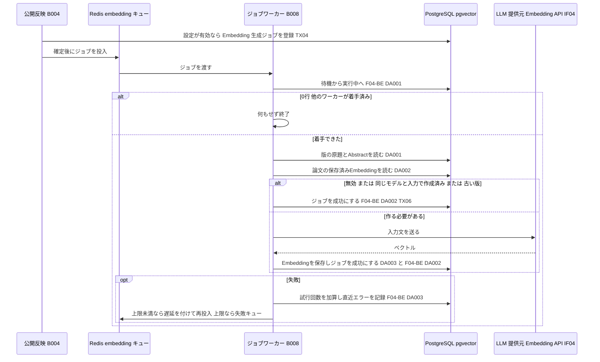
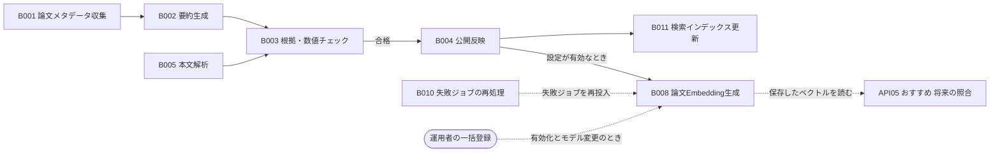

# バッチ詳細設計書 — B008 論文Embedding生成

## 0. 文書情報

| 項目 | 値 |
| :--- | :--- |
| 設計書ID | B008-BE |
| 親ID | B008 |
| 親設計書 | `基本設計書_概要.md` §4 機能設計「バッチ処理設計」B008 行 |
| バッチ名 | 論文Embedding生成（上流 §4 バッチ処理設計の区分「非同期ジョブ」） |
| 対応する機能ID | F08 レコメンド（上流 §4 機能一覧。将来の Embedding 照合で、本バッチが作る論文 Embedding を使う） |
| 関連する業務フローID | BF08 おすすめ論文の表示（上流 §2。Embedding 照合への切り替え後に使う）、BF01 論文収集・日本語化（定期。本バッチの登録元 B004 の流れ） |
| 版 | 1.1（第1回セルフレビュー `docs/reviews/batch_B008_review_applied.md` の Major 3件・Minor 1件を反映） |
| 作成日 / 更新日 | 2026-10-27 / 2026-10-27 |
| 作成方法 | creating-backend-detailed-design v1.5.0 準拠。上流の確定設計書と `source/` の企画資料からの新規設計 |
| インプット | (a) `source/02_機能要求定義.md:13,37-42,45-46`、`source/03_システム構成.md:8-9,11-12,35-36,43`、`source/04_収益化とロードマップ.md:27`（全6ファイル・計227行。前単位 B007 の作業時から変更なし）／(b) `docs/基本設計書_概要.md` §1 技術スタック・用語集、§4 F08・B004・B008・バッチ共通の方針、§6 テーブル一覧の注記（論文Embedding の保存先なし）・T001・T002・T009、§7 IF04、§8、§9 環境変数一覧、§10 運用監視、§11 ARC001・ARC006、付録 Q19・Q23・Q29・Q31・Q36／関連する確定済み設計書: `docs/detail/be/BE.F04.BE詳細設計.md`（F04-BE。B008 の登録処理とジョブ共通の実行枠の定義元）、`docs/detail/be/BE.F08.BE詳細設計.md`（F08-BE。Embedding の利用側）、`docs/detail/batch/BT.B004.バッチ詳細設計.md`（登録元）、`docs/detail/batch/BT.B001.バッチ詳細設計.md`（版のスナップショットのキー定義）、`docs/db/DB.T002.DB物理設計.md`・`DB.T009.DB物理設計.md`／(c) `legacy/`（空） |

* **インプットの性質（source/ の突合結果）**: `source/` は企画・初期設計案の Markdown 6ファイル（計227行）だけです。依頼にあるスケジュール定義 `config/schedule.rb`（whenever）と rake タスクの実装 `lib/tasks/` は**存在しません**（Ruby のファイル0件）。本システムのジョブは Python のワーカー（Redis + Celery または RQ）で動きます（`source/03_システム構成.md:7,11`）。資料にある Embedding の記述は「将来：論文Embeddingとユーザープロフィールをpgvectorで照合」（`source/02_機能要求定義.md:40`）と技術スタックの「ベクトル検索 pgvector」（`source/03_システム構成.md:9`）の2か所だけで、作り方・保存先・モデルは未定義です（上流 付録 Q23・Q29）。B008 は時刻で起動する定期実行ではなく、公開反映（B004）が登録する**非同期ジョブ**です（上流 §4 B008「ジョブキュー（※推測: B004 の後に起動）」）。このため whenever に当たるスケジュール定義は B008 には無く（§5 で「該当なし」と根拠を記載）、rake タスクに当たるものは §4 のジョブ関数と、運用者が使う一括登録のコマンド（§5 起動契機 No.4）に置き換えています。本書は**リバースエンジニアリングではなく新規設計**で、資料と上流に無い値には「※推測」を付けています。
* **既存版**: `docs/detail/batch/BT.B008.バッチ詳細設計.md` の旧版はありません（作業開始時点の `docs/detail/batch/` は B001〜B007 の7ファイルだけ）。本書が初版で、消さずに残すべき既存記述はありません。
* **legacy/ との突合**: `legacy/` は空ディレクトリです（ファイル0件）。突合する既存のバッチ設計書・業務意図・非機能の記述はありません。
* **F04-BE・F08-BE との分担と継承**:
  * **登録側（F04-BE・BT.B004）**: B008 のジョブ行は、公開反映（B004）が、設定 `EMBEDDING_ENABLED` が有効なときだけ、版を指定して種別 `generate_embedding` で登録します（F04-BE §4 No.16、BT.B004 §3 DA004）。BT.B004 §6 確認事項 No.8 は「B011・B008 は同じ版を何度処理しても結果が変わらない作りにする必要がある（BT.B008 の設計で確定する）」としており、本書の §6 冪等性で確定します。
  * **ジョブ共通の実行枠（F04-BE）**: B008 は `jobs`（T009）に行を持つジョブのため、F04-BE が定義したジョブ共通の実行枠をそのまま使います。F04-BE で採番済みの **関数 No.1〜4（`run`・`claim`・`mark_succeeded`・`mark_failed_or_retry`）、DA001〜DA003、トランザクション TX01・TX06** を引き継ぎます。
  * **利用側（F08-BE）**: F08-BE は「論文 Embedding はバッチ B008 が作り、保存先テーブルは上流で未定義（上流 Q23）であるため、本書の §3 には載せない」「利用者プロフィールの Embedding の作り方は上流 Q29 の決定を待つ」としています（F08-BE §5）。本書は論文側の Embedding の作成と保存までを受け持ち、利用者プロフィール側の Embedding と照合は対象外です。
  * **IDの書き方**: 引き継いだIDは定義元の設計書IDを付けて「F04-BE No.1」「F04-BE DA001」「F04-BE TX01」と書きます。本書が初めて定義するデータアクセスは設計書IDを付けず「DA001」と書き、本書（B008-BE）のIDであることを表します（BT.B006・BT.B007 と同じ書き方）。本書で加えた関数とトランザクションには番号を振りません（※上流未定義。F04-BE の番号の続きを仮採番しないため）。
* **上流との差分**（※上流要確認・※上流未定義。§6 確認事項に集約）:
  * 論文 Embedding の保存先テーブルが上流 §6 に無い（上流 §6 テーブル一覧の注記、付録 Q23）。本書は F07・F10 の扱い（BT.B007）にならい、物理名を付けず `{論文Embeddingテーブル}` と書きます。
  * Embedding を作る提供元・モデル・次元数が未定義（上流 付録 Q29）。上流 §7 IF04 は受信データに「Embedding（※推測）」を含めており、本書は IF04 の一用途として扱います。
  * 上流 §6 CRUD図に B008 の行が無く、F08 行にも jobs と `{論文Embeddingテーブル}` の列が無い。
  * 上流 §11 ARC001 の適用範囲は「B001〜B005」で B008 を含まないが、本書は同じ入力のEmbeddingを作り直さない仕組み（§6 冪等性）でこの方式に従う。

## 1. バックエンド構成・モジュール設計

* **対象ドメイン**: 推薦系（論文Embedding生成の非同期ジョブ） — 公開反映（B004）が登録した版ごとのジョブを受け取り、その版の原題と Abstract から Embedding を作るための入力文を組み立て、LLM 提供元の Embedding API（IF04）でベクトルにして、論文ごとに1行の `{論文Embeddingテーブル}` へ保存する。同じモデル・同じ入力ですでに作ってあれば提供元を呼ばず、古い版のジョブで新しい版のベクトルを上書きしない。あわせて、機能を有効にした時点やモデルを替えた時点で、既存の論文をまとめて登録し直す一括登録を備える（上流 B008・F08、`source/02_機能要求定義.md:40`）。
* **対象APIエンドポイント**: なし。B008 は画面や外部から HTTP で呼ばれず、ジョブキューから取り出されて動きます（根拠は §2 APIエンドポイント一覧）。
* **実行基盤**: Pythonワーカー上の非同期ジョブです（Redis + Celery または RQ。どちらにするかは未決定、上流 Q02）。外部の Embedding API を呼ぶため、要約の検証（B003）と共用の `default` キューから分けて専用のキュー `embedding` で処理します（§5 ワーカーの配置）。DB は Supabase 上の PostgreSQL（pgvector 拡張を有効にしたもの。上流 §1 技術スタック）に、行単位アクセス制御を通らないサーバ側のサービスロールで接続します（DB物理設計書 T009 §7）。
* **ディレクトリ/ファイル構造**（※推測: F04-BE §1 の配置案に、本書で加える3ファイルを足したもの）:

```
worker/
├── jobs/
│   ├── runner.py                    # F04-BE No.1 run（JobRunner。ジョブ共通の実行枠）
│   └── generate_embedding.py        # generate_embedding / enqueue_embedding_backfill（本書で定義）
├── repositories/
│   ├── job_repository.py            # F04-BE No.2 claim / No.3 mark_succeeded / No.4 mark_failed_or_retry（F04-BE DA001〜DA003）、本書 DA005
│   └── embedding_repository.py      # 本書 DA001〜DA004（版の読み出し、保存済みの確認、保存、一括登録の対象の読み出し）
├── integrations/
│   └── embedding_client.py          # EmbeddingClient.embed（IF04 の Embedding API）、build_embedding_input
└── config.py                        # EMBEDDING_ENABLED ほか設定値の読み込み（§6 設定値一覧）
```

* **処理シーケンス図**（上流 §4 B008「B004 の後に起動」を、ジョブの受け取りから終了まで展開。※推測を含む）:



## 2. API・インターフェース詳細設計

* **APIエンドポイント一覧（全数ロースター）**:

| API ID | メソッド | エンドポイント | 概要 | 定義状況 | 詳細の所在 |
| :--- | :--- | :--- | :--- | :--- | :--- |
| — | — | 該当なし | — | — | — |

**総件数: 0件。根拠**: 上流 §7 内部API一覧の全8件（API01〜API08）に、B008 を起動・操作するものはありません。B008 の起動は、B004 がジョブ行を登録してジョブキューへ投入することで行います（§5 起動契機一覧）。おすすめを返す API05 `GET /api/recommendations` は、Phase 2 では Embedding を使わず（F08-BE §5「将来の切り替え」）、切り替え後も B008 が保存した `{論文Embeddingテーブル}` を読むだけで、B008 とは直接やり取りしません。一括登録（§5 起動契機 No.4）もワーカー上のコマンドで行い、HTTP の受け口は設けません（※推測）。

* **外部サービス連携一覧（全数ロースター）**: 上流 §7 外部連携一覧の全9件に対し、B008 で使うかを示します。

| IF ID | 連携先 | B008 での利用 | 概要 | 定義状況 | 詳細の所在 |
| :--- | :--- | :--- | :--- | :--- | :--- |
| IF01 | arXiv API | 利用しない | 論文メタデータの取得は B001・B006 の責務。B008 は保存済みの版のスナップショットを読むだけ | - | `docs/detail/batch/BT.B001.バッチ詳細設計.md` |
| IF02 | arXiv（論文本文PDF） | 利用しない | 本文は使わず、原題と Abstract だけからベクトルを作る（§4 `build_embedding_input`） | - | `docs/detail/batch/BT.B005.バッチ詳細設計.md` |
| IF03 | arXiv 原文ページ | 利用しない | 画面からのリンク遷移でサーバ処理を伴わない | - | - |
| IF04 | LLM API | 利用する（Embedding API） | 原題と Abstract の入力文を送り、ベクトルを受け取る（上流 IF04「受信: …Embedding（※推測）」） | 詳細 | 本節 外部サービス連携仕様、§4 `EmbeddingClient.embed` |
| IF05 | Supabase Auth | 利用しない | 利用者に関わらない。DB へはサービスロールで接続する | - | - |
| IF06 | Stripe（決済セッション） | 利用しない | 課金（F12）の責務 | - | - |
| IF07 | Stripe（契約状態の通知） | 利用しない | 課金（F12）の責務 | - | - |
| IF08 | GitHub | 利用しない | GitHub関連付け（B009）の責務 | - | - |
| IF09 | 通知配信手段 | 利用しない | 通知・ダイジェスト配信（B007）の責務 | - | - |

**総件数: 9件（B008 で利用するもの1件）。根拠**: 上流 §7 外部連携一覧の IF01〜IF09 の全9行と1対1で対応します。上流 §7 IF04 の受信データに Embedding が挙がっており（※推測）、上流 §4 B008 の処理内容「論文ごとのEmbeddingを作ってpgvectorへ保存する」で外部とやり取りするのはこの1件だけです。pgvector は PostgreSQL の拡張で、上流 §7 で内部の構成要素とされているため外部連携に含めません。

* **外部サービス連携仕様**（B008 で利用する IF04 の1件）:

| IF ID | 連携先 | 連携方式 | エンドポイント / 接続先 | 認証方式 | タイムアウト | リトライ方針 | エラー時の挙動 |
| :--- | :--- | :--- | :--- | :--- | :--- | :--- | :--- |
| IF04 | LLM API（Embedding API） | REST API（※推測。上流 IF04 自体が※推測） | 提供元は未定（上流 Q29）。使うモデルは設定値 `EMBEDDING_MODEL_ID`、次元数は `EMBEDDING_DIMENSIONS`（※推測: 1536）で指定する。1回の呼び出しで1つの入力文を送る | APIキー（上流 §9 の環境変数 `LLM_API_KEY`。要約生成と同じ提供元を使う前提。※推測） | 1回の呼び出しにつき30秒（※推測） | 通信のタイムアウト・接続失敗・提供元の混雑（HTTP 429）・提供元の障害（HTTP 5xx）のときだけ、2秒・4秒・8秒と間隔を倍にして最大3回まで呼び直す（BT.B005 §2 IF04 と同じ規則）。それ以外の 400〜499 は呼び直さない | 呼び直しを使い切っても失敗したら例外を上げ、ジョブ共通の失敗処理（F04-BE DA003）で試行回数を1増やし、上限未満ならジョブごと遅延を付けて再実行される。入力の不備（HTTP 400）・認証失敗（HTTP 401・403）・返ってきたベクトルの次元数が設定と違う場合は、再実行しても直らないため試行回数にかかわらずすぐ失敗にする。認証失敗と次元数の不一致は、他のジョブもすべて同じ理由で失敗するため ERROR ログで監視へ知らせる（§5 監視項目 No.3） |

* **IF04 の送受信データと保存先の対応**（※推測: Embedding API の項目名は提供元で異なる。ここでは送る内容と保存先の対応だけを定める）:

| 区分 | 項目 | 入れる値・受け取る値 | 保存先 |
| :--- | :--- | :--- | :--- |
| 送信 | モデル | 設定値 `EMBEDDING_MODEL_ID` | `{論文Embeddingテーブル}.model_id` |
| 送信 | 入力文 | その版の原題と Abstract を、空行1つを挟んでつないだ文（§4 `build_embedding_input`） | 保存しない（入力文の要約値だけを `input_hash` に残す） |
| 送信 | 次元数 | 設定値 `EMBEDDING_DIMENSIONS`（提供元が次元数の指定に対応する場合だけ送る） | — |
| 受信 | ベクトル | 浮動小数点数の配列（要素数は次元数と同じ） | `{論文Embeddingテーブル}.embedding`（pgvector の vector 型） |
| 受信 | 使ったトークン数 | 整数 | 保存しない（成功ログに出し、費用の監視に使う。§5 ログ No.5） |
| 固定値 | 版 | ジョブが指す論文バージョンIDと版番号 | `{論文Embeddingテーブル}.paper_version_id`・`version` |
| 固定値 | 入力の要約値 | 入力文の SHA-256 を16進数で表した文字列 | `{論文Embeddingテーブル}.input_hash` |
| 固定値 | 作成日時 | 保存した時刻（UTC） | `{論文Embeddingテーブル}.generated_at` |

**総件数: 8行（送信3・受信2・固定値3）。根拠**: 上流 IF04 の送受信のうち Embedding に関わるもの（送信: 入力文、受信: Embedding）を、送る項目と受け取る項目ごとに分け、`{論文Embeddingテーブル}` の列（§3 DA003 の発行SQLで仮置きした `paper_id`・`paper_version_id`・`version`・`model_id`・`input_hash`・`embedding`・`generated_at` の7列）のうち、ジョブが指す論文から決まる `paper_id` を除く6列がいずれかの行に対応するよう挙げたものです。

* **API詳細仕様**: 該当なし（APIエンドポイント0件のため。根拠は上の一覧の直後に記載）。ジョブとしての入出力は §4 の `generate_embedding`・`enqueue_embedding_backfill` と §5 の入出力一覧に記載します。

## 3. データアクセス（ORM / クエリ）設計

* **データアクセス一覧（全数ロースター）**: 「F04-BE DA00n」は F04-BE §3 で採番済みのものをそのまま引き継いだもの、「DA00n」は本書が定義するものです（§0「IDの書き方」）。F04-BE の DA004〜DA014 は B002〜B005 だけが使うため、本書には含めません。

| DA-ID | 処理名 | 呼出元（関数/API） | テーブルID | 対象物理テーブル | 種別 (SELECT/INSERT/UPDATE/DELETE) | 定義状況 (詳細/簡易) | 詳細の所在 |
| :--- | :--- | :--- | :--- | :--- | :--- | :--- | :--- |
| F04-BE DA001 | ジョブの実行開始 | F04-BE No.2 `claim`（No.1 `run` から呼ぶ） | T009 | jobs | UPDATE | 詳細 | §3 詳細定義 F04-BE DA001・発行SQL F04-BE DA001 |
| F04-BE DA002 | ジョブの成功記録 | F04-BE No.3 `mark_succeeded`（`generate_embedding` から呼ぶ） | T009 | jobs | UPDATE | 詳細 | §3 詳細定義 F04-BE DA002・発行SQL F04-BE DA002 |
| F04-BE DA003 | ジョブの失敗記録 | F04-BE No.4 `mark_failed_or_retry`（No.1 `run` から呼ぶ） | T009 | jobs | UPDATE | 詳細 | §3 詳細定義 F04-BE DA003・発行SQL F04-BE DA003 |
| DA001 | 版の原題と Abstract の取得 | `generate_embedding` | T002 | paper_versions | SELECT | 簡易 | 発行SQL DA001 |
| DA002 | 論文の保存済み Embedding の確認 | `generate_embedding` | ※上流未定義 | {論文Embeddingテーブル} | SELECT | 詳細 | §3 詳細定義 DA002・発行SQL DA002 |
| DA003 | Embedding の保存 | `generate_embedding` | ※上流未定義 | {論文Embeddingテーブル} | INSERT（衝突時 UPDATE） | 詳細 | §3 詳細定義 DA003・発行SQL DA003 |
| DA004 | 一括登録の対象の版の取得 | `enqueue_embedding_backfill` | T001, T002, T003, ※上流未定義 | papers, paper_versions, summaries, {論文Embeddingテーブル} | SELECT | 詳細 | §3 詳細定義 DA004・発行SQL DA004 |
| DA005 | 一括登録のジョブの追加 | `enqueue_embedding_backfill` | T009 | jobs | INSERT（衝突時は何もしない） | 詳細 | §3 詳細定義 DA005・発行SQL DA005 |
| DA006 | 作成済みの Embedding の版の付け替え | `generate_embedding` | ※上流未定義 | {論文Embeddingテーブル} | UPDATE | 詳細 | §3 詳細定義 DA006・発行SQL DA006 |

**総件数: 9件（F04-BE から継承3件・本書で定義6件。SELECT 3件・INSERT 2件・UPDATE 4件・DELETE 0件。詳細8件・簡易1件）。全数である根拠**: §4 関数一覧の全8関数のうち DB へ問い合わせる5関数（F04-BE No.2→DA001、No.3→DA002、No.4→DA003、`generate_embedding`→本書 DA001〜DA003・DA006、`enqueue_embedding_backfill`→本書 DA004・DA005）の処理フローに現れる DB 操作を1件1行で数えたものです。残りの3関数（F04-BE No.1 `run`・`build_embedding_input`・`EmbeddingClient.embed`）は DB に直接触れません。B008 のジョブ行を作るのは通常 B004（BT.B004 DA004）で、本書の DA005 は運用者の一括登録の場合だけです。B008 は DELETE を発行しません（論文の削除は上流に無く、版が消えないため）。
**上流 CRUD図との突合**: 上流 §6 CRUD図に B008 の行は無く、F08 行は papers・summaries・users・user_interests・bookmarks・view_events の R だけです。B008 は jobs の R・U・C（F04-BE DA001〜DA003、本書 DA005）、paper_versions の R（本書 DA001・DA004）、papers・summaries の R（本書 DA004）、`{論文Embeddingテーブル}` の R・C・U（本書 DA002〜DA004・DA006）を行います（※上流要確認、§6 確認事項 No.2。DB物理設計書 T009 §9 No.5「B008 のジョブを操作する機能の行を加えるか（B008 は未定）」と同じ事項）。
**定義状況の判定**（completeness 3-1）: F04-BE DA001〜DA003・本書 DA003・DA005・DA006 は永続データを書き換える（3-1 の2）、本書 DA002 は結果で作るかどうかが分かれる（3-1 の1）、本書 DA004 は複数の表にまたがり大量件数を区切って読む（3-1 の3・6）ため「詳細」です。本書 DA001 は主キーで版の1行を読むだけで 3-1 のどれにも当たらないため「簡易」です。

* **データアクセス詳細定義**（定義状況＝詳細の8件。F04-BE から継承した3件は F04-BE §3・BT.B004 §3 と同じ内容）:

| DA-ID | 処理名 | テーブルID | 対象物理テーブル | JOIN / Include | 抽出条件 (Where) / ソート | トランザクション境界 | N+1対策・性能上の注意 |
| :--- | :--- | :--- | :--- | :--- | :--- | :--- | :--- |
| F04-BE DA001 | ジョブの実行開始 | T009 | jobs | なし | 指定のジョブで状態が待機の行だけを実行中に変え、版ID・種別・試行回数を受け取る（`WHERE id = $1 AND status = 'pending' RETURNING …`） | 単独で即時に確定する（F04-BE TX01） | 更新できた行が0件なら、他のワーカーが実行中か完了済みなので何もせずに終える（T009 §4.3 (4)）。主キーで1行 |
| F04-BE DA002 | ジョブの成功記録 | T009 | jobs | なし | 指定のジョブで状態が実行中の行だけを成功に変える（`WHERE id = $1 AND status = 'running'`） | Embedding の保存と同じトランザクション（本書の保存トランザクション）、版の付け替えと同じトランザクション（本書の版の付け替えトランザクション）、または作らずに終えるときの単独のトランザクション（F04-BE TX06） | 更新が0件なら他の処理が状態を変えたものとして JobStateConflict を上げ、Embedding の保存ごと取り消す |
| F04-BE DA003 | ジョブの失敗記録 | T009 | jobs | なし | 指定のジョブで状態が実行中の行について、試行回数を1増やし直近エラーを書く。増やした結果が上限以上なら失敗、未満なら待機に戻す。再実行しても直らない失敗では、上限を「今の試行回数＋1」にして必ず失敗にする（`SET attempts = attempts + 1, last_error = $2, status = CASE WHEN attempts + 1 >= $3 THEN 'failed' ELSE 'pending' END WHERE id = $1 AND status = 'running'`） | 単独で即時に確定する（F04-BE TX01）。本処理のトランザクションを取り消した後に実行する | 上限は `JOB_MAX_ATTEMPTS`（※推測: 3）。直近エラーには APIキー・認証付きURL・接続文字列に見える値を取り除いた要約文だけを書く（T009 §4.3 (6)） |
| DA002 | 論文の保存済み Embedding の確認 | ※上流未定義 | {論文Embeddingテーブル} | なし | ジョブが指す版の論文について、保存済みの行の版番号・モデル・入力の要約値を1行読む（`WHERE paper_id = $1`） | トランザクションの外で読む（提供元を呼ぶ前の判定のため） | 主キー（論文ID）で1行。この結果で「同じモデル・同じ入力ですでに作ってある」「保存済みの版のほうが新しい」を判定し、どちらかなら提供元を呼ばない（§4 `generate_embedding` 手順4）。判定から保存までの間に別のジョブが新しい版を保存しても、DA003 の更新の条件で古い版の上書きは防がれる |
| DA003 | Embedding の保存 | ※上流未定義 | {論文Embeddingテーブル} | なし | 論文の行が無ければ追加し、あれば、今回の版番号が保存済みの版番号以上のときだけ、版・モデル・入力の要約値・ベクトル・作成日時を上書きする（`INSERT … ON CONFLICT (paper_id) DO UPDATE … WHERE EXCLUDED.version >= {論文Embeddingテーブル}.version RETURNING paper_id`）。行が返らなければ、より新しい版がすでに保存されていたため上書きしなかったことを表す | 本書の保存トランザクション。ジョブの成功の記録（F04-BE DA002）と同じトランザクションで確定する | 1論文1行のため、版が増えても行は増えない（推薦で論文を照合する単位に合わせる。上流 §4 B008「論文ごとのEmbedding」）。同じ版を再び保存しても内容は変わらない（§6 冪等性 No.1） |
| DA004 | 一括登録の対象の版の取得 | T001, T002, T003, ※上流未定義 | papers, paper_versions, summaries, {論文Embeddingテーブル} | 論文の最新版（`paper_versions.version = papers.latest_version`）を内部結合し、その論文の保存済み Embedding を外部結合する | 検証に合格した要約がある最新版のうち、Embedding がまだ無いか、保存済みのモデルが今回のモデルと違うか、保存済みの版が最新版より古い論文の版を、論文IDの昇順に、前回読んだ最後の論文IDより後ろから1,000件まで読む（`EXISTS (合格した要約) AND (e.paper_id IS NULL OR e.model_id <> $2 OR e.version < pv.version) AND p.id > $1 ORDER BY p.id LIMIT 1000`） | トランザクションの外で読む（1ページずつ。読み出しの途中で行が増えても次の一括登録で拾われる） | 全論文（最大で年に約30万行。DB物理設計書 T001 §4 想定件数）を対象にするため、論文IDで区切って1,000件ずつ読む（キーセット方式）。合格した要約の有無は `idx_summaries_lookup` の先頭列で引く。一括登録は運用者が起動したときだけ動き、日々の処理では発行しない |
| DA005 | 一括登録のジョブの追加 | T009 | jobs | なし | DA004 で読んだ1,000件の版について、種別「論文Embedding生成」の待機ジョブを1行ずつ追加する。同じ版・同じ種別で待機中か実行中の行があれば何もしない（`INSERT … SELECT unnest($1::bigint[]), 'generate_embedding' ON CONFLICT (paper_version_id, job_type) WHERE status IN ('pending','running') AND paper_version_id IS NOT NULL DO NOTHING RETURNING id`） | 1,000件ごとに1つのトランザクションで確定し、確定した後に、登録できたジョブIDだけをジョブキューへ投入する | 部分一意インデックス `uq_jobs_active_per_version` に合わせて ON CONFLICT に同じ条件を書く（T009 §5.2）。B004 が同じ版のジョブを登録済みなら重ならない |
| DA006 | 作成済みの Embedding の版の付け替え | ※上流未定義 | {論文Embeddingテーブル} | なし | 論文の保存済みの行が、同じモデル・同じ入力の要約値で作られていて、版番号が今回より小さいときだけ、版（論文バージョンIDと版番号）を今回の版に書き換える。ベクトルは書き換えない（`WHERE paper_id = $1 AND model_id = $4 AND input_hash = $5 AND version < $3`） | 本書の版の付け替えトランザクション。ジョブの成功の記録（F04-BE DA002）と同じトランザクションで確定する | 新しい版でも原題と Abstract が変わらなければ同じベクトルになるため、提供元を呼ばずに版の情報だけを進める。これをしないと保存済みの版が古いままになり、一括登録の対象の条件（本書 DA004 の「保存済みの版が最新版より古い」）に当たり続け、一括登録のたびに同じ論文のジョブが登録されて空振りを繰り返す。主キーで1行 |

* **発行SQL**: 全9件（F04-BE DA001〜DA003、本書 DA001〜DA006）。プレースホルダ（`$1` から始まる番号付きの引数）に値を渡す固定の文で、実行時に文の構造を組み立てる動的SQLはありません。F04-BE から継承した3件は F04-BE §3・BT.B004 §3 の発行SQLと同じ文です。`{論文Embeddingテーブル}` とその列名（`paper_id`・`paper_version_id`・`version`・`model_id`・`input_hash`・`embedding`・`generated_at`）は、テーブルが上流で未定義のための置き場所で、名前はすべて※推測です（§6 確認事項 No.1）。

**F04-BE DA001 ジョブの実行開始**
```sql
UPDATE jobs
SET status = 'running'
WHERE id = $1
  AND status = 'pending'
RETURNING id, paper_version_id, job_type, attempts;
```
組み立ての分岐: なし（固定の1文）。

**F04-BE DA002 ジョブの成功記録**
```sql
UPDATE jobs
SET status = 'succeeded'
WHERE id = $1
  AND status = 'running';
-- 更新件数が0なら JobStateConflict を上げて Embedding の保存ごと取り消す
```
組み立ての分岐: なし（固定の1文）。

**F04-BE DA003 ジョブの失敗記録**（`$2` は直近エラーの要約文、`$3` は試行回数の上限。直らない失敗では「今の試行回数＋1」を渡す）
```sql
UPDATE jobs
SET attempts   = attempts + 1,
    last_error = $2,
    status     = CASE WHEN attempts + 1 >= $3 THEN 'failed' ELSE 'pending' END
WHERE id = $1
  AND status = 'running'
RETURNING status, attempts;
```
組み立ての分岐: なし（固定の1文）。

**DA001 版の原題と Abstract の取得**
```sql
SELECT id                                   AS paper_version_id,
       paper_id,
       version,
       metadata_snapshot->>'title'          AS title,
       metadata_snapshot->>'abstract'       AS abstract
FROM   paper_versions
WHERE  id = $1;
-- 原題と Abstract は版のスナップショットから読む（BT.B001 §2 のキー title・abstract）
```
組み立ての分岐: なし（固定の1文）。

**DA002 論文の保存済み Embedding の確認**
```sql
SELECT version, model_id, input_hash
FROM   {論文Embeddingテーブル}
WHERE  paper_id = $1;
```
組み立ての分岐: なし（固定の1文）。

**DA003 Embedding の保存**（`$6` はベクトルの文字列表現 `'[0.01,-0.02,…]'`）
```sql
INSERT INTO {論文Embeddingテーブル}
       (paper_id, paper_version_id, version, model_id, input_hash, embedding, generated_at)
VALUES ($1, $2, $3, $4, $5, $6::vector, CURRENT_TIMESTAMP)
ON CONFLICT (paper_id) DO UPDATE
   SET paper_version_id = EXCLUDED.paper_version_id,
       version          = EXCLUDED.version,
       model_id         = EXCLUDED.model_id,
       input_hash       = EXCLUDED.input_hash,
       embedding        = EXCLUDED.embedding,
       generated_at     = EXCLUDED.generated_at
 WHERE EXCLUDED.version >= {論文Embeddingテーブル}.version
RETURNING paper_id;
-- 行が返らなければ、より新しい版が保存済みのため上書きしなかった
```
組み立ての分岐: なし（固定の1文）。結果は「追加した」「上書きした」「新しい版が保存済みで何もしなかった」の3通りです。

**DA004 一括登録の対象の版の取得**（`$1` は前のページの最後の論文ID。最初は0、`$2` は今回のモデル）
```sql
SELECT p.id  AS paper_id,
       pv.id AS paper_version_id
FROM   papers p
JOIN   paper_versions pv
       ON pv.paper_id = p.id
      AND pv.version  = p.latest_version
LEFT JOIN {論文Embeddingテーブル} e
       ON e.paper_id = p.id
WHERE  p.id > $1
  AND  EXISTS (
         SELECT 1
         FROM   summaries s
         WHERE  s.paper_version_id  = pv.id
           AND  s.validation_status = 'passed'
       )
  AND  (e.paper_id IS NULL OR e.model_id <> $2 OR e.version < pv.version)
ORDER  BY p.id
LIMIT  1000;
```
組み立ての分岐: なし（固定の1文）。

**DA005 一括登録のジョブの追加**（`$1` は DA004 で読んだ論文バージョンIDの配列）
```sql
INSERT INTO jobs (paper_version_id, job_type)
SELECT v, 'generate_embedding'
FROM   unnest($1::bigint[]) AS v
ON CONFLICT (paper_version_id, job_type)
  WHERE status IN ('pending', 'running') AND paper_version_id IS NOT NULL
  DO NOTHING
RETURNING id;
-- 返ったジョブIDだけを、確定後にジョブキュー embedding へ投入する
```
組み立ての分岐: なし（固定の1文）。

**DA006 作成済みの Embedding の版の付け替え**（`$1` は論文ID、`$2` は論文バージョンID、`$3` は版番号、`$4` はモデル、`$5` は入力の要約値）
```sql
UPDATE {論文Embeddingテーブル}
   SET paper_version_id = $2,
       version          = $3
 WHERE paper_id   = $1
   AND model_id   = $4
   AND input_hash = $5
   AND version    < $3;
-- 更新件数0（同じ版か、より新しい版が保存済み）でもジョブは成功にする
```
組み立ての分岐: なし（固定の1文）。

## 4. サーバー側機能・処理ロジック設計（IPO設計）

* **関数一覧（全数ロースター）**: No と関数名は F04-BE §4 の採番をそのまま引き継ぎます。F04-BE の No.5〜25 は B002〜B005 だけが使うため、本書には含めません（No.5 `enqueue` は B004 が B008 を登録するときに使う関数で、B008 自身は使わない）。本書で加えた関数には No を振りません（§0「IDの書き方」）。

| No | 関数名 | 所属モジュール（※推測） | 定義元 | 概要 | 定義状況 | 詳細の所在 |
| :--- | :--- | :--- | :--- | :--- | :--- | :--- |
| F04-BE No.1 | `run` | `worker/jobs/runner.py`（JobRunner） | F04-BE §4 | ジョブ共通の実行枠。取り合い、本処理の呼び出し、失敗時の記録と遅延付きの再投入を受け持つ | 詳細 | §4 IPO定義 |
| F04-BE No.2 | `claim` | `worker/repositories/job_repository.py` | F04-BE §4 | 待機中のジョブを実行中に変え、取り合いに勝ったときだけジョブの内容を返す（F04-BE DA001） | 詳細 | §4 IPO定義 |
| F04-BE No.3 | `mark_succeeded` | `worker/repositories/job_repository.py` | F04-BE §4 | 呼び出し側のトランザクションの中で、実行中のジョブを成功にする（F04-BE DA002） | 詳細 | §4 IPO定義 |
| F04-BE No.4 | `mark_failed_or_retry` | `worker/repositories/job_repository.py` | F04-BE §4 | 失敗の回数を数え、上限未満なら待機へ戻し、上限に達したか直らない失敗なら失敗にする（F04-BE DA003） | 詳細 | §4 IPO定義 |
| —（※上流未定義） | `generate_embedding` | `worker/jobs/generate_embedding.py` | 本書 | B008 の本処理。版の原題と Abstract から Embedding を作り、論文ごとに保存する。作る必要が無ければ提供元を呼ばずに終える | 詳細 | §4 IPO定義 |
| —（※上流未定義） | `build_embedding_input` | `worker/integrations/embedding_client.py` | 本書 | 原題と Abstract から、Embedding API に送る入力文と、その要約値を作る | 詳細 | §4 IPO定義 |
| —（※上流未定義） | `EmbeddingClient.embed` | `worker/integrations/embedding_client.py` | 本書 | Embedding API（IF04）を呼び、一時的な失敗なら呼び直し、ベクトルの次元数を確かめる | 詳細 | §4 IPO定義 |
| —（※上流未定義） | `enqueue_embedding_backfill` | `worker/jobs/generate_embedding.py` | 本書 | 運用者の一括登録の起点。Embedding が無いか古い論文の最新版について、ジョブを1,000件ずつ登録して投入する | 詳細 | §4 IPO定義 |

**総件数: 8関数（F04-BE から継承4件・本書で追加4件。全件 詳細）。全数である根拠**: F04-BE §4 関数ロースターの全25件のうち、B008 のジョブが通るジョブ共通の実行枠（No.1〜4）の4件と、上流 §4 B008 の処理内容「論文ごとのEmbeddingを作ってpgvectorへ保存する」を、処理の段階ごとに1関数ずつ割り当てた4件です（本処理→`generate_embedding`、入力文の組み立て→`build_embedding_input`、外部への送信→`EmbeddingClient.embed`、既存の論文への適用→`enqueue_embedding_backfill`）。F04-BE は B008 の本処理を定義しておらず（F04-BE §5「B008（Embedding）は F08」）、F08-BE も「責務はバッチ詳細設計にある」としている（F08-BE §5）ため、本処理の4関数は本書が初めて定義します。ソースコードが無いため実在の関数との突合はできず、関数名と分け方は※推測です。
**定義状況の判定**（completeness 3-1）: F04-BE No.1 と `generate_embedding` は分岐と失敗時の扱いを含み（3-1 の1・5）、No.2〜4 は状態を書き換え（3-1 の2）、`build_embedding_input` は入力の作り方の業務ルールを含み（3-1 の7）、`EmbeddingClient.embed` は外部への送信と呼び直しを伴い（3-1 の2・5）、`enqueue_embedding_backfill` は大量件数を区切って登録する（3-1 の2・6）ため、8件とも「詳細」です。

* **入力・処理・出力（IPO）定義**:

| No | 関数名 | 所属モジュール | 引数 (型) | 処理フロー (ステップ単位で具体的に) | 戻り値 | 発生しうるエラー |
| :--- | :--- | :--- | :--- | :--- | :--- | :--- |
| F04-BE No.1 | `run` | JobRunner | job_id: int, handler: 本処理の関数（B008 では `generate_embedding`） | 1. `claim` で待機中のジョブを実行中にする。取り合いに負けた（null）なら INFO ログ（§5 ログ No.1）を残して終える。<br>2. `claim` 自体が DB の失敗で例外を上げたときは、ジョブはまだ待機で失敗を jobs に記録できない（F04-BE DA003 は実行中の行だけを更新する）。ERROR ログ（§5 ログ No.9）を出し、例外をジョブキューへ返して再配送に任せる（BT.B002〜B005 と同じ。※推測）。<br>3. 本処理を呼ぶ。本処理は自身のトランザクションで Embedding の保存とジョブの成功を確定する。<br>4. 本処理が例外を上げたら、トランザクションを取り消してから `mark_failed_or_retry` を呼ぶ。直らない失敗（入力の不備・認証失敗・次元数の不一致・版の原題か Abstract が空）は force_fail を真にする。JobStateConflict は失敗を記録せずに終える。<br>5. 戻ってきた状態が待機なら、試行回数に応じた遅延（1回目の失敗の後は1分、2回目の失敗の後は5分。※推測。BT.B002〜B005 と同じ）を付けて、同じジョブIDをジョブキュー `embedding` へ再投入する。失敗なら失敗キューへ送り、ERROR ログ（§5 ログ No.7）を残す（上流 EX01、ARC006） | なし | なし（本処理の例外はここで受け止め、ジョブの状態として残す。`claim` の DB 失敗だけは手順2のとおりジョブキューへ返す） |
| F04-BE No.2 | `claim` | JobRepository | job_id: int | 1. F04-BE DA001 を発行し、即時に確定する（F04-BE TX01）。<br>2. 更新できた行があればジョブの内容を、無ければ null を返す | { id, paperVersionId, jobType, attempts } または null | DB の接続・問い合わせ失敗（例外を上げる。`run` 手順2） |
| F04-BE No.3 | `mark_succeeded` | JobRepository | conn: トランザクション中の接続, job_id: int | 1. 呼び出し側のトランザクションの中で F04-BE DA002 を発行する。<br>2. 更新が0件なら JobStateConflict を上げて、Embedding の保存ごと取り消させる | なし | JobStateConflict（→ `run` が WARN ログ（§5 ログ No.8）を残して終える。失敗記録はしない） |
| F04-BE No.4 | `mark_failed_or_retry` | JobRepository | job_id: int, error: Exception, force_fail: bool | 1. エラーの種類と要約から直近エラーの文を作る。APIキー・認証付きURL・接続文字列に見える値とスタックトレースは取り除き、2,000文字（※推測）で切る（T009 §4.3 (6)）。<br>2. 直らない失敗（force_fail が真）なら上限を「今の試行回数＋1」にして必ず失敗にし、それ以外は `JOB_MAX_ATTEMPTS`（※推測: 3）を使う。<br>3. F04-BE DA003 を発行し、即時に確定する（F04-BE TX01）。<br>4. 更新後の状態と試行回数を返す。更新が0件なら null を返す | { status: 'pending' または 'failed', attempts: int } または null | DB の接続・問い合わせ失敗（ERROR ログ（§5 ログ No.9）。ジョブは実行中のまま残る。§6 確認事項 No.8） |
| —（※上流未定義） | `generate_embedding` | `worker/jobs/generate_embedding.py` | job: { id, paperVersionId } | 1. 設定値 `EMBEDDING_ENABLED` が無効なら、提供元を呼ばずにジョブを成功にして確定し（`mark_succeeded`、F04-BE TX06）、INFO ログ（§5 ログ No.2）に「機能が無効」と出して終える。B004 は無効のときに登録しないため通常は起きず、登録の後に無効へ切り替えた場合の備えである。<br>2. 版の原題と Abstract を読む（DA001）。どちらかが空なら、作り直しても変わらないため直らない失敗として例外を上げる。<br>3. `build_embedding_input` で入力文とその要約値を作る。<br>4. 論文の保存済み Embedding を読む（DA002）。次のどちらかなら提供元を呼ばず、ジョブを成功にして確定し（F04-BE TX06）、INFO ログ（No.3 または No.4）に理由を出して終える。<br>　(a) 保存済みのモデルが今回のモデル（`EMBEDDING_MODEL_ID`）と同じで、入力の要約値も同じ（同じ入力ですでに作ってある。B004 が同じ版で再び動いた場合や、新しい版でも原題と Abstract が変わっていない場合）（上流 ARC001）。このとき保存済みの版番号が今回より小さければ、成功の記録と同じトランザクションで版の情報だけを今回の版に付け替える（本書 DA006。ベクトルはそのまま）。<br>　(b) 保存済みの版番号が今回の版番号より大きい（新しい版のベクトルがすでにある）。<br>5. `EmbeddingClient.embed` でベクトルを受け取る。<br>6. 1つのトランザクションで、Embedding を保存し（DA003）、ジョブを成功にして（`mark_succeeded`）確定する。DA003 で行が返らなかった（判定から保存までの間に新しい版が保存された）ときも、ジョブは成功にする。<br>7. 版、モデル、次元数、使ったトークン数、提供元の応答時間、保存の結果（追加・上書き・新しい版があり保存せず）を INFO ログ（No.5）に出す | なし | 版の原題・Abstract が空（直らない失敗）、IF04 の失敗（`EmbeddingClient.embed` から。直らない失敗かどうかを区別して上げる）、JobStateConflict、DB の接続失敗（いずれも `run` が受け止める） |
| —（※上流未定義） | `build_embedding_input` | `worker/integrations/embedding_client.py` | title: str, abstract: str | 1. 原題と Abstract の前後の空白を取り、改行と連続する空白を1つの空白にまとめる。<br>2. 原題、空行1つ、Abstract の順につなぐ。日本語の要約は入れない（英語の原文だけで作り、要約の作り直しや言語の違いでベクトルが変わらないようにするため。※推測）。<br>3. 長さが上限（※推測: 8,000文字。arXiv の Abstract は1,920文字以内のため通常は超えない）を超えたら、Abstract の末尾を切って上限に収める。<br>4. 入力文の SHA-256 を16進数で求める | 入力文（str）と入力の要約値（str） | なし |
| —（※上流未定義） | `EmbeddingClient.embed` | `worker/integrations/embedding_client.py` | text: str | 1. IF04 の Embedding API へ、モデル（`EMBEDDING_MODEL_ID`）と入力文を送る。提供元が次元数の指定に対応する場合は `EMBEDDING_DIMENSIONS` も送る。タイムアウトは30秒（※推測）。<br>2. 通信のタイムアウト・接続失敗・HTTP 429・HTTP 5xx のときは、2秒・4秒・8秒と間隔を倍にして最大3回まで呼び直す。HTTP 429 で待ち時間の指示（Retry-After）があれば、その秒数を待つ。ただし1回の待ちは最大10秒にする（ジョブのタイムアウトの中で呼び直しを終えるため。それより長い待ちが要る混雑は、ジョブごとの再試行の遅延（1分・5分）に任せる）。<br>3. HTTP 400 は入力の不備、HTTP 401・403 は認証失敗として、呼び直さずに直らない失敗の例外を上げる。<br>4. 返ってきたベクトルの要素数が `EMBEDDING_DIMENSIONS` と違えば、設定とモデルの食い違いとして直らない失敗の例外を上げる（保存すると vector 型の次元の制約で失敗し、照合もできないため）。<br>5. ベクトルと使ったトークン数を返す | ベクトル（float の配列）と使ったトークン数（int） | 呼び直し切れ（再試行できる失敗）、入力の不備・認証失敗・次元数の不一致（直らない失敗） |
| —（※上流未定義） | `enqueue_embedding_backfill` | `worker/jobs/generate_embedding.py` | dry_run: bool（既定は偽） | 1. 設定値 `EMBEDDING_ENABLED` が無効なら、何もせずに終える（有効にしてから使うコマンドのため）。<br>2. 論文IDの0から、DA004 で対象の版を1,000件読む。0件なら手順6へ進む。<br>3. dry_run なら件数だけを数えて手順5へ進む。<br>4. 1つのトランザクションで DA005 によりジョブを追加して確定し、登録できたジョブIDをジョブキュー `embedding` へ投入する。<br>5. 読んだ最後の論文IDを次の読み出し位置にして手順2へ戻る。1,000件ごとに INFO ログ（No.6）に進み具合（読んだ件数・登録した件数・最後の論文ID）を出す。<br>6. 合計の対象件数・登録件数を出して終える | 対象件数・登録件数（int） | DB の接続失敗（例外を上げて終える。運用者が同じコマンドをやり直すと、登録済みの版は DA005 の衝突判定で重ならず、Embedding のある論文は DA004 で外れる）、ジョブキューへの投入失敗（ERROR ログ No.9。ジョブ行は待機のまま残り、§6 確認事項 No.8 で扱う） |

## 5. バッチ処理・非同期タスク設計

* **起動契機一覧（全数ロースター）**: B008 のジョブ行が作られ、ジョブキューから取り出されて動き出す経路をすべて挙げます。

| No | 起動契機 | 登録・投入する主体 | 登録の条件 | 概要 | 定義状況 | 詳細の所在 |
| :--- | :--- | :--- | :--- | :--- | :--- | :--- |
| 1 | 公開反映で後続ジョブが登録された | 公開反映（B004） | 版に合格した要約があり、設定 `EMBEDDING_ENABLED` が有効なとき（F04-BE §4 No.16、BT.B004 §4 No.16 手順4） | ジョブ行の追加とB004 自身の成功を同じトランザクション（F04-BE TX04）で確定した後に、ジョブキューへ投入する（BT.B004 DA004） | 詳細 | `docs/detail/batch/BT.B004.バッチ詳細設計.md` §3 DA004・§4 No.16 |
| 2 | 自動再試行 | B008 自身（F04-BE No.1 `run`） | 失敗して試行回数が上限未満のとき | 同じジョブIDを遅延付きで再投入する。ジョブ行は新しく作らない（上流 EX01 と同じ扱い） | 詳細 | §4 F04-BE No.1、§6 リトライ方針 |
| 3 | 失敗ジョブの再処理 | 運用者が起動する失敗ジョブの再処理（B010） | 失敗で終わった Embedding 生成ジョブの原因を取り除いたとき | 失敗のジョブを待機に戻して再投入する。ジョブ行は新しく作らない（上流 B010、T009 §4.3 (4)） | 詳細 | -（未作成。予定パス `docs/detail/batch/BT.B010.バッチ詳細設計.md`） |
| 4 | 一括登録（バックフィル） | 運用者（※上流未定義） | 機能を有効にしたとき（それまでに公開された論文には Embedding が無い）と、モデルを替えたとき（保存済みのベクトルと新しいベクトルは照合できない）。ワーカーのホスト上で `python -m worker.jobs.generate_embedding --backfill` を実行する（※推測） | Embedding が無いか、モデルが違うか、版が古い論文の最新版について、ジョブ行を1,000件ずつ追加して投入する（本書 DA004・DA005） | 詳細 | §4 `enqueue_embedding_backfill` |

**総件数: 4件。全数である根拠**: 上流 §4 B008 の実行タイミング「B004 の後に起動」に当たる登録元1件（BT.B004 DA004）、既存の行を再投入する経路（自動再試行: F04-BE §4 No.1、再処理: 上流 B010）2件、本書で加えた一括登録1件です。一括登録は上流に無い経路ですが、B004 は新しく公開された版にしかジョブを登録しないため、機能を有効にした時点で公開済みの論文と、モデルを替えた時点のすべての論文には、これが無いと Embedding が作られません（※上流未定義。§6 確認事項 No.4）。DB物理設計書 T009 §6 の `generate_embedding` も「公開反映の後に登録する（※推測）」の1つだけで、利用者の操作から登録する経路はありません。
**定義状況の判定**（completeness 3-1）: 4件とも B008 を起動して永続データを書き換える（3-1 の2）ため「詳細」です。

* **スケジュール定義**（whenever の `config/schedule.rb` に当たる定義）: **該当なし**。B008 は時刻で起動する定期実行ではなく、公開反映（B004）が登録する非同期ジョブです（上流 §4 B008 の実行タイミング「ジョブキュー（※推測: B004 の後に起動）」）。cron 式・実行時刻・タイムゾーンの設定はありません。実際に動く時間帯は、登録元の B004 が動く毎日 02:00〜04:00 UTC ごろです（BT.B004 §5 性能、本書 §5 性能）。一括登録（起動契機 No.4）も運用者が手で実行するもので、定期実行にはしません。

* **ワーカーの配置**（whenever の `roles` による専用サーバ判定に当たる定義。※推測・※上流未定義: キュー名と並列数は上流で未定義。上流 §4、Q02）:

| 項目 | 値 | 説明 |
| :--- | :--- | :--- |
| キュー | `embedding`（※推測。B008 専用） | BT.B004 §5 ワーカーの配置は「B011・B008 とも `default`（それぞれの設計書で別のキューに分けてもよい）」としている。本書は専用のキューに分ける。一括登録で数万〜数十万件のジョブが一度に入ったとき、要約の検証（B003）と公開反映（B004）が共用する `default` キューの後ろに並ばせ、新着の公開が遅れるのを防ぐため。BT.B004 の `enqueue` の投入先の対応表で `generate_embedding` を `embedding` に直す（§6 確認事項 No.5） |
| 処理するワーカー | `embedding` キューを購読するワーカーのプロセス。本番では1つ以上のホストに置いてよい | 定期実行ではないため、1か所に限る必要はない。同じジョブが2つのワーカーに渡っても、F04-BE DA001 の取り合いで1つだけが処理する |
| 並列数 | 全ワーカーの合計で2（設定値 `EMBEDDING_WORKER_CONCURRENCY`。※推測） | 提供元の毎分の呼び出し回数の上限（未定。上流 Q29）を、要約生成（B002）・検証（B003）と分け合うため小さく抑える。2並列で毎分約340回の見込み（§5 性能） |
| 実行環境 | production・staging・development のどれでも動く。ただし `EMBEDDING_ENABLED` が無効の環境では B004 が登録せず、登録済みでも提供元を呼ばずに終える | 本番以外で提供元の費用がかからないよう、既定は無効にしておく |

**総件数: 4項目。根拠**: whenever の定義で決める事項のうち時刻を除く「何を（キュー）」「どこで（処理するワーカー）」「どれだけ（並列数）」「どの環境で」を1行ずつ挙げたものです。

* **多重起動制御**: 同じ論文の Embedding を二重に作ると、提供元の費用が二重にかかり、古い版のベクトルで新しい版を上書きするおそれがあります。次の4段階で防ぎます。

| No | 段階 | 防ぐもの | 方法 | 防げなかったときの結果 |
| :--- | :--- | :--- | :--- | :--- |
| 1 | 登録 | 同じ版の Embedding 生成ジョブが2つ待機・実行されること | 同じ版・同じ種別で待機中か実行中の行は1件までしか作れない部分一意インデックス（`uq_jobs_active_per_version`）に当たったら、登録を取りやめる（BT.B004 DA004、本書 DA005） | — （DB が保証する） |
| 2 | 着手の取り合い | 同じジョブがジョブキューから2つのワーカーへ渡ること | 状態が待機の行だけを実行中に変える条件付きの更新で、勝った1つだけが処理する（F04-BE DA001） | — （DB が保証する） |
| 3 | 作成済みの判定 | 同じモデル・同じ入力の Embedding をもう一度作ること、新しい版がある論文で古い版の Embedding を作ること | 保存済みの行のモデル・入力の要約値・版番号を見て、作る必要が無ければ提供元を呼ばない（本書 DA002、§4 `generate_embedding` 手順4） | 同じ論文の別の版のジョブが同時に動くと、判定をすり抜けて両方が提供元を呼ぶことがある（費用が1回分増えるだけ） |
| 4 | 保存の条件 | 古い版のベクトルで新しい版のベクトルを上書きすること | 版番号が保存済み以上のときだけ上書きする（本書 DA003） | — （DB が保証する） |

**総件数: 4段階。根拠**: 二重作成の原因になる「ジョブの重複登録」「同一ジョブの重複配送」「同じ入力・古い版での作り直し」「保存の追い越し」の4つに1段階ずつ対応させたものです。

* **入出力一覧（IPO: 対象テーブル・外部連携）**: B008 が読み書きするものをすべて挙げます。

| 区分 | ID | 名称 | 物理名・接続先 | 操作 | 内容 |
| :--- | :--- | :--- | :--- | :--- | :--- |
| 入力 | — | ジョブキューのメッセージ | Redis の `embedding` キュー（`REDIS_URL`） | 受信 | Embedding 生成ジョブのジョブID |
| 入力 | T002 | 論文バージョン | paper_versions | 参照（本書 DA001・DA004） | 版の原題と Abstract（スナップショット）、論文の最新版 |
| 入力 | T001 | 論文 | papers | 参照（本書 DA004。一括登録のときだけ） | 論文の最新版の番号 |
| 入力 | T003 | 要約 | summaries | 参照（本書 DA004。一括登録のときだけ） | 版に合格した要約があるか |
| 入力・出力 | T009 | ジョブ | jobs | 自身の状態変更（F04-BE DA001〜DA003）、一括登録のジョブの追加（本書 DA005） | Embedding 生成ジョブの状態・試行回数・直近エラー |
| 入力・出力 | ※上流未定義 | 論文Embedding | {論文Embeddingテーブル} | 参照・追加・上書き・版の付け替え（本書 DA002〜DA004・DA006） | 論文ごとのベクトルと、作った版・モデル・入力の要約値 |
| 入力・出力 | IF04 | LLM API（Embedding API） | 提供元は未定（`EMBEDDING_MODEL_ID`・`LLM_API_KEY`） | 送受信 | 送信: 原題と Abstract の入力文、受信: ベクトルと使ったトークン数（§2） |
| 入力 | — | 設定値 | ワーカーの環境変数 | 参照 | §6 設定値一覧の9件 |
| 出力 | — | ジョブキュー | Redis（`REDIS_URL`） | 送信 | 自身の再投入、上限到達時の失敗キューへの投入、一括登録のジョブの投入 |
| 出力 | — | 構造化ログ | ワーカーの標準出力（※推測: ホスティング先のログ収集に任せる） | 出力 | 本節 ログ出力一覧の9種類 |

**総件数: 10件（入力5件・入出力3件・出力2件）。根拠**: テーブルは §3 データアクセス一覧の9件が触れる5つの表（T001・T002・T003・T009・{論文Embeddingテーブル}）と一致し、外部連携は §2 外部サービス連携一覧で「利用する」の1件と一致します。ジョブキュー・設定値・ログは §4 の IPO 定義の引数と処理フローに現れる入出力を拾ったものです。

* **処理ステップ詳細**: 起動契機 No.1（B004 が登録した）の1件分を、ジョブの受け取りから終了まで順に示します。起動契機 No.2〜No.4 も手順1から同じです（No.4 はジョブ行を作るまでの手順が §4 `enqueue_embedding_backfill` にある）。

| 手順 | 処理 | 対象（ID） | DA-ID / 関数 | 成功時の次の手順 | 失敗時の扱い |
| :--- | :--- | :--- | :--- | :--- | :--- |
| 1 | ワーカーが `embedding` キューからジョブを受け取る | Redis | F04-BE No.1 `run` | 2 | — （受け取れないジョブは Redis に残る） |
| 2 | ジョブを待機から実行中に変える | T009 | F04-BE DA001（No.2 `claim`） | 1行変えた: 3／0行: INFO ログ（No.1）を出して終了 | DB の失敗は、ジョブがまだ待機のため jobs に記録できない。ERROR ログ（No.9）を出してジョブキューへ例外を返し、再配送に任せる |
| 3 | 機能が有効かを確かめる | — | `generate_embedding` | 有効: 4／無効: ジョブを成功にして確定し（F04-BE DA002、TX06）、INFO ログ（No.2）を出して終了 | — |
| 4 | 版の原題と Abstract を読み、入力文と要約値を作る | T002 | 本書 DA001、`build_embedding_input` | 5 | 原題か Abstract が空なら直らない失敗（手順9）。DB の失敗は再試行できる失敗（手順9） |
| 5 | 論文の保存済み Embedding を読み、作る必要があるかを判定する | ※上流未定義 | 本書 DA002・DA006 | 作る: 6／同じモデル・同じ入力で作成済み: 保存済みの版が古ければ版の情報だけを付け替え（DA006）、ジョブを成功にして確定し（本書の版の付け替えトランザクション、付け替えが無ければ TX06）、INFO ログ（No.3）を出して終了／新しい版が保存済み: ジョブを成功にして確定し（TX06）、INFO ログ（No.4）を出して終了 | DB の失敗は再試行できる失敗（手順9） |
| 6 | Embedding API へ入力文を送り、ベクトルを受け取る | IF04 | `EmbeddingClient.embed` | 7 | 一時的な失敗は 2秒・4秒・8秒で呼び直し、使い切ったら再試行できる失敗（手順9）。入力の不備・認証失敗・次元数の不一致は直らない失敗（手順9） |
| 7 | 1つのトランザクションで、Embedding を保存し、ジョブを成功にして確定する | ※上流未定義・T009 | 本書 DA003、F04-BE DA002（No.3） | 8 | どれかが失敗したら全体を取り消し、再試行できる失敗（手順9）。成功の記録が0件（JobStateConflict）なら全体を取り消し、WARN ログ（No.8）を出して終了（失敗記録はしない） |
| 8 | 結果を記録して終える | — | `generate_embedding` | 終了（INFO ログ No.5） | — |
| 9 | 実行中にした後の失敗を記録する。上限未満なら遅延（1分・5分）を付けて同じジョブを再投入し、上限到達か直らない失敗なら失敗キューへ送る | T009・Redis | F04-BE DA003（No.4）、No.1 `run` | 終了（WARN または ERROR ログ No.7） | 記録できない場合は ERROR ログ（No.9）だけ残し、ジョブは実行中のまま（§6 確認事項 No.8） |

**総件数: 9手順。根拠**: §4 の F04-BE No.1 `run`（手順1〜5）と `generate_embedding`（手順1〜7）の処理フローを、DB 操作・外部連携・分岐の単位で1行ずつ並べたものです。ジョブ1件で発行する DA-ID の7件（F04-BE DA001: 手順2、DA002: 3・5・7、DA003: 9、本書 DA001: 4、DA002・DA006: 5、DA003: 7）がすべて現れます。本書 DA004・DA005 は一括登録の関数だけが発行し、ジョブ1件の手順には現れません。

* **ジョブ実行定義**:

| バッチID | ジョブ名 | 実行タイミング | 対象テーブル | 処理概要 | タイムアウト |
| :--- | :--- | :--- | :--- | :--- | :--- |
| B008 | 論文Embedding生成（`generate_embedding`） | 公開反映（B004）が、設定 `EMBEDDING_ENABLED` が有効なときに登録し、確定直後にジョブキュー `embedding` へ投入する。ほかに自動再試行、失敗ジョブの再処理、運用者の一括登録（起動契機一覧の4件） | paper_versions（参照）、papers・summaries（一括登録で参照）、jobs（自身の状態変更、一括登録で追加）、{論文Embeddingテーブル}（※上流未定義。参照・追加・上書き） | 版の原題と Abstract から、LLM 提供元の Embedding API でベクトルを作り、論文ごとに1行で保存する。同じモデル・同じ入力ですでに作ってあれば提供元を呼ばず、古い版で新しい版を上書きしない（上流 B008、ARC001）。将来の推薦（F08）が利用者プロフィールと照合するために使う（`source/02_機能要求定義.md:40`） | 3分（※推測。最悪は、1回30秒の呼び出しが最初と呼び直し3回の計4回ともタイムアウトし、その間に最大10秒の待ちが3回入る場合で、30秒×4回＋10秒×3回＝150秒。これに DB の処理と余裕を加えた値）。超えたときはジョブキューが処理を止め、再試行できる失敗として扱う |

* **依存ジョブ順序（全数ロースター）**: 上流 §4 バッチ処理設計の全11件について、B008 との前後関係を示します。

| バッチID | 名称 | B008 との関係 | 順序 | 概要 | 定義状況 | 詳細の所在 |
| :--- | :--- | :--- | :--- | :--- | :--- | :--- |
| B001 | 論文メタデータ収集 | 間接の先行 | B001 → B002 → B003 → B004 → B008 の順 | 論文と版を保存する。B008 はその版のスナップショットの原題と Abstract を使う | 簡易 | `docs/detail/batch/BT.B001.バッチ詳細設計.md` |
| B002 | Abstractベース日本語要約生成 | 間接の先行 | B002 → B003 → B004 → B008 の順 | 要約を作る。B008 は要約を入力に使わないが、合格した要約がある版だけが B004 を経て B008 の対象になる | 簡易 | `docs/detail/batch/BT.B002.バッチ詳細設計.md` |
| B003 | 要約の根拠・数値チェック | 間接の先行 | B003 → B004 → B008 の順 | 要約を検証し、合格すれば B004 を登録する | 簡易 | `docs/detail/batch/BT.B003.バッチ詳細設計.md` |
| B004 | 公開反映 | 直接の先行（登録元） | B004 が成功を記録したトランザクションで登録され、確定直後に投入される（設定が有効なときだけ） | 合格した要約がある版について B011 と B008 を登録する | 簡易 | `docs/detail/batch/BT.B004.バッチ詳細設計.md` |
| B005 | 本文解析・詳細解説生成 | 間接の先行 | B005 → B003 → B004 → B008 の順。10分解説が後から合格すると、同じ版の B004 がもう一度動き、B008 も再び登録される。原題と Abstract は変わらないため、B008 は作成済みと判定して提供元を呼ばずに終える | 本文から10分解説を作る | 簡易 | `docs/detail/batch/BT.B005.バッチ詳細設計.md` |
| B006 | arXivオンデマンド同期 | 間接の先行 | B006 → B002 → B003 → B004 → B008 の順 | 検索で必要になった論文を取り込む。取り込んだ論文も公開されれば B008 の対象になる | 簡易 | `docs/detail/batch/BT.B006.バッチ詳細設計.md` |
| B007 | 通知・ダイジェスト配信 | 関係なし | 現在の配信はカテゴリ・キーワードの一致で論文を選び、Embedding を使わない（BT.B007 §5 依存ジョブ順序 B008 行と同じ） | 関心分野の新着論文をまとめて送る | 簡易 | `docs/detail/batch/BT.B007.バッチ詳細設計.md` |
| B008 | 論文Embedding生成 | 本バッチ | — | 論文ごとの Embedding を作って保存する | 詳細 | 本書 |
| B009 | GitHub公式実装の関連付け | 関係なし | 起動契機は上流で未定義 | 論文の公式実装リポジトリを関連付ける | 簡易 | -（未作成。予定パス `docs/detail/batch/BT.B009.バッチ詳細設計.md`） |
| B010 | 失敗ジョブの再処理 | 再起動の主体 | B008 の失敗ジョブを運用者の起動で再投入する（起動契機 No.3） | 失敗キューのジョブを原因を取り除いてから再実行する | 簡易 | -（未作成。予定パス `docs/detail/batch/BT.B010.バッチ詳細設計.md`） |
| B011 | 検索インデックス更新 | 並行（同じ登録元） | B004 の同じトランザクションで登録される兄弟のジョブで、互いに順序の制約はない | 公開反映が済んだ論文を検索インデックスに加える | 簡易 | -（未作成。予定パス `docs/detail/batch/BT.B011.バッチ詳細設計.md`） |

**総件数: 11件。全数である根拠**: 上流 §4 バッチ処理設計の B001〜B011 の全11行と1対1で対応します。B008 自身を除く10件は、本書では B008 との順序関係だけを述べるため「簡易」とし、各バッチの詳細はそれぞれのバッチ詳細設計書に委ねます（B001〜B007 は作成済み、B009〜B011 は未作成）。B008 は後続のジョブを登録しません。Embedding の利用側はバッチではなく推薦の API（F08-BE、API05）です。
**順序の図**（上流 BF01・§4 バッチ処理設計と BT.B004 §5 から作図。一括登録は※推測）:



* **性能（バッチウィンドウ・想定件数）**（※推測: 資料に件数・時間の目標値は無い。上流 Q31 で確認待ち。件数は `docs/detail/batch/BT.B004.バッチ詳細設計.md` §5 性能を起点に計算）:

| 項目 | 標準ケース（AI・IT系のカテゴリに絞った場合） | 最大ケース（全カテゴリを収集した場合） | 根拠・計算 |
| :--- | :--- | :--- | :--- |
| 1日のジョブ数（日々の処理） | 約430件 | 約1,290件 | B004 の1日の公開反映ジョブ数（BT.B004 §5）と同じ。設定が有効なとき、公開反映1件につき B008 を1件登録する |
| 1日に提供元を呼ぶ回数 | 約430回 | 約1,290回 | 新しい版のほとんどは初めての論文か原題・Abstract が変わった改訂のため、ほぼ全件で呼ぶ。10分解説の後からの合格による再登録は作成済みと判定され、呼ばない |
| 1件あたりの所要時間 | 約0.35秒 | 約0.35秒 | Embedding API の応答 約0.3秒（※推測）と DB の問い合わせ4文 約20ミリ秒 |
| 処理能力 | 毎秒約5.7件（毎分約340件） | 毎秒約5.7件（毎分約340件） | 並列数2÷0.35秒 |
| 1日分の処理時間の合計 | 約1.3分 | 約3.8分 | ジョブ数÷処理能力 |
| バッチウィンドウ（日々の処理） | 02:00〜02:45 UTC | 02:00〜04:00 UTC。再試行を含めた最悪で 05:30 UTC まで | B004 の確定直後に投入され、数秒以内に終わる。最悪は、B004 が再試行を含めて 05:11 に終わり（BT.B004 §5）、B008 自身も3回とも失敗する場合で、B008 の上乗せ（タイムアウト3分×3回＋再試行の遅延1分＋5分＝15分）を足して 05:26 に終わる。これに余裕を加えた 05:30 を監視の締め時刻にする（監視項目 No.2） |
| 一括登録の件数と時間 | 有効化の時点で公開済みの論文 約10万件（収集開始から1年後に有効化した場合）で約4.9時間 | 約30万件で約14.6時間 | T001 の想定件数（標準 年約10万行、最大 年約25万〜30万行。BT.B001 §5）を処理能力で割った値。日々のジョブと同じ `embedding` キューで先着順に処理されるため、一括登録の間は日々のジョブの開始が遅れる（推薦が使う Embedding が数時間遅れるだけで、新着の公開には影響しない） |
| テーブルの増加量 | {論文Embeddingテーブル} 1日約270行（新しい論文の数。BT.B001 §5）、1行約6KB（1536次元×4バイト）で1年に約0.6GB | 1日約800行、1年に約1.8GB | 1論文1行のため、改訂では行が増えず上書きされる。ベクトルの索引（照合用）は別に同程度の容量が要る（※推測。§6 確認事項 No.6） |
| 提供元の費用の目安 | 1日約430回×約400トークン＝約17万トークン | 約52万トークン | 原題と Abstract で1件約400トークン（※推測）。一括登録では1回限りで約4,000万トークン（10万件）／約1.2億トークン（30万件） |

**総件数: 9項目。根拠**: 処理量（ジョブ数・呼び出し回数）、時間（1件・処理能力・1日の合計・時間帯）、一括登録、データ量、費用を、BT.B004・BT.B001 §5 の件数から順に計算したものです。

* **ログ出力一覧（全数ロースター）**: 構造化ログ（※推測: JSON 形式で、ジョブID・ジョブ種別・版ID・試行回数を項目として持つ）で出します。入力文とベクトルの値はログに出しません（量が多く、調査に要らないため）。

| No | 出す時点 | レベル | 出す内容 | 用途 | 定義状況 | 詳細の所在 |
| :--- | :--- | :--- | :--- | :--- | :--- | :--- |
| 1 | 取り合いに負けて何もせず終えたとき | INFO | ジョブID、「他のワーカーが着手済み」 | ジョブキューの重複配送の発生を把握する | 簡易 | - |
| 2 | 機能が無効で提供元を呼ばずに終えたとき | INFO | ジョブID、版ID、「機能が無効」 | 無効にした後に残ったジョブの消化を確かめる | 簡易 | - |
| 3 | 同じモデル・同じ入力で作成済みのため提供元を呼ばずに終えたとき | INFO | ジョブID、版ID、モデル | 作り直しを避けた件数を把握する（費用の監視。監視項目 No.4） | 詳細 | 本節 監視項目一覧 |
| 4 | 新しい版が保存済みのため提供元を呼ばずに終えたとき | INFO | ジョブID、版ID、保存済みの版番号 | 版の追い越しの発生を把握する | 簡易 | - |
| 5 | Embedding を保存して終えたとき | INFO | ジョブID、版ID、モデル、次元数、使ったトークン数、提供元の応答時間、保存の結果（追加・上書き・新しい版があり保存せず） | 監視項目 No.4・No.5 の集計元 | 詳細 | 本節 監視項目一覧 |
| 6 | 一括登録の1,000件ごとと終了時 | INFO | 読んだ件数、登録した件数、最後の論文ID、終了時は合計 | 一括登録の進み具合と、途中で止まったときの再開位置を確かめる | 簡易 | - |
| 7 | ジョブが失敗したとき | 上限未満は WARN、上限到達・直らない失敗は ERROR | ジョブID、版ID、試行回数、エラーの要約（APIキーを伏せたもの）、HTTP の状態コード、再試行までの遅延、ERROR のときはスタックトレース | 失敗の原因調査。ERROR は監視の通知対象（監視項目 No.1・No.3） | 詳細 | §6 例外処理、本節 監視項目一覧 |
| 8 | 成功の記録が0件（JobStateConflict）で取り消したとき | WARN | ジョブID、「他の処理が状態を変えた」 | 再処理と自動再試行の重なりを調べる | 簡易 | - |
| 9 | DB・ジョブキューの失敗でジョブの状態を記録できなかったとき（実行中にする前の失敗、失敗の記録の失敗、一括登録の投入の失敗） | ERROR | ジョブID、失敗した時点、元のエラー | 待機または実行中のまま残ったジョブを運用者が見つける（§6 確認事項 No.8） | 詳細 | §6 例外処理 |

**総件数: 9種類。根拠**: §4 IPO 定義の処理フローと発生しうるエラーの欄で「ログを出す」と定めた箇所を、出す時点ごとに1行ずつ拾ったものです（F04-BE No.1 手順1・2・5、No.3・No.4 の発生しうるエラー、`generate_embedding` 手順1・4・7、`enqueue_embedding_backfill` 手順5 と発生しうるエラー）。定義状況は、運用者の対応や監視の判断に使うもの（3-1 の5「失敗時の扱い」）を「詳細」、記録だけのものを「簡易」としています。

* **監視項目一覧（全数ロースター）**（上流 §8 アプリケーション保護「バッチは監視対象にし、失敗したジョブは失敗キューに集める」、§10 運用監視「コスト監視」。監視の手段・通知先は未定義で上流 Q35 で確認待ち。しきい値は※推測）:

| No | 監視項目 | 検出の方法 | しきい値（※推測） | 通知・対応 | 定義状況 | 詳細の所在 |
| :--- | :--- | :--- | :--- | :--- | :--- | :--- |
| 1 | Embedding 生成ジョブの失敗 | ERROR ログ（No.7 の上限到達）と、種別が `generate_embedding` で状態が失敗のジョブ（DB物理設計書 T009 の索引 `idx_jobs_failed` で抽出） | 1日に10件を超える | 運用者へ通知し、提供元の障害かどうかを確かめ、原因を取り除いてから失敗ジョブの再処理（B010）で戻す | 詳細 | §6 リトライ方針 |
| 2 | 日々の処理の未完了 | 当日 05:30 UTC の時点で、種別が `generate_embedding` で待機か実行中のジョブが残っていること（一括登録の実行中を除く。運用者が jobs を数える問い合わせで確かめる。B008 は発行しない） | 1件でも残っていたら | ワーカーの停止やキューの滞留を疑う | 詳細 | 本節 性能 |
| 3 | 設定・認証の誤り | ERROR ログ（No.7）のうち、認証失敗（HTTP 401・403）と次元数の不一致によるもの | 1件でも発生したら | 他のジョブもすべて同じ理由で失敗するため、すぐ運用者へ通知する。`LLM_API_KEY`・`EMBEDDING_MODEL_ID`・`EMBEDDING_DIMENSIONS` を直してから、失敗ジョブの再処理で戻す | 詳細 | §2 外部サービス連携仕様 |
| 4 | 提供元の費用 | 成功ログ（No.5）の使ったトークン数の1日の合計と、作成済みで呼ばなかった件数（No.3） | 1日100万トークンを超える（最大ケースの見込み約52万トークンの約2倍。一括登録の日を除く） | 費用の増加として運用者へ知らせ、同じ論文の作り直しが起きていないか（No.3 の件数が0に近いか）を確かめる（上流 §10「コスト監視」） | 詳細 | 本節 性能 |
| 5 | 提供元の応答時間の増加 | 成功ログ（No.5）の応答時間 | 1件あたりの平均が2秒を超える（見込み 約0.3秒） | 並列数と提供元の上限を見直す。一括登録の時間の見積もりにも影響する | 詳細 | 本節 性能 |

**総件数: 5件。根拠**: 上流 §8・§10 が求めるバッチ監視（失敗・失敗キュー）とコスト監視に、B008 で起きうる異常（処理が残る、設定の誤りで全件が失敗する、費用が膨らむ、応答が遅くなる）を、ログ出力一覧の ERROR と成功ログの集計項目、jobs の行の状態ごとに1つずつ対応させたものです。No.2 の問い合わせは運用者が監視のために発行するもので、B008 は発行しません（BT.B004 §5 監視項目 No.4 と同じ扱い）。

## 6. 例外処理・セキュリティ設計

* **エラーハンドリング**: B008 は利用者へ応答を返さないため、「クライアント応答」には、失敗が画面や運用者からどう見えるかを書きます。B008 が失敗しても、要約の公開・検索・通知には影響しません。影響は、その論文の Embedding が無いか古いままになり、将来の Embedding 照合のおすすめでその論文が候補に入りにくくなることです（Phase 2 の推薦は Embedding を使わないため、現時点の画面には影響が無い。F08-BE §5）。

| 例外種別 | 対応方法 | ログ出力 | クライアント応答 |
| :--- | :--- | :--- | :--- |
| 取り合いに負けた（他のワーカーが着手済み） | 何もせずに終える（F04-BE DA001 の更新件数0） | INFO（§5 ログ No.1） | なし |
| 実行中にする前の DB の失敗（`claim`） | ジョブはまだ待機のため jobs に記録できない。例外をジョブキューへ返して再配送に任せる | ERROR（No.9） | なし（再配送で処理される） |
| 機能が無効 | 提供元を呼ばずにジョブを成功にして終える（F04-BE TX06） | INFO（No.2） | その論文の Embedding は作られない。機能を有効にした後、一括登録で作る |
| 版の原題か Abstract が空 | 作り直しても変わらないため、直らない失敗としてすぐ失敗にする | ERROR（No.7） | その論文の Embedding は作られない。運用者が版のデータを確かめる |
| 同じモデル・同じ入力で作成済み | 例外にしない。提供元を呼ばずにジョブを成功にして終える。保存済みの版が古ければ、版の情報だけを今回の版に付け替える（本書 DA006） | INFO（No.3） | なし（保存済みのベクトルがそのまま使われる） |
| 新しい版が保存済み | 例外にしない。提供元を呼ばずにジョブを成功にして終える | INFO（No.4） | なし（新しい版のベクトルがそのまま使われる） |
| Embedding API の一時的な失敗（タイムアウト・接続失敗・HTTP 429・HTTP 5xx） | 2秒・4秒・8秒の間隔で最大3回呼び直し、使い切ったら再試行できる失敗として試行回数を加算する。上限未満なら遅延（1分・5分）を付けて再実行し、上限に達したら失敗キューへ送る | 呼び直しは記録しない。ジョブの失敗は上限未満が WARN、上限到達が ERROR（No.7） | 再試行で作られれば影響なし。上限に達した論文は運用者の再処理まで Embedding が無い |
| Embedding API の入力の不備（HTTP 400） | 直らない失敗としてすぐ失敗にする | ERROR（No.7。状態コードと提供元のエラーの要約） | その論文の Embedding は作られない。運用者が入力文の作り方（`build_embedding_input`）を確かめる |
| Embedding API の認証失敗（HTTP 401・403） | 直らない失敗としてすぐ失敗にする。他のジョブもすべて同じ理由で失敗する | ERROR（No.7）。監視項目 No.3 で即時に通知 | 運用者が認証情報を直すまで、すべての論文の Embedding が作られない。直した後に失敗ジョブの再処理で戻す |
| ベクトルの次元数が設定と違う | 直らない失敗としてすぐ失敗にする（保存すると vector 型の次元の制約で失敗するため、保存の前に止める） | ERROR（No.7）。監視項目 No.3 で即時に通知 | 運用者がモデルと次元数の設定を直すまで、すべての論文の Embedding が作られない |
| 保存（DA003）またはジョブの成功の記録の DB 失敗 | トランザクション全体を取り消し、再試行できる失敗として記録する。再実行すると提供元をもう一度呼ぶ（入力の要約値が保存されていないため） | WARN、上限到達で ERROR（No.7） | 再試行で保存されれば影響なし。提供元の費用が1回分増える |
| 成功の記録が0件（JobStateConflict） | Embedding の保存ごと取り消し、失敗は記録しない（他の処理がすでに状態を変えたため） | WARN（No.8） | なし（状態を変えた側の処理の結果が残る） |
| 失敗の記録自体の DB 失敗 | 何もできないため ERROR ログを残す。ジョブは実行中のまま残る | ERROR（No.9） | 運用者が監視（監視項目 No.2）で見つけ、失敗ジョブの再処理で戻す（§6 確認事項 No.8） |
| ジョブのタイムアウト（3分） | ジョブキューが処理を止める。再試行できる失敗として扱う。保存は1つのトランザクションのため、途中まで保存された状態は無い | ERROR（No.7） | 再試行で作られれば影響なし |
| 予期しない例外 | 再試行できる失敗として記録する。直近エラーには要約だけを入れ、スタックトレースはログにだけ出す | ERROR（No.7。スタックトレース付き） | 再試行で作られれば影響なし |

**総件数: 15種類。根拠**: §4 IPO 定義の「発生しうるエラー」欄に挙げた失敗と、例外にせず結果として扱う4つ（取り合いに負けた・機能が無効・作成済み・新しい版が保存済み）を、扱いの違いごとに1行にまとめたものです。F04-BE §6 エラーハンドリングの全12件のうち、ジョブ共通の例外で B008 でも起きる3件（No.1 取り合い、No.2 JobStateConflict、No.11 DB の失敗）を採り、これに、実行中にする前の DB の失敗、Embedding API に固有の4件（一時的な失敗・入力の不備・認証失敗・次元数の不一致。F04-BE No.3・No.4 の LLM の失敗と同じ分け方を Embedding API に当てはめたもの）、版のデータの不備、失敗の記録自体の失敗、ジョブのタイムアウト、予期しない例外、上の結果として扱う3件（機能が無効・作成済み・新しい版が保存済み）の12件を加えました（3＋12＝15）。F04-BE の残り9件（No.3〜No.10・No.12）は、要約の生成・検証、本文の取得・解析、後続ジョブの投入に固有の例外で、B008 では起きません（B008 は後続のジョブを登録しないため No.12 の投入失敗も起きない）。一括登録（`enqueue_embedding_backfill`）の失敗は、運用者の目の前で例外として表示され、やり直しても重ならないため、本表には含めず §4 の発生しうるエラーに記載しています。

* **リトライ方針**（上流 EX01、§4 バッチ共通の方針）:

| 項目 | 値 | 説明 |
| :--- | :--- | :--- |
| 再試行の単位（ジョブ） | Embedding 生成ジョブ全体 | 保存とジョブの成功を1つのトランザクションで記録するため、途中まで記録された状態は無い |
| 再試行の単位（呼び出し） | Embedding API の1回の呼び出し | 一時的な失敗のときだけ、ジョブの中で呼び直す（2秒・4秒・8秒、最大3回。BT.B005 の IF04 と同じ） |
| ジョブの試行回数の上限 | 3回（※推測。上流 Q19、`JOB_MAX_ATTEMPTS`） | 1回目の失敗で試行回数が1、3回目の失敗で上限に達して失敗になる |
| 再試行までの遅延 | 1回目の失敗の後は1分、2回目の失敗の後は5分（※推測） | BT.B002〜B005 と同じ。ジョブ共通の実行枠（F04-BE No.1）の値をそのまま使う |
| 再試行しない失敗 | 入力の不備（HTTP 400）、認証失敗（HTTP 401・403）、次元数の不一致、版の原題か Abstract が空 | 同じ条件で何度やり直しても結果が変わらないため、すぐ失敗にする（force_fail） |
| 上限到達後 | 失敗キューへ送り、運用者が原因を取り除いてから失敗ジョブの再処理（B010）で待機に戻す | 再処理で試行回数を0に戻すかは B010 の設計で決める（DB物理設計書 T009 §9 No.8、上流 Q36） |

* **冪等性**: 同じ Embedding 生成ジョブが二重に渡されたり、失敗して再実行されたり、同じ版のジョブが B004 の再実行で再び登録されたりしても、結果が1回成功したときと同じになるようにします。BT.B004 §6 確認事項 No.8「B008 は同じ版を何度処理しても結果が変わらない作りにする必要がある」への回答です。

| No | 対象 | 二重に処理されたときの結果 | 冪等にしている仕組み |
| :--- | :--- | :--- | :--- |
| 1 | 論文の Embedding（{論文Embeddingテーブル} の行） | 同じ版を2回処理しても、論文の行は1つで、内容は同じ。古い版を後から処理しても新しい版のベクトルと版の情報は残る | 論文IDの一意な行への追加か、版番号が保存済み以上のときだけの上書き（本書 DA003）。版の付け替えも版番号が保存済みより大きいときだけ（本書 DA006） |
| 2 | 提供元の呼び出し（費用） | 2回目以降は、同じモデル・同じ入力なら提供元を呼ばない | 保存済みのモデルと入力の要約値の照合（本書 DA002、§4 `generate_embedding` 手順4） |
| 3 | Embedding 生成ジョブの登録 | 同じ版・同じ種別の待機中か実行中のジョブは1件まで | 部分一意インデックスによる登録の取りやめ（BT.B004 DA004、本書 DA005） |
| 4 | Embedding 生成ジョブの実行 | 同じジョブが2つのワーカーに渡っても、処理するのは1つだけ | 着手の条件付き更新（F04-BE DA001） |
| 5 | ジョブの状態の記録 | 成功・失敗の記録が二重に来ても、状態が実行中の行しか変えないため、2回目は0行になる | 状態を条件にした更新（F04-BE DA002・DA003） |
| 6 | 一括登録 | 同じコマンドを何度実行しても、作成済みの論文は対象にならず、待機中のジョブは重ならない | 対象の読み出しの条件（本書 DA004）と登録の衝突判定（本書 DA005） |

**総件数: 6件。根拠**: B008 が書き込む2つの表（{論文Embeddingテーブル}・T009）の行の種類（論文の Embedding・Embedding 生成ジョブの行と状態）、外部への送信（IF04）、一括登録を、書き込み・送信の単位ごとに1行ずつ挙げたものです。

* **トランザクション制御**（ID は F04-BE §6 の TX ID をそのまま引き継ぐ。本書で加えたものは ID を振らない）:

| 処理名 | トランザクション範囲 | ロールバック条件 |
| :--- | :--- | :--- |
| F04-BE TX01 ジョブの実行開始・失敗記録 | jobs UPDATE 1件（F04-BE DA001 または DA003）。それぞれ単独で即時に確定する | 更新が0件でも取り消しはしない（取り合いに負けた、または他のワーカーが記録済みとして扱う） |
| —（※上流未定義）Embedding の保存 | {論文Embeddingテーブル} の追加または上書き（本書 DA003）と、jobs UPDATE（自身を成功。F04-BE DA002）を1つのトランザクションにする。版の読み出し（本書 DA001）・保存済みの確認（本書 DA002）・提供元の呼び出しは、この前にトランザクションの外で行う | いずれかが失敗したら全体を取り消す。ベクトルだけが保存されてジョブが待機へ戻り再び提供元を呼ぶ状態や、成功したのにベクトルが無い状態を作らない。成功の記録が0件（JobStateConflict）のときも全体を取り消す。取り消し後は F04-BE TX01 で失敗を記録する（JobStateConflict を除く） |
| —（※上流未定義）版の付け替え | {論文Embeddingテーブル} の版の付け替え（本書 DA006）と、jobs UPDATE（自身を成功。F04-BE DA002）を1つのトランザクションにする。同じモデル・同じ入力で作成済みで、保存済みの版が古いとき | いずれかが失敗したら全体を取り消し、F04-BE TX01 で失敗を記録する。成功の記録が0件（JobStateConflict）のときも全体を取り消す |
| F04-BE TX06 何もせずに終える | jobs UPDATE（自身を成功。F04-BE DA002）だけ。機能が無効、作成済みで版の付け替えが要らない、新しい版が保存済みのとき | 失敗したら取り消し、F04-BE TX01 で失敗を記録する |
| —（※上流未定義）一括登録の1,000件分 | jobs INSERT（本書 DA005）を1,000件ごとに1つのトランザクションにする。確定した後にジョブキューへ投入する | 失敗したらその1,000件分を取り消し、コマンドを例外で終える。確定済みの分は残り、やり直したときは DA004 で外れる |

* **外部呼び出しとトランザクションの関係**: Embedding API の呼び出しはトランザクションの外で行い、ベクトルを受け取ってから保存のトランザクションを始めます。呼び直しを含めて最大約150秒かかる間、DB の接続とロックを持ち続けないためです（BT.B005 と同じ考え方）。

* **セキュリティ設計**（上流 §8 のうち B008 に関わるもの）:
  * **外部への送信の範囲**: 提供元へは、arXiv で公開されている原題と Abstract だけを送ります。利用者の情報（関心分野・閲覧履歴）は送りません。利用者プロフィールの Embedding（将来の照合で使う）は B008 の対象外で、作り方は上流 Q29 で決めます（F08-BE §5）。
  * **機密情報**: 提供元のAPIキー（`LLM_API_KEY`）・DB 接続文字列（`DATABASE_URL`）・サービスロールの鍵（`SUPABASE_SERVICE_ROLE_KEY`）・ジョブキューの接続先（`REDIS_URL`）はワーカーの環境変数にだけ置きます（上流 §8 機密情報管理、§9 環境変数一覧）。直近エラーとログに APIキーを残しません（F04-BE No.4 手順1）。
  * **権限**: {論文Embeddingテーブル} の書き込みは、行単位アクセス制御を通らないサーバ側のサービスロールだけが行います。ブラウザのロールには読み書きとも許さない前提です（ベクトルは画面に出さず、推薦の API がサーバ側で使うため。※推測・※上流未定義）。

* **設定値一覧**（B008 が使うもの。※推測を含む）:

| 設定値 | 上流での定義 | 用途 | 既定値（※推測） |
| :--- | :--- | :--- | :--- |
| EMBEDDING_ENABLED | ※上流未定義（F04-BE §4 No.16。B004 と共用） | 論文Embedding生成を行うかどうか。推薦の Embedding は将来機能のため、使い始めるまで無効にしておく | false |
| EMBEDDING_MODEL_ID | ※上流未定義（本書で追加。上流 Q29） | Embedding を作るモデル。保存済みのベクトルと照合し、違えば作り直しの対象にする | 未定 |
| EMBEDDING_DIMENSIONS | ※上流未定義（本書で追加） | ベクトルの次元数。{論文Embeddingテーブル} の vector 型の次元と一致させる | 1536 |
| EMBEDDING_WORKER_CONCURRENCY | ※上流未定義（本書で追加） | `embedding` キューを処理するワーカーの並列数の合計 | 2 |
| LLM_API_KEY | 上流 §9 環境変数一覧に定義あり | 提供元の認証（要約生成と同じ提供元を使う前提） | — |
| JOB_MAX_ATTEMPTS | ※上流未定義（値は上流 Q19。B001〜B007 と共用） | ジョブの再試行の上限回数 | 3 |
| DATABASE_URL | 上流 §9 に定義あり | PostgreSQL への接続 | — |
| REDIS_URL | 上流 §9 に定義あり | ジョブキューの接続先 | — |
| SUPABASE_SERVICE_ROLE_KEY | 上流 §9 に定義あり | 行単位アクセス制御を通らないサービスロールで DB を書くための鍵（BT.B004 と同じ扱い） | — |

**総件数: 9件。根拠**: §4 IPO 定義と §5 ワーカーの配置で参照する設定値をすべて拾ったものです。入力文の上限（8,000文字）、提供元のタイムアウト（30秒）、呼び直しの回数と間隔（3回、2秒・4秒・8秒）、Retry-After の上限（10秒）、一括登録の単位（1,000件）、再試行の遅延（1分・5分）、ジョブのタイムアウト（3分）はプログラム内の定数とします（※推測）。要約生成用のモデル `LLM_MODEL_ID` は使いません（Embedding には別のモデルを使うため）。

* **確認事項**（本書で※推測・※上流要確認・※上流未定義とした事項）:

| No | 確認事項 | 本書での仮置き | 関連する上流の確認事項 |
| :--- | :--- | :--- | :--- |
| 1 | 論文 Embedding の保存先テーブル（物理名・列・主キー・外部キー）と、pgvector の vector 型の次元数 | `{論文Embeddingテーブル}`（論文ID を主キーとする1論文1行。列は paper_id・paper_version_id・version・model_id・input_hash・embedding・generated_at）（※上流未定義） | Q23 |
| 2 | 上流 CRUD図に B008 の行（jobs の RUC、paper_versions・papers・summaries の R、{論文Embeddingテーブル} の RCU）を加えるか | 本書は §3 のとおり読み書きする（※上流要確認。DB物理設計書 T009 §9 No.5 と同じ根） | —（※上流未定義） |
| 3 | Embedding の提供元・モデル・次元数と、毎分の呼び出し上限 | 要約生成と同じ提供元、`EMBEDDING_MODEL_ID` は未定、1536次元、毎分340回以上を許す上限（※推測） | Q29 |
| 4 | 機能を有効にした時点とモデルを替えた時点で、既存の論文に Embedding を作る一括登録を設けてよいか | 運用者のコマンドとして設ける（起動契機 No.4。※上流未定義） | Q29 |
| 5 | BT.B004 §5 ワーカーの配置の「後続ジョブのキュー」と `enqueue` の投入先の対応表で、`generate_embedding` を `default` から `embedding` に直すこと | 本書は `embedding` キューで処理する（BT.B004 が「それぞれの設計書で別のキューに分けてもよい」としている。BT.B004 の次回改訂で直す） | Q02 |
| 6 | 照合用のベクトルの索引（HNSW または IVFFlat）と距離の種類（コサイン類似度・内積） | 索引は推薦が Embedding 照合に切り替えるときに F08 の設計で作る。B008 は索引が無くても保存できる（※推測） | Q29 |
| 7 | Embedding の入力を原題と Abstract（英語の原文）にするか、日本語の要約も含めるか | 原題と Abstract だけ（要約の作り直しや言語でベクトルが変わらないようにするため。※推測） | Q29 |
| 8 | 実行中にする前・失敗の記録の DB の失敗で残ったジョブと、ジョブキューへの投入漏れの拾い直し（jobs に登録日時の列が無い） | 実行中にする前の失敗はジョブキューの再配送、投入漏れは運用者の手での投入、失敗の記録の失敗は再処理（B010）で扱う。残ったジョブは監視項目 No.2 で見つける（※上流要確認。DB物理設計書 T009 §9 No.1、BT.B002〜B005 と同じ事項） | Q19・Q36 |
| 9 | 上流 §11 ARC001 の適用範囲に B008 を含めるか | 本書は同じ入力の作り直しを避ける仕組みでこの方式に従う（※上流要確認） | —（※上流未定義） |
| 10 | 上流 §9 環境変数一覧に、本書で加えた設定値（`EMBEDDING_ENABLED`・`EMBEDDING_MODEL_ID`・`EMBEDDING_DIMENSIONS`・`EMBEDDING_WORKER_CONCURRENCY`・`JOB_MAX_ATTEMPTS`）を加えるか | 加える前提（※上流未定義） | Q33 |
| 11 | ジョブの試行回数の上限、再試行の遅延、タイムアウト、並列数 | §5・§6 のとおり（3回、1分・5分、3分、2並列）（※推測） | Q19 |

## 7. 利用する方式（共通基盤）

| 方式ID | 名称 | 本書での利用箇所 |
| :--- | :--- | :--- |
| ARC006 | ジョブ実行基盤（キュー・リトライ・失敗キュー・監視） | B004 が登録したジョブを専用キュー `embedding` で受け取り、着手の取り合い（F04-BE DA001）、試行回数と直近エラーの記録、上限到達時の失敗キュー送り（F04-BE DA003・No.1 `run`）、ログと監視（§5 ログ出力一覧・監視項目一覧）を、F04-BE のジョブ共通の実行枠で行う。上流の適用範囲「B001〜B011 / T009」に B008・T009 が含まれる |
| ARC001 | 生成物キャッシュ・重複排除方式 | 論文ごとに1行で Embedding を持ち、保存済みのモデルと入力の要約値が同じなら提供元を呼ばない（本書 DA002、§6 冪等性 No.2）。画面表示のたびに Embedding を作らず、事前に作ったものを推薦が読む（`source/02_機能要求定義.md:45`）。上流の適用範囲は「B001〜B005」で B008 を含まないが、同じ考え方を当てはめる（※上流要確認。§6 確認事項 No.9） |

**総件数: 2件。根拠**: 上流 §11 方式設計一覧の全10件（ARC001〜ARC010）を1件ずつ照合し、本書の処理が使うものを挙げました。上流の適用範囲に B008・T009 を含む ARC006 と、本書の処理が方式の規則に従う ARC001 です。ARC002（段階的生成）・ARC003（要約スキーマ）・ARC004（LLM出力検証）は要約の生成と検証、ARC005（ライセンスゲート）は本文の利用、ARC007（外部APIアクセス制御）は arXiv への問い合わせ（適用範囲 B001・B005・B006・IF01・IF02）、ARC008（プラン別機能制御）は Pro 機能、ARC009（表示・編集ポリシー）は画面の表記、ARC010（個人データ最小化）は利用者データに関する方式で、原題と Abstract からベクトルを作って保存するだけの本バッチでは使いません。
