# 基本設計書（概要） — Kaine personal pj（arXiv日本語研究ダイジェスト Webアプリ）

| 項目 | 内容 |
| :--- | :--- |
| 文書名 | 基本設計書（概要） |
| 対象システム | Kaine personal pj — arXiv日本語研究ダイジェスト Webアプリ（サービス名は未決定。候補は Arclia / Paprism / Curion — `source/05_ネーミング候補.md:4-6`） |
| 版 | 1.3（レビュー `docs/reviews/概要review_refix_run_mvqbk3zzd130d24c2fdc97b8.md` の Major-01 を反映し、B004・B011 の処理内容と BF01 図のうち資料と異なる仮置きの決定に「※推測」と資料との差を明記。あわせて Minor-01（ID採番の記述）を修正。Blocker は0件のため画面・API・テーブルの追加は無し）。1.2 はバッチ詳細設計書横断の整合性レビュー `docs/reviews/batch_consistency_review.md` の Blocker 1件・Major 12件のうち、本書が対象のもの（Blocker-01・MJ-02〜MJ-05・MJ-10）を反映し、下流設計書が対象のもの（MJ-01・MJ-06〜MJ-09・MJ-11・MJ-12）は、本書に関係する決定（キュー名・起動契機・責務分担）だけを取り込み、各下流設計書の本文の修正は下流側の作業として残す（§付録 差し戻し一覧）。1.1 は第1回セルフレビュー `docs/reviews/概要review_applied.md` の Major 7件・Minor 3件を反映） |
| 作成日 | 2026-10-26 |
| 更新日 | 2026-10-27 |
| 作成方法 | `source/` 配下の資料からのリバースエンジニアリング（creating-basic-design-overview v1.9.0 準拠） |
| インプット | `source/README.md`、`source/01_企画概要.md`、`source/02_機能要求定義.md`、`source/03_システム構成.md`、`source/04_収益化とロードマップ.md`、`source/05_ネーミング候補.md`（全6ファイル・計227行）。1.2 の改訂では、確定済みの下流設計書 `docs/detail/batch/BT.B001〜B011.バッチ詳細設計.md`・`docs/arch/方式.ARC006.方式設計.md`・`docs/arch/方式.ARC007.方式設計.md` と、整合性レビュー `docs/reviews/batch_consistency_review.md` を追加で参照 |

## 前提: インプットの性質

* `source/` に入っているのは **企画・初期設計案のMarkdown資料6ファイルだけ** です。アプリのソースコード、スキーマ定義、ルーティング定義、ジョブ定義、設定ファイルは1つもありません（`source/README.md:1-12` のファイル一覧と、`source/` 配下の実ファイル数6件が一致）。
* このため本書では、各一覧の「ソース実体」を **企画資料の定義行（`path:line`）** とします。画面・機能・API・テーブル・バッチはどれも「企画資料に定義がある計画上の実体」であり、**実装済みであることは意味しません**（実装状況: 全件未着手）。
* 企画資料に書かれていない値（URL、型・桁数、実行時刻、バージョン、環境変数）は、設計上の仮置きとして「※推測」を付けて記載し、§顧客確認事項に集約しています。
* IDは 1.0 で初回採番し、1.1・1.2・1.3 では振り直していません（前版は Git 履歴に保存）。
* 企画資料の機能ID `F-01`〜`F-14`（`source/02_機能要求定義.md:6-19`）は、本書の機能ID `F01`〜`F14` に **同じ番号で** 対応させています（番号は振り直していません）。

---

## 1. システム概要

* **システムの目的と背景**:
  * コンセプトは「世界の最先端研究を、日本語で5分に。」です（`source/01_企画概要.md:4`）。
  * arXivの新着論文を定期的に集め、AIが日本語の構造化要約を作ります。英語論文を読むのが負担な人でも、新着研究を短時間で把握できるようにすることが目的です（`source/01_企画概要.md:6-13`）。
  * 想定利用者は、AI・IT系のエンジニア／研究開発職、大学生・大学院生・研究者、技術動向を追うビジネスパーソン、英語論文の読解に負担を感じる一般学習者の4層です（`source/01_企画概要.md:16-19`）。
  * 目指すゴール（MVPの完了基準案, `source/02_機能要求定義.md:53-58`）:
    1. 指定日の論文一覧を検索できる。
    2. 英文タイトルとAbstractを取り込める。
    3. 日本語の短い要約と標準要約を表示できる。
    4. arXivの原文リンクを開ける。
    5. 同じ論文を重複処理せず、生成済みデータを再利用できる。
    6. 処理に失敗しても画面全体は落ちず、処理状況を確認できる。
  * 収益モデルはFree／Pro（月額980円・仮）の2プランです。料金はユーザー調査と原価検証を経て決めます（`source/04_収益化とロードマップ.md:4-8`）。

* **システム全体構成図**（`source/03_システム構成.md:4-16` の推奨スタックから作図。実装形態は※推測を含む）:

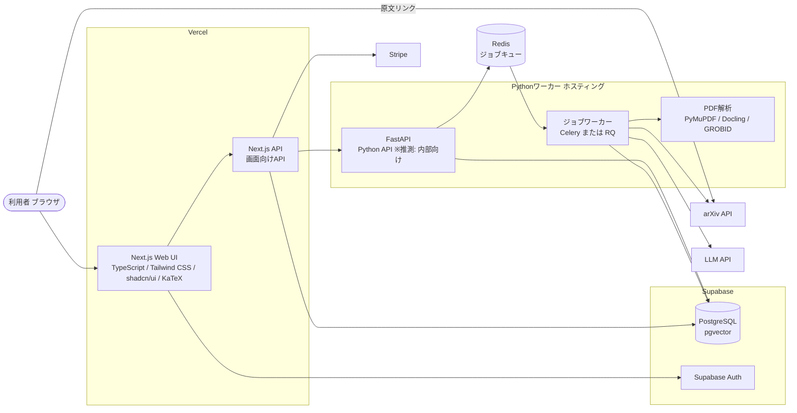

* **技術スタック**（候補として `source/03_システム構成.md:4-16` に記載。バージョンは資料に記載が無いため全件未定）:

| カテゴリ | 技術 | バージョン | 用途 |
| :--- | :--- | :--- | :--- |
| フロントエンド フレームワーク | Next.js | 未定（資料に記載なし） | Web画面の描画と画面向けAPIの提供（`source/03_システム構成.md:6-7`） |
| フロントエンド 言語 | TypeScript | 未定（資料に記載なし） | Web UIとNext.js APIの実装言語（`source/03_システム構成.md:6`） |
| CSS | Tailwind CSS | 未定（資料に記載なし） | 画面のスタイル定義（`source/03_システム構成.md:6`） |
| UIコンポーネント | shadcn/ui | 未定（資料に記載なし） | ボタンやフォームといった共通UI部品（`source/03_システム構成.md:6`） |
| 数式表示 | KaTeX | 未定（資料に記載なし） | 10分解説・Appendixで数式を表示する（`source/03_システム構成.md:14`） |
| バックエンド API | FastAPI（Python） | 未定（資料に記載なし） | 要約生成・PDF解析といったPython側処理の窓口（`source/03_システム構成.md:7`） |
| DB | PostgreSQL（Supabaseを想定） | 未定（資料に記載なし） | 論文・要約・利用者データの永続化（`source/03_システム構成.md:8`） |
| ベクトル検索 | pgvector | 未定（資料に記載なし） | 将来の推薦で論文Embeddingと利用者プロフィールを照合する（`source/02_機能要求定義.md:40`、`source/03_システム構成.md:9`） |
| 認証 | Supabase Auth | 未定（資料に記載なし） | 会員登録とログイン（`source/03_システム構成.md:10`） |
| ジョブ管理 | Redis + Celery または RQ | 未定（Celery と RQ のどちらにするかも未決定） | 収集・要約・解析ジョブのキュー管理と実行（`source/03_システム構成.md:11`） |
| AI | LLM API | 未定（用途と費用に応じて選ぶ） | 日本語構造化要約・詳細解説・AIチャット・比較要約の生成（`source/03_システム構成.md:12`） |
| PDF解析 | PyMuPDF / Docling / GROBID | 未定（どれを使うかは未決定） | 論文本文PDFから章・ページ・数式・参考文献を取り出す（`source/03_システム構成.md:13`） |
| 決済 | Stripe | 未定（資料に記載なし） | Proプランの課金とプラン管理（`source/03_システム構成.md:15`、`source/02_機能要求定義.md:17`） |
| ホスティング | Vercel + Pythonワーカーのホスティング | Pythonワーカー側のサービスは未定 | Web UIとAPIはVercel、Pythonワーカーは別ホスティング（`source/03_システム構成.md:16`） |

* **用語集**:

| 用語 | 定義 |
| :--- | :--- |
| arXiv | 研究論文のプレプリント公開サイト。本システムが論文メタデータを取得する唯一の論文ソース（`source/01_企画概要.md:6`） |
| arXiv ID | arXivが論文ごとに付ける識別子。本システムの論文の業務キーであり、URLの `{arxivId}` にも使う（`source/03_システム構成.md:22,35,49`） |
| バージョン（v1/v2…） | arXiv上の論文改訂版の番号。arXiv IDとバージョンの組で重複を判定し、版ごとに要約を持つ（`source/01_企画概要.md:37`、`source/03_システム構成.md:22`） |
| Abstract | 論文の概要文。MVPではAbstractだけを要約の材料にする（`source/02_機能要求定義.md:54`） |
| Abstractベース | 本文を読まずAbstractだけで要約したことを示す表示。画面上で明示する（`source/01_企画概要.md:36`） |
| 解析範囲（source_scope） | 要約の材料が「Abstractのみ」か「本文取得済み」かの区分（`source/02_機能要求定義.md:27`、`source/03_システム構成.md:37`） |
| 30秒要約（short） | 結論を中心にした最も短い要約。depth の値 short との対応は※推測（`source/02_機能要求定義.md:24`、`source/03_システム構成.md:50`） |
| 3分要約（standard） | 研究背景・手法・主要結果・限界をまとめた標準要約。depth の値 standard との対応は※推測（`source/02_機能要求定義.md:25`） |
| 10分解説（deep） | 技術的詳細・数式・比較実験の解説。本文を取得できた論文に限って作る。depth の値 deep との対応は※推測（`source/02_機能要求定義.md:26`） |
| 構造化要約 | 結論・課題・手法・結果・限界・応用の項目に分けた日本語要約（`source/02_機能要求定義.md:9`） |
| 速報版 | 詳細な処理がまだ済んでいない論文について先に出すAbstractベースの要約（`source/03_システム構成.md:58`） |
| 出典参照（citation） | 要約内の主張ごとに、原文の章・ページ・URLを結びつけた参照情報（`source/01_企画概要.md:35`、`source/03_システム構成.md:38`） |
| claim | 要約に含まれる個々の主張。出典参照の単位（`source/03_システム構成.md:38`） |
| 根拠・数値チェック（検証工程） | 要約が原文を超えた断定をしていないか、数値・比較対象・ベンチマーク名が原文と合うかを確かめる工程（`source/02_機能要求定義.md:47`、`source/03_システム構成.md:25`） |
| Appendix | 原文リンク、数式解説、参考文献、許諾に応じた日本語全文をまとめた詳細ページ（`source/01_企画概要.md:28`） |
| ライセンス（license_type） | 論文ごとの利用許諾の種類。本文解析や全文翻訳の公開可否を決める（`source/03_システム構成.md:29,36`、`source/02_機能要求定義.md:50`） |
| Free / Pro | 無料プランと有料プラン（月額980円・仮）（`source/04_収益化とロードマップ.md:4-5`） |
| 投稿日 / 更新日 / 新着公開日 | arXiv上の3種類の日付。意味とタイムゾーンを画面上で区別して表示する（`source/02_機能要求定義.md:32`） |
| カテゴリ | arXivの分野分類（例: `cs.LG`）（`source/03_システム構成.md:47`） |
| レコメンド（推薦） | 関心カテゴリ・キーワードと新しさで論文を勧める機能。将来はEmbedding照合に切り替える（`source/02_機能要求定義.md:38-42`） |
| Embedding | 論文や利用者プロフィールを数値ベクトルにしたもの。pgvectorで似たもの同士を照合する（`source/02_機能要求定義.md:40`） |
| 失敗キュー | リトライしても失敗したジョブを溜め、後で調べたり再実行したりするための待ち行列（`source/02_機能要求定義.md:46`） |
| MVP | Phase 1で作る最小限の製品範囲（`source/04_収益化とロードマップ.md:31-32`） |

---

## 2. 業務フロー設計

* **業務フロー一覧（全数ロースター）**:

| No | フローID | フロー名 | 起点（画面・バッチ・外部契機） | 関与する機能ID | 定義状況 | 詳細の所在 |
| :--- | :--- | :--- | :--- | :--- | :--- | :--- |
| 1 | BF01 | 論文収集・日本語化（定期） | 定期ジョブ（B001） | F01, F04 | 詳細 | §2 BF01 |
| 2 | BF02 | 本文解析・詳細解説の生成 | 人気論文・リクエストされた論文（B005） | F04, F05 | 詳細 | §2 BF02 |
| 3 | BF03 | 新着論文の閲覧（日付・カテゴリ） | P102 新着論文 | F02, F05 | 詳細 | §2 BF03 |
| 4 | BF04 | 自由検索 | P103 論文検索 | F03 | 詳細 | §2 BF04 |
| 5 | BF05 | 論文詳細・要約の深さ切替・Appendix閲覧 | P104 論文詳細 / P105 Appendix | F04, F05, F15 | 詳細 | §2 BF05 |
| 6 | BF06 | 会員登録・関心分野の設定 | P106 マイページ ※推測: 登録導線の画面は未定義 | F06 | 詳細 | §2 BF06 |
| 7 | BF07 | ブックマーク登録・解除 | P104 論文詳細 / P106 マイページ | F07 | 詳細 | §2 BF07 |
| 8 | BF08 | おすすめ論文の表示 | P101 ホーム | F08 | 詳細 | §2 BF08 |
| 9 | BF09 | AIチャット（Later） | P104 論文詳細 ※推測 | F09, F18 | 詳細 | §2 BF09 |
| 10 | BF10 | 通知・ダイジェスト配信（Later） | 定期ジョブ（B007） | F10 | 詳細 | §2 BF10 |
| 11 | BF11 | 複数論文比較（Later） | P104 論文詳細 ※推測 | F11, F18 | 詳細 | §2 BF11 |
| 12 | BF12 | Pro申込・課金（Later） | P107 料金 | F12 | 詳細 | §2 BF12 |
| 13 | BF13 | 退会・個人データ削除 | P106 マイページ ※推測 | F16 | 詳細 | §2 BF13 |
| 14 | BF14 | トレンド可視化の閲覧（Future） | 画面未定義 ※推測 | F13 | 簡易 | §4 機能一覧 F13 |
| 15 | BF15 | GitHub公式実装の関連付け（Future） | 定期登録処理（毎日 04:00 UTC ※推測）→ B009 | F14 | 詳細 | §2 BF15 |
| 16 | BF16 | 処理状況の確認 | P104 論文詳細 ※推測 | F17 | 簡易 | §4 機能一覧 F17 |
| 17 | BF17 | コスト監視・利用状況分析（Phase 4） | 運営者による確認 ※推測 | F19 | 簡易 | §4 機能一覧 F19 |

**総件数: 17件（詳細14件・簡易3件）。全数である根拠**: §4 機能一覧の全19機能（F01〜F19）を、利用者または定期ジョブの起点ごとにまとめた結果です。F01〜F19 のどれもが、上表の少なくとも1つのフローの「関与する機能ID」に登場します（F01→BF01, F02→BF03, F03→BF04, F04→BF01/BF02/BF05, F05→BF02/BF03/BF05, F06→BF06, F07→BF07, F08→BF08, F09→BF09, F10→BF10, F11→BF11, F12→BF12, F13→BF14, F14→BF15, F15→BF05, F16→BF13, F17→BF16, F18→BF09/BF11, F19→BF17）。定義状況は completeness 3-1 で判定し、データの書き換え・外部送信・分岐のどれも伴わない参照だけのフロー（BF14, BF16, BF17）を簡易にしています。

* **業務フロー図（正常系）**:

#### BF01 論文収集・日本語化（定期）
根拠: `source/03_システム構成.md:19-32`、`source/02_機能要求定義.md:6,46`。各ジョブの責務分担は確定済みのバッチ詳細設計書（`docs/detail/batch/BT.B001`〜`BT.B004`・`BT.B011`・`BT.B008` の §0）に合わせています（1.2 で改訂。レビュー MJ-02）。

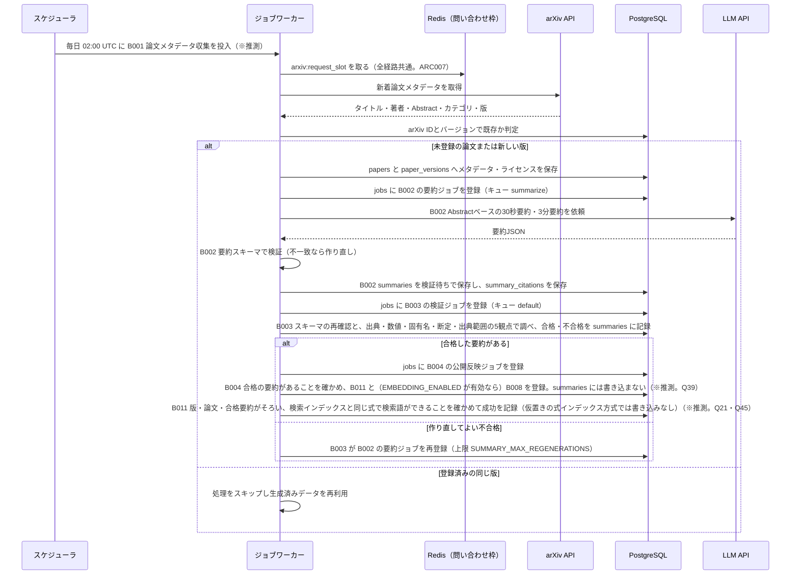

#### BF02 本文解析・詳細解説の生成
根拠: `source/03_システム構成.md:29-31`、`source/04_収益化とロードマップ.md:25-27`、`source/02_機能要求定義.md:26,50`。起動契機の3つ目（B003 による10分解説の作り直し）と保存の順序は `docs/detail/batch/BT.B005.バッチ詳細設計.md` §0・§5 に合わせています（1.2 で改訂。レビュー MJ-02）。

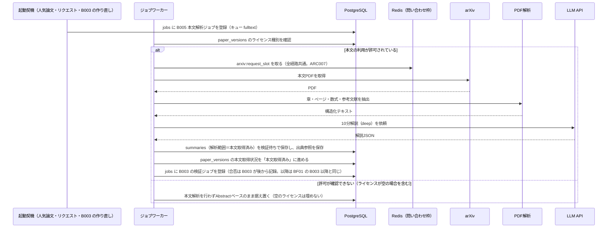

#### BF03 新着論文の閲覧（日付・カテゴリ）
根拠: `source/01_企画概要.md:25`、`source/02_機能要求定義.md:7,32-35`、`source/03_システム構成.md:47,58`

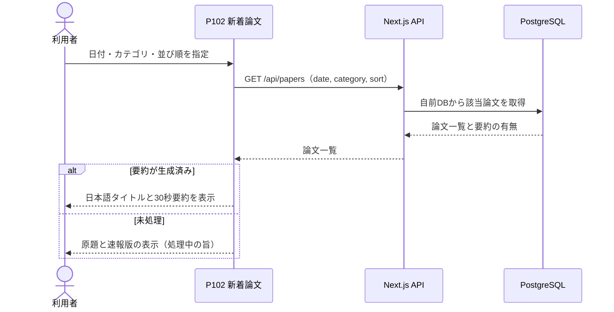

#### BF04 自由検索
根拠: `source/01_企画概要.md:26`、`source/02_機能要求定義.md:8,33-35`、`source/03_システム構成.md:48`

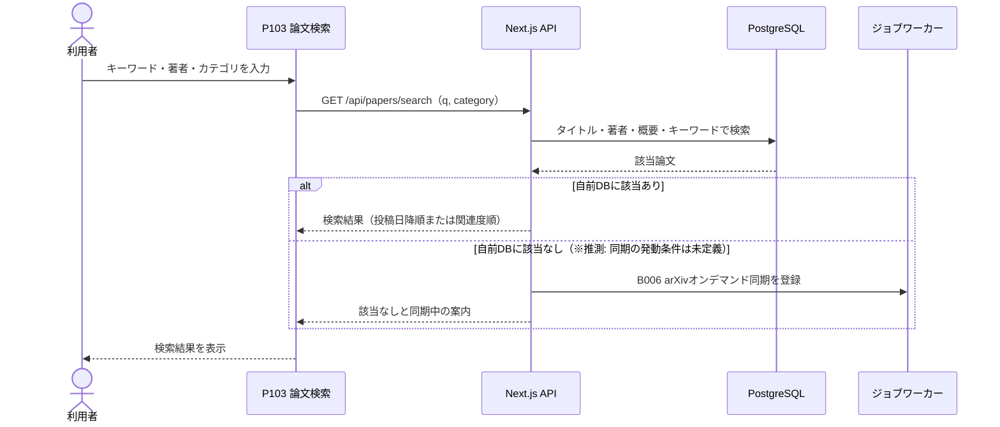

#### BF05 論文詳細・要約の深さ切替・Appendix閲覧
根拠: `source/01_企画概要.md:27-28`、`source/02_機能要求定義.md:10,21-29`、`source/03_システム構成.md:49-50`、`source/03_システム構成.md:42`

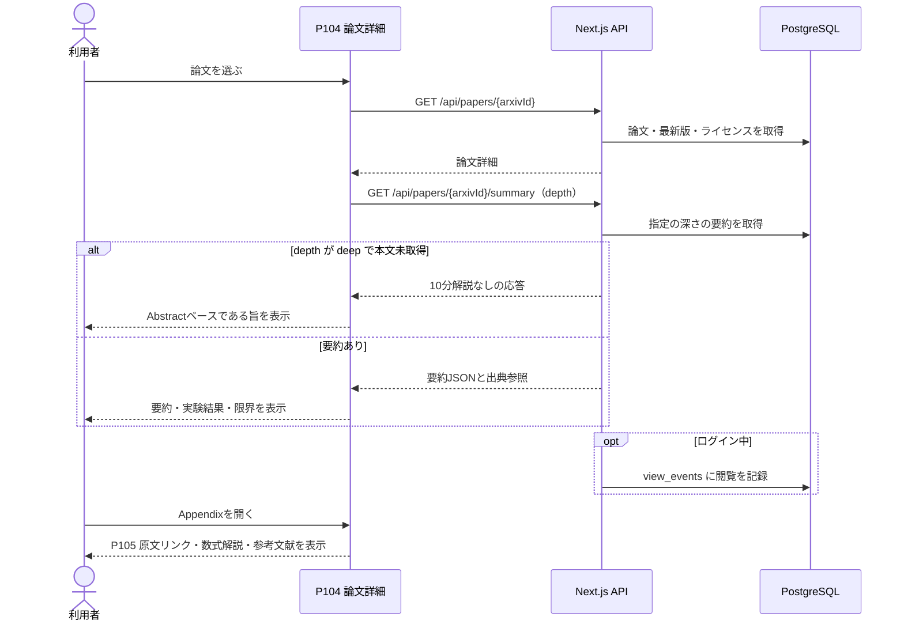

#### BF06 会員登録・関心分野の設定
根拠: `source/02_機能要求定義.md:11`、`source/03_システム構成.md:10,39-40`、`source/04_収益化とロードマップ.md:35`

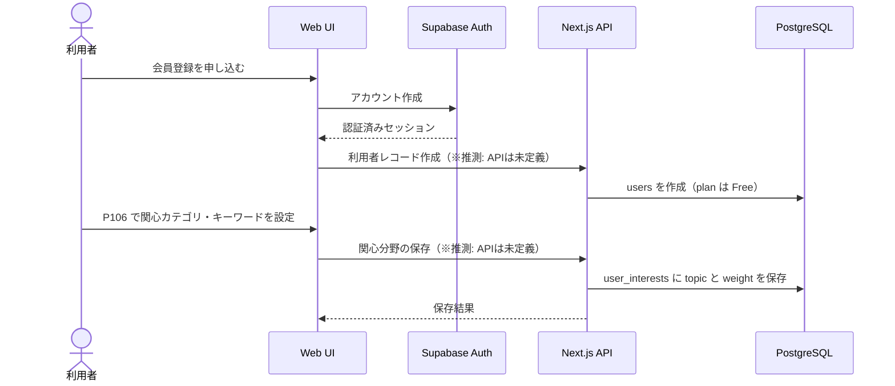

#### BF07 ブックマーク登録・解除
根拠: `source/02_機能要求定義.md:12`、`source/03_システム構成.md:41,52-53`

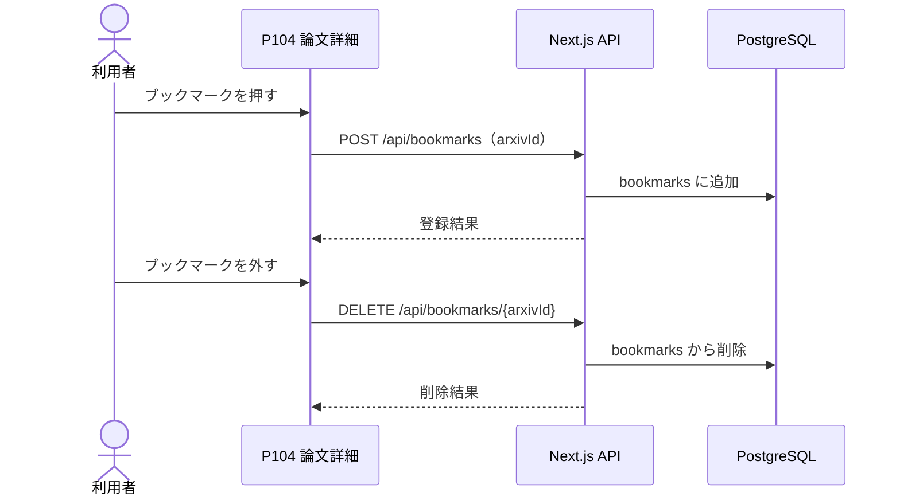

#### BF08 おすすめ論文の表示
根拠: `source/01_企画概要.md:24`、`source/02_機能要求定義.md:13,37-42`、`source/03_システム構成.md:51`

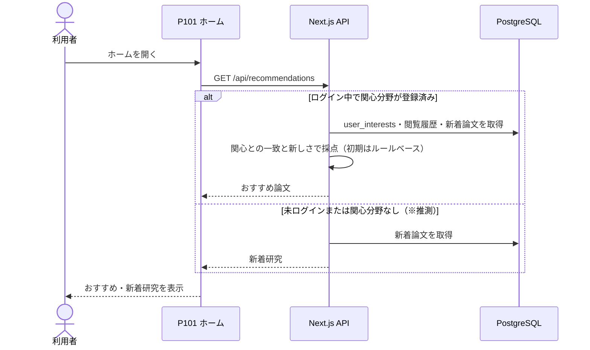

#### BF09 AIチャット（Later）
根拠: `source/02_機能要求定義.md:14`、`source/04_収益化とロードマップ.md:5,21,28`

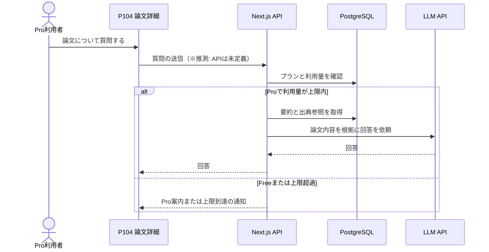

#### BF10 通知・ダイジェスト配信（Later）
根拠: `source/02_機能要求定義.md:15`、`source/01_企画概要.md:29`

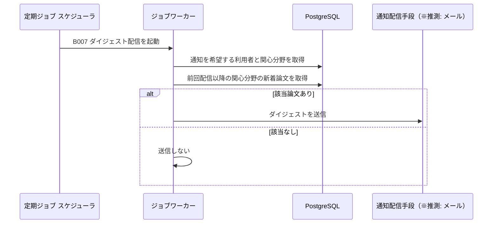

#### BF11 複数論文比較（Later）
根拠: `source/02_機能要求定義.md:16`、`source/04_収益化とロードマップ.md:5,28`

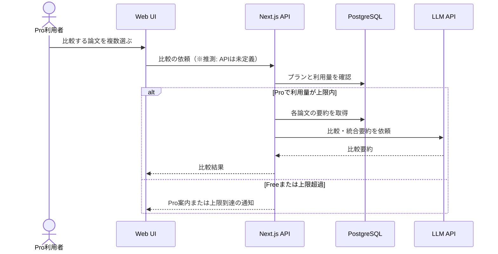

#### BF12 Pro申込・課金（Later）
根拠: `source/02_機能要求定義.md:17`、`source/03_システム構成.md:44,54`、`source/04_収益化とロードマップ.md:41`

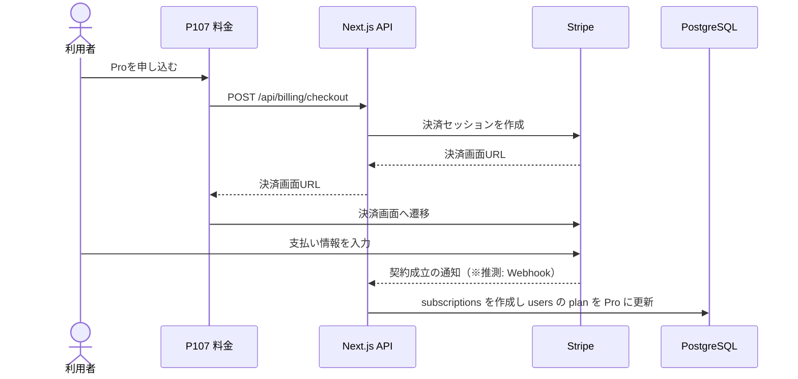

#### BF13 退会・個人データ削除
根拠: `source/02_機能要求定義.md:48`、`source/03_システム構成.md:39-44`

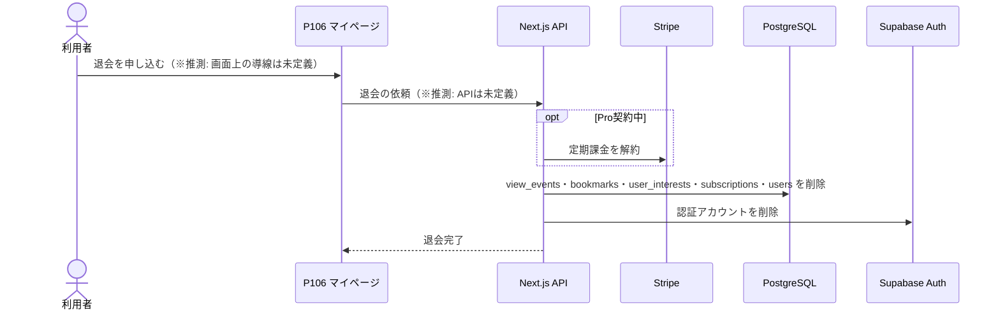

#### BF15 GitHub公式実装の関連付け（Future）
根拠: `source/02_機能要求定義.md:19`。起動契機（毎日 04:00 UTC の登録処理）と「見つからない」場合の記録・再探索は `docs/detail/batch/BT.B009.バッチ詳細設計.md` §0・§5 に合わせています（1.2 で改訂。レビュー MJ-04）。

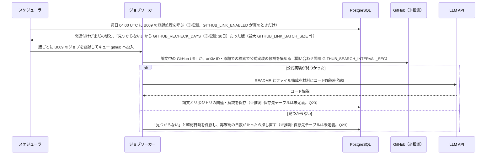

* **業務フロー図（異常系）**:

#### EX01 arXiv APIの取得失敗・レート制限
根拠: `source/02_機能要求定義.md:46,49`、`source/03_システム構成.md:57`。間隔の管理は `docs/arch/方式.ARC007.方式設計.md` §3 段階4 の決定（全経路共通の問い合わせ枠）に合わせています（1.2 で改訂。レビュー Blocker-01）。

arXiv へ問い合わせる経路は、B001（定期収集）・B006（オンデマンド同期）・B003（10分解説の検証での本文PDF取得）・B005（本文PDF取得）の4つです。経路ごとに間隔を守るだけでは、4経路が同時に動いたときに arXiv から見た合計の間隔が推奨間隔を下回るため、4経路・全ワーカーが Redis 上の1つの問い合わせ枠 `arxiv:request_slot` を共有し、問い合わせの開始を `ARXIV_REQUEST_INTERVAL_SEC` 秒（※推測: 3秒）に1回までにします（※推測・資料に方式の定義なし）。

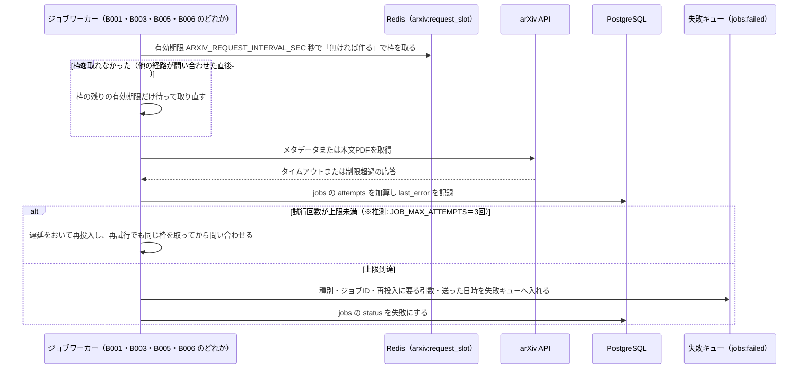

#### EX02 要約のスキーマ検証・根拠チェックで不合格
根拠: `source/02_機能要求定義.md:47`、`source/03_システム構成.md:25,60`

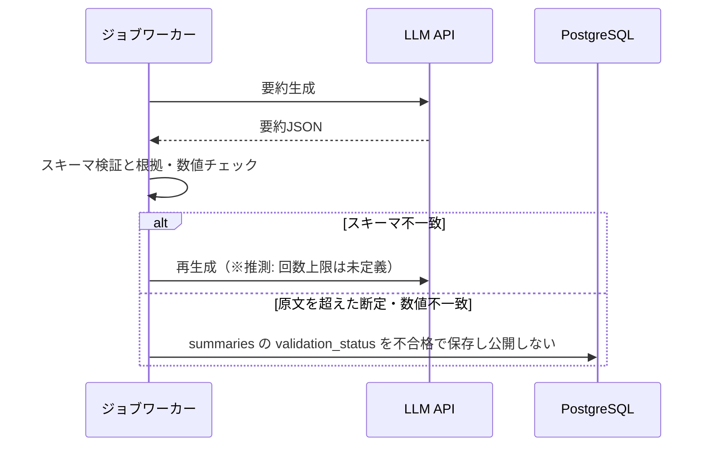

#### EX03 本文の利用条件が確認できない
根拠: `source/03_システム構成.md:29-30,59`、`source/02_機能要求定義.md:50`

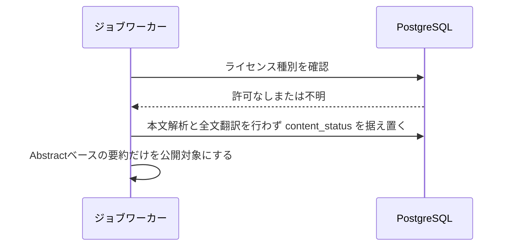

#### EX04 画面表示時のAPI障害・要約未生成
根拠: `source/02_機能要求定義.md:58`、`source/03_システム構成.md:58`

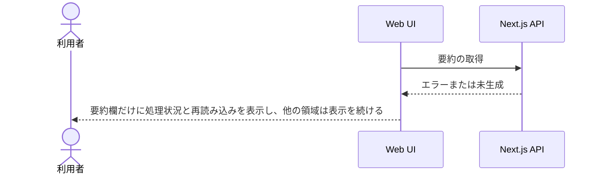

#### EX05 未ログインで会員向け操作を実行
根拠: `source/02_機能要求定義.md:11-12`、`source/03_システム構成.md:10`

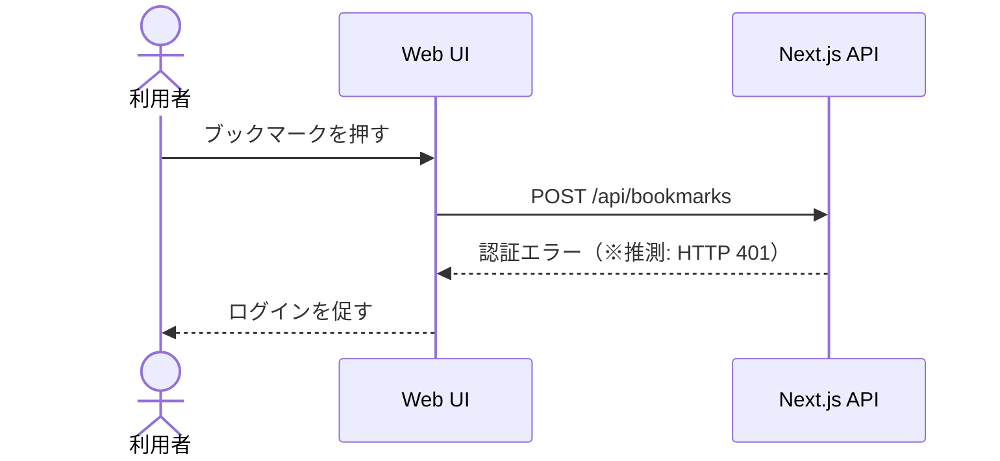

#### EX06 決済の失敗
根拠: `source/03_システム構成.md:44,54`

```mermaid
sequenceDiagram
    actor U as 利用者
    participant STR as Stripe
    participant API as Next.js API
    participant DB as PostgreSQL
    U->>STR: 支払い
    STR-->>U: 決済失敗
    STR-->>API: 失敗の通知（※推測: Webhook）
    API->>DB: subscriptions の status を失敗状態で保存し plan は Free のまま
```

#### EX07 Pro機能の利用量上限超過
根拠: `source/04_収益化とロードマップ.md:28,41`

```mermaid
sequenceDiagram
    actor U as Pro利用者
    participant API as Next.js API
    participant DB as PostgreSQL
    U->>API: AIチャットまたは比較の依頼
    API->>DB: 当期の利用量を確認
    DB-->>API: 上限到達
    API-->>U: 上限到達を通知しLLMを呼ばない（※推測: 上限値と集計期間は未定義）
```

* **ユースケース図**:

```mermaid
flowchart LR
    G(["ゲスト"])
    M(["会員 Free"])
    P(["会員 Pro"])
    S(["定期ジョブ"])
    subgraph "arXiv日本語研究ダイジェスト"
        UC1["新着論文を日付・カテゴリで探す"]
        UC2["自由検索する"]
        UC3["論文詳細と日本語要約を読む"]
        UC4["Appendixで原文と詳細を確認する"]
        UC5["会員登録と関心分野の設定"]
        UC6["ブックマークする"]
        UC7["おすすめ論文を見る"]
        UC8["通知・ダイジェストを受け取る"]
        UC9["Proを申し込む"]
        UC10["AIチャットで質問する"]
        UC11["複数論文を比較する"]
        UC12["退会する"]
        UC13["論文を収集し日本語化する"]
    end
    G --> UC1
    G --> UC2
    G --> UC3
    G --> UC4
    G --> UC5
    M --> UC6
    M --> UC7
    M --> UC8
    M --> UC9
    M --> UC12
    P --> UC10
    P --> UC11
    S --> UC13
```

※推測: ゲストが閲覧できる範囲（新着・検索・詳細・Appendix）は資料に明記がありません。Freeの提供範囲（`source/04_収益化とロードマップ.md:4`）から推定しています。

---

## 3. 画面・UI設計

* **画面ID命名規則（凡例）**: 画面IDは「系統プレフィックス（英字1〜3文字）＋3桁連番」とします。
  * `P` = 利用者向け画面（P101〜）。本書で採番済み: P101〜P107。
  * `A` = 管理者向け画面（A101〜）。現時点では該当画面がありません。
  * 系統が増えたときは新しいプレフィックスを追記します。1.0 で初回採番し、以後の版で振り直していません。次版以降は採番済みIDを振り直しません。
* **画面と数えた根拠**: 本システムはWeb UI（Next.js）を持つ計画で（`source/03_システム構成.md:6`）、利用者が見て操作する画面が `source/01_企画概要.md:21-30` の「主要画面」表に定義されています。各行の実体はこの表の定義行です（実装は未着手のため、ルーティング定義は存在しません）。

### 3.1 画面一覧（利用者向け）

| 画面ID | 画面名 | パス | 概要 | ソース実体 | 定義状況 | 画面基本設計書（詳細の所在） |
| :--- | :--- | :--- | :--- | :--- | :--- | :--- |
| P101 | ホーム | `/`（※推測） | 利用者の関心に合わせたおすすめ論文と新着研究を並べる入口の画面 | `source/01_企画概要.md:24` | 簡易（詳細は画面基本設計書へ委譲） | `screens/画面.P101.画面基本設計.md` |
| P102 | 新着論文 | `/papers`（※推測） | 日付とカテゴリで新着論文を絞り込み、投稿日順または関連度順に並べて一覧する画面 | `source/01_企画概要.md:25` | 簡易（詳細は画面基本設計書へ委譲） | `screens/画面.P102.画面基本設計.md` |
| P103 | 論文検索 | `/search`（※推測） | キーワード・著者・カテゴリで論文を検索する画面 | `source/01_企画概要.md:26` | 簡易（詳細は画面基本設計書へ委譲） | `screens/画面.P103.画面基本設計.md` |
| P104 | 論文詳細 | `/papers/{arxivId}`（※推測） | 1本の論文について30秒／3分／10分の日本語要約、実験結果、研究の限界を表示する画面 | `source/01_企画概要.md:27` | 簡易（詳細は画面基本設計書へ委譲） | `screens/画面.P104.画面基本設計.md` |
| P105 | Appendix | `/papers/{arxivId}/appendix`（※推測） | 原文へのリンク、数式解説、参考文献、許諾がある論文に限った日本語全文を表示する画面 | `source/01_企画概要.md:28` | 簡易（詳細は画面基本設計書へ委譲） | `screens/画面.P105.画面基本設計.md` |
| P106 | マイページ | `/mypage`（※推測） | 関心分野、ブックマーク、閲覧履歴、通知設定を利用者自身が確認・変更する画面 | `source/01_企画概要.md:29` | 簡易（詳細は画面基本設計書へ委譲） | `screens/画面.P106.画面基本設計.md` |
| P107 | 料金 | `/pricing`（※推測） | FreeとProの違いを比べ、課金の申込みとプランの管理を行う画面 | `source/01_企画概要.md:30` | 簡易（詳細は画面基本設計書へ委譲） | `screens/画面.P107.画面基本設計.md` |

**総件数: 7件（全件 定義状況＝簡易）。** 画面ごとのワイヤーフレーム・項目・イベントは画面基本設計書（`screens/`）の責務とし、本書では一覧と遷移までを扱うため全件を簡易としています。**全数である根拠**: `source/01_企画概要.md:21-30` の「主要画面」表の全7行と1対1で対応しています。ほかの5ファイルには画面の定義がありません（`source/02_機能要求定義.md`・`source/03_システム構成.md`・`source/04_収益化とロードマップ.md` は機能・API・テーブルの定義のみ、`source/README.md` と `source/05_ネーミング候補.md` は画面に触れていない）。ログイン・会員登録画面、トレンド可視化画面、比較画面、エラー画面は、機能としては必要になる見込みですが画面としての定義が資料に無いため一覧に載せず、§顧客確認事項に挙げています。

### 3.2 画面一覧（管理者向け）

| 画面ID | 画面名 | パス | 概要 | ソース実体 | 定義状況 | 画面基本設計書（詳細の所在） |
| :--- | :--- | :--- | :--- | :--- | :--- | :--- |
| — | 該当なし | — | — | — | — | — |

**総件数: 0件。根拠**: 資料に管理者・運営者向け画面の定義がありません。ジョブの処理状況（`source/02_機能要求定義.md:58`）やコスト監視（`source/04_収益化とロードマップ.md:41`）を運営者がどこで確認するかは未定義のため、§顧客確認事項に挙げています。

* **画面遷移図**（遷移の線は資料に無く、画面の役割から想定したもの。※推測）:

```mermaid
flowchart LR
    P101["P101 ホーム"]
    P102["P102 新着論文"]
    P103["P103 論文検索"]
    P104["P104 論文詳細"]
    P105["P105 Appendix"]
    P106["P106 マイページ"]
    P107["P107 料金"]
    ARX["arXiv 原文ページ 外部"]
    STR["Stripe 決済画面 外部"]
    P101 --> P102
    P101 --> P103
    P101 --> P104
    P102 --> P104
    P103 --> P104
    P104 --> P105
    P105 --> ARX
    P104 --> ARX
    P101 --> P106
    P106 --> P104
    P101 --> P107
    P107 --> STR
    STR --> P106
```

* **カラーテーマ / デザインシステム**:
  * UI部品は shadcn/ui、スタイルは Tailwind CSS を使います（`source/03_システム構成.md:6`）。数式は KaTeX で表示します（`source/03_システム構成.md:14`）。
  * 配色・フォント・ブレークポイントは資料に定義がありません（§顧客確認事項）。※推測: Tailwind CSS の標準ブレークポイント（sm 640px / md 768px / lg 1024px / xl 1280px）をそのまま使う想定です。
  * 表示上の共通ルール（全画面で守る。詳細は §11 ARC009。事実と推測の区別は ARC004）:
    * 研究で実証された事実とAIの推測を見た目で区別する（`source/01_企画概要.md:33`）。
    * Abstractだけで要約した論文には「Abstractベース」と表示する（`source/01_企画概要.md:36`）。
    * 論文の版（v1/v2）を表示する（`source/01_企画概要.md:37`）。
    * 投稿日・更新日・新着公開日の意味とタイムゾーンを区別して表示する（`source/02_機能要求定義.md:32`）。
    * arXivと本サービスの関係を誤解させない表記にする（`source/03_システム構成.md:61`）。
* **レイアウト構造**: 資料に定義がありません。※推測: 全画面共通のヘッダー（サービス名、P102・P103・P106・P107への導線、ログイン状態）とフッター（arXivとの関係の注記、利用規約）を置き、その間にメインコンテンツを配置する構成を想定します。

**注意**: 各画面の詳細定義（ワイヤーフレーム、画面項目定義、イベント定義）は本書には記載しません。`screens/` 配下の画面基本設計書を参照してください。

---

## 4. 機能設計

* **機能一覧**:

| 機能ID | 資料上のID | カテゴリ | 区分 | 機能名 | 詳細 | 優先度・フェーズ | 出典 | 定義状況 | BE詳細設計書 |
| :--- | :--- | :--- | :--- | :--- | :--- | :--- | :--- | :--- | :--- |
| F01 | F-01 | 論文収集 | システム機能 | 新着論文取得 | arXiv APIから新着論文のメタデータを定期的に集め、arXiv IDと版で重複を除いて保存する | Must / Phase 1 | `source/02_機能要求定義.md:6`、`source/03_システム構成.md:21-23` | 詳細 | `detail/be/BE.F01.BE詳細設計.md` |
| F02 | F-02 | 検索 | 利用者機能 | 日付・カテゴリ検索 | 指定した日付と分野で論文を絞り込み、投稿日降順または関連度順に並べる | Must / Phase 1 | `source/02_機能要求定義.md:7,32-34` | 詳細 | `detail/be/BE.F02.BE詳細設計.md` |
| F03 | F-03 | 検索 | 利用者機能 | 自由検索 | タイトル・著者・概要・キーワードで論文を探す。まず自前DBを検索し、必要なときだけarXiv APIと同期する | Must / Phase 1 | `source/02_機能要求定義.md:8,35` | 詳細 | `detail/be/BE.F03.BE詳細設計.md` |
| F04 | F-04 | 要約 | システム機能 | 日本語構造化要約 | 結論・課題・手法・結果・限界・応用の項目に分けた日本語要約を、30秒／3分／10分の3段階で作り、検証してから保存する | Must / Phase 1（10分解説は Phase 3） | `source/02_機能要求定義.md:9,21-29`、`source/04_収益化とロードマップ.md:38` | 詳細 | `detail/be/BE.F04.BE詳細設計.md` |
| F05 | F-05 | 論文閲覧 | 利用者機能 | 論文詳細・Appendix | 論文の要約・出典・原文リンクを表示し、Appendixで数式解説・参考文献・許諾がある論文の日本語全文を見せる | Must / Phase 1（全文翻訳は Phase 3） | `source/02_機能要求定義.md:10`、`source/01_企画概要.md:27-28` | 詳細 | `detail/be/BE.F05.BE詳細設計.md` |
| F06 | F-06 | 会員 | 利用者機能 | 認証・プロフィール | アカウントを登録してログインし、関心のあるカテゴリ・キーワードを保存する | Should / Phase 2 | `source/02_機能要求定義.md:11`、`source/03_システム構成.md:10,40` | 詳細 | `detail/be/BE.F06.BE詳細設計.md` |
| F07 | F-07 | 会員 | 利用者機能 | ブックマーク | 論文を保存し、マイページで一覧・整理する | Should / Phase 2 | `source/02_機能要求定義.md:12`、`source/03_システム構成.md:41,52-53` | 詳細 | `detail/be/BE.F07.BE詳細設計.md` |
| F08 | F-08 | 推薦 | 利用者機能 | レコメンド | 初期は関心カテゴリ・キーワードと新しさで点数を付けて推薦する。将来は論文Embeddingをpgvectorでプロフィールと照合し、類似度50%・新しさ25%・内容との関連性15%・多様性10%（仮）で重み付けする | Should / Phase 2 | `source/02_機能要求定義.md:13,37-42` | 詳細 | `detail/be/BE.F08.BE詳細設計.md` |
| F09 | F-09 | AI高機能 | 利用者機能（Pro） | AIチャット | 論文の内容について対話形式で質問に答える。Proの機能で、利用量に上限を設ける | Later / Phase 3 | `source/02_機能要求定義.md:14`、`source/04_収益化とロードマップ.md:5,28` | 詳細 | `detail/be/BE.F09.BE詳細設計.md` |
| F10 | F-10 | 通知 | 利用者機能 | 通知・ダイジェスト | 関心分野の新着論文を利用者に知らせる。通知の要否はマイページで設定する | Later / ※推測: Phase 3 | `source/02_機能要求定義.md:15`、`source/01_企画概要.md:29` | 詳細 | `detail/be/BE.F10.BE詳細設計.md` |
| F11 | F-11 | AI高機能 | 利用者機能（Pro） | 複数論文比較 | 関連する複数の論文を比べ、統合した要約を作る。Proの機能で、利用量に上限を設ける | Later / Phase 3 | `source/02_機能要求定義.md:16`、`source/04_収益化とロードマップ.md:5,38` | 詳細 | `detail/be/BE.F11.BE詳細設計.md` |
| F12 | F-12 | 課金 | 利用者機能 | 課金 | Stripeで有料プランの申込み・契約状態の管理を行う | Later / Phase 4 | `source/02_機能要求定義.md:17`、`source/04_収益化とロードマップ.md:41` | 詳細 | `detail/be/BE.F12.BE詳細設計.md` |
| F13 | F-13 | 分析表示 | 利用者機能 | トレンド可視化 | 注目されている研究キーワードの時間推移をグラフで見せる | Future | `source/02_機能要求定義.md:18` | 簡易 | `detail/be/BE.F13.BE詳細設計.md` |
| F14 | F-14 | 外部連携 | システム機能 | GitHub関連付け | 論文の公式実装リポジトリを結びつけ、コードの解説を付ける | Future | `source/02_機能要求定義.md:19` | 詳細 | `detail/be/BE.F14.BE詳細設計.md` |
| F15 | — | 会員 | 利用者機能 | 閲覧履歴 | ログイン中の利用者が開いた論文を記録し、マイページで履歴として見せる。記録は必要最小限にとどめる | Phase 2 | `source/01_企画概要.md:29`、`source/03_システム構成.md:42`、`source/04_収益化とロードマップ.md:35` | 詳細 | `detail/be/BE.F15.BE詳細設計.md` |
| F16 | — | 会員 | 利用者機能 | 退会・個人データ削除 | 利用者の申し出で、行動ログを含む個人データを削除する | ※推測: Phase 2 | `source/02_機能要求定義.md:48` | 詳細 | `detail/be/BE.F16.BE詳細設計.md` |
| F17 | — | 運用 | 利用者機能 ※推測 | 処理状況の確認 | 処理に失敗しても画面全体を止めず、論文ごとの要約の処理状況を確認できるようにする | Phase 1（MVP完了基準） | `source/02_機能要求定義.md:58` | 簡易 | `detail/be/BE.F17.BE詳細設計.md` |
| F18 | — | 課金 | システム機能 | Pro機能の利用量制限 | AIチャット・複数論文比較といったコストの高いPro機能について、利用者ごとに利用量の上限を設けて超過時は実行しない | Phase 4 | `source/04_収益化とロードマップ.md:28,41` | 詳細 | `detail/be/BE.F18.BE詳細設計.md` |
| F19 | — | 運用 | 管理機能 | コスト監視・利用状況分析 | 1論文あたりの生成コスト、利用者あたりの粗利益、継続率・転換率を集計して確認する | Phase 4 | `source/04_収益化とロードマップ.md:41,43-48` | 簡易 | `detail/be/BE.F19.BE詳細設計.md` |

**総件数: 19件（利用者機能14件・システム機能4件・管理機能1件）。全数である根拠**: F01〜F14 は `source/02_機能要求定義.md:4-19` の機能一覧表の全14行と1対1で対応します。F15〜F19 は、同表には無いものの他の行で機能として要求されているもの（閲覧履歴: `source/01_企画概要.md:29` と `source/04_収益化とロードマップ.md:35`／退会・削除: `source/02_機能要求定義.md:48`／処理状況確認: `source/02_機能要求定義.md:58`／利用量制限・コスト監視: `source/04_収益化とロードマップ.md:28,41`）を、資料の全227行を読んで拾い出したものです。研究室・企業R&D向けの分野モニタリングとチーム共有（`source/04_収益化とロードマップ.md:6`）は「将来」のビジネス案で機能としての中身が無いため、機能一覧に載せず §顧客確認事項に挙げています。検証指標の「ユーザーフィードバック」（`source/04_収益化とロードマップ.md:48`）も指標の名前だけで収集機能の定義が無いため機能に含めず、収集手段を §顧客確認事項 Q37 に挙げています。

* **オンライン処理設計**:
  * **事前生成優先**: フィードと論文詳細は事前に生成したデータを表示し、画面を開くたびにLLMを呼びません（`source/02_機能要求定義.md:45`）。AIチャット（F09）と複数論文比較（F11）だけは、利用者の依頼を受けてその場でLLMを呼びます ※推測。
  * **未処理論文の扱い**: 要約がまだ無い論文は、原題と速報版（Abstractベース）を先に表示し、処理中であることを示します（`source/03_システム構成.md:58`）。
  * **部分的な障害の扱い**: 要約の取得に失敗しても画面全体は落とさず、失敗した領域だけに処理状況を表示します（`source/02_機能要求定義.md:58`）。
  * **入力チェック**（※推測: 資料に定義なし）:
    * `date` は `YYYY-MM-DD` 形式の実在日付だけを受け付けます（形式は `source/03_システム構成.md:47`）。
    * `category` はarXivのカテゴリ表記（例: `cs.LG`）だけを受け付けます。
    * `sort` は新着順（`newest`）と関連度順の2値です（`source/02_機能要求定義.md:34`、`source/03_システム構成.md:47`。関連度順の値名は未定義）。
    * `depth` は `short`・`standard`・`deep` の3値です（`source/03_システム構成.md:50`）。
    * 検索語 `q` が空のときは検索を実行せず、入力を促します。
  * **エラー応答**（※推測）: 入力不正は HTTP 400、未ログインは 401、Pro限定機能へのFree利用者のアクセスは 403、該当論文なしは 404、利用量上限超過は 429、サーバ側の失敗は 500 を返します。
  * **日付の扱い**: 投稿日・更新日・新着公開日を区別し、表示するタイムゾーンを画面に明記します（`source/02_機能要求定義.md:32`）。

* **バッチID命名規則（凡例）**: 既存の命名慣習（legacy資料）は無いため（`legacy/` は空ディレクトリ）、「B」＋3桁連番で新規採番します。1バッチ／1ジョブ＝1つのIDとし、複数処理の束ね書きや枝番分割はしません。区分は「定期実行」「非同期ジョブ」「運用コマンド」（運用者が手動で起動するコマンド。1.2 で新設）の3つです。B001〜B011 は 1.0 での採番で、1.2 でも振り直していません。

* **バッチ処理設計**:

| バッチID | 区分 | 名称 | 処理内容 | 実行タイミング／キュー | 出典 | 定義状況 | バッチ詳細設計書 |
| :--- | :--- | :--- | :--- | :--- | :--- | :--- | :--- |
| B001 | 定期実行 | 論文メタデータ収集 | arXiv APIから新着論文のメタデータを取得し、arXiv IDと版で重複を判定したうえで、メタデータとライセンスを保存する。新しく入った版ごとに要約ジョブ（B002）を登録する。取得期間は直近の設定日数（※推測: 3日） | 毎日 02:00 UTC（※推測。Q18）にスケジューラ `collect-metadata-daily` が投入。キュー `default`（※推測。BT.B001 側へのキュー定義の追記は下流の作業） | `source/03_システム構成.md:21-23`、`source/02_機能要求定義.md:6` | 詳細 | `detail/batch/BT.B001.バッチ詳細設計.md` |
| B002 | 非同期ジョブ | Abstractベース日本語要約生成 | 論文の版ごとに、Abstractを材料にLLMで30秒要約と3分要約を作る。要約スキーマでの検証もここで行い（B003 から移管）、スキーマに通った要約を検証待ちとして保存して検証ジョブ（B003）を登録する | キュー `summarize`（B001・B006 が新しい版を保存したとき、B003 が作り直しを決めたとき） | `source/03_システム構成.md:24`、`source/02_機能要求定義.md:24-25` | 詳細 | `detail/batch/BT.B002.バッチ詳細設計.md` |
| B003 | 非同期ジョブ | 要約の根拠・数値チェック | 検証待ちの要約を、出典の対応・数値・固有名・断定・出典の範囲の5観点で調べ、原文を超えた断定が無いか、数値・比較対象・ベンチマーク名が原文と合うかを確かめて合格・不合格を要約に記録する。合格があれば公開反映（B004）を、作り直してよい不合格があれば要約生成（B002）か本文解析（B005）を登録する。スキーマ検証の主な担当は保存前の B002 で、B003 は保存済みの要約のスキーマを再確認し、合わなければ不合格にする | キュー `default`（B002・B005 が要約を保存したとき） | `source/03_システム構成.md:25,60`、`source/02_機能要求定義.md:47` | 詳細 | `detail/batch/BT.B003.バッチ詳細設計.md` |
| B004 | 非同期ジョブ | 公開反映 | 版に合格した要約があることを確かめ、検索インデックス更新（B011）と、設定 `EMBEDDING_ENABLED` が有効なら論文Embedding生成（B008）のジョブを登録する。要約テーブルには公開済みを表す列が無く「合格＝公開対象」とするため、要約には書き込まない（※推測。資料 `source/03_システム構成.md:26` は「公開用DBに保存」とするが、summaries に公開を表す列が無いため「合格＝公開対象」と仮置き。Q39） | キュー `default`（B003 が合格を記録したとき） | `source/03_システム構成.md:26` | 詳細 | `detail/batch/BT.B004.バッチ詳細設計.md` |
| B005 | 非同期ジョブ | 本文解析・詳細解説生成 | ライセンスで本文の利用が許される論文に限り、本文PDFを取得・解析して10分解説を作り、検証待ちで保存して版の本文取得状況を「本文取得済み」に進め、検証ジョブ（B003）を登録する。人気論文とリクエストされた論文だけを対象にしてコストを抑える | キュー `fulltext`（起動契機: 人気論文の判定・利用者のリクエスト・B003 による10分解説の作り直しの3つ。判定基準と登録の主体は未定義。Q13） | `source/03_システム構成.md:29-31`、`source/04_収益化とロードマップ.md:26` | 詳細 | `detail/batch/BT.B005.バッチ詳細設計.md` |
| B006 | 非同期ジョブ | arXivオンデマンド同期 | 自前DBに無い論文が必要になったときだけ、arXiv APIから該当論文を設定件数（※推測: 5件）取り込み、新しい版ごとに要約ジョブ（B002）を登録する | キュー `sync_on_demand`（並列数1。起動契機: 自由検索で自前DBに該当が無いとき。発動条件は Q10 の仮置き） | `source/02_機能要求定義.md:35` | 詳細 | `detail/batch/BT.B006.バッチ詳細設計.md` |
| B007 | 定期実行 | 通知・ダイジェスト配信 | 通知を希望する利用者ごとに、前回配信以降に取り込まれた関心分野の新着論文を最大20件（※推測）まとめて送る。jobs には行を持たず、配信日の排他で二重送信を防ぐ | 毎日 03:00 UTC（日本時間 12:00。※推測。送信手段はメールの仮置き。Q15）にスケジューラ `digest-delivery-daily` がキュー `notification` へ投入 | `source/02_機能要求定義.md:15` | 詳細 | `detail/batch/BT.B007.バッチ詳細設計.md` |
| B008 | 非同期ジョブ | 論文Embedding生成 | 将来の推薦のため、版の原題とAbstractから論文ごとのEmbeddingを作ってpgvectorへ保存する。同じモデル・同じ入力で作成済みなら提供元を呼ばない | キュー `embedding`（B008 専用。B004 が公開反映を終えたとき（`EMBEDDING_ENABLED` が有効な場合）と、運用者の一括登録） | `source/02_機能要求定義.md:40` | 詳細 | `detail/batch/BT.B008.バッチ詳細設計.md` |
| B009 | 非同期ジョブ | GitHub公式実装の関連付け | 1つの版について公式実装リポジトリを探して関連付け、コード解説を作る。見つからなければその旨と確認日時を記録し、再確認の日数（※推測: 30日）後に探し直す | キュー `github`（並列数1）。起動契機: 毎日 04:00 UTC（※推測）にスケジューラ `link-github-enqueue-daily` が B009 の登録処理を呼び、対象の版ごとにジョブを登録する。この登録処理は B001 の投入処理と同じく B009 の起動契機の一部として扱い、別のバッチIDは付けない | `source/02_機能要求定義.md:19` | 詳細 | `detail/batch/BT.B009.バッチ詳細設計.md` |
| B010 | 運用コマンド | 失敗ジョブの再処理 | 失敗ジョブの一覧と失敗キューの引数を確かめ、原因を取り除いたジョブを待機に戻して試行回数を0にし、種別のキューへ元の引数で再投入する。同じ版・同じ種別のジョブが待機中か実行中なら戻さない。jobs に行を持たない B007 は失敗キューの引数で再投入する | 運用者がワーカーのホストでコマンドを手動実行（※推測。Q36）。キューを持たず、自身は jobs に行を持たない。1回の上限 `REPROCESS_MAX_PER_RUN`（※推測: 1,000件） | `source/02_機能要求定義.md:46` | 詳細 | `detail/batch/BT.B010.バッチ詳細設計.md` |
| B011 | 非同期ジョブ | 検索インデックス更新 | 公開反映が済んだ版について、版と論文がそろっていること、合格した要約があること、検索インデックスと同じ式で検索語ができることを確かめて成功を記録する。仮置きの方式（PostgreSQL の式インデックス `idx_papers_fulltext`。Q21）ではインデックスへの書き込みは無い。新着一覧（API01）は検索インデックスに依存しない（※推測。資料 `source/03_システム構成.md:27-28` は検索インデックス更新の後に画面で閲覧する順序。Q45） | キュー `default`（B004 が公開反映を終えたとき） | `source/03_システム構成.md:27` | 詳細 | `detail/batch/BT.B011.バッチ詳細設計.md` |

**総件数: 11件（定期実行2件・非同期ジョブ8件・運用コマンド1件）。全数である根拠**: `source/03_システム構成.md:19-32` の収集・日本語化フロー図の処理ノード（A〜K）のうち、利用者の閲覧（I）と判定（J）を除く処理を、1処理1ジョブで分けたものが B001〜B005 と B011 です（A〜D→B001、E→B002、F→B003、G→B004、H→B011、K→B005）。これに、資料の別の行で非同期処理として要求されているもの（オンデマンド同期 `source/02_機能要求定義.md:35`、通知 `:15`、Embedding `:40`、GitHub関連付け `:19`、失敗キュー `:46`）を B006〜B010 として加えています。B011 は第1回レビュー（`docs/reviews/概要review_applied.md` Major-03）で B004 から分けたもので、既存IDの続き番号で採番しています。1.2 で B010 の区分を「非同期ジョブ」から「運用コマンド」に改めました（BT.B010 §0 で、ジョブキューの中で動くジョブではなく運用者が起動するコマンドとして設計されたため。レビュー MJ-03）。B009 の定期登録処理（`link-github-enqueue-daily`）は B009 のジョブを作るだけで独自の業務処理を持たないため、B001 の投入処理（`collect-metadata-daily`）と同じく起動契機として扱い、新しいバッチIDは採番していません（レビュー MJ-04。採番が必要かは Q40）。ジョブの状態は `jobs` テーブル（T009）で管理します（`source/03_システム構成.md:43`）。ただし B007 と B010 は jobs に行を持たず、jobs の処理種別は B001〜B006・B008・B009・B011 の9種です。

* **キュー一覧**（`docs/arch/方式.ARC006.方式設計.md` §4 キュー一覧を正とします。1.2 で追加）:

| No | キュー | 処理するバッチ | 並列数（全ワーカー合計） | 分けている理由 |
| :--- | :--- | :--- | :--- | :--- |
| 1 | `default` | B001（※推測）・B003・B004・B011 | B003・B004・B011 の合計で4（`DEFAULT_WORKER_CONCURRENCY`）。B001 は収集の排他で同時に1つ | 1件が短い処理をまとめて流す |
| 2 | `summarize` | B002 | 8（`SUMMARY_WORKER_CONCURRENCY`） | 収集直後にまとめて入る要約ジョブが、検証・公開を遅らせないようにする |
| 3 | `fulltext` | B005 | 2（`FULLTEXT_WORKER_CONCURRENCY`） | 1件に数分かかる本文解析が速報の公開を遅らせないようにする |
| 4 | `sync_on_demand` | B006 | 1 | 検索した利用者が待つ間に取り込みを終えるため、重いジョブの後ろに並ばせない |
| 5 | `embedding` | B008 | 2（`EMBEDDING_WORKER_CONCURRENCY`） | 一括登録で数万件入っても新着の公開を遅らせない |
| 6 | `github` | B009 | 1（`GITHUB_WORKER_CONCURRENCY`） | GitHub のレート制限に合わせて並列数を絞る |
| 7 | `notification` | B007 | 1（配信日の排他） | 要約ジョブの山に配信が埋もれないようにする |

**総件数: 7件**。根拠: ARC006 §4 キュー一覧の10行（jobs の種別9種＋B007）に現れるキュー名の異なり数です。B010 はキューを持ちません。上限まで再試行しても直らなかったジョブは、キューとは別の失敗キュー（Redis のリスト `jobs:failed`。※推測）に残します。

* **バッチ共通の方針**（`source/02_機能要求定義.md:46,49`）: すべてのジョブにリトライ・重複排除・失敗キュー・監視を備えます。外部APIのレート制限とライセンス条件を守ります。arXiv の推奨間隔は経路ごとではなく全経路の合計で守り、B001・B003・B005・B006 のすべてが Redis の問い合わせ枠 `arxiv:request_slot` を共有して、問い合わせの開始を `ARXIV_REQUEST_INTERVAL_SEC` 秒に1回までにします（※推測。ARC007 §3 段階4、§2 EX01。レビュー Blocker-01）。タイムゾーンは資料に定義がありません（※推測: スケジュールはUTCで定義し、画面表示は日本時間に変換）。

---

## 5. 帳票設計

* **帳票ID命名規則（凡例）**: 帳票IDは「R」＋2桁以上の連番（R01…）とします。1.0 で初回採番し、以後の版で振り直していません。
* **帳票一覧**:

| 帳票ID | 帳票名 | 形式 | 出力元ID（画面ID/バッチID） | 出力機能 | 出力トリガー |
| :--- | :--- | :--- | :--- | :--- | :--- |
| — | 該当なし | — | — | — | — |

**総件数: 0件。根拠**: 資料の全6ファイルに、PDF・CSV・TXTといったファイル出力の定義がありません。研究室・企業R&D向けの「定期レポート」（`source/04_収益化とロードマップ.md:6`）は将来のビジネス案として名前が出ているだけで、形式・内容・出力元の定義が無いため帳票として数えていません（§顧客確認事項）。通知・ダイジェスト（F10 / B007）はメッセージ配信であり、ファイルとして出力する帳票ではありません。

* **帳票レイアウト・出力条件**: 該当なし（帳票が0件のため）。

---

## 6. データ・データベース（DB）設計

* **テーブルID命名規則（凡例）**: テーブルIDは「T」＋3桁連番（T001…）とし、ドメインは「分類」列で表します。1.0 で初回採番し、以後の版で振り直していません。
* **テーブル一覧**:

| テーブルID | 分類 | 論理名 | 物理名 | 概要 | 出典 | 定義状況 | DB物理設計書 |
| :--- | :--- | :--- | :--- | :--- | :--- | :--- | :--- |
| T001 | 論文 | 論文 | papers | arXiv論文1本につき1行。タイトル・Abstract・著者・カテゴリ・日付・最新版・原文URLを持つ | `source/03_システム構成.md:35` | 詳細 | [DB.T001](db/DB.T001.DB物理設計.md) |
| T002 | 論文 | 論文バージョン | paper_versions | 論文の版（v1/v2…）ごとに1行。取得時点のメタデータ、本文の取得状況、ライセンス種別を持つ | `source/03_システム構成.md:36` | 詳細 | [DB.T002](db/DB.T002.DB物理設計.md) |
| T003 | 要約 | 要約 | summaries | 論文の版ごと・要約の深さごとの日本語要約JSON。生成モデル、生成日時、解析範囲、検証結果を持つ | `source/03_システム構成.md:37` | 詳細 | [DB.T003](db/DB.T003.DB物理設計.md) |
| T004 | 要約 | 要約出典参照 | summary_citations | 要約内の主張ごとに、原文の章・ページ・URLを結びつける | `source/03_システム構成.md:38` | 詳細 | [DB.T004](db/DB.T004.DB物理設計.md) |
| T005 | 利用者 | 利用者 | users | 会員1人につき1行。プラン（Free/Pro）と登録日時を持つ | `source/03_システム構成.md:39` | 詳細 | [DB.T005](db/DB.T005.DB物理設計.md) |
| T006 | 利用者 | 利用者関心分野 | user_interests | 利用者が登録した関心トピックと、その重み | `source/03_システム構成.md:40` | 詳細 | [DB.T006](db/DB.T006.DB物理設計.md) |
| T007 | 利用者 | ブックマーク | bookmarks | 利用者が保存した論文 | `source/03_システム構成.md:41` | 詳細 | [DB.T007](db/DB.T007.DB物理設計.md) |
| T008 | 利用者 | 閲覧イベント | view_events | 利用者が論文を開いた記録。プライバシーに配慮して最小限だけ持つ | `source/03_システム構成.md:42` | 詳細 | [DB.T008](db/DB.T008.DB物理設計.md) |
| T009 | 運用 | ジョブ | jobs | 論文の版ごとの処理ジョブの種類・状態・試行回数・直近エラー | `source/03_システム構成.md:43` | 詳細 | [DB.T009](db/DB.T009.DB物理設計.md) |
| T010 | 課金 | サブスクリプション | subscriptions | 利用者とStripeの顧客・定期課金を結びつけ、契約状態を持つ | `source/03_システム構成.md:44` | 詳細 | [DB.T010](db/DB.T010.DB物理設計.md) |

**総件数: 10件（全件「詳細」）。全数である根拠**: `source/03_システム構成.md:34-44` の「データモデル（主要テーブル）」に箇条書きされた10テーブルと1対1で対応します。資料の他の箇所にテーブル名の定義はありません。資料の見出しは「主要テーブル」ですが、ほかにテーブルを示す記述が無いため、この10件を全数として扱います。次のデータは機能として要求されているものの保存先テーブルが資料に無く、本一覧には載せていません（§顧客確認事項）: 論文Embedding（`source/02_機能要求定義.md:40`）、通知設定と配信履歴（`source/01_企画概要.md:29`、`source/02_機能要求定義.md:15`）、AIチャット履歴（`:14`）、比較要約（`:16`）、GitHub関連付け（`:19`）、Pro機能の利用量（`source/04_収益化とロードマップ.md:28`）、ユーザーフィードバック（`source/04_収益化とロードマップ.md:48`）。

**定義状況の判定**: 10件とも completeness 3-1 の「状態を変える」（定期ジョブまたは利用者操作で書き換わる）に該当するため「詳細」としました。全テーブルの物理的なカラム定義（型・桁・インデックス）は DB物理設計書（`db/DB.{テーブルID}.DB物理設計.md`。T001〜T010 の全10件を作成済み）の責務です。本書の論理テーブル定義の型・桁は資料に無いため、すべて※推測です。

* **概念データモデル / ER図**（全10件中10件を図示）:

```mermaid
erDiagram
    papers ||--o{ paper_versions : "版を持つ"
    paper_versions ||--o{ summaries : "要約を持つ"
    summaries ||--o{ summary_citations : "出典参照を持つ"
    paper_versions |o--o{ jobs : "処理ジョブを持つ"
    users ||--o{ user_interests : "関心分野を持つ"
    users ||--o{ bookmarks : "保存する"
    papers ||--o{ bookmarks : "保存される"
    users ||--o{ view_events : "閲覧する"
    papers ||--o{ view_events : "閲覧される"
    users ||--o{ subscriptions : "契約する"

    papers {
        bigint id PK
        varchar_32 arxiv_id UK
        text title
        text abstract
        jsonb authors
        text_array categories
        timestamptz submitted_at
        timestamptz updated_at
        integer latest_version
        text original_url
    }
    paper_versions {
        bigint id PK
        bigint paper_id FK
        integer version
        jsonb metadata_snapshot
        varchar_32 content_status
        varchar_64 license_type
    }
    summaries {
        bigint id PK
        bigint paper_version_id FK
        varchar_16 summary_type
        varchar_8 language
        jsonb json_content
        varchar_128 model_id
        timestamptz generated_at
        varchar_32 source_scope
        varchar_32 validation_status
    }
    summary_citations {
        bigint id PK
        bigint summary_id FK
        varchar_64 claim_id
        text source_section
        integer source_page
        text source_url
    }
    users {
        uuid user_id PK
        varchar_16 plan
        timestamptz created_at
    }
    user_interests {
        uuid user_id FK
        varchar_128 topic
        numeric weight
    }
    bookmarks {
        uuid user_id FK
        bigint paper_id FK
        timestamptz created_at
    }
    view_events {
        uuid user_id FK
        bigint paper_id FK
        timestamptz viewed_at
    }
    jobs {
        bigint id PK
        bigint paper_version_id FK
        varchar_32 job_type
        varchar_16 status
        integer attempts
        text last_error
    }
    subscriptions {
        bigint id PK
        uuid user_id FK
        varchar_64 stripe_customer_id
        varchar_64 stripe_subscription_id
        varchar_32 status
    }
```

* **CRUD図**（C=作成 / R=参照 / U=更新 / D=削除 / -=操作なし。資料に明記の無い操作は※推測を含む）: 1.2 で、バッチ詳細設計書（`docs/detail/batch/BT.B001〜B011` の §5 バッチ一覧の読み書き欄）に合わせて B001〜B009 のバッチ行を加え、F01・F03・F04・F10・F14 の行を対応するバッチの読み書きの合計に直しました（レビュー MJ-05）。F 行はその機能に属するオンライン処理とバッチの合計、B 行はバッチ単体の読み書きを表します。

| 機能 | papers | paper_versions | summaries | summary_citations | users | user_interests | bookmarks | view_events | jobs | subscriptions |
| :--- | :--- | :--- | :--- | :--- | :--- | :--- | :--- | :--- | :--- | :--- |
| F01 新着論文取得 | CRU | CR | - | - | - | - | - | - | CU | - |
| F02 日付・カテゴリ検索 | R | R | R | - | - | - | - | - | - | - |
| F03 自由検索 | CRU | CR | R | - | - | - | - | - | CRU | - |
| F04 日本語構造化要約 | R | RU | CRU | CR | - | - | - | - | CRU | - |
| F05 論文詳細・Appendix | R | R | R | R | - | - | - | - | - | - |
| F06 認証・プロフィール | - | - | - | - | CRU | CRUD | - | - | - | - |
| F07 ブックマーク | R | - | - | - | R | - | CRD | - | - | - |
| F08 レコメンド | R | - | R | - | R | R | R | R | - | - |
| F09 AIチャット | R | R | R | R | R | - | - | - | - | R |
| F10 通知・ダイジェスト | R | R | R | - | R | R | - | - | - | - |
| F11 複数論文比較 | R | R | R | - | R | - | - | - | - | R |
| F12 課金 | - | - | - | - | RU | - | - | - | - | CRU |
| F13 トレンド可視化 | R | - | - | - | - | - | - | - | - | - |
| F14 GitHub関連付け | R | R | - | - | - | - | - | - | CRU | - |
| F15 閲覧履歴 | R | - | - | - | R | - | - | CR | - | - |
| F16 退会・個人データ削除 | - | - | - | - | D | D | D | D | - | RD |
| F17 処理状況の確認 | R | R | R | - | - | - | - | - | R | - |
| F18 Pro機能の利用量制限 | - | - | - | - | R | - | - | - | - | R |
| F19 コスト監視・利用状況分析 | R | - | R | - | R | - | R | R | R | R |
| B001 論文メタデータ収集 | CRU | CR | - | - | - | - | - | - | CU | - |
| B002 Abstractベース日本語要約生成 | R | R | CR | C | - | - | - | - | CU | - |
| B003 要約の根拠・数値チェック | R | R | RU | R | - | - | - | - | CU | - |
| B004 公開反映 | - | - | R | - | - | - | - | - | CU | - |
| B005 本文解析・詳細解説生成 | R | RU | CR | C | - | - | - | - | CU | - |
| B006 arXivオンデマンド同期 | CRU | C | - | - | - | - | - | - | CRU | - |
| B007 通知・ダイジェスト配信 | R | R | R | - | R | R | - | - | - | - |
| B008 論文Embedding生成 | R | R | R | - | - | - | - | - | CRU | - |
| B009 GitHub公式実装の関連付け | R | R | - | - | - | - | - | - | CRU | - |
| B010 失敗ジョブの再処理 | - | - | - | - | - | - | - | - | RU | - |
| B011 検索インデックス更新 | R | R | R | - | - | - | - | - | RU | - |

**総件数: 30行（機能19行・バッチ11行）**。根拠: §4 機能一覧の F01〜F19 と、§4 バッチ処理設計の B001〜B011 の全件です。

* **テーブル一覧に無い保存先の読み書き**（※推測。保存先テーブルが資料に無いため上の表の列に載せず、Q23 で確定したら列を加える）:

| バッチ | 保存先（下流設計書での仮名） | 操作 | 根拠 |
| :--- | :--- | :--- | :--- |
| B007 | 通知設定（{通知設定テーブル}） | R | `docs/detail/batch/BT.B007.バッチ詳細設計.md` §5 |
| B007 | 配信履歴（{配信履歴テーブル}） | CRD（追加と、保持期間 `DIGEST_HISTORY_RETENTION_DAYS` 切れの削除） | 同上 |
| B008 | 論文Embedding（{論文Embeddingテーブル}） | CRU | `docs/detail/batch/BT.B008.バッチ詳細設計.md` §5 |
| B009 | GitHub関連付け（{GitHub関連付けテーブル}） | CRU（「見つからない」と確認日時の記録を含む） | `docs/detail/batch/BT.B009.バッチ詳細設計.md` §5 |

* **論理テーブル定義（定義状況＝詳細のテーブル）**: テーブル一覧の T001〜T010 の全10件を展開します。物理名は `source/03_システム構成.md:35-44` に書かれた列名です。資料に無い列（主キー `id`）と、型・桁・制約はすべて※推測です。

#### T001 papers（論文）
| 項目名（論理名） | 物理名 | 型・桁数 | 制約 | 説明・用途 |
| :--- | :--- | :--- | :--- | :--- |
| 論文ID | id | bigint（※推測） | PK, 自動採番（※推測: 資料に列なし。paper_versions と bookmarks が paper_id で参照するため必要） | 本システム内で論文を一意に識別する |
| arXiv ID | arxiv_id | varchar(32)（※推測） | 必須, 一意（※推測） | arXiv上の論文識別子。URLの `{arxivId}` と重複判定に使う |
| タイトル | title | text（※推測） | 必須（※推測） | 英語の原題。日本語タイトルは要約側に持つ |
| Abstract | abstract | text（※推測） | 必須（※推測） | 英語の概要文。MVPの要約の材料になる |
| 著者 | authors | jsonb（※推測） | 必須（※推測） | 著者名の並び。著者検索に使う |
| カテゴリ | categories | text[]（※推測） | 必須（※推測） | arXivの分野分類。カテゴリでの絞り込みと推薦に使う |
| 投稿日時 | submitted_at | timestamptz（※推測） | 必須（※推測） | arXivへの初回投稿日時。新着一覧の並び順と日付絞り込みに使う |
| 更新日時 | updated_at | timestamptz（※推測） | 任意（※推測） | arXiv上で最後に改訂された日時。投稿日とは区別して表示する |
| 最新版 | latest_version | integer（※推測） | 必須（※推測） | arXiv上の最新の版番号。新しい版が出たかの判定に使う |
| 原文URL | original_url | text（※推測） | 必須（※推測） | arXivの論文ページへのリンク |

#### T002 paper_versions（論文バージョン）
| 項目名（論理名） | 物理名 | 型・桁数 | 制約 | 説明・用途 |
| :--- | :--- | :--- | :--- | :--- |
| 論文バージョンID | id | bigint（※推測） | PK, 自動採番（※推測: 資料に列なし。summaries と jobs が paper_version_id で参照するため必要） | 論文の版を一意に識別する |
| 論文ID | paper_id | bigint（※推測） | FK→papers.id, 必須 | どの論文の版かを示す |
| 版番号 | version | integer（※推測） | 必須, paper_id との組で一意（※推測） | v1・v2の番号。arXiv IDとの組で重複処理を防ぐ |
| メタデータスナップショット | metadata_snapshot | jsonb（※推測） | 必須（※推測） | その版を取り込んだ時点のメタデータ。版ごとの違いを残す |
| 本文取得状況 | content_status | varchar(32)（※推測） | 必須（※推測: 値は未定義。例として「Abstractのみ」「本文取得済み」） | 本文を取得・解析済みかを示し、10分解説を作れるかの判定に使う |
| ライセンス種別 | license_type | varchar(64)（※推測） | 任意（※推測） | 論文の利用許諾。本文解析と全文翻訳の公開可否を決める |

#### T003 summaries（要約）
| 項目名（論理名） | 物理名 | 型・桁数 | 制約 | 説明・用途 |
| :--- | :--- | :--- | :--- | :--- |
| 要約ID | id | bigint（※推測） | PK, 自動採番（※推測: 資料に列なし。summary_citations が summary_id で参照するため必要） | 要約を一意に識別する |
| 論文バージョンID | paper_version_id | bigint（※推測） | FK→paper_versions.id, 必須 | どの版を要約したかを示す。版ごとに生成物を再利用する |
| 要約種別 | summary_type | varchar(16)（※推測） | 必須（※推測: 値は short / standard / deep。APIの depth と対応） | 30秒要約・3分要約・10分解説のどれかを示す |
| 言語 | language | varchar(8)（※推測） | 必須（※推測: 初期値 ja） | 要約の言語 |
| 要約本文 | json_content | jsonb（※推測） | 必須 | 日本語タイトル（原題併記）、結論・課題・手法・結果・限界・応用を項目ごとに持つ構造化要約 |
| 生成モデル | model_id | varchar(128)（※推測） | 必須 | 要約を作ったLLMのモデル。品質追跡と再生成の判断に使う |
| 生成日時 | generated_at | timestamptz（※推測） | 必須 | 要約を作った日時 |
| 解析範囲 | source_scope | varchar(32)（※推測） | 必須（※推測: 値は「Abstractのみ」「本文取得済み」） | 要約の材料の範囲。「Abstractベース」の表示に使う |
| 検証状態 | validation_status | varchar(32)（※推測） | 必須（※推測: 値は未検証・合格・不合格） | 根拠・数値チェックの結果。合格したものだけを公開する |

#### T004 summary_citations（要約出典参照）
| 項目名（論理名） | 物理名 | 型・桁数 | 制約 | 説明・用途 |
| :--- | :--- | :--- | :--- | :--- |
| 出典参照ID | id | bigint（※推測） | PK, 自動採番（※推測: 資料に列なし） | 出典参照を一意に識別する |
| 要約ID | summary_id | bigint（※推測） | FK→summaries.id, 必須 | どの要約の出典かを示す |
| 主張ID | claim_id | varchar(64)（※推測） | 必須, summary_id との組で一意（※推測） | 要約JSON内の個々の主張を指す |
| 出典の章 | source_section | text（※推測） | 任意（※推測） | 主張の根拠がある原文の章 |
| 出典ページ | source_page | integer（※推測） | 任意（※推測: Abstractベースでは空） | 主張の根拠がある原文のページ |
| 出典URL | source_url | text（※推測） | 必須（※推測） | 根拠となる原文のURL |

#### T005 users（利用者）
| 項目名（論理名） | 物理名 | 型・桁数 | 制約 | 説明・用途 |
| :--- | :--- | :--- | :--- | :--- |
| 利用者ID | user_id | uuid（※推測: Supabase Auth の利用者IDと同じ値） | PK | 会員を一意に識別する |
| プラン | plan | varchar(16)（※推測） | 必須, 初期値 Free（※推測） | Free か Pro か。Pro限定機能の利用可否に使う |
| 登録日時 | created_at | timestamptz（※推測） | 必須 | 会員登録した日時 |

#### T006 user_interests（利用者関心分野）
| 項目名（論理名） | 物理名 | 型・桁数 | 制約 | 説明・用途 |
| :--- | :--- | :--- | :--- | :--- |
| 利用者ID | user_id | uuid（※推測） | FK→users.user_id, 必須, topic との組でPK（※推測） | 関心分野の持ち主 |
| トピック | topic | varchar(128)（※推測） | 必須 | 関心のあるカテゴリまたはキーワード |
| 重み | weight | numeric（※推測） | 必須（※推測: 初期値 1.0） | 推薦で関心の強さとして使う |

#### T007 bookmarks（ブックマーク）
| 項目名（論理名） | 物理名 | 型・桁数 | 制約 | 説明・用途 |
| :--- | :--- | :--- | :--- | :--- |
| 利用者ID | user_id | uuid（※推測） | FK→users.user_id, 必須, paper_id との組でPK（※推測） | 保存した利用者 |
| 論文ID | paper_id | bigint（※推測） | FK→papers.id, 必須 | 保存した論文 |
| 登録日時 | created_at | timestamptz（※推測） | 必須 | 保存した日時。マイページでの並び順に使う |

#### T008 view_events（閲覧イベント）
| 項目名（論理名） | 物理名 | 型・桁数 | 制約 | 説明・用途 |
| :--- | :--- | :--- | :--- | :--- |
| 利用者ID | user_id | uuid（※推測） | FK→users.user_id, 必須 | 閲覧した利用者。退会時に削除する |
| 論文ID | paper_id | bigint（※推測） | FK→papers.id, 必須 | 閲覧した論文 |
| 閲覧日時 | viewed_at | timestamptz（※推測） | 必須 | 閲覧した日時。閲覧履歴と推薦に使う（保持期間は未定義） |

#### T009 jobs（ジョブ）
| 項目名（論理名） | 物理名 | 型・桁数 | 制約 | 説明・用途 |
| :--- | :--- | :--- | :--- | :--- |
| ジョブID | id | bigint（※推測） | PK, 自動採番（※推測: 資料に列なし） | ジョブを一意に識別する |
| 論文バージョンID | paper_version_id | bigint（※推測） | FK→paper_versions.id, 任意（※推測: 収集 B001・オンデマンド同期 B006 は版の確定前に動くため空を許す） | どの版の処理かを示す。版が決まる前のジョブでは空になる |
| ジョブ種別 | job_type | varchar(32)（※推測） | 必須（※推測: 値は B001〜B006・B008・B009・B011 の処理種別） | 要約生成・検証・公開・本文解析といった処理の種類 |
| 状態 | status | varchar(16)（※推測） | 必須（※推測: 値は待機・実行中・成功・失敗） | 処理状況の確認（F17）と失敗キューの抽出に使う |
| 試行回数 | attempts | integer（※推測） | 必須, 初期値 0（※推測） | リトライの上限判定に使う |
| 直近エラー | last_error | text（※推測） | 任意 | 最後に失敗したときのエラー内容。原因調査に使う |

#### T010 subscriptions（サブスクリプション）
| 項目名（論理名） | 物理名 | 型・桁数 | 制約 | 説明・用途 |
| :--- | :--- | :--- | :--- | :--- |
| サブスクリプションID | id | bigint（※推測） | PK, 自動採番（※推測: 資料に列なし） | 契約を一意に識別する |
| 利用者ID | user_id | uuid（※推測） | FK→users.user_id, 必須 | 契約者 |
| Stripe顧客ID | stripe_customer_id | varchar(64)（※推測） | 必須 | Stripe上の顧客を指す |
| Stripe定期課金ID | stripe_subscription_id | varchar(64)（※推測） | 必須, 一意（※推測） | Stripe上の定期課金を指す |
| 契約状態 | status | varchar(32)（※推測: Stripeの定期課金の状態値をそのまま持つ） | 必須 | 有効・支払い遅延・解約といった契約の状態。users.plan の更新に使う |

---

## 7. 外部インターフェース設計

* **外部連携一覧**:

| No | 連携先システム名 | 連携方式 | データフロー | 主要データ内容 | 認証方式 | 出典 | 定義状況 | 詳細の所在 | 備考 |
| :--- | :--- | :--- | :--- | :--- | :--- | :--- | :--- | :--- | :--- |
| IF01 | arXiv API | REST API（※推測: arXiv公式APIのHTTP GET） | 受信 | 新着論文のメタデータ（タイトル・著者・Abstract・カテゴリ・日付・版・ライセンス） | 認証なし（※推測） | `source/03_システム構成.md:21,57`、`source/02_機能要求定義.md:6,35` | 詳細 | §7 IF01 | 利用規約と推奨アクセス間隔を守り、定期同期してキャッシュする。間隔は IF02 と合わせた全経路の合計で守る（ARC007） |
| IF02 | arXiv（論文本文PDF） | HTTPダウンロード（※推測） | 受信 | 本文PDF | 認証なし（※推測） | `source/03_システム構成.md:29-30` | 詳細 | §7 IF02 | 本文の利用条件が許す論文に限って取得する。問い合わせ間隔は IF01 と同じ問い合わせ枠で管理する（ARC007） |
| IF03 | arXiv 原文ページ | 画面からのリンク遷移 | 送信（利用者を遷移させる） | 論文ページのURL | なし | `source/02_機能要求定義.md:56`、`source/01_企画概要.md:28` | 簡易 | - | データの送受信は無く、利用者のブラウザが直接開く |
| IF04 | LLM API | REST API（※推測） | 双方向 | 送信: Abstract・本文・質問、受信: 要約JSON・解説・回答・比較要約・Embedding（※推測） | APIキー（※推測） | `source/03_システム構成.md:12,24,60` | 詳細 | §7 IF04 | 用途と費用に応じてモデルを選ぶ。出力はスキーマで検証する |
| IF05 | Supabase Auth | SDKによる認証連携（※推測） | 双方向 | アカウント情報、認証セッション | Supabase のAPIキーと利用者セッション（※推測: JWT） | `source/03_システム構成.md:10` | 詳細 | §7 IF05 | 会員登録・ログイン・退会時のアカウント削除 |
| IF06 | Stripe（決済セッション） | REST API | 双方向 | 送信: 利用者・プラン、受信: 決済画面URL | Stripe シークレットキー（※推測） | `source/03_システム構成.md:15,54` | 詳細 | §7 IF06・IF07 | Pro申込みの決済 |
| IF07 | Stripe（契約状態の通知） | Webhook（※推測） | 受信 | 契約成立・支払い失敗・解約の通知 | Webhook署名検証（※推測） | `source/03_システム構成.md:44`（subscriptions.status を保持する定義から推定） | 詳細 | §7 IF06・IF07 | ※推測: 資料にWebhookの記述は無いが、契約状態を追うには必要 |
| IF08 | GitHub | REST API（※推測） | 受信 | 公式実装リポジトリの情報 | ※推測: APIトークン | `source/02_機能要求定義.md:19` | 詳細 | §7 IF08 | Future。連携方法は未定義 |
| IF09 | 通知配信手段 | ※推測: メール送信サービス | 送信 | 関心分野の新着論文ダイジェスト | ※推測: APIキー | `source/02_機能要求定義.md:15` | 詳細 | §7 IF09 | Later。配信手段（メール・プッシュ）が未定義 |

**総件数: 9件（詳細8件・簡易1件）。全数である根拠**: `source/03_システム構成.md:4-16` の推奨スタックのうち本システムの外にあるサービス（arXiv、LLM API、Supabase Auth、Stripe）と、機能要求で外部とのやり取りが必要なもの（arXiv本文 `source/03_システム構成.md:30`、原文リンク `source/02_機能要求定義.md:56`、GitHub `:19`、通知 `:15`）を数えたものです。PostgreSQL・pgvector・Redis・PDF解析ライブラリ・Vercel は本システムの構成要素（内部）であり外部連携には含めていません（GROBIDを外部サービスとして使う場合は外部連携に加える。§顧客確認事項）。

* **外部連携シーケンス図**（定義状況＝詳細の8件）:

#### IF01 arXiv API（メタデータ取得）
```mermaid
sequenceDiagram
    participant WK as ジョブワーカー（B001・B006）
    participant RD as Redis（arxiv:request_slot）
    participant ARX as arXiv API
    WK->>RD: 問い合わせ枠を有効期限 ARXIV_REQUEST_INTERVAL_SEC 秒で「無ければ作る」で取る（取れなければ残りの有効期限だけ待つ）
    WK->>ARX: 新着論文の問い合わせ（カテゴリ・期間）またはオンデマンドの検索条件
    ARX-->>WK: 論文メタデータの一覧
```

#### IF02 arXiv（本文PDF取得）
```mermaid
sequenceDiagram
    participant WK as ジョブワーカー（B003・B005）
    participant RD as Redis（arxiv:request_slot）
    participant ARX as arXiv
    WK->>WK: ライセンスで本文利用が許されることを確認
    WK->>RD: IF01 と同じ問い合わせ枠を取る（4経路共通）
    WK->>ARX: 本文PDFを要求
    ARX-->>WK: 本文PDF
```

#### IF04 LLM API
```mermaid
sequenceDiagram
    participant WK as ジョブワーカーまたはAPI
    participant LLM as LLM API
    WK->>LLM: 指示と材料（Abstract・本文・質問）
    LLM-->>WK: 生成結果（JSON）
    WK->>WK: スキーマ検証（不一致なら再生成）
```

#### IF05 Supabase Auth
```mermaid
sequenceDiagram
    actor U as 利用者
    participant FE as Web UI
    participant AUTH as Supabase Auth
    participant API as Next.js API
    U->>FE: ログイン情報を入力
    FE->>AUTH: 認証
    AUTH-->>FE: セッション
    FE->>API: セッションを付けてAPIを呼ぶ
    API->>AUTH: セッションを検証（※推測）
```

#### IF06・IF07 Stripe（決済セッションと契約状態の通知）
```mermaid
sequenceDiagram
    participant API as Next.js API
    participant STR as Stripe
    participant DB as PostgreSQL
    API->>STR: 決済セッション作成（利用者・プラン）
    STR-->>API: 決済画面URL
    STR->>API: 契約状態の通知（※推測: Webhook）
    API->>API: 署名を検証（※推測）
    API->>DB: subscriptions と users.plan を更新
```

#### IF08 GitHub（Future）
```mermaid
sequenceDiagram
    participant WK as ジョブワーカー
    participant GH as GitHub
    WK->>GH: 論文タイトル・著者で公式実装を探す（※推測）
    GH-->>WK: リポジトリ候補
```

#### IF09 通知配信手段（Later）
```mermaid
sequenceDiagram
    participant WK as ジョブワーカー
    participant NT as 通知配信手段
    WK->>NT: 利用者ごとのダイジェスト
    NT-->>WK: 送信結果
```

* **内部API一覧**:

| No | カテゴリ | メソッド | エンドポイント | 概要 | 主要パラメータ | 認証 | 出典 | 定義状況 | 詳細の所在 |
| :--- | :--- | :--- | :--- | :--- | :--- | :--- | :--- | :--- | :--- |
| API01 | 論文 | GET | /api/papers | 日付とカテゴリで論文一覧を取得する | `date`(YYYY-MM-DD), `category`, `sort` | 不要（※推測） | `source/03_システム構成.md:47` | 詳細 | §7 API詳細定義「GET /api/papers」 |
| API02 | 論文 | GET | /api/papers/search | キーワードで論文を検索する | `q`, `category` | 不要（※推測） | `source/03_システム構成.md:48` | 詳細 | §7 API詳細定義「GET /api/papers/search」 |
| API03 | 論文 | GET | /api/papers/{arxivId} | 論文1本の詳細を取得する | `arxivId`(パス) | 不要（※推測） | `source/03_システム構成.md:49` | 詳細 | §7 API詳細定義「GET /api/papers/{arxivId}」 |
| API04 | 要約 | GET | /api/papers/{arxivId}/summary | 指定した深さの日本語要約を取得する | `arxivId`(パス), `depth`(short/standard/deep) | 不要。deep は※推測: Proのみ | `source/03_システム構成.md:50` | 詳細 | §7 API詳細定義「GET /api/papers/{arxivId}/summary」 |
| API05 | 推薦 | GET | /api/recommendations | ログイン中の利用者へのおすすめ論文を取得する | なし（利用者はセッションから特定） | ※推測: 任意（未ログイン時は新着を返す） | `source/03_システム構成.md:51` | 詳細 | §7 API詳細定義「GET /api/recommendations」 |
| API06 | ブックマーク | POST | /api/bookmarks | 論文をブックマークに加える | `arxivId`（※推測: 本文のキー名は未定義） | 必要 | `source/03_システム構成.md:52` | 詳細 | §7 API詳細定義「POST /api/bookmarks」 |
| API07 | ブックマーク | DELETE | /api/bookmarks/{arxivId} | 論文をブックマークから外す | `arxivId`(パス) | 必要 | `source/03_システム構成.md:53` | 詳細 | §7 API詳細定義「DELETE /api/bookmarks/{arxivId}」 |
| API08 | 課金 | POST | /api/billing/checkout | Pro申込みの決済セッションを作る | ※推測: `plan` | 必要 | `source/03_システム構成.md:54` | 詳細 | §7 API詳細定義「POST /api/billing/checkout」 |

**総件数: 8件。全数である根拠**: `source/03_システム構成.md:46-54` の「API設計案」の全8行と1対1で対応します。資料の他の箇所にAPIのパス定義はありません。関心分野の保存、ブックマーク一覧の取得、閲覧履歴の取得、プランの変更・解約、退会、AIチャット、複数論文比較、処理状況の取得、Stripe Webhook の受け口は機能として必要ですがAPIが定義されていないため一覧に載せず、§顧客確認事項に挙げています。

* **API詳細定義**:

### GET /api/papers
- **機能概要**: 指定した日付・カテゴリに当てはまる論文の一覧を、指定の並び順で返します。自前DBだけを検索し、arXiv APIは呼びません（`source/02_機能要求定義.md:35`）。
- **リクエストパラメータ**: `date` (String / ※推測: 任意 / 形式 YYYY-MM-DD)、`category` (String / ※推測: 任意 / 例 `cs.LG`)、`sort` (String / ※推測: 任意 / `newest` は投稿日降順。関連度順の値名は未定義)。どの日付（投稿日・更新日・新着公開日）で絞り込むかは未定義です（§顧客確認事項）。
- **レスポンス（成功時）**: ※推測: 論文の配列。各要素は arXiv ID、原題、日本語タイトル、著者、カテゴリ、投稿日、30秒要約、解析範囲（Abstractベースか）、要約の処理状況。
- **レスポンス（エラー時）**: ※推測: 400（日付の形式不正・存在しないカテゴリ）、500（DB障害）。

### GET /api/papers/search
- **機能概要**: タイトル・著者・概要・キーワードで論文を検索します。自前DBを先に検索し、必要なときだけarXiv APIとの同期（B006）を起動します（`source/02_機能要求定義.md:8,35`）。
- **リクエストパラメータ**: `q` (String / 必須 ※推測)、`category` (String / 任意 ※推測)。
- **レスポンス（成功時）**: ※推測: 論文の配列（GET /api/papers と同じ要素構成）と、arXivとの同期を起動したかどうか。
- **レスポンス（エラー時）**: ※推測: 400（`q` が空）、500（DB障害）。

### GET /api/papers/{arxivId}
- **機能概要**: 論文1本のメタデータ、最新版、ライセンス、原文URLを返します（`source/03_システム構成.md:49`）。
- **リクエストパラメータ**: `arxivId` (String / 必須 / パス)。
- **レスポンス（成功時）**: ※推測: arXiv ID、原題、日本語タイトル、著者、カテゴリ、投稿日、更新日、最新版、表示中の版、原文URL、ライセンス種別、本文取得状況。
- **レスポンス（エラー時）**: ※推測: 404（該当論文なし）、500（DB障害）。

### GET /api/papers/{arxivId}/summary
- **機能概要**: 指定した深さ（30秒・3分・10分）の日本語構造化要約と出典参照を返します。検証に合格した要約だけを返します（`source/03_システム構成.md:50`、`source/02_機能要求定義.md:21-29`）。
- **リクエストパラメータ**: `arxivId` (String / 必須 / パス)、`depth` (String / ※推測: 任意、未指定時は standard / short・standard・deep の3値)。
- **レスポンス（成功時）**: 日本語タイトル（原題併記）、要約の各項目（結論・課題・手法・結果・限界・応用）、解析範囲（Abstractのみ／本文取得済み）、主要な主張ごとの出典参照、処理日時、生成モデル、対象の版（`source/02_機能要求定義.md:23-29`）。
- **レスポンス（エラー時）**: ※推測: 400（`depth` の値不正）、403（Free利用者が deep を要求した場合。Pro限定とするかは未確定）、404（論文なし、または指定の深さの要約が未生成）、500。

### GET /api/recommendations
- **機能概要**: 利用者の関心カテゴリ・キーワードと新しさから点数を付けたおすすめ論文を返します。将来はEmbedding照合と多様性を加えます（`source/02_機能要求定義.md:37-42`）。
- **リクエストパラメータ**: なし（利用者はセッションから特定する ※推測）。件数指定は未定義です。
- **レスポンス（成功時）**: ※推測: おすすめ論文の配列（GET /api/papers と同じ要素構成）と、各論文が選ばれた理由（一致した関心分野）。
- **レスポンス（エラー時）**: ※推測: 未ログイン時は 401 ではなく新着論文を返す、500。

### POST /api/bookmarks
- **機能概要**: ログイン中の利用者のブックマークに論文を加えます（`source/03_システム構成.md:52`）。
- **リクエストパラメータ**: `arxivId` (String / 必須 / リクエスト本文 ※推測: キー名は未定義)。
- **レスポンス（成功時）**: ※推測: 201、登録した論文と登録日時。登録済みの場合も成功として扱う。
- **レスポンス（エラー時）**: ※推測: 401（未ログイン）、404（論文なし）、500。

### DELETE /api/bookmarks/{arxivId}
- **機能概要**: ログイン中の利用者のブックマークから論文を外します（`source/03_システム構成.md:53`）。
- **リクエストパラメータ**: `arxivId` (String / 必須 / パス)。
- **レスポンス（成功時）**: ※推測: 204（本文なし）。
- **レスポンス（エラー時）**: ※推測: 401（未ログイン）、404（ブックマークに無い）、500。

### POST /api/billing/checkout
- **機能概要**: Pro申込みのためにStripeの決済セッションを作り、決済画面のURLを返します（`source/03_システム構成.md:54`）。
- **リクエストパラメータ**: ※推測: `plan` (String / 必須 / 初期は pro のみ)。
- **レスポンス（成功時）**: ※推測: Stripe決済画面のURL。
- **レスポンス（エラー時）**: ※推測: 401（未ログイン）、409（すでにPro契約中）、502（Stripeとの通信失敗）。

---

## 8. 非機能要件・セキュリティ設計

* **性能・可用性要件**:
  * 画面表示のたびにLLMを呼ばず、事前生成したデータを返すことで表示を速くします（`source/02_機能要求定義.md:45`）。
  * 失敗しても画面全体が落ちないこと、処理状況を確認できることがMVPの完了基準です（`source/02_機能要求定義.md:58`）。
  * 新着論文から日本語速報の公開までの時間を検証指標にします（`source/04_収益化とロードマップ.md:44`）。目標値は未定義です。
  * 応答時間・同時アクセス数・稼働率の目標値は資料に定義がありません（§顧客確認事項）。※推測: 規模の目安は月間アクティブユーザー1,000〜30,000人（`source/04_収益化とロードマップ.md:13-16` の売上試算の前提）。
* **認証・認可設計**:
  * ログインは Supabase Auth で行います（`source/03_システム構成.md:10`）。ログイン方式（メール・ソーシャル）、セッションの有効期限は未定義です（§顧客確認事項）。
  * 認可はプラン（`users.plan` が Free か Pro か）で分けます。Pro限定は専門的な詳細解説・AIチャット・複数論文比較・カスタム通知です（`source/04_収益化とロードマップ.md:5`）。Free は新着検索・短い要約・標準要約・基本推薦・ブックマークです（`source/04_収益化とロードマップ.md:4`）。
  * ※推測: ブックマーク・関心分野・閲覧履歴は本人だけが読み書きできるよう、Supabase の行単位アクセス制御（Row Level Security）で利用者IDを照合します。
* **セキュリティ対策**（資料に具体策の記載が無いため、構成から導いた※推測を含む）:

| 脅威 | 対策 | 実装方法 |
| :--- | :--- | :--- |
| なりすまし・不正ログイン | 認証を外部サービスに任せる | Supabase Auth のセッションで利用者を特定する（`source/03_システム構成.md:10`） |
| 他人のデータの閲覧・改ざん | 本人以外のデータへのアクセスを拒否する | ※推測: Row Level Security で `user_id` が本人と一致する行だけを許可する |
| Pro機能の不正利用 | プランと利用量をサーバ側で確かめる | API側で `users.plan` と利用量上限を確認してからLLMを呼ぶ（`source/04_収益化とロードマップ.md:28`） |
| 決済通知の偽装 | 通知の送り主を確かめる | ※推測: Stripe Webhook の署名を検証する |
| XSS（要約やAbstractに含まれるスクリプト） | 外部由来テキストを無害化して表示する | ※推測: React の標準エスケープを使い、数式はKaTeXで描画してHTMLとして直接埋め込まない |
| CSRF | 状態を変えるAPIで送り主を確かめる | ※推測: Cookie を SameSite 属性付きにし、POST/DELETE ではセッショントークンをヘッダーで送る |
| 盗聴 | 通信を暗号化する | ※推測: Vercel・Supabase の HTTPS を使い、HTTP は HTTPS に転送する |
| LLMによる誤情報（原文を超えた断定） | 生成物を検証してから公開する | スキーマ検証と根拠・数値チェックに合格した要約だけを公開する（`source/02_機能要求定義.md:47`、`source/03_システム構成.md:60`） |
| 権利侵害（無許諾の全文翻訳公開） | 本文の利用条件を確認する | ライセンスで許可された論文だけ全文翻訳を公開する（`source/02_機能要求定義.md:50`、`source/03_システム構成.md:59`） |
| 外部APIの規約違反・遮断 | アクセス頻度を抑える | arXivの推奨間隔を守り、定期同期した結果をキャッシュする（`source/03_システム構成.md:57`） |
| 個人の行動データの過剰保持 | 保持を最小限にする | 閲覧記録は必要最小限にし、退会時に削除する（`source/02_機能要求定義.md:48`） |
| ブランドの誤認 | arXivとの関係を明示する | arXivと本サービスの関係を誤解させない表記にする（`source/03_システム構成.md:61`） |

* **アプリケーション保護**:
  * 要約の取得に失敗した領域だけに処理状況を出し、画面全体は表示を続けます（`source/02_機能要求定義.md:58`）。※推測: Next.js のエラー境界（error.tsx）で領域ごとに失敗を閉じ込めます。
  * バッチは監視対象にし、失敗したジョブは失敗キューに集めます（`source/02_機能要求定義.md:46`）。監視の手段・通知先は未定義です（§顧客確認事項）。
  * 管理画面は定義されていません（§3.2）。
* **機密情報管理**:
  * 資料に定義がありません（§顧客確認事項）。※推測: LLM APIキー（`LLM_API_KEY`）、Stripe シークレットキー（`STRIPE_SECRET_KEY`）、Stripe Webhook 署名鍵（`STRIPE_WEBHOOK_SECRET`）、Supabase のサービスロールキー（`SUPABASE_SERVICE_ROLE_KEY`）、メール送信サービスの認証キー（`MAIL_API_KEY`。B007）、GitHub API のトークン（`GITHUB_TOKEN`。B009。権限は公開リポジトリの読み取りだけに絞る）、データベースの接続文字列（`DATABASE_URL`）の7件を機密情報とし、サーバ側（API・ワーカー）の環境変数だけに置き、ブラウザへ渡す値（Supabase の公開キー）と分けます。`.env` 系ファイルはリポジトリにコミットしません。

---

## 9. ビルド・デプロイ設計

* **環境構成**: 資料に定義がありません（§顧客確認事項）。※推測:

| 環境 | 用途 | Web UI / API | Pythonワーカー | DB・認証 |
| :--- | :--- | :--- | :--- | :--- |
| development | 開発者の手元での開発 | ローカルの Next.js 開発サーバ | ローカルの FastAPI とワーカー | ローカルまたは開発用 Supabase プロジェクト |
| staging | 公開前の確認 | Vercel のプレビュー環境 | ステージング用ワーカー | ステージング用 Supabase プロジェクト |
| production | 本番 | Vercel の本番環境（`source/03_システム構成.md:16`） | 本番ワーカー（ホスティング先は未定） | 本番 Supabase プロジェクト |

* **環境変数一覧**: 資料に定義がありません。※推測（「置き場所」は値を読むプロセス、末尾の括弧は値を定めたバッチ詳細設計書）:

| 環境変数 | 置き場所 | 用途 |
| :--- | :--- | :--- |
| NEXT_PUBLIC_SUPABASE_URL | Web UI | Supabase の接続先 |
| NEXT_PUBLIC_SUPABASE_ANON_KEY | Web UI | ブラウザから Supabase Auth を使うための公開キー |
| SUPABASE_SERVICE_ROLE_KEY | API・ワーカー | サーバ側からDBを操作するための鍵 |
| DATABASE_URL | API・ワーカー | PostgreSQL への接続文字列 |
| REDIS_URL | API・ワーカー | ジョブキューの接続先 |
| LLM_API_KEY | ワーカー・API | LLM API の認証 |
| LLM_MODEL_ID | ワーカー | 要約に使うモデル。summaries.model_id に記録する |
| STRIPE_SECRET_KEY | API | Stripe API の認証 |
| STRIPE_WEBHOOK_SECRET | API | Stripe Webhook の署名検証 |
| ARXIV_REQUEST_INTERVAL_SEC | ワーカー | arXiv API への問い合わせ間隔の秒数（※推測: 3）。全経路共通の問い合わせ枠 `arxiv:request_slot` の有効期限にも使う（ARC007） |
| JOB_MAX_ATTEMPTS | ワーカー | ジョブの試行回数の上限（※推測: 3）。全ジョブ種別で共用する（ARC006） |
| SUMMARY_MAX_REGENERATIONS | ワーカー | 検証不合格からの要約の作り直しの上限（※推測: 版・深さごとの不合格2件まで）（B003） |
| DEFAULT_WORKER_CONCURRENCY | ワーカー | キュー `default` を処理するワーカーの並列数の合計（※推測: 4）（B003・B004・B011） |
| SUMMARY_WORKER_CONCURRENCY | ワーカー | キュー `summarize` の並列数の合計（※推測: 8）（B002） |
| ARXIV_CATEGORIES | ワーカー | 収集対象の arXiv カテゴリの並び（値は未定。例: `cs.LG`）（B001） |
| ARXIV_LOOKBACK_DAYS | ワーカー | 定期収集で毎回取り直す期間の日数（※推測: 3）（B001） |
| FULLTEXT_WORKER_CONCURRENCY | ワーカー | キュー `fulltext` の並列数の合計（※推測: 2）（B005） |
| FULLTEXT_MAX_PDF_MB | ワーカー | 受け取る本文PDFの大きさの上限（※推測: 50MB）（B005） |
| FULLTEXT_MAX_INPUT_TOKENS | ワーカー | LLM へ渡す本文の長さの上限（※推測: 100,000トークン）（B005） |
| FULLTEXT_DAILY_LIMIT | API・ワーカー | 人気論文の判定と利用者のリクエストによる本文解析の1日の登録数の上限（※推測: 50）。登録元が数える（B005） |
| ARXIV_ON_DEMAND_ENABLED | API・ワーカー | オンデマンド同期で arXiv へ問い合わせるかどうか（※推測: 本番だけ真）（B006） |
| ARXIV_ON_DEMAND_MAX_RESULTS | ワーカー | オンデマンド同期1回で取得する論文の件数（※推測: 5）（B006） |
| SYNC_ON_DEMAND_MAX_WAIT_SEC | ワーカー | 登録から長く待たされたオンデマンド同期ジョブを見送るしきい値の秒数（※推測: 1800）（B006） |
| NOTIFICATION_ENABLED | ワーカー | 通知・ダイジェストを提供するかどうか（※推測: 提供開始までは偽）（B007） |
| MAIL_API_KEY | ワーカー | 通知配信手段（メール送信サービス）の認証。機密情報（B007） |
| MAIL_FROM_ADDRESS | ワーカー | 通知メールの送り主のアドレスと名称（値は未定。サービス名が未決定のため。Q01）（B007） |
| APP_BASE_URL | ワーカー | 通知メールに載せる本サービスへのリンクの先頭（値は未定。本番ドメインが未決定）（B007） |
| MAIL_SEND_CONCURRENCY | ワーカー | 1ジョブの中でのメール送信の並列数（※推測: 3）（B007） |
| DIGEST_HISTORY_RETENTION_DAYS | ワーカー | 配信履歴を残す日数（※推測: 90）（B007） |
| EMBEDDING_ENABLED | ワーカー | 論文Embeddingを作るかどうか（※推測: 既定は無効）。無効なら B004 は B008 を登録しない（B008） |
| EMBEDDING_MODEL_ID | ワーカー | Embedding を作るモデル（値は未定。Q29）。保存済みのベクトルと違えば作り直しの対象にする（B008） |
| EMBEDDING_DIMENSIONS | ワーカー | ベクトルの次元数（※推測: 1536）。保存先の vector 型の次元と一致させる（B008） |
| EMBEDDING_WORKER_CONCURRENCY | ワーカー | キュー `embedding` の並列数の合計（※推測: 2）（B008） |
| GITHUB_LINK_ENABLED | ワーカー | GitHub関連付けを行うかどうか（※推測: 既定は偽。F14 は Future のため）（B009） |
| GITHUB_TOKEN | ワーカー | GitHub API の認証（公開リポジトリの読み取りだけの権限）。機密情報（B009） |
| GITHUB_SEARCH_INTERVAL_SEC | ワーカー | GitHub 検索APIの問い合わせ間隔の秒数（※推測: 2）（B009） |
| GITHUB_RECHECK_DAYS | ワーカー | 「見つからない」論文を探し直すまでの日数（※推測: 30）（B009） |
| GITHUB_LINK_BATCH_SIZE | ワーカー | 1回の定期登録処理で登録する件数の上限（※推測: 500）（B009） |
| GITHUB_TREE_EXCLUDES | ワーカー | コード解説の材料にするファイル構成から外すフォルダと拡張子の一覧（F14-BE FN09 の一覧）（B009） |
| GITHUB_WORKER_CONCURRENCY | ワーカー | キュー `github` の並列数の合計（※推測: 1）（B009） |
| REPROCESS_MAX_PER_RUN | ワーカー（運用コマンド） | 失敗ジョブの再処理で1回に戻す件数の上限（※推測: 1,000）（B010） |

**総件数: 41件（1.1 からの10件＋1.2 で追加した31件）**。根拠: 1.1 の10件に、バッチ詳細設計書 BT.B001〜B011 で「※上流未定義」として追加された設定値31件を加えたものです（レビュー MJ-10。共通4件、B001 2件、B005 4件、B006 3件、B007 6件、B008 4件、B009 7件、B010 1件）。値はすべて資料に定義が無く※推測です（Q33）。各バッチ詳細設計書側の「※上流未定義」の表記を「上流 §9 に定義あり」へ改める作業は下流側に残ります。

* **ビルドコマンド**: 資料に定義がありません。※推測: Web UI は `npm run build` / `npm run start`（Vercel が自動実行）、Pythonワーカーは `uvicorn` による FastAPI の起動と、`celery worker` または `rq worker` によるワーカーの起動です。
* **ディレクトリ構成**:
  * 現在の `source/` の構成（実物）:

| パス | 役割 |
| :--- | :--- |
| `source/README.md` | 資料一式の目次と注意書き |
| `source/01_企画概要.md` | コンセプト、想定ユーザー、主要画面、編集方針 |
| `source/02_機能要求定義.md` | 機能一覧、要約の出力仕様、検索・推薦仕様、非機能要件、MVPの完了基準 |
| `source/03_システム構成.md` | 推奨スタック、収集・日本語化フロー、データモデル、API設計案、実装上の注意 |
| `source/04_収益化とロードマップ.md` | 料金案、売上試算、コスト、原価抑制方針、開発フェーズ、検証指標 |
| `source/05_ネーミング候補.md` | サービス名の候補 |

  * 実装時のディレクトリ構成は未定義です。※推測: `web/`（Next.js の画面と画面向けAPI）、`worker/`（FastAPI・ジョブ・PDF解析）、`supabase/`（マイグレーションとRow Level Securityの定義）の3つに分ける構成を想定します。

---

## 10. 運用・移行設計

* **バックアップ・リカバリ方針**: 資料に定義がありません（§顧客確認事項）。※推測: Supabase の日次バックアップを使います。論文と要約はarXivから取り直して再生成できますが、LLMの費用がかかるため、要約（summaries）もバックアップ対象にします。利用者データ（users・user_interests・bookmarks・subscriptions）は再生成できないため必ず対象にします。
* **運用監視**: ジョブの監視、失敗キュー、コスト監視、利用状況分析を行います（`source/02_機能要求定義.md:46`、`source/04_収益化とロードマップ.md:41`）。検証指標は、速報公開までの時間、週間継続率、要約閲覧数、ブックマーク率、有料転換率、解約率、1論文あたり生成コスト、1利用者あたり粗利益、要約の誤り率、ユーザーフィードバックです（`source/04_収益化とロードマップ.md:43-48`）。
* **システム移行計画**: 該当なし（新規構築であり、移行元のシステムはありません。`legacy/` も空です）。開発は4段階で進めます（`source/04_収益化とロードマップ.md:30-41`）:

| フェーズ | 範囲 | 対応する機能ID |
| :--- | :--- | :--- |
| Phase 1: MVP | arXiv連携、収集、DB、日付検索、自由検索、日本語要約、原文リンク | F01, F02, F03, F04（30秒・3分）, F05（原文リンク）, F17 |
| Phase 2: 個人向け機能 | 会員登録、興味設定、ブックマーク、推薦、閲覧履歴 | F06, F07, F08, F15, F16（※推測） |
| Phase 3: AI高機能化 | 詳細解説、AIチャット、複数論文比較、権利条件を満たす全文翻訳 | F04（10分解説）, F05（全文翻訳）, F09, F11, F10（※推測） |
| Phase 4: 収益化 | Stripe連携、プラン管理、従量制限、コスト監視、利用状況分析 | F12, F18, F19 |
| Future | トレンド可視化、GitHub関連付け | F13, F14 |

* **関連文書一覧**:

| 文書 | 格納場所 | 状態 |
| :--- | :--- | :--- |
| 本書（基本設計書 概要） | `docs/基本設計書_概要.md` | 作成済み |
| レビュー結果 | `docs/reviews/概要review_applied.md`、`docs/reviews/概要review.md`、`docs/reviews/batch_consistency_review.md`（バッチ詳細設計書横断の整合性レビュー。1.2 で反映） | 作成済み |
| 画面基本設計書（P101〜P107） | `docs/screens/画面.{画面ID}.画面基本設計.md` | 作成済み（7件） |
| BE詳細設計書 | `docs/detail/be/BE.{機能ID}.BE詳細設計.md` | 作成済み（F01〜F19 の19件） |
| バッチ詳細設計書（B001〜B011） | `docs/detail/batch/BT.{バッチID}.バッチ詳細設計.md` | 作成済み（11件） |
| DB物理設計書（T001〜T010） | `docs/db/DB.{テーブルID}.DB物理設計.md` | 作成済み（10件） |
| 方式設計書（ARC001〜ARC010） | `docs/arch/方式.{方式ID}.方式設計.md` | 作成済み（10件） |
| 企画・初期設計資料（インプット） | `source/` | 既存 |

---

## 11. 方式設計（共通基盤）一覧

* **方式設計（共通基盤）一覧**: 画面・機能・テーブル・バッチ・帳票のどれにも分解できないが、システムの動きを決めている仕組みを挙げます。判定は「この仕組みを知らずに機能単位の設計書だけでシステムを再現できるか」で行い、再現できないものを全数挙げています。

### 11.1 方式設計（共通基盤）一覧

| 方式ID | 名称 | 目的（何のために存在するか） | 実体（ソースパス） | 適用範囲 | 定義状況 | 詳細設計書 |
| :--- | :--- | :--- | :--- | :--- | :--- | :--- |
| ARC001 | 生成物キャッシュ・重複排除方式 | 同じ論文を何度も処理してLLM費用がかさむのを防ぐ。「論文ID＋バージョン＋解析方式」を鍵に生成物を保存して使い回し、画面表示のたびにLLMを呼ばない | `source/04_収益化とロードマップ.md:27`、`source/03_システム構成.md:22`、`source/02_機能要求定義.md:45,57` | F01, F04, F05 / B001〜B005 / T002, T003 | 詳細 | `arch/方式.ARC001.方式設計.md` |
| ARC002 | 段階的生成・公開方式（速報版→詳細版） | 全論文を全文解析すると高くつくため、まずAbstractだけで速報を出し、人気論文とリクエストされた論文だけ本文を解析して10分解説へ広げる。未処理の論文も速報版で先に見せる | `source/04_収益化とロードマップ.md:25-26`、`source/03_システム構成.md:58`、`source/02_機能要求定義.md:26-27` | F04, F05, F17 / B002, B005 / P102, P104 | 詳細 | `arch/方式.ARC002.方式設計.md` |
| ARC003 | 要約スキーマ（構造化要約の出力仕様） | 要約の形をそろえて画面表示・検証・出典参照を機械的に扱えるようにする。日本語タイトル（原題併記）、30秒・3分・10分の3段階、解析範囲、主張ごとの出典、処理日時・モデル・版を必ず持つ | `source/02_機能要求定義.md:21-29`、`source/03_システム構成.md:37-38,50` | F04, F05, F09, F11 / B002, B003, B005 / T003, T004 / API04 | 詳細 | `arch/方式.ARC003.方式設計.md` |
| ARC004 | LLM出力検証方式（事実と推測の区別） | AIが原文を超えて断定したり数値を取り違えたりするのを防ぐ。出力をスキーマで検証し、根拠・数値チェックに合格したものだけを公開し、事実とAIの推測を分けて表示する | `source/03_システム構成.md:25,60`、`source/02_機能要求定義.md:47`、`source/01_企画概要.md:33-34` | F04, F09, F11 / B003 / T003.validation_status | 詳細 | `arch/方式.ARC004.方式設計.md` |
| ARC005 | ライセンス・権利ゲート | 権利を確認していない論文本文を解析・翻訳公開しないようにする。論文ごとのライセンスで本文解析と全文翻訳公開の可否を決める | `source/03_システム構成.md:29-30,59`、`source/02_機能要求定義.md:50`、`source/01_企画概要.md:28` | F04, F05 / B005 / T002.license_type / P105 | 詳細 | `arch/方式.ARC005.方式設計.md` |
| ARC006 | ジョブ実行基盤（キュー・リトライ・失敗キュー・監視） | 収集・要約・解析の失敗で処理が止まったり二重に走ったりするのを防ぐ。Redis と Celery/RQ でジョブを流し（キュー7件。§4 キュー一覧）、すべてのジョブにリトライ・重複排除・失敗キュー（`jobs:failed`）・監視を備え、状態を jobs に残す。ただし B007（配信日の排他で二重送信を防ぐ）と B010（運用コマンド）は jobs に行を持たない | `source/03_システム構成.md:11,43`、`source/02_機能要求定義.md:46,58` | B001〜B011（jobs に行を持つのは B007・B010 を除く9件） / T009 / F17 | 詳細 | `arch/方式.ARC006.方式設計.md` |
| ARC007 | 外部APIアクセス制御（レート制限遵守・同期キャッシュ） | arXivの利用規約に反して遮断されるのを防ぐ。推奨間隔を守って定期同期し、検索は自前DBを優先して必要なときだけarXivに問い合わせる。arXiv へ問い合わせる4経路（B001・B003・B005・B006）と全ワーカーが Redis の問い合わせ枠 `arxiv:request_slot` を共有し、合計で推奨間隔に1回までに抑える（※推測。1.2 で反映。レビュー Blocker-01） | `source/03_システム構成.md:57`、`source/02_機能要求定義.md:35,49` | B001, B003, B005, B006 / F01, F03, F04 / IF01, IF02 | 詳細 | `arch/方式.ARC007.方式設計.md` |
| ARC008 | プラン別機能制御・利用量上限 | Proの高コスト機能で原価が売上を上回るのを防ぐ。Free/Proで使える機能を分け、Pro機能には利用者ごとの利用量上限を設ける | `source/04_収益化とロードマップ.md:4-5,28,41` | F09, F10, F11, F12, F18 / API04, API08 / T005, T010 | 詳細 | `arch/方式.ARC008.方式設計.md` |
| ARC009 | 表示・編集ポリシー（出典・版・日付・ブランド表記） | 利用者が要約の確からしさと出どころを取り違えないようにする。全画面で、Abstractベースかどうか、論文の版、3種類の日付とタイムゾーン、原文の出典、arXivとの関係を誤解させない表記をそろえる | `source/01_企画概要.md:32-37`、`source/02_機能要求定義.md:32`、`source/03_システム構成.md:61` | P101〜P107 全画面 / API01〜API05 | 詳細 | `arch/方式.ARC009.方式設計.md` |
| ARC010 | 個人データ最小化・削除方針 | 個人の行動ログを集めすぎてプライバシーを損なうのを防ぐ。閲覧記録は必要最小限にし、退会時には利用者に紐づくデータを消す | `source/02_機能要求定義.md:48`、`source/03_システム構成.md:42` | F15, F16, F08 / T005〜T008, T010 | 詳細 | `arch/方式.ARC010.方式設計.md` |

**総件数: 10件。全数である根拠**: 資料の全227行のうち、特定の1画面・1機能・1テーブル・1バッチに閉じず、複数の要素にまたがって守るべき決まりを述べた行（`source/02_機能要求定義.md:21-29,44-50`、`source/03_システム構成.md:11,22,56-61`、`source/04_収益化とロードマップ.md:4-5,24-28`、`source/01_企画概要.md:32-37`）を、解決する課題ごとにまとめたものです。推薦の重み付け（`source/02_機能要求定義.md:37-42`）は F08 だけで使われるため方式に含めず、§4 機能一覧 F08 に記載しています。

### 11.2 方式（共通基盤）の相関

```mermaid
flowchart TD
    ARC006["ARC006 ジョブ実行基盤"]
    ARC007["ARC007 外部APIアクセス制御"]
    ARC001["ARC001 生成物キャッシュ・重複排除"]
    ARC002["ARC002 段階的生成・公開"]
    ARC005["ARC005 ライセンス・権利ゲート"]
    ARC003["ARC003 要約スキーマ"]
    ARC004["ARC004 LLM出力検証"]
    ARC009["ARC009 表示・編集ポリシー"]
    ARC008["ARC008 プラン別機能制御"]
    ARC010["ARC010 個人データ最小化"]
    B["B001〜B011 バッチ・ジョブ"]
    SCR["P101〜P107 画面"]
    PRO["F09 F11 F12 F18 Pro関連機能"]
    USR["F06 F07 F08 F15 F16 会員機能"]
    ARC006 --> B
    ARC007 --> ARC006
    ARC001 --> ARC006
    ARC002 --> ARC005
    ARC002 --> ARC001
    ARC003 --> ARC004
    ARC004 --> ARC002
    ARC003 --> ARC009
    ARC009 --> SCR
    ARC008 --> PRO
    ARC010 --> USR
```

---

## 付録. 顧客確認事項（※推測の集約）

本書で※推測とした内容と、資料から決められなかった事項です。確認がとれたら本書を更新します。

| No | 区分 | 確認事項 | 本書での仮置き | 関連箇所 |
| :--- | :--- | :--- | :--- | :--- |
| Q01 | 全体 | 本プロジェクト（Kaine personal pj）の正式なサービス名 | 未決定（候補: Arclia / Paprism / Curion） | §1、`source/05_ネーミング候補.md` |
| Q02 | 技術 | 各技術のバージョン、Celery と RQ のどちらを使うか、PDF解析にどれを使うか（GROBIDを外部サービスとして使うか）、Pythonワーカーのホスティング先 | 全件未定 | §1 技術スタック、§7 |
| Q03 | 画面 | 各画面のURL | P101 `/`、P102 `/papers`、P103 `/search`、P104 `/papers/{arxivId}`、P105 `/papers/{arxivId}/appendix`、P106 `/mypage`、P107 `/pricing` | §3.1 |
| Q04 | 画面 | ログイン・会員登録画面、退会画面、トレンド可視化画面、複数論文比較画面、AIチャットの置き場所、エラー画面（404・500）を画面として設けるか | 一覧に載せていない | §3.1 |
| Q05 | 画面 | 運営者がジョブの処理状況・コスト・利用状況を確認する管理画面を設けるか | 管理画面は0件 | §3.2、F17, F19 |
| Q06 | 画面 | 配色・フォント・レイアウト・ブレークポイント | Tailwind CSS 標準、ヘッダー＋メイン＋フッター | §3 |
| Q07 | 画面 | 画面遷移の経路 | §3 画面遷移図のとおり | §3 |
| Q08 | 機能 | ゲスト（未ログイン）が使える範囲 | 新着・検索・詳細・Appendix・料金 | §2 ユースケース図 |
| Q09 | 機能 | 10分解説（deep）をPro限定にするか | Pro限定の可能性あり（「専門的な詳細解説」がPro。`source/04_収益化とロードマップ.md:5`） | API04 |
| Q10 | 機能 | 自由検索でarXivとの同期を起動する条件 | 自前DBに該当が無いとき | BF04、B006 |
| Q11 | 機能 | 新着一覧の絞り込みに使う日付（投稿日・更新日・新着公開日のどれか）と、表示するタイムゾーン | 未定 | API01、ARC009 |
| Q12 | 機能 | 関連度順の並び替えの値名と算出方法 | 未定 | F02, API01 |
| Q13 | 機能 | 本文解析の対象とする「人気論文」の判定基準と、利用者がリクエストする手段 | 未定 | B005、ARC002 |
| Q14 | 機能 | Pro機能の利用量上限の値と集計期間 | 未定 | F18、ARC008、EX07 |
| Q15 | 機能 | 通知の配信手段（メール・プッシュ）、頻度、通知設定の保存先 | 毎日 03:00 UTC（日本時間 12:00）のメール（BT.B007 §5） | F10、B007 |
| Q16 | 機能 | 研究室・企業R&D向けの分野モニタリング、チーム共有、定期レポートを機能・帳票として扱うか | 機能・帳票に含めていない | §4, §5 |
| Q17 | 機能 | 退会の導線と、削除するデータの範囲（Stripe側の顧客情報を含むか） | 利用者に紐づくテーブルの行をすべて削除 | F16、BF13 |
| Q18 | バッチ | B001 の実行頻度・時刻・タイムゾーン | 毎日 02:00 UTC（arXivの新着公開から1時間以上あける。BT.B001 §5） | B001 |
| Q19 | バッチ | リトライ回数の上限と間隔、要約の再生成回数の上限 | ※推測: 試行回数の上限 `JOB_MAX_ATTEMPTS`＝3回、作り直しは版・深さごとの不合格2件まで（`SUMMARY_MAX_REGENERATIONS`）。間隔は ARC006 の遅延の段階 | EX01, EX02、ARC006 |
| Q20 | バッチ | 公開反映（B004）と検索インデックス更新（B011）を別ジョブで実装してよいか | 別ジョブ（B004・B011） | B004, B011 |
| Q21 | バッチ | 検索インデックスの実体（PostgreSQL の全文検索か、別の検索エンジンか） | 未定 | B011 |
| Q22 | DB | 主キー列（papers.id、paper_versions.id、summaries.id、summary_citations.id、jobs.id、subscriptions.id）の追加と、全列の型・桁・必須・一意制約 | §6 論理テーブル定義のとおり | §6 |
| Q23 | DB | Embedding、通知設定・配信履歴、AIチャット履歴、比較要約、GitHub関連付け、利用量、ユーザーフィードバックの保存先テーブル | 未定（テーブル一覧に載せていない）。バッチ詳細設計書は通知設定・配信履歴・論文Embedding・GitHub関連付けの4つを仮名で使っており、確定したら §6 テーブル一覧と CRUD図に列を加える | §6 |
| Q24 | DB | content_status・summary_type・source_scope・validation_status・jobs.status・subscriptions.status の取りうる値 | §6 のとおり | §6 |
| Q25 | DB | view_events の保持期間 | 未定 | T008、ARC010 |
| Q26 | API | APIのリクエスト本文・レスポンス形式・エラーコード、ブックマーク登録の本文キー名、checkout の本文 | §7 API詳細定義のとおり | §7 |
| Q27 | API | 関心分野の保存、ブックマーク一覧の取得、閲覧履歴の取得、プランの変更・解約、退会、AIチャット、比較、処理状況取得、利用者レコード作成のAPIを追加するか | 未定義（API一覧に載せていない） | §7 |
| Q28 | 外部IF | Stripe Webhook を受けて契約状態を更新する方式でよいか | Webhook で受ける | IF07、BF12、EX06 |
| Q29 | 外部IF | 使うLLMの提供元とモデル、Embedding の作り方 | 未定 | IF04、B008 |
| Q30 | 外部IF | GitHub 関連付けの方法（API・論文内リンク・Papers with Code のような外部データ） | GitHub API | IF08、B009 |
| Q31 | 非機能 | 応答時間・同時アクセス数・稼働率・速報公開までの時間の目標値 | 未定 | §8 |
| Q32 | 非機能 | ログイン方式とセッション有効期限、Row Level Security の採用 | Supabase Auth 標準、RLSで本人のみ許可 | §8 |
| Q33 | 非機能 | 機密情報の管理方法と環境変数 | §8・§9 のとおり（環境変数41件、うち機密7件。1.2 でバッチ詳細設計書の設定値31件を追加） | §8, §9 |
| Q34 | 運用 | 環境構成（staging の有無）、ビルド・起動コマンド、ディレクトリ構成 | §9 のとおり | §9 |
| Q35 | 運用 | バックアップの頻度・保管期間、監視の手段と通知先 | Supabase 日次バックアップ | §8, §10 |
| Q36 | 運用 | 失敗ジョブの再処理を手動で行うか自動で行うか | 運用者が手動でコマンドを実行（Q42） | B010 |
| Q37 | 機能 | 検証指標「ユーザーフィードバック」「要約の誤り率」を集める手段（要約ごとの誤り報告ボタンを設けるか） | 機能に含めていない | §4、§10 運用監視 |
| Q38 | バッチ | 要約のスキーマ検証の担当を、保存前の B002（主）と保存後の B003（再確認）の両方に置いてよいか（BT.B002 §6 No.1・BT.B003 §6 No.1 からの差し戻し。1.2 で起票） | ※推測: 両方で行う（B002 が保存前に検証して合わない出力は保存せず、B003 が保存済みの要約を再確認する） | §2 BF01、§4 B002・B003 |
| Q39 | バッチ | 合格と公開を分けて管理するか（公開日時の列を設けて B004 が書くか）。分けない場合、B004 は要約に書き込まない（BT.B004 §6 No.1 からの差し戻し。Q20 と関連。1.2 で起票） | ※推測: 分けない。「合格＝公開対象」とし、B004 は B011・B008 の起点だけを担う | §2 BF01、§4 B004、§6 T003 |
| Q40 | バッチ | B009 の定期登録処理（毎日 04:00 UTC の `link-github-enqueue-daily`）に独自のバッチIDを付けるか（レビュー MJ-04。1.2 で起票） | ※推測: 付けない。B001 の投入処理と同じく B009 の起動契機として扱う | §2 BF15、§4 B009 |
| Q41 | バッチ | GitHub の公式実装が見つからなかった論文を、その旨と確認日時を保存して `GITHUB_RECHECK_DAYS` 日後に探し直す扱いでよいか（BT.B009 §0 との差。1.0 の BF15 は何も保存せず終了としていた。1.2 で起票） | ※推測: 保存して30日後に探し直す | §2 BF15、§4 B009 |
| Q42 | バッチ | 失敗ジョブの再処理（B010）を、ジョブキューの中のジョブではなく運用者が実行するコマンドとし、区分を「運用コマンド」としてよいか（Q36 と関連。1.2 で起票） | ※推測: 運用コマンドとする。B010 は jobs に行を持たない | §4 B010、§11 ARC006 |
| Q43 | バッチ | arXiv への問い合わせ間隔を、4経路（B001・B003・B005・B006）共通の Redis の問い合わせ枠 `arxiv:request_slot` で管理する方式を採るか（ARC007 §6 No.1。レビュー Blocker-01。1.2 で起票） | ※推測: 採る。間隔は `ARXIV_REQUEST_INTERVAL_SEC`（3秒）。Redis に接続できないときの扱いは ARC007 §3 段階4 のとおり | §2 EX01、§4 バッチ共通の方針、§7 IF01・IF02、§11 ARC007 |
| Q44 | バッチ | B001 を投入するキューを `default` としてよいか（ARC006 §付録 No.9。1.2 で起票） | ※推測: `default` | §4 B001・キュー一覧 |
| Q45 | バッチ | B011 の役割を「公開反映が済んだ版が検索に載るかを確かめて記録する」に改め、説明から「新着一覧」を外してよいか。仮置きの方式（式インデックス）では論文は保存した時点で検索から見つかるため、検索を公開反映の後に限るかも合わせて決める（BT.B011 §6 No.2。Q20・Q21 と関連。1.2 で起票） | ※推測: 役割を改める。検索を公開反映の後に限るかは未定 | §2 BF01、§4 B011 |

### 付録 差し戻し一覧（下流設計書の修正が必要な事項）

整合性レビュー `docs/reviews/batch_consistency_review.md` の Blocker・Major のうち、修正対象が本書ではなく下流の設計書であるものです。本書には、各項目で正とする決定を反映済みです（反映先の列）。下流の本文の修正は、各設計書の改訂で行います。

| No | レビューID | 修正が必要な下流設計書 | 本書で正とした内容 | 本書の反映先 |
| :--- | :--- | :--- | :--- | :--- |
| 1 | Blocker-01 | BT.B001・BT.B003・BT.B005・BT.B006（arXiv の間隔の手順と確認事項） | 4経路共通の問い合わせ枠 `arxiv:request_slot` で間隔を管理する（※推測。Q43） | §2 BF01・BF02・EX01、§4 バッチ共通の方針、§7 IF01・IF02、§11 ARC007 |
| 2 | MJ-01 | BT.B004（後続ジョブの投入先の対応表） | B008 の投入先はキュー `embedding`、B011 は `default` | §4 B008・キュー一覧 |
| 3 | MJ-06 | BT.B001〜B006（依存ジョブ表の B003・B004・B011 行） | B003・B004・B011 の役割は §4 バッチ処理設計の 1.2 の記述（各書 §0 と同じ） | §4 B003・B004・B011 |
| 4 | MJ-07 | BT.B001・B002・B003・B004・B006・B007・B010（後発で決まった事項の確認事項） | B010 の再投入の行き先・引数は BT.B010 §4、ジョブ共通の正は ARC006 | §4 B010・キュー一覧、§11 ARC006 |
| 5 | MJ-08 | BT.B011・BT.B010（失敗キューの引数の引用） | 失敗キューの項目は種別・ジョブID・引数・送った日時の4つ（ARC006 §3 段階8） | §2 EX01 |
| 6 | MJ-09 | BT.B001（§5 ワーカーの配置）・BT.B010 | B001 のキューは `default`（※推測。Q44） | §4 B001・キュー一覧 |
| 7 | MJ-11 | BT.B003（PdfParseError の扱い） | 本文PDFが解析できないときは10分解説の不合格として記録し、ジョブは失敗にしない（ARC006 の決定） | —（本書の粒度では記載しない） |
| 8 | MJ-12 | DB.T002（索引 `idx_paper_versions_fetched_at` の追加、ライセンス補完の記述の削除） | B005 は空のライセンスを埋めない（空＝本文利用の許可なし） | §2 BF02 |

