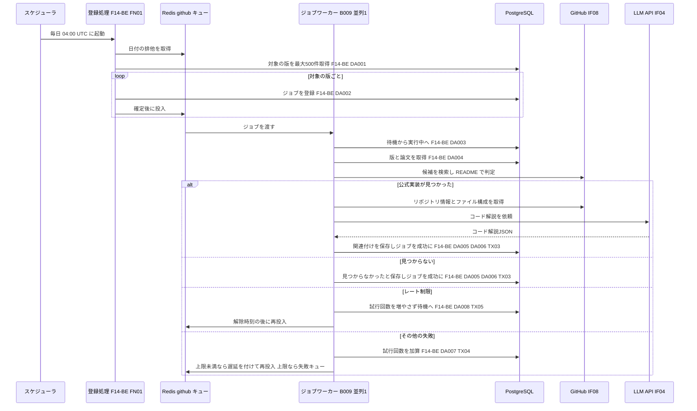
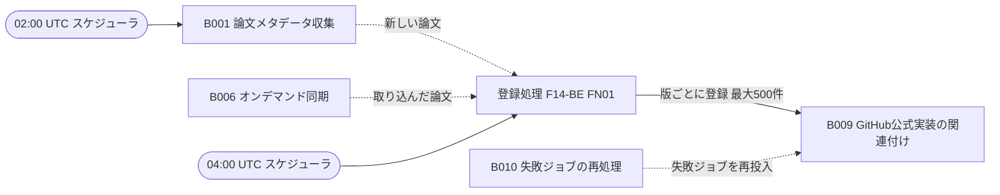

# バッチ詳細設計書 — B009 GitHub公式実装の関連付け

## 0. 文書情報

| 項目 | 値 |
| :--- | :--- |
| 設計書ID | B009-BE |
| 親ID | B009 |
| 親設計書 | `基本設計書_概要.md` §4 機能設計「バッチ処理設計」B009 行 |
| バッチ名 | GitHub公式実装の関連付け（上流 §4 バッチ処理設計の区分「非同期ジョブ」） |
| 対応する機能ID | F14 GitHub関連付け（上流 §4 機能一覧。優先度 Future） |
| 関連する業務フローID | BF15 GitHub公式実装の関連付け（Future）（上流 §2） |
| 版 | 1.1（第1回セルフレビュー `docs/reviews/batch_B009_review_applied.md` の Major 3件・Minor 1件を反映） |
| 作成日 / 更新日 | 2026-10-27 / 2026-10-27 |
| 作成方法 | creating-backend-detailed-design v1.5.0 準拠。上流の確定設計書と `source/` の企画資料からの新規設計 |
| インプット | (a) `source/02_機能要求定義.md:19,44-50`、`source/03_システム構成.md:7,11-12,43,57`、`source/04_収益化とロードマップ.md:27`（全6ファイル・計227行。前単位 B008 の作業時から変更なし）／(b) `docs/基本設計書_概要.md` §2 BF15、§4 F14・B009・バッチ共通の方針、§6 T001・T002・T009・CRUD図 F14 行、§7 IF04・IF08、§8、§9 環境変数一覧、§10 運用監視、§11 ARC001・ARC004・ARC006・ARC007、付録 Q02・Q18・Q19・Q23・Q29・Q30・Q31・Q35・Q36／関連する確定済み設計書: `docs/detail/be/BE.F14.BE詳細設計.md`（F14-BE。B009 の処理ロジックの定義元）、`docs/detail/be/BE.F04.BE詳細設計.md`（ジョブ共通の実行枠）、`docs/detail/batch/BT.B001.バッチ詳細設計.md`・`BT.B007.バッチ詳細設計.md`（スケジュール定義の置き場所）、`docs/db/DB.T001.DB物理設計.md`・`DB.T002.DB物理設計.md`・`DB.T009.DB物理設計.md`／(c) `legacy/`（空） |

* **インプットの性質（source/ の突合結果）**: `source/` は企画・初期設計案の Markdown 6ファイル（計227行）だけです。依頼にあるスケジュール定義 `config/schedule.rb`（whenever）と rake タスクの実装 `lib/tasks/` は**存在しません**（Ruby のファイル0件）。本システムのジョブは Python のワーカー（Redis + Celery または RQ）で動きます（`source/03_システム構成.md:7,11`）。資料にある B009 の記述は機能一覧の1行「F-14 GitHub関連付け｜Future｜論文の公式実装とコード解説」（`source/02_機能要求定義.md:19`）だけで、探し方・保存先・頻度は未定義です（上流 付録 Q23・Q30）。B009 本体は上流 §4 で「非同期ジョブ（※推測: 実行契機は未定義）」とされ、F14-BE はそのジョブを1日1回の定期実行で登録する二段の形に決めています（F14-BE §1 前提3）。このため whenever に当たる定義は §5「スケジュール定義」（登録処理の起動）に、rake タスクに当たるものは §4 のジョブ関数に置き換えて設計しています。本書は**リバースエンジニアリングではなく新規設計**で、資料と上流に無い値には「※推測」を付けています。
* **既存版**: `docs/detail/batch/BT.B009.バッチ詳細設計.md` の旧版はありません（作業開始時点の `docs/detail/batch/` は B001〜B008 の8ファイルだけ）。本書が初版で、消さずに残すべき既存記述はありません。
* **legacy/ との突合**: `legacy/` は空ディレクトリです（ファイル0件）。突合する既存のバッチ設計書・業務意図・非機能の記述はありません。
* **F14-BE・F04-BE との分担と継承**:
  * **処理ロジック（F14-BE）**: B009 の関数（FN01〜FN13）・データアクセス（DA001〜DA008）・発行SQL・トランザクション（TX01〜TX05）は F14-BE で定義済みです。F14-BE §5 は「ジョブとしての運用面の詳細はバッチ詳細設計書へ委譲する」としています。本書はこれらの **FN-ID・DA-ID・TX-ID をそのまま引き継ぎ**、起動契機・スケジュール・キューと並列数・多重起動制御・処理ステップ・性能・依存ジョブ順序・ログと監視を加えて、バッチとして実装・運用できる形に展開します。
  * **ジョブ共通の実行枠（F04-BE）**: F14-BE が共用するとした6関数（`run`・`claim`・`mark_succeeded`・`mark_failed_or_retry`・`enqueue`・`generate_structured`）は F04-BE の番号（No.1〜5・No.9）で引き継ぎます。
  * **IDの書き方**: 引き継いだIDは定義元の設計書IDを付けて「F14-BE FN01」「F14-BE DA003」「F14-BE TX03」「F04-BE No.1」と書きます（BT.B006〜B008 と同じ書き方）。本書で新しく採番したIDはありません。
  * **両書が食い違った場合**: 処理ロジックは F14-BE、起動と運用は本書を正とします。本書で見直した点（スケジュール定義の置き場所、スケジューラからの引数、専用キューと並列数1、再試行の遅延の段階）は §6 確認事項 No.8 にまとめ、F14-BE への取り込みを依頼します。
* **上流との差分**（F14-BE §1 前提1〜9 で挙がった※上流要確認・※上流未定義を引き継ぐ。§6 確認事項に集約）:
  * 関連付けの保存先テーブルが上流 §6 に無い（上流 付録 Q23）。F14-BE と同じく `{GitHub関連付けテーブル}` と書きます。
  * 上流 §6 CRUD図の F14 行は jobs の C だけで、ジョブの状態の書き換え（U）と保存先テーブルの列が無い。
  * 上流 §2 は BF15 の起点を「定期ジョブ（B009）」、§4 は B009 を「非同期ジョブ」とし、食い違う。登録の定期実行には上流のバッチIDが無い（※上流未定義。仮採番しない）。
  * 関連付けた結果を見せる画面・APIが無い。GitHub の認証情報の環境変数が上流 §9 に無い。公式実装の探し方が未定（Q30）。

## 1. バックエンド構成・モジュール設計

* **対象ドメイン**: 外部連携系（GitHub公式実装の関連付けバッチ） — 1日1回の定期実行で、関連付けがまだの論文と再確認の時期が来た論文の最新版を選んで版ごとにジョブを登録し、ジョブワーカーが1版ずつ、論文側に書かれた GitHub のURLか GitHub の検索から公式実装の候補を集めて判定し、見つかれば README とファイル構成から LLM で日本語のコード解説を作って保存し、見つからなければその旨と確認日時を保存する。GitHub のレート制限では試行回数を使わずに延期する（上流 F14・BF15・B009、F14-BE）。
* **対象APIエンドポイント**: なし。B009 は画面や外部から HTTP で呼ばれず、スケジューラとジョブキューから起動されます（根拠は §2 APIエンドポイント一覧）。
* **実行基盤**: Pythonワーカー上のジョブです（Redis + Celery または RQ。上流 Q02）。登録処理はスケジューラ（BT.B001・BT.B007 と同じ Celery beat または rq-scheduler。※推測）から起動し、B009 本体は GitHub の検索APIの回数制限に合わせて専用のキュー `github` を並列数1で処理します（§5 ワーカーの配置）。DB は Supabase 上の PostgreSQL に、行単位アクセス制御を通らないサーバ側のサービスロールで接続します（DB物理設計書 T009 §7）。
* **ディレクトリ/ファイル構造**（※推測: F14-BE §1 の配置案。スケジュール定義だけは全バッチで1か所にまとめるため、BT.B001・BT.B007 と同じ `worker/schedule.py` に置く。F14-BE は `worker/scheduler/schedule.py` としており、§6 確認事項 No.8 で揃える）:

```
worker/
├── schedule.py                         # スケジュール定義（whenever の config/schedule.rb に当たる。B001・B007 と共用。§5）
├── jobs/
│   ├── runner.py                       # F04-BE No.1 run（JobRunner。F14-BE FN13 の延期の分岐を加える）
│   ├── link_github_enqueue.py          # F14-BE FN01 enqueue_link_github_jobs（登録処理）
│   └── link_github.py                  # F14-BE FN02 link_github（B009 の本処理）
├── github/
│   ├── client.py                       # F14-BE FN08 GitHubClient.request（IF08）
│   ├── repo_finder.py                  # F14-BE FN05〜FN07（候補探しと判定）
│   ├── code_material.py                # F14-BE FN09（コード解説の材料集め）
│   └── explanation_schema.py           # F14-BE FN11（コード解説の出力形式の検証）
├── llm/
│   ├── client.py                       # F04-BE No.9 generate_structured（IF04）
│   └── prompts.py                      # F14-BE FN10（コード解説の指示文）
└── repositories/
    ├── job_repository.py               # F04-BE No.2〜5、F14-BE FN13
    └── github_link_repository.py       # F14-BE FN03・FN04・FN12
```

* **処理シーケンス図**（F14-BE §1 の図に、スケジューラの起動時刻、登録処理の排他、専用キューを加えたもの。※推測を含む）:



## 2. API・インターフェース詳細設計

* **APIエンドポイント一覧（全数ロースター）**:

| API ID | メソッド | エンドポイント | 概要 | 定義状況 | 詳細の所在 |
| :--- | :--- | :--- | :--- | :--- | :--- |
| — | — | 該当なし | — | — | — |

**総件数: 0件。根拠**: 上流 §7 内部API一覧の全8件（API01〜API08）に、B009 を起動・操作するものはありません（F14-BE §2 APIロースター0件と同じ）。上流 BF15 はジョブワーカーの中で完結し、関連付けた結果を見せるAPIも上流に無い（F14-BE §1 前提4。※上流要確認）。手動の登録（§5 起動契機 No.2）もワーカー上のコマンドで行い、HTTP の受け口は設けません（※推測）。

* **外部サービス連携一覧（全数ロースター）**: 上流 §7 外部連携一覧の全9件に対し、B009 で使うかを示します。

| IF ID | 連携先 | B009 での利用 | 概要 | 定義状況 | 詳細の所在 |
| :--- | :--- | :--- | :--- | :--- | :--- |
| IF01 | arXiv API | 利用しない | 論文の情報は収集済みの DB から読む | - | `docs/detail/batch/BT.B001.バッチ詳細設計.md` |
| IF02 | arXiv（論文本文PDF） | 利用しない | 論文本文は使わない | - | `docs/detail/batch/BT.B005.バッチ詳細設計.md` |
| IF03 | arXiv 原文ページ | 利用しない | 画面からのリンク遷移でサーバ処理を伴わない | - | - |
| IF04 | LLM API | 利用する | 論文の原題・Abstract とリポジトリの README・ファイル一覧を送り、コード解説のJSONを受け取る | 詳細 | 本節 外部サービス連携仕様、F14-BE §2 IF04 |
| IF05 | Supabase Auth | 利用しない | 利用者に関わらない | - | - |
| IF06 | Stripe（決済セッション） | 利用しない | 課金（F12）の責務 | - | - |
| IF07 | Stripe（契約状態の通知） | 利用しない | 課金（F12）の責務 | - | - |
| IF08 | GitHub | 利用する | リポジトリの検索、リポジトリ情報・README・ファイル構成の取得、残り回数の確認 | 詳細 | 本節 外部サービス連携仕様、F14-BE §2 IF08 |
| IF09 | 通知配信手段 | 利用しない | 通知・ダイジェスト配信（B007）の責務 | - | - |

**総件数: 9件（B009 で利用するもの2件）。根拠**: 上流 §7 外部連携一覧の IF01〜IF09 の全9行と1対1で対応します。利用する2件は上流 BF15 のシーケンスに現れる外部の参加者（GitHub・LLM API）で、F14-BE §2 外部サービス連携仕様の2件と一致します。

* **外部サービス連携仕様**（B009 で利用する2件。F14-BE §2 と同じ仕様に、本書の運用上の値（並列数・1日の回数）を加えたもの）:

| IF ID | 連携先 | 連携方式 | エンドポイント / 接続先 | 認証方式 | タイムアウト | リトライ方針 | エラー時の挙動 |
| :--- | :--- | :--- | :--- | :--- | :--- | :--- | :--- |
| IF08 | GitHub | REST API（※推測。上流 IF08、付録 Q30 の仮置き「GitHub API」） | ※推測: `https://api.github.com` の5つの口（リポジトリ検索 `GET /search/repositories`、リポジトリ情報 `GET /repos/{owner}/{repo}`、README `GET /repos/{owner}/{repo}/readme`、ファイル構成 `GET /repos/{owner}/{repo}/git/trees/{branch}?recursive=1`、残り回数 `GET /rate_limit`）。キュー `github` を並列数1で処理し、検索は前回から `GITHUB_SEARCH_INTERVAL_SEC`（※推測: 2秒）以上あけるため、検索は毎分30回以内に収まる（本書で追加） | ※推測: 個人アクセストークンを Bearer で送る（環境変数 `GITHUB_TOKEN`。※上流未定義） | ※推測: 1回の問い合わせあたり10秒 | 通信断・タイムアウト・HTTP 5xx のときだけ、1秒・2秒・4秒と間隔を倍にして最大3回まで送り直す（F14-BE FN08） | レート制限（HTTP 403 で残り回数0、または HTTP 429）は試行回数を増やさずにジョブを待機へ戻し、解除時刻の後に再投入する（F14-BE FN13）。HTTP 404 はその候補を外す。HTTP 401（トークン無効）は送り直さず、試行回数の上限によらずすぐ失敗にし、全ジョブに影響するため監視へ即時に知らせる。送り直しを使い切ったときはジョブを失敗記録へ回す |
| IF04 | LLM API | REST API（※推測。上流 IF04） | 提供元は未定（上流 Q29）。モデルは `LLM_MODEL_ID`（上流 §9） | APIキー（`LLM_API_KEY`。上流 §9） | ※推測: 90秒（F14-BE §2） | 通信のタイムアウト・接続失敗・HTTP 429・HTTP 5xx のときだけ、2秒・4秒・8秒と間隔を倍にして最大3回まで送り直す（F04-BE No.9） | 送り直しても失敗したらジョブを失敗記録へ回す。出力がコード解説の形式に合わないときは最大2回作り直し、それでも合わなければ解説を空にして関連付けだけを保存する（F14-BE FN02 手順7） |

* **API詳細仕様**: 該当なし（APIエンドポイント0件のため）。ジョブとしての入出力は §4 と §5 の入出力一覧に記載します。

## 3. データアクセス（ORM / クエリ）設計

* **データアクセス一覧（全数ロースター）**: DA-ID はすべて F14-BE §3 の採番をそのまま引き継ぎます。F14-BE DA002・DA003・DA006・DA007 は F04-BE の DA004・DA001・DA002・DA003 と同じ文です（F14-BE §3）。

| DA-ID | 処理名 | 呼出元（関数/API） | テーブルID | 対象物理テーブル | 種別 (SELECT/INSERT/UPDATE/DELETE) | 定義状況 (詳細/簡易) | 詳細の所在 |
| :--- | :--- | :--- | :--- | :--- | :--- | :--- | :--- |
| F14-BE DA001 | 関連付け対象の版の抽出 | F14-BE FN03（F14-BE FN01 から） | T001, T002, ※上流未定義, T009 | papers, paper_versions, {GitHub関連付けテーブル}, jobs | SELECT | 詳細 | §3 詳細定義・発行SQL F14-BE DA001 |
| F14-BE DA002 | 関連付けジョブの登録 | F04-BE No.5 `enqueue`（F14-BE FN01 から） | T009 | jobs | INSERT（衝突時は何もしない） | 詳細 | §3 詳細定義・発行SQL F14-BE DA002 |
| F14-BE DA003 | ジョブの実行開始 | F04-BE No.2 `claim`（F04-BE No.1 `run` から） | T009 | jobs | UPDATE | 詳細 | §3 詳細定義・発行SQL F14-BE DA003 |
| F14-BE DA004 | 対象の版と論文の取得 | F14-BE FN04（F14-BE FN02 から） | T001, T002 | papers, paper_versions | SELECT | 詳細 | §3 詳細定義・発行SQL F14-BE DA004 |
| F14-BE DA005 | 関連付け結果の保存 | F14-BE FN12（F14-BE FN02 から） | ※上流未定義 | {GitHub関連付けテーブル} | INSERT（衝突時 UPDATE） | 詳細 | §3 詳細定義・発行SQL F14-BE DA005 |
| F14-BE DA006 | ジョブの成功記録 | F04-BE No.3 `mark_succeeded`（F14-BE FN02 から） | T009 | jobs | UPDATE | 詳細 | §3 詳細定義・発行SQL F14-BE DA006 |
| F14-BE DA007 | ジョブの失敗記録 | F04-BE No.4 `mark_failed_or_retry`（F04-BE No.1 `run` から） | T009 | jobs | UPDATE | 詳細 | §3 詳細定義・発行SQL F14-BE DA007 |
| F14-BE DA008 | レート制限によるジョブの延期 | F14-BE FN13（F04-BE No.1 `run` から） | T009 | jobs | UPDATE | 詳細 | §3 詳細定義・発行SQL F14-BE DA008 |

**総件数: 8件（SELECT 2件・INSERT 1件・INSERT（衝突時 UPDATE）1件・UPDATE 4件・DELETE 0件。全件 詳細）。全数である根拠**: F14-BE §3 データアクセス一覧の全8件と1対1で対応します。§4 関数一覧の全19関数のうち DB へ問い合わせる8関数（F14-BE FN03→DA001、F04-BE No.5→DA002、No.2→DA003、F14-BE FN04→DA004、FN12→DA005、F04-BE No.3→DA006、No.4→DA007、F14-BE FN13→DA008）の処理フローに現れる問い合わせと一致します。本書（運用面）で新しく発行する DB 操作はありません。登録処理の排他は Redis のキーで行い（§5 多重起動制御）、DB には問い合わせません。B009 は DELETE を発行しません（関連付けの行は消さず、再確認で書き換える。F14-BE §3）。
**上流 CRUD図との突合**: 上流 §6 CRUD図の F14 行は papers「R」、paper_versions「R」、jobs「C」です。DA001・DA004 の R、DA002 の C と一致します。jobs の U（DA003・DA006〜DA008）と、`{GitHub関連付けテーブル}` の R・C・U（DA001・DA005）は CRUD図に表せません（F14-BE §1 前提2 と同じ。※上流要確認、§6 確認事項 No.2）。
**定義状況の判定**（completeness 3-1）: 8件とも、状態を変えるか（3-1 の2: DA002・DA003・DA005〜DA008）、複数の表を結合するか（3-1 の3: DA001・DA004）、重複・取り合いの業務ルールを含む（3-1 の5・7）ため「詳細」です（F14-BE §3 の判定と同じ）。

* **データアクセス詳細定義**（定義状況＝詳細の8件。内容は F14-BE §3 と同じで、本書で運用上の注意を加えたものは「本書で追加」と示す）:

| DA-ID | 処理名 | テーブルID | 対象物理テーブル | JOIN / Include | 抽出条件 (Where) / ソート | トランザクション境界 | N+1対策・性能上の注意 |
| :--- | :--- | :--- | :--- | :--- | :--- | :--- | :--- |
| F14-BE DA001 | 関連付け対象の版の抽出 | T001, T002, ※上流未定義, T009 | papers, paper_versions, {GitHub関連付けテーブル}, jobs | 論文に、その論文の最新版を内部結合し、関連付けの行を論文IDで外部結合する | 関連付けの行がまだ無い論文か、前回「見つからなかった」と記録してから再確認の間隔（`GITHUB_RECHECK_DAYS`。※推測: 30日）以上たった論文の最新版を選ぶ。すでに公式実装が見つかっている論文は選ばない。その版に関連付けのジョブが待機中・実行中・失敗のどれかで残っていれば外す（待機・実行中は二重登録を防ぐため、失敗は失敗ジョブの再処理（B010）を迂回して毎日登録し直さないため）。投稿日時の新しい順に、1回の上限件数（`GITHUB_LINK_BATCH_SIZE`。※推測: 500件）まで返す（`gl.paper_id IS NULL OR (gl.link_status = 'not_found' AND gl.checked_at < 現在 − 再確認の日数)`、`NOT EXISTS (jobs で同じ版・link_github・状態が pending/running/failed)`、`ORDER BY p.submitted_at DESC LIMIT 上限`） | なし（参照のみ） | 論文全件を見る問い合わせのため上限件数で区切る。上限500件は GitHub の1時間あたりの回数（認証付き ※推測: 5,000回）を1件あたり最大9回の問い合わせで割った目安。ジョブの有無は `idx_jobs_paper_version_id_job_type` の先頭2列で引ける。機能を有効にした直後は既存の論文がすべて対象になり、1日500件では追いつくまでに長い日数がかかる（本書で追加。§5 性能、§6 確認事項 No.5） |
| F14-BE DA002 | 関連付けジョブの登録 | T009 | jobs | なし | 版IDと種別 `link_github` で1行追加する。同じ版・同じ種別のジョブが待機中か実行中ですでにあれば何もしない（`ON CONFLICT (paper_version_id, job_type) WHERE status IN ('pending','running') AND paper_version_id IS NOT NULL DO NOTHING RETURNING id`） | 1件ごとに自動確定し、確定した後にキュー `github` へ投入する（F14-BE TX01） | DA001 と登録の間に別経路で登録された場合も、一意インデックス `uq_jobs_active_per_version` が二重登録を防ぐ。500件を1件ずつ登録する往復は1日1回のため許容する |
| F14-BE DA003 | ジョブの実行開始 | T009 | jobs | なし | 指定のジョブで状態が待機の行だけを実行中にし、版ID・種別・試行回数を受け取る（`WHERE id = $1 AND status = 'pending'`） | 1文で即時に確定する（F14-BE TX02） | 更新できた行が無ければ、他のワーカーが処理中か完了済みのため何もしない |
| F14-BE DA004 | 対象の版と論文の取得 | T001, T002 | papers, paper_versions | 版に論文を内部結合する | 指定した版IDの1行（`pv.id = $1`）。原題・Abstract・著者・取り込み時点のメタデータを読む | なし（参照のみ。トランザクションの外で読み、GitHub・LLM への問い合わせ中に DB の接続を持ち続けない） | 主キーで1行 |
| F14-BE DA005 | 関連付け結果の保存 | ※上流未定義 | {GitHub関連付けテーブル} | なし | 論文IDの行が無ければ追加し、あれば今回の結果で書き換える。見つかったときはリポジトリの情報・ライセンス名・判定の根拠・コード解説・生成モデル・確認日時を、見つからなかったときは「見つからなかった」と確認日時だけを書く。すでに公式実装が見つかっている行は「見つからなかった」で上書きしない（`ON CONFLICT (paper_id) DO UPDATE … WHERE 既存.link_status <> 'linked' OR 今回.link_status = 'linked'`） | DA006 と同じトランザクションで確定する（F14-BE TX03） | 1行の追加または更新。コードの本文は保存しない（F14-BE §1 前提9） |
| F14-BE DA006 | ジョブの成功記録 | T009 | jobs | なし | 指定のジョブで状態が実行中の行だけを成功にする（`WHERE id = $1 AND status = 'running'`） | DA005 と同じトランザクション（F14-BE TX03） | 更新が0件なら JobStateConflict として DA005 ごと取り消す |
| F14-BE DA007 | ジョブの失敗記録 | T009 | jobs | なし | 指定のジョブで状態が実行中の行について、試行回数を1増やし直近エラーを書く。増やした後の回数が上限（`JOB_MAX_ATTEMPTS`。※推測: 3）以上なら失敗、未満なら待機に戻す。再試行しても変わらない例外（トークン無効・版が無い）は上限を「今の試行回数＋1」にして必ず失敗にする | 単独で即時に確定する。本処理のトランザクションを取り消した後に実行する（F14-BE TX04） | 直近エラーには GitHub のトークン・認証付きURL・README の本文を含めず、エラーの種類と HTTP の状態コードだけを書く |
| F14-BE DA008 | レート制限によるジョブの延期 | T009 | jobs | なし | 指定のジョブで状態が実行中の行を、試行回数を増やさずに待機へ戻し、直近エラーに「GitHub のレート制限」と解除予定時刻を書く（`WHERE id = $1 AND status = 'running'`） | 単独で即時に確定し、確定の後にキューへ再投入する（F14-BE TX05） | 延期は同じジョブで1日24回（※推測）まで。超えたら DA007 に切り替える（延期の回数は Redis で数える） |

* **発行SQL**: 全8件。F14-BE §3 の発行SQLと同じ文です。番号付きのプレースホルダ（`$1`・`$2`）に値を渡す静的な文で、実行時に文の構造を組み立てる動的SQLはありません。`{GitHub関連付けテーブル}` とその列名（paper_id・paper_version_id・link_status・repo_full_name・repo_url・repo_license・default_branch・commit_sha・match_method・match_evidence・code_explanation・model_id・checked_at・generated_at）は、テーブルが上流で未定義のための置き場所で、名前はすべて※推測です。`link_status` の値は公式実装が見つかった `linked` と見つからなかった `not_found` の2つ（※推測）です。

**F14-BE DA001 関連付け対象の版の抽出**（`$1` は再確認の間隔の日数、`$2` は1回の上限件数）
```sql
SELECT pv.id AS paper_version_id,
       p.id  AS paper_id,
       p.arxiv_id
FROM   papers p
JOIN   paper_versions pv
       ON pv.paper_id = p.id
      AND pv.version  = p.latest_version
LEFT JOIN {GitHub関連付けテーブル} gl
       ON gl.paper_id = p.id
WHERE  (
         gl.paper_id IS NULL
         OR (gl.link_status = 'not_found'
             AND gl.checked_at < CURRENT_TIMESTAMP - make_interval(days => $1))
       )
  AND  NOT EXISTS (
         SELECT 1
         FROM   jobs j
         WHERE  j.paper_version_id = pv.id
           AND  j.job_type = 'link_github'
           AND  j.status IN ('pending', 'running', 'failed')
       )
ORDER  BY p.submitted_at DESC
LIMIT  $2;
```
組み立ての分岐: なし（固定の1文）。

**F14-BE DA002 関連付けジョブの登録**（`$2` は `link_github`）
```sql
INSERT INTO jobs (paper_version_id, job_type)
VALUES ($1, $2)
ON CONFLICT (paper_version_id, job_type)
  WHERE status IN ('pending', 'running') AND paper_version_id IS NOT NULL
  DO NOTHING
RETURNING id;
```
組み立ての分岐: なし（固定の1文）。

**F14-BE DA003 ジョブの実行開始**
```sql
UPDATE jobs
SET status = 'running'
WHERE id = $1
  AND status = 'pending'
RETURNING id, paper_version_id, job_type, attempts;
```
組み立ての分岐: なし（固定の1文）。

**F14-BE DA004 対象の版と論文の取得**
```sql
SELECT pv.id AS paper_version_id,
       pv.version,
       pv.metadata_snapshot,
       p.id AS paper_id,
       p.arxiv_id,
       p.title,
       p.abstract,
       p.authors
FROM   paper_versions pv
JOIN   papers p
       ON p.id = pv.paper_id
WHERE  pv.id = $1;
```
組み立ての分岐: なし（固定の1文）。

**F14-BE DA005 関連付け結果の保存**（`$3` が `linked` のときは `$4`〜`$12` に値が入り、`not_found` のときは空で渡す）
```sql
INSERT INTO {GitHub関連付けテーブル}
       (paper_id, paper_version_id, link_status,
        repo_full_name, repo_url, repo_license, default_branch, commit_sha,
        match_method, match_evidence, code_explanation, model_id,
        checked_at, generated_at)
VALUES ($1, $2, $3,
        $4, $5, $6, $7, $8,
        $9, $10, $11, $12,
        CURRENT_TIMESTAMP,
        CASE WHEN $11::jsonb IS NULL THEN NULL ELSE CURRENT_TIMESTAMP END)
ON CONFLICT (paper_id) DO UPDATE
   SET paper_version_id = EXCLUDED.paper_version_id,
       link_status      = EXCLUDED.link_status,
       repo_full_name   = EXCLUDED.repo_full_name,
       repo_url         = EXCLUDED.repo_url,
       repo_license     = EXCLUDED.repo_license,
       default_branch   = EXCLUDED.default_branch,
       commit_sha       = EXCLUDED.commit_sha,
       match_method     = EXCLUDED.match_method,
       match_evidence   = EXCLUDED.match_evidence,
       code_explanation = EXCLUDED.code_explanation,
       model_id         = EXCLUDED.model_id,
       checked_at       = EXCLUDED.checked_at,
       generated_at     = EXCLUDED.generated_at
 WHERE {GitHub関連付けテーブル}.link_status <> 'linked'
    OR EXCLUDED.link_status = 'linked'
RETURNING link_status;
-- すでに linked の行に not_found を書こうとしたときは行が返らない（既存の関連付けを残した）
```
組み立ての分岐: 文は固定です。結果は「追加した」「書き換えた」「既存の関連付けを残した（行が返らない）」の3通りです。

**F14-BE DA006 ジョブの成功記録**
```sql
UPDATE jobs
SET status = 'succeeded'
WHERE id = $1
  AND status = 'running';
```
組み立ての分岐: なし（固定の1文）。

**F14-BE DA007 ジョブの失敗記録**（`$2` は直近エラーの要約文、`$3` は試行回数の上限）
```sql
UPDATE jobs
SET attempts   = attempts + 1,
    last_error = $2,
    status     = CASE WHEN attempts + 1 >= $3 THEN 'failed' ELSE 'pending' END
WHERE id = $1
  AND status = 'running'
RETURNING status, attempts;
```
組み立ての分岐: なし（固定の1文）。

**F14-BE DA008 レート制限によるジョブの延期**（`$2` は「GitHub のレート制限。解除予定 {時刻}」の文）
```sql
UPDATE jobs
SET status     = 'pending',
    last_error = $2
WHERE id = $1
  AND status = 'running'
RETURNING status, attempts;
```
組み立ての分岐: なし（固定の1文）。

## 4. サーバー側機能・処理ロジック設計（IPO設計）

* **関数一覧（全数ロースター）**: FN-ID・No と関数名は定義元（F14-BE §4・F04-BE §4）の採番をそのまま引き継ぎます。

| FN-ID / No | 関数名 | 所属モジュール（※推測） | 定義元 | 概要 | 定義状況 | 詳細の所在 |
| :--- | :--- | :--- | :--- | :--- | :--- | :--- |
| F14-BE FN01 | `enqueue_link_github_jobs` | `worker/jobs/link_github_enqueue.py` | F14-BE §4 | 1日1回起動され、関連付けがまだの論文と再確認の時期が来た論文の最新版を選び、版ごとに B009 のジョブを登録する | 詳細 | §4 IPO定義（本書で運用の手順を追加） |
| F14-BE FN02 | `link_github` | `worker/jobs/link_github.py` | F14-BE §4 | B009 の本処理。1つの版について公式実装を探し、見つかればコード解説を作って保存し、見つからなければその旨を保存する | 詳細 | `docs/detail/be/BE.F14.BE詳細設計.md` §4 IPO FN02（委譲） |
| F14-BE FN03 | `find_targets_for_linking` | `worker/repositories/github_link_repository.py` | F14-BE §4 | DA001 を発行し、関連付け対象の版を上限件数まで返す | 詳細 | `docs/detail/be/BE.F14.BE詳細設計.md` §4 IPO FN03（委譲） |
| F14-BE FN04 | `find_target_with_metadata` | `worker/repositories/github_link_repository.py` | F14-BE §4 | DA004 を発行し、対象の版・論文・著者・メタデータを返す | 詳細 | `docs/detail/be/BE.F14.BE詳細設計.md` §4 IPO FN04（委譲） |
| F14-BE FN05 | `extract_links_from_paper` | `worker/github/repo_finder.py` | F14-BE §4 | Abstract とメタデータから GitHub のリポジトリを指すURLを抜き出す | 詳細 | `docs/detail/be/BE.F14.BE詳細設計.md` §4 IPO FN05（委譲） |
| F14-BE FN06 | `search_candidates` | `worker/github/repo_finder.py` | F14-BE §4 | 論文側にURLが無いとき、arXiv ID と原題で GitHub の検索APIを呼び候補を集める | 詳細 | `docs/detail/be/BE.F14.BE詳細設計.md` §4 IPO FN06（委譲） |
| F14-BE FN07 | `judge_official` | `worker/github/repo_finder.py` | F14-BE §4 | README の記述と所有者で、候補が公式実装といえるかを判定し1件を選ぶ | 詳細 | `docs/detail/be/BE.F14.BE詳細設計.md` §4 IPO FN07（委譲） |
| F14-BE FN08 | `request` | `worker/github/client.py`（GitHubClient） | F14-BE §4 | GitHub API を呼ぶ。送り直し、検索の間隔、レート制限・認証失敗の判別を受け持つ | 詳細 | §4 IPO定義（本書で並列数1の前提を追加） |
| F14-BE FN09 | `collect_code_material` | `worker/github/code_material.py` | F14-BE §4 | リポジトリ情報・ライセンス名・README・ファイル一覧を集め、指示文に入る長さに切り詰める | 詳細 | `docs/detail/be/BE.F14.BE詳細設計.md` §4 IPO FN09（委譲） |
| F14-BE FN10 | `build_code_explanation_prompt` | `worker/llm/prompts.py` | F14-BE §4 | コード解説を作らせる指示文を組み立てる | 詳細 | `docs/detail/be/BE.F14.BE詳細設計.md` §4 IPO FN10（委譲） |
| F14-BE FN11 | `validate_code_explanation` | `worker/github/explanation_schema.py` | F14-BE §4 | LLM の出力の形式と、事実と推測の区別、ファイル名の実在を確かめる | 詳細 | `docs/detail/be/BE.F14.BE詳細設計.md` §4 IPO FN11（委譲） |
| F14-BE FN12 | `save_link_result` | `worker/repositories/github_link_repository.py` | F14-BE §4 | DA005 を発行し、関連付けの結果を保存する | 詳細 | `docs/detail/be/BE.F14.BE詳細設計.md` §4 IPO FN12（委譲） |
| F14-BE FN13 | `defer_for_rate_limit` | `worker/repositories/job_repository.py` | F14-BE §4 | DA008 を発行し、レート制限のジョブを試行回数を増やさずに待機へ戻して再投入する | 詳細 | §4 IPO定義（本書で再投入先のキューを追加） |
| F04-BE No.1 | `run` | `worker/jobs/runner.py`（JobRunner） | F04-BE §4 | ジョブ共通の実行枠。取り合い、本処理の呼び出し、失敗時の記録と遅延付きの再投入。F14-BE FN13 の延期の分岐を加える | 詳細 | §4 IPO定義（B009 での値） |
| F04-BE No.2 | `claim` | `worker/repositories/job_repository.py` | F04-BE §4 | DA003 を発行し、待機中のジョブを実行中にする | 詳細 | `docs/detail/be/BE.F04.BE詳細設計.md` §4 IPO No.2（委譲） |
| F04-BE No.3 | `mark_succeeded` | `worker/repositories/job_repository.py` | F04-BE §4 | DA006 を発行し、ジョブを成功にする | 詳細 | `docs/detail/be/BE.F04.BE詳細設計.md` §4 IPO No.3（委譲） |
| F04-BE No.4 | `mark_failed_or_retry` | `worker/repositories/job_repository.py` | F04-BE §4 | DA007 を発行し、試行回数を増やして待機か失敗にする | 詳細 | `docs/detail/be/BE.F04.BE詳細設計.md` §4 IPO No.4（委譲） |
| F04-BE No.5 | `enqueue` | `worker/repositories/job_repository.py` | F04-BE §4 | DA002 を発行し、確定後に Redis へ投入する | 詳細 | `docs/detail/be/BE.F04.BE詳細設計.md` §4 IPO No.5（委譲） |
| F04-BE No.9 | `generate_structured` | `worker/llm/client.py`（LlmClient） | F04-BE §4 | LLM API を呼んで JSON を受け取る。通信の送り直しを受け持つ | 詳細 | `docs/detail/be/BE.F04.BE詳細設計.md` §4 IPO No.9（委譲） |

**総件数: 19関数（F14-BE の13件・F04-BE の6件。全件 詳細）。全数である根拠**: F14-BE §4 関数ロースターの全19件（F14-BE で定義する13件と、F04-BE で定義された共用の6件）と1対1で対応します。本書で新しく加えた関数はありません（運用面の手順は既存の関数の処理フローに加え、スケジュール定義は関数ではなく設定のため含めない）。
**定義状況と委譲**（completeness 2-3・3-1）: 19件とも F14-BE §4 の判定どおり「詳細」です。処理フローの詳細は定義元の設計書（`docs/detail/be/BE.F14.BE詳細設計.md` §4 IPO、`docs/detail/be/BE.F04.BE詳細設計.md` §4 IPO）にあり、本書は同じ内容を重ねて書かずに委譲します（責務は各定義元にある）。B009 の運用で手順や値を加える4件（F14-BE FN01・FN08・FN13、F04-BE No.1）だけを、本書の IPO 定義に書きます。

* **入力・処理・出力（IPO）定義**（本書で運用の手順・値を加える4件。定義元の処理フローの全手順を含め、本書で加えた部分は「（本書で追加）」と示す）:

| FN-ID / No | 関数名 | 所属モジュール | 引数 (型) | 処理フロー (ステップ単位で具体的に) | 戻り値 | 発生しうるエラー |
| :--- | :--- | :--- | :--- | :--- | :--- | :--- |
| F14-BE FN01 | `enqueue_link_github_jobs` | `worker/jobs/link_github_enqueue.py` | run_at: datetime または None（F14-BE は「スケジューラが渡す」とするが、スケジューラは起動のたびに変わる値を渡せないため、無ければ起動時刻（UTC）を使う。本書で追加） | 1. 機能の有効化（`GITHUB_LINK_ENABLED`）が無効なら、何もせず「対象外」として INFO ログ（§5 ログ No.1）を出して終わる（F14 は Future のため、提供を始めるまで止めておく）。<br>2. `GITHUB_TOKEN` が設定されていなければ、登録しても全件が認証失敗になるため、登録せずに ERROR ログ（No.2）を出して終わる。<br>3. 同じ日（UTC の日付）の登録処理が実行中なら、二重に走らないよう起動せずに終わる（Redis のキー `link_github_enqueue:lock:{日付}` を有効期限30分で作る。作れなければ INFO ログ No.1）。<br>4. F14-BE FN03 で、関連付け対象の版を上限件数（`GITHUB_LINK_BATCH_SIZE`。※推測: 500件）まで読む。0件なら手順6へ進む。<br>5. 版ごとに F04-BE No.5 `enqueue` でジョブ（種別 `link_github`）を登録する（F14-BE DA002）。同じ版のジョブが待機中か実行中ですでにあれば登録されず、その版は飛ばす。登録できたジョブは、確定の後にキュー `github` へ投入される（投入先のキューは本書で追加）。<br>6. 抽出件数・登録件数・飛ばした件数・前日までに登録して待機のまま残っているジョブの件数（キュー `github` の長さ）を INFO ログ（No.3）に出す。抽出件数が上限に達していれば、翌日に残りを回すことを書き添える。<br>7. 最後に排他を外す（本書で追加） | 実行結果の集計（抽出件数、登録件数、飛ばした件数: int） | DB 接続の失敗（登録処理を失敗で終え、ERROR ログ No.2。翌日の起動でやり直す。それまでに登録したジョブは確定済みのため残る）、Redis への投入失敗（ジョブ行は待機のまま残る。ERROR ログ No.9） |
| F14-BE FN08 | `request` | `worker/github/client.py`（GitHubClient） | method: str, path: str, params: dict, is_search: bool | 1. `GITHUB_TOKEN` を Bearer として付け、`https://api.github.com` に問い合わせる（IF08）。タイムアウトは10秒（※推測）。<br>2. 検索APIのときは、前回の検索から `GITHUB_SEARCH_INTERVAL_SEC`（※推測: 2秒）がたつまで待つ。前回時刻はワーカーのプロセスの中で持つ。キュー `github` を並列数1で処理するため、トークン1つにつき検索は同時に1つしか走らず、間隔はプロセスの中だけで守れる（本書で追加。§5 ワーカーの配置）。<br>3. 成功したら応答の本文を返す。<br>4. HTTP 403 で残り回数が0のとき、または HTTP 429 のときは、応答ヘッダーの解除時刻を添えて GitHubRateLimited を上げる。<br>5. HTTP 401 のときは送り直さず GitHubAuthError を上げる。<br>6. HTTP 404 のときは送り直さず「無い」を返す。<br>7. 通信断・タイムアウト・HTTP 5xx のときは、1秒・2秒・4秒と間隔をあけて最大3回まで送り直し、使い切ったら GitHubTransientError を上げる。<br>8. ログにはトークンと応答の本文を出さず、問い合わせ先の経路・状態コード・残り回数だけを出す。残り回数が設定の1割（※推測: 500回）を下回ったら WARN ログ（No.6）を出す（本書で追加） | 応答の本文、または「無い」 | GitHubRateLimited、GitHubAuthError、GitHubTransientError |
| F14-BE FN13 | `defer_for_rate_limit` | `worker/repositories/job_repository.py` | job_id: int, reset_at: datetime | 1. 同じジョブのその日の延期回数を Redis で1増やす。24回（※推測）を超えたら延期せず、F04-BE No.4 `mark_failed_or_retry` に切り替える。<br>2. 直近エラーの文を「GitHub のレート制限。解除予定 {時刻}」にして F14-BE DA008 を発行し、即時に確定する（F14-BE TX05）。<br>3. 解除予定時刻に60秒（※推測）を足した時刻に実行されるよう、同じジョブIDをキュー `github` へ予約投入する（投入先のキューは本書で追加）。ワーカーはその場で待たずに次のジョブへ進むが、次のジョブもほとんどが同じ制限に当たって延期されるため、制限の間はキューが延期の繰り返しで空転しない（各ジョブは1回目の問い合わせで延期になり、数ミリ秒で終わる）。<br>4. WARN ログ（No.5）を出す。打ち切ったときは ERROR ログ（No.5） | 更新後の状態（待機）と試行回数。打ち切ったときは `mark_failed_or_retry` の戻り値 | DB 障害（ERROR ログ No.9。ジョブは実行中のまま残る）、Redis への再投入失敗（ERROR ログ No.9。ジョブ行は待機のまま残る） |
| F04-BE No.1 | `run` | `worker/jobs/runner.py`（JobRunner） | job_id: int, handler: 本処理の関数（B009 では F14-BE FN02 `link_github`） | 1. `claim` で待機中のジョブを実行中にする。取り合いに負けた（null）なら INFO ログ（No.4）を残して終える。<br>2. `claim` 自体が DB の失敗で例外を上げたときは、ジョブはまだ待機で失敗を jobs に記録できない。ERROR ログ（No.9）を出し、例外をジョブキューへ返して再配送に任せる（BT.B002〜B008 と同じ）。<br>3. 本処理を呼ぶ。本処理は自身のトランザクション（F14-BE TX03）で関連付けの保存とジョブの成功を確定する。<br>4. 本処理が GitHubRateLimited を上げたら、トランザクションを取り消してから F14-BE FN13 を呼んで終える（F14-BE FN13 の注記の分岐）。<br>5. GitHubAuthError・PaperVersionNotFound は再試行しても変わらないため、force_fail を真にして `mark_failed_or_retry` を呼ぶ。JobStateConflict は失敗を記録せずに WARN ログ（No.8）を残して終える。それ以外の例外は force_fail を偽にして `mark_failed_or_retry` を呼ぶ。<br>6. 戻ってきた状態が待機なら、遅延（1回目の失敗の後は1分、2回目の失敗の後は5分。※推測。F14-BE §5 は1分・5分・15分を挙げるが、上限3回では3回目の失敗で失敗になるため15分は使われない）を付けて、同じジョブIDをキュー `github` へ再投入する。失敗なら失敗キューへ送り、ERROR ログ（No.7）を残す | なし | なし（本処理の例外はここで受け止め、ジョブの状態として残す。`claim` の DB 失敗だけはジョブキューへ返す） |

## 5. バッチ処理・非同期タスク設計

* **起動契機一覧（全数ロースター）**: 登録処理（F14-BE FN01）と B009 本体（F14-BE FN02）が動き出す経路をすべて挙げます。

| No | 起動契機 | 起動・登録する主体 | 起動の方法 | 概要 | 定義状況 | 詳細の所在 |
| :--- | :--- | :--- | :--- | :--- | :--- | :--- |
| 1 | 定期実行（登録処理） | スケジューラ（※推測: Celery beat または rq-scheduler。BT.B001・BT.B007 と同じスケジューラ） | 毎日 04:00 UTC に F14-BE FN01 を引数なしで呼ぶ | 関連付け対象の版を最大500件選び、版ごとに B009 のジョブを登録してキュー `github` へ投入する（F14-BE §5 の「GitHub関連付けジョブの定期登録」。上流にバッチIDが無い ※上流未定義） | 詳細 | 本節 スケジュール定義、§4 F14-BE FN01 |
| 2 | 手動の登録 | 運用者 | ワーカーのホスト上で F14-BE FN01 を実行するコマンドを使う（※推測: `python -m worker.jobs.link_github_enqueue`） | 機能を有効にした直後や、登録処理が失敗した日に、翌日を待たずに登録する。日付の排他で定期実行と重ならない | 詳細 | §4 F14-BE FN01 |
| 3 | 自動再試行・レート制限の延期 | B009 自身（F04-BE No.1 `run`、F14-BE FN13） | 失敗して試行回数が上限未満のとき遅延（1分・5分）を付けて、レート制限のときは解除時刻の後に、同じジョブIDを再投入する | ジョブ行は新しく作らない（上流 EX01 と同じ扱い。レート制限は試行回数を使わない） | 詳細 | §4 F04-BE No.1・F14-BE FN13、§6 リトライ方針 |
| 4 | 失敗ジョブの再処理 | 運用者が起動する失敗ジョブの再処理（B010） | 失敗のジョブを待機に戻して再投入する（上流 B010、T009 §4.3 (4)） | 原因（トークンの失効、GitHub・LLM の障害の継続）を取り除いた後の再実行。ジョブ行は新しく作らない。失敗のジョブがある版は F14-BE DA001 の対象から外れるため、B010 で戻さない限り再登録されない | 詳細 | -（未作成。予定パス `docs/detail/batch/BT.B010.バッチ詳細設計.md`） |

**総件数: 4件。全数である根拠**: F14-BE §5 ジョブ実行定義の2件（B009 本体と定期登録）のうち、B009 のジョブ行を作る経路が定期登録（No.1）で、これに、運用者が同じ関数を手で呼ぶ経路（No.2。BT.B001 §5 の手動実行と同じ考え方）、既存の行を再投入する経路（No.3: F04-BE No.1 と F14-BE FN13、No.4: 上流 B010）を加えたものです。DB物理設計書 T009 §6 の `link_github` も「登録の契機は上流で未定義」で、他のバッチから B009 を登録する経路はありません（BT.B001〜B008 の後続登録に `link_github` は無い）。
**定義状況の判定**（completeness 3-1）: 4件とも B009 を起動して外部への送信と永続データの書き換えを起こす（3-1 の2）ため「詳細」です。

* **スケジュール定義**（whenever の `config/schedule.rb` に当たる定義。登録処理の起動。※推測: 資料に頻度・時刻の定義は無く、F14-BE §5 の「1日1回（UTC 04:00）」と上流 §4 バッチ共通の方針「スケジュールはUTCで定義」に従う）:

| 項目 | 値 | 説明 |
| :--- | :--- | :--- |
| スケジュールの置き場所 | `worker/schedule.py`（BT.B001・BT.B007 と同じファイル） | すべての定期実行を1つのスケジューラに登録し、スケジューラのプロセスを1つにするため |
| 定義名 | `link-github-enqueue-daily`（※推測） | — |
| 呼び出す処理 | `worker.jobs.link_github_enqueue.enqueue_link_github_jobs`（引数なし） | スケジューラは登録だけを行い、GitHub への問い合わせはワーカーが行う |
| 実行周期 | 毎日1回 | 新しい論文は毎日入り、「見つからなかった」論文の再確認も日単位で来るため |
| 実行時刻 | 04:00 UTC（日本時間 13:00）。cron 式 `0 4 * * *` | 論文メタデータ収集（B001、02:00 UTC、約3分）の後に、その日の新しい論文を対象に入れるため（F14-BE §5）。要約の生成・公開（B002〜B004、最大で 04:00 UTC まで）とは、使う外部サービスとキューが別のため重なってもよい |
| タイムゾーン | UTC（スケジューラの設定 `timezone = "UTC"`） | 夏時間の影響を受けないため |
| 実行するホスト（専用サーバ判定） | スケジューラのプロセスは本番環境で1つだけ起動する（BT.B001・BT.B007 と共用。※推測・※上流未定義: Pythonワーカーのホスティング先が未定。上流 Q02） | whenever の `roles` に当たる。スケジューラが2つ動いても、日付の排他（多重起動制御 No.2）で登録は1回しか走らない |
| 実行環境 | production だけで有効にする。さらに `GITHUB_LINK_ENABLED` が真のときだけ登録する（既定は偽） | F14 は Future のため、提供を始めるまで本番でも何もしない。本番以外から GitHub と LLM を呼ばず、費用と回数を使わないため |

**総件数: 8項目。根拠**: BT.B001・BT.B007 §5 スケジュール定義と同じ8項目を、B009 の登録処理について定めたものです。

Celery beat を使う場合の定義例（※推測。BT.B007 §5 の定義例に1件を加える）:
```python
# worker/schedule.py
from celery.schedules import crontab

beat_schedule = {
    # B001・B007 の定義は BT.B001・BT.B007 §5 のとおり
    "link-github-enqueue-daily": {       # B009 の登録処理（本書）
        "task": "worker.jobs.link_github_enqueue.enqueue_link_github_jobs",
        "schedule": crontab(minute=0, hour=4),  # 毎日 04:00 UTC
    },
}
timezone = "UTC"
```

* **ワーカーの配置**（※推測・※上流未定義: キュー名と並列数は上流で未定義。上流 Q02）:

| 項目 | 値 | 説明 |
| :--- | :--- | :--- |
| キュー | `github`（※推測。B009 専用） | 要約系の `summarize`・`default`、Embedding の `embedding` と分ける。GitHub のレート制限で延期を繰り返す間も、他のジョブを止めないため |
| 並列数 | 全ワーカーの合計で1（設定値 `GITHUB_WORKER_CONCURRENCY`。※推測） | GitHub の検索APIの回数制限はトークン単位で、認証付きでも毎分30回程度と少ない（※推測）。並列数1にすると、F14-BE FN08 の「前回の検索から2秒あける」がプロセスの中だけで守れ、検索は毎分30回以内に収まる。並列数を増やすときは、検索の間隔を Redis で共有する仕組みが要る（§6 確認事項 No.6） |
| 処理するワーカー | `github` キューを購読するワーカーのプロセスを本番で1つだけ置く | 並列数1を保証するため |
| 実行環境 | すべての環境でキューを処理するが、ジョブが登録されるのは本番で `GITHUB_LINK_ENABLED` が真のときだけ | — |

**総件数: 4項目。根拠**: whenever の定義で決める事項のうち時刻を除く「何を（キュー）」「どれだけ（並列数）」「どこで（ワーカー）」「どの環境で」を1行ずつ挙げたものです。

* **多重起動制御**: 同じ論文を二重に処理すると、GitHub の回数と LLM の費用が二重にかかります。次の5段階で防ぎます。

| No | 段階 | 防ぐもの | 方法 | 防げなかったときの結果 |
| :--- | :--- | :--- | :--- | :--- |
| 1 | スケジューラ | 同じ時刻に登録処理が2つ起動されること | スケジューラのプロセスを本番で1つだけ動かす | No.2 で登録は1回しか走らない |
| 2 | 登録処理の排他 | 同じ日の登録処理（定期と手動）が同時に走ること | 日付をキーにした Redis のキーを有効期限30分で作り、作れなければ起動しない（F14-BE FN01 手順3） | 同時に走っても、No.3 で同じ版のジョブは1つしかできない |
| 3 | 登録 | 同じ版の B009 のジョブが2つ待機・実行されること | 待機中・実行中・失敗のジョブがある版を対象から外し（F14-BE DA001）、登録でも部分一意インデックスに当たったら取りやめる（F14-BE DA002） | — （DB が保証する） |
| 4 | 着手の取り合い | 同じジョブがキューから2つのワーカーへ渡ること | 状態が待機の行だけを実行中に変える条件付きの更新（F14-BE DA003） | — （DB が保証する） |
| 5 | 保存の条件 | 確定した関連付けを「見つからなかった」で上書きすること | すでに公式実装が見つかっている行は「見つからなかった」で書き換えない（F14-BE DA005） | — （DB が保証する） |

**総件数: 5段階。根拠**: 二重処理の原因になる「登録処理の重複起動（スケジューラ・手動）」「同じ版のジョブの重複登録」「同一ジョブの重複配送」「確定した結果の上書き」に1段階ずつ対応させたものです（スケジューラと登録処理の排他は起動の経路が違うため分けた）。

* **入出力一覧（IPO: 対象テーブル・外部連携）**: B009 が読み書きするものをすべて挙げます。

| 区分 | ID | 名称 | 物理名・接続先 | 操作 | 内容 |
| :--- | :--- | :--- | :--- | :--- | :--- |
| 入力 | T001 | 論文 | papers | 参照（F14-BE DA001・DA004） | arXiv ID・原題・Abstract・著者・最新版・投稿日時 |
| 入力 | T002 | 論文バージョン | paper_versions | 参照（F14-BE DA001・DA004） | 最新版と取り込み時点のメタデータ |
| 入力・出力 | ※上流未定義 | GitHub関連付け | {GitHub関連付けテーブル} | 参照・追加・書き換え（F14-BE DA001・DA005） | 論文ごとの公式実装のリポジトリ・判定の根拠・コード解説・確認日時、または「見つからなかった」 |
| 入力・出力 | T009 | ジョブ | jobs | 参照・追加・状態変更（F14-BE DA001〜DA003・DA006〜DA008） | `link_github` のジョブの状態・試行回数・直近エラー |
| 入力・出力 | IF08 | GitHub | `https://api.github.com`（※推測） | 送受信 | 送信: 検索語・リポジトリ名、受信: 候補・リポジトリ情報・README・ファイル構成・残り回数 |
| 入力・出力 | IF04 | LLM API | 提供元は未定（`LLM_MODEL_ID`・`LLM_API_KEY`） | 送受信 | 送信: 原題・Abstract・README・ファイル一覧・指示文、受信: コード解説のJSON |
| 入力 | — | ジョブキューのメッセージ | Redis の `github` キュー（`REDIS_URL`） | 受信 | ジョブID |
| 入力 | — | 設定値 | ワーカーの環境変数 | 参照 | §6 設定値一覧の13件 |
| 出力 | — | 排他のキー・延期の回数・ジョブキュー | Redis（`REDIS_URL`） | 作成・削除・送信 | 登録処理の排他、延期の回数、ジョブの投入・再投入・予約投入、失敗キューへの投入 |
| 出力 | — | 構造化ログ | ワーカーとスケジューラの標準出力（※推測: ホスティング先のログ収集に任せる） | 出力 | 本節 ログ出力一覧の12種類 |

**総件数: 10件（入力4件・入出力4件・出力2件）。根拠**: テーブルは §3 データアクセス一覧の8件が触れる4つの表（T001・T002・T009・{GitHub関連付けテーブル}）と一致し、外部連携は §2 外部サービス連携一覧で「利用する」の2件と一致します。ジョブキュー・設定値・Redis のキー・ログは §4 の IPO 定義と F14-BE §4 の処理フローに現れる入出力を拾ったものです。

* **処理ステップ詳細**: 定期実行（起動契機 No.1）の1日分を、登録から1件のジョブの終了まで順に示します。手動の登録（No.2）は手順1の起動のしかただけが違い、再試行・再処理（No.3・No.4）は手順6から始まります。

| 手順 | 処理 | 対象（ID） | DA-ID / 関数 | 成功時の次の手順 | 失敗時の扱い |
| :--- | :--- | :--- | :--- | :--- | :--- |
| 1 | スケジューラが 04:00 UTC に登録処理を呼ぶ | — | F14-BE FN01 | 2 | スケジューラのログに残り、翌日に再び起動する（運用者が急ぐ場合は手動の登録） |
| 2 | 機能の有効化とトークンを確かめ、日付の排他を取る | Redis | F14-BE FN01 | 3 | 無効: INFO ログ（No.1）で終了。トークン未設定: ERROR ログ（No.2）で終了。排他を取れない: INFO ログ（No.1）で終了 |
| 3 | 関連付け対象の版を最大500件読む | T001・T002・※上流未定義・T009 | F14-BE DA001（FN03） | 4（0件なら 5） | DB の失敗は ERROR ログ（No.2）で終了し、翌日にやり直す |
| 4 | 版ごとにジョブを登録し、確定後にキュー `github` へ投入する | T009・Redis | F14-BE DA002（F04-BE No.5） | 5 | DB の失敗は ERROR ログ（No.2）で終了（登録済みの分は残る）。投入の失敗は ERROR ログ（No.9）を出して続ける |
| 5 | 件数を出し、排他を外す | Redis | F14-BE FN01 | 登録処理は終了（INFO ログ No.3）。以降は手順6からジョブごとに進む | — |
| 6 | ワーカーがキュー `github` からジョブを受け取り、待機から実行中に変える | T009 | F14-BE DA003（F04-BE No.1・No.2） | 1行変えた: 7／0行: INFO ログ（No.4）で終了 | DB の失敗は ERROR ログ（No.9）を出してキューへ返し、再配送に任せる |
| 7 | 対象の版と論文を読み、論文側の GitHub のURLを抜き出し、無ければ検索APIで候補を集め、README で公式かを判定する | T001・T002・IF08 | F14-BE DA004（FN04）、FN05〜FN08 | 見つかった: 8／見つからない: 10 | レート制限は手順12、トークン無効・版が無いは直らない失敗（手順11）、通信の失敗は再試行できる失敗（手順11） |
| 8 | リポジトリ情報・README・ファイル構成を集め、LLM でコード解説を作り、形式を確かめる（合わなければ最大2回作り直す） | IF08・IF04 | F14-BE FN09〜FN11、F04-BE No.9 | 9 | 作り直しのたびに INFO ログ（No.11）。作り直しても合わなければ解説を空にして 9 へ（WARN ログ No.3）。LLM の失敗は再試行できる失敗（手順11） |
| 9 | 1つのトランザクションで「見つかった」として保存し、ジョブを成功にする | ※上流未定義・T009 | F14-BE DA005・DA006（FN12、F04-BE No.3）、TX03 | 終了（INFO ログ No.3） | DB の失敗は全体を取り消し、再試行できる失敗（手順11）。JobStateConflict は取り消して WARN ログ（No.8）で終了 |
| 10 | 1つのトランザクションで「見つからなかった」と確認日時を保存し、ジョブを成功にする | ※上流未定義・T009 | F14-BE DA005・DA006、TX03 | 終了 | 手順9と同じ |
| 11 | 失敗を記録する。上限未満なら遅延（1分・5分）を付けて再投入、上限到達か直らない失敗なら失敗キューへ送る | T009・Redis | F14-BE DA007（F04-BE No.4）、TX04 | 終了（WARN または ERROR ログ No.7） | 記録できない場合は ERROR ログ（No.9）だけを残し、ジョブは実行中のまま |
| 12 | レート制限で試行回数を増やさずに待機へ戻し、解除時刻の後に再投入する。1日24回を超えたら手順11へ | T009・Redis | F14-BE DA008（FN13）、TX05 | 終了（WARN ログ No.5） | 記録できない場合は ERROR ログ（No.9） |

**総件数: 12手順。根拠**: F14-BE FN01（登録処理）の手順1〜7と、F04-BE No.1 `run`・F14-BE FN02（ジョブ1件）の処理フローを、DB 操作・外部連携・分岐の単位で1行ずつ並べたものです。DA-ID の全8件が少なくとも1つの手順に現れます（DA001: 手順3、DA002: 4、DA003: 6、DA004: 7、DA005・DA006: 9・10、DA007: 11、DA008: 12）。

* **ジョブ実行定義**:

| バッチID | ジョブ名 | 実行タイミング | 対象テーブル | 処理概要 | タイムアウト |
| :--- | :--- | :--- | :--- | :--- | :--- |
| B009 | GitHub公式実装の関連付け（ジョブ種別 `link_github`） | 毎日 04:00 UTC の登録処理が登録したジョブを、キュー `github` から並列数1で1版ずつ実行する（上流 B009「非同期ジョブ」。登録処理による起動は F14-BE §5 の※推測）。ほかに手動の登録、自動再試行・レート制限の延期、失敗ジョブの再処理（起動契機一覧の4件） | 読み取り: papers, paper_versions。書き込み: {GitHub関連付けテーブル}（※上流未定義）、jobs（状態の書き換え） | 1つの版について、論文側に書かれた GitHub のURLか、arXiv ID・原題での検索から候補を集め、README がこの論文を指している候補を公式実装として1件選ぶ。見つかれば README とファイル構成を材料に LLM で日本語のコード解説を作り、リポジトリの情報と一緒に保存する。見つからなければその旨と確認日時を保存し、30日（※推測）後に探し直す（F14-BE §5） | 15分（F14-BE §5。※推測）。通常は約30秒以内に終わる。送り直しが重なる最悪の場合はこれを超えることがあり、そのときはジョブキューが打ち切って失敗記録へ回し、ジョブの再実行に任せる |
| — ※上流未定義 | GitHub関連付けジョブの定期登録（F14-BE FN01） | 毎日 04:00 UTC（※推測） | 読み取り: papers, paper_versions, {GitHub関連付けテーブル}, jobs。書き込み: jobs（登録） | 関連付けがまだの論文と、「見つからなかった」から再確認の間隔がたった論文の最新版を、投稿日時の新しい順に最大500件選び、版ごとに B009 のジョブを登録してキュー `github` へ投入する | 5分（F14-BE §5。※推測）。500件の抽出と登録は通常10秒以内に終わる |

* **依存ジョブ順序（全数ロースター）**: 上流 §4 バッチ処理設計の全11件について、B009 との前後関係を示します。

| バッチID | 名称 | B009 との関係 | 順序 | 概要 | 定義状況 | 詳細の所在 |
| :--- | :--- | :--- | :--- | :--- | :--- | :--- |
| B001 | 論文メタデータ収集 | 時刻による先行 | 02:00 UTC に起動し約3分で終わる（BT.B001 §5）。B009 の登録処理はその2時間後に起動し、その日の新しい論文を対象に入れる。完了を待つ仕組みは持たない（B001 が遅れても、翌日の登録で拾われる） | 論文と版を保存する | 簡易 | `docs/detail/batch/BT.B001.バッチ詳細設計.md` |
| B002 | Abstractベース日本語要約生成 | 関係なし | B009 は要約を使わない（原題と Abstract だけでコード解説を作る） | 要約を作る | 簡易 | `docs/detail/batch/BT.B002.バッチ詳細設計.md` |
| B003 | 要約の根拠・数値チェック | 関係なし | コード解説は B003 の検証を通さず、F14-BE FN11 の形式の検証だけを通す（※上流要確認。F14-BE §1 前提8） | 要約を検証する | 簡易 | `docs/detail/batch/BT.B003.バッチ詳細設計.md` |
| B004 | 公開反映 | 関係なし | B009 は公開の有無にかかわらず論文を対象にする | 合格した要約の後続ジョブを登録する | 簡易 | `docs/detail/batch/BT.B004.バッチ詳細設計.md` |
| B005 | 本文解析・詳細解説生成 | 関係なし | 本文は使わない | 本文から10分解説を作る | 簡易 | `docs/detail/batch/BT.B005.バッチ詳細設計.md` |
| B006 | arXivオンデマンド同期 | 間接の先行 | B006 が取り込んだ論文も、翌日以降の登録処理で対象に入る | 検索で必要になった論文を取り込む | 簡易 | `docs/detail/batch/BT.B006.バッチ詳細設計.md` |
| B007 | 通知・ダイジェスト配信 | 関係なし | 通知はコード解説を載せない | 関心分野の新着論文をまとめて送る | 簡易 | `docs/detail/batch/BT.B007.バッチ詳細設計.md` |
| B008 | 論文Embedding生成 | 関係なし | Embedding はコード解説を入力に使わない | 論文ごとの Embedding を作る | 簡易 | `docs/detail/batch/BT.B008.バッチ詳細設計.md` |
| B009 | GitHub公式実装の関連付け | 本バッチ | 起点は 04:00 UTC の登録処理 | 論文の公式実装を関連付け、コード解説を作る | 詳細 | 本書 |
| B010 | 失敗ジョブの再処理 | 再起動の主体 | B009 の失敗ジョブを運用者の起動で再投入する（起動契機 No.4） | 失敗キューのジョブを原因を取り除いてから再実行する | 簡易 | -（未作成。予定パス `docs/detail/batch/BT.B010.バッチ詳細設計.md`） |
| B011 | 検索インデックス更新 | 関係なし | 検索はリポジトリの情報を対象にしない | 公開反映が済んだ論文を検索インデックスに加える | 簡易 | -（未作成。予定パス `docs/detail/batch/BT.B011.バッチ詳細設計.md`） |

**総件数: 11件。全数である根拠**: 上流 §4 バッチ処理設計の B001〜B011 の全11行と1対1で対応します。B009 自身を除く10件は、本書では B009 との順序関係だけを述べるため「簡易」とし、各バッチの詳細はそれぞれのバッチ詳細設計書に委ねます（B001〜B008 は作成済み、B010・B011 は未作成）。B009 は他のバッチを登録せず、他のバッチからも登録されません（前後関係は時刻だけ）。
**順序の図**（上流 BF01・BF15・§4 バッチ処理設計と BT.B001 §5 から作図。時刻は※推測）:



* **性能（バッチウィンドウ・想定件数）**（※推測: 資料に件数・時間の目標値は無い。上流 Q31 で確認待ち。件数は BT.B001 §5 性能の1日の新しい論文の数を起点に計算）:

| 項目 | 標準ケース（AI・IT系のカテゴリに絞った場合） | 最大ケース（全カテゴリを収集した場合） | 根拠・計算 |
| :--- | :--- | :--- | :--- |
| 1日の新しい論文 | 約270本 | 約800本 | BT.B001 §5 |
| 1日に登録するジョブ数 | 積み残しがある間（機能を有効にしてから約200日）: 500件（上限）。積み残しが無くなった後: 約270件＋再確認の分 | 積み残しがある間（約600日）: 500件（上限）。積み残しが無くなった後も、新しい論文だけで上限を超えるため 500件 | 機能を有効にした時点の既存の論文がすべて対象になるため、積み残しがある間は毎日上限まで登録される（下の「機能を有効にした直後の積み残し」）。積み残しが無くなった後は、新しい論文と、30日前に「見つからなかった」論文の再確認だけになる |
| 公式実装が見つかる割合 | 約30% | 約20% | AI・IT系は実装を公開する論文が多いと見込む（※推測） |
| 1件あたりの所要時間 | 見つからない: 約8秒、見つかった: 約40秒 | 同じ | 見つからない: 検索2回（間隔2秒を含む）＋README の取得最大5回。見つかった: これにリポジトリ情報・ファイル構成の取得と LLM の呼び出し約30秒（※推測）を加える |
| 1日分の処理時間 | 積み残しがある間: 約2.4時間（500件×(0.7×8秒＋0.3×40秒)＝約8,800秒）。積み残しが無くなった後: 約1.3時間（270件で約4,750秒） | 約2時間（500件×(0.8×8秒＋0.2×40秒)＝約7,200秒） | 並列数1で1件ずつ処理する。標準ケースのほうが長いのは、公式実装が見つかる割合が高く LLM の呼び出しが多いため |
| バッチウィンドウ | 04:00〜06:30 UTC（積み残しがある間）、04:00〜05:30 UTC（積み残しが無くなった後） | 04:00〜06:30 UTC。レート制限の延期が続く日は最大で翌日 04:00 まで | 登録処理は数秒で終わり、その後ジョブを順に処理する。翌日の登録処理は待機中・実行中のジョブがある版を外すため、終わらなかった分が二重に登録されることはない。終わらなかった分は翌日の登録処理の時点で見る（監視項目 No.3） |
| GitHub の問い合わせ回数 | 1日最大約4,500回（500件×最大9回）。1時間あたり最大約1,900回（2.4時間で割った値） | 1日最大約4,500回、1時間あたり最大約2,250回 | 1件あたり最大9回（F14-BE §3 DA001 の目安）。並列数1で処理するため、1時間の回数は認証付きの上限（※推測: 5,000回）に収まる。検索は毎分30回以内（2秒間隔） |
| 機能を有効にした直後の積み残し | 既存の論文 約10万本（収集開始から1年後に有効化した場合）を、1日500件で約200日 | 約30万本で約600日 | 新しい論文が投稿日時の新しい順に優先されるため、新着の関連付けは遅れない。古い論文の積み残しを早く片付けるには上限件数を上げる必要があり、GitHub の回数と LLM の費用の見直しが要る（§6 確認事項 No.5） |
| テーブルの増加量 | {GitHub関連付けテーブル} 1日約500行（積み残しがある間）、約270行（無くなった後）。論文1本1行で、再確認は書き換え | 1日約500行 | 1論文1行のため、行数は関連付けを試した論文の数と同じ。コード解説のJSONは1行あたり数KB（※推測） |
| LLM の呼び出し回数 | 1日約150回（積み残しがある間。500件×30%）、約80回（積み残しが無くなった後。270件×30%） | 1日約100回（500件×20%） | 見つかったときだけ呼ぶ。形式の不一致による作り直しは最大2回 |

**総件数: 10項目。根拠**: 処理量（新しい論文・登録数・見つかる割合）、時間（1件・1日・時間帯）、外部の回数（GitHub）、機能の有効化時の積み残し、データ量、費用（LLM）を、BT.B001 §5 の件数から順に計算したものです。

* **ログ出力一覧（全数ロースター）**: 構造化ログ（※推測: JSON 形式で、ジョブID・ジョブ種別・版ID・試行回数を項目として持つ）で出します。GitHub のトークン、README の本文、LLM の出力の本文はログに出しません（F14-BE §6 セキュリティ上の考慮）。

| No | 出す時点 | レベル | 出す内容 | 用途 | 定義状況 | 詳細の所在 |
| :--- | :--- | :--- | :--- | :--- | :--- | :--- |
| 1 | 登録処理が何もせず終えたとき（機能が無効、日付の排他を取れない） | INFO | 日付、理由 | 提供開始前の定期実行と、多重起動の発生を確かめる | 簡易 | - |
| 2 | 登録処理が失敗したとき（トークン未設定、DB の失敗） | ERROR | 日付、理由、DB の失敗ならスタックトレース | その日の登録が行われなかったことを運用者が知る（監視項目 No.2） | 詳細 | 本節 監視項目一覧 |
| 3 | 登録処理が終わったとき、ジョブが成功で終わったとき | INFO（コード解説の作り直しの上限に達して解説を空にしたときは WARN） | 登録処理: 抽出件数・登録件数・飛ばした件数・待機のまま残っているジョブの件数。ジョブ: 結果（見つかった・見つからなかった・既存の関連付けを残した）、判定の根拠の種類、GitHub の問い合わせ回数、LLM の呼び出し回数、所要時間 | 監視項目 No.3・No.4 の集計元 | 詳細 | 本節 監視項目一覧 |
| 4 | 取り合いに負けて何もせず終えたとき | INFO | ジョブID、「他のワーカーが着手済み」 | ジョブキューの重複配送の発生を把握する | 簡易 | - |
| 5 | レート制限で延期したとき、延期を打ち切ったとき | 延期は WARN、打ち切りは ERROR | ジョブID、解除予定時刻、その日の延期回数 | 回数制限に当たっている頻度を把握する（監視項目 No.5） | 詳細 | 本節 監視項目一覧 |
| 6 | GitHub の残り回数が少なくなったとき | WARN | 残り回数、解除予定時刻 | 上限件数と問い合わせ回数の見積もりを見直す（監視項目 No.5） | 簡易 | - |
| 7 | ジョブが失敗したとき | 上限未満は WARN、上限到達・直らない失敗は ERROR | ジョブID、版ID、試行回数、エラーの種類と HTTP の状態コード、再試行までの遅延、ERROR のときはスタックトレース | 失敗の原因調査。ERROR は監視の通知対象（監視項目 No.1）。トークン無効は監視項目 No.6 で即時通知 | 詳細 | §6 例外処理 |
| 8 | 成功の記録が0件（JobStateConflict）で取り消したとき | WARN | ジョブID、その時点の状態 | 再処理と自動再試行の重なりを調べる | 簡易 | - |
| 9 | DB・ジョブキューの失敗でジョブの状態を記録できなかったとき（実行中にする前の失敗、失敗の記録の失敗、延期の記録の失敗、投入・再投入の失敗） | ERROR | ジョブID、失敗した時点、元のエラー | 待機または実行中のまま残ったジョブを運用者が見つける（§6 確認事項 No.7） | 詳細 | §6 例外処理 |
| 10 | 候補や材料の不備を飛ばしたとき（候補リポジトリが消えた・非公開（HTTP 404）、メタデータの形が想定と違う欄） | 404 は INFO、メタデータの形は WARN | 404: ジョブID・リポジトリ名。メタデータ: ジョブID・版ID・飛ばした欄の名前 | 論文側のURLの誤りや、取り込み時点のメタデータの形の変化を調べる | 簡易 | - |
| 11 | コード解説を作り直したとき | INFO（作り直しのたび） | ジョブID、arXiv ID、リポジトリ名、不合格の理由、作り直しの回数 | 指示文と出力形式の食い違いを調べる。上限に達して解説を空にしたときは No.3 の WARN で知らせる | 簡易 | - |
| 12 | GitHub の問い合わせを送り直したとき | WARN（送り直しのたび） | 問い合わせ先の経路、状態コード、送り直しの回数（トークンと応答の本文は出さない） | GitHub 側の障害の兆しを把握する。使い切った場合は No.7 のジョブの失敗になる | 簡易 | - |

**総件数: 12種類。根拠**: §4 IPO 定義（F14-BE FN01・FN08・FN13、F04-BE No.1）と F14-BE §6 エラーハンドリングの全15行の「ログ出力」欄で出すと定めたものを、出す時点ごとに1行ずつまとめたものです（F14-BE §6 の「404 の INFO」「メタデータの形の WARN」→No.10、「作り直しのたびに INFO」→No.11、「送り直しのたびに WARN」→No.12。残りの行は No.1〜No.9 のどれかに対応する）。定義状況は、運用者の対応や監視の判断に使うもの（3-1 の5「失敗時の扱い」）を「詳細」、記録だけのものを「簡易」としています。

* **監視項目一覧（全数ロースター）**（上流 §8 アプリケーション保護「バッチは監視対象にし、失敗したジョブは失敗キューに集める」、§10 運用監視「コスト監視」。監視の手段・通知先は未定義で上流 Q35 で確認待ち。しきい値は※推測）:

| No | 監視項目 | 検出の方法 | しきい値（※推測） | 通知・対応 | 定義状況 | 詳細の所在 |
| :--- | :--- | :--- | :--- | :--- | :--- | :--- |
| 1 | 関連付けジョブの失敗 | ERROR ログ（No.7 の上限到達）と、種別が `link_github` で状態が失敗のジョブ（`idx_jobs_failed`） | 1日に10件を超える | 運用者へ通知し、GitHub・LLM の障害かどうかを確かめ、原因を取り除いてから失敗ジョブの再処理（B010）で戻す | 詳細 | §6 リトライ方針 |
| 2 | 登録処理の未実行・失敗 | ERROR ログ（No.2）、または当日 04:30 UTC までに登録処理の終了ログ（No.3）が無いこと（機能が有効なときだけ） | 1日分の欠落 | 運用者へ通知する。必要なら手動の登録（起動契機 No.2）を行う | 詳細 | 本節 スケジュール定義 |
| 3 | 積み残しの増加 | 登録処理の終了ログ（No.3）の「待機のまま残っているジョブの件数」 | 前日の登録件数の半分を超える日が3日続く | 処理が1日で終わらなくなっている。延期の多さ（No.5）か所要時間の増加を確かめ、上限件数を見直す | 詳細 | 本節 性能 |
| 4 | LLM の費用 | 成功ログ（No.3）の LLM の呼び出し回数の1日の合計 | 1日300回を超える（標準ケースの積み残しがある間の見込み約150回の2倍） | 作り直しの多発や、判定の誤りで関連付けが増えていないかを確かめる（上流 §10「コスト監視」） | 詳細 | 本節 性能 |
| 5 | GitHub の回数制限 | 延期のログ（No.5）の件数、延期の打ち切り（No.5 の ERROR）、残り回数の警告（No.6） | 延期が1日100回を超える、または打ち切りが1件でも発生 | 上限件数・検索の間隔・並列数を見直す（§6 確認事項 No.6） | 詳細 | §5 ワーカーの配置 |
| 6 | トークンの無効・未設定 | ERROR ログ（No.7）のうち HTTP 401 によるもの、または登録処理の「トークン未設定」（No.2） | 1件でも発生したら | 全ジョブが失敗するため、すぐ運用者へ通知する。`GITHUB_TOKEN` を直してから失敗ジョブの再処理で戻す | 詳細 | §2 外部サービス連携仕様 |

**総件数: 6件。根拠**: 上流 §8・§10 が求めるバッチ監視（失敗・失敗キュー）とコスト監視に、B009 で起きうる異常（登録されない、処理が積み残る、費用が膨らむ、GitHub に制限される、認証情報が失効する）を、ログ出力一覧の ERROR・WARN と終了ログの集計項目ごとに1つずつ対応させたものです。

## 6. 例外処理・セキュリティ設計

* **エラーハンドリング**: B009 は利用者へ応答を返さないため、「クライアント応答」には、失敗が画面や運用者からどう見えるかを書きます。関連付けた結果を見せる画面は上流にまだ無いため（F14-BE §1 前提4）、B009 の失敗は現時点で利用者からは見えず、関連付けが遅れるだけです。

| 例外種別 | 対応方法 | ログ出力 | クライアント応答 |
| :--- | :--- | :--- | :--- |
| 機能が無効、またはトークン未設定（登録処理） | ジョブを登録せずに終わる（無効のときは正常終了、トークン未設定のときは設定漏れとして扱う） | 無効は INFO（No.1）、トークン未設定は ERROR（No.2） | なし（関連付けが行われない） |
| 登録処理の日付の排他を取れない | 起動せずに終わる（同じ日の登録処理が実行中） | INFO（No.1） | なし |
| DB 障害（登録処理） | 登録処理を失敗で終え、翌日の起動でやり直す。それまでに登録したジョブは確定済みのため残る | ERROR（No.2） | 運用者が急ぐ場合は手動の登録で取り戻す |
| Redis への投入失敗（登録・再投入・延期の予約投入） | ジョブ行は待機のまま残す | ERROR（No.9） | 運用者がジョブIDを手で投入し直す（§6 確認事項 No.7） |
| 取り合いに負けた | 何もせずに終える | INFO（No.4） | なし |
| 実行中にする前の DB の失敗（`claim`） | ジョブはまだ待機のため jobs に記録できない。例外をジョブキューへ返して再配送に任せる | ERROR（No.9） | なし（再配送で処理される） |
| 対象の版が無い（PaperVersionNotFound） | 試行回数の上限によらずその場で失敗にする（force_fail） | ERROR（No.7） | データの不整合として運用者が調べる |
| GitHub のレート制限（GitHubRateLimited） | 試行回数を増やさずに待機へ戻し、解除時刻の後に再投入する（F14-BE FN13）。1日24回を超えたら失敗記録へ切り替える | 延期は WARN、打ち切りは ERROR（No.5） | 関連付けが数時間遅れる |
| GitHub の認証失敗（GitHubAuthError） | 送り直さず、その場で失敗にする（force_fail）。全ジョブに影響する | ERROR（No.7）、監視項目 No.6 で即時通知 | トークンを直すまですべての関連付けが止まる。直した後に失敗ジョブの再処理で戻す |
| GitHub の通信失敗・障害（GitHubTransientError） | 1秒・2秒・4秒の間隔で最大3回送り直し、使い切ったら再試行できる失敗として記録する。上限未満なら遅延（1分・5分）を付けて再実行する | 送り直しのたびに WARN（No.12）、ジョブの失敗は上限未満が WARN・上限到達が ERROR（No.7） | 再試行で関連付けられれば影響なし |
| 候補リポジトリが消えた・非公開（HTTP 404） | その候補を外して次の候補へ進む。材料集めで起きた場合は「見つからなかった」として扱う | INFO（No.10） | なし（30日後に探し直す） |
| メタデータの形の不一致 | 想定と違う欄は飛ばし、残りの材料で続ける | WARN（No.10） | なし |
| LLM の失敗（LlmTransientError・LlmPermanentError） | 再試行できる失敗として記録する。関連付けもまだ保存していないため、再実行で探すところからやり直す | 上限未満は WARN、上限到達は ERROR（No.7） | 再試行で作られれば影響なし。GitHub の回数を再び使う |
| コード解説の形式の不一致 | 不合格の理由を添えて最大2回作り直し、それでも合わなければ解説を空にして関連付けだけを保存する | 作り直しのたびに INFO（No.11）、上限に達したら WARN（No.3） | 公式実装へのリンクだけが保存され、解説は空になる |
| 成功の記録が0件（JobStateConflict） | 関連付けの保存ごと取り消し、ジョブの状態には触れずに終える | WARN（No.8） | なし（状態を変えた側の処理の結果が残る） |
| 保存の失敗（DB 障害） | 関連付けの保存とジョブの成功記録をまとめて取り消し、再試行できる失敗として記録する | WARN、上限到達で ERROR（No.7） | 再試行で保存されれば影響なし。GitHub の回数と LLM の費用が1回分増える |
| 失敗・延期の記録自体の DB 失敗 | 何もできないため ERROR ログを残す。ジョブは実行中のまま残る | ERROR（No.9） | 運用者が監視で見つけ、失敗ジョブの再処理で戻す（§6 確認事項 No.7） |
| ジョブのタイムアウト（15分） | ジョブキューが打ち切り、再試行できる失敗として記録する。保存は最後の1つのトランザクションのため、途中まで保存された状態は無い | ERROR（No.7。処理していた段階） | 再試行で関連付けられれば影響なし |
| 予期しない例外 | 再試行できる失敗として記録する。登録処理では処理を失敗で終える | ERROR（No.7 または No.2。スタックトレース付き） | 再試行で関連付けられれば影響なし |

**総件数: 19種類。根拠**: F14-BE §6 エラーハンドリングの全15行（機能が無効またはトークン未設定・DB障害（登録処理）・Redis への投入失敗・PaperVersionNotFound・レート制限・認証失敗・通信失敗・404・メタデータの形・LLM の失敗・コード解説の形式・JobStateConflict・保存の失敗・ジョブのタイムアウト・予期しない例外）をすべて採り、本書の運用で起きる4種類（登録処理の日付の排他を取れない、取り合いに負けた、実行中にする前の DB の失敗、失敗・延期の記録自体の DB 失敗）を加えたものです（15＋4＝19）。

* **リトライ方針**（上流 EX01、§4 バッチ共通の方針、F14-BE §5 ジョブ共通の方針）:

| 項目 | 値 | 説明 |
| :--- | :--- | :--- |
| 再試行の単位（ジョブ） | 関連付けジョブ全体 | 保存とジョブの成功を最後の1つのトランザクション（F14-BE TX03）で記録するため、途中まで記録された状態は無い。再実行は探すところからやり直す |
| 再試行の単位（問い合わせ） | GitHub・LLM の1回の問い合わせ | 一時的な失敗のときだけ、ジョブの中で送り直す（GitHub は1秒・2秒・4秒、LLM は2秒・4秒・8秒、いずれも最大3回） |
| ジョブの試行回数の上限 | 3回（※推測。上流 Q19、`JOB_MAX_ATTEMPTS`） | 1回目の失敗で試行回数が1、3回目の失敗で上限に達して失敗になる |
| 再試行までの遅延 | 1回目の失敗の後は1分、2回目の失敗の後は5分（※推測。F04-BE No.1） | F14-BE §5 は1分・5分・15分を挙げるが、上限3回では15分は使われない |
| 試行回数を使わない延期 | GitHub のレート制限。解除時刻の後に再投入し、同じジョブで1日24回まで（F14-BE FN13） | 時間がたてば必ず解ける制限のため、試行回数を消費させない |
| 再試行しない失敗 | トークン無効（HTTP 401）、版が無い（force_fail）、登録処理のトークン未設定 | 同じ条件で何度やり直しても結果が変わらないため |
| 登録処理の失敗 | 自動では再試行しない。翌日の定期実行でやり直すか、運用者が手動の登録を行う | 1日1回の登録で、対象の抽出は毎回最初からやり直すため |
| 上限到達後 | 失敗キューへ送り、運用者が原因を取り除いてから失敗ジョブの再処理（B010）で待機に戻す。失敗のジョブがある版は登録処理の対象から外れる | 再処理で試行回数を0に戻すかは B010 の設計で決める（DB物理設計書 T009 §9 No.8、上流 Q36） |

* **冪等性**: 同じ版の関連付けを何度実行しても、結果が1回成功したときと同じになるようにします。

| No | 対象 | 二重に処理されたときの結果 | 冪等にしている仕組み |
| :--- | :--- | :--- | :--- |
| 1 | 関連付けの行（{GitHub関連付けテーブル}） | 論文1本につき1行。同じ結果で2回保存しても内容は変わらない。確定した関連付けは「見つからなかった」で消えない | 論文IDの一意な行への追加か書き換え、「見つかった」行を「見つからなかった」で書き換えない条件（F14-BE DA005） |
| 2 | 関連付けジョブの登録 | 同じ版のジョブは待機中・実行中で1件まで。失敗のジョブがある版は登録し直さない | 対象の抽出の条件（F14-BE DA001）と部分一意インデックスによる登録の取りやめ（F14-BE DA002） |
| 3 | 登録処理の起動 | 同じ日の登録処理は1つだけ動く | 日付をキーにした Redis の排他（F14-BE FN01 手順3） |
| 4 | 関連付けジョブの実行 | 同じジョブが2つのワーカーに渡っても、処理するのは1つだけ | 着手の条件付き更新（F14-BE DA003） |
| 5 | ジョブの状態の記録 | 成功・失敗・延期の記録が二重に来ても、状態が実行中の行しか変えないため、2回目は0行になる | 状態を条件にした更新（F14-BE DA006〜DA008） |
| 6 | LLM の呼び出し（費用） | 一度「見つかった」論文は再確認の対象にならず、コード解説を作り直さない | 対象の抽出で「見つかった」論文を外す（F14-BE DA001。上流 ARC001） |

**総件数: 6件。根拠**: B009 が書き込む2つの表（{GitHub関連付けテーブル}・T009）の行の種類（関連付け・ジョブの登録・ジョブの状態）、登録処理の起動、ジョブの実行、外部への送信（IF04）を、書き込み・実行・送信の単位ごとに1行ずつ挙げたものです。

* **トランザクション制御**（ID は F14-BE §6 の TX ID をそのまま引き継ぐ）:

| 処理名 | トランザクション範囲 | ロールバック条件 |
| :--- | :--- | :--- |
| F14-BE TX01 関連付けジョブの登録 | 版1件ごとのジョブの追加（F14-BE DA002）を1文で確定し、確定の後にキュー `github` へ投入する | 文の実行に失敗したとき（DB 障害）。同じ版のジョブがすでにある場合は一意インデックスに当たって何もしないため失敗にならない。それまでに確定した版のジョブは残る |
| F14-BE TX02 ジョブの実行開始 | 待機から実行中への書き換え（F14-BE DA003）を1文で即時に確定する | 文の実行に失敗したとき。書き換えた行が無ければ何もせずに終わる |
| F14-BE TX03 関連付け結果の保存とジョブの成功 | 関連付けの保存（F14-BE DA005）とジョブの成功記録（F14-BE DA006）を1つのトランザクションで確定する。GitHub と LLM への問い合わせはこの外で済ませ、結果がそろってから短く確定する | どちらかの文が失敗したとき（DB 障害）、または成功記録で更新できた行が無かったとき（JobStateConflict）。両方とも取り消される |
| F14-BE TX04 ジョブの失敗記録 | 本処理のトランザクションを取り消した後に、F14-BE DA007 を単独で即時に確定する | 文の実行に失敗したとき（ジョブは実行中のまま残る） |
| F14-BE TX05 レート制限によるジョブの延期 | 本処理のトランザクションを取り消した後に、F14-BE DA008 を単独で即時に確定し、確定の後にキューへ予約投入する | 文の実行に失敗したとき（ジョブは実行中のまま残る） |

* **外部呼び出しとトランザクションの関係**: GitHub と LLM への問い合わせ（最悪で十数分）はトランザクションの外で行い、結果がそろってから TX03 で短く確定します。長い外部呼び出しの間、DB の接続とロックを持ち続けないためです（F14-BE §6）。

* **セキュリティ設計**（上流 §8 のうち B009 に関わるもの。F14-BE §6 セキュリティ上の考慮を引き継ぐ）:
  * **機密情報**: GitHub のトークン（`GITHUB_TOKEN`）・LLM のAPIキー（`LLM_API_KEY`）・DB 接続文字列（`DATABASE_URL`）・サービスロールの鍵（`SUPABASE_SERVICE_ROLE_KEY`）・ジョブキューの接続先（`REDIS_URL`）はワーカーの環境変数にだけ置き、ログ・直近エラー・失敗キューへ出しません。トークンの権限は公開リポジトリの読み取りだけに絞ります。
  * **外部の文章による指示の書き換え**: README は第三者が書いた文章のため、LLM への指示文では「材料」の区画に入れ、材料の中の指示には従わないよう明記します。出力は形式とファイル名の実在を確かめてから保存します（F14-BE FN10・FN11、上流 ARC004 の考え方）。
  * **保存する内容**: README・ファイル一覧・コードの本文は保存せず、コード解説と判定の根拠の短い文だけを保存します。リポジトリのURLは所有者名とリポジトリ名から組み立て直したものだけを保存します（F14-BE §6）。
  * **外部APIの規約遵守**: 検索の間隔をあけ、並列数1で処理し、1日の登録件数を GitHub の1時間あたりの回数に収まる上限で区切ります（上流 §8「外部APIの規約違反・遮断」、`source/02_機能要求定義.md:49`）。
  * **個人データ**: B009 は利用者の個人データを扱いません（上流 CRUD図の F14 行に利用者のテーブルは無い）。

* **設定値一覧**（B009 が使うもの。※推測を含む）:

| 設定値 | 上流での定義 | 用途 | 既定値（※推測） |
| :--- | :--- | :--- | :--- |
| GITHUB_LINK_ENABLED | ※上流未定義（F14-BE §1 前提5） | GitHub関連付けを行うかどうか（F14 は Future のため提供開始まで無効） | false |
| GITHUB_TOKEN | ※上流未定義（F14-BE §1 前提5） | GitHub API の認証（公開リポジトリの読み取りだけの権限） | — |
| GITHUB_SEARCH_INTERVAL_SEC | ※上流未定義（F14-BE §1 前提5） | 検索APIの問い合わせ間隔 | 2 |
| GITHUB_RECHECK_DAYS | ※上流未定義（F14-BE §1 前提5） | 「見つからなかった」論文を探し直すまでの日数 | 30 |
| GITHUB_LINK_BATCH_SIZE | ※上流未定義（F14-BE §1 前提5） | 1回の登録処理で登録する件数の上限 | 500 |
| GITHUB_TREE_EXCLUDES | ※上流未定義（F14-BE FN09「一覧は設定値として持つ」） | ファイル構成から外すフォルダと拡張子の一覧 | F14-BE FN09 の一覧 |
| GITHUB_WORKER_CONCURRENCY | ※上流未定義（本書で追加） | キュー `github` を処理するワーカーの並列数の合計 | 1 |
| LLM_API_KEY | 上流 §9 環境変数一覧に定義あり | LLM API の認証 | — |
| LLM_MODEL_ID | 上流 §9 に定義あり | コード解説に使うモデル | — |
| JOB_MAX_ATTEMPTS | ※上流未定義（値は上流 Q19。B001〜B008 と共用） | ジョブの再試行の上限回数 | 3 |
| DATABASE_URL | 上流 §9 に定義あり | PostgreSQL への接続 | — |
| REDIS_URL | 上流 §9 に定義あり | ジョブキュー・排他・延期の回数 | — |
| SUPABASE_SERVICE_ROLE_KEY | 上流 §9 に定義あり | 行単位アクセス制御を通らないサービスロールで DB を書くための鍵（BT.B004・BT.B008 と同じ扱い） | — |

**総件数: 13件。根拠**: §4 IPO 定義と F14-BE §1 前提5・§4 の処理フロー、§5 ワーカーの配置で参照する設定値をすべて拾ったものです。GitHub と LLM のタイムアウト（10秒・90秒）、送り直しの回数と間隔、延期の上限（1日24回）、候補の件数（3件・5件）、材料の上限（2万字・500件）、作り直しの回数（2回）、排他の有効期限（30分）、再試行の遅延（1分・5分）、ジョブのタイムアウト（15分）はプログラム内の定数とします（※推測。F14-BE と同じ）。

* **確認事項**（本書で※推測・※上流要確認・※上流未定義とした事項。F14-BE §1 前提1〜9 のうち B009 の運用に関わるものを含む）:

| No | 確認事項 | 本書での仮置き | 関連する上流の確認事項 |
| :--- | :--- | :--- | :--- |
| 1 | 関連付けの保存先テーブル（物理名・列・論文IDの一意制約） | `{GitHub関連付けテーブル}`（F14-BE §3 の列を仮置き）（※上流未定義。F14-BE §1 前提1） | Q23 |
| 2 | 上流 CRUD図の F14 行に jobs の U と保存先テーブルの列を加えるか | 本書は §3 のとおり読み書きする（※上流要確認。F14-BE §1 前提2、DB物理設計書 T009 §4.6 No.4） | —（※上流未定義） |
| 3 | B009 の起動のしかた（上流 §2 の「定期ジョブ」と §4 の「非同期ジョブ」の食い違い）と、登録処理のバッチIDを上流に加えるか | 1日1回の登録処理と非同期ジョブの二段の形。登録処理には ID を振らない（※上流要確認・※上流未定義。F14-BE §1 前提3） | Q18 |
| 4 | 公式実装の探し方と判定の基準 | 論文側のURLを優先し、無ければ GitHub の検索API。README が論文を指している候補だけを公式とする（※推測。F14-BE §1 前提7） | Q30 |
| 5 | 機能を有効にした直後の積み残し（既存の論文 約10万〜30万本を1日500件で処理すると約200〜600日）を許容するか、上限件数を上げるか | 新着を優先し、古い論文は上限の範囲で徐々に処理する。上げる場合は GitHub の回数と LLM の費用を見直す（※推測） | Q31 |
| 6 | キュー `github` の並列数を1より増やすか（増やす場合は検索の間隔を Redis で共有する仕組みが要る） | 並列数1（※推測） | Q02 |
| 7 | 実行中にする前・失敗や延期の記録の DB の失敗で残ったジョブと、ジョブキューへの投入漏れの拾い直し（jobs に登録日時の列が無い） | 実行中にする前の失敗はジョブキューの再配送、投入漏れは運用者の手での投入、記録の失敗は再処理（B010）で扱う（※上流要確認。DB物理設計書 T009 §9 No.1、BT.B002〜B008 と同じ事項） | Q19・Q36 |
| 8 | F14-BE との差分の取り込み: (a) スケジュール定義の置き場所を `worker/schedule.py` に揃える (b) 登録処理の引数 `run_at` はスケジューラが渡せないため、渡さなくてよい（無ければ起動時刻を使う）ことにする (c) 専用キュー `github` と並列数1を明記する (d) 再試行の遅延を1分・5分の2段階とする（上限3回では15分は使われない） | この4点は本書を正とし、F14-BE の次回改訂で本書に合わせる（※上流要確認） | —（※上流未定義） |
| 9 | 関連付けた結果を見せる画面とAPI（論文詳細 P104・API03 への項目追加） | 本書は保存までを扱う（※上流要確認。F14-BE §1 前提4） | —（※上流未定義） |
| 10 | コード解説を要約と同じ根拠・数値チェック（B003）に通すか | 通さず、形式の検証（F14-BE FN11）だけを通す（※上流要確認。F14-BE §1 前提8） | —（※上流未定義） |
| 11 | 上流 §9 環境変数一覧に、本書と F14-BE で加えた設定値（`GITHUB_LINK_ENABLED`・`GITHUB_TOKEN`・`GITHUB_SEARCH_INTERVAL_SEC`・`GITHUB_RECHECK_DAYS`・`GITHUB_LINK_BATCH_SIZE`・`GITHUB_TREE_EXCLUDES`・`GITHUB_WORKER_CONCURRENCY`・`JOB_MAX_ATTEMPTS`）を加えるか | 加える前提（※上流未定義） | Q33 |
| 12 | 実行時刻・上限件数・再確認の日数・タイムアウト・延期の上限・再試行の上限と遅延 | §5・§6 のとおり（04:00 UTC、500件、30日、15分、1日24回、3回と1分・5分）（※推測） | Q18・Q19 |

## 7. 利用する方式（共通基盤）

| 方式ID | 名称 | 本書での利用箇所 |
| :--- | :--- | :--- |
| ARC006 | ジョブ実行基盤（キュー・リトライ・失敗キュー・監視） | 登録処理の定期実行、`link_github` のジョブの登録・取り合い・再試行・失敗キュー、レート制限での延期（F14-BE FN13）、ログと監視（§5 ログ出力一覧・監視項目一覧）をこの基盤で行う。上流の適用範囲「B001〜B011 / T009」に B009 が含まれる |
| ARC001 | 生成物キャッシュ・重複排除方式 | コード解説を論文ごとに保存して使い回し、「見つかった」論文は再確認の対象から外して LLM を再び呼ばない（§6 冪等性 No.6）。上流の適用範囲に B009・F14 は無いが、F14-BE §7 と同じく当てはめる（※上流要確認） |
| ARC004 | LLM出力検証方式（事実と推測の区別） | コード解説の各記述に「README に書かれた事実」か「AI の推測」かの区別を持たせ、ファイル名の実在を確かめてから保存する（F14-BE FN10・FN11）。上流の適用範囲に F14 は無いが、F14-BE §7 と同じく当てはめる（※上流要確認） |
| ARC007 | 外部APIアクセス制御（レート制限遵守・同期キャッシュ） | GitHub の検索の間隔、並列数1、1日の登録件数の上限、レート制限での延期で、GitHub の回数制限を守る（§5 ワーカーの配置、F14-BE FN08・FN13）。上流の適用範囲は arXiv（IF01・IF02）だけだが、F14-BE §7 と同じく当てはめる（※上流要確認） |

**総件数: 4件。根拠**: 上流 §11 方式設計一覧の全10件（ARC001〜ARC010）を1件ずつ照合し、本書の処理が使うものを挙げました。F14-BE §7 の4件と同じです（上流の適用範囲に B009 を含むのは ARC006 の1件、残る3件は F14-BE と同じく本書の処理が方式の規則に従うため当てはめたもの）。ARC002（段階的生成）・ARC003（要約スキーマ）は要約、ARC005（ライセンスゲート）は論文本文、ARC008（プラン別機能制御）は Pro 機能、ARC009（表示・編集ポリシー）は画面の表記、ARC010（個人データ最小化）は利用者データに関する方式で、本バッチでは使いません。
