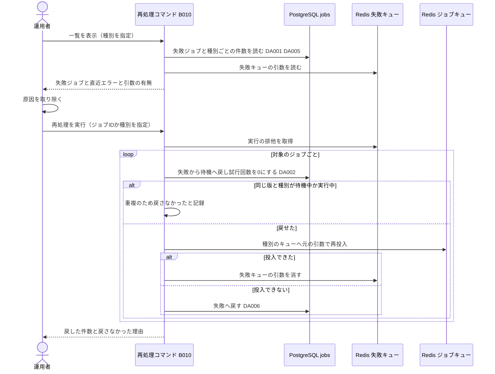
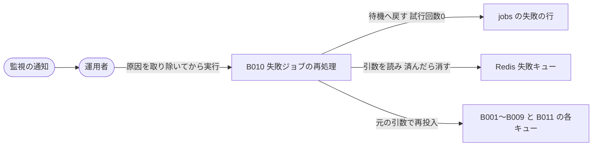

# バッチ詳細設計書 — B010 失敗ジョブの再処理

## 0. 文書情報

| 項目 | 値 |
| :--- | :--- |
| 設計書ID | B010-BE |
| 親ID | B010 |
| 親設計書 | `基本設計書_概要.md` §4 機能設計「バッチ処理設計」B010 行 |
| バッチ名 | 失敗ジョブの再処理（上流 §4 バッチ処理設計の区分「非同期ジョブ」） |
| 対応する機能ID | —（上流 §4 機能一覧に B010 を担う機能IDは無い。上流 §6 CRUD図は B010 を独立した行「B010 失敗ジョブの再処理」として持つ） |
| 関連する業務フローID | EX01 arXiv APIの取得失敗・レート制限（上流 §2。「上限到達: 失敗キューへ移す」の後始末） |
| 版 | 1.1（第1回セルフレビュー `docs/reviews/batch_B010_review_applied.md` の Major 2件を反映） |
| 作成日 / 更新日 | 2026-10-27 / 2026-10-27 |
| 作成方法 | creating-backend-detailed-design v1.5.0 準拠。上流の確定設計書と `source/` の企画資料からの新規設計 |
| インプット | (a) `source/02_機能要求定義.md:46,58`、`source/03_システム構成.md:11,43`（全6ファイル・計227行。前単位 B009 の作業時から変更なし）／(b) `docs/基本設計書_概要.md` §2 EX01、§4 B001〜B011・バッチ共通の方針、§6 T009・CRUD図 B010 行、§8 アプリケーション保護、§9 環境変数一覧、§10 運用監視、§11 ARC006、付録 Q19・Q24・Q35・Q36／関連する確定済み設計書: `docs/db/DB.T009.DB物理設計.md`（再処理の規則の定義元: §4.3 (4)(5)・§4.6 No.7・§6・§9 No.1・No.2・No.8）、`docs/detail/batch/BT.B001〜B009.バッチ詳細設計.md`（再処理の対象と、各バッチが本書に委ねた事項）、`docs/detail/be/BE.F04.BE詳細設計.md`（ジョブ共通の実行枠）、`docs/detail/be/BE.F17.BE詳細設計.md`（処理状況の表示）／(c) `legacy/`（空） |

* **インプットの性質（source/ の突合結果）**: `source/` は企画・初期設計案の Markdown 6ファイル（計227行）だけです。依頼にあるスケジュール定義 `config/schedule.rb`（whenever）と rake タスクの実装 `lib/tasks/` は**存在しません**（Ruby のファイル0件）。資料にある B010 の根拠は非機能要件の「バッチ処理はリトライ、重複排除、失敗キュー、監視を備える」（`source/02_機能要求定義.md:46`）の1行で、失敗キューをどう再処理するかは未定義です。上流 §4 は B010 を「失敗キュー（※推測: 運用者が手動で起動）」とし、付録 Q36 の仮置きも「運用者が手動で起動」です。このため B010 は定期実行ではなく、**運用者がワーカーのホスト上で実行するコマンド**として設計します（rake タスクに当たる）。whenever に当たるスケジュール定義は無く、§5 で「該当なし」と根拠を記載します。本書は**リバースエンジニアリングではなく新規設計**で、資料と上流に無い値には「※推測」を付けています。
* **既存版**: `docs/detail/batch/BT.B010.バッチ詳細設計.md` の旧版はありません（作業開始時点の `docs/detail/batch/` は B001〜B009 の9ファイルだけ）。本書が初版で、消さずに残すべき既存記述はありません。
* **legacy/ との突合**: `legacy/` は空ディレクトリです（ファイル0件）。突合する既存のバッチ設計書・業務意図・非機能の記述はありません。
* **上流と他の設計書から受け取った規則**:
  * **DB物理設計書 T009**: 「原因を取り除いたジョブを待機に戻す」（§4.3 (4)）、「待機に戻すときは試行回数を0に戻す」（§4.3 (5)、§9 No.8 の仮置き）、「同じ版・同じ種別の別のジョブがすでに待機中か実行中なら、失敗のまま残し直近エラーも書き換えず、『重複のため戻さなかった』と示す」（§4.3 (5)）、CRUD図の B010 行は jobs の「RU」（§4.6 No.7）。
  * **各バッチ設計書が本書に委ねた事項**: B001 の収集ジョブは失敗キューに残した取得期間で再投入し、無ければ直近3日分で再実行する（BT.B001 §6 確認事項 No.10）。B006 の同期ジョブは失敗キューに残した3キー（登録日時を除く）で再投入し、検索条件が無ければ直らない失敗になる（BT.B006 §5 起動契機 No.3）。B007 は jobs に行を持たないため、失敗キューの引数で扱えるかを本書で決める（BT.B007 §6 確認事項 No.6）。実行中のまま止まったジョブは B010 で扱う（BT.B001 §6 確認事項 No.5、BT.B004 §6 確認事項 No.6、BT.B005 §5 監視項目 No.6、BT.B008 §6 確認事項 No.8、BT.B009 §6 確認事項 No.7）。B008・B009 は専用のキュー（`embedding`・`github`）へ再投入する。
* **IDの書き方**: B010 の処理を定義した上流の BE 詳細設計書は無いため、本書のデータアクセスは「DA001」から本書（B010-BE）の ID として書きます。他の設計書のIDは「BT.B001 DA009」のように定義元を付けて書きます。本書で加えた関数とトランザクションには番号を振りません（※上流未定義。仮採番しないため）。
* **上流との差分**（※上流要確認・※上流未定義。§6 確認事項に集約）:
  * 失敗キューの形（何を入れるか）が上流と方式設計（ARC006。`docs/arch/方式.ARC006.方式設計.md` は未作成）で未定義。本書は各バッチ設計書が「失敗キューへ送る」とした内容から形を決め、※上流未定義とします。
  * 上流 §4 は B010 を「非同期ジョブ」と分類していますが、運用者が手で起動するコマンドとして設計します。B010 自身は jobs に行を持ちません（DB物理設計書 T009 §4.3「含めない処理」）。
  * jobs に登録日時・開始日時の列が無いため、実行中のまま止まったジョブは DB の行だけでは見分けられません（T009 §9 No.1）。本書は運用者がジョブIDを指定した場合だけ待機へ戻します。

## 1. バックエンド構成・モジュール設計

* **対象ドメイン**: 運用系（失敗ジョブの再処理） — 試行回数の上限に達したか直らない失敗で失敗になったジョブ（jobs の状態が失敗の行）と、失敗キューに残ったジョブの引数を運用者が一覧で確かめ、原因を取り除いた後に、指定したジョブを待機に戻して試行回数を0にし、ジョブの種別に応じたキューへ元の引数で再投入する。あわせて、実行中のまま止まったジョブと、待機のまま投入されなかったジョブを、運用者がジョブIDを指定して戻す・投入し直す。jobs に行を持たない通知・ダイジェスト配信（B007）は、失敗キューの引数だけで再投入する（上流 B010・EX01、DB物理設計書 T009 §4.3 (4)(5)）。
* **対象APIエンドポイント**: なし。運用者がワーカーのホスト上でコマンドを実行します（根拠は §2 APIエンドポイント一覧）。
* **実行基盤**: Pythonワーカーと同じコードベースのコマンド（※推測: `python -m worker.ops.reprocess_failed`）として、ワーカーのホスト上で実行します。ジョブキューの中で動くジョブではなく、運用者の端末で結果を表示して終わる同期的な処理です。DB は Supabase 上の PostgreSQL に、行単位アクセス制御を通らないサーバ側のサービスロールで接続し、失敗キューとジョブキューは Redis（`REDIS_URL`）に接続します。
* **ディレクトリ/ファイル構造**（※推測: 上流 §9 の想定構成 `worker/` に運用コマンドの置き場所 `ops/` を加える）:

```
worker/
├── ops/
│   └── reprocess_failed.py         # run_reprocess（コマンドの入口）/ show_failed_jobs / reprocess_failed_job / recover_running_job / requeue_pending_job / reprocess_queue_only_entry
├── jobs/
│   └── routes.py                   # resolve_route（ジョブ種別ごとのキューと引数の対応表。各バッチの投入でも使う）
├── repositories/
│   └── reprocess_repository.py     # 本書 DA001〜DA006
└── queue/
    └── failure_queue.py            # load_failure_entries / remove_failure_entry（失敗キューの読み書き）
```

* **処理シーケンス図**（上流 B010「失敗キューに溜まったジョブを調べ、原因を取り除いたものを再実行する」を、運用者の操作から再投入まで展開。※推測を含む）:



## 2. API・インターフェース詳細設計

* **APIエンドポイント一覧（全数ロースター）**:

| API ID | メソッド | エンドポイント | 概要 | 定義状況 | 詳細の所在 |
| :--- | :--- | :--- | :--- | :--- | :--- |
| — | — | 該当なし | — | — | — |

**総件数: 0件。根拠**: 上流 §7 内部API一覧の全8件（API01〜API08）に B010 を起動・操作するものは無く、上流 §3.2 の管理者向け画面も0件です（上流 付録 Q05 で管理画面の有無を確認中）。運用者はワーカーのホスト上のコマンドで操作し、HTTP の受け口は設けません（※推測）。

* **外部サービス連携一覧（全数ロースター）**: 上流 §7 外部連携一覧の全9件に対し、B010 で使うかを示します。

| IF ID | 連携先 | B010 での利用 | 概要 | 定義状況 | 詳細の所在 |
| :--- | :--- | :--- | :--- | :--- | :--- |
| IF01 | arXiv API | 利用しない | B010 はジョブを再投入するだけで、arXiv への問い合わせは再投入された B001・B006 が行う | - | `docs/detail/batch/BT.B001.バッチ詳細設計.md` |
| IF02 | arXiv（論文本文PDF） | 利用しない | 本文の取得は再投入された B005 が行う | - | `docs/detail/batch/BT.B005.バッチ詳細設計.md` |
| IF03 | arXiv 原文ページ | 利用しない | 画面からのリンク遷移でサーバ処理を伴わない | - | - |
| IF04 | LLM API | 利用しない | 要約・解説・Embedding の生成は再投入された各バッチが行う | - | `docs/detail/batch/BT.B002.バッチ詳細設計.md` |
| IF05 | Supabase Auth | 利用しない | 利用者に関わらない | - | - |
| IF06 | Stripe（決済セッション） | 利用しない | 課金（F12）の責務 | - | - |
| IF07 | Stripe（契約状態の通知） | 利用しない | 課金（F12）の責務 | - | - |
| IF08 | GitHub | 利用しない | GitHub への問い合わせは再投入された B009 が行う | - | `docs/detail/batch/BT.B009.バッチ詳細設計.md` |
| IF09 | 通知配信手段 | 利用しない | 配信は再投入された B007 が行う | - | `docs/detail/batch/BT.B007.バッチ詳細設計.md` |

**総件数: 9件（B010 で利用するもの0件）。根拠**: 上流 §7 外部連携一覧の IF01〜IF09 の全9行と1対1で対応します。上流 §6 CRUD図の B010 行は jobs の RU だけで、B010 は DB と Redis（どちらも上流 §7 で内部の構成要素）だけを読み書きします。

* **外部サービス連携仕様**: 該当なし（B010 が利用する外部連携は0件。根拠は上の一覧の直後に記載）。

* **コマンドの引数の定義**（運用者が指定するもの。※推測・※上流未定義）:

| No | 引数 | 型 | 既定 | 意味 | 説明 |
| :--- | :--- | :--- | :--- | :--- | :--- |
| 1 | `--list` | 指定の有無 | 指定なし | 失敗ジョブの一覧と種別ごとの件数を表示するだけで、何も変えない | 再処理の前に、直近エラーと失敗キューの引数の有無を確かめるため |
| 2 | `--job-type` | jobs の種別のコード（DB物理設計書 T009 §6 の9値）または `digest_delivery` | 指定なし | 対象を1つの種別に絞る | 原因を取り除いたのは種別単位のことが多いため（例: LLM のキーを直したら要約生成だけを戻す） |
| 3 | `--ids` | ジョブIDの並び | 指定なし | 対象をジョブIDで指定する | 種別より細かく、特定のジョブだけを戻すため |
| 4 | `--all-failed` | 指定の有無 | 指定なし | `--job-type` で絞った種別の失敗ジョブをすべて対象にする（種別の指定が必須） | 誤って全種別をまとめて戻さないよう、種別の指定なしでは使えない |
| 5 | `--recover-running` | ジョブIDの並び | 指定なし | 実行中のまま止まったジョブを待機へ戻して再投入する | jobs に開始日時が無く自動では見分けられないため、運用者がログ（各バッチのログ「状態を記録できなかった」）で確かめたジョブIDだけを受け付ける |
| 6 | `--requeue-pending` | ジョブIDの並び | 指定なし | 待機のまま投入されなかったジョブを、状態を変えずに投入し直す | 各バッチのログ「ジョブキューへの投入に失敗した」で確かめたジョブIDだけを受け付ける |
| 7 | `--execute` | 指定の有無 | 指定なし | 指定が無ければ、何をするかを表示するだけで何も変えない（試し実行） | 誤操作で大量のジョブを戻さないため、実際に変えるには明示を要する |
| 8 | `--limit` | 整数 | 1,000（設定値 `REPROCESS_MAX_PER_RUN`） | 1回で戻すジョブの上限 | 障害の後に数千件の失敗がまとまっていても、一度にキューへ流し込まず、段階的に戻すため |

**総件数: 8引数。根拠**: 本書の再処理の4つの操作（失敗ジョブの再処理、実行中のまま止まったジョブの回復、待機のまま残ったジョブの投入し直し、jobs に行を持たない B007 の再投入）と、一覧の表示を行うために、対象の選び方（No.2〜No.6）、表示か実行か（No.1・No.7）、量の制限（No.8）を1引数1行で挙げたものです。B007 の再投入は `--job-type digest_delivery` で指定します（`digest_delivery` は jobs の種別ではなく、失敗キューの中で B007 を表す名前。※上流未定義）。

* **失敗キューの形**（各バッチが「失敗キューへ送る」とした内容を、本書が読む形として定める。※推測・※上流未定義。ジョブ実行基盤 ARC006 の方式設計書で確定する）:

| No | 項目 | 型 | 必須 | 入れる値 | 説明 |
| :--- | :--- | :--- | :--- | :--- | :--- |
| 1 | `jobType` | 文字列 | ○ | jobs の種別のコード、または B007 は `digest_delivery` | 再投入するキューと処理を決める（§4 `resolve_route`） |
| 2 | `jobId` | 整数または null | — | jobs のジョブID。B007 は null | jobs の行と結びつける |
| 3 | `args` | オブジェクト | — | 再投入に要る引数（B001: 取得期間、B006: `jobId`・`q`・`category`、B007: `run_at`・`delivery_date`、それ以外: 無し） | 各バッチの設計書で「失敗キューに残す」とした引数そのもの |
| 4 | `failedAt` | 文字列（ISO 8601、UTC） | ○ | 失敗キューへ送った日時 | jobs に失敗日時の列が無いため、一覧で古い順に並べ、B007 の配信日の判定に使う |

**総件数: 4項目。根拠**: 各バッチ設計書の「失敗キューへ送る」の記述（BT.B001 `record_job_failure` 手順4「ジョブIDと期間の引数」、BT.B006 `record_job_failure` 手順4「ジョブIDと3キー」、BT.B007 FN01 手順11「引数ごと」、F04-BE No.1 手順5「失敗キューへ送る」）に共通する内容（種別・ジョブID・引数）に、jobs に無い失敗日時を加えたものです。Redis のリスト `jobs:failed`（※推測）に、1件を1つの JSON として入れます。

* **API詳細仕様**: 該当なし（APIエンドポイント0件のため）。コマンドとしての入出力は本節の「コマンドの引数の定義」、§4 `run_reprocess`、§5 入出力一覧に記載します。

## 3. データアクセス（ORM / クエリ）設計

* **データアクセス一覧（全数ロースター）**: DA-ID は本書（B010-BE）の ID です（§0「IDの書き方」）。

| DA-ID | 処理名 | 呼出元（関数/API） | テーブルID | 対象物理テーブル | 種別 (SELECT/INSERT/UPDATE/DELETE) | 定義状況 (詳細/簡易) | 詳細の所在 |
| :--- | :--- | :--- | :--- | :--- | :--- | :--- | :--- |
| DA001 | 失敗ジョブの一覧の取得 | `show_failed_jobs`、`run_reprocess`（対象の決定） | T009 | jobs | SELECT | 詳細 | §3 詳細定義 DA001・発行SQL DA001 |
| DA002 | 失敗ジョブを待機へ戻す | `reprocess_failed_job` | T009 | jobs | UPDATE | 詳細 | §3 詳細定義 DA002・発行SQL DA002 |
| DA003 | 実行中のまま止まったジョブを待機へ戻す | `recover_running_job` | T009 | jobs | UPDATE | 詳細 | §3 詳細定義 DA003・発行SQL DA003 |
| DA004 | 待機のジョブの確認 | `requeue_pending_job` | T009 | jobs | SELECT | 簡易 | 発行SQL DA004 |
| DA005 | 種別ごとの失敗件数の集計 | `show_failed_jobs` | T009 | jobs | SELECT | 簡易 | 発行SQL DA005 |
| DA006 | 投入できなかったジョブを失敗へ戻す | `reprocess_failed_job`・`recover_running_job` | T009 | jobs | UPDATE | 詳細 | §3 詳細定義 DA006・発行SQL DA006 |

**総件数: 6件（SELECT 3件・UPDATE 3件・INSERT 0件・DELETE 0件。詳細4件・簡易2件）。全数である根拠**: §4 関数一覧の全10関数のうち DB へ問い合わせる5関数（`show_failed_jobs`→DA001・DA005、`run_reprocess`→DA001、`reprocess_failed_job`→DA002・DA006、`recover_running_job`→DA003・DA006、`requeue_pending_job`→DA004）の処理フローに現れる問い合わせを1件1行で数えたものです。残りの5関数（`resolve_route`・`load_failure_entries`・`remove_failure_entry`・`requeue`・`reprocess_queue_only_entry`）は Redis だけを読み書きします。
**上流 CRUD図との突合**: 上流 §6 CRUD図の B010 行は jobs「RU」で、他のテーブルは「-」です。DA001・DA004・DA005 の R、DA002・DA003・DA006 の U と一致し、jobs 以外のテーブルには触れません。B010 はジョブ行を作らず（C なし）、消しません（D なし。DB物理設計書 T009 §9 No.4「消さない」）。
**定義状況の判定**（completeness 3-1）: DA002・DA003・DA006 は永続データを書き換え（3-1 の2）、一意インデックスとの衝突や状態の条件による分岐を持つ（3-1 の1・5）ため「詳細」です。DA001 は種別の指定の有無で条件が変わり（3-1 の1）、件数の上限で区切る（3-1 の6）ため「詳細」です。DA004 は指定のジョブIDの行を読むだけ、DA005 は失敗の行を種別ごとに数えるだけで、3-1 のどれにも当たらないため「簡易」です。

* **データアクセス詳細定義**（定義状況＝詳細の4件）:

| DA-ID | 処理名 | テーブルID | 対象物理テーブル | JOIN / Include | 抽出条件 (Where) / ソート | トランザクション境界 | N+1対策・性能上の注意 |
| :--- | :--- | :--- | :--- | :--- | :--- | :--- | :--- |
| DA001 | 失敗ジョブの一覧の取得 | T009 | jobs | なし | 状態が失敗の行のうち、種別の指定があればその種別だけ、ジョブIDの指定があればそのIDだけを、ジョブIDの古い順に上限件数まで読み、種別・版・試行回数・直近エラーを受け取る（`status = 'failed' AND ($1::text IS NULL OR job_type = $1) AND ($2::bigint[] IS NULL OR id = ANY($2)) ORDER BY id LIMIT $3`） | なし（参照のみ） | 失敗の行だけを持つ部分インデックス `idx_jobs_failed`（job_type, id）で、種別ごとに古い順に読める（DB物理設計書 T009 §5.2）。jobs に失敗日時の列が無いため、ジョブIDの順で古い順の代わりにする（T009 §9 No.1） |
| DA002 | 失敗ジョブを待機へ戻す | T009 | jobs | なし | 指定のジョブで状態が失敗の行だけを、待機に戻し試行回数を0にする。直近エラーは残す（過去の失敗の手がかりにするため。T009 §4.3 (5)）。戻した行の種別と版を受け取る（`SET status = 'pending', attempts = 0 WHERE id = $1 AND status = 'failed' RETURNING id, job_type, paper_version_id`）。同じ版・同じ種別で待機中か実行中の別のジョブがあると、一意インデックス `uq_jobs_active_per_version` に当たって文が失敗する。その場合は失敗のまま残し、「重複のため戻さなかった」とする（T009 §4.3 (5)） | ジョブ1件ごとに1文で確定する。一意インデックスの衝突は、その1件の文だけが失敗し、他のジョブの処理には影響しない | 版を持たない種別（収集・オンデマンド同期）は一意インデックスの対象外のため衝突しない（T009 §5.2）。更新が0件なら、他の運用者か他の実行がすでに戻したものとして飛ばす |
| DA003 | 実行中のまま止まったジョブを待機へ戻す | T009 | jobs | なし | 運用者が指定したジョブで状態が実行中の行だけを待機に戻す。試行回数は変えない（止まった実行は失敗として数えていないため）。直近エラーに「実行中のまま止まったため再処理で待機へ戻した」と書く（`SET status = 'pending', last_error = $2 WHERE id = $1 AND status = 'running' RETURNING id, job_type, paper_version_id`） | ジョブ1件ごとに1文で確定する | 実行中から待機へ移るだけで、待機中・実行中の行の数は増えないため、一意インデックスには当たらない。ワーカーが実はまだ処理中だった場合、そのワーカーの成功・失敗の記録は「状態が実行中の行だけ」を変えるため0件になり（JobStateConflict）、再投入された実行の結果が残る（各バッチの多重起動制御と同じ仕組み）。本当に止まっているかは運用者がログで確かめる |
| DA006 | 投入できなかったジョブを失敗へ戻す | T009 | jobs | なし | 待機へ戻した直後にジョブキューへの投入が失敗したとき、そのジョブで状態が待機の行だけを失敗に戻す（`SET status = 'failed' WHERE id = $1 AND status = 'pending'`）。試行回数は0のまま、直近エラーは変えない | 1文で確定する（DA002・DA003 の確定とは別の、補償のための更新） | 待機のまま投入されないジョブを残さないため。戻した直後にワーカーが別経路で着手していた場合は0件になり、何もしない |

* **発行SQL**: 全6件。番号付きのプレースホルダ（`$1`・`$2`）に値を渡す静的な文で、実行時に文の構造を組み立てる動的SQLはありません（種別とジョブIDの指定の有無は、値が空かどうかで条件を切り替える）。

**DA001 失敗ジョブの一覧の取得**（`$1` は種別（指定なしは空）、`$2` はジョブIDの配列（指定なしは空）、`$3` は上限件数）
```sql
SELECT id, job_type, paper_version_id, attempts, last_error
FROM   jobs
WHERE  status = 'failed'
  AND  ($1::text     IS NULL OR job_type = $1)
  AND  ($2::bigint[] IS NULL OR id = ANY($2))
ORDER  BY id
LIMIT  $3;
```
組み立ての分岐: 文は固定です。種別とジョブIDの指定の有無（4通り）は値が空かどうかで条件が働くかが決まり、文の形は変わりません。

**DA002 失敗ジョブを待機へ戻す**
```sql
UPDATE jobs
SET    status   = 'pending',
       attempts = 0
WHERE  id = $1
  AND  status = 'failed'
RETURNING id, job_type, paper_version_id;
-- 一意インデックス uq_jobs_active_per_version に当たると unique_violation（23505）で失敗する。
-- その場合は「重複のため戻さなかった」として次のジョブへ進む
```
組み立ての分岐: なし（固定の1文）。結果は「戻した（1行返る）」「他の処理が戻し済み（0行）」「重複のため戻せない（一意制約の違反）」の3通りです。

**DA003 実行中のまま止まったジョブを待機へ戻す**（`$2` は直近エラーに書く文）
```sql
UPDATE jobs
SET    status     = 'pending',
       last_error = $2
WHERE  id = $1
  AND  status = 'running'
RETURNING id, job_type, paper_version_id;
```
組み立ての分岐: なし（固定の1文）。

**DA004 待機のジョブの確認**
```sql
SELECT id, job_type, paper_version_id
FROM   jobs
WHERE  id = ANY($1)
  AND  status = 'pending';
-- 指定したジョブIDのうち、いま待機のものだけを投入し直す
```
組み立ての分岐: なし（固定の1文）。

**DA005 種別ごとの失敗件数の集計**
```sql
SELECT job_type, COUNT(*) AS failed_count
FROM   jobs
WHERE  status = 'failed'
GROUP  BY job_type
ORDER  BY job_type;
```
組み立ての分岐: なし（固定の1文）。

**DA006 投入できなかったジョブを失敗へ戻す**
```sql
UPDATE jobs
SET    status = 'failed'
WHERE  id = $1
  AND  status = 'pending';
```
組み立ての分岐: なし（固定の1文）。

## 4. サーバー側機能・処理ロジック設計（IPO設計）

* **関数一覧（全数ロースター）**: すべて本書で定義する関数です（※上流未定義。関数名は※推測）。番号は振りません（§0「IDの書き方」）。

| 関数名 | 所属モジュール（※推測） | 概要 | 定義状況 | 詳細の所在 |
| :--- | :--- | :--- | :--- | :--- |
| `run_reprocess` | `worker/ops/reprocess_failed.py` | コマンドの入口。引数を確かめ、実行の排他を取り、指定された操作を対象のジョブごとに呼び、結果を表示する | 詳細 | §4 IPO定義 |
| `show_failed_jobs` | `worker/ops/reprocess_failed.py` | 失敗ジョブの一覧と種別ごとの件数を、失敗キューの引数の有無と一緒に表示する | 詳細 | §4 IPO定義 |
| `reprocess_failed_job` | `worker/ops/reprocess_failed.py` | 失敗ジョブ1件を待機へ戻し、試行回数を0にして、元の引数で再投入する | 詳細 | §4 IPO定義 |
| `recover_running_job` | `worker/ops/reprocess_failed.py` | 実行中のまま止まったジョブ1件を待機へ戻して再投入する | 詳細 | §4 IPO定義 |
| `requeue_pending_job` | `worker/ops/reprocess_failed.py` | 待機のまま投入されなかったジョブ1件を、状態を変えずに投入し直す | 詳細 | §4 IPO定義 |
| `reprocess_queue_only_entry` | `worker/ops/reprocess_failed.py` | jobs に行を持たない B007 の失敗キューの1件を、配信日を確かめて再投入する | 詳細 | §4 IPO定義 |
| `resolve_route` | `worker/jobs/routes.py` | ジョブの種別から、投入するキュー・処理・必要な引数を決める | 詳細 | §4 IPO定義 |
| `load_failure_entries` | `worker/queue/failure_queue.py` | 失敗キューの全件を読み、ジョブIDと種別で引ける形にする | 詳細 | §4 IPO定義 |
| `remove_failure_entry` | `worker/queue/failure_queue.py` | 再投入が済んだジョブの失敗キューの1件を消す | 簡易 | - |
| `requeue` | `worker/ops/reprocess_failed.py` | `resolve_route` の結果に従って、ジョブキューへ投入する | 詳細 | §4 IPO定義 |

**総件数: 10関数（詳細9件・簡易1件）。全数である根拠**: 上流 B010「失敗キューに溜まったジョブを調べ、原因を取り除いたものを再実行する」と、DB物理設計書 T009 §4.3 (4)(5)・§4.6 No.7 の規則、§0 の各バッチが本書に委ねた事項を、操作の単位で1関数ずつ割り当てたものです（入口→`run_reprocess`、調べる→`show_failed_jobs`、再実行の4操作→`reprocess_failed_job`・`recover_running_job`・`requeue_pending_job`・`reprocess_queue_only_entry`、行き先の決定→`resolve_route`、失敗キューの読み書き→`load_failure_entries`・`remove_failure_entry`、投入→`requeue`）。ソースコードが無いため実在の関数との突合はできず、関数名と分け方は※推測です。
**定義状況の判定**（completeness 3-1）: `run_reprocess`・`show_failed_jobs` は引数による分岐を含み（3-1 の1）、再実行の4関数と `requeue` は永続データとジョブキューを書き換え、失敗時の補償を持ち（3-1 の2・5）、`resolve_route` は種別ごとの業務ルールを含み（3-1 の7）、`load_failure_entries` は形の違う古い項目の扱いを含む（3-1 の5）ため「詳細」です。`remove_failure_entry` は指定の1件を消すだけで「簡易」です。

* **入力・処理・出力（IPO）定義**（定義状況＝詳細の9件）:

| 関数名 | 所属モジュール | 引数 (型) | 処理フロー (ステップ単位で具体的に) | 戻り値 | 発生しうるエラー |
| :--- | :--- | :--- | :--- | :--- | :--- |
| `run_reprocess` | `worker/ops/reprocess_failed.py` | §2 コマンドの引数の定義の8引数 | 1. 引数の組み合わせを確かめる。`--all-failed` に種別の指定が無い、操作（`--list`・`--ids`・`--all-failed`・`--recover-running`・`--requeue-pending`）が1つも無いか2つ以上ある、種別のコードが §4 `resolve_route` の対応表に無い、のどれかなら、使い方を表示して終える。<br>2. `--list` なら `show_failed_jobs` を呼んで終える（何も変えない）。<br>3. 実行の排他を取る（Redis のキー `reprocess:lock` を有効期限30分で作る。※推測）。作れなければ「他の運用者が再処理中」と表示して終える。<br>4. 操作に応じて対象を決める。`--ids`・`--all-failed`: DA001 で失敗ジョブを上限件数（`--limit`）まで読む。種別が `digest_delivery` なら jobs を読まず、`load_failure_entries` から B007 の項目を読む。`--recover-running`・`--requeue-pending`: 指定のジョブIDを対象にする。<br>5. `load_failure_entries` で失敗キューを読み込む（`--requeue-pending` 以外）。<br>6. `--execute` が無ければ、対象ごとに「何をするか」（戻す・重複のため戻せない見込み・引数が無いため戻さない）を表示して終える（試し実行）。<br>7. `--execute` があれば、対象ごとに操作の関数（`reprocess_failed_job`・`recover_running_job`・`requeue_pending_job`・`reprocess_queue_only_entry`）を呼ぶ。1件の失敗で全体を止めず、結果を数える。<br>8. 結果（戻して投入した件数、重複のため戻さなかった件数、引数が無いため戻さなかった件数、投入に失敗して失敗へ戻した件数、他の処理が先に変えていた件数）を表示し、INFO ログ（§5 ログ No.2）に出す。<br>9. 最後に排他を外す | 操作の結果の集計（件数の組） | 引数の誤り（使い方を表示して終える）、DB・Redis への接続失敗（その時点で処理を止めて ERROR ログ No.6。それまでに戻したジョブはそのまま。同じコマンドをやり直すと、戻し済みのジョブは状態の条件で飛ばされる） |
| `show_failed_jobs` | `worker/ops/reprocess_failed.py` | job_type: str または None, ids: list[int] または None, limit: int | 1. DA005 で種別ごとの失敗件数を読む。<br>2. DA001 で失敗ジョブを読む。<br>3. `load_failure_entries` で失敗キューを読み、ジョブごとに失敗キューの引数があるか、失敗日時はいつかを突き合わせる。<br>4. 種別ごとの件数と、ジョブごとの ID・種別・版・試行回数・直近エラー（先頭200文字）・失敗日時・引数の有無を表示する。引数が必要な種別（§4 `resolve_route` の対応表で「引数あり」）で引数が無いジョブには「引数なし」の印を付ける。<br>5. jobs に行が無く失敗キューにだけある項目（B007）も、種別 `digest_delivery` として配信日と失敗日時を表示する | 表示した件数 | DB・Redis への接続失敗（ERROR ログ No.6） |
| `reprocess_failed_job` | `worker/ops/reprocess_failed.py` | job: DA001 の1行, entry: 失敗キューの項目または None | 1. `resolve_route` で種別の行き先と、引数が必要かを得る。<br>2. 引数が必要な種別で失敗キューに引数が無いときは、種別ごとの扱いに従う。収集（B001）は引数なしで戻す（期間が無いと直近3日分で再実行される。BT.B001 §6 確認事項 No.10）。オンデマンド同期（B006）は戻さず「引数が無いため戻さなかった」とする（検索条件が無いと B006 がすぐ失敗に戻すため、戻しても結果が変わらない。BT.B006 §4 手順5）。<br>3. DA002 で待機へ戻し、試行回数を0にする。一意制約の違反なら「重複のため戻さなかった」として終える（INFO ログ No.3）。0件なら「他の処理が先に変えていた」として終える。<br>4. `requeue` で種別のキューへ元の引数で投入する。<br>5. 投入できたら `remove_failure_entry` で失敗キューの項目を消し、INFO ログ（No.3）に結果を出す。<br>6. 投入できなかったら DA006 で失敗へ戻し、ERROR ログ（No.5）を出す（待機のまま投入されないジョブを残さないため） | 結果（戻して投入した・重複のため戻さなかった・引数が無いため戻さなかった・他の処理が先に変えていた・投入に失敗して失敗へ戻した） | DB への接続失敗（例外を上げ、`run_reprocess` が処理を止める）、Redis への投入失敗（手順6で補償） |
| `recover_running_job` | `worker/ops/reprocess_failed.py` | job_id: int, entry: 失敗キューの項目または None | 1. DA003 で、状態が実行中なら待機へ戻し、直近エラーに「実行中のまま止まったため再処理で待機へ戻した」と書く。0件なら「実行中ではない」として終える（すでに終わったか、他の処理が変えた）。<br>2. `resolve_route` で行き先を得て、`requeue` で投入する。引数が必要な種別の引数は失敗キューの項目から取る（止まったジョブは失敗キューに入っていないため、ほとんどの場合は無い。B001 は直近3日分、B006 は検索条件が無いため B006 側で失敗になる）。<br>3. 投入できなかったら DA006 ではなく、待機のまま残して ERROR ログ（No.5）を出し、運用者に `--requeue-pending` での投入し直しを促す（実行中だった行を失敗にすると、失敗していないジョブが失敗として数えられるため）。<br>4. WARN ログ（No.4）に、止まっていたジョブを戻したことを出す | 結果（戻して投入した・実行中ではない・投入に失敗した） | DB への接続失敗、Redis への投入失敗（手順3） |
| `requeue_pending_job` | `worker/ops/reprocess_failed.py` | job_id: int | 1. DA004 で、指定のジョブがいま待機かを確かめる。待機でなければ「待機ではない」として終える。<br>2. `resolve_route` で行き先を得て、`requeue` で投入する（引数が必要な種別は、各バッチの設計書のとおり引数なしで投入する。B001 は直近3日分、B006 は検索条件が無いため B006 側で失敗になる）。<br>3. 投入できなかったら ERROR ログ（No.5）を出す（状態は待機のまま） | 結果（投入した・待機ではない・投入に失敗した） | DB への接続失敗、Redis への投入失敗 |
| `reprocess_queue_only_entry` | `worker/ops/reprocess_failed.py` | entry: 失敗キューの B007 の項目 | 1. 項目の配信日（`args.delivery_date`）が今日（日本時間）でなければ、再投入せずに失敗キューから消し、「翌日以降の配信で前日分の論文もまとめて届くため再投入しない」と INFO ログ（No.3）に出す（BT.B007 §6 リトライ方針「上限到達後」、F10-BE §5）。<br>2. 今日なら、`run_at`・`delivery_date` を引き継ぎ、試行回数（`attempt`）を0にして、キュー `notification` へ B007 の配信ジョブとして投入する（BT.B007 §2 ジョブの引数の定義）。成功の履歴がある利用者は B007 が外すため、未送信の利用者だけに送られる。<br>3. 投入できたら失敗キューから消す。投入できなかったら項目を残して ERROR ログ（No.5）を出す | 結果（再投入した・配信日が過ぎたため消した・投入に失敗した） | Redis への投入失敗 |
| `resolve_route` | `worker/jobs/routes.py` | job_type: str | 1. 下の「再投入の行き先の対応表」から、種別に対応するキュー・処理・引数の要否を返す。<br>2. 対応表に無い種別なら、未知の種別として例外を上げる（DB の CHECK 制約 `ck_jobs_job_type` が許す9値と B007 の1値で全件のため、通常は起きない） | { queue, task, needsArgs, onMissingArgs } | 未知の種別 |
| `load_failure_entries` | `worker/queue/failure_queue.py` | なし | 1. Redis のリスト `jobs:failed` の全件を読む。<br>2. 1件ずつ JSON として読み、`jobType`・`failedAt` が無いか読めない項目は「形の違う項目」として WARN ログ（No.7）に出し、飛ばす（古い形式や手で入れた項目に備える）。<br>3. ジョブIDがある項目はジョブIDで、無い項目（B007）は種別と配信日で引ける形にする。同じジョブIDの項目が複数あるときは、失敗日時の新しいものを使う（同じジョブが再処理の後にまた失敗した場合） | 失敗キューの項目の索引 | Redis への接続失敗 |
| `requeue` | `worker/ops/reprocess_failed.py` | route: `resolve_route` の戻り値, job_id: int または None, args: dict または None | 1. route のキューへ、route の処理を、ジョブIDと引数を付けて投入する（遅延なし）。<br>2. B006 の引数は `jobId`・`q`・`category` の3キーだけを渡し、登録日時（`requestedAt`）は付けない（BT.B006 §2「自動再試行・再処理のメッセージには入らない」）。<br>3. 投入の結果（成功・失敗）を返す | 成功か失敗 | Redis への接続失敗（戻り値で失敗を返す） |

* **再投入の行き先の対応表**（`resolve_route` が持つ表。各バッチ設計書 §5 ワーカーの配置・§2 の定義を集めたもの）:

| No | 種別（jobs.job_type。B007 は失敗キューの名前） | バッチID | キュー | 処理 | 引数 | 引数が無いときの扱い |
| :--- | :--- | :--- | :--- | :--- | :--- | :--- |
| 1 | `collect_metadata` | B001 | `default`（※推測。BT.B001 はキュー名を定めていない。§6 確認事項 No.7） | `run_collect_metadata` | 取得期間（あれば） | 引数なしで戻す（直近3日分で再実行される） |
| 2 | `summarize_abstract` | B002 | `summarize`（BT.B002 §5） | F04-BE No.1 `run`（本処理 `summarize_abstract`） | 無し（ジョブIDだけ） | — |
| 3 | `validate_summary` | B003 | `default`（BT.B003 §5） | F04-BE No.1 `run`（本処理 `validate_summary`） | 無し | — |
| 4 | `publish_summary` | B004 | `default`（BT.B004 §5） | F04-BE No.1 `run`（本処理 `publish_summary`） | 無し | — |
| 5 | `analyze_full_text` | B005 | `fulltext`（BT.B005 §5） | F04-BE No.1 `run`（本処理 `analyze_full_text`） | 無し | — |
| 6 | `sync_on_demand` | B006 | `sync_on_demand`（BT.B006 §5） | `run_sync_on_demand` | `jobId`・`q`・`category` | 失敗ジョブの再処理では戻さない。実行中・待機の回復では引数なしで投入する（B006 が直らない失敗にする） |
| 7 | `generate_embedding` | B008 | `embedding`（BT.B008 §5） | F04-BE No.1 `run`（本処理 `generate_embedding`） | 無し | — |
| 8 | `link_github` | B009 | `github`（BT.B009 §5） | F04-BE No.1 `run`（本処理 `link_github`） | 無し | — |
| 9 | `update_search_index` | B011 | `default`（※推測。BT.B004 §5「B011 は `default`」。BT.B011 は未作成） | F04-BE No.1 `run`（本処理は BT.B011 で定める） | 無し（※推測） | — |
| 10 | `digest_delivery`（※上流未定義。jobs の種別ではない） | B007 | `notification`（BT.B007 §5） | `run_digest_delivery` | `run_at`・`delivery_date`（`attempt` は0にする） | 配信日が無い項目は再投入せず消す |

**総件数: 10行。根拠**: DB物理設計書 T009 §6 の `job_type` の全9値（B001〜B006・B008・B009・B011）と、jobs に行を持たず失敗キューだけを使う B007 の1値です。上流 §4 バッチ処理設計の11件のうち B010 自身を除く10件と1対1で対応します。

## 5. バッチ処理・非同期タスク設計

* **起動契機一覧（全数ロースター）**:

| No | 起動契機 | 起動する主体 | 起動の方法 | 概要 | 定義状況 | 詳細の所在 |
| :--- | :--- | :--- | :--- | :--- | :--- | :--- |
| 1 | 運用者による手動の起動 | 運用者 | ワーカーのホスト上で `python -m worker.ops.reprocess_failed` を引数付きで実行する（※推測） | 監視の通知（各バッチの監視項目「ジョブの失敗」「止まったジョブ」）を受けた運用者が、原因を取り除いた後に実行する。まず `--list` で確かめ、試し実行で内容を見てから `--execute` で戻す | 詳細 | §4 `run_reprocess` |

**総件数: 1件。全数である根拠**: 上流 §4 B010 の実行タイミング「失敗キュー（※推測: 運用者が手動で起動）」と付録 Q36 の仮置き「運用者が手動で起動」、DB物理設計書 T009 §9 No.8 の仮置き「運用者が手動で起動」の1経路です。自動での再処理は設けません。原因を取り除かずに戻すと、同じ失敗を繰り返して LLM と外部APIの費用・回数を使うためです（※推測。Q36 で自動に決まった場合は定期実行を加える）。
**定義状況の判定**（completeness 3-1）: ジョブの状態を書き換えキューへ投入する（3-1 の2）ため「詳細」です。

* **スケジュール定義**（whenever の `config/schedule.rb` に当たる定義）: **該当なし**。B010 は運用者が手で起動するコマンドで、時刻で起動する定期実行はありません（上流 §4 B010、付録 Q36）。cron 式・実行時刻の設定はありません。

* **実行するホストと権限**（whenever の `roles` による専用サーバ判定に当たる定義。※推測・※上流未定義）:

| 項目 | 値 | 説明 |
| :--- | :--- | :--- |
| 実行するホスト | 本番のワーカーのホストのどれか1台（Pythonワーカーのホスティング先は未定。上流 Q02） | 本番の DB と Redis に接続でき、ワーカーと同じコードと対応表を使えるため |
| 実行できる人 | ワーカーのホストへの接続を許された運用者だけ | ジョブを大量に戻すと外部APIの費用がかかるため、操作できる人を絞る |
| 同時に実行できる数 | 1（実行の排他 `reprocess:lock`） | 2人の運用者が同時に同じジョブを戻しても DB の状態の条件で二重にはならないが、結果の表示が食い違わないようにする |
| 実行環境 | production・staging のどちらでも動く（それぞれの DB と Redis に対して） | staging では動作の確認に使う |

**総件数: 4項目。根拠**: whenever の定義で決める事項のうち時刻を除く「どこで」「誰が」「同時にいくつ」「どの環境で」を1行ずつ挙げたものです。

* **多重起動制御**: 同じジョブを二重に戻すと、同じ処理が二重に走り費用がかかります。次の4段階で防ぎます。

| No | 段階 | 防ぐもの | 方法 | 防げなかったときの結果 |
| :--- | :--- | :--- | :--- | :--- |
| 1 | コマンドの排他 | 2つの再処理が同時に動くこと | Redis のキー `reprocess:lock` を有効期限30分で作り、作れなければ起動しない | No.2〜No.4 で同じジョブは二重に戻らない |
| 2 | 状態の条件 | 同じ失敗ジョブを2回戻すこと | 状態が失敗の行だけを待機に戻す（DA002）。2回目は0件になる | — （DB が保証する） |
| 3 | 一意インデックス | 同じ版・同じ種別の処理が2つ待機・実行されること（再処理と、新しく登録されたジョブや自動再試行が重なった場合） | 一意インデックス `uq_jobs_active_per_version` に当たったら戻さない（DA002、DB物理設計書 T009 §4.3 (5)） | — （DB が保証する） |
| 4 | 着手の取り合い | 戻したジョブがキューから2つのワーカーへ渡ること | 各バッチの着手の条件付き更新（B001: BT.B001 DA003、B002〜B005・B008・B011: F04-BE DA001、B006: BT.B006 DA002、B009: F14-BE DA003。B007 は配信日の排他 BT.B007 §5 多重起動制御 No.2） | — （DB が保証する） |

**総件数: 4段階。根拠**: 二重処理の原因になる「再処理の同時起動」「同じジョブの重複の戻し」「同じ処理の別ジョブとの重なり」「同一ジョブの重複配送」に1段階ずつ対応させたものです。

* **入出力一覧（IPO: 対象テーブル・外部連携）**: B010 が読み書きするものをすべて挙げます。

| 区分 | ID | 名称 | 物理名・接続先 | 操作 | 内容 |
| :--- | :--- | :--- | :--- | :--- | :--- |
| 入力 | — | コマンドの引数 | 運用者の入力 | 参照 | §2 コマンドの引数の定義の8引数 |
| 入力・出力 | T009 | ジョブ | jobs | 参照・状態変更（DA001〜DA006） | 失敗・実行中・待機のジョブの状態と試行回数 |
| 入力・出力 | — | 失敗キュー | Redis のリスト `jobs:failed`（`REDIS_URL`） | 参照・削除 | §2 失敗キューの形の4項目 |
| 出力 | — | ジョブキュー | Redis の各キュー（`default`・`summarize`・`fulltext`・`sync_on_demand`・`embedding`・`github`・`notification`） | 送信 | 戻したジョブの投入（§4 再投入の行き先の対応表） |
| 出力 | — | 実行の排他 | Redis のキー `reprocess:lock` | 作成・削除 | 同時に1つだけ動かすための印 |
| 入力 | — | 設定値 | ワーカーのホストの環境変数 | 参照 | §6 設定値一覧の4件 |
| 出力 | — | 運用者への表示と構造化ログ | コマンドの標準出力とログ収集（※推測） | 出力 | 本節 ログ出力一覧の7種類 |

**総件数: 7件（入力2件・入出力2件・出力3件）。根拠**: テーブルは §3 データアクセス一覧の6件が触れる1テーブル（T009）と一致し、上流 §6 CRUD図の B010 行（jobs の RU）と一致します。外部連携は §2 で0件です。Redis の失敗キュー・ジョブキュー・排他と、引数・設定値・表示は §4 の IPO 定義の引数と処理フローに現れる入出力を拾ったものです。

* **処理ステップ詳細**: 失敗ジョブの再処理（`--job-type summarize_abstract --all-failed --execute` の例）の1回分を、起動から終了まで順に示します。実行中・待機の回復と B007 の再投入は、手順5の関数が違うだけで同じ流れです。

| 手順 | 処理 | 対象（ID） | DA-ID / 関数 | 成功時の次の手順 | 失敗時の扱い |
| :--- | :--- | :--- | :--- | :--- | :--- |
| 1 | 運用者がコマンドを実行し、引数の組み合わせを確かめる | — | `run_reprocess` | 2 | 引数の誤りは使い方を表示して終了 |
| 2 | 実行の排他を取る | Redis | `run_reprocess` | 3 | 取れなければ「他の運用者が再処理中」と表示して終了 |
| 3 | 対象の失敗ジョブを上限件数まで読む | T009 | DA001 | 4 | DB の失敗は ERROR ログ（No.6）で終了 |
| 4 | 失敗キューの引数を読み、ジョブと突き合わせる | Redis | `load_failure_entries` | 5 | Redis の失敗は ERROR ログ（No.6）で終了。形の違う項目は WARN ログ（No.7）で飛ばす |
| 5 | 1件ずつ、待機へ戻して試行回数を0にする | T009 | `reprocess_failed_job`（DA002） | 6 | 重複のため戻せない・他の処理が先に変えていた・引数が無いため戻さない場合は、結果を数えて次のジョブへ（INFO ログ No.3） |
| 6 | 種別のキューへ元の引数で投入する | Redis | `resolve_route`・`requeue` | 7 | 投入に失敗したら失敗へ戻し（DA006）、ERROR ログ（No.5）を出して次のジョブへ |
| 7 | 失敗キューの項目を消す | Redis | `remove_failure_entry` | 対象が残っていれば 5、無くなれば 8 | 消せなかった項目は残り、次の一覧で「jobs は待機・実行中なのに失敗キューにある」と表示される（WARN ログ No.7） |
| 8 | 結果を表示し、ログに出して、排他を外す | Redis | `run_reprocess` | 終了（INFO ログ No.2） | 排他を外せなくても30分で消える |

**総件数: 8手順。根拠**: §4 `run_reprocess`（手順1〜9）と `reprocess_failed_job`（手順1〜6）の処理フローを、DB 操作・Redis の操作・分岐の単位で1行ずつ並べたものです。この流れで発行する DA001・DA002・DA006 が手順に現れ、DA003・DA004・DA005 は他の操作（実行中の回復・待機の投入し直し・一覧の表示）で発行します。

* **ジョブ実行定義**:

| バッチID | ジョブ名 | 実行タイミング | 対象テーブル | 処理概要 | タイムアウト |
| :--- | :--- | :--- | :--- | :--- | :--- |
| B010 | 失敗ジョブの再処理（運用コマンド `reprocess_failed`） | 運用者が手動で起動する（上流 §4 B010、付録 Q36。※推測） | jobs（参照・状態の書き換え） | 失敗ジョブの一覧と失敗キューの引数を確かめ、原因を取り除いたジョブを待機に戻して試行回数を0にし、種別のキューへ元の引数で再投入する。同じ版・同じ種別のジョブがすでに待機中か実行中なら戻さない（DB物理設計書 T009 §4.3 (5)）。運用者が指定した、実行中のまま止まったジョブと待機のまま残ったジョブも戻す。jobs に行を持たない B007 は失敗キューの引数で再投入する | 30分（※推測。1回の上限1,000件で約1分の見込みに十分な余裕を持たせた値で、実行の排他の有効期限と同じ）。コマンドとして実行するためジョブキューのタイムアウトは無く、超えた場合は運用者が止める |

* **依存ジョブ順序（全数ロースター）**: 上流 §4 バッチ処理設計の全11件について、B010 との前後関係を示します。

| バッチID | 名称 | B010 との関係 | 順序 | 概要 | 定義状況 | 詳細の所在 |
| :--- | :--- | :--- | :--- | :--- | :--- | :--- |
| B001 | 論文メタデータ収集 | 再処理の対象 | B001 の失敗の後、運用者が原因を取り除いてから。対応表 No.1 | 失敗した収集ジョブを、失敗キューの取得期間で再投入する | 簡易 | `docs/detail/batch/BT.B001.バッチ詳細設計.md` |
| B002 | Abstractベース日本語要約生成 | 再処理の対象 | B002 の失敗の後。対応表 No.2 | 失敗した要約ジョブを再投入する | 簡易 | `docs/detail/batch/BT.B002.バッチ詳細設計.md` |
| B003 | 要約の根拠・数値チェック | 再処理の対象 | B003 の失敗の後。対応表 No.3。検証ジョブが失敗のままだと要約が未検証で残り、B002 も作り直しを止めるため、早く戻す必要がある（BT.B003 §5 監視項目 No.1） | 失敗した検証ジョブを再投入する | 簡易 | `docs/detail/batch/BT.B003.バッチ詳細設計.md` |
| B004 | 公開反映 | 再処理の対象 | B004 の失敗の後。対応表 No.4 | 失敗した公開反映ジョブを再投入する | 簡易 | `docs/detail/batch/BT.B004.バッチ詳細設計.md` |
| B005 | 本文解析・詳細解説生成 | 再処理の対象 | B005 の失敗の後。対応表 No.5 | 失敗した本文解析ジョブを再投入する | 簡易 | `docs/detail/batch/BT.B005.バッチ詳細設計.md` |
| B006 | arXivオンデマンド同期 | 再処理の対象 | B006 の失敗の後。対応表 No.6。検索条件が失敗キューに無いジョブは戻さない | 失敗した同期ジョブを、失敗キューの検索条件で再投入する | 簡易 | `docs/detail/batch/BT.B006.バッチ詳細設計.md` |
| B007 | 通知・ダイジェスト配信 | 再処理の対象（jobs に行を持たない） | B007 の失敗の後、同じ配信日のうち。対応表 No.10。配信日を過ぎた項目は再投入しない | 失敗キューの引数で配信ジョブを再投入する（BT.B007 §6 確認事項 No.6 への回答） | 簡易 | `docs/detail/batch/BT.B007.バッチ詳細設計.md` |
| B008 | 論文Embedding生成 | 再処理の対象 | B008 の失敗の後。対応表 No.7 | 失敗した Embedding 生成ジョブを再投入する | 簡易 | `docs/detail/batch/BT.B008.バッチ詳細設計.md` |
| B009 | GitHub公式実装の関連付け | 再処理の対象 | B009 の失敗の後。対応表 No.8。失敗のジョブがある版は B009 の登録処理の対象から外れているため、B010 で戻すまで再び関連付けられない（BT.B009 §5 起動契機 No.4） | 失敗した関連付けジョブを再投入する | 簡易 | `docs/detail/batch/BT.B009.バッチ詳細設計.md` |
| B010 | 失敗ジョブの再処理 | 本バッチ | 運用者の起動による | 失敗したジョブを原因を取り除いてから再実行する | 詳細 | 本書 |
| B011 | 検索インデックス更新 | 再処理の対象 | B011 の失敗の後。対応表 No.9（キューと処理は BT.B011 で確定する） | 失敗した検索インデックス更新ジョブを再投入する | 簡易 | -（未作成。予定パス `docs/detail/batch/BT.B011.バッチ詳細設計.md`） |

**総件数: 11件。全数である根拠**: 上流 §4 バッチ処理設計の B001〜B011 の全11行と1対1で対応します。B010 自身を除く10件はすべて再処理の対象で、本書では B010 との関係だけを述べるため「簡易」とし、各バッチの詳細はそれぞれのバッチ詳細設計書に委ねます（B001〜B009 は作成済み、B011 は未作成）。B010 は他のバッチから起動されず、他のバッチの完了も待ちません。
**順序の図**:



* **性能（バッチウィンドウ・想定件数）**（※推測: 資料に件数・時間の目標値は無い。上流 Q31 で確認待ち。件数は BT.B002〜B009 §5 性能の1日のジョブ数を起点に計算）:

| 項目 | 標準ケース（障害が無い日） | 最大ケース（外部サービスの障害が1日続いた日） | 根拠・計算 |
| :--- | :--- | :--- | :--- |
| 1日に失敗になるジョブ数 | 約12件 | 約1,400件 | 標準は jobs を使う全ジョブ 1日約2,400件（B001 1件・B002 約420件・B003 約430件・B004 約430件・B005 約8件・B006 約5件・B008 約430件・B009 約270件・B011 約430件。各バッチ §5 性能の標準ケース）の約0.5%（※推測）。最大は LLM の提供元の障害が1日続いた場合で、B002 の全件（最大ケース 約1,260件）、B005 の全件（約24件）、B009 で公式実装が見つかり解説を作る分（約100件）が失敗する。B003・B004・B008 は B002 の成功を受けて登録されるため、B002 が全件失敗する日には登録されず、失敗も増えない |
| 1回の再処理の件数 | 約12件 | 1,000件（上限）と約400件の2回に分ける | 上限 `REPROCESS_MAX_PER_RUN`（1,000件）で区切る。一度に戻すと要約生成のキューに1日分を超える量が流れ込み、LLM の毎分の上限に当たるため |
| 1件あたりの所要時間 | 約20ミリ秒 | 約20ミリ秒 | DB の更新1文と Redis の投入・削除（※推測） |
| 1回の所要時間 | 1秒未満 | 約20秒（1,000件の回） | 件数×1件あたりの所要時間。一覧の表示は DA001・DA005 と失敗キューの読み込みで数秒 |
| 戻したジョブの処理にかかる時間 | 数分 | 要約生成 1,000件で約1.4時間（BT.B002 §5 の処理能力 毎分約12件） | 戻したジョブは各バッチのキューで通常どおり処理される。最大ケースは2回に分けて戻し、1回分の処理が終わるのを待ってから次を戻す |
| バッチウィンドウ | 時間帯の制約なし（運用者が起動するとき） | 時間帯の制約なし。ただし定期収集（02:00 UTC）から要約の公開（最大 04:00 UTC）の間は、要約系のキューが混むため避ける（※推測） | B010 自身は数十秒で終わる。戻したジョブが日々の処理と同じキューで重なるのを避けるため |
| 失敗キューの大きさ | 約12件 | 約1,400件（1件 約1KB で約1.4MB） | 再処理で投入が済んだ項目は消すため、溜まり続けない |

**総件数: 7項目。根拠**: 処理量（失敗の数・1回の件数）、時間（1件・1回・戻した後の処理）、時間帯、失敗キューの大きさを、各バッチの §5 性能の件数から順に計算したものです。

* **ログ出力一覧（全数ロースター）**: 構造化ログ（※推測: JSON 形式で、実行した運用者・操作・ジョブID・種別を項目として持つ）で出します。同じ内容をコマンドの標準出力にも表示します。

| No | 出す時点 | レベル | 出す内容 | 用途 | 定義状況 | 詳細の所在 |
| :--- | :--- | :--- | :--- | :--- | :--- | :--- |
| 1 | コマンドを起動したとき | INFO | 実行した運用者（ホストのログイン名）、引数、試し実行か実行か | 誰がいつ何を戻したかを後から追う（監査） | 詳細 | §6 セキュリティ設計 |
| 2 | コマンドが終わったとき | INFO | 操作、結果の件数（戻して投入した・重複のため戻さなかった・引数が無いため戻さなかった・投入に失敗した・他の処理が先に変えていた）、所要時間 | 再処理の結果を記録し、監視項目 No.2 の集計に使う | 詳細 | 本節 監視項目一覧 |
| 3 | ジョブ1件の結果が決まったとき | INFO | ジョブID、種別、版ID、結果、戻す前の直近エラー（先頭200文字） | どのジョブをどう扱ったかを追う | 簡易 | - |
| 4 | 実行中のまま止まったジョブを戻したとき | WARN | ジョブID、種別、版ID | ワーカーの異常終了や記録の失敗が起きたことを残す（監視項目 No.3） | 詳細 | 本節 監視項目一覧 |
| 5 | ジョブキューへの投入に失敗したとき | ERROR | ジョブID、種別、キュー名、失敗へ戻したか待機のまま残したか | 運用者がもう一度実行する | 詳細 | §6 例外処理 |
| 6 | DB・Redis への接続に失敗して処理を止めたとき | ERROR | 止めた時点、それまでの結果の件数、元のエラー | 運用者がやり直す | 詳細 | §6 例外処理 |
| 7 | 失敗キューに形の違う項目や、jobs と食い違う項目があったとき | WARN | 項目の先頭200文字、食い違いの内容（jobs は待機・実行中なのに失敗キューにある、jobs に無いジョブIDがある） | 失敗キューの掃除と、各バッチの失敗キューへの送り方の誤りを調べる | 簡易 | - |

**総件数: 7種類。根拠**: §4 IPO 定義の処理フローと発生しうるエラーの欄で「ログを出す」と定めた箇所を、出す時点ごとに1行ずつ拾ったものです（`run_reprocess` 手順1・8 と発生しうるエラー、`reprocess_failed_job` 手順3・5・6、`recover_running_job` 手順3・4、`load_failure_entries` 手順2、処理ステップ手順7）。定義状況は、監査と運用者の対応に使うもの（3-1 の5・7）を「詳細」、記録だけのものを「簡易」としています。

* **監視項目一覧（全数ロースター）**（上流 §8 アプリケーション保護「失敗したジョブは失敗キューに集める」、§10 運用監視。監視の手段・通知先は未定義で上流 Q35 で確認待ち。しきい値は※推測）:

| No | 監視項目 | 検出の方法 | しきい値（※推測） | 通知・対応 | 定義状況 | 詳細の所在 |
| :--- | :--- | :--- | :--- | :--- | :--- | :--- |
| 1 | 失敗ジョブの溜まり | 種別ごとの失敗件数（DA005 と同じ集計を監視の仕組みが定期的に行う。B010 自身は定期実行しない） | どの種別でも50件を超える、または3日以上同じ件数のまま減らない | 運用者へ通知し、原因を確かめてから B010 で戻す。各バッチの監視項目「ジョブの失敗」と同じ通知先にまとめる | 詳細 | §3 DA005 |
| 2 | 再処理しても失敗に戻るジョブ | 同じジョブIDが、B010 で戻された後（INFO ログ No.3）にまた失敗キューに入ったこと（失敗キューの項目の `failedAt` が再処理より後） | 同じジョブで2回 | 原因が取り除けていない。同じジョブを3回以上戻さず、データや設定の不備を調べる | 詳細 | 本節 ログ出力一覧 |
| 3 | 実行中のまま止まったジョブの回復 | WARN ログ（No.4） | 1週間に5件を超える | ワーカーの異常終了やタイムアウトの設定を見直す（DB物理設計書 T009 §9 No.1 の開始日時の列の追加を検討する） | 詳細 | §6 確認事項 No.3 |

**総件数: 3件。根拠**: 上流 §8・§10 が求める「失敗キューに集めたジョブの監視」に、B010 の運用で起きうる異常（失敗が片付かない、戻しても直らない、止まったジョブが多い）を1つずつ対応させたものです。B010 自身の失敗（接続の失敗）は運用者の目の前で表示されるため、監視項目にはしません。

## 6. 例外処理・セキュリティ設計

* **エラーハンドリング**: B010 は運用者がその場で結果を見るコマンドのため、「クライアント応答」には、運用者への表示と、利用者から見た影響を書きます。

| 例外種別 | 対応方法 | ログ出力 | クライアント応答 |
| :--- | :--- | :--- | :--- |
| 引数の誤り（操作の指定が無い・重なる、種別の指定なしの `--all-failed`、対応表に無い種別） | 何も変えずに使い方を表示して終える | なし | 運用者に使い方を表示する |
| 実行の排他を取れない | 何も変えずに終える | なし | 「他の運用者が再処理中」と表示する |
| 重複のため戻せない（同じ版・同じ種別のジョブが待機中か実行中。一意制約の違反） | そのジョブは失敗のまま残し、直近エラーも変えず、次のジョブへ進む（DB物理設計書 T009 §4.3 (5)） | INFO（No.3） | 「重複のため戻さなかった」と件数を表示する。利用者への影響は無い（同じ処理がすでに予定されている） |
| 他の処理が先に変えていた（更新が0件） | 何もせず次のジョブへ進む | INFO（No.3） | 「他の処理が先に変えていた」と件数を表示する |
| 引数が必要な種別で失敗キューに引数が無い（B006） | 戻さずに次のジョブへ進む（B006 は検索条件が無いと直らない失敗に戻すため） | INFO（No.3） | 「引数が無いため戻さなかった」と表示する。その検索で必要だった論文は取り込まれないが、利用者が検索し直せば新しい同期ジョブが登録される |
| 配信日を過ぎた B007 の項目 | 再投入せずに失敗キューから消す | INFO（No.3） | 「配信日が過ぎたため消した」と表示する。前日に届かなかった利用者には、翌日の配信で前日分の論文もまとめて届く |
| ジョブキューへの投入の失敗（失敗ジョブの再処理） | 待機へ戻したジョブを失敗へ戻す（DA006）。失敗キューの項目は残す | ERROR（No.5） | 「投入に失敗した」と表示する。もう一度同じコマンドを実行すれば戻せる |
| ジョブキューへの投入の失敗（実行中の回復・待機の投入し直し・B007） | 状態は待機のまま残す（実行中だったジョブを失敗として数えないため）。B007 の項目は失敗キューに残す | ERROR（No.5） | 「投入に失敗した」と表示し、`--requeue-pending`（B007 は同じコマンド）でやり直すよう促す |
| 失敗キューの形の違う項目 | 飛ばして続ける | WARN（No.7） | 一覧に「読めない項目」として件数を表示する |
| DB・Redis への接続の失敗 | その時点で処理を止める。それまでに戻したジョブはそのまま | ERROR（No.6） | 「接続に失敗した」とそれまでの件数を表示する。やり直すと、戻し済みのジョブは状態の条件で飛ばされる |
| 予期しない例外 | その時点で処理を止め、排他を外す | ERROR（No.6。スタックトレース付き） | エラーの要約を表示する |

**総件数: 11種類。根拠**: §4 IPO 定義の「発生しうるエラー」欄と、処理フローで結果として扱うもの（重複・先に変えていた・引数なし・配信日切れ）を、扱いの違いごとに1行にまとめたものです。DB物理設計書 T009 §4.3 (5) の「重複のため戻さなかった」を含みます。

* **リトライ方針**:

| 項目 | 値 | 説明 |
| :--- | :--- | :--- |
| B010 自身の再試行 | 行わない。運用者がもう一度同じコマンドを実行する | 運用者がその場で結果を見ており、やり直しても戻し済みのジョブは飛ばされるため（§6 冪等性） |
| 戻したジョブの試行回数 | 0に戻す（DB物理設計書 T009 §4.3 (5)・§9 No.8 の仮置き） | 0に戻さないと、再処理の直後の1回の失敗で再び上限に達してしまうため。過去の失敗は直近エラーと B010 のログ（No.3）で追う |
| 実行中のまま止まったジョブの試行回数 | 変えない | 止まった実行は失敗として数えていないため |
| 同じジョブを戻す回数 | 2回まで（運用のきまり。※推測） | 2回戻しても失敗に戻るジョブは、原因が取り除けていない（監視項目 No.2）。B010 は回数を数えないため、運用者が一覧（直近エラー）とログで確かめる |
| 1回に戻す件数 | 上限1,000件（`REPROCESS_MAX_PER_RUN`） | 障害の後に大量のジョブをまとめて戻すと、各バッチのキューと外部サービスの上限に当たるため |

* **冪等性**: 同じコマンドを何度実行しても、各ジョブが1回だけ戻されるようにします。

| No | 対象 | 二重に処理されたときの結果 | 冪等にしている仕組み |
| :--- | :--- | :--- | :--- |
| 1 | 失敗ジョブの状態 | 2回目は状態が待機（または実行中・成功）のため0件になり、何もしない | 状態が失敗の行だけを戻す条件（DA002） |
| 2 | 実行中のまま止まったジョブの状態 | 2回目は状態が実行中でなければ0件になり、何もしない | 状態が実行中の行だけを戻す条件（DA003） |
| 3 | 同じ版・同じ種別の処理 | 待機中か実行中の別のジョブがあれば戻さない | 一意インデックス `uq_jobs_active_per_version`（DA002） |
| 4 | ジョブキューへの投入 | 戻せたジョブだけを投入するため、2回目の実行では投入されない。待機の投入し直しを2回すると同じジョブが2つ投入されるが、各バッチの着手の取り合いで1つだけが処理する | 投入は DA002・DA003 で行が返ったときだけ。待機の投入し直しは各バッチの着手の条件付き更新に任せる |
| 5 | 失敗キューの項目 | 投入が済んだ項目は消すため、次の一覧には出ない。消せなかった項目は jobs の状態と照らして食い違いとして表示する | `remove_failure_entry`、`show_failed_jobs` の突き合わせ |
| 6 | B007 の再投入 | 同じ配信日に2回投入しても、成功の履歴がある利用者は B007 が外すため、同じ人へ二度は送らない | B007 の成功済みの利用者の除外と配信日の排他（BT.B007 §5 多重起動制御 No.2・No.3） |

**総件数: 6件。根拠**: B010 が書き換える jobs の状態（失敗・実行中）、同じ処理の重なり、ジョブキューへの投入、失敗キューの項目、jobs を持たない B007 の再投入を、書き換え・投入の単位ごとに1行ずつ挙げたものです。

* **トランザクション制御**（本書で定義。ID は振らない）:

| 処理名 | トランザクション範囲 | ロールバック条件 |
| :--- | :--- | :--- |
| 失敗ジョブを待機へ戻す | DA002 の1文で即時に確定する。ジョブ1件ごとに別のトランザクションにする（1件の一意制約の違反で他のジョブの戻しを取り消さないため） | 一意制約の違反（重複のため戻せない）のときは、その1文だけが取り消される |
| 実行中のまま止まったジョブを待機へ戻す | DA003 の1文で即時に確定する | 文の失敗のとき、その1文だけが取り消される |
| 投入できなかったジョブを失敗へ戻す（補償） | DA006 の1文で即時に確定する。DA002 の確定とジョブキューへの投入の後に、投入が失敗したときだけ行う | 文の失敗のとき（ジョブは待機のまま残る。ERROR ログ No.5 で運用者に知らせる） |
| 再処理全体 | 1つのトランザクションにはしない（意図した設計）。ジョブ1件ごとに確定し、途中で止まってもやり直せば戻し済みのジョブは飛ばされる | — |

* **ジョブキューへの投入とトランザクションの関係**: 待機へ戻す更新を確定した後でジョブキューへ投入します（確定前に投入すると、ワーカーがまだ失敗のままの行を見て着手できないため。BT.B001 DA001 と同じ考え方）。投入に失敗したときは補償の更新（DA006）で失敗へ戻し、待機のまま投入されないジョブを残さないようにします。

* **セキュリティ設計**（上流 §8 のうち B010 に関わるもの）:
  * **操作できる人**: 本番のワーカーのホストへの接続を許された運用者だけが実行できます。管理画面は設けません（上流 §3.2 管理者向け画面0件、付録 Q05）。
  * **誤操作の防止**: 既定は試し実行で、実際に変えるには `--execute` を要します。種別の指定なしに全種別の失敗をまとめて戻す操作は受け付けません。1回の件数に上限を設けます。
  * **監査**: 誰が・いつ・どの引数で実行し、どのジョブをどう扱ったかをログ（No.1〜No.3）に残します。
  * **機密情報**: DB 接続文字列（`DATABASE_URL`）・サービスロールの鍵（`SUPABASE_SERVICE_ROLE_KEY`）・Redis の接続先（`REDIS_URL`）はホストの環境変数にだけ置きます。一覧に表示する直近エラーは、各バッチが認証情報を取り除いて書いたものです（DB物理設計書 T009 §4.3 (6)）。失敗キューの B006 の項目には利用者が入力した検索語が入るため、一覧には検索語の本文を表示せず、引数の有無だけを示します（上流 ARC010、BT.B006 §6）。

* **設定値一覧**（B010 が使うもの。※推測を含む）:

| 設定値 | 上流での定義 | 用途 | 既定値（※推測） |
| :--- | :--- | :--- | :--- |
| DATABASE_URL | 上流 §9 環境変数一覧に定義あり | PostgreSQL への接続 | — |
| SUPABASE_SERVICE_ROLE_KEY | 上流 §9 に定義あり | 行単位アクセス制御を通らないサービスロールで jobs を書くための鍵 | — |
| REDIS_URL | 上流 §9 に定義あり | 失敗キュー・ジョブキュー・実行の排他 | — |
| REPROCESS_MAX_PER_RUN | ※上流未定義（本書で追加） | 1回で戻すジョブの上限 | 1000 |

**総件数: 4件。根拠**: §4 IPO 定義で参照する設定値をすべて拾ったものです。失敗キューのリスト名（`jobs:failed`）・排他のキー名と有効期限（30分）・再投入の行き先の対応表は、各バッチと共有するプログラム内の定数とします（※推測）。

* **確認事項**（本書で※推測・※上流要確認・※上流未定義とした事項）:

| No | 確認事項 | 本書での仮置き | 関連する上流の確認事項 |
| :--- | :--- | :--- | :--- |
| 1 | 失敗ジョブの再処理を手動で行うか自動で行うか | 運用者が手動で起動するコマンドとする（上流 §4 B010・Q36 の仮置き、DB物理設計書 T009 §9 No.8） | Q36 |
| 2 | 再処理で試行回数を0に戻してよいか | 0に戻す（DB物理設計書 T009 §4.3 (5)・§9 No.8 の仮置き） | Q36 |
| 3 | 実行中のまま止まったジョブを自動で見分けるため、jobs に開始日時の列を加えるか | 加えない。運用者がログで確かめたジョブIDを指定したときだけ戻す（※上流要確認。DB物理設計書 T009 §9 No.1） | Q19 |
| 4 | 失敗キューの形（何をどこに入れるか）をジョブ実行基盤（ARC006）の方式設計で確定すること | §2「失敗キューの形」の4項目を Redis のリスト `jobs:failed` に入れる（※上流未定義） | Q02 |
| 5 | 失敗したオンデマンド同期（B006）・収集（B001）の対象（検索条件・取得期間）を jobs に残す列を加えるか | 加えない。失敗キューの引数を使い、B006 で引数が無ければ戻さない（※上流要確認。DB物理設計書 T009 §9 No.2） | Q36 |
| 6 | 上流 §4 の区分「非同期ジョブ」と、本書の「運用者が実行するコマンド」の違い | コマンドとする。管理画面や HTTP の受け口は設けない（※上流要確認。上流 Q05 で管理画面を設ける場合は画面から呼ぶ形に改める） | Q05・Q36 |
| 7 | 収集（B001）のジョブを投入するキュー名（BT.B001 はキュー名を定めていない） | `default`（※推測。BT.B001 の次回改訂で明記する） | Q02 |
| 8 | 検索インデックス更新（B011）のキューと処理（BT.B011 は未作成） | BT.B004 §5 の仮置き `default`（※推測。BT.B011 で確定したら対応表を直す） | Q21 |
| 9 | 上流 §9 環境変数一覧に `REPROCESS_MAX_PER_RUN` を加えるか | 加える前提（※上流未定義） | Q33 |
| 10 | 1回の上限件数・同じジョブを戻す回数の上限・排他の有効期限 | §5・§6 のとおり（1,000件、2回まで、30分）（※推測） | Q19 |

## 7. 利用する方式（共通基盤）

| 方式ID | 名称 | 本書での利用箇所 |
| :--- | :--- | :--- |
| ARC006 | ジョブ実行基盤（キュー・リトライ・失敗キュー・監視） | 各バッチがこの基盤で失敗キューへ送ったジョブを、jobs の状態と失敗キューの引数から一覧にし、原因を取り除いた後に待機へ戻して試行回数を0にし、種別のキューへ再投入する（§3 DA001〜DA006、§4 再投入の行き先の対応表）。失敗の溜まりと再処理しても直らないジョブを監視する（§5 監視項目一覧）。上流の適用範囲「B001〜B011 / T009」に B010・T009 が含まれる。本書は失敗キューの形を仮置きしており、この方式の設計書（未作成）で確定する |

**総件数: 1件。根拠**: 上流 §11 方式設計一覧の全10件（ARC001〜ARC010）を1件ずつ照合し、本書の処理が使うものを挙げました。適用範囲に B010 または T009 を含むのは ARC006 だけです。ARC001（生成物キャッシュ）〜ARC005（ライセンスゲート）・ARC007（外部APIアクセス制御）は、戻した後に各バッチが処理するときに働く方式で、B010 自身は生成物も外部APIも扱いません。ARC008（プラン別機能制御）・ARC009（表示・編集ポリシー）は利用者向けの機能と画面、ARC010（個人データ最小化）は利用者データの方式で、B010 は利用者のデータを読み書きしません（失敗キューの B006 の検索語を表示しない扱いは §6 セキュリティ設計に記載）。
