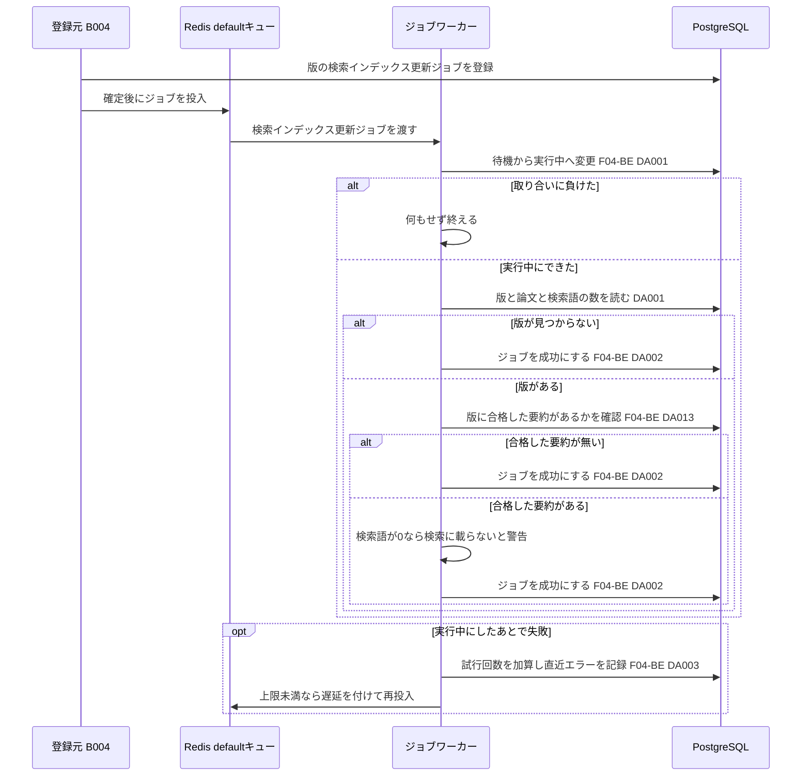
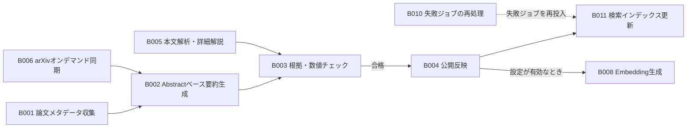

# バッチ詳細設計書 — B011 検索インデックス更新

## 0. 文書情報

| 項目 | 値 |
| :--- | :--- |
| 設計書ID | B011-BE |
| 親ID | B011 |
| 親設計書 | `基本設計書_概要.md` §4 機能設計「バッチ処理設計」B011 行 |
| バッチ名 | 検索インデックス更新（上流 §4 バッチ処理設計の区分「非同期ジョブ」） |
| 対応する機能ID | —（上流 §4 機能一覧に B011 を担う機能IDは無い。上流 §6 CRUD図は B011 を独立した行「B011 検索インデックス更新」として持つ。検索インデックスを使う側は F03 自由検索の API02 で、F03-BE §5 も「F03 は B011 を起動しない」とする） |
| 関連する業務フローID | BF01 論文収集・日本語化（定期。上流 §2 の図の「B011 検索インデックスを更新」）、BF04 自由検索（インデックスの利用側）、EX01 arXiv APIの取得失敗・レート制限（ジョブの再試行の扱い）（上流 §2） |
| 版 | 1.1（第1回セルフレビュー `docs/reviews/batch_B011_review_applied.md` の Major 3件・Minor 1件を反映） |
| 作成日 / 更新日 | 2026-10-27 / 2026-10-27 |
| 作成方法 | creating-backend-detailed-design v1.5.0 準拠。上流の確定設計書と `source/` の企画資料からの新規設計 |
| インプット | (a) `source/03_システム構成.md:8,11,19-32,35-38,43,48`、`source/02_機能要求定義.md:8,31-35,45-46`、`source/04_収益化とロードマップ.md:44`（全6ファイル・計227行。前単位 B010 の作業時から変更なし）／(b) `docs/基本設計書_概要.md` §2 BF01・BF04・EX01、§4 F02・F03・B004・B008・B010・B011・バッチ共通の方針、§6 T001〜T003・T009・CRUD図 B011 行、§7 API01・API02・外部連携一覧、§8、§9 環境変数一覧、§10 運用監視、§11 ARC001〜ARC010、付録 Q02・Q19・Q20・Q21・Q31・Q35・Q36／関連する確定済み設計書: `docs/detail/be/BE.F04.BE詳細設計.md`（F04-BE。ジョブ共通の実行枠と合格した要約の有無確認の定義元）、`docs/detail/be/BE.F03.BE詳細設計.md`（F03-BE。インデックスを使う検索の SQL）、`docs/detail/be/BE.F02.BE詳細設計.md`（F02-BE。新着一覧がインデックスに依存しないこと）、`docs/detail/batch/BT.B004.バッチ詳細設計.md`（登録元）、`docs/detail/batch/BT.B008.バッチ詳細設計.md`（同じ登録元の兄弟ジョブ）、`docs/detail/batch/BT.B010.バッチ詳細設計.md`（再処理の対応表 No.9）、`docs/db/DB.T001.DB物理設計.md`・`DB.T002`・`DB.T003`・`DB.T009.DB物理設計.md`／(c) `legacy/`（空） |

* **インプットの性質（source/ の突合結果）**: `source/` は企画・初期設計案の Markdown 6ファイル（計227行）だけです（ファイル数6件を再確認）。依頼にあるスケジュール定義 `config/schedule.rb`（whenever）と rake タスクの実装 `lib/tasks/` は**存在しません**（Ruby のファイル0件）。本システムのジョブは Python のワーカー（Redis + Celery または RQ）で動きます（`source/03_システム構成.md:7,11`）。資料にある B011 の根拠は、収集・日本語化フロー図のノード「G 公開用DBに保存 → H 検索インデックス更新 → I Web画面で閲覧」（`source/03_システム構成.md:26-28`）の1か所だけで、インデックスの実体・更新の中身・実行条件は書かれていません（上流 付録 Q21「未定」）。B011 は時刻で起動する定期実行ではなく、公開反映（B004）が登録する**非同期ジョブ**です（上流 §4 B011「ジョブキュー（B004 の完了後）」）。このため whenever に当たるスケジュール定義は B011 には無く（§5 スケジュール定義で「該当なし」と根拠を記載）、rake タスクに当たるものは §4 のジョブ関数に置き換えています。本書は**リバースエンジニアリングではなく新規設計**で、資料と上流に無い値には「※推測」を付けています。
* **既存版**: `docs/detail/batch/BT.B011.バッチ詳細設計.md` の旧版はありません（作業開始時点の `docs/detail/batch/` は B001〜B010 の10ファイルだけ）。本書が初版で、消さずに残すべき既存記述はありません。
* **legacy/ との突合**: `legacy/` は空ディレクトリです（ファイル0件）。突合する既存のバッチ設計書・業務意図・非機能の記述はありません。
* **上流と他の設計書から受け取った規則**:
  * **検索インデックスの実体（DB物理設計書 T001 §5）**: 上流 Q21 が未定のあいだの仮置きとして、論文テーブル `papers` に、原題と Abstract を英語の語幹単位に分けた値の式インデックス `idx_papers_fulltext`（GIN。`to_tsvector('english', title || ' ' || abstract)`）を作ります。式インデックスは、行の追加・更新と同じ文の中で PostgreSQL が自動で更新します。このため、**仮置きの方式では B011 が書き込むものはありません**。上流 §6 CRUD図の B011 行も、papers・paper_versions・summaries は「R」（参照だけ）、jobs は「RU」です。
  * **検索の側（F03-BE §3 DA001）**: 自由検索は `papers` を直接検索し、要約が無い論文も結果から外しません。論文は収集（B001）・オンデマンド同期（B006）が `papers` に保存した時点で検索から見つかり、B011 の完了を待ちません（F03-BE §5、BT.B006 §5 依存ジョブ順序の注記）。
  * **新着一覧の側（F02-BE §5・§6 確認事項 No.5）**: 新着一覧（API01）は検索インデックスに依存しません。
  * **登録側（F04-BE・BT.B004）**: B011 のジョブ行は、公開反映（B004）が、合格した要約がある版について種別 `update_search_index` で登録し、確定後に `default` キューへ投入します（F04-BE §4 No.16、BT.B004 §3 DA004・§5 ワーカーの配置）。BT.B004 §6 確認事項 No.8 は「B011・B008 は同じ版を何度処理しても結果が変わらない作りにする必要がある（BT.B011 の設計で確定する）」としており、本書の §6 冪等性で確定します。
  * **再処理側（BT.B010）**: BT.B010 §4 再投入の行き先の対応表 No.9 は、`update_search_index` を「`default` キュー、F04-BE No.1 `run`、再試行しない失敗は無し（※推測）」と仮置きしています。本書はこの仮置きをそのまま確定させます（§6 確認事項 No.5）。
* **B011 の役割（本書の設計判断）**: 上の規則から、仮置きの方式での B011 の役割は次の3つです。どれも PostgreSQL の式インデックスの更新そのものではありません。
  1. **検索に載るかの確認**: 版の論文の原題と Abstract から、検索インデックスと同じ式で検索語が1つ以上できるかを確かめます。語が1つもできない論文（記号だけの原題など）はキーワード検索で見つからないため、WARN ログで運用者に知らせます。
  2. **公開から検索までの区切りの記録**: ジョブの成功を jobs に残し、INFO ログに所要時間と版を出します。検証指標「新着論文から日本語速報公開までの時間」（`source/04_収益化とロードマップ.md:44`）の最後の区切りとして使います。
  3. **方式を差し替える場所**: 上流 Q21 で別の検索エンジンを採用した場合、本処理の手順4（§4 `update_search_index`）を「検索エンジンへ版の文書を上書きで登録する」処理に置き換えます。その連携仕様は Q21 の決定後に本書の改訂で定めます（※推測。§6 確認事項 No.1）。B004 と別のジョブにしたのはこのためです（上流 Q20 の仮置き「別ジョブ」）。
* **IDの書き方**: B011 は `jobs`（T009）に行を持つジョブのため、F04-BE が定義したジョブ共通の実行枠をそのまま使います。F04-BE で採番済みの **関数 No.1〜4（`run`・`claim`・`mark_succeeded`・`mark_failed_or_retry`）・No.25（`exists_passed`）、DA001〜DA003・DA013、トランザクション TX01・TX06** を引き継ぎ、定義元の設計書IDを付けて「F04-BE No.1」「F04-BE DA001」「F04-BE TX01」と書きます。本書が初めて定義するデータアクセスは設計書IDを付けず「DA001」と書き、本書（B011-BE）のIDであることを表します（BT.B006〜BT.B010 と同じ書き方）。本書で加えた関数には番号を振りません（※上流未定義。F04-BE の番号の続きを仮採番しないため）。
* **上流との差分**（※上流要確認・※上流未定義。§6 確認事項に集約）:
  * 上流 §4 B011 は「公開反映が済んだ論文を検索インデックスに加え、検索と新着一覧から見つかるようにする」とします。しかし仮置きの方式では、論文は保存した時点で検索から見つかり（F03-BE）、新着一覧はインデックスに依存しません（F02-BE）。本書の B011 は見つかるようにする処理ではなく、上の「B011 の役割」の3つを担います（§6 確認事項 No.2）。
  * DB物理設計書 T003 §4.6 No.11 は B011 が「公開対象になった要約の日本語タイトルを読み、検索インデックスへ加える（※推測）」とします。しかし仮置きのインデックスは英語の原題と Abstract だけを対象にし、F03-BE の検索も日本語タイトルを検索しません。本書は要約からは合格の有無だけを読みます（§6 確認事項 No.3）。

## 1. バックエンド構成・モジュール設計

* **対象ドメイン**: 検索系（検索インデックス） — 公開反映（B004）が済んだ論文の版について、版と論文がそろっていること・合格した要約があること・検索インデックスと同じ式で検索語ができることを確かめ、ジョブの成功を記録する。仮置きの方式（PostgreSQL の式インデックス `idx_papers_fulltext`）ではインデックスを書き換えない（上流 B011・BF01、DB物理設計書 T001 §5、上流 Q21）。
* **対象APIエンドポイント**: なし。B011 は画面や外部から HTTP で呼ばれず、ジョブキューから取り出されて動きます（根拠は §2 APIエンドポイント一覧）。
* **実行基盤**: Pythonワーカー上の非同期ジョブです（Redis + Celery または RQ。どちらにするかは未決定、上流 Q02）。DB は Supabase 上の PostgreSQL に、行単位アクセス制御を通らないサーバ側のサービスロールで接続します（DB物理設計書 T009 §7）。
* **ディレクトリ/ファイル構造**（※推測: F04-BE §1 の配置案に、B011 の本処理と読み出しを加える）:

```
worker/
├── jobs/
│   ├── runner.py                     # run（F04-BE No.1。ジョブ共通の実行枠。ARC006）
│   └── update_search_index.py        # update_search_index（B011 の本処理）
└── repositories/
    ├── job_repository.py             # claim / mark_succeeded / mark_failed_or_retry（F04-BE No.2〜4、F04-BE DA001〜DA003）
    ├── summary_repository.py         # exists_passed（F04-BE No.25、F04-BE DA013）
    └── search_index_repository.py    # load_version_for_index（本書 DA001）
```

* **処理シーケンス図**（上流 BF01 の「B011 検索インデックスを更新」を、ジョブの受け取りから終了まで展開。※推測を含む）:



## 2. API・インターフェース詳細設計

* **APIエンドポイント一覧（全数ロースター）**:

| API ID | メソッド | エンドポイント | 概要 | 定義状況 | 詳細の所在 |
| :--- | :--- | :--- | :--- | :--- | :--- |
| — | — | 該当なし | — | — | — |

**総件数: 0件。根拠**: 上流 `docs/基本設計書_概要.md` §7 内部API一覧の全8件（API01〜API08）に、B011 を起動・操作するものはありません。B011 の起動は、B004 が成功を記録したトランザクションでジョブ行を登録し、ジョブキューへ投入することで行います（§5 起動契機一覧）。検索インデックスを使う API02（自由検索）は、B011 の完了を待たずに `papers` を検索します（§0 上流と他の設計書から受け取った規則）。

* **外部サービス連携一覧（全数ロースター）**: 上流 §7 外部連携一覧の全9件に対し、B011 で使うかを示します。

| IF ID | 連携先 | B011 での利用 | 概要 | 定義状況 | 詳細の所在 |
| :--- | :--- | :--- | :--- | :--- | :--- |
| IF01 | arXiv API | 利用しない | メタデータの取得は B001・B006 の責務。B011 は保存済みの原題と Abstract を読むだけ | - | `docs/detail/batch/BT.B001.バッチ詳細設計.md` |
| IF02 | arXiv（論文本文PDF） | 利用しない | 本文の取得は B005・B003 の責務。仮置きのインデックスは本文を対象にしない | - | `docs/detail/batch/BT.B005.バッチ詳細設計.md` |
| IF03 | arXiv 原文ページ | 利用しない | 画面からのリンク遷移で、サーバ処理を伴わない | - | - |
| IF04 | LLM API | 利用しない | 検索語は PostgreSQL の語幹処理で作り、LLM を呼ばない | - | - |
| IF05 | Supabase Auth | 利用しない | 利用者の認証は B011 に関係しない。DBへはサービスロールで接続する | - | - |
| IF06 | Stripe（決済セッション） | 利用しない | 課金（F12）の責務 | - | - |
| IF07 | Stripe（契約状態の通知） | 利用しない | 課金（F12）の責務 | - | - |
| IF08 | GitHub | 利用しない | GitHub関連付け（B009）の責務 | - | - |
| IF09 | 通知配信手段 | 利用しない | 通知・ダイジェスト配信（B007）の責務 | - | - |

**総件数: 9件（B011 で利用するもの0件）。根拠**: 上流 §7 外部連携一覧の IF01〜IF09 の全9行と1対1で対応します。上流 §2 BF01 のシーケンスで B011 の範囲（「WK->>DB: B011 検索インデックスを更新」）に登場する相手は PostgreSQL だけで、外部の相手はいません。Redis と PostgreSQL は上流 §7 で本システムの構成要素（内部）とされているため外部連携に含めません。上流 Q21 で別の検索エンジンを採用した場合は、その検索エンジンが新しい外部連携になり、上流 §7 への追加が要ります（※上流未定義。§6 確認事項 No.1）。

* **外部サービス連携仕様**: 該当なし（B011 が利用する外部連携は0件。根拠は上の一覧の直後に記載）。
* **API詳細仕様**: 該当なし（APIエンドポイント0件のため）。ジョブとしての入出力は §4 の F04-BE No.1 `run`・`update_search_index` と §5 の入出力一覧に記載します。

## 3. データアクセス（ORM / クエリ）設計

* **データアクセス一覧（全数ロースター）**: F04-BE の DA-ID は F04-BE §3 の採番をそのまま引き継ぎます（§0「IDの書き方」）。F04-BE の DA004〜DA012・DA014 は B002〜B005 だけが使うため、本書には含めません。

| DA-ID | 処理名 | 呼出元（関数/API） | テーブルID | 対象物理テーブル | 種別 (SELECT/INSERT/UPDATE/DELETE) | 定義状況 (詳細/簡易) | 詳細の所在 |
| :--- | :--- | :--- | :--- | :--- | :--- | :--- | :--- |
| F04-BE DA001 | ジョブの実行開始 | F04-BE No.2 `claim`（F04-BE No.1 `run` から呼ぶ） | T009 | jobs | UPDATE | 詳細 | §3 詳細定義 F04-BE DA001・発行SQL F04-BE DA001 |
| F04-BE DA002 | ジョブの成功記録 | F04-BE No.3 `mark_succeeded`（`update_search_index` から呼ぶ） | T009 | jobs | UPDATE | 詳細 | §3 詳細定義 F04-BE DA002・発行SQL F04-BE DA002 |
| F04-BE DA003 | ジョブの失敗記録 | F04-BE No.4 `mark_failed_or_retry`（F04-BE No.1 `run` から呼ぶ） | T009 | jobs | UPDATE | 詳細 | §3 詳細定義 F04-BE DA003・発行SQL F04-BE DA003 |
| F04-BE DA013 | 合格した要約の有無確認 | F04-BE No.25 `exists_passed`（`update_search_index` から呼ぶ） | T003 | summaries | SELECT | 簡易 | 発行SQL F04-BE DA013 |
| DA001 | 版と論文と検索語の数の取得 | `load_version_for_index`（`update_search_index` から呼ぶ） | T002, T001 | paper_versions, papers | SELECT | 詳細 | §3 詳細定義 DA001・発行SQL DA001 |

**総件数: 5件（SELECT 2件・UPDATE 3件・INSERT 0件・DELETE 0件。詳細4件・簡易1件）。全数である根拠**: §4 関数一覧の全7関数のうち DB へ問い合わせる5関数（F04-BE No.2・3・4・25、`load_version_for_index`）の処理フローに現れる DB 操作を1件1行で数えたものです（F04-BE No.2→F04-BE DA001、No.3→DA002、No.4→DA003、No.25→DA013、`load_version_for_index`→DA001）。残りの2関数（F04-BE No.1 `run`・`update_search_index`）は DB へ直接問い合わせず、これらの関数を呼ぶだけです。B011 は後続ジョブを登録しないため、F04-BE DA004（後続ジョブの登録）は使いません。
**上流 CRUD図との突合**: 上流 §6 CRUD図の B011 行は「papers R・paper_versions R・summaries R・jobs RU」です。本書の操作は papers R・paper_versions R（DA001）、summaries R（F04-BE DA013）、jobs RU（F04-BE DA001〜DA003。「R」は状態を条件にした更新で行を読む部分）で、過不足なく一致します。
**定義状況の判定**（completeness 3-1）: F04-BE DA001〜DA003 は永続データを書き換える（3-1 の2）ため「詳細」です。DA001 は2つのテーブルを結合し（3-1 の3）、結果で本処理が分岐する（3-1 の1）ため「詳細」です。F04-BE DA013 は版のキー1つで合格した要約の有無を返すだけで、3-1 の基準に当たらないため「簡易」です（F04-BE §3・BT.B004 §3 の判定と同じ）。

* **データアクセス詳細定義**（定義状況＝詳細の4件）:

| DA-ID | 処理名 | テーブルID | 対象物理テーブル | JOIN / Include | 抽出条件 (Where) / ソート | トランザクション境界 | N+1対策・性能上の注意 |
| :--- | :--- | :--- | :--- | :--- | :--- | :--- | :--- |
| F04-BE DA001 | ジョブの実行開始 | T009 | jobs | なし | 指定のジョブで状態が待機の行だけを実行中に変え、版ID・種別・試行回数を受け取る（`WHERE id = $1 AND status = 'pending' RETURNING …`） | 単独で即時に確定する（F04-BE TX01） | 更新できた行が0件なら、他のワーカーが実行中か完了済みなので何もせずに終える（T009 §4.3 (4)）。主キーで1行 |
| F04-BE DA002 | ジョブの成功記録 | T009 | jobs | なし | 指定のジョブで状態が実行中の行だけを成功に変える（`WHERE id = $1 AND status = 'running'`） | ジョブの成功だけを確定する単独のトランザクション（F04-BE TX06） | 更新が0件なら他の処理が状態を変えたものとして JobStateConflict を上げる。B011 はほかに書き込むものが無いため、取り消す対象は成功の記録だけ |
| F04-BE DA003 | ジョブの失敗記録 | T009 | jobs | なし | 指定のジョブで状態が実行中の行について、試行回数を1増やし直近エラーを書く。増やした結果が上限以上なら失敗、未満なら待機に戻す（`SET attempts = attempts + 1, last_error = $2, status = CASE WHEN attempts + 1 >= $3 THEN 'failed' ELSE 'pending' END WHERE id = $1 AND status = 'running'`） | 単独で即時に確定する（F04-BE TX01）。本処理のトランザクションを取り消した後に実行する | 上限は環境変数 `JOB_MAX_ATTEMPTS`（※推測: 3）。直近エラーには、APIキー・認証付きURL・接続文字列に見える値を取り除いた要約文だけを書く（T009 §4.3 (6)） |
| DA001 | 版と論文と検索語の数の取得 | T002, T001 | paper_versions, papers | 版の行に、その版が属する論文の行を内部結合する（`paper_versions.paper_id = papers.id`） | ジョブが指す版の1行だけを読む（`WHERE paper_versions.id = $1`）。あわせて、その版が論文の最新版かどうか（`paper_versions.version = papers.latest_version`）と、原題と Abstract から検索インデックスと同じ式で作った検索語の数（`length(to_tsvector('english', papers.title \|\| ' ' \|\| papers.abstract))`）を受け取る。並べ替えはしない | トランザクションの外で読む（参照だけ。ジョブの成功の記録とは別） | 版は主キー、論文は主キーで、それぞれ1行。検索語の数は1行分だけをその場で計算するため、インデックスは使わず、全件走査にもならない。式は F03-BE §3 DA001 と DB物理設計書 T001 §5 の `idx_papers_fulltext` の式と同じにする（式が違うと、確認の結果と実際の検索の結果が食い違う）。行が返らなければ版が見つからないことを表す |

* **発行SQL**: 全5件（F04-BE DA001〜DA003・DA013、DA001）。すべてプレースホルダ（`$1` から始まる番号付きの引数）に値を渡す固定の文で、実行時に文の構造を組み立てる動的SQLはありません。F04-BE の4件は F04-BE §3 の発行SQLと同じ文です。監視のために運用者が発行する問い合わせ（§5 監視項目 No.4）は B011 が発行するものではないため、本一覧には含めず、監視項目の欄に記載します。

**F04-BE DA001 ジョブの実行開始**
```sql
UPDATE jobs
SET status = 'running'
WHERE id = $1
  AND status = 'pending'
RETURNING id, paper_version_id, job_type, attempts;
```
組み立ての分岐: なし（固定の1文）。

**F04-BE DA002 ジョブの成功記録**
```sql
UPDATE jobs
SET status = 'succeeded'
WHERE id = $1
  AND status = 'running';
-- 更新件数が0なら JobStateConflict を上げる
```
組み立ての分岐: なし（固定の1文）。

**F04-BE DA003 ジョブの失敗記録**（`$2` は直近エラーの要約文、`$3` は試行回数の上限）
```sql
UPDATE jobs
SET attempts   = attempts + 1,
    last_error = $2,
    status     = CASE WHEN attempts + 1 >= $3 THEN 'failed' ELSE 'pending' END
WHERE id = $1
  AND status = 'running'
RETURNING status, attempts;
```
組み立ての分岐: なし（固定の1文）。

**F04-BE DA013 合格した要約の有無確認**
```sql
SELECT EXISTS (
  SELECT 1
  FROM summaries
  WHERE paper_version_id = $1
    AND validation_status = 'passed'
) AS has_passed;
-- idx_summaries_lookup の先頭列（paper_version_id）で版の要約だけを読む
```
組み立ての分岐: なし（固定の1文）。

**DA001 版と論文と検索語の数の取得**（`$1` はジョブが指す版ID）
```sql
SELECT pv.id                     AS paper_version_id,
       pv.paper_id,
       pv.version,
       p.arxiv_id,
       p.latest_version,
       (pv.version = p.latest_version) AS is_latest,
       length(to_tsvector('english', p.title || ' ' || p.abstract)) AS lexeme_count
FROM   paper_versions pv
JOIN   papers p ON p.id = pv.paper_id
WHERE  pv.id = $1;
-- 行が返らなければ「版が見つからない」。lexeme_count が 0 ならキーワード検索で見つからない論文
-- 検索語の式は idx_papers_fulltext（DB物理設計書 T001 §5）・F03-BE DA001 と同じにする
```
組み立ての分岐: なし（固定の1文）。結果は「版が見つからない（0行）」「版はあるが検索語が0個」「版があり検索語が1個以上」の3通りで、それぞれに最新版かどうかが付きます。

## 4. サーバー側機能・処理ロジック設計（IPO設計）

* **関数一覧（全数ロースター）**: F04-BE の関数は F04-BE §4 の No と関数名をそのまま引き継ぎます。F04-BE の No.5〜24 は B002〜B005 だけが使うため、本書には含めません。

| No | 関数名 | 所属モジュール（※推測） | 概要 | 定義状況 | 詳細の所在 |
| :--- | :--- | :--- | :--- | :--- | :--- |
| F04-BE No.1 | `run` | `worker/jobs/runner.py`（JobRunner） | ジョブ共通の実行枠。取り合い、本処理の呼び出し、失敗時の記録と遅延付きの再投入を受け持つ | 詳細 | §4 IPO定義 |
| F04-BE No.2 | `claim` | `worker/repositories/job_repository.py` | 待機中のジョブを実行中に変え、取り合いに勝ったときだけジョブの内容を返す（F04-BE DA001） | 詳細 | §4 IPO定義 |
| F04-BE No.3 | `mark_succeeded` | `worker/repositories/job_repository.py` | 実行中のジョブを成功にする。他の処理が状態を変えていたら JobStateConflict を上げる（F04-BE DA002） | 詳細 | §4 IPO定義 |
| F04-BE No.4 | `mark_failed_or_retry` | `worker/repositories/job_repository.py` | 失敗の回数を数え、上限未満なら待機へ戻し、上限に達したら失敗にする（F04-BE DA003） | 詳細 | §4 IPO定義 |
| F04-BE No.25 | `exists_passed` | `worker/repositories/summary_repository.py` | 版に合格した要約が1件でもあるかを返す（F04-BE DA013） | 簡易 | - |
| —（※上流未定義） | `update_search_index` | `worker/jobs/update_search_index.py` | B011 の本処理。版と論文を確かめ、合格した要約がある版について検索語ができるかを確かめて、ジョブを成功にする | 詳細 | §4 IPO定義 |
| —（※上流未定義） | `load_version_for_index` | `worker/repositories/search_index_repository.py` | 版と論文を読み、最新版かどうかと検索語の数を返す（DA001） | 詳細 | §4 IPO定義 |

**総件数: 7関数（詳細6件・簡易1件）。全数である根拠**: B011 の本処理 `update_search_index` から呼び出し関係をたどって届く関数と、ジョブ共通の実行枠（F04-BE No.1〜4）を拾ったものです（`run`→`claim`・`update_search_index`・`mark_failed_or_retry`、`update_search_index`→`load_version_for_index`・`exists_passed`・`mark_succeeded`）。F04-BE §4 関数ロースターの全25件のうち残りの20関数は B002〜B005 からだけ呼ばれます。ソースコードが無いため実在の関数との突合はできず、本書で加えた2関数の関数名と分け方は※推測です。
**定義状況の判定**（completeness 3-1）: 分岐を持つもの（F04-BE No.1・`update_search_index`）、状態を書き換えるもの（F04-BE No.2〜4）、2つのテーブルを結合して分岐の材料を返すもの（`load_version_for_index`。3-1 の3）を「詳細」としました。キー1つで有無を返すだけの F04-BE No.25 は「簡易」です（F04-BE §4 の判定と同じ）。

* **入力・処理・出力（IPO）定義**（ロースターは上表。本表は定義状況＝詳細の6件）:

| No | 関数名 | 所属モジュール | 引数 (型) | 処理フロー (ステップ単位で具体的に) | 戻り値 | 発生しうるエラー |
| :--- | :--- | :--- | :--- | :--- | :--- | :--- |
| F04-BE No.1 | `run` | JobRunner | job_id: int, handler: 本処理の関数（B011 では `update_search_index`） | 1. `claim` で待機中のジョブを実行中にする。取り合いに負けた（null）なら INFO ログ（§5 ログ No.1）を残して終える。<br>2. `claim` 自体が DB の失敗で例外を上げたときは、ジョブはまだ待機で失敗を jobs に記録できない（F04-BE DA003 は実行中の行だけを更新する）。ERROR ログ（§5 ログ No.9）を出し、例外をジョブキューへ返して再配送に任せる（※推測: Celery では `acks_late=True` と `task_acks_on_failure_or_timeout=False` の両方を設定する。RQ では失敗ジョブの登録簿から再投入する仕組みを ARC006 で用意する。BT.B002〜BT.B004 と同じ）。<br>3. 本処理を呼ぶ。本処理は自身でジョブの成功を確定する。<br>4. 本処理が例外を上げたら、トランザクションを取り消してから `mark_failed_or_retry` を呼ぶ。B011 には再試行しても結果が変わらない例外は無いため、すべて試行回数の上限まで再試行する（版が見つからない場合は例外にしない。`update_search_index` 手順2）。JobStateConflict は失敗を記録せずに終える（F04-BE No.3）。<br>5. 戻ってきた状態が待機なら、試行回数に応じた遅延（1回目の失敗の後は1分、2回目の失敗の後は5分。※推測）を付けて、同じジョブIDを `default` キューへ再投入する。失敗なら失敗キューへ送り、ERROR ログ（§5 ログ No.6）を残す（上流 EX01、ARC006） | なし | なし（本処理の例外はここで受け止め、ジョブの状態として残す。`claim` の DB 失敗だけは手順2のとおりジョブキューへ返す） |
| F04-BE No.2 | `claim` | JobRepository | job_id: int | 1. F04-BE DA001 を発行し、即時に確定する（F04-BE TX01）。<br>2. 更新できた行があればジョブの内容を、無ければ null を返す | { id, paperVersionId, jobType, attempts } または null | DB の接続・問い合わせ失敗（例外を上げる。`run` 手順2） |
| F04-BE No.3 | `mark_succeeded` | JobRepository | conn: トランザクション中の接続, job_id: int | 1. 呼び出し側のトランザクション（B011 では F04-BE TX06）の中で F04-BE DA002 を発行する。<br>2. 更新が0件なら JobStateConflict を上げる | なし | JobStateConflict（→ `run` が WARN ログ（§5 ログ No.7）を残して終える。失敗記録はしない） |
| F04-BE No.4 | `mark_failed_or_retry` | JobRepository | job_id: int, error: Exception, force_fail: bool（B011 では常に偽） | 1. エラーの種類と要約から直近エラーの文を作る。APIキー・認証付きURL・接続文字列に見える値とスタックトレースは取り除き、2,000文字（※推測）で切る（T009 §4.3 (6)）。<br>2. 上限に環境変数 `JOB_MAX_ATTEMPTS`（※推測: 3）を使う。<br>3. F04-BE DA003 を発行し、即時に確定する（F04-BE TX01）。<br>4. 更新後の状態と試行回数を返す。更新が0件なら null を返す | { status: 'pending' または 'failed', attempts: int } または null | DB の接続・問い合わせ失敗（ERROR ログ（§5 ログ No.9）。ジョブは実行中のまま残る。§6 確認事項 No.6） |
| — | `update_search_index` | `worker/jobs/update_search_index.py` | job: { id, paperVersionId } | 1. `load_version_for_index` で、版とその論文、最新版かどうか、検索語の数を読む。<br>2. 版が見つからなければ（版IDが空、または該当の行が無い）、それ以上は何もせずに `mark_succeeded` を確定し（F04-BE TX06）、WARN ログ（§5 ログ No.2）を出して終える。jobs の版は外部キーで守られ、版の削除も行わないため通常は起きない。何度やり直しても結果が変わらないため、再試行にはしない（※推測。§6 確認事項 No.4）。<br>3. `exists_passed` で、版に合格した要約が1件でもあるかを確かめる。無ければ `mark_succeeded` を確定し（F04-BE TX06）、INFO ログ（§5 ログ No.3）を出して終える。B011 は B004 が合格を確かめた版についてだけ登録されるため通常は起きず、失敗ジョブの再処理（B010）で手動で起動された場合の備えである。<br>4. 検索インデックスへの反映を確かめる。仮置きの方式（PostgreSQL の式インデックス）では、論文の行を保存した時点で PostgreSQL がインデックスを更新済みのため、書き込みはしない。検索語の数が0なら、この論文はキーワード検索で見つからず著者名の完全一致でしか見つからないため、WARN ログ（§5 ログ No.4）を出す。ジョブは失敗にしない（原題と Abstract は arXiv の値のままで、やり直しても変わらないため）。上流 Q21 で別の検索エンジンを採用した場合は、本手順を検索エンジンへの文書の上書き登録に置き換える（※推測。§6 確認事項 No.1）。<br>5. `mark_succeeded` を確定する（F04-BE TX06）。<br>6. INFO ログ（§5 ログ No.5）に、版ID・arXiv ID・版番号・最新版かどうか・検索語の数・ジョブの所要時間を出す。版が最新版でない（後から新しい版が届いた）ときも成功とする。検索は論文単位で行い、結果に添える要約は F03-BE の検索が版番号の大きい合格した要約を選ぶため、古い版の B011 が検索結果を変えることは無い | なし | JobStateConflict、DB の接続失敗（いずれも `run` が受け止める） |
| — | `load_version_for_index` | SearchIndexRepository | paper_version_id: int または null | 1. 版IDが空なら、問い合わせずに null を返す（種別「検索インデックス更新」のジョブは必ず版を持つが、念のための防御）。<br>2. DA001 を発行する（トランザクションの外。参照だけ）。<br>3. 行があれば内容を、無ければ null を返す | { paperVersionId, paperId, version, arxivId, latestVersion, isLatest, lexemeCount } または null | DB の接続・問い合わせ失敗（例外を上げる。`run` 手順4で再試行できる失敗として扱う） |

## 5. バッチ処理・非同期タスク設計

* **起動契機一覧（全数ロースター）**: B011 のジョブ行が作られ、ジョブキューから取り出されて動き出す経路をすべて挙げます。

| No | 起動契機 | 登録・投入する主体 | 登録の条件 | 概要 | 定義状況 | 詳細の所在 |
| :--- | :--- | :--- | :--- | :--- | :--- | :--- |
| 1 | 公開反映が済んだ | 公開反映（B004） | B004 が版に合格した要約があることを確かめたとき。同じ版の検索インデックス更新ジョブが待機中か実行中なら登録しない（BT.B004 DA004 の部分一意インデックス）。10分解説が後から合格して同じ版の B004 がもう一度動いたときも、改めて登録される | B004 の成功の記録と同じトランザクション（F04-BE TX04）でジョブを登録し、確定後に `default` キューへ投入する（BT.B004 §3 DA004・§4 No.5 `enqueue`） | 詳細 | `docs/detail/batch/BT.B004.バッチ詳細設計.md` §3 DA004・§5 |
| 2 | 自動再試行 | B011 自身（F04-BE No.1 `run`） | 失敗して試行回数が上限未満のとき | 同じジョブIDを遅延付きで再投入する。ジョブ行は新しく作らない（上流 EX01 と同じ扱い） | 詳細 | §4 F04-BE No.1 `run`、§6 リトライ方針 |
| 3 | 失敗ジョブの再処理 | 運用者が起動する失敗ジョブの再処理（B010） | 失敗で終わった検索インデックス更新ジョブの原因を取り除いたとき | 失敗のジョブを待機に戻し試行回数を0にして、`default` キューへ再投入する。ジョブ行は新しく作らない（上流 B010、T009 §4.3 (4)(5)、BT.B010 §4 対応表 No.9） | 詳細 | `docs/detail/batch/BT.B010.バッチ詳細設計.md` §4 |

**総件数: 3件。全数である根拠**: 上流 §4 B011 の実行タイミング「B004 の完了後」に当たる登録元1件（BT.B004 DA004）と、既存の行を再投入する経路（自動再試行: F04-BE §4 No.1、再処理: 上流 B010・BT.B010）2件です。DB物理設計書 T009 §6 も `update_search_index` の登録を「公開反映が終わったときに登録する」の1つだけとしています。利用者の操作や画面から直接 B011 を登録する経路はありません（上流 §7 内部API一覧に該当なし）。収集（B001）とオンデマンド同期（B006）は B011 を登録しません（BT.B001・BT.B006 §5 依存ジョブ順序）。
**定義状況の判定**（completeness 3-1）: 3件とも B011 を起動して永続データ（jobs）を書き換える（3-1 の2）ため「詳細」です。

* **スケジュール定義**（whenever の `config/schedule.rb` に当たる定義）: **該当なし**。B011 は時刻で起動する定期実行ではなく、公開反映（B004）の完了を受けて登録される非同期ジョブです（上流 §4 B011 の実行タイミング「ジョブキュー（B004 の完了後）」）。cron 式・実行時刻・タイムゾーンの設定はありません。実際に動く時間帯は、登録元の B004 が動く毎日 02:00〜04:00 UTC ごろです（BT.B004 §5 性能、本書 §5 性能）。

* **ワーカーの配置**（whenever の `roles` による専用サーバ判定に当たる定義。※推測・※上流未定義: キュー名と並列数は上流で未定義。上流 §4、Q02）:

| 項目 | 値 | 説明 |
| :--- | :--- | :--- |
| キュー | `default`（※推測）。要約の根拠・数値チェック（B003）・公開反映（B004）と共用する | BT.B004 §5 ワーカーの配置と BT.B010 §4 対応表 No.9 の仮置きどおり。B011 は1件が数十ミリ秒で終わり、一度に大量のジョブが入る経路（B008 の一括登録のようなもの）も無いため、専用のキューを設けるほどの負荷は無い。BT.B004・BT.B010 の対応表は直す必要が無い |
| 処理するワーカー | `default` キューを購読するワーカーのプロセス。本番では1つ以上のホストに置いてよい | 定期実行ではないため、専用のサーバに限る必要はない。同じジョブが2つのワーカーに渡っても、F04-BE DA001 の取り合いで1つだけが処理する |
| 並列数 | B003・B004 と合わせて全ワーカーの合計で4（設定値 `DEFAULT_WORKER_CONCURRENCY`。BT.B003 と同じ値） | B011 単独の並列数は設けない。B011 の負荷は B003 の約1,000分の1（§5 性能）で、B003 の処理能力をほとんど削らない |
| 実行環境 | production・staging・development のどれでも動く | B011 は自分からは動かず、B004 が登録した分だけ動く |

* **多重起動制御**: 同じ版の検索インデックス更新が二重に動いても、B011 が書き込むのは自身のジョブの状態だけのため、データが壊れることはありません。それでも二重の実行で監視の件数がずれないよう、次の3段階で防ぎます。

| No | 段階 | 防ぐもの | 方法 | 防げなかったときの結果 |
| :--- | :--- | :--- | :--- | :--- |
| 1 | 登録 | 同じ版の検索インデックス更新ジョブが2つ待機・実行されること | 同じ版・同じ種別で待機中か実行中の行は1件までしか作れない部分一意インデックス（`uq_jobs_active_per_version`）に当たったら、登録を取りやめる（BT.B004 DA004。再処理で戻すときも同じ索引に当たる。BT.B010 DA002） | — （DB が保証する）。取りやめになっても、待機中か実行中の同じ版のジョブが実行時点の状態で確かめる |
| 2 | 着手の取り合い | 同じジョブがジョブキューから2つのワーカーへ渡ること | 状態が待機の行だけを実行中に変える条件付きの更新で、勝った1つだけが処理する（F04-BE DA001） | — （DB が保証する） |
| 3 | 成功の記録 | 実行中のまま止まったとみなされたジョブを、失敗ジョブの再処理（B010）が待機へ戻した後（BT.B010 DA003）に、元の実行が成功で上書きすること | 成功の記録を状態が実行中の行に限り、0件なら JobStateConflict として何もしない（F04-BE DA002） | — （DB が保証する） |

**総件数: 3段階。根拠**: 二重実行の原因になる「ジョブの重複登録」「同一ジョブの重複配送」「状態が変わった後の確定」の3つに1段階ずつ対応させたものです。B004 の多重起動制御（BT.B004 §5）にある「後続ジョブの登録」の段階は、B011 が後続ジョブを登録しないため要りません。

* **入出力一覧（IPO: 対象テーブル・外部連携）**: B011 が読み書きするものをすべて挙げます。

| 区分 | ID | 名称 | 物理名・接続先 | 操作 | 内容 |
| :--- | :--- | :--- | :--- | :--- | :--- |
| 入力 | — | ジョブキューのメッセージ | Redis の `default` キュー（`REDIS_URL`） | 受信 | 検索インデックス更新ジョブのジョブID |
| 入力 | T002 | 論文バージョン | paper_versions | 参照（DA001） | 版の論文ID・版番号 |
| 入力 | T001 | 論文 | papers | 参照（DA001） | arXiv ID・最新版の番号、検索語の数の計算に使う原題と Abstract（値そのものはワーカーへ持ち出さない） |
| 入力 | T003 | 要約 | summaries | 参照（F04-BE DA013） | 版に合格した要約があるか |
| 入力・出力 | T009 | ジョブ | jobs | 自身の状態変更（F04-BE DA001〜DA003） | 検索インデックス更新ジョブの状態・試行回数・直近エラー |
| 入力 | — | 設定値 | ワーカーの環境変数 | 参照 | §6 設定値一覧の5件 |
| 出力 | — | ジョブキュー | Redis（`REDIS_URL`） | 送信 | 自身の再投入、上限到達時の失敗キューへの投入 |
| 出力 | — | 構造化ログ | ワーカーの標準出力（※推測: ホスティング先のログ収集に任せる） | 出力 | 本節 ログ出力一覧の9種類 |

**総件数: 8件（入力5件・入出力1件・出力2件）。根拠**: テーブルは §3 データアクセス一覧の5件が触れる4テーブル（T001・T002・T003・T009）と一致し、上流 CRUD図の B011 行の「-」でない4列とも一致します。外部連携は §2 で0件です。ジョブキュー・設定値・ログは §4 の IPO 定義の引数と処理フローに現れる入出力を拾ったものです。検索インデックス `idx_papers_fulltext` は PostgreSQL が papers の書き込み時に自動で更新するため、B011 の出力には含めません（§0 上流と他の設計書から受け取った規則）。

* **処理ステップ詳細**: 起動契機 No.1（B004 が登録した）の1件分を、ジョブの受け取りから終了まで順に示します。起動契機 No.2・No.3 も手順1から同じです。

| 手順 | 処理 | 対象（ID） | DA-ID / 関数 | 成功時の次の手順 | 失敗時の扱い |
| :--- | :--- | :--- | :--- | :--- | :--- |
| 1 | ワーカーが `default` キューから検索インデックス更新ジョブを受け取る | Redis | F04-BE No.1 `run` | 2 | — （受け取れないジョブは Redis に残る） |
| 2 | ジョブを待機から実行中に変える | T009 | F04-BE DA001（F04-BE No.2 `claim`） | 1行変えた: 3／0行: INFO ログ（No.1）を出して終了 | DB の失敗は、ジョブがまだ待機のため jobs に記録できない。ERROR ログ（No.9）を出してジョブキューへ例外を返し、再配送に任せる（※推測。§6 確認事項 No.6） |
| 3 | 版とその論文、最新版かどうか、検索語の数を読む | T002・T001 | DA001（`load_version_for_index`） | 版がある: 4／版が見つからない: ジョブを成功にして確定し（F04-BE DA002、F04-BE TX06）、WARN ログ（No.2）を出して終了 | DB の失敗は再試行できる失敗として手順8 |
| 4 | 版に合格した要約があるかを確かめる | T003 | F04-BE DA013（F04-BE No.25 `exists_passed`） | あり: 5／なし: ジョブを成功にして確定し（F04-BE DA002、F04-BE TX06）、INFO ログ（No.3）を出して終了 | DB の失敗は再試行できる失敗として手順8 |
| 5 | 検索語の数を確かめる。0個ならキーワード検索で見つからない論文として警告する | — | `update_search_index` | 6（検索語が0個なら WARN ログ No.4 を出してから6） | — （DB に問い合わせないため失敗しない） |
| 6 | ジョブの成功を確定する | T009 | F04-BE DA002（F04-BE No.3 `mark_succeeded`）、F04-BE TX06 | 7 | DB の失敗は取り消して手順8。成功の記録が0件（JobStateConflict）なら WARN ログ（No.7）を出して終了（失敗記録はしない） |
| 7 | 版・最新版かどうか・検索語の数・所要時間を記録して終える | — | `update_search_index` | 終了（INFO ログ No.5） | — |
| 8 | 実行中にした後の失敗を記録する。上限未満なら遅延を付けて同じジョブを再投入し、上限到達なら失敗キューへ送る | T009・Redis | F04-BE DA003（F04-BE No.4）、F04-BE No.1 `run` | 終了（WARN または ERROR ログ No.6） | 記録できない場合は ERROR ログ（No.9）だけ残し、ジョブは実行中のまま（§6 確認事項 No.6）。再投入に失敗したら ERROR ログ（No.8） |

**総件数: 8手順。根拠**: §4 の F04-BE No.1 `run`（手順1〜5）と `update_search_index`（手順1〜6）の処理フローを、DB 操作・ジョブキューとのやり取り・分岐の単位で1行ずつ並べたものです。DA-ID の全5件が少なくとも1つの手順に現れます（F04-BE DA001: 手順2、F04-BE DA002: 3・4・6、F04-BE DA003: 8、F04-BE DA013: 4、DA001: 3）。

* **ジョブ実行定義**:

| バッチID | ジョブ名 | 実行タイミング | 対象テーブル | 処理概要 | タイムアウト |
| :--- | :--- | :--- | :--- | :--- | :--- |
| B011 | 検索インデックス更新（`update_search_index`） | B004 が成功を記録してジョブを投入したとき。ほかに自動再試行と失敗ジョブの再処理（起動契機一覧の3件）。大半は B004 が動く毎日 02:00〜04:00 UTC ごろに入る | paper_versions・papers・summaries（参照）、jobs（自身の状態変更） | 公開反映が済んだ版について、版と論文がそろっていること、合格した要約があること、検索インデックスと同じ式で検索語ができることを確かめ、ジョブの成功を記録する。仮置きの方式ではインデックスは書き換えない（上流 B011、DB物理設計書 T001 §5） | 1分（※推測。BT.B004 と同じ。DB の問い合わせ4文だけで、通常は0.1秒以内に終わる）。1分で本処理に時間切れの例外を上げ、再試行できる失敗として記録する。90秒（※推測）で終わらなければワーカーのプロセスごと止める（§6 エラーハンドリングのタイムアウトの行） |

* **依存ジョブ順序（全数ロースター）**: 上流 §4 バッチ処理設計の全11件について、B011 との前後関係を示します。

| バッチID | 名称 | B011 との関係 | 順序 | 概要 | 定義状況 | 詳細の所在 |
| :--- | :--- | :--- | :--- | :--- | :--- | :--- |
| B001 | 論文メタデータ収集 | 間接の先行 | B001 → B002 → B003 → B004 → B011 の順。B001 が papers に保存した時点で、PostgreSQL がインデックスを更新し、論文は検索から見つかる | 定期実行で論文と版を保存し、新しい版ごとに B002 を登録する。B011 を登録しない | 簡易 | `docs/detail/batch/BT.B001.バッチ詳細設計.md` |
| B002 | Abstractベース日本語要約生成 | 間接の先行 | B002 → B003 → B004 → B011 の順 | Abstract から30秒要約と3分要約を作り、未検証として保存する | 簡易 | `docs/detail/batch/BT.B002.バッチ詳細設計.md` |
| B003 | 要約の根拠・数値チェック | 間接の先行 | B003 → B004 → B011 の順 | 未検証の要約を調べて合格・不合格を記録し、合格があれば B004 を登録する | 簡易 | `docs/detail/batch/BT.B003.バッチ詳細設計.md` |
| B004 | 公開反映 | 直接の先行（登録元） | B004 が成功を記録したトランザクションで登録され、確定直後に投入される | 合格した要約がある版について、B011 と、設定が有効なら B008 を登録する | 簡易 | `docs/detail/batch/BT.B004.バッチ詳細設計.md` |
| B005 | 本文解析・詳細解説生成 | 間接の先行 | B005 → B003 → B004 → B011 の順。10分解説が後から合格すると、同じ版の B011 がもう一度動く | ライセンスで本文の利用が許される論文に限り、本文PDFを解析して10分解説を作る | 簡易 | `docs/detail/batch/BT.B005.バッチ詳細設計.md` |
| B006 | arXivオンデマンド同期 | 間接の先行 | B006 → B002 → B003 → B004 → B011 の順。B006 が papers に保存した時点で論文は検索から見つかる | 自前DBに無い論文が検索で必要になったとき、arXiv から該当論文だけを取り込む。B011 を登録しない | 簡易 | `docs/detail/batch/BT.B006.バッチ詳細設計.md` |
| B007 | 通知・ダイジェスト配信 | 関係なし | B011 の完了を待たない（通知は合格した要約を直接読む。BT.B007） | 通知を希望する利用者ごとに、関心分野の新着論文をまとめて送る | 簡易 | `docs/detail/batch/BT.B007.バッチ詳細設計.md` |
| B008 | 論文Embedding生成 | 並行（同じ登録元） | B004 の同じトランザクションで登録される兄弟のジョブで、互いに順序の制約はない（BT.B008 §5 依存ジョブ順序）。B008 は専用キュー `embedding`、B011 は `default` で別々に動く | 将来の推薦のため、論文ごとの Embedding を作って pgvector へ保存する | 簡易 | `docs/detail/batch/BT.B008.バッチ詳細設計.md` |
| B009 | GitHub公式実装の関連付け | 関係なし | 起動契機は上流で未定義。B011 とは前後関係を持たない | 論文の公式実装リポジトリを探して関連付け、コード解説を作る | 簡易 | `docs/detail/batch/BT.B009.バッチ詳細設計.md` |
| B010 | 失敗ジョブの再処理 | 再起動の主体 | B011 の失敗ジョブを運用者の起動で再投入する（起動契機 No.3、BT.B010 §4 対応表 No.9） | 失敗キューに溜まったジョブを調べ、原因を取り除いたものを再実行する | 簡易 | `docs/detail/batch/BT.B010.バッチ詳細設計.md` |
| B011 | 検索インデックス更新 | 本バッチ | — | 公開反映が済んだ版について、検索に載るかを確かめ、公開から検索までの区切りを記録する | 詳細 | 本書 |

**総件数: 11件。全数である根拠**: 上流 §4 バッチ処理設計の B001〜B011 の全11行と1対1で対応します。B011 自身を除く10件は、本書では B011 との順序関係だけを述べるため「簡易」とし、各バッチの詳細はそれぞれのバッチ詳細設計書に委ねます（B001〜B010 はすべて作成済み）。B011 は後続のジョブを登録せず、上流 BF01 の流れの最後のジョブです（その先は利用者の閲覧「I Web画面で閲覧」）。
**順序の図**（上流 BF01・BF02・§4 バッチ処理設計から作図。B008 の起動条件は※推測）:



* **性能（バッチウィンドウ・想定件数）**（※推測: 資料に件数・時間の目標値は無い。上流 Q31 で確認待ち。件数は `docs/detail/batch/BT.B004.バッチ詳細設計.md` §5 性能を起点に計算）:

| 項目 | 標準ケース（AI・IT系のカテゴリに絞った場合） | 最大ケース（全カテゴリを収集した場合） | 根拠・計算 |
| :--- | :--- | :--- | :--- |
| 1日の検索インデックス更新ジョブ数 | 約430件 | 約1,290件 | B004 の1日の公開反映ジョブ（約430件／約1,290件）のほぼ全件が合格した要約を持ち、1件につき B011 を1行登録する（BT.B004 §5 性能「テーブルの変化量」）。10分解説の後からの合格による再登録は B005 の1日約8件（BT.B010 §5 性能）で、件数にほとんど影響しない |
| 1件あたりの所要時間 | 約20ミリ秒 | 約20ミリ秒 | DB の問い合わせ4文（主キーで1行の更新2文と参照2文。検索語の数は1行分だけ計算する）と、ジョブキューとのやり取りだけ（※推測） |
| 1日分の処理時間の合計 | 約9秒 | 約26秒 | ジョブ数×1件あたりの所要時間。`default` キューで B003（1件約20秒）と同じワーカーを使うが、B003 の処理時間（1日約2.4時間分／約7.2時間分のワーカー時間）に比べて0.1%程度で、B003 の処理能力をほとんど削らない |
| バッチウィンドウ | 02:00〜02:45 UTC | 02:00〜04:00 UTC。再試行を含めた最悪で 05:20 UTC まで | B004 の確定直後に投入され、数秒以内に終わる。最悪は、B004 が再試行を含めて 05:11 に終わり（BT.B004 §5 性能）、B011 自身も3回とも失敗する場合で、B011 の上乗せ（タイムアウト1分×3回＋再試行の遅延1分＋5分＝9分）を足して 05:20 に終わる。この最悪の場合だけ `default` キューの滞留の監視の締め時刻 05:15（BT.B003・BT.B004 と共用。監視項目一覧 No.2）を超えるが、そのときは B003・B004・B011 の失敗の ERROR がすでに出ているため、締め時刻は動かさない |
| テーブルの変化量 | jobs の更新 1日約430行。追加は0行 | jobs の更新 1日約1,290行。追加は0行 | B011 は自身のジョブ行の状態を変えるだけで、行を追加しない（行は B004 が追加する）。papers・paper_versions・summaries は書き換えない |

* **ログ出力一覧（全数ロースター）**: 構造化ログ（※推測: JSON 形式で、ジョブID・ジョブ種別・版ID・試行回数を項目として持つ）で出します。原題・Abstract の本文はログに出しません。

| No | 出す時点 | レベル | 出す内容 | 用途 | 定義状況 | 詳細の所在 |
| :--- | :--- | :--- | :--- | :--- | :--- | :--- |
| 1 | 取り合いに負けて何もせず終えたとき | INFO | ジョブID、「他のワーカーが実行中か完了済み」 | ジョブキューの重複配送の発生を把握する | 簡易 | - |
| 2 | 版が見つからず、何もせずに成功で終えたとき | WARN | ジョブID、版ID（空の場合は空と示す）、「版が見つからない」 | 通常は起きない。ジョブの登録の誤りかデータの不整合を疑う手がかりにする | 詳細 | §6 エラーハンドリング、§6 確認事項 No.4 |
| 3 | 合格した要約が無く、何もせずに成功で終えたとき | INFO | ジョブID、版ID、「合格した要約が無い」 | 通常は起きない。再処理（B010）での手動起動か、登録元の誤りを疑う手がかりにする | 簡易 | - |
| 4 | 検索語が1つもできなかったとき | WARN | ジョブID、版ID、arXiv ID、検索語の数（0） | キーワード検索で見つからない論文を運用者が把握する。件数が増えたら語幹処理の方式（上流 Q21）を見直す材料にする | 詳細 | 本節 監視項目一覧 No.5 |
| 5 | 確認を終えて成功で終えたとき | INFO | ジョブID、版ID、arXiv ID、版番号、最新版かどうか、検索語の数、ジョブの所要時間 | 版ごとに公開から検索までの区切りがいつ済んだかを追う。新着から公開までの時間（`source/04_収益化とロードマップ.md:44`）の最後の区切りとして使う | 詳細 | §6 確認事項 No.8 |
| 6 | ジョブが失敗したとき | 上限未満は WARN、上限到達は ERROR | ジョブID、試行回数、エラーの要約（伏せ字済み）、再試行までの遅延、ERROR のときはスタックトレース | 失敗の原因調査。ERROR は監視の通知対象 | 詳細 | §6 エラーハンドリング、本節 監視項目一覧 No.1 |
| 7 | 成功の記録が0件で終えたとき | WARN | ジョブID、「他の処理がジョブの状態を変えた」 | 状態の取り合いの発生を把握する | 簡易 | - |
| 8 | ジョブキューへの再投入に失敗したとき | ERROR | ジョブID、試行回数、元のエラー | 待機のまま残ったジョブを運用者が手で投入し直す（§6 確認事項 No.6） | 詳細 | §6 エラーハンドリング |
| 9 | DB の失敗でジョブの状態を記録できなかったとき（実行中にする前の失敗で待機のまま残る場合と、失敗の記録ができず実行中のまま残る場合の両方） | ERROR | ジョブID、失敗した時点（実行中にする前か後か）、元のエラー | 待機または実行中のまま残ったジョブを運用者が見つける（§6 確認事項 No.6） | 詳細 | §6 エラーハンドリング |

**総件数: 9種類。根拠**: §4 IPO 定義の処理フローと発生しうるエラーの欄で「ログを出す」と定めた箇所を、出す時点ごとに1行ずつ拾ったものです（F04-BE No.1 手順1・2・5、`update_search_index` 手順2〜6、F04-BE No.3・No.4 のエラー）。定義状況は、運用者の対応や監視の判断に使うもの（3-1 の5「失敗時の扱い」・3-1 の7「業務ルール」）を「詳細」、記録だけのものを「簡易」としています。

* **監視項目一覧（全数ロースター）**（上流 §8 アプリケーション保護「バッチは監視対象にし、失敗したジョブは失敗キューに集める」、§10 運用監視。監視の手段・通知先は未定義で上流 Q35 で確認待ち。しきい値は※推測）:

| No | 監視項目 | 検出の方法 | しきい値 | 通知・対応 | 定義状況 | 詳細の所在 |
| :--- | :--- | :--- | :--- | :--- | :--- | :--- |
| 1 | 検索インデックス更新ジョブの失敗 | ERROR ログ（No.6）と、状態が失敗の検索インデックス更新ジョブ（DB物理設計書 T009 の失敗の行だけを持つ索引 `idx_jobs_failed` で、種別 `update_search_index` を抽出） | 1件でも発生したら | 運用者へ通知する。仮置きの方式では論文は検索から見つかり続けるため利用者への影響は無いが、DB・Redis の障害の兆候として原因を取り除き、再処理（B010）で戻す | 詳細 | §6 エラーハンドリング |
| 2 | 処理の滞留 | `default` キューに残っているジョブの数（Redis のキューの長さ。B003・B004 と共用のため、BT.B003 §5 監視項目 No.2 と同じ監視） | 05:15 UTC に1件以上残っている | 並列数・障害を確かめる | 詳細 | 本節 性能 |
| 3 | 投入されなかったジョブ・状態を記録できなかったジョブ | ERROR ログ（No.8・No.9） | 1件でも発生したら | 運用者がジョブIDを確かめ、待機のまま残った行は手で投入し直し、実行中のまま残った行は失敗ジョブの再処理（B010）で扱う | 詳細 | §6 確認事項 No.6 |
| 4 | 公開反映が済んだのに検索インデックス更新が済んでいない版 | 運用者が1日1回、成功した公開反映ジョブを持つ版のうち、状態が成功・待機・実行中のどれかの検索インデックス更新ジョブが1件も無い版を数える。待機中・実行中のジョブがある版は処理の途中のため数えない。失敗のジョブだけがある版は監視項目 No.1 で扱うため、ここでも数える（版と種別の索引 `idx_jobs_paper_version_id_job_type` で、公開反映ジョブ1件ごとに同じ版の検索インデックス更新ジョブの有無を引く。`SELECT count(DISTINCT pub.paper_version_id) FROM jobs pub WHERE pub.job_type = 'publish_summary' AND pub.status = 'succeeded' AND NOT EXISTS (SELECT 1 FROM jobs idx WHERE idx.paper_version_id = pub.paper_version_id AND idx.job_type = 'update_search_index' AND idx.status IN ('succeeded','pending','running'))`） | 1件以上 | B004 の投入漏れか、B011 が失敗で終わったまま戻されていない版。待機のまま投入されていないジョブは見えないため、待機の行があっても数日たって成功にならない版は、監視項目 No.3 の ERROR ログで見つける。対応は、その版の検索インデックス更新ジョブを手で登録して投入するか、失敗のジョブを再処理（B010）で戻す。この問い合わせは「成功した B011 が1件でもある版」を数えないため、10分解説が後から合格して2回目の B011 だけが漏れた場合は検出できない。仮置きの方式では、2回目の B011 が漏れても検索の結果は変わらない（インデックスは要約を対象にしない）ため、検出の対象外とする（※推測） | 詳細 | §6 確認事項 No.6 |
| 5 | キーワード検索で見つからない論文 | WARN ログ（No.4）の件数 | 1日10件以上（※推測） | 運用者が対象の論文の原題と Abstract を確かめる。語幹処理の方式（英語の語幹）が合わない分野が多いなら、上流 Q21 の検索方式の見直しの材料にする | 詳細 | §6 確認事項 No.1 |

**総件数: 5件。根拠**: 上流 §8・§10 が求めるバッチ監視（失敗・失敗キュー）に、B011 で起きうる異常（処理が追いつかない、投入・記録に失敗する、公開反映の後に区切りが記録されない、検索に載らない論文がある）を、ログ出力一覧の ERROR・WARN と、DB の行の状態ごとに1つずつ対応させたものです。No.4 の問い合わせは運用者が監視のために発行するもので、B011 は発行しません（§3 発行SQL の注記）。

## 6. 例外処理・セキュリティ設計

* **エラーハンドリング**: B011 は利用者へ応答を返さないため、「クライアント応答」には、失敗が画面や運用者からどう見えるかを書きます。仮置きの方式では、B011 が失敗しても論文は自由検索（API02）から見つかり続け、新着一覧（API01）にも影響しません。影響は、公開から検索までの区切りが記録されず、監視（§5 監視項目 No.4）に数えられることです。

| 例外種別 | 対応方法 | ログ出力 | クライアント応答 |
| :--- | :--- | :--- | :--- |
| 取り合いに負けた（実行開始の更新が0件） | 何もせずに終える | INFO（§5 ログ No.1） | なし（他のワーカーが処理する） |
| 実行中にする前の DB の失敗（`claim` の失敗） | ジョブがまだ待機のため jobs に記録できない（F04-BE DA003 は実行中の行だけを更新する）。例外をジョブキューへ返し、再配送に任せる（※推測。再配送されなければ待機のまま残る。§6 確認事項 No.6） | ERROR（§5 ログ No.9） | 検索・新着一覧には影響しない。運用者が監視（§5 監視項目 No.3。ERROR ログ No.9 の発生）で見つける |
| 版が見つからない（通常は起きない） | 例外にせず、何もせずにジョブを成功にする（F04-BE TX06）。やり直しても結果が変わらないため再試行しない | WARN（§5 ログ No.2） | なし（検索する対象の版が無い） |
| 合格した要約が無い（通常は起きない） | 例外にせず、何もせずにジョブを成功にする（F04-BE TX06） | INFO（§5 ログ No.3） | なし（公開対象の要約が無い。論文自体は検索から見つかる） |
| 検索語が1つもできない | 例外にせず、警告を出してジョブを成功にする | WARN（§5 ログ No.4） | その論文はキーワード検索で見つからず、著者名の完全一致でだけ見つかる |
| DB の接続失敗（版・要約の読み出し、成功の記録） | トランザクションを取り消し、ジョブを失敗記録へ回す。上限未満なら遅延を付けて再実行する | 上限未満は WARN、上限到達は ERROR とスタックトレース（§5 ログ No.6） | 検索・新着一覧には影響しない。上限に達したジョブは失敗キューで運用者が確認する |
| JobStateConflict（成功の記録が0件） | 何もせずに終える。他の処理の結果を優先し、失敗記録はしない | WARN（§5 ログ No.7） | なし（他の処理の結果が残る） |
| ジョブキュー（Redis）への再投入失敗 | 失敗の記録（待機へ戻した状態）は取り消さない。ジョブの行は待機のまま残る（※上流要確認。§6 確認事項 No.6） | ERROR（§5 ログ No.8） | 検索・新着一覧には影響しない。運用者が監視（§5 監視項目 No.3）で見つけて手で投入し直す |
| ジョブのタイムアウト（1分） | 2段階で扱う（※推測: Celery では `soft_time_limit=60`・`time_limit=90`。RQ では同じ2段階を ARC006 で用意する）。(1) 1分で本処理に時間切れの例外を上げる。`run` が他の例外と同じく受け止め、トランザクションを取り消してから F04-BE DA003 で失敗を記録し、上限未満なら遅延を付けて再投入する。(2) それでも90秒で終わらないときはワーカーのプロセスごと止められ、失敗を記録できないため、ジョブは実行中のまま残る | (1) 上限未満は WARN、上限到達は ERROR（§5 ログ No.6）。(2) B011 からは記録できないため、ジョブキューが出すワーカーの停止のログで見つける。jobs に開始日時が無く、実行中のまま残った行は B011 の監視項目では見分けられない（§6 確認事項 No.6） | 検索・新着一覧には影響しない。(2) の実行中のまま残ったジョブは、運用者が再処理（B010）で待機へ戻す |
| 失敗の記録自体の DB の失敗（`mark_failed_or_retry` の失敗） | 記録できず、ジョブは実行中のまま残る（※上流要確認: DB物理設計書 T009 §9 No.1。§6 確認事項 No.6） | ERROR（§5 ログ No.9） | 検索・新着一覧には影響しない。運用者が監視（§5 監視項目 No.3。ERROR ログ No.9 の発生）で見つけて再処理（B010）する |
| 予期しない例外 | 再試行できる失敗として記録する。直近エラーには要約だけを入れ、スタックトレースはログにだけ出す | ERROR とスタックトレース（§5 ログ No.6） | 検索・新着一覧には影響しない |

**総件数: 11種類。根拠**: §4 IPO 定義の「発生しうるエラー」欄に挙げた失敗（取り合い・`claim` の DB 失敗・読み出しと記録の DB 失敗・JobStateConflict・Redis への再投入失敗・失敗の記録自体の失敗）と、例外にせず結果として扱う3件（版が見つからない・合格した要約が無い・検索語が0個）に、ジョブのタイムアウトと予期しない例外を加え、扱いの違いごとに1行にまとめたものです。F04-BE §6 の12件のうち、LLM・スキーマ・検証不合格・本文・PDF に関わるものは、それらを扱わない B011 では起きません。

* **リトライ方針**（上流 EX01、§4 バッチ共通の方針）:

| 項目 | 値 | 説明 |
| :--- | :--- | :--- |
| ジョブの再試行の単位 | 検索インデックス更新ジョブ全体 | B011 が書き込むのは自身のジョブの成功の記録だけで、途中まで書き込まれた状態は無い |
| ジョブの試行回数の上限 | 3回（※推測。上流 Q19、`JOB_MAX_ATTEMPTS`） | 1回目の失敗で試行回数が1、3回目の失敗で上限に達して失敗になる |
| 再試行までの遅延 | 1回目の失敗の後は1分、2回目の失敗の後は5分（※推測） | BT.B002〜BT.B004 と同じ。B011 の失敗は DB・Redis の一時的な障害がほとんどのため、短い間隔で回復を待つ |
| 再試行しない失敗 | なし | 版が見つからない・合格した要約が無い・検索語が0個は、失敗にせず成功で終える（やり直しても結果が変わらないため）。BT.B010 §4 対応表 No.9 の「無し」と一致する |
| 上限到達後 | 失敗キューへ送り、運用者が原因を取り除いてから失敗ジョブの再処理（B010）で待機に戻す。再処理では試行回数を0に戻す（BT.B010 DA002） | 失敗キューに入れる引数はジョブIDと版IDだけで足りる（BT.B010 §4 対応表 No.9） |

* **冪等性**: 同じ検索インデックス更新ジョブが二重に渡されたり、失敗して再実行されたり、同じ版について B004 からもう一度登録されたりしても、結果が1回成功したときと同じになるようにします。BT.B004 §6 確認事項 No.8（B011 は同じ版を何度処理しても結果が変わらない作りにする）を本表で確定します。

| No | 対象 | 二重に処理されたときの結果 | 冪等にしている仕組み |
| :--- | :--- | :--- | :--- |
| 1 | 検索インデックス（仮置きの `idx_papers_fulltext`） | B011 は書き換えないため、何度動いてもインデックスは変わらない。インデックスは papers の行の内容だけで決まる | 参照だけの問い合わせ（DA001）。インデックスの更新は PostgreSQL が papers の書き込みと同時に行う |
| 2 | 検索インデックス更新ジョブの状態の記録 | 成功・失敗の記録が二重に来ても、状態が実行中の行しか変えないため、2回目は0行になり何もしない | 状態を条件にした更新（F04-BE DA001〜DA003） |
| 3 | 同じ版の2回目以降のジョブ（10分解説の後からの合格による再登録） | 新しいジョブ行として、実行時点の版・論文・合格した要約を読み直して同じ確認をする。結果は1回目と同じか、より新しい状態を反映したものになり、前の結果と矛盾しない | 実行時点の状態だけを読み、前回の結果に依存しない（`update_search_index` 手順1〜4） |
| 4 | 論文・版・要約（papers・paper_versions・summaries） | B011 は書き換えないため、何度動いても変わらない | 参照だけの問い合わせ（DA001・F04-BE DA013） |

**総件数: 4件。根拠**: B011 が書き込むテーブル（T009）の行の種類（自身のジョブの状態、同じ版の再登録されたジョブ）と、読むだけのもの（検索インデックス、T001〜T003）を、種類ごとに1行ずつ挙げたものです。上流 Q21 で別の検索エンジンを採用した場合は、No.1 を「版の文書を論文単位の鍵で上書き登録する」に改め、同じ版を何度登録しても文書が1件のままになるようにします（※推測。§6 確認事項 No.1）。

* **トランザクション制御**（ID は F04-BE §6 の TX ID をそのまま引き継ぐ）:

| 処理名 | トランザクション範囲 | ロールバック条件 |
| :--- | :--- | :--- |
| F04-BE TX01 ジョブの実行開始・失敗記録 | jobs UPDATE 1件（F04-BE DA001 または F04-BE DA003）。それぞれ単独で即時に確定する | 更新が0件でも取り消しはしない（取り合いに負けた、または他のワーカーが記録済みとして扱う） |
| F04-BE TX06 ジョブの成功だけを確定する | jobs UPDATE（自身を成功。F04-BE DA002）だけ。版が見つからない・合格した要約が無い・確認を終えた、の3つの終わり方すべてで使う。版と論文の読み出し（DA001）と合格した要約の有無確認（F04-BE DA013）は、この直前にトランザクションの外で行う | 失敗したら取り消し、F04-BE TX01 で失敗を記録する。成功の記録が0件（JobStateConflict）なら取り消して終える（失敗記録はしない） |

* **確認と記録の間の変化**: 版と要約を読んでから（DA001・F04-BE DA013）成功を記録する（F04-BE TX06）までの間に、同じ論文に新しい版が届いて最新版でなくなることはありえます。その場合も、新しい版の要約が合格すれば B004 がその版の B011 を登録するため、記録した「最新版かどうか」が古くなっても対応は要りません。合格した要約の状態は合格・不合格から他の値へ移らないため（T003 §6）、確認の後に合格が取り消されることは起きません。

* **セキュリティ設計**（上流 §8 のうち B011 に関わるもの）:
  * **誤情報**: B011 は合格した要約がある版についてだけ公開から検索までの区切りを記録します（F04-BE DA013）。検索結果に添える要約を選ぶのは F03-BE の検索で、合格した要約だけを選びます（上流 §8「LLMによる誤情報」、ARC004）。
  * **不正な値の混入**: SQL にはすべてプレースホルダで値を渡します。B011 が書き込むのは自身の jobs の行だけです。
  * **機密情報**: `DATABASE_URL`・`SUPABASE_SERVICE_ROLE_KEY`・`REDIS_URL` はワーカーの環境変数にだけ置き、ログと直近エラーに出しません（上流 §8 機密情報管理、§9 環境変数一覧）。
  * **ログへの持ち出し**: 原題と Abstract の本文はワーカーへ持ち出さず（検索語の数だけを DB で計算する。DA001）、ログにも出しません。ログには ID と数だけを出します。
  * **外部への送信**: B011 は外部と通信しません（§2 外部サービス連携一覧）。

* **設定値一覧**（B011 が使うもの。※推測を含む）:

| 設定値 | 上流での定義 | 用途 | 既定値（※推測） |
| :--- | :--- | :--- | :--- |
| DATABASE_URL | 上流 §9 環境変数一覧に定義あり | PostgreSQL への接続 | — |
| REDIS_URL | 上流 §9 に定義あり | ジョブキューの接続先 | — |
| SUPABASE_SERVICE_ROLE_KEY | 上流 §9 に定義あり | 行単位アクセス制御を通らないサービスロールで DB を読み書きするための鍵 | — |
| JOB_MAX_ATTEMPTS | ※上流未定義（値は上流 Q19） | ジョブの再試行の上限回数 | 3 |
| DEFAULT_WORKER_CONCURRENCY | ※上流未定義（BT.B003 で定義） | `default` キューを処理するワーカーの並列数の合計（B003・B004 と共用） | 4 |

**総件数: 5件。根拠**: §4 IPO 定義と §5 ワーカーの配置で参照する設定値をすべて拾ったものです。B011 は LLM・arXiv を呼ばず、後続ジョブも登録しないため、`LLM_API_KEY`・`LLM_MODEL_ID`・`ARXIV_REQUEST_INTERVAL_SEC`・`EMBEDDING_ENABLED` は使いません。

* **確認事項**（本書で※推測・※上流要確認・※上流未定義とした事項）:

| No | 確認事項 | 本書での仮置き | 関連する上流の確認事項 |
| :--- | :--- | :--- | :--- |
| 1 | 検索インデックスの実体（PostgreSQL の全文検索か、別の検索エンジンか）。別の検索エンジンを採用した場合は、その接続先・認証・文書の形・削除の扱いが要り、上流 §7 外部連携一覧への追加が要る（※上流未定義） | PostgreSQL の式インデックス `idx_papers_fulltext`（DB物理設計書 T001 §5 の仮置き）。B011 はインデックスを書き換えず、検索語ができるかの確認と区切りの記録を行う。別の検索エンジンにしたら、`update_search_index` 手順4を文書の上書き登録に置き換え、§2・§6 冪等性 No.1 を改訂する | Q21 |
| 2 | 上流 §4 B011 は「公開反映が済んだ論文を検索インデックスに加え、検索と新着一覧から見つかるようにする」とするが、仮置きの方式では論文は保存した時点で検索から見つかり（F03-BE §5）、新着一覧はインデックスに依存しない（F02-BE §6 確認事項 No.5、BT.B004 §6 確認事項 No.5）（※上流要確認） | B011 の説明を「公開反映が済んだ版について、検索に載るかを確かめ、公開から検索までの区切りを記録する」と読み替える。上流 §4 B011 の説明から「新着一覧」を外すか、検索を公開反映の後に限るかを上流で決める | Q20・Q21 |
| 3 | DB物理設計書 T003 §4.6 No.11 は、B011 が「要約の日本語タイトルを読み、検索インデックスへ加える（※推測）」とするが、仮置きのインデックスと F03-BE の検索は英語の原題と Abstract だけを対象にしている。日本語の検索語（日本語タイトル・要約）で探せるようにするか（※上流要確認） | 日本語での検索は行わない。B011 は要約からは合格の有無だけを読む。日本語で探せるようにする場合は、日本語の語の分け方を持つ方式（上流 Q21）を選び、B011 が日本語タイトルを読んで反映する形に改める | Q21 |
| 4 | 版が見つからないジョブの扱い（jobs の版は外部キーで守られるため通常は起きない） | 失敗にせず成功で終え、WARN ログ（§5 ログ No.2）を出す。再試行しない失敗を作らず、BT.B010 §4 対応表 No.9 の「再試行しない失敗: 無し」と合わせる（※推測） | Q19 |
| 5 | 検索インデックス更新のキューと、再処理での行き先（BT.B010 §6 確認事項 No.8） | `default`（BT.B004 §5・BT.B010 §4 対応表 No.9 の仮置きをそのまま確定）。F04-BE No.1 `run` で `update_search_index` を呼ぶ。BT.B004・BT.B010 の表は直す必要が無い | Q02 |
| 6 | DB に登録済みでジョブキューへの投入に失敗した待機ジョブと、実行中にする前・失敗の記録の DB の失敗で残ったジョブの拾い直し（jobs に登録日時の列が無い） | 実行中にする前の失敗はジョブキューの再配送、投入漏れは運用者の手での投入、失敗の記録の失敗は再処理（B010）で扱う。区切りが記録されていない版（失敗で終わったまま、または B004 の投入漏れ）は監視項目 No.4 で、待機・実行中のまま残った行は ERROR ログ（監視項目 No.3）とワーカーの停止のログで見つける（※上流要確認。DB物理設計書 T009 §9 No.1、BT.B002〜BT.B004 と同じ事項） | Q19・Q36 |
| 7 | ジョブの試行回数の上限、再試行の遅延、タイムアウト | §6 リトライ方針・§5 ジョブ実行定義のとおり（3回、1分・5分、1分） | Q19 |
| 8 | 新着論文から日本語速報公開までの時間の測り方。jobs に日時の列が無いため、DB からは B011 の完了時刻が分からない | B011 の成功の INFO ログ（§5 ログ No.5）の出力時刻を、公開から検索までの区切りとして使う。目標値は未定（※推測） | Q31 |
| 9 | 上流 §11 ARC004 の適用範囲（F04, F09, F11 / B003 / T003.validation_status）に B011 は含まれないが、本書は合格した要約がある版だけを区切りの記録の対象にして、この方式に従う（※上流要確認） | §7 に ARC004 を挙げる | —（※上流未定義） |

## 7. 利用する方式（共通基盤）

| 方式ID | 名称 | 本書での利用箇所 |
| :--- | :--- | :--- |
| ARC004 | LLM出力検証方式（事実と推測の区別） | 合格した要約がある版についてだけ、公開から検索までの区切りを記録する（F04-BE DA013、`update_search_index` 手順3）。未検証・不合格の要約しかない版は対象外にする。上流の適用範囲には B011 が含まれないため、§6 確認事項 No.9 で上流の確認を求める |
| ARC006 | ジョブ実行基盤（キュー・リトライ・失敗キュー・監視） | B004 が登録したジョブを `default` キューで受け取り、着手の取り合い（F04-BE DA001）、成功と失敗の記録（F04-BE DA002・DA003）、遅延付きの再試行、上限到達時の失敗キュー送り（F04-BE No.1 `run`）、ログと監視（§5 ログ出力一覧・監視項目一覧）を、F04-BE のジョブ共通の実行枠で行う。上流の適用範囲「B001〜B011 / T009」に B011・T009 が含まれる |

**総件数: 2件。根拠**: 上流 §11 方式設計一覧の全10件（ARC001〜ARC010）を1件ずつ照合し、本書の処理が使うものを挙げました。適用範囲に B011 または T009 を含むもの（ARC006: B001〜B011・T009）と、適用範囲には無いが本書の処理が使うもの（ARC004: 合格した要約だけを対象にする）です。ARC001（生成物キャッシュ・重複排除）は生成物を作る B001〜B005 の方式で、B011 は生成物を作らず、二重実行の防止はジョブ実行基盤（ARC006）の部分一意インデックスで足ります。ARC002（段階的生成）・ARC003（要約スキーマ）は要約を作る処理、ARC005（ライセンス・権利ゲート）は本文を使う B005、ARC007（外部APIアクセス制御）は arXiv へ問い合わせる処理、ARC008（プラン別機能制御）は Pro 機能、ARC009（表示・編集ポリシー）は画面の表記、ARC010（個人データ最小化）は利用者データに適用され、要約を作らず外部とも画面とも利用者データとも関わらない B011 は利用しません。
