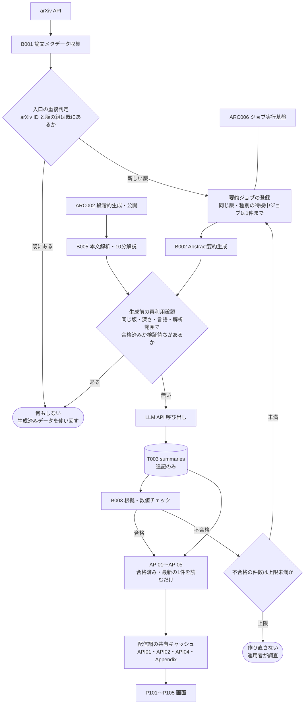
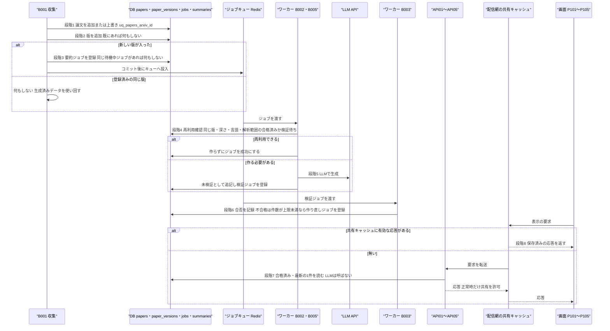

方式（共通基盤）: ARC001 生成物キャッシュ・重複排除方式 ／ 実体 18ファイル（定義元の資料3・実現先の設計書15） ／ 影響範囲 21件

# 方式設計書 — ARC001 生成物キャッシュ・重複排除方式

| 項目 | 内容 |
| :--- | :--- |
| 方式ID | ARC001（上流 `docs/基本設計書_概要.md` §11.1 で採番済み。本書で新規採番した ID はありません） |
| 名称 | 生成物キャッシュ・重複排除方式 |
| 更新日 | 2026-10-27 |
| インプット | (a) `source/`（全6ファイル227行。ARC001 に関わる行は `source/04_収益化とロードマップ.md:19-20,24-28,47`、`source/03_システム構成.md:21-26,36-37,57-58`、`source/02_機能要求定義.md:22-29,45-46,57`）／(b) `docs/基本設計書_概要.md` §4（F01・F04・F05、事前生成優先、B001〜B005）、§6（T002・T003）、§7（API04）、§11.1・§11.2、付録 Q19・Q22・Q24／実現先の設計書 `docs/db/DB.T001`・`T002`・`T003`・`T009.DB物理設計.md`、`docs/detail/be/BE.F01`・`F04`・`F05.BE詳細設計.md`、`docs/detail/batch/BT.B001`〜`B005`・`B008`・`B009.バッチ詳細設計.md`、`docs/detail/be/BE.F14.BE詳細設計.md`、関連先の `docs/detail/be/BE.F02`・`F03`・`F08`・`F19.BE詳細設計.md`、`docs/detail/fe/FE.P101`〜`P105.FE詳細設計.md`／(c) `legacy/` |
| 既存資料の突合 | `legacy/` は空ディレクトリ（ファイル0件）で、突合する既存設計・業務資料はありません。本書の既存版（`docs/arch/方式.ARC001.方式設計.md`）も無く、今回が初版です。引き継ぐ記述は無く、引き継ぐ ID は上流で採番済みのもの（ARC001・ARC002・ARC003・ARC004・ARC006・ARC007、F01〜F05・F08・F11・F13・F14・F17・F19、B001〜B006・B008〜B011、T001〜T004・T009、API01〜API05、P101〜P105、BF01・BF02・EX02、Q19）だけです |
| 対象システムの性質 | `source/` は企画・初期設計の資料（Markdown）で、プログラムのソースコードはありません。本書は資料の記述を一次情報とし、資料に無い実現方法は、確定済みの下流設計書（DB物理設計・BE詳細設計・バッチ詳細設計）が定めた内容を「実現先」として引用します。下流設計書の※推測は本書でも※推測のまま扱います |

---

## 1. 機構の概要

* **解決している課題**:
  * **LLM費用の重複**: 論文の要約は LLM で作るため、1回ごとに費用がかかります（主要コストの1・2位が「Abstractの翻訳・要約」「本文の解析・詳細解説」。`source/04_収益化とロードマップ.md:19-20`）。この仕組みが無いと、次の3つの場面で同じ論文の同じ要約を何度も作り、費用が利用者数や収集回数に比例して増えます。
    1. **画面を開くたび**: 利用者が論文詳細や一覧を開くたびに LLM を呼ぶと、閲覧数に比例して費用がかかり、表示も LLM の応答を待つため遅くなります（`source/02_機能要求定義.md:45`、`source/03_システム構成.md:58`「瞬時に翻訳は事前生成で実現」）。
    2. **収集のたび**: 定期収集は直近数日分を取り直すため（※推測: BE.F01 B001 の取得範囲は直近3日）、同じ論文の同じ版を何度も受け取ります。受け取るたびに要約を作ると、収集回数に比例して費用がかかります（`source/03_システム構成.md:22`）。
    3. **ジョブが重なったとき**: 再試行・再処理・二重配送でジョブが重なると、同じ要約を並行して2回作ります（`source/02_機能要求定義.md:46`）。
  * **MVPの完了基準を満たせない**: 「同一論文を重複処理せず、生成データを再利用できる」ことが MVP の完了基準に入っています（`source/02_機能要求定義.md:57`）。
  * **原価が測れない**: 「1論文あたり生成コスト」を検証指標にしているため（`source/04_収益化とロードマップ.md:47`）、1論文の1要約が1回だけ作られる前提が崩れると指標の意味がなくなります（※推測）。
* **設計方針**（資料から読み取れる範囲。推測は※推測と明記）:
  1. **生成物は「論文ID＋バージョン＋解析方式」を鍵に保存して使い回す**（`source/04_収益化とロードマップ.md:27`）。本システムではこの鍵を、論文の版（`paper_versions` の1行。論文IDと版番号の組）・要約の深さ（30秒／3分／10分）・言語・解析範囲（Abstractのみ／本文取得済み）の4つの組として実現します（上流 §6 T003、T003 §4.3 (1)）。「解析方式」を深さ＋解析範囲＋言語と読んでいるのは※推測です（付録B No.1）。
  2. **重複は入口で止める**: arXiv ID と版の組で重複を判定し、新しい版が入ったときだけ要約処理を始めます（`source/03_システム構成.md:21-23`）。
  3. **画面は事前に作ったものだけを読む**: フィードと論文詳細は事前生成データを優先し、画面表示のたびに LLM を呼びません（`source/02_機能要求定義.md:45`）。
  4. **重複の防止は DB の一意制約で保証する**（※推測: 下流の DB 物理設計の判断）。アプリの「確かめてから書く」だけでは並行実行で2行入りうるため、最後の防壁を DB に置きます（T002 §4.3、T009 §4.3 (4)）。
  5. **生成物は書き換えず追記する**（※推測: T003 §4.3 (4)）。作り直した要約は新しい行として残し、どのモデルが何を出したか・誤り率を追えるようにします。表示する1件は「合格済み・最も新しい」で選びます。
* **位置づけ**: 収集（B001）から表示（API01〜API05）までの流れの3か所（入口の重複判定・生成前の再利用確認・表示時の読み出し）に効きます。同じ考え方は要約以外の LLM 生成物（B008 の論文Embedding、F14・B009 のコード解説）にも当てはめられています（※上流要確認）。あわせて、その間のジョブ登録の重複防止を ARC006 ジョブ実行基盤と分担します。上流 §11.2 の相関では「ARC001 → ARC006」「ARC002 → ARC001」です。

---

## 2. 実体の構成

本方式は1つのプログラムではなく、資料の4か所で定められた決まりを、DB の一意制約・索引と、収集・要約・表示の各処理で分担して実現しています。下表の「定義元」は決まりを定めた資料、「実現先」はその決まりを具体化した確定済みの設計書です。

| # | パス | 種別 | 役割 | 備考 |
| :--- | :--- | :--- | :--- | :--- |
| 1 | `source/04_収益化とロードマップ.md` | 定義元（資料） | 生成物を「論文ID＋バージョン＋解析方式」でキャッシュするという、本方式の鍵を定める（:27）。原価抑制が目的であることの根拠（:19-20,24） | 上流 §11.1 の実体 |
| 2 | `source/03_システム構成.md` | 定義元（資料） | 収集フローの「arXiv ID＋バージョンで重複判定」を定める（:22）。事前生成で瞬時の表示を実現する方針（:58）と、要約の保存項目（:37） | 上流 §11.1 の実体 |
| 3 | `source/02_機能要求定義.md` | 定義元（資料） | 画面表示時に毎回 LLM を呼ばない（:45）、同一論文を重複処理せず生成データを再利用する（:57・MVP完了基準）、バッチの重複排除（:46）、生成物に処理日時・モデル・対象版を残す（:29） | 上流 §11.1 の実体 |
| 4 | `docs/db/DB.T001.DB物理設計.md` | 実現先（DB物理設計） | 同じ arXiv ID の論文を1行に限る一意制約 `uq_papers_arxiv_id` | ※上流未定義: 上流 §11.1 の適用範囲に T001 の記載が無い |
| 5 | `docs/db/DB.T002.DB物理設計.md` | 実現先（DB物理設計） | 同じ論文の同じ版を1行に限る一意制約 `uq_paper_versions_paper_id_version`。重複処理を防ぐ最後の防壁 | 上流の適用範囲 T002 |
| 6 | `docs/db/DB.T003.DB物理設計.md` | 実現先（DB物理設計） | 生成物（要約）の保存先。鍵の4列、再利用確認と表示に使う索引 `idx_summaries_lookup`、鍵の値をそろえる CHECK 制約、一意制約を設けない理由と表示する1件の選び方 | 上流の適用範囲 T003 |
| 7 | `docs/db/DB.T009.DB物理設計.md` | 実現先（DB物理設計） | 同じ版・同じ種別の待機中・実行中ジョブを1件に限る部分一意索引 `uq_jobs_active_per_version` | ※上流未定義: 上流 §11.1 の適用範囲に T009 の記載が無い（T009 自身は ARC001・ARC006 を根拠に挙げている） |
| 8 | `docs/detail/be/BE.F01.BE詳細設計.md` | 実現先（BE詳細設計） | 収集時に論文・版を重複なく書き込み、新しい版のときだけ要約ジョブを登録する手順（DA004・DA006・DA007、`upsert_paper_version`） | 上流の適用範囲 F01 |
| 9 | `docs/detail/be/BE.F04.BE詳細設計.md` | 実現先（BE詳細設計） | LLM を呼ぶ前の再利用確認（`find_reusable_summary`・DA006）、作り直し回数の上限（`count_failed_attempts`・DA012）、後続ジョブの重複なき登録（`enqueue`・DA004）。実装モジュール `worker/summary/reuse.py` | 上流の適用範囲 F04 |
| 10 | `docs/detail/be/BE.F05.BE詳細設計.md` | 実現先（BE詳細設計） | 表示時に合格済みの要約だけを読み、LLM を呼ばない（DA002〜DA004）。応答の共有キャッシュの指定 | 上流の適用範囲 F05 |
| 11 | `docs/detail/batch/BT.B001.バッチ詳細設計.md` | 実現先（バッチ詳細設計） | 収集バッチの冪等性（同じ版を何度受け取っても結果が変わらない） | 上流の適用範囲 B001 |
| 12 | `docs/detail/batch/BT.B002.バッチ詳細設計.md` | 実現先（バッチ詳細設計） | Abstract 要約の生成前の再利用確認と多重起動制御 | 上流の適用範囲 B002 |
| 13 | `docs/detail/batch/BT.B003.バッチ詳細設計.md` | 実現先（バッチ詳細設計） | 検証後の公開反映・作り直しジョブの重複なき登録と、作り直し回数の上限 | 上流の適用範囲 B003 |
| 14 | `docs/detail/batch/BT.B004.バッチ詳細設計.md` | 実現先（バッチ詳細設計） | 合格した要約を書き換えずに後続（B011・B008）へ使い回し、後続ジョブを重複なく登録する | 上流の適用範囲 B004 |
| 15 | `docs/detail/batch/BT.B005.バッチ詳細設計.md` | 実現先（バッチ詳細設計） | 本文PDFを取得する前の10分解説の再利用確認と多重起動制御 | 上流の適用範囲 B005 |
| 16 | `docs/detail/batch/BT.B008.バッチ詳細設計.md` | 実現先（バッチ詳細設計） | 要約以外の生成物（論文Embedding）の使い回し。保存済みの版・モデル・入力の要約値が同じなら Embedding の提供元を呼ばない（DA002） | ※上流要確認: 上流の適用範囲に B008 の記載が無い（BT.B008 §6 確認事項 No.9） |
| 17 | `docs/detail/be/BE.F14.BE詳細設計.md` | 実現先（BE詳細設計） | 要約以外の生成物（公式実装のコード解説）の使い回し。論文ごとに1行で保存し、見つかった論文は再確認の対象から外して LLM を再び呼ばない（DA001・DA005） | ※推測・※上流要確認: 上流の適用範囲に F14 の記載が無い |
| 18 | `docs/detail/batch/BT.B009.バッチ詳細設計.md` | 実現先（バッチ詳細設計） | F14 の関連付けを実行するバッチの冪等性（見つかった論文のコード解説を作り直さない） | ※上流要確認: 上流の適用範囲に B009 の記載が無い |

* **命名規則・配置規則**（新規追加時に従うべき規則）:
  * 要約の形をした生成物（要約スキーマ ARC003 に従うもの）の保存先は `summaries`（T003）に限り、鍵となる「版（`paper_version_id`）・種別・言語・解析範囲」の4列を必ず持たせます（§5 手順A）。要約の形でない生成物は専用の保存先を持ちます（論文Embedding は `{論文Embeddingテーブル}`、コード解説は `{GitHub関連付けテーブル}`。いずれも物理名は未定で※上流未定義）。その場合も、論文ID を単位に1行とし、作り直しの要否を決める項目（モデル・入力の要約値・確認日時）を同じ行に持たせます（§4 鍵4・鍵5）。
  * 一意制約・索引の名前は DB 物理設計の命名規則に従います（一意制約 `uq_{テーブル}_{列または用途}`、索引 `idx_{テーブル}_{列または用途}`。T002・T009 §1 ※推測）。
  * 要約の再利用確認・作り直し判定のロジックはワーカーの `worker/summary/reuse.py` に集めます（BE.F04 §1 ディレクトリ構成）。要約を作るジョブごとに個別の確認ロジックを書きません。Embedding（B008）とコード解説（F14）は、それぞれの本処理の中で再利用を判定します（BT.B008 DA002、BE.F14 DA001）。
* **全数**: 18件（定義元の資料3件＋実現先の設計書15件。実現先の内訳は DB物理設計4件・BE詳細設計4件・バッチ詳細設計7件）。根拠: 定義元は上流 §11.1 ARC001 行の「実体」列に挙がった3ファイルと一致します。実現先は、全47本の確定済み設計書（`docs/db/` 10本・`docs/detail/be/` 19本・`docs/detail/batch/` 11本・`docs/detail/fe/` 7本）を1本ずつ調べ、ARC001 を「利用する方式」に挙げ、かつ重複排除または再利用の決まりを自ら定めているものを数えました。47本の振り分けは次のとおりです。
  * **実現先（15本）**: DB物理設計 T001・T002・T003・T009、BE詳細設計 F01・F04・F05・F14、バッチ詳細設計 B001・B002・B003・B004・B005・B008・B009。
  * **影響範囲だけで扱うもの（10本）**: ARC001 を利用すると書いているが、決まりを自ら定めず実現先の決まりに従うもの。BE詳細設計 F02・F03・F08（作り置きの要約を読むだけ）・F19（使い回しの効き目を監視するだけ）、バッチ詳細設計 B006（F01 の書き込み DA004・DA006・DA007 をそのまま使う）、FE詳細設計 P101〜P105（作り置きの要約を API から受け取って表示するだけ）。§6 影響範囲に行があります。
  * **対象外（22本）**: ARC001 を使わないと明記しているもの。DB物理設計 T004〜T008・T010（6本。ARC001 への言及なし）、BE詳細設計 F06・F07・F09〜F13・F15〜F18（11本）、バッチ詳細設計 B007・B010・B011（3本）、FE詳細設計 P106・P107（2本）。このうち F11 は「比較結果の使い回しは保存先が無いため未適用」としており、付録B No.11 に挙げます。B010 は自らは ARC001 を使わないとしていますが、再処理で戻すジョブが本方式の部分一意索引に当たるため、§6 に影響先として行を設けています（T009 §4.3 (4) が根拠）。
  * **共有キャッシュの境界**: 本書は、作り置きの要約を返す応答（API01・API02・API04・Appendix）の配信網での共有を「画面表示のたびに生成物を取りに行かない」ための層として構成要素に含めます（※上流未定義）。生成物を返さない応答の共有（BE.F13 トレンド可視化。BE.F13 自身が「本書独自の性能対策で ARC001 ではない」と明記）は含めません。

**構成要素ロースター**（本方式を構成する制約・索引・処理・設定の全数）

ID 列には、上流または実現先の設計書で付いている識別子（制約名・索引名・関数名・データアクセスID・環境変数名）をそのまま書きます。本書で新しく番号を付けた要素はありません。データアクセスID（DA）は設計書ごとに振られているため、必ず「定義元」の設計書と組で読みます。

| # | ID（既存の識別子） | 名称 | 種別 | 概要 | 定義元 | 定義状況 | 詳細の所在 |
| :--- | :--- | :--- | :--- | :--- | :--- | :--- | :--- |
| 1 | uq_papers_arxiv_id | 論文の一意制約 | 一意制約 | 同じ arXiv ID の論文を2行登録させない。取り込みの重複排除の最後の防壁 | T001（※上流未定義） | 詳細 | §3 段階1、`docs/db/DB.T001.DB物理設計.md` §4.3 (1) |
| 2 | uq_paper_versions_paper_id_version | 版の一意制約 | 一意制約 | 同じ論文の同じ版番号を2行登録させない。新しい版が入ったかどうかを DB が判定する | T002 | 詳細 | §3 段階2、§4 鍵1、`docs/db/DB.T002.DB物理設計.md` §4.3 (2) |
| 3 | uq_jobs_active_per_version | ジョブの重複登録防止 | 部分一意索引 | 同じ版・同じ種別のジョブが、待機中と実行中を合わせて2件以上にならないようにする | T009（※上流未定義） | 詳細 | §3 段階3、§4 鍵2、`docs/db/DB.T009.DB物理設計.md` §4.3 (4) |
| 4 | idx_summaries_lookup | 要約の引き当て索引 | 索引 | 版・深さ・言語で絞り、生成日時の新しい順に要約を引く。生成前の再利用確認と表示時の読み出しの両方が使う | T003 | 詳細 | §3 段階4・段階7、`docs/db/DB.T003.DB物理設計.md` §5.2 |
| 5 | ck_summaries_language_format | 言語コードの形式制約 | CHECK 制約 | 言語を `ja` のような小文字の言語コードにそろえる。表記が揺れると再利用確認で同じ言語と判定できず、要約を作り直してしまうため | T003 | 詳細 | §4 鍵3、`docs/db/DB.T003.DB物理設計.md` §4.3 (3) |
| 6 | ck_summaries_source_scope | 解析範囲の値の制約 | CHECK 制約 | 解析範囲を「Abstractのみ」「本文取得済み」の2値に限る（`abstract_only`・`full_text`） | T003 | 簡易 | §4 鍵3 |
| 7 | ck_summaries_deep_requires_full_text | 10分解説の材料の制約 | CHECK 制約 | 10分解説は本文を材料にしたときだけ保存できる。鍵の組み合わせのうち意味の無いもの（Abstractだけの10分解説）を作らせない | T003 | 詳細 | §4 鍵3、`docs/db/DB.T003.DB物理設計.md` §4.4 |
| 8 | ck_summaries_validation_status | 検証状態の値の制約 | CHECK 制約 | 検証状態を「未検証」「合格」「不合格」の3値に限る（`pending`・`passed`・`failed`） | T003 | 簡易 | §4 鍵3 |
| 9 | DA004（BE.F01） | 論文の追加または最新版での上書き | データアクセス | 未登録の arXiv ID なら追加し、登録済みなら取り込んだ版が最新版以上で内容が変わったときだけ上書きする。古い版の取得結果で最新の内容を戻さない | F01 | 詳細 | §3 段階1、`docs/detail/be/BE.F01.BE詳細設計.md` §3 |
| 10 | DA006（BE.F01） | 論文の版の追加 | データアクセス | 論文IDと版番号の組がまだ無ければ1行追加し、あれば何もしない。追加できたときだけ新しい版のIDが返り、これが「新しい版か」の判定結果になる | F01 | 詳細 | §3 段階2、`docs/detail/be/BE.F01.BE詳細設計.md` §3 |
| 11 | DA007（BE.F01） | 要約ジョブ（B002）の登録 | データアクセス | 新しく入った版についてだけ、Abstract 要約のジョブを1件登録する。同じジョブが待機中か実行中なら何もしない | F01 | 詳細 | §3 段階3、`docs/detail/be/BE.F01.BE詳細設計.md` §3 |
| 12 | upsert_paper_version | 論文1件の取り込み | 関数 | 1件の論文について DA004・DA006・DA007 を1つのトランザクションで行う。版が新しかったときだけ要約ジョブを登録する | F01 | 詳細 | §3 段階1〜3、`docs/detail/be/BE.F01.BE詳細設計.md` §4 |
| 13 | enqueue（DA004・BE.F04） | 後続ジョブの重複なき登録 | 関数 | 検証・公開反映・作り直し・検索インデックス更新・Embedding 生成のジョブを、同じ版・種別の待機中ジョブが無いときだけ登録し、コミット後にキューへ投入する | F04 | 詳細 | §3 段階3、`docs/detail/be/BE.F04.BE詳細設計.md` §4 No.5 |
| 14 | find_reusable_summary（DA006・BE.F04） | 再利用できる要約の確認 | 関数 | LLM を呼ぶ前に、同じ版・深さ・言語・解析範囲で合格済みか検証待ちの要約があるかを調べ、あれば作らない | F04 | 詳細 | §3 段階4、§4 鍵3、`docs/detail/be/BE.F04.BE詳細設計.md` §4 No.7 |
| 15 | count_failed_attempts（DA012・BE.F04） | 作り直し回数の上限判定 | 関数 | 同じ版・深さで不合格になった要約の件数を数え、上限に達していれば作り直しのジョブを登録しない | F04 | 詳細 | §3 段階6、§4 設定項目、`docs/detail/be/BE.F04.BE詳細設計.md` §4 No.15 |
| 16 | summarize_abstract | Abstract 要約の生成（B002 本処理） | 関数 | 30秒要約と3分要約のそれぞれについて再利用確認を行い、必要なものだけを LLM で作る。作るものが無ければ何も保存せずに成功にする | F04（B002） | 詳細 | §3 段階4・5、`docs/detail/be/BE.F04.BE詳細設計.md` §4 No.6 |
| 17 | analyze_full_text | 10分解説の生成（B005 本処理） | 関数 | ライセンスを確かめたあと、本文PDFを取得する前に10分解説の再利用確認を行い、不要なら取得もしない | F04（B005） | 詳細 | §3 段階4・5、`docs/detail/be/BE.F04.BE詳細設計.md` §4 No.17 |
| 18 | validate_summary | 検証と作り直しの登録（B003 本処理） | 関数 | 未検証の要約を合否判定し、不合格のうち上限未満のものだけ作り直しのジョブ（30秒・3分は B002、10分は B005）を登録する | F04（B003） | 詳細 | §3 段階6、`docs/detail/be/BE.F04.BE詳細設計.md` §4 No.12 |
| 19 | save_with_citations | 要約の追記保存 | 関数 | 生成した要約を未検証として新しい行で追加し、出典参照を結びつける。既存の要約は書き換えない | F04 | 詳細 | §3 段階5、`docs/detail/be/BE.F04.BE詳細設計.md` §4 No.11 |
| 20 | DA002（BE.F05） | 表示する版の決定 | データアクセス | 合格した日本語の要約を持つ版のうち版番号が最も大きいものを表示する版にする。無ければ最新版にする | F05 | 詳細 | §3 段階7、`docs/detail/be/BE.F05.BE詳細設計.md` §3 |
| 21 | DA003（BE.F05） | 日本語タイトル用の要約取得 | データアクセス | 表示する版の合格済み要約から、3分要約・30秒要約・10分解説の優先順で最も新しいものを選び、日本語タイトルだけを取り出す | F05 | 詳細 | §3 段階7、`docs/detail/be/BE.F05.BE詳細設計.md` §3 |
| 22 | DA004（BE.F05） | 指定深さの公開済み要約取得 | データアクセス | 表示する版・指定の深さ・日本語で、合格済みの要約のうち生成日時が最も新しい1件を返す。未検証・不合格は返さない | F05 | 詳細 | §3 段階7、`docs/detail/be/BE.F05.BE詳細設計.md` §3 |
| 23 | DA002（BE.F02） | 一覧の表示用要約の取得 | データアクセス | 日付別一覧の各論文に、合格済みの30秒要約を版番号の大きい順・生成日時の新しい順で1件結びつける | F02（※上流要確認） | 詳細 | §3 段階7、`docs/detail/be/BE.F02.BE詳細設計.md` §3 |
| 24 | DA001（BE.F03） | 自由検索の表示用要約の取得 | データアクセス | 検索結果の各論文に、合格済みの30秒要約を1件結びつける。要約が無い論文も結果から外さない | F03（※上流要確認） | 詳細 | §3 段階7、`docs/detail/be/BE.F03.BE詳細設計.md` §3 |
| 25 | DA005・DA006（BE.F08） | おすすめの表示用要約の取得 | データアクセス | おすすめに添える日本語タイトルと30秒要約を、作り置きのものから読む | F08（※上流要確認） | 詳細 | §3 段階7、`docs/detail/be/BE.F08.BE詳細設計.md` §3 |
| 26 | API01 の共有キャッシュ指定 | 日付別一覧の応答の共有 | 応答ヘッダー | 一覧の正常応答を配信網で5分間共有し、同じ条件の表示のたびに DB を読まない。エラー応答は共有しない（`public, s-maxage=300, stale-while-revalidate=60`） | F02（※上流未定義） | 詳細 | §3 段階8、`docs/detail/be/BE.F02.BE詳細設計.md` §2 |
| 27 | API02 の共有キャッシュ指定 | 自由検索の応答の共有 | 応答ヘッダー | 同じ条件の検索結果を配信網で60秒共有する（`public, s-maxage=60, stale-while-revalidate=60`） | F03（※上流未定義） | 詳細 | §3 段階8、`docs/detail/be/BE.F03.BE詳細設計.md` §2 |
| 28 | API04 の共有キャッシュ指定 | 要約取得の応答の共有 | 応答ヘッダー | 公開済み要約は同じ版・深さなら誰にでも同じ内容のため、配信網で5分間共有する。10分解説を Pro 限定にする場合の10分解説の応答と、失敗応答は共有しない（`public, s-maxage=300, stale-while-revalidate=60`） | F05（※上流未定義） | 詳細 | §3 段階8、`docs/detail/be/BE.F05.BE詳細設計.md` §2 |
| 29 | Appendix の共有キャッシュ指定 | Appendix 取得の応答の共有 | 応答ヘッダー | 利用者によって内容が変わらないため、配信網で5分間共有する（`public, s-maxage=300`） | F05（※上流未定義） | 簡易 | §3 段階8 |
| 30 | SUMMARY_MAX_REGENERATIONS | 作り直し回数の上限 | 環境変数 | 同じ版・深さで不合格が何件になったら作り直しを止めるか（※推測: 2） | F04（上流 Q19 で未定） | 詳細 | §4 設定項目 |
| 31 | LLM_MODEL_ID | 生成に使うモデル | 環境変数 | 要約を作る LLM のモデル。生成物に記録されるが、再利用の鍵には含まれない | F04（上流 §9） | 簡易 | §4 設定項目 |
| 32 | DA002（BT.B008） | 保存済み Embedding の確認 | データアクセス | 論文の保存済み Embedding の版・モデル・入力の要約値を1行読み、同じモデル・同じ入力で作ってあるか、保存済みの版のほうが新しいときは Embedding の提供元を呼ばない | B008（※上流要確認） | 詳細 | §3 段階9、§4 鍵4、`docs/detail/batch/BT.B008.バッチ詳細設計.md` §3 |
| 33 | DA001（BE.F14） | 関連付け対象の版の抽出 | データアクセス | まだ探していない論文と、「見つからなかった」と記録してから再確認の間隔が過ぎた論文だけを選ぶ。公式実装が見つかった論文は対象にせず、コード解説を作り直さない | F14（※上流要確認） | 詳細 | §3 段階9、§4 鍵5、`docs/detail/be/BE.F14.BE詳細設計.md` §3 |
| 34 | DA005（BE.F14） | 関連付け結果の保存 | データアクセス | 論文ごとに1行で、見つかった公式実装とコード解説・生成モデルを保存する。見つかった行は「見つからなかった」で上書きしない | F14（※上流要確認） | 詳細 | §3 段階9、§4 鍵5、`docs/detail/be/BE.F14.BE詳細設計.md` §3 |
| 35 | EMBEDDING_MODEL_ID | Embedding に使うモデル | 設定値 | Embedding を作るモデル。要約と違い Embedding の再利用の鍵に含まれ、変えると作り直しの対象になる | B008（※上流未定義） | 詳細 | §4 鍵4・設定項目 |
| 36 | GITHUB_RECHECK_DAYS | 公式実装の再確認の間隔 | 環境変数 | 「見つからなかった」論文を何日たったら探し直すか（※推測: 30日） | F14（※上流未定義） | 詳細 | §4 鍵5・設定項目 |

**総件数: 36件**（一意制約・索引4件、CHECK 制約4件、データアクセス12件、関数8件、応答ヘッダー4件、環境変数・設定値4件。定義状況は詳細32件・簡易4件）。**全数である根拠**: 実現先の設計書15本（§2 #4〜#18）と関連先の `BE.F02`・`BE.F03`・`BE.F08` から、ARC001 の根拠として挙げている制約・索引・関数・データアクセス・設定値と、「重複」「使い回し」「再利用」「作り直し」「`ON CONFLICT`」「`Cache-Control`」を含む記述を全件拾い、本方式の決まり（入口の重複判定・ジョブ登録の重複防止・生成前の再利用確認・作り直しの上限・表示時の読み出し・応答の共有）と、要約以外の生成物（Embedding・コード解説）の使い回しを担うものを数えました。次のものは他の方式の責務として除いています: ジョブの取り合い（`claim`、状態が待機の行だけを実行中に変える更新）と再試行回数の上限 `JOB_MAX_ATTEMPTS` は ARC006、arXiv の問い合わせ間隔 `ARXIV_REQUEST_INTERVAL_SEC` は ARC007、ライセンス判定 `is_full_text_allowed` は ARC005、10分解説の起動の判定は ARC002。API03（論文詳細）と API05（おすすめ）の応答は利用者ごとに閲覧記録や中身が変わるため共有しない指定（`private, no-store`）で、本方式の共有キャッシュには入りません。
**定義状況の判定**（completeness 3-1）: 分岐・状態の変更・非自明な業務ルールのいずれかを含むものを「詳細」としました。値の範囲を限るだけの CHECK 制約2件（#6・#8）、内容の分岐が無い応答ヘッダー（#29）、値を記録するだけの環境変数（#31）は「簡易」です。再利用の鍵や再確認の規則を決める設定値（#30・#35・#36）は業務ルールを含むため「詳細」です。

---

## 3. ライフサイクル（登録・読込・選択）

本方式には「起動時に読み込む定義ファイル」はありません。生成物は**論文の新しい版が入ったとき**に作られ、**画面からの要求ごと**に読まれます。下図は、要約について収集から表示までの時系列です（段階1〜8）。要約以外の生成物（Embedding・コード解説）の使い回しは段階9として表に記載します。

| 段階 | 契機 | 処理 | 実装（ファイル:行） |
| :--- | :--- | :--- | :--- |
| 1 論文の重複判定 | 定期収集（B001、※推測: 1日1回 UTC 02:00）またはオンデマンド同期（B006）が論文を1件受け取ったとき | 同じ arXiv ID の論文が無ければ追加します。あれば、取り込んだ版が登録済みの最新版以上で、原題・Abstract・著者・カテゴリ・更新日時・最新版の6項目のどれかが変わったときだけ上書きします。古い版の取得結果で最新の内容を戻さないためです（`INSERT … ON CONFLICT (arxiv_id) DO UPDATE … WHERE` 版が最新版以上）。DB の一意制約 `uq_papers_arxiv_id` が、並行して取り込んでも行が2つにならないことを保証します | `docs/detail/be/BE.F01.BE詳細設計.md:160,198`、`docs/db/DB.T001.DB物理設計.md:186,206,250` |
| 2 版の重複判定 | 段階1と同じトランザクションの続き | 論文IDと版番号の組がまだ無ければ版を1行追加し、あれば何もしません。追加できたときだけ新しい版のIDが返り、これを「新しい版が入った」の判定に使います（`INSERT … ON CONFLICT (paper_id, version) DO NOTHING RETURNING id`）。版の取り込み時点のメタデータを版ごとに残します | `docs/detail/be/BE.F01.BE詳細設計.md:161,228,312`、`docs/db/DB.T002.DB物理設計.md:188,208,243`、`source/03_システム構成.md:22` |
| 3 ジョブ登録の重複防止 | 段階2で新しい版が入ったとき（B002 の登録）。B002・B005 の保存後（B003 の登録）、B003 の合格・不合格の後（B004・作り直しの登録）、B004 の後（B011・B008 の登録）、失敗ジョブの再処理（B010） | 同じ版・同じ種別のジョブが待機中か実行中なら登録せず、無ければ待機の行を1件登録します（`ON CONFLICT (paper_version_id, job_type) WHERE status IN ('pending','running') … DO NOTHING`）。登録できたものだけをコミット後にキューへ投入します。終わったジョブ（成功・失敗）は対象外のため、後から同じ処理をやり直せます。B010 の再処理が新しいジョブと重なったときは、失敗のジョブを待機に戻さず「重複のため戻さなかった」と運用者に示します（※推測） | `docs/detail/be/BE.F01.BE詳細設計.md:162,237`、`docs/detail/be/BE.F04.BE詳細設計.md:232,372`、`docs/db/DB.T009.DB物理設計.md:218,226,380-382` |
| 4 生成前の再利用確認 | ワーカーが B002（30秒・3分要約）または B005（10分解説）のジョブを始めたとき。深さごとに LLM を呼ぶ前、B005 では本文PDFを取得する前 | 同じ版・同じ深さ・日本語・同じ解析範囲で、合格済みか検証待ちの要約が1件でもあれば、その深さは作りません。検証待ちも「作らない」に含めるのは、検証の途中で同じ要約を二重に作って費用をかけないためです（`validation_status IN ('passed','pending')`）。不合格の要約しか無いか、要約が無いときだけ作ります。作るものが1つも無ければ、何も保存せずにジョブを成功にします | `docs/detail/be/BE.F04.BE詳細設計.md:191,373,374,384`、`docs/db/DB.T003.DB物理設計.md:212,343` |
| 5 生成と追記保存 | 段階4で「作る」と判定された深さ | LLM で生成し、要約スキーマ（ARC003）で確かめてから、未検証として**新しい行で追記**します。処理日時・モデル・対象の版・解析範囲を一緒に記録します（`source/02_機能要求定義.md:29`）。既存の行は書き換えません。同じトランザクションで検証ジョブ（B003）を登録します | `docs/detail/be/BE.F04.BE詳細設計.md:149,373,384`、`docs/db/DB.T003.DB物理設計.md:204` |
| 6 作り直しの上限判定 | B003 が要約を不合格と記録したとき | 同じ版・同じ深さで不合格になった要約の件数（今回の不合格を含む）が上限未満のときだけ、作り直しのジョブ（30秒・3分は B002、10分解説は B005）を登録します。上限に達したら作り直さず、警告ログを残して運用者の調査に回します。作り直しの B002 は2つの深さを再び確認しますが、合格済みの深さは段階4で飛ばされるため、不合格の深さだけが作り直されます | `docs/detail/be/BE.F04.BE詳細設計.md:195,379,382`、`docs/detail/batch/BT.B002.バッチ詳細設計.md:498` |
| 7 表示時の読み出し | 画面からの要求ごと（API01〜API05） | 作り置きの要約を DB から読むだけで、LLM は呼びません。合格済み（`validation_status = 'passed'`）・日本語の要約のうち、選択規則（下記）で1件を選びます | `docs/detail/be/BE.F05.BE詳細設計.md:19,341-343`、`docs/detail/be/BE.F02.BE詳細設計.md:232`、`docs/detail/be/BE.F03.BE詳細設計.md:228`、`docs/detail/be/BE.F08.BE詳細設計.md:557`、`source/02_機能要求定義.md:45` |
| 8 応答の共有 | 段階7の正常応答を返すとき | 利用者によって内容が変わらない応答（API01・API02・API04・Appendix）は、配信網で一定時間共有し、同じ要求で DB を読まないようにします。利用者ごとに変わる応答（API03・API05、Pro 限定の10分解説）と失敗応答は共有しません | `docs/detail/be/BE.F02.BE詳細設計.md:196`、`docs/detail/be/BE.F03.BE詳細設計.md:200`、`docs/detail/be/BE.F05.BE詳細設計.md:127,180,243,298`、`docs/detail/be/BE.F08.BE詳細設計.md:208` |
| 9 要約以外の生成物の使い回し | B008（B004 の後、版ごと）・B009（定期、F14 の関連付け）のジョブが始まったとき | 要約と同じ考え方を、要約以外の LLM 生成物にも当てはめています（※上流要確認: 上流の適用範囲に B008・B009・F14 が無い）。**論文Embedding（B008）**: 論文ごとに1行で持ち、保存済みの行と版・モデル・入力文の要約値（入力文から作る短い値）を比べ、同じモデル・同じ入力で作ってあるか、保存済みの版のほうが新しいときは提供元を呼びません。古い版のジョブで新しい版のベクトルを上書きしません。**コード解説（B009・F14）**: 論文ごとに1行で持ち、公式実装が見つかった論文は以後の探索の対象から外して、コード解説を作り直しません。「見つからなかった」論文だけを、再確認の間隔が過ぎたら探し直します | `docs/detail/batch/BT.B008.バッチ詳細設計.md:34,160,584`、`docs/detail/be/BE.F14.BE詳細設計.md:152,156,393`、`docs/detail/batch/BT.B009.バッチ詳細設計.md:580,645` |

* **読込順序**（どの層が先に効き、どれが勝つか）:

| 順 | 層 | 判定の材料 | 先に止めたときの効果 | 後の層との関係 |
| :--- | :--- | :--- | :--- | :--- |
| 1 | 論文の重複判定（段階1） | arXiv ID | 同じ論文を2行にしない | 上書きは「取り込んだ版が最新版以上」のときだけ。古い版の取得結果は新しい内容に勝たない |
| 2 | 版の重複判定（段階2） | 論文ID＋版番号 | 登録済みの版では以降の処理を一切始めない（ジョブも作らない） | ここで止まれば段階3〜6は動かない。最も費用削減の効果が大きい層 |
| 3 | ジョブ登録の重複防止（段階3） | 版＋ジョブ種別＋状態（待機・実行中） | 同じ処理を並行して2回走らせない | 段階2を通っても、再処理・再試行・後続登録の重なりはここで止まる |
| 4 | 生成前の再利用確認（段階4） | 版＋深さ＋言語＋解析範囲＋検証状態 | LLM を呼ばない | 段階3を通った作り直しのジョブでも、合格済みの深さはここで飛ばす |
| 5 | 作り直しの上限（段階6） | 版＋深さの不合格件数 | 不合格の繰り返しで費用が際限なく増えない | 上限に達した深さは自動では二度と作られない（運用者の対応が要る） |
| 6 | 応答の共有（段階8） | 要求の URL | DB を読まない | 共有中は、新しく合格した要約が最大で共有時間ぶん遅れて表示される |

* **選択規則**（実行時に、どの生成物が使われるか）:
  * **生成するかの判定**（段階4）: 「合格済み」または「検証待ち」が1件でもあれば使い回し（作らない）、「不合格」だけか0件なら作ります。生成モデル（`model_id`）は判定に**含めません**。このため、モデルを変えても既存の合格済み要約がある版は自動では作り直されません（付録B No.2）。
  * **表示する版**（API03・API04・Appendix、BE.F05 DA002）: 合格した日本語の要約を持つ版のうち、版番号が最も大きいものを使います。どの版にも合格した要約が無ければ、最新版（`papers.latest_version` と同じ版番号）を使います。
  * **表示する要約**（BE.F05 DA004）: 表示する版・指定した深さ・日本語・合格済みのうち、生成日時が最も新しい1件です。モデルを変えて作り直した場合や、本文取得後に作り直した場合に、新しい要約へ自然に切り替わります（T003 §4.3 (6)）。未検証・不合格は返しません。該当が無いときは 404 です（上流 §7 API04）。
  * **一覧の要約**（BE.F02 DA002・BE.F03 DA001）: 同じ論文の版のうち、合格済みの日本語30秒要約を、版番号の大きい順・同じ版の中では生成日時の新しい順に並べた先頭1件です。
  * **日本語タイトル**（BE.F05 DA003）: 表示する版の合格済み要約から、3分要約・30秒要約・10分解説の優先順で、同じ深さの中では生成日時の新しいものを選びます。
  * **版の選択の食い違い**（※上流要確認）: T003 §4.3 (1) は「API04 は最新版の要約を返し、最新版に合格した要約が無ければ 404」とし、前の版の要約を出す案を採らないとしています。一方、BE.F05 DA002・BE.F02 DA002 は、最新版に合格した要約が無いときに前の版の合格済み要約を表示します。本書は実装に近い BE 詳細設計の規則を記載しますが、どちらに合わせるかは顧客確認が必要です（付録B No.3）。
* **失効・再読込**（生成物が使われなくなる・作り直される条件）:

| 契機 | 起きること | 根拠 |
| :--- | :--- | :--- |
| 論文の新しい版が arXiv に出た | 新しい版は別の鍵になるため、段階2で新しい版の行が入り、その版の要約が作られます。古い版の要約は消さずに残ります | `docs/db/DB.T003.DB物理設計.md:211`、`source/01_企画概要.md:37` |
| 要約が検証で不合格になった | 不合格の行は残したまま（誤り率の集計のため）、上限未満なら同じ鍵で新しい行を作り直します | `docs/db/DB.T003.DB物理設計.md:204`、`docs/detail/be/BE.F04.BE詳細設計.md:379` |
| 本文が取得できるようになった | 解析範囲が「本文取得済み」の別の鍵として10分解説が作られます。30秒・3分要約を本文から作り直すかの規則は未定義です（※推測: T003 は作り直した場合に最も新しいものを表示するとしているが、作り直しを起動する処理は定義されていない。付録B No.4） | `docs/db/DB.T003.DB物理設計.md:245` |
| 生成モデル・指示文を変えた | 自動では何も起きません。鍵にモデルも指示文の版も含まれないためです。作り直す手順は未定義です（※上流未定義。付録B No.2） | `docs/detail/be/BE.F04.BE詳細設計.md:191` |
| 時間の経過 | 生成物（DB）には有効期限がありません。配信網の共有は API01・API04・Appendix が5分、API02 が60秒で切れ、API01・API02・API04 は期限切れ後さらに60秒は古い応答を返しながら裏で取り直します（`stale-while-revalidate=60`） | §2 #26〜#29 |
| Embedding のモデルを変えた（B008） | 要約と違い、モデルが Embedding の鍵に含まれるため、次に同じ論文の Embedding ジョブが動いたときに作り直されます。既存の論文をまとめて作り直す一括登録が B008 にあります | `docs/detail/batch/BT.B008.バッチ詳細設計.md:34` |
| 「見つからなかった」と記録したコード解説（F14） | 再確認の間隔（※推測: 30日）が過ぎると探索の対象に戻ります。見つかったものは失効せず、新しい版が出ても作り直しません（※推測: 公式リポジトリは版で変わらない前提） | `docs/detail/be/BE.F14.BE詳細設計.md:152` |
| 検証待ちのまま止まった | 検証待ちは再利用確認で「作らない」に入るため、検証ジョブが失敗して検証待ちが残ると、その深さは作り直されません（BE.F04 §0 確認事項 No.10） | `docs/detail/be/BE.F04.BE詳細設計.md:191` |

---

## 4. インターフェース・データ構造

* **鍵1 版の鍵**（段階2で使う）: 論文IDと版番号の組です。論文IDは arXiv ID から引いた本システム内の番号で、版番号は arXiv の v1・v2 の番号です（`paper_versions.paper_id`、`paper_versions.version`、一意制約 `uq_paper_versions_paper_id_version`）。arXiv ID には版番号の接尾辞を含めず、版は別の列で持ちます（T001 `ck_papers_arxiv_id_format`）。
* **鍵2 ジョブの鍵**（段階3で使う）: 版とジョブ種別の組で、状態が待機または実行中の行だけを対象にします（`jobs.paper_version_id`、`jobs.job_type`、部分一意索引 `uq_jobs_active_per_version`）。版を持たないジョブ（収集 `collect_metadata`・オンデマンド同期 `sync_on_demand`）は対象外です。
* **鍵3 生成物の鍵**（段階4・段階7で使う）: 上流の「論文ID＋バージョン＋解析方式」を、次の4列の組で実現します。

| 鍵の列 | 物理名 | 取りうる値 | 鍵に入れる理由 | 根拠 |
| :--- | :--- | :--- | :--- | :--- |
| 論文の版 | summaries.paper_version_id | 版の行のID | 「論文ID＋バージョン」に当たる。版が変われば内容が変わりうるため、版ごとに作る | `source/04_収益化とロードマップ.md:27`、T003 §4.3 (1) |
| 要約の深さ | summaries.summary_type | `short`（30秒要約）・`standard`（3分要約）・`deep`（10分解説） | 深さごとに材料・費用・項目が違う別の生成物のため | `source/02_機能要求定義.md:24-26`、T003 §4.3 (2) |
| 言語 | summaries.language | `ja`（初期は日本語だけ）。小文字の言語コードの形に限る | 言語が違えば別の生成物。表記の揺れがあると同じ言語と判定できないため形式を固定する | T003 §4.3 (3) |
| 解析範囲 | summaries.source_scope | `abstract_only`（Abstractのみ）・`full_text`（本文取得済み） | 「解析方式」に当たる（※推測）。同じ深さでも材料が違えば別の生成物。10分解説は `full_text` だけ | `source/02_機能要求定義.md:27`、T003 §4.3 (7) |

* **鍵に含めないが記録する項目**: 生成モデル（`model_id`）、生成日時（`generated_at`）、要約本文（`json_content`）、検証状態（`validation_status`）。検証状態は鍵ではなく、再利用・表示の可否を決める状態です（再利用確認は「合格」「検証待ち」、表示は「合格」だけ）。
* **一意制約を設けない理由**: 生成物の鍵（鍵3）には一意制約を設けません。不合格による作り直しやモデルを変えた作り直しで、同じ鍵の行が複数になるためです。不合格の行は誤り率の集計のために残します（`docs/db/DB.T003.DB物理設計.md:204` ※推測）。同じ鍵の生成物が並行して2行作られることは、鍵2（ジョブの重複防止）と段階4（再利用確認）で防ぎます。
* **鍵4 Embedding の鍵**（段階9、B008）: 論文IDで1行（論文ごとに1つ）。作り直しの要否は、保存済みの版番号・モデル（`EMBEDDING_MODEL_ID`）・入力文の要約値と比べて決めます。要約の鍵3と違い**モデルを鍵に含む**ため、モデルを変えると作り直しの対象になります。保存先のテーブルは上流 §6 に無く、物理名は未定です（`{論文Embeddingテーブル}`。※上流未定義、上流 Q23）。
* **鍵5 コード解説の鍵**（段階9、F14・B009）: 論文IDで1行（論文IDの一意制約に当たったら更新）。状態（見つかった／見つからなかった）と確認日時で、再探索の要否を決めます。保存先のテーブルは上流 §6 に無く、物理名は未定です（`{GitHub関連付けテーブル}`。※上流未定義）。
* **機構の入出力**:

| 方向 | 呼び出し元 | 渡すもの | 返るもの | 実現先 |
| :--- | :--- | :--- | :--- | :--- |
| 入口の重複判定 | B001・B006 | 論文1件の取り込み結果（arXiv ID・版番号・メタデータ・ライセンス） | 新しい版が入ったときは版ID、登録済みの同じ版のときは無し | BE.F01 `upsert_paper_version` |
| ジョブ登録 | B001・B002〜B005・B010 | 版ID・ジョブ種別 | 登録したジョブID、または無し（同じジョブが待機中か実行中） | BE.F04 `enqueue`、BE.F01 DA007 |
| 生成前の再利用確認 | B002・B005 | 版ID・深さ・解析範囲（言語は日本語で固定） | 「作り直し不要」か「作る」 | BE.F04 `find_reusable_summary` |
| 作り直しの上限判定 | B003 | 版ID・深さ | 「作り直してよい」か「作り直さない」 | BE.F04 `count_failed_attempts` |
| 表示時の読み出し | API01〜API05 | arXiv ID・深さ | 合格済みの要約1件（無ければ 404 または要約なしの一覧行） | BE.F05 DA002〜DA004、BE.F02 DA002、BE.F03 DA001、BE.F08 DA005・DA006 |

* **設定項目**（全項目）:

| 設定項目 | 種別 | 既定値 | 意味 | 変えたときの影響 | 根拠 |
| :--- | :--- | :--- | :--- | :--- | :--- |
| SUMMARY_MAX_REGENERATIONS | 環境変数（ワーカー） | 未定（※推測: 2） | 同じ版・深さで不合格が何件に達したら作り直しを止めるか | 大きくすると品質の救済は増えるが費用も増える。小さくすると要約が無いままの論文が増える | `docs/detail/be/BE.F04.BE詳細設計.md:382`、上流 Q19 |
| LLM_MODEL_ID | 環境変数（ワーカー） | 未定（上流 Q29） | 要約を作るモデル。生成物の `model_id` に記録する | 変えても既存の合格済み要約は作り直されない（鍵に含まれないため）。以後に新しく作る要約だけが新しいモデルになる | `docs/detail/be/BE.F04.BE詳細設計.md:39` |
| API01 の共有時間 | 応答ヘッダー（固定値） | 300秒＋取り直し中60秒（※推測） | 日付別一覧の応答を配信網で共有する時間 | 長くすると DB の負荷は減るが、新しく公開された要約の反映が遅れる | `docs/detail/be/BE.F02.BE詳細設計.md:196` |
| API02 の共有時間 | 応答ヘッダー（固定値） | 60秒＋取り直し中60秒（※推測） | 自由検索の応答を共有する時間 | 長くすると DB の負荷は減るが、新しく公開された要約が検索結果に出るのが遅れる | `docs/detail/be/BE.F03.BE詳細設計.md:200` |
| API04 の共有時間 | 応答ヘッダー（固定値） | 300秒＋取り直し中60秒（※推測） | 要約取得の応答を共有する時間 | 長くすると DB の負荷は減るが、新しく合格した要約・作り直した要約への切り替えが遅れる | `docs/detail/be/BE.F05.BE詳細設計.md:243` |
| Appendix の共有時間 | 応答ヘッダー（固定値） | 300秒（※推測） | Appendix 取得の応答を共有する時間 | 長くすると DB の負荷は減るが、新しく生成した数式解説・全文の反映が遅れる | `docs/detail/be/BE.F05.BE詳細設計.md:298` |
| EMBEDDING_MODEL_ID | 設定値（ワーカー） | 未定（上流 Q29） | Embedding を作るモデル。Embedding の再利用の鍵に含まれる | 変えると、以後の Embedding ジョブで論文ごとに作り直しになり、Embedding の提供元の費用が全論文ぶんかかる | `docs/detail/batch/BT.B008.バッチ詳細設計.md:114` |
| GITHUB_RECHECK_DAYS | 環境変数（ワーカー） | 未定（※推測: 30日） | 「見つからなかった」論文を探し直すまでの日数 | 短くすると公式実装の見落としは減るが、GitHub への問い合わせとコード解説の LLM 費用が増える | `docs/detail/be/BE.F14.BE詳細設計.md:103,152` |

**総件数: 8件**（環境変数・設定値4件・応答ヘッダーの固定値4件）。根拠: §2 構成要素ロースターのうち、種別が「環境変数」「設定値」「応答ヘッダー」の8件と一致します。キャッシュの有効期限・鍵の構成を切り替える設定は、資料と実現先の設計書のどこにもありません。

---

## 5. 拡張・変更手順

**手順A: 新しい種類の生成物（例: 新しい深さ・言語・Appendix の数式解説）を追加する**

1. **鍵を決める**: 新しい生成物が「版・種別・言語・解析範囲」のどの組で一意に決まるかを決めます。既存の4列で表せるなら `summaries` に入れます。値を増やす場合は CHECK 制約（`ck_summaries_*`）と、`summary_type` の値と API04 の `depth` の対応を同時に改めます（`docs/db/DB.T003.DB物理設計.md` §7 の DDL を改版）。
2. **保存先を決める**: 数式解説・日本語全文のように要約スキーマ（ARC003）の外にある生成物は、保存先のテーブルが未定義です（※上流要確認: 画面基本設計 P105 は「数式解説・全文翻訳も生成物として保存し使い回す前提」を※推測としている）。新しいテーブルを作るときは、鍵の列に、生成物の鍵として**一意制約を付けない**（作り直しの行を残す）か、**付ける**（1行だけを上書きで持つ）かを決め、DB物理設計書に理由を書きます。
3. **再利用確認を加える**: 生成するジョブの本処理で、LLM や外部の取得を呼ぶ**前**に、`worker/summary/reuse.py` の再利用確認（`find_reusable_summary` と同じ条件: 合格済みか検証待ちがあれば作らない）を呼びます。確認を生成処理ごとに個別に書かないでください。
4. **ジョブ種別を追加する**: 新しいジョブ種別を `jobs.job_type` の値に加え（T009 の CHECK 制約を改版）、登録は必ず `enqueue`（同じ版・種別の待機中ジョブがあれば登録しない）を通します。版を持たないジョブにする場合は、鍵2の対象外になるため別の重複防止が必要です。
5. **作り直しの上限を決める**: 検証の対象にするなら、B003 の作り直しジョブの振り分け（深さ→B002/B005）に新しい種別を加え、`count_failed_attempts` の上限を共有するか別にするかを決めます。
6. **表示側を追加する**: 読み出す API のデータアクセスに「合格済み・最も新しい1件」の条件を入れ、`idx_summaries_lookup`（版・種別・言語・生成日時の降順）で並べ替えなしに引けることを確かめます。利用者で内容が変わらない応答なら、共有キャッシュの時間を決めて応答ヘッダーを付けます。
7. **反映のタイミング**: DB の制約変更はマイグレーション（※推測: Supabase のマイグレーション機能。上流 Q34）で反映し、ワーカーとAPIは次のデプロイで反映します。既存の版について新しい生成物を作るには、対象の版ごとに新しいジョブを登録する運用作業が要ります（自動で遡って作る仕組みはありません）。
8. **文書を更新する**: 本書 §2 構成要素ロースター・§3・§4 の鍵3の表、T003 物理設計、BE.F04、該当バッチ詳細設計を改版します。

**手順B: 生成モデル・指示文を変えて既存の要約を作り直す**（※上流未定義。資料と実現先に手順が無いため、本書の案として記載します）

1. `LLM_MODEL_ID` を変えてワーカーを再デプロイします。以後に新しく作られる要約だけが新しいモデルになります。
2. 既存の版を作り直す場合、再利用確認（段階4）が合格済みの要約を見つけて生成を飛ばすため、ジョブを登録するだけでは作り直されません。作り直しの指定（例: 生成モデルが現在の値と違う合格済みは使い回さない）を再利用確認に加える改修が必要です（※推測）。
3. 作り直した要約は新しい行で追記され、表示は生成日時の新しい合格済みへ自動で切り替わります（選択規則）。

---

## 6. 影響範囲

| 影響先（機能/画面/工程） | どう効くか | 変更時のリスク |
| :--- | :--- | :--- |
| F01 新着論文取得／B001 論文メタデータ収集 | 論文を arXiv ID で、版を論文IDと版番号の組で重複なく書き込み、新しい版が入ったときだけ要約ジョブを登録する（段階1〜3） | 版の重複判定を外す・条件を変えると、収集のたびに全論文の要約ジョブが登録され、LLM 費用が収集回数に比例して増える。上書きの条件（版が最新版以上）を外すと、古い版の取得結果で論文の内容が戻る |
| B006 arXivオンデマンド同期（※上流未定義: 上流の適用範囲に B006 の記載が無い） | 論文の一意制約を使って「未登録なら追加・登録済みなら更新」で書き込み、B001 と同じ重複判定に従う | 一意制約の名前・列を変えると B001 と B006 の両方の書き込み文が壊れる |
| F04 日本語構造化要約／B002 Abstractベース日本語要約生成 | LLM を呼ぶ前に、深さごとに再利用確認を行う（段階4・5） | 再利用確認の条件を変える（例: 検証待ちを外す）と、検証の途中で同じ要約を二重に作る。言語・解析範囲の値の表記を変えると、既存の要約と一致しなくなり全件作り直しになる |
| F04／B003 要約の根拠・数値チェック | 不合格の要約の作り直しを、件数の上限未満のときだけ登録する（段階6） | 上限を外すと、合格しない論文で費用が際限なく増える。上限を小さくすると要約の無い論文が増える |
| F04／B004 公開反映 | 合格した要約を書き換えずに後続（B011・B008）へ使い回し、後続ジョブを重複なく登録する | 要約を書き換える処理を加えると、追記のみの前提（誤り率の集計・モデルの追跡）が崩れる |
| F04／B005 本文解析・詳細解説生成 | 本文PDFを取得する前に、10分解説の再利用確認を行う（段階4） | 確認を本文取得の後に動かすと、作らない場合でも arXiv への取得（ARC007 の間隔制限）と解析の費用がかかる |
| B010 失敗ジョブの再処理（※上流未定義: 上流の適用範囲に B010 の記載が無い） | 失敗のジョブを待機に戻すとき、同じ版・種別のジョブが待機中か実行中なら戻さない（段階3） | 部分一意索引を外すと、再処理と自動の再試行が重なって同じ要約を二重に作る |
| F05 論文詳細・Appendix／API03 論文詳細 | 表示する版と日本語タイトルを、合格済みの要約から選んで読む。LLM は呼ばない（段階7） | 版の選択規則を変えると、論文詳細と要約欄で違う版を出す食い違いが起きうる（付録B No.3） |
| F05／API04 要約取得 | 指定深さの合格済み・最新の1件を読み、正常応答を配信網で5分共有する（段階7・8） | 選択条件から「合格済み」を外すと、未検証の要約が公開される（ARC004 違反）。共有時間を延ばすと、新しく合格した要約の反映が遅れる |
| F05／Appendix 取得 | 作り置きの数式解説・参考文献・日本語全文を読み、応答を5分共有する（段階7・8） | 数式解説・全文の保存先が未定義のため、生成物として使い回せるかは未確定（§5 手順A-2） |
| F02 日付・カテゴリ検索／API01（※上流要確認: 上流の適用範囲に F02 の記載が無い） | 一覧の各論文に合格済みの30秒要約を結びつけて読み、正常応答を5分共有する | 一覧の要約の選び方（版番号の大きい順）を論文詳細と別に変えると、一覧と詳細で違う版の要約が出る |
| F03 自由検索／API02（※上流要確認: 上流の適用範囲に F03 の記載が無い） | 検索結果の各論文に合格済みの30秒要約を結びつけて読み、正常応答を60秒共有する | 検索結果の要約の選び方を論文詳細と別に変えると、検索結果と詳細で違う版の要約が出る |
| F08 レコメンド／API05（※上流要確認: 上流の適用範囲に F08 の記載が無い） | おすすめに添える日本語タイトルと30秒要約を作り置きから読む。応答は利用者ごとのため共有しない | おすすめの表示で LLM を呼ぶ変更を入れると、本方式の「画面表示のたびに LLM を呼ばない」に反する |
| B008 論文Embedding生成（※上流要確認: 上流の適用範囲に B008 の記載が無い） | 保存済みの版・モデル・入力の要約値が同じなら Embedding の提供元を呼ばない（段階9） | 比べる項目からモデルや入力の要約値を外すと、モデルを変えても作り直されない、または毎回作り直して費用が増える |
| F14 GitHub関連付け／B009 GitHub公式実装の関連付け（※上流要確認: 上流の適用範囲に F14・B009 の記載が無い） | 公式実装が見つかった論文はコード解説を作り直さず、「見つからなかった」論文だけを間隔をあけて探し直す（段階9） | 抽出条件から「見つかった論文を外す」を除くと、定期実行のたびに全論文のコード解説を作り直し、LLM 費用が実行回数に比例して増える |
| F19 コスト監視・利用状況分析（※上流要確認: 上流の適用範囲に F19 の記載が無い） | 1論文あたりの生成件数（M07。期間内の要約の件数÷対象の論文数）で、本方式の使い回しが効いているかを監視する | 作り直しの行を残す（追記のみ）前提を変えると、生成件数が実際の LLM 呼び出し回数と合わなくなり、指標が使えなくなる |
| P101〜P105 利用者向け画面（※上流要確認: 上流の適用範囲に画面の記載が無い） | 画面を開くたび・深さを切り替えるたびに LLM を呼ばず、作り置きの要約だけを表示する | 共有キャッシュの時間の分だけ、一覧（P101〜P103）で公開直後の要約が表示されない行が最大5分残る。論文詳細の要約欄は 404 を共有しないため「準備中」は残らない |
| T001 papers（※上流未定義: 上流の適用範囲に T001 の記載が無い） | arXiv ID の一意制約が論文の重複判定を担う | 一意制約を外すと同じ論文が2行になり、版・要約がどちらに付くか定まらない |
| T002 paper_versions | 論文IDと版番号の一意制約が、新しい版かどうかの判定を担う | 一意制約を外すと、並行して取り込んだときに同じ版が2行入り、要約が二重に作られる |
| T003 summaries | 生成物の保存先。鍵の4列と引き当て索引、鍵の値をそろえる CHECK 制約を持つ。行は追記のみ | 鍵の列を減らす・索引を変えると、再利用確認と表示の両方の性能と正しさが変わる。一意制約を加えると、作り直しの行を残せなくなる |
| T009 jobs（※上流未定義: 上流の適用範囲に T009 の記載が無い） | 部分一意索引が、同じ版・種別のジョブの二重登録を防ぐ | 対象の状態（待機・実行中）を変えると、終わったジョブのやり直しができなくなるか、二重実行を許す |

**総件数: 21件**（機能・バッチ・API の行16件、画面の行1件、テーブルの行4件、うち上流の適用範囲に無いもの11件）。**根拠**: 上流 §11.1 ARC001 の適用範囲（F01・F04・F05／B001〜B005／T002・T003）の全要素を行にし、加えて §2 構成要素ロースターの要素を持つか、それに従って動く機能・バッチ・テーブル（B006・B008・B010・F02・F03・F08・F14／B009・T001・T009）、本方式の効き目を監視する F19、画面基本設計と FE詳細設計の P101〜P105 が ARC001 を利用すると明記しているものを加えました。上流に無い11件（B006・B008・B010・F02・F03・F08・F14／B009・F19・P101〜P105・T001・T009）は※上流未定義または※上流要確認として、上流 §11.1 の適用範囲への追記を求めます。

---

## 7. 制約・注意事項

* **性能・容量**:
  * 1版あたりの要約は数件（深さ3種×作り直し上限）のため、再利用確認と表示は `idx_summaries_lookup` で数件に絞ってから検証状態を確かめれば足ります（`docs/db/DB.T003.DB物理設計.md:343`）。
  * 生成物は追記のみで消さないため、`summaries` は版の数×深さ×作り直しの回数で増え続けます。古い版・不合格の行を消す保管期間は未定義です（※上流未定義。付録B No.5）。
  * 一覧系（API01・API02）は横断結合で要約を1回の問い合わせにまとめ、論文ごとの問い合わせ（N+1）を避けます（`docs/detail/be/BE.F02.BE詳細設計.md:232`）。
* **失敗時の挙動**:
  * 入口（段階1・2）は1件の論文ごとに1トランザクションで、失敗した論文は版も要約ジョブも残りません。次回の収集で同じ版を受け取ったときに、新しい版として改めて処理されます。
  * ジョブの登録（段階3）はコミット後にキューへ投入するため、キューへの投入に失敗するとジョブの行は待機のまま残り、部分一意索引により同じジョブを新たに登録できなくなります（BE.F04 §0 確認事項 No.11。拾い直しは ARC006 の責務）。
  * 検証待ちのまま検証ジョブが失敗し続けると、再利用確認が「作らない」と判定し続け、その深さの要約が公開されません（BE.F04 §0 確認事項 No.10）。
  * 作り直しの上限に達した深さは自動では二度と作られず、警告ログをもとに運用者が原因を調べます（上流 Q19）。
* **効き目の監視**: 本方式が効いているかは、F19 の「1論文あたり生成コスト」（M07。期間内の要約の件数÷対象の論文数）で確かめます。作り直しも新しい行で残るため、この件数は LLM で要約を作った回数とそろいます（`docs/detail/be/BE.F19.BE詳細設計.md:339,403`）。
* **既知の制約**:
  * 生成物の鍵に**生成モデルと指示文の版が含まれない**ため、モデルや指示文を変えても既存の要約は自動で作り直されません（§3 失効・再読込、§5 手順B）。
  * 配信網の共有キャッシュは時間でだけ切れ、要約の公開時に消す仕組みはありません（※推測）。公開直後の数分間は、古い応答（要約なしの 404 は共有しないため「準備中」は残らないが、一覧の要約なし行は最大5分残る）が見えます。
  * 論文の版の選択規則が T003 物理設計と BE.F05・BE.F02 で食い違っています（§3 選択規則、付録B No.3）。
  * ARC006 との境界: 本方式は「同じ生成物を二度作らない」ことを、ARC006 は「同じジョブ行を二重に実行しない（取り合い）・失敗を再試行する」ことを受け持ちます。部分一意索引 `uq_jobs_active_per_version` は両方式が共有し、本書では重複登録の防止として扱います。

---

## 付録A. ソース突合トレーサビリティ

| 記述箇所 | 根拠ソース（パス:行） |
| :--- | :--- |
| §0 実体・影響範囲の件数 | §2 表（18件）、§6 表（21件） |
| §1 解決している課題（LLM費用・原価） | `source/04_収益化とロードマップ.md:19-20,24,47` |
| §1 画面表示のたびに LLM を呼ばない | `source/02_機能要求定義.md:45`、`source/03_システム構成.md:58`、`docs/基本設計書_概要.md:725` |
| §1 MVP完了基準（重複処理せず再利用） | `source/02_機能要求定義.md:57` |
| §1 バッチの重複排除 | `source/02_機能要求定義.md:46` |
| §1 設計方針1 鍵「論文ID＋バージョン＋解析方式」 | `source/04_収益化とロードマップ.md:27`、`docs/基本設計書_概要.md:1291` |
| §1 設計方針2 arXiv ID＋版での重複判定 | `source/03_システム構成.md:21-23`、`docs/基本設計書_概要.md:702,743` |
| §1 位置づけ（方式の相関） | `docs/基本設計書_概要.md:1310-1326` |
| §2 定義元の資料3件 | `docs/基本設計書_概要.md:1291`（ARC001 行の実体） |
| §2 #1 uq_papers_arxiv_id | `docs/db/DB.T001.DB物理設計.md:186,206,250` |
| §2 #2 uq_paper_versions_paper_id_version | `docs/db/DB.T002.DB物理設計.md:188,208,243,298,365` |
| §2 #3 uq_jobs_active_per_version | `docs/db/DB.T009.DB物理設計.md:192,218,243,290,305,380-382` |
| §2 #4 idx_summaries_lookup | `docs/db/DB.T003.DB物理設計.md:212,329,343,420` |
| §2 #5〜#8 CHECK 制約 | `docs/db/DB.T003.DB物理設計.md` §4.3 (3)・§7 DDL（`ck_summaries_language_format`・`ck_summaries_source_scope`・`ck_summaries_deep_requires_full_text`・`ck_summaries_validation_status`） |
| §2 #9〜#12 収集時の書き込み | `docs/detail/be/BE.F01.BE詳細設計.md:160-162,198,228,237,312,401` |
| §2 #13 enqueue | `docs/detail/be/BE.F04.BE詳細設計.md:232,339,372` |
| §2 #14 find_reusable_summary | `docs/detail/be/BE.F04.BE詳細設計.md:62,191,341,374` |
| §2 #15 count_failed_attempts | `docs/detail/be/BE.F04.BE詳細設計.md:195,349,382` |
| §2 #16〜#19 生成・検証・保存の本処理 | `docs/detail/be/BE.F04.BE詳細設計.md:149,373,379,384` |
| §2 #20〜#22 表示時の読み出し（F05） | `docs/detail/be/BE.F05.BE詳細設計.md:341-343` |
| §2 #23 一覧の要約（F02） | `docs/detail/be/BE.F02.BE詳細設計.md:221,232,397` |
| §2 #24 自由検索の要約（F03） | `docs/detail/be/BE.F03.BE詳細設計.md:228,238` |
| §2 #25 おすすめの要約（F08） | `docs/detail/be/BE.F08.BE詳細設計.md:557` |
| §2 #26〜#29 応答の共有キャッシュ | `docs/detail/be/BE.F02.BE詳細設計.md:196`、`docs/detail/be/BE.F03.BE詳細設計.md:200`、`docs/detail/be/BE.F05.BE詳細設計.md:127,180,243,298`、`docs/detail/be/BE.F08.BE詳細設計.md:208` |
| §2 #30・#31 環境変数 | `docs/detail/be/BE.F04.BE詳細設計.md:39,382` |
| §2 #32・#35 Embedding の使い回し（B008） | `docs/detail/batch/BT.B008.バッチ詳細設計.md:34,114,143,160,584` |
| §2 #33・#34・#36 コード解説の使い回し（F14・B009） | `docs/detail/be/BE.F14.BE詳細設計.md:103,137,141,152,156,393`、`docs/detail/batch/BT.B009.バッチ詳細設計.md:580,645` |
| §2 全数の振り分け（47本） | 各設計書の「利用する方式」の表（例: `docs/detail/batch/BT.B006.バッチ詳細設計.md:611`、`docs/detail/be/BE.F13.BE詳細設計.md`・`BE.F17.BE詳細設計.md`・`BT.B010.バッチ詳細設計.md` の「利用しない」根拠） |
| §3 段階1〜8 | 段階ごとの「実装」列に記載 |
| §3 選択規則（表示する要約） | `docs/db/DB.T003.DB物理設計.md:245`、`docs/detail/be/BE.F05.BE詳細設計.md:343` |
| §3 選択規則（版の食い違い） | `docs/db/DB.T003.DB物理設計.md:214`、`docs/detail/be/BE.F05.BE詳細設計.md:341`、`docs/detail/be/BE.F02.BE詳細設計.md:232` |
| §3 失効・再読込 | `docs/db/DB.T003.DB物理設計.md:204,211,245`、`docs/detail/be/BE.F04.BE詳細設計.md:191,379`、`source/01_企画概要.md:37` |
| §4 鍵3 の各列 | `source/02_機能要求定義.md:24-27,29`、`source/03_システム構成.md:37`、`docs/db/DB.T003.DB物理設計.md` §4.3 (1)(2)(3)(7) |
| §4 一意制約を設けない理由 | `docs/db/DB.T003.DB物理設計.md:204,287` |
| §4 設定項目 | `docs/detail/be/BE.F04.BE詳細設計.md:39,382`、§2 #26〜#29 の根拠 |
| §5 手順A-2 生成物の保存先が未定義 | `docs/screens/画面.P105.画面基本設計.md:202` |
| §6 画面への影響 | `docs/screens/画面.P101.画面基本設計.md:216`、`画面.P102.画面基本設計.md:216`、`画面.P103.画面基本設計.md:222`、`画面.P104.画面基本設計.md:262`、`画面.P105.画面基本設計.md:225` |
| §6 FE詳細設計の ARC001 行 | `docs/detail/fe/FE.P101.FE詳細設計.md:397`、`FE.P102.FE詳細設計.md:351`、`FE.P103.FE詳細設計.md:380`、`FE.P104.FE詳細設計.md:462`、`FE.P105.FE詳細設計.md:357` |
| §6 F19 の監視 | `docs/detail/be/BE.F19.BE詳細設計.md:339,403`、`source/04_収益化とロードマップ.md:47` |
| §6 バッチの ARC001 行 | `docs/detail/batch/BT.B001.バッチ詳細設計.md:627`、`BT.B002.バッチ詳細設計.md:557`、`BT.B003.バッチ詳細設計.md:609`、`BT.B004.バッチ詳細設計.md:439`、`BT.B005.バッチ詳細設計.md:616` |
| §7 失敗時の挙動 | `docs/detail/be/BE.F04.BE詳細設計.md:191,372`、`docs/基本設計書_概要.md:1361`（Q19） |

---

## 付録B. 未確定事項（※推測の一覧）

| No. | 区分 | 内容 | 本書での扱い | 確認先 |
| :--- | :--- | :--- | :--- | :--- |
| 1 | ※推測 | 資料の「解析方式」を、要約の深さ・解析範囲・言語の組と読んでいる（`source/04_収益化とロードマップ.md:27`） | 鍵3 の4列（版・深さ・言語・解析範囲）で実現する | 顧客（上流 付録に追加を要する） |
| 2 | ※上流未定義 | 生成モデル・指示文を変えたときに既存の要約を作り直すか。現状は鍵に含まれず、自動では作り直されない | §5 手順B に案を記載。採否は未定 | 顧客・上流 Q29（LLM の選定） |
| 3 | ※上流要確認 | 最新版に合格した要約が無いとき、前の版の合格済み要約を表示するか。T003 §4.3 (1) は「表示しない（404）」、BE.F05 DA002・BE.F02 DA002 は「表示する」で食い違う | §3 選択規則に BE 詳細設計の規則を記載し、食い違いを明記 | 顧客・T003 と BE.F05 の改版 |
| 4 | ※推測 | 本文が取得できた後に、30秒・3分要約を本文から作り直すか。作り直しを起動する処理が定義されていない | §3 失効・再読込に「未定義」と記載 | 顧客（ARC002 と合わせて決める） |
| 5 | ※上流未定義 | 古い版の要約・不合格の要約の保管期間と削除の要否 | 消さずに残す前提で記載 | 顧客・上流 §10 運用 |
| 6 | ※推測 | 応答の共有時間（API01・API04・Appendix 300秒、API02 60秒）と、要約の公開時に共有キャッシュを消すか | 下流設計書の値を記載。公開時に消す仕組みは無い | 顧客（表示の鮮度の要求） |
| 7 | ※推測 | 作り直し回数の上限 `SUMMARY_MAX_REGENERATIONS` の値（※推測: 2） | 下流設計書の値を記載 | 上流 Q19 |
| 8 | ※上流要確認 | 上流 §11.1 ARC001 の適用範囲に、B006・B010・F02・F03・F08・P101〜P105・T001・T009 が無い | §6 に※上流未定義・※上流要確認として加えた | 上流 §11.1 の改版 |
| 9 | ※上流要確認 | 数式解説・日本語全文（Appendix）の生成物の保存先と鍵が未定義 | §5 手順A-2 に記載 | 上流 §6・ARC003 |
| 10 | ※推測 | 検証待ちのまま残った要約が再利用確認で「作らない」と判定され続ける問題の解消方法 | §7 に記載。解消は ARC006（失敗ジョブの再処理）と合わせて決める | BE.F04 §0 確認事項 No.10 |
| 11 | ※推測 | 複数論文比較（F11）の結果を、同じ論文の組み合わせで使い回すか。保存先テーブルが無いため現在は使い回さない（`docs/detail/be/BE.F11.BE詳細設計.md:26`） | 本方式の対象外として §2 の振り分けに記載 | 上流 付録 Q23・§6 |
| 12 | ※上流未定義 | Embedding・コード解説の保存先テーブル（`{論文Embeddingテーブル}`・`{GitHub関連付けテーブル}`）が上流 §6 に無い | §4 鍵4・鍵5 に物理名未定として記載 | 上流 §6・Q23 |
