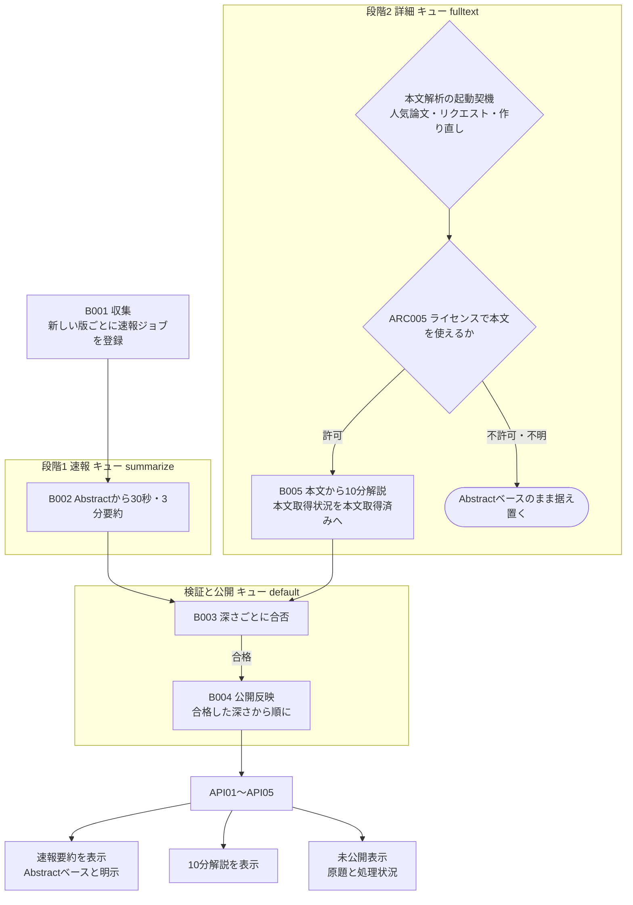
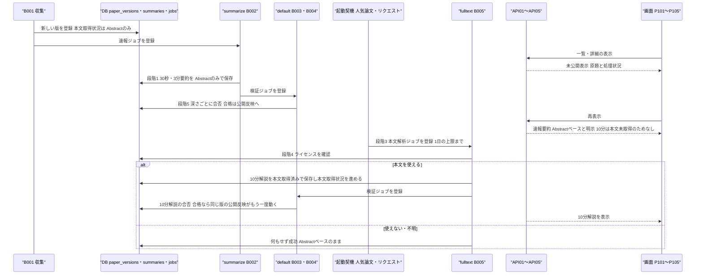

方式（共通基盤）: ARC002 段階的生成・公開方式（速報版→詳細版） ／ 実体 21ファイル（定義元の資料3・実現先の設計書18） ／ 影響範囲 22件

# 方式設計書 — ARC002 段階的生成・公開方式（速報版→詳細版）

| 項目 | 内容 |
| :--- | :--- |
| 方式ID | ARC002（上流 `docs/基本設計書_概要.md` §11.1 で採番済み。本書で新規採番した ID はありません） |
| 名称 | 段階的生成・公開方式（速報版→詳細版） |
| 更新日 | 2026-10-27 |
| インプット | (a) `source/`（全6ファイル227行。ARC002 に関わる行は `source/04_収益化とロードマップ.md:19-20,25-26,44`、`source/03_システム構成.md:24-31,58`、`source/02_機能要求定義.md:24-27,58`、`source/01_企画概要.md:36`）／(b) `docs/基本設計書_概要.md` §1 用語集「速報版」、§2（BF01・BF02・BF03・EX03・EX04）、§4（F04・F05・F17、オンライン処理設計「未処理論文の扱い」、B002〜B005）、§11.1・§11.2、付録 Q09・Q13・Q24・Q27・Q31／実現先の設計書 `docs/db/DB.T002`・`T003.DB物理設計.md`、`docs/detail/be/BE.F02`・`F03`・`F04`・`F05`・`F07`・`F15`・`F17.BE詳細設計.md`、`docs/detail/batch/BT.B002`〜`B005.バッチ詳細設計.md`、`docs/detail/fe/FE.P101`〜`P105.FE詳細設計.md`、関連先の画面基本設計 P101〜P105・`BE.F19`／(c) `legacy/`／前単位の方式設計 `docs/arch/方式.ARC001.方式設計.md` |
| 既存資料の突合 | `legacy/` は空ディレクトリ（ファイル0件）で、突合する既存設計・業務資料はありません。本書の既存版（`docs/arch/方式.ARC002.方式設計.md`）も無く、今回が初版です。引き継ぐ ID は上流で採番済みのもの（ARC001・ARC002・ARC003・ARC004・ARC005・ARC006・ARC008、F02〜F05・F07・F08・F15・F17・F19、B001〜B005・B010・B011、T002・T003・T008・T009、API01〜API05、P101〜P105、BF01〜BF03・EX03・EX04、Q09・Q13・Q24・Q27・Q31）だけです |
| 対象システムの性質 | `source/` は企画・初期設計の資料（Markdown）で、プログラムのソースコードはありません。本書は資料の記述を一次情報とし、資料に無い実現方法は、確定済みの下流設計書（DB物理設計・BE詳細設計・バッチ詳細設計・FE詳細設計）が定めた内容を「実現先」として引用します。下流設計書の※推測は本書でも※推測のまま扱います |

---

## 1. 機構の概要

* **解決している課題**:
  * **全文解析の費用**: 本文の解析・詳細解説は、長文・数式・図表のため LLM の入力が大きく、主要コストの中で最も高くつきます（`source/04_収益化とロードマップ.md:20`）。毎日数百〜千件余り入る新着論文（※推測: BT.B002 §5 性能の見込み）をすべて本文から解析すると、費用が売上に見合わなくなります（`source/04_収益化とロードマップ.md:25`「全論文の全文翻訳を行わず」）。
  * **公開の遅れ**: 本文の取得・解析・長い LLM 呼び出しを全論文で済ませてから公開すると、新着論文が日本語で読めるまでの時間が延びます。この時間は検証指標「新着論文から日本語速報公開までの時間」に挙がっています（`source/04_収益化とロードマップ.md:44`）。
  * **未処理の論文が見えない**: 要約ができあがった論文だけを表示すると、収集直後の論文や処理に失敗した論文が一覧・検索から消え、利用者は新着を見逃します。資料は「未処理論文は速報版を先に表示する」としています（`source/03_システム構成.md:58`）。
  * **本文が無い論文の扱い**: ライセンスで本文を使えない論文や、まだ本文を解析していない論文には10分解説が作れません。これを「処理中」と区別せずに出すと、利用者は待っても出てこない解説を待ち続けます（`source/02_機能要求定義.md:26-27`「10分解説は本文を取得できた場合」「解析範囲：Abstractのみ／本文取得済み」）。
* **設計方針**（資料から読み取れる範囲。推測は※推測と明記）:
  1. **2段階で作る**: まず全論文について Abstract だけを材料に30秒要約と3分要約を作り（速報）、本文の利用が許される論文のうち人気論文とリクエストされた論文だけ本文を解析して10分解説を作ります（詳細）（`source/04_収益化とロードマップ.md:25-26`、`source/03_システム構成.md:24,29-31`）。
  2. **速報を詳細の完了で待たせない**: 速報の生成（B002）と詳細の生成（B005）を別のジョブ・別のキューに分け、検証・公開も深さごとに進めます。10分解説の検証や本文PDFの取得失敗が、30秒・3分要約の公開を止めないようにします（※推測: 下流バッチ設計の判断。BT.B002・B003・B005 §5）。
  3. **材料の範囲を記録して表示する**: 要約ごとに解析範囲（Abstractのみ／本文取得済み）を、版ごとに本文取得状況を残し、画面は「Abstractベース」と明示します（`source/02_機能要求定義.md:27`、`source/01_企画概要.md:36`）。
  4. **未公開の論文も外さない**: 一覧・検索・ブックマーク・閲覧履歴は、要約が未公開の論文も原題と処理状況で表示します（`source/03_システム構成.md:58`、上流 §4 オンライン処理設計「未処理論文の扱い」）。
  5. **詳細版の費用に上限を設ける**: 本文解析の登録は1日の件数に上限を置きます（※推測・※上流未定義: BT.B005 §5 登録の受け口 No.4）。
* **用語「速報版」の2つの使われ方**（※上流要確認）: 上流 §1 用語集は「速報版＝詳細な処理がまだ済んでいない論文について先に出すAbstractベースの要約」と定義しています。一方、下流の一覧・検索の設計（BE.F02・BE.F03・FE P101〜P103）は、**合格した要約がまだ無い論文を原題と処理状況だけで出す表示**も「速報版」と呼んでいます（BE.F02 `summaryStatus` = `processing`「速報版。要約は準備中」）。本書では区別のため、前者を「**速報要約**」（Abstractから作った30秒・3分要約）、後者を「**未公開表示**」（原題と処理状況）と呼びます。資料の「未処理論文は速報版を先に表示」（`source/03_システム構成.md:58`）がどちらを指すかは資料から決められません。上流 BF03 も、要約が未処理のときに「原題と速報版の表示（処理中の旨）」としており（`docs/基本設計書_概要.md:227`）、要約が無い論文に何を速報版として出すのかが定まっていません（付録B No.1）。
* **位置づけ**: 要約の生成・検証・公開の流れ（BF01・BF02）と、一覧・詳細の表示（API01〜API05・P101〜P105）の両方に効きます。上流 §11.2 の相関では「ARC002 → ARC005」（本文を使う前にライセンスを確かめる）、「ARC002 → ARC001」（深さ・解析範囲ごとに生成物を使い回す）、「ARC004 → ARC002」（検証に合格したものだけが段階を進む）です。

---

## 2. 実体の構成

本方式は1つのプログラムではなく、資料の3ファイルで定められた決まりを、要約生成・検証・公開のジョブ、版と要約の状態を表す列、表示側の出し分けで分担して実現しています。

| # | パス | 種別 | 役割 | 備考 |
| :--- | :--- | :--- | :--- | :--- |
| 1 | `source/04_収益化とロードマップ.md` | 定義元（資料） | 全論文の全文翻訳はせず Abstract から速報を作り（:25）、人気論文・リクエストされた論文だけを追加解析する（:26）という本方式の骨格を定める。費用の理由（:19-20）と検証指標「速報公開までの時間」（:44） | 上流 §11.1 の実体 |
| 2 | `source/03_システム構成.md` | 定義元（資料） | 未処理論文は速報版を先に表示する（:58）。収集フローで Abstract ベースの要約を先に作り、本文は利用条件を確かめてから解析する（:24-31） | 上流 §11.1 の実体 |
| 3 | `source/02_機能要求定義.md` | 定義元（資料） | 10分解説は本文を取得できた場合だけ作り（:26）、解析範囲（Abstractのみ／本文取得済み）を記録する（:27）。失敗しても画面全体を落とさず処理状況を確認できる（:58） | 上流 §11.1 の実体 |
| 4 | `docs/db/DB.T002.DB物理設計.md` | 実現先（DB物理設計） | 版ごとの本文取得状況（`content_status`）と、その値の制約・遷移（Abstractのみ→本文取得済み） | ※上流未定義: 上流 §11.1 の適用範囲に T002 の記載が無い |
| 5 | `docs/db/DB.T003.DB物理設計.md` | 実現先（DB物理設計） | 要約ごとの解析範囲（`source_scope`）と、10分解説は本文を材料にしたときだけ保存できる制約 | ※上流未定義: 上流 §11.1 の適用範囲に T003 の記載が無い |
| 6 | `docs/detail/be/BE.F04.BE詳細設計.md` | 実現先（BE詳細設計） | 速報（B002）と詳細（B005）の生成・検証・公開の処理本体と、本文取得状況の更新（`mark_full_text`） | 上流の適用範囲 F04 |
| 7 | `docs/detail/be/BE.F05.BE詳細設計.md` | 実現先（BE詳細設計） | 要約取得 API04 が、要約の無い理由を「処理中」と「本文未取得のため10分解説なし」に分けて返す（FN06） | 上流の適用範囲 F05 |
| 8 | `docs/detail/be/BE.F17.BE詳細設計.md` | 実現先（BE詳細設計） | 論文の最新版について、深さごとにどの段階か（6状態）を返す処理状況 API | 上流の適用範囲 F17 |
| 9 | `docs/detail/be/BE.F02.BE詳細設計.md` | 実現先（BE詳細設計） | 日付別一覧 API01 が、要約未公開の論文も外さず公開状況「処理中」で返す | ※上流要確認: 上流の適用範囲に F02 の記載が無い（上流は P102 を挙げている） |
| 10 | `docs/detail/be/BE.F03.BE詳細設計.md` | 実現先（BE詳細設計） | 自由検索 API02 が、要約未公開の論文も外さず「処理中」で返す | ※上流要確認: 上流の適用範囲に F03 の記載が無い |
| 11 | `docs/detail/be/BE.F07.BE詳細設計.md` | 実現先（BE詳細設計） | ブックマーク一覧が、要約の無い論文も外さず日本語タイトルを空で返す | ※上流要確認: 上流の適用範囲に F07 の記載が無い |
| 12 | `docs/detail/be/BE.F15.BE詳細設計.md` | 実現先（BE詳細設計） | 閲覧履歴一覧が、要約の無い論文も外さず日本語タイトルを空で返す | ※上流要確認: 上流の適用範囲に F15 の記載が無い |
| 13 | `docs/detail/batch/BT.B002.バッチ詳細設計.md` | 実現先（バッチ詳細設計） | 速報要約（30秒・3分）を Abstract から作り、解析範囲「Abstractのみ」で保存する。専用キュー `summarize` | 上流の適用範囲 B002 |
| 14 | `docs/detail/batch/BT.B003.バッチ詳細設計.md` | 実現先（バッチ詳細設計） | 深さごとの合否で後続を振り分け（30秒・3分の作り直しは B002、10分は B005）、本文PDFの失敗を10分解説だけに閉じ込める | ※上流未定義: 上流 §11.1 の適用範囲に B003 の記載が無い |
| 15 | `docs/detail/batch/BT.B004.バッチ詳細設計.md` | 実現先（バッチ詳細設計） | 合格した深さから公開反映し、10分解説が後から合格すると同じ版でもう一度動く | ※上流未定義: 上流 §11.1 の適用範囲に B004 の記載が無い |
| 16 | `docs/detail/batch/BT.B005.バッチ詳細設計.md` | 実現先（バッチ詳細設計） | 詳細版（10分解説）の起動契機5件・登録の受け口4件・専用キュー `fulltext`・1日の登録数の上限 | 上流の適用範囲 B005 |
| 17 | `docs/detail/fe/FE.P101.FE詳細設計.md` | 実現先（FE詳細設計） | ホームのおすすめ・新着で、要約が公開済み以外の論文を未公開表示にする（論文カード C08） | ※上流要確認: 上流の適用範囲に P101 の記載が無い |
| 18 | `docs/detail/fe/FE.P102.FE詳細設計.md` | 実現先（FE詳細設計） | 新着論文一覧で未公開表示にする（C08、H23） | 上流の適用範囲 P102 |
| 19 | `docs/detail/fe/FE.P103.FE詳細設計.md` | 実現先（FE詳細設計） | 検索結果で未公開表示にする（C08、H26） | ※上流要確認: 上流の適用範囲に P103 の記載が無い |
| 20 | `docs/detail/fe/FE.P104.FE詳細設計.md` | 実現先（FE詳細設計） | 論文詳細の要約欄で、処理状況（H37）と「10分解説なし」（H34）をエラーコードで出し分ける | 上流の適用範囲 P104 |
| 21 | `docs/detail/fe/FE.P105.FE詳細設計.md` | 実現先（FE詳細設計） | Appendix の数式解説・参考文献が無いとき、本文取得状況に応じた理由（H18・H21）を出す | ※上流要確認: 上流の適用範囲に P105 の記載が無い |

* **命名規則・配置規則**（新規追加時に従うべき規則）:
  * 段階の区別は「要約の深さ（`summary_type`: short／standard／deep）」と「解析範囲（`source_scope`: abstract_only／full_text）」の組で表し、段階専用の列や表は作りません（T003 §4.3 (2)(7)）。
  * 速報と詳細のジョブは別のジョブ種別（速報 `summarize_abstract`、詳細 `analyze_full_text`）とし、別のキュー（速報 `summarize`、詳細 `fulltext`。検証・公開は `default`）に入れます（※推測: キュー名は下流の命名案。上流 Q02）。
  * 一覧系の応答は、要約の公開状況を「公開済み」と「処理中（未公開）」の2値で返し、画面は公開済み以外をすべて未公開表示にします（BE.F02 `summaryStatus`、FE P101〜P103）。
* **全数**: 21件（定義元の資料3件＋実現先の設計書18件。実現先の内訳は DB物理設計2件・BE詳細設計7件・バッチ詳細設計4件・FE詳細設計5件）。根拠: 定義元は上流 §11.1 ARC002 行の「実体」列に挙がった3ファイルと一致します。実現先は、全47本の確定済み設計書を「利用する方式」の ARC002 の記述と本文の内容で1本ずつ調べて振り分けました。
  * **実現先（18本）**: 「利用する方式」に ARC002 の行を持つ16本（BE F02・F03・F04・F05・F07・F15・F17、バッチ B002〜B005、FE P101〜P105）と、ARC002 の行は持たないが段階の区別に使う列と制約を定める DB物理設計 T002・T003 の2本です（T002 §4.3 (4)・T003 §4.3 (2)(7) が ARC002・B005 を根拠に挙げている）。
  * **影響範囲だけで扱うもの（2本）**: ARC002 の行を持たないが本方式の結果を使うもの。BE.F08（おすすめ。合格要約の無い論文を not_published で返し、表示は FE P101 が担う）、BE.F19（M01 速報公開までの時間を集計）。§6 に行があります。
  * **対象外（27本）**: 上記以外。DB物理設計 T001・T004〜T010（8本）、BE詳細設計 F01・F06・F09〜F14・F16・F18（10本）、バッチ詳細設計 B001・B006〜B011（7本）、FE詳細設計 P106・P107（2本）。B001 は速報ジョブを登録する起点ですが、その決まり（新しい版ごとに1件）は ARC001 の責務のため本書では §6 の影響先としてだけ扱います。B011 も ARC002 を利用しないとしていますが、公開反映が深さごとに動く結果として10分解説の合格後にもう一度登録されるため、§6 に影響先として行を設けています。

**構成要素ロースター**（本方式を構成するジョブ・状態・制約・出し分け・設定の全数）

ID 列には、上流または実現先の設計書で付いている識別子（バッチID・制約名・関数名・エラーコード・設定値名・画面項目ID）をそのまま書きます。本書で新しく番号を付けた要素はありません。

| # | ID（既存の識別子） | 名称 | 種別 | 概要 | 定義元 | 定義状況 | 詳細の所在 |
| :--- | :--- | :--- | :--- | :--- | :--- | :--- | :--- |
| 1 | B002 | Abstractベース日本語要約生成 | ジョブ（段階1 速報） | 新しい版ごとに、Abstract だけを材料に30秒要約と3分要約を作り、解析範囲「Abstractのみ」で保存する | 上流 §4 B002 | 詳細 | §3 段階1、`docs/detail/batch/BT.B002.バッチ詳細設計.md` |
| 2 | B005 | 本文解析・詳細解説生成 | ジョブ（段階2 詳細） | 起動契機で登録された版について、ライセンスを確かめてから本文PDFを解析して10分解説を作り、版の本文取得状況を本文取得済みに進める | 上流 §4 B005 | 詳細 | §3 段階3〜4、`docs/detail/batch/BT.B005.バッチ詳細設計.md` |
| 3 | B003（合否と後続ジョブの決め方） | 深さごとの検証と振り分け | ジョブの業務ルール | 合格した深さは公開反映へ、不合格の30秒・3分は B002、不合格の10分は B005 へ作り直しを回す。本文PDFが取れない失敗は10分解説だけに閉じ込める（全8通り） | BT.B003（※上流未定義） | 詳細 | §3 段階5、`docs/detail/batch/BT.B003.バッチ詳細設計.md` §5 |
| 4 | B004 | 公開反映 | ジョブ | 合格した深さから順に公開反映し、10分解説が後から合格すると同じ版でもう一度動いて詳細版の内容も反映する | 上流 §4 B004 | 詳細 | §3 段階6、`docs/detail/batch/BT.B004.バッチ詳細設計.md` §5 |
| 5 | 起動契機 No.1（BT.B005） | 人気論文の判定 | 起動契機 | 閲覧の多い論文を本文解析の対象として登録する。判定の基準と主体は未定義 | BT.B005（※上流未定義、上流 Q13） | 詳細 | §3 段階3、`docs/detail/batch/BT.B005.バッチ詳細設計.md` §5 |
| 6 | 起動契機 No.2（BT.B005） | 利用者のリクエスト | 起動契機 | 利用者が求めた論文を本文解析の対象として登録する。手段は未定義で、API04 からは登録しない | BT.B005（※上流未定義、上流 Q13） | 詳細 | §3 段階3、`docs/detail/batch/BT.B005.バッチ詳細設計.md` §5 |
| 7 | 起動契機 No.3（BT.B005） | 10分解説の作り直し | 起動契機 | 10分解説が検証で不合格になり、不合格の件数が上限未満のとき B003 が登録する。1日の上限に含めない | BT.B005・BT.B003 | 詳細 | §3 段階5 |
| 8 | 登録の受け口（BT.B005 §5） | 本文解析ジョブの登録規則 | 業務ルール | 登録元が守る4つの決まり。同じ版の待機中ジョブがあれば登録しない、最新版だけを登録する、許されない版・作成済みの版は登録しない、1日の登録数に上限を置く | BT.B005（※推測・※上流未定義） | 詳細 | §3 段階3、§4 |
| 9 | summarize | 速報要約のキュー | ジョブキュー | B002 専用のキュー。収集直後にまとめて入る速報ジョブが、検証・公開や本文解析と取り合わないようにする | BT.B002（※推測） | 詳細 | §3 読込順序、§4 設定項目 |
| 10 | default | 検証・公開のキュー | ジョブキュー | B003・B004 が使う。速報・詳細のどちらの要約も同じキューで検証・公開する | BT.B003・BT.B004（※推測） | 簡易 | §4 設定項目 |
| 11 | fulltext | 本文解析のキュー | ジョブキュー | B005 専用のキュー。1件が数分かかる本文解析が詰まっても、速報の公開を遅らせない | BT.B005（※推測） | 詳細 | §3 読込順序、§4 設定項目 |
| 12 | T002.content_status | 本文取得状況 | 状態の列 | 版ごとに「Abstractのみ」か「本文取得済み」かを持つ。初期値は Abstractのみで、B005 が10分解説を保存したときだけ本文取得済みに進み、戻らない | T002 | 詳細 | §4 状態、`docs/db/DB.T002.DB物理設計.md` §4.3 (4) |
| 13 | ck_paper_versions_content_status | 本文取得状況の値の制約 | CHECK 制約 | 本文取得状況を2値（`abstract_only`・`full_text`）に限る | T002 | 簡易 | §4 状態 |
| 14 | ck_paper_versions_full_text_requires_license | 本文取得済みの前提の制約 | CHECK 制約 | ライセンス種別が分からない版を本文取得済みにできないようにする。権利を確かめずに詳細版へ進むことを DB で防ぐ | T002 | 詳細 | §4 状態、`docs/db/DB.T002.DB物理設計.md` §4.4 |
| 15 | T003.source_scope | 解析範囲 | 状態の列 | 要約ごとに材料が Abstract だけか本文まで含むかを持ち、画面の「Abstractベース」表示の根拠になる | T003 | 詳細 | §4 状態、`docs/db/DB.T003.DB物理設計.md` §4.3 (7) |
| 16 | ck_summaries_deep_requires_full_text | 10分解説の材料の制約 | CHECK 制約 | 10分解説は解析範囲が本文取得済みのときだけ保存できる。Abstract だけで詳細版を作らせない | T003 | 詳細 | §4 状態 |
| 17 | mark_full_text（DA014・BE.F04） | 本文取得状況の更新 | 関数 | 10分解説の保存と同じトランザクションで、版の本文取得状況を本文取得済みに進める | F04 | 詳細 | §3 段階4、`docs/detail/be/BE.F04.BE詳細設計.md` §4 No.22 |
| 18 | SUMMARY_NOT_READY | 要約準備中の応答 | エラーコード（404） | 指定した深さの公開済み要約がまだ無い（生成待ち・検証待ち・作り直し待ち）ことを示す。画面は処理状況を出す | F05（※推測） | 詳細 | §3 段階7、`docs/detail/be/BE.F05.BE詳細設計.md` §4 FN06 |
| 19 | DEEP_SUMMARY_UNAVAILABLE | 10分解説なしの応答 | エラーコード（404） | 10分解説を求めたが、表示する版の本文が未取得のため作られていないことを示す。待っても出ないことを利用者に伝える | F05（※推測） | 詳細 | §3 段階7、`docs/detail/be/BE.F05.BE詳細設計.md` §4 FN06 |
| 20 | summaryStatus（BE.F02） | 一覧の要約公開状況 | 応答項目 | 合格した30秒要約があれば「公開済み」、無ければ「処理中」を返す。一覧から論文を外さない | F02 | 詳細 | §3 段階7、`docs/detail/be/BE.F02.BE詳細設計.md` §4 toPaperListItem |
| 21 | toSearchResultItem（BE.F03） | 検索結果の要約公開状況 | 関数 | 要約が未公開の論文も検索結果から外さず「処理中」として原題だけで返す | F03 | 詳細 | §3 段階7、`docs/detail/be/BE.F03.BE詳細設計.md` §4 |
| 22 | DA006（BE.F07） | ブックマーク一覧の取得 | データアクセス | 要約が無い論文も一覧から外さず、日本語タイトルを空で返す。画面は原題で表示する | F07 | 詳細 | §3 段階7、`docs/detail/be/BE.F07.BE詳細設計.md` §3 |
| 23 | DA002（BE.F15） | 閲覧履歴一覧の取得 | データアクセス | 要約が無い論文も一覧から外さず、日本語タイトルを空で返す。画面は原題で表示する（P106 H36） | F15 | 詳細 | §3 段階7、`docs/detail/be/BE.F15.BE詳細設計.md` §3 |
| 24 | GET /api/papers/{arxivId}/status（BE.F17） | 処理状況の取得 | エンドポイント | 論文の最新版について、深さごとに6状態（公開済み・生成中・検証中・処理に失敗・未着手・本文未取得のため対象外）を返す | F17（※上流未定義: API ID なし、上流 Q27） | 詳細 | §3 段階8、§4 状態、`docs/detail/be/BE.F17.BE詳細設計.md` §2 |
| 25 | C08 PaperCard（FE P101〜P103） | 論文カードの未公開表示 | 画面部品 | 公開済み以外の論文を、日本語タイトルと30秒要約の代わりに原題と処理状況（P101 H21・P102 H23・P103 H26）で出す | FE P101〜P103 | 詳細 | §3 段階7、`docs/detail/fe/FE.P102.FE詳細設計.md` §2 |
| 26 | fetchPaperSummary（FE P104） | 要約欄の出し分け | 関数 | API04 のエラーコードで、処理状況（H37）と10分解説なし（H34）を出し分ける | FE P104 | 詳細 | §3 段階7、`docs/detail/fe/FE.P104.FE詳細設計.md` §4 |
| 27 | getFormulaNotice・getReferenceNotice（FE P105） | Appendix の理由表示 | 関数 | 数式解説・参考文献が0件のとき、本文取得状況に応じた理由（H18・H21）を出す | FE P105 | 詳細 | §3 段階7、`docs/detail/fe/FE.P105.FE詳細設計.md` §4 |
| 28 | FULLTEXT_DAILY_LIMIT | 本文解析の1日の登録上限 | 設定値 | 人気論文の判定と利用者のリクエストによる登録を、合わせて1日何件までにするか（※推測: 50件） | BT.B005（※上流未定義） | 詳細 | §4 設定項目 |
| 29 | FULLTEXT_WORKER_CONCURRENCY | 本文解析の並列数 | 設定値 | `fulltext` キューを処理するワーカーの並列数の合計（※推測: 2） | BT.B005（※上流未定義） | 簡易 | §4 設定項目 |
| 30 | SUMMARY_WORKER_CONCURRENCY | 速報要約の並列数 | 設定値 | `summarize` キューを処理するワーカーの並列数の合計（※推測: 8） | BT.B002（※上流未定義） | 簡易 | §4 設定項目 |
| 31 | DEFAULT_WORKER_CONCURRENCY | 検証・公開の並列数 | 設定値 | `default` キューを処理するワーカーの並列数の合計（※推測: 4） | BT.B003（※上流未定義） | 簡易 | §4 設定項目 |
| 32 | M01（BE.F19 DA001） | 速報公開までの時間 | 監視指標 | 投稿日時から、最初に合格した30秒要約の生成日時までの時間の中央値と90パーセンタイルを週ごとに出し、本方式の効き目を測る | F19 | 詳細 | §7、`docs/detail/be/BE.F19.BE詳細設計.md` §3 DA001 |

**総件数: 32件**（ジョブ・業務ルール4件、起動契機3件、登録規則1件、キュー3件、状態の列2件、CHECK 制約3件、関数・データアクセス6件、エラーコード2件、応答項目1件、エンドポイント1件、画面部品1件、設定値4件、監視指標1件。定義状況は詳細27件・簡易5件）。**全数である根拠**: 実現先の設計書18本（§2 #4〜#21）の「利用する方式」の ARC002 行が根拠に挙げている処理・項目と、本文中の「速報」「Abstractのみ」「本文取得済み」「10分解説」「処理中」「未公開」を含む記述を全件拾い、段階の区別（生成・検証・公開・状態・表示・費用の上限）を担うものを数えました。B005 の起動契機5件のうち、自動再試行（No.4）と失敗ジョブの再処理（No.5）は既存のジョブ行を再投入するだけで段階を決めないため ARC006 の要素として除いています。ライセンスの判定（`is_full_text_allowed`）は ARC005、生成前の使い回し確認は ARC001、出力の検証基準は ARC004 の要素で、本書では呼び出し関係だけを §3 に書きます。
**定義状況の判定**（completeness 3-1）: 分岐・状態の変更・非自明な業務ルールのいずれかを含むものを「詳細」としました。値の範囲を限るだけの制約（#13）、内容の分岐が無いキュー（#10）と並列数の設定値（#29〜#31）は「簡易」です。

---

## 3. ライフサイクル（登録・読込・選択）

本方式には起動時に読み込む定義ファイルはありません。**論文の新しい版が入ったとき**に段階1（速報）が、**起動契機が登録したとき**に段階2（詳細）が始まり、**画面からの要求ごと**に段階の結果が読まれます。下図は1つの版が速報から詳細へ進む時系列です。

| 段階 | 契機 | 処理 | 実装（ファイル:行） |
| :--- | :--- | :--- | :--- |
| 0 未公開表示 | 画面からの要求ごと。合格した要約がまだ無い論文を表示するとき | 一覧（API01・API02・API05）・ブックマーク・閲覧履歴は、要約が未公開の論文も外さず、原題と処理状況で返します。一覧の公開状況は「公開済み」か「処理中」の2値です（合格した30秒要約があれば公開済み）。論文詳細の要約欄は API04 の 404 `SUMMARY_NOT_READY` を受けて処理状況を出します | `docs/detail/be/BE.F02.BE詳細設計.md:176,211,398`、`docs/detail/be/BE.F03.BE詳細設計.md:412`、`docs/detail/be/BE.F07.BE詳細設計.md:515`、`docs/detail/be/BE.F15.BE詳細設計.md:383`、`source/03_システム構成.md:58` |
| 1 速報要約の生成 | 収集（B001）が新しい版を登録したとき（版ごとに1件）。B003 が30秒・3分要約の作り直しを決めたとき | Abstract だけを材料に30秒要約と3分要約を作り、解析範囲「Abstractのみ」で未検証として保存します。専用キュー `summarize` で動かし、収集直後にまとめて入っても検証・公開や本文解析と取り合わないようにします。生成前の使い回し確認は ARC001 に従います | `docs/detail/batch/BT.B002.バッチ詳細設計.md:317-319,558`、`docs/detail/be/BE.F04.BE詳細設計.md:373,466`、`source/03_システム構成.md:24`、`source/04_収益化とロードマップ.md:25` |
| 2 速報の検証・公開 | B002 が要約を保存した同じトランザクションで検証ジョブを登録したとき | 30秒・3分要約を深さごとに検証し、合格した深さから公開反映（B004）へ回します。10分解説の有無や検証を待ちません | `docs/detail/batch/BT.B003.バッチ詳細設計.md:388,610`、`docs/detail/batch/BT.B004.バッチ詳細設計.md:286,440` |
| 3 詳細版の登録 | 人気論文の判定（基準未定義）、利用者のリクエスト（手段未定義）、10分解説の作り直し（B003） | 登録の受け口に従い、論文の最新版について本文解析ジョブを1件登録します。同じ版の待機中・実行中ジョブがあれば登録せず、ライセンスで許されない版や作成済みの版は登録元で外します。人気論文とリクエストの登録は合わせて1日 `FULLTEXT_DAILY_LIMIT` 件までです（作り直しは上限に含めない）。確定後に `fulltext` キューへ投入します | `docs/detail/batch/BT.B005.バッチ詳細設計.md:329-345`、`source/04_収益化とロードマップ.md:26` |
| 4 詳細版の生成 | `fulltext` キューのワーカーがジョブを受け取ったとき | ライセンスで本文の解析が許されるかを確かめ（ARC005）、許されなければ本文を取得せず、本文取得状況も変えずに成功で終えます（Abstractベースのまま据え置き）。許されれば、10分解説の使い回しを確かめ（ARC001）、本文PDFを取得・解析して10分解説を作り、解析範囲「本文取得済み」で保存し、同じトランザクションで版の本文取得状況を本文取得済みに進め、検証ジョブを登録します | `docs/detail/be/BE.F04.BE詳細設計.md:177,356,384`、`docs/detail/batch/BT.B005.バッチ詳細設計.md:357,617`、`docs/基本設計書_概要.md:182-209,512-523` |
| 5 深さ別の検証と振り分け | B002・B005 が要約を保存したとき | 合格した深さは公開反映へ、不合格の30秒・3分は上限未満なら B002 へ、不合格の10分は上限未満なら B005 へ作り直しを回します（10分解説は本文が材料のため B002 では作れない）。本文PDFが取れないときは10分解説だけを不合格または未検証として残し、30秒・3分要約の検証と公開は止めません | `docs/detail/batch/BT.B003.バッチ詳細設計.md:388-400,610` |
| 6 詳細版の公開 | 10分解説が検証に合格したとき | 同じ版の公開反映（B004）がもう一度動き、詳細版の内容を検索へ反映するための検索インデックス更新（B011）と、Embedding 生成が有効なら論文Embedding 生成（B008）を、同じ版について改めて登録します | `docs/detail/batch/BT.B004.バッチ詳細設計.md:289,440` |
| 7 段階に応じた表示 | 画面からの要求ごと | 要約がある深さは表示し、Abstract から作った要約には「Abstractベース」と明示します（ARC009）。要約が無い理由を、待てば出るもの（404 `SUMMARY_NOT_READY` → 処理状況 H37）と、本文未取得のため出ないもの（404 `DEEP_SUMMARY_UNAVAILABLE` → 10分解説なし H34）に分けます。Appendix の数式解説・参考文献も、無いときは本文取得状況に応じた理由（H18・H21）を出します | `docs/detail/be/BE.F05.BE詳細設計.md:137-138,251,260,511`、`docs/detail/fe/FE.P104.FE詳細設計.md:459`、`docs/detail/fe/FE.P105.FE詳細設計.md:356`、`docs/detail/fe/FE.P101.FE詳細設計.md:396`、`docs/detail/fe/FE.P102.FE詳細設計.md:350`、`docs/detail/fe/FE.P103.FE詳細設計.md:381` |
| 8 処理状況の確認 | 画面または運用者が論文の処理状況を求めたとき | 論文の最新版について、深さごとに6状態のどれかを返します。10分解説は、本文が未取得で本文解析も予定されていなければ「本文未取得のため対象外」です | `docs/detail/be/BE.F17.BE詳細設計.md:107,140-149,310`、`source/02_機能要求定義.md:58` |

* **読込順序**（段階どうしの優先関係）:

| 順 | 段階 | 先に進む条件 | 後の段階との関係 |
| :--- | :--- | :--- | :--- |
| 1 | 速報要約（30秒・3分） | 新しい版が入れば全論文で必ず作る | 詳細版の有無にかかわらず先に公開される。詳細版の失敗・遅れの影響を受けない（別キュー・深さ別の公開） |
| 2 | 詳細版（10分解説） | 起動契機の登録＋ライセンスの許可＋1日の上限内 | 速報要約を前提にしない（※推測: 速報要約の合否を登録の条件にする記述は無い）。速報要約を書き換えない（10分解説は別の深さの別の行） |
| 3 | 表示 | 深さごとに合格した要約があるか | 合格した深さだけを表示し、無い深さは理由（処理中／本文未取得）を出す。一覧は30秒要約だけで公開状況を決める |

  上書き・マージの規則: 段階は深さで分かれるため、詳細版が速報要約を上書きすることはありません。本文取得状況は「Abstractのみ→本文取得済み」の一方向だけに進み、戻りません（T002 §4.3 (4)）。
* **選択規則**:
  * **本文解析の対象にするか**: 起動契機（人気論文・リクエスト・作り直し）で登録された論文の最新版だけが対象です。ライセンスで許されない・不明な版は対象外で、Abstractベースのまま据え置きます（上流 EX03）。人気論文の判定基準とリクエストの手段は未定義です（上流 Q13、付録B No.2）。
  * **要約の無い理由の判定**（BE.F05 FN06）: 10分解説を求められ、表示する版の本文取得状況が「Abstractのみ」なら「本文未取得のため10分解説なし」、それ以外は「準備中」と判定します（`content_status` = `abstract_only` かつ `depth` = `deep` → `DEEP_SUMMARY_UNAVAILABLE`）。
  * **一覧の公開状況**（BE.F02）: 合格した30秒要約があれば「公開済み」、無ければ「処理中」です。3分要約・10分解説の有無は一覧の公開状況に効きません。
  * **処理状況の6状態**（BE.F17）: 合格した要約があれば「公開済み」、生成ジョブが待機中・実行中なら「生成中」、未検証の要約があれば「検証中」、ジョブが上限まで失敗したか不合格で作り直しが予定されていなければ「処理に失敗」、10分解説で本文未取得かつ本文解析が予定されていなければ「本文未取得のため対象外」、ジョブも要約も無ければ「未着手」です（判定順は BE.F17 §4 No.4）。
* **失効・再読込**（段階が戻る・やり直される条件）:

| 契機 | 起きること | 根拠 |
| :--- | :--- | :--- |
| 論文の新しい版が出た | 新しい版は本文取得状況「Abstractのみ」から始まり、段階1からやり直します。詳細版は新しい版について改めて起動契機の登録が要ります。新しい版の速報要約が合格すると表示する版が新しい版へ移るため、前の版にあった10分解説は表示されなくなり、「本文未取得のため10分解説なし」になります（※推測: BE.F05 DA002 の版の選び方からの帰結。付録B No.4） | `docs/detail/batch/BT.B005.バッチ詳細設計.md:343`、`docs/detail/be/BE.F05.BE詳細設計.md:341` |
| 10分解説が不合格になった | 上限未満なら B005 で作り直します（1日の上限に含めない）。上限以上なら10分解説は公開されないまま残ります | `docs/detail/batch/BT.B003.バッチ詳細設計.md:388-400` |
| 本文PDFが取れなかった | 版が無い・テキストが取れないときは10分解説を不合格として記録し、作り直しません。一時的な失敗は再試行し、上限に達したら10分解説は未検証のまま残ります。どちらも速報要約には影響しません | `docs/detail/batch/BT.B003.バッチ詳細設計.md:399-400` |
| ライセンスが後から分かった・変わった | 本文解析は登録されたときにだけライセンスを確かめるため、自動では詳細版へ進みません。改めて起動契機で登録する必要があります（※推測） | `docs/detail/be/BE.F04.BE詳細設計.md:384` |
| 本文が取得できた後の30秒・3分要約 | 本文から作り直す処理は定義されていません。30秒・3分要約は Abstractベースのまま残ります（ARC001 付録B No.4 と同じ論点） | `docs/db/DB.T003.DB物理設計.md:245` |

---

## 4. インターフェース・データ構造

* **段階を表す状態**（本方式が読み書きする値の全数）:

| 状態 | 持つ場所 | 取りうる値 | 意味と遷移 | 根拠 |
| :--- | :--- | :--- | :--- | :--- |
| 本文取得状況 | paper_versions.content_status（版ごと） | `abstract_only`（Abstractのみ）・`full_text`（本文取得済み） | 版の取り込み時は Abstractのみ。B005 が10分解説を保存したときだけ本文取得済みへ進み、戻らない。ライセンス種別が分からない版は本文取得済みにできない | `docs/db/DB.T002.DB物理設計.md:190,222-226,247-248` |
| 解析範囲 | summaries.source_scope（要約ごと） | `abstract_only`・`full_text` | 30秒・3分要約は B002 が Abstractのみで作る。10分解説は本文取得済みだけ（制約で強制）。画面の「Abstractベース」表示の根拠 | `docs/db/DB.T003.DB物理設計.md:248-250` |
| 要約の深さ | summaries.summary_type | `short`（30秒）・`standard`（3分）・`deep`（10分） | short・standard が段階1（速報）、deep が段階2（詳細） | `docs/db/DB.T003.DB物理設計.md` §4.3 (2) |
| 一覧の公開状況 | API01 の応答 `summaryStatus` | `published`・`processing` | 合格した30秒要約があれば公開済み、無ければ処理中（未公開表示） | `docs/detail/be/BE.F02.BE詳細設計.md:176` |
| 処理状況 | 処理状況 API の応答 `depths.*.state` | `published`・`generating`・`validating`・`failed`・`not_started`・`not_available` | 深さごとの段階。`not_available` は10分解説だけに使う | `docs/detail/be/BE.F17.BE詳細設計.md:143-149` |

* **機構の入出力**:

| 方向 | 呼び出し元 | 渡すもの | 返るもの | 実現先 |
| :--- | :--- | :--- | :--- | :--- |
| 速報の開始 | B001（新しい版）・B003（作り直し） | 版ID | ジョブID（同じジョブが待機中なら無し） | BT.B002、BE.F04 `enqueue` |
| 詳細版の登録 | 人気論文の判定・利用者のリクエスト（いずれも※上流未定義）・B003 | 版ID（論文の最新版） | ジョブID（同じジョブが待機中・上限超過なら無し） | BT.B005 §5 登録の受け口 |
| 要約の取得 | P104（API04） | arXiv ID・深さ | 合格した要約1件、または 404 `SUMMARY_NOT_READY`／`DEEP_SUMMARY_UNAVAILABLE` | BE.F05 FN06 |
| 一覧の取得 | P101〜P103（API01・API02・API05） | 日付・検索語・利用者 | 論文ごとの要約と公開状況（未公開も含む） | BE.F02・BE.F03・BE.F08 |
| 処理状況の取得 | P104（※上流要確認）・運用者 | arXiv ID | 最新版の本文取得状況と深さごとの6状態 | BE.F17 |

* **設定項目**（全項目）:

| 設定項目 | 種別 | 既定値 | 意味 | 変えたときの影響 | 根拠 |
| :--- | :--- | :--- | :--- | :--- | :--- |
| FULLTEXT_DAILY_LIMIT | 設定値（登録元） | 未定（※推測: 50件） | 人気論文とリクエストによる本文解析の1日の登録上限 | 大きくすると10分解説のある論文が増えるが、本文解析の LLM 費用が比例して増える | `docs/detail/batch/BT.B005.バッチ詳細設計.md:345,590` |
| FULLTEXT_WORKER_CONCURRENCY | 設定値（ワーカー） | 未定（※推測: 2） | `fulltext` キューの並列数 | 大きくすると詳細版が早く出るが、LLM 提供元の毎分のトークン上限を圧迫し、速報要約の生成まで遅らせうる | `docs/detail/batch/BT.B005.バッチ詳細設計.md:357,587` |
| SUMMARY_WORKER_CONCURRENCY | 設定値（ワーカー） | 未定（※推測: 8） | `summarize` キューの並列数 | 大きくすると速報公開までの時間が縮むが、LLM の呼び出し量の上限に近づく | `docs/detail/batch/BT.B002.バッチ詳細設計.md:319,534` |
| DEFAULT_WORKER_CONCURRENCY | 設定値（ワーカー） | 未定（※推測: 4） | `default` キュー（検証・公開）の並列数 | 小さくすると、速報要約ができても検証・公開が追いつかず速報公開までの時間が延びる | `docs/detail/batch/BT.B003.バッチ詳細設計.md:336,583` |

**総件数: 4件**。根拠: §2 構成要素ロースターの種別「設定値」4件と一致します。キュー名（`summarize`・`default`・`fulltext`）は設定値ではなく固定の名前として扱われています（下流の命名案）。人気論文の判定基準・リクエストの受付件数の設定は、判定・受付の処理が未定義のため存在しません。

---

## 5. 拡張・変更手順

**手順A: 新しい起動契機（例: 人気論文の判定処理）を追加する**

1. **判定する処理を決める**: 判定の基準（例: 一定期間の閲覧数）と、判定を動かす主体（定期処理か画面の操作か）を決め、上流 §4 に機能またはバッチとして追加します（上流 Q13。現状は※上流未定義）。閲覧数を使う場合は閲覧イベント（T008）を集計します（※推測）。
2. **登録の受け口に従う**: 登録は必ず BT.B005 §5 登録の受け口の4つの決まりに従います。版は論文の最新版、登録文は「同じ版・種別の待機中・実行中があれば何もしない」形、ライセンスで許されない版と作成済みの版は登録前に外し、`FULLTEXT_DAILY_LIMIT` を他の起動契機と合わせて数えます。
3. **キューへの投入**: 登録の確定後に `fulltext` キューへ投入します。速報の `summarize` キューへは入れません。
4. **文書を更新する**: 本書 §2 構成要素ロースター（起動契機）・§3 段階3、BT.B005 §5 起動契機一覧を改版します。
5. **反映のタイミング**: 判定処理のデプロイ後、次の判定から登録が始まります。過去の人気論文をまとめて登録する場合も1日の上限の中で行います。

**手順B: 新しい段階（例: 本文から作り直した3分要約、日本語全文）を追加する**

1. **深さと解析範囲の組を決める**: 新しい段階を `summary_type` と `source_scope` の組で表せるか確かめます。新しい値が要る場合は T003 の CHECK 制約（`ck_summaries_*`）と API04 の `depth` の値を同時に改めます。
2. **どのジョブが作るかを決める**: 本文を材料にするなら B005（`fulltext`）、Abstract だけなら B002（`summarize`）に入れます。速報の公開を遅らせないため、本文を使う処理を `summarize` に入れてはいけません。
3. **検証の振り分けを加える**: B003 の「合否と後続ジョブの決め方」に、新しい段階の作り直し先を加えます。
4. **表示の出し分けを加える**: API04 の要約が無い理由（準備中／本文未取得）と、処理状況 API の6状態の判定に新しい段階を加え、画面（P104・P105）の案内を改めます。
5. **文書を更新する**: 本書 §2・§3・§4、T003、BE.F04・BE.F05・BE.F17、該当バッチ詳細設計を改版します。

---

## 6. 影響範囲

| 影響先（機能/画面/工程） | どう効くか | 変更時のリスク |
| :--- | :--- | :--- |
| B001 論文メタデータ収集（※上流未定義: 上流の適用範囲に B001 の記載が無い） | 新しい版を本文取得状況「Abstractのみ」で登録し、速報ジョブを登録する起点になる | 新しい版で本文解析まで登録するように変えると、全論文が詳細版の対象になり費用の前提が崩れる |
| F04／B002 Abstractベース日本語要約生成 | 段階1。全論文の速報要約を専用キューで作る | 本文を使う処理を加えると、1件の処理時間と費用が増え、速報公開までの時間が延びる |
| F04／B003 要約の根拠・数値チェック（※上流未定義） | 段階5。深さごとに合否を出し、作り直しを深さで B002／B005 に振り分ける | 版単位でまとめて合否を出すように変えると、10分解説の失敗が速報要約の公開を止める |
| F04／B004 公開反映（※上流未定義） | 段階2・6。合格した深さから公開し、10分解説の合格でもう一度動く | 全深さの合格を待って公開するように変えると、詳細版の無い論文がいつまでも公開されない |
| F04／B005 本文解析・詳細解説生成 | 段階3・4。起動契機で登録された版だけを、ライセンスを確かめてから本文解析する | 登録の受け口（最新版だけ・1日の上限）を外すと、本文解析の費用が際限なく増える |
| F05／API04 要約取得 | 段階7。要約の無い理由を準備中と本文未取得に分けて返す | エラーコードを1つにまとめると、画面が「待てば出る」と「出ない」を区別できず、利用者が10分解説を待ち続ける |
| F05／Appendix 取得 | 数式解説・参考文献・日本語全文は本文を解析した論文だけにあり、無いときの理由を画面が出す | 本文取得状況を応答から外すと、P105 が理由を出せなくなる |
| F17 処理状況の確認 | 段階8。深さごとの6状態を返し、未公開表示の論文の進み具合を示す | 状態の判定に本文取得状況を使わなくすると、10分解説が「未着手」と「対象外」で区別できない |
| F02 日付・カテゴリ検索／API01（※上流要確認: 上流は P102 を挙げ F02 の記載が無い） | 段階0。要約未公開の論文も外さず「処理中」で返す | 合格した要約のある論文だけを返すように変えると、収集直後の新着が一覧から消える |
| F03 自由検索／API02（※上流要確認） | 段階0。要約未公開の論文も検索結果に「処理中」で返す | 同じく、収集直後の論文が検索で見つからなくなる |
| F07 ブックマーク（※上流要確認） | 要約の無い論文も一覧から外さず、原題で表示させる | 内部結合に変えると、要約の無い論文がブックマーク一覧から消え、利用者には保存が失われたように見える |
| F15 閲覧履歴（※上流要確認） | 要約の無い論文も履歴から外さず、原題で表示させる | 同じく、要約の無い論文が履歴から消える |
| F08 レコメンド／API05（※上流要確認: BE.F08 は ARC002 を挙げていない） | 合格要約の無い論文を「未公開」として返し、P101 が未公開表示にする | おすすめから未公開の論文を外すかを変えると、P101 の表示の切り替えも改める必要がある |
| F19 コスト監視・利用状況分析（※上流要確認） | M01 で速報公開までの時間を週ごとに集計し、本方式の効き目を測る | 速報要約の深さ（30秒要約）を変えると、M01 の起点となる「最初に合格した30秒要約」の定義も改める必要がある |
| B011 検索インデックス更新（※上流要確認） | B004 が深さごとに動くため、10分解説の合格後にもう一度登録される | 公開反映を1回に限ると、詳細版の内容が検索に反映されない |
| P101 ホーム（※上流要確認: 上流の適用範囲に P101 の記載が無い） | おすすめ・新着の未公開の論文を原題と処理状況（H21）で表示する | 公開状況の値を増やすと、カード（C08）の切り替えも改める必要がある |
| P102 新着論文 | 未公開の論文を原題と処理状況（H23）で表示する | 同じく C08 の切り替えに効く |
| P103 論文検索（※上流要確認） | 未公開の論文を原題と処理状況（H26）で表示する | 同じく C08 の切り替えに効く |
| P104 論文詳細 | 処理状況（H37）と10分解説なし（H34）を出し分ける | API04 のエラーコードを変えると、出し分けが壊れる |
| P105 Appendix（※上流要確認） | 数式解説・参考文献が無いとき、本文取得状況に応じた理由（H18・H21）を出す | 本文取得状況の値を増やすと、理由の文言の切り替えも改める必要がある |
| T002 paper_versions（※上流未定義） | 本文取得状況で版の段階を表し、ライセンス不明の版を本文取得済みにさせない | 状態を戻せるようにすると、10分解説があるのに「本文未取得」と案内する食い違いが起きる |
| T003 summaries（※上流未定義） | 解析範囲で要約ごとの材料を表し、Abstractだけの10分解説を保存させない | 制約を外すと、Abstractだけで作った詳細版が公開され、「本文取得済み」の表示と食い違う |

**総件数: 22件**（機能・バッチ・API の行15件、画面の行5件、テーブルの行2件、うち上流 §11.1 の適用範囲に無いもの15件）。**根拠**: 上流 §11.1 ARC002 の適用範囲（F04・F05・F17／B002・B005／P102・P104）の全要素を行にし、加えて §2 の実現先が属する機能・バッチ・画面・テーブル（B003・B004・F02・F03・F07・F15・P101・P103・P105・T002・T003）と、§2 で「影響範囲だけで扱う」とした F08・F19、本方式の結果を受けて動く B001（起点）・B011（公開反映の後続）を加えました。上流に無い15件は※上流未定義または※上流要確認として、上流 §11.1 の適用範囲への追記を求めます。

---

## 7. 制約・注意事項

* **性能・容量**:
  * 本文解析は1件が数分かかり、PDF解析でメモリを多く使うため（※推測: 1件あたり最大1GB）、`fulltext` は並列数2の専用ワーカーで動かします（BT.B005 §5）。1日の登録上限（※推測: 50件）と合わせ、詳細版の1日の処理量は上限で決まります。
  * 速報要約は収集直後に数百〜千件余りまとめて入るため（※推測）、専用キュー `summarize` で並列8、検証・公開は `default` で並列4として、速報公開までの時間を抑えます（BT.B002・BT.B003 §5）。
* **失敗時の挙動**:
  * 本文PDFの取得・解析の失敗、10分解説の不合格は、10分解説だけに閉じ込め、速報要約の検証と公開を止めません（BT.B003 §5 No.7・No.8）。
  * ライセンスで本文を使えない・不明な版は、本文解析ジョブを失敗にせず成功で終え、Abstractベースのまま据え置きます。再試行しても結果が変わらず失敗キューを無駄に増やすためです（BE.F04 §4 No.17、上流 EX03）。
  * 速報要約の生成が失敗し続けた論文は、一覧・検索で未公開表示のまま残り、処理状況 API は「処理に失敗」を返します（BE.F17）。
* **効き目の監視**: 速報公開までの時間は F19 の M01（投稿日時から最初に合格した30秒要約の生成日時まで）で測ります。公開の時刻は記録が無いため、合格した要約の生成日時で代えています（※推測。`docs/detail/be/BE.F19.BE詳細設計.md:132,333`）。目標値は未定義です（上流 Q31）。
* **既知の制約**:
  * 人気論文の判定基準と、利用者がリクエストする手段が未定義です（上流 Q13）。このため現時点で詳細版を起動できる契機は「10分解説の作り直し」だけで、作り直しは最初の10分解説が無いと起きないため、**実質的に詳細版は作られません**（付録B No.2）。
  * 新しい版が出ると、前の版の10分解説は表示されなくなります（§3 失効・再読込）。
  * キューの分け方が下流で食い違っています。BE.F04 §5 は「B002〜B004 は同じキュー、B005 は別」とし、BT.B002 は B002 を専用キュー `summarize` に分けています。本書は後から確定した BT.B002 に合わせています（付録B No.5）。
  * 論文詳細の要約欄（P104）は API04 の 404 だけで処理状況を出し、処理状況 API（F17）を呼びません。「処理中」と「処理に失敗」を画面で区別するかは未確定です（BE.F17 §0 確認事項 No.3、付録B No.6）。

---

## 付録A. ソース突合トレーサビリティ

| 記述箇所 | 根拠ソース（パス:行） |
| :--- | :--- |
| §0 実体・影響範囲の件数 | §2 表（21件）、§6 表（22件） |
| §1 全文解析の費用 | `source/04_収益化とロードマップ.md:19-20,25` |
| §1 公開の遅れ（検証指標） | `source/04_収益化とロードマップ.md:44`、`docs/基本設計書_概要.md:1180` |
| §1 未処理の論文を先に表示 | `source/03_システム構成.md:58`、`docs/基本設計書_概要.md:726` |
| §1 10分解説は本文取得時だけ・解析範囲 | `source/02_機能要求定義.md:26-27`、`source/01_企画概要.md:36` |
| §1 設計方針1 2段階で作る | `source/04_収益化とロードマップ.md:25-26`、`source/03_システム構成.md:24,29-31`、`docs/基本設計書_概要.md:744,747,1292` |
| §1 用語「速報版」 | `docs/基本設計書_概要.md:110,227`、`docs/detail/be/BE.F02.BE詳細設計.md:176,398` |
| §1 位置づけ（方式の相関） | `docs/基本設計書_概要.md:1310-1326` |
| §2 定義元の資料3件 | `docs/基本設計書_概要.md:1292`（ARC002 行の実体） |
| §2 実現先の ARC002 行 | `docs/detail/be/BE.F02.BE詳細設計.md:398`、`BE.F03.BE詳細設計.md:412`、`BE.F04.BE詳細設計.md:466`、`BE.F05.BE詳細設計.md:511`、`BE.F07.BE詳細設計.md:515`、`BE.F15.BE詳細設計.md:383`、`BE.F17.BE詳細設計.md:310`、`docs/detail/batch/BT.B002.バッチ詳細設計.md:558`、`BT.B003.バッチ詳細設計.md:610`、`BT.B004.バッチ詳細設計.md:440`、`BT.B005.バッチ詳細設計.md:617`、`docs/detail/fe/FE.P101.FE詳細設計.md:396`、`FE.P102.FE詳細設計.md:350`、`FE.P103.FE詳細設計.md:381`、`FE.P104.FE詳細設計.md:459`、`FE.P105.FE詳細設計.md:356` |
| §2 #1〜#4 ジョブ | `docs/基本設計書_概要.md:744-747`、`docs/detail/batch/BT.B003.バッチ詳細設計.md:388-400`、`docs/detail/batch/BT.B004.バッチ詳細設計.md:286,289` |
| §2 #5〜#8 起動契機・登録の受け口 | `docs/detail/batch/BT.B005.バッチ詳細設計.md:327-345` |
| §2 #9〜#11 キュー | `docs/detail/batch/BT.B002.バッチ詳細設計.md:317`、`docs/detail/batch/BT.B005.バッチ詳細設計.md:355`、`docs/detail/batch/BT.B003.バッチ詳細設計.md:334,336`、`docs/detail/be/BE.F04.BE詳細設計.md:409` |
| §2 #12〜#14 本文取得状況 | `docs/db/DB.T002.DB物理設計.md:176,190,222-226,247-248` |
| §2 #15・#16 解析範囲 | `docs/db/DB.T003.DB物理設計.md:248-250`、同 §7 DDL `ck_summaries_deep_requires_full_text` |
| §2 #17 mark_full_text | `docs/detail/be/BE.F04.BE詳細設計.md:177,356` |
| §2 #18・#19 エラーコード | `docs/detail/be/BE.F05.BE詳細設計.md:137-138,251,260` |
| §2 #20〜#23 一覧の未公開表示 | `docs/detail/be/BE.F02.BE詳細設計.md:176,211`、`docs/detail/be/BE.F03.BE詳細設計.md:412`、`docs/detail/be/BE.F07.BE詳細設計.md:515`、`docs/detail/be/BE.F15.BE詳細設計.md:383` |
| §2 #24 処理状況 API | `docs/detail/be/BE.F17.BE詳細設計.md:25,107,140-149` |
| §2 #25〜#27 画面の出し分け | `docs/detail/fe/FE.P101.FE詳細設計.md:97,396`、`docs/screens/画面.P104.画面基本設計.md:45,85`、`docs/detail/fe/FE.P105.FE詳細設計.md:356` |
| §2 #28〜#31 設定値 | `docs/detail/batch/BT.B005.バッチ詳細設計.md:587,590`、`docs/detail/batch/BT.B002.バッチ詳細設計.md:534`、`docs/detail/batch/BT.B003.バッチ詳細設計.md:583` |
| §2 #32 M01 | `docs/detail/be/BE.F19.BE詳細設計.md:115,132,333` |
| §3 段階0〜8 | 段階ごとの「実装」列に記載 |
| §3 EX03 ライセンス不明の据え置き | `docs/基本設計書_概要.md:512-523` |
| §3 失効（新しい版） | `docs/detail/batch/BT.B005.バッチ詳細設計.md:343`、`docs/detail/be/BE.F05.BE詳細設計.md:341` |
| §6 画面への影響 | `docs/screens/画面.P101.画面基本設計.md:215`、`画面.P102.画面基本設計.md:215`、`画面.P103.画面基本設計.md:223`、`画面.P104.画面基本設計.md:259`、`画面.P105.画面基本設計.md:224` |
| §7 Q13・Q31 | `docs/基本設計書_概要.md:1355,1373` |
| §7 処理状況 API と P104 | `docs/detail/be/BE.F17.BE詳細設計.md:26` |

---

## 付録B. 未確定事項（※推測の一覧）

| No. | 区分 | 内容 | 本書での扱い | 確認先 |
| :--- | :--- | :--- | :--- | :--- |
| 1 | ※上流要確認 | 「速報版」が、Abstractから作った要約（上流 §1 用語集）を指すのか、要約未公開の論文を原題と処理状況で出す表示（BE.F02・FE P101〜P103）も含むのか。上流 BF03 の「未処理: 原題と速報版の表示（処理中の旨）」（`docs/基本設計書_概要.md:227`）も、要約が無い論文に何を出すかを決めていない | 「速報要約」と「未公開表示」に分けて記載 | 顧客・上流 §1 用語集 |
| 2 | ※上流未定義 | 人気論文の判定基準・判定する主体と、利用者がリクエストする手段。未定義のままでは詳細版が実質的に作られない | 起動契機として受け口だけ記載 | 上流 Q13 |
| 3 | ※推測 | 本文解析の1日の登録上限（※推測: 50件）と、各キューの並列数 | 下流設計書の値を記載 | 顧客（原価の上限）・上流 Q02 |
| 4 | ※推測 | 新しい版が出たとき、前の版の10分解説を表示し続けるか、新しい版の本文解析を自動で登録するか | 現状は表示されなくなると記載 | 顧客（ARC001 付録B No.3 の版選択と合わせて決める） |
| 5 | ※上流要確認 | キューの分け方が BE.F04 §5（B002〜B004 は同じキュー）と BT.B002（B002 専用 `summarize`）で食い違う | BT.B002 に合わせて記載 | BE.F04 の改版 |
| 6 | ※上流要確認 | P104 が処理状況 API を呼んで「処理中」「処理に失敗」「未着手」を出し分けるか | 現状は API04 の 404 だけで処理状況を出すと記載 | BE.F17 §0 No.3・P104 の改版 |
| 7 | ※推測 | ライセンスが後から分かった・変わった版を、自動で詳細版の対象に戻すか | 自動では戻らないと記載 | 顧客・ARC005 |
| 8 | ※推測 | 本文取得後に30秒・3分要約を本文から作り直すか | 作り直さないと記載 | 顧客（ARC001 付録B No.4 と同じ論点） |
| 9 | ※上流要確認 | 上流 §11.1 ARC002 の適用範囲に、B001・B003・B004・B011・F02・F03・F07・F08・F15・F19・P101・P103・P105・T002・T003 が無い | §6 に※上流未定義・※上流要確認として加えた | 上流 §11.1 の改版 |
| 10 | ※推測 | 10分解説を Pro 限定にするか（詳細版の公開範囲） | 本方式は段階の生成・公開を扱い、公開範囲は ARC008 に委ねる | 上流 Q09 |
