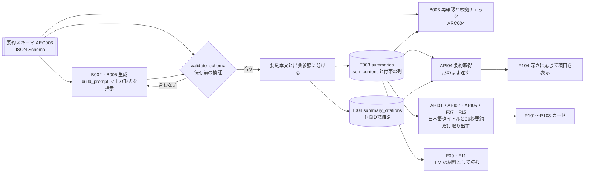
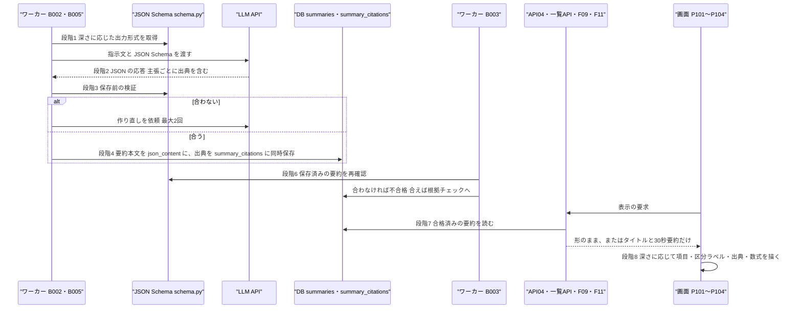

方式（共通基盤）: ARC003 要約スキーマ（構造化要約の出力仕様） ／ 実体 10ファイル（定義元の資料2・実現先の設計書8） ／ 影響範囲 17件

# 方式設計書 — ARC003 要約スキーマ（構造化要約の出力仕様）

| 項目 | 内容 |
| :--- | :--- |
| 方式ID | ARC003（上流 `docs/基本設計書_概要.md` §11.1 で採番済み。本書で新規採番した ID はありません） |
| 名称 | 要約スキーマ（構造化要約の出力仕様） |
| 更新日 | 2026-10-27 |
| インプット | (a) `source/`（全6ファイル227行。ARC003 に関わる行は `source/02_機能要求定義.md:9,21-29`、`source/03_システム構成.md:37-38,50,60`、`source/01_企画概要.md:27,33-36`）／(b) `docs/基本設計書_概要.md` §4（F04・F05）、§6（T003・T004）、§7（API04）、§11.1・§11.2、付録 Q24・Q26／実現先の設計書 `docs/db/DB.T003`・`T004.DB物理設計.md`、`docs/detail/be/BE.F04`・`F05.BE詳細設計.md`、`docs/detail/batch/BT.B002`・`B003`・`B005.バッチ詳細設計.md`、`docs/detail/fe/FE.P104.FE詳細設計.md`、関連先の `docs/detail/be/BE.F02`・`F03`・`F07`・`F08`・`F09`・`F11`・`F15.BE詳細設計.md`、`docs/detail/fe/FE.P101`〜`P103.FE詳細設計.md`、画面基本設計 P101〜P104／(c) `legacy/`／前単位の方式設計 `docs/arch/方式.ARC001.方式設計.md`・`方式.ARC002.方式設計.md` |
| 既存資料の突合 | `legacy/` は空ディレクトリ（ファイル0件）で、突合する既存設計・業務資料はありません。本書の既存版（`docs/arch/方式.ARC003.方式設計.md`）も無く、今回が初版です。引き継ぐ ID は上流で採番済みのもの（ARC001〜ARC004・ARC009、F02〜F05・F07〜F09・F11・F15、B002・B003・B005、T003・T004、API01・API02・API04・API05、P101〜P104、EX02、Q24・Q26）だけです |
| 対象システムの性質 | `source/` は企画・初期設計の資料（Markdown）で、プログラムのソースコードはありません。資料が定めているのは要約に含める**項目**までで、JSON の**キー名・型・必須条件**はどこにも定義されていません。本書は、確定済みの下流設計書が仮置きしたキー名を突き合わせ、最も多く使われている名前と、上流の適用範囲にある API04（BE.F05）の応答の形を正として**本書でスキーマを確定させます**。キー名はすべて※推測で、顧客確認と下流設計書の改版を前提とします（付録B No.1） |

---

## 1. 機構の概要

* **解決している課題**:
  * **要約の形がそろわない**: LLM に自由な文章で要約させると、論文ごとに項目の有無・順番・書き方が変わります。画面は結論・課題・手法・結果・限界・応用の6つの見出しで要約を出すため（`source/01_企画概要.md:27`、`source/02_機能要求定義.md:9`）、形がそろっていないと項目を取り出せません。
  * **検証ができない**: 原文を超えた断定や数値の取り違えを確かめる工程（ARC004）は、要約を「主張」の単位に分け、主張ごとに根拠を突き合わせます。主張の区切りと識別子が無いと、どの文を検証したか・どの文が不合格かを機械的に扱えません（`source/02_機能要求定義.md:47`、`source/03_システム構成.md:60`「LLM出力はスキーマ検証し、事実と推測を区別する」）。
  * **出典を示せない**: 資料は主要な主張と原文への出典参照を保存し、章・ページ・URL を示せるようにするとしています（`source/02_機能要求定義.md:28`、`source/01_企画概要.md:35`）。主張と出典を結ぶキーが無いと、出典を主張の横に出せません。
  * **確からしさが伝わらない**: Abstractだけから作ったのか、どのモデルでいつ作ったのか、どの版を要約したのかが残っていないと、利用者は要約の確からしさを判断できず、運用者は誤りの原因を追えません（`source/02_機能要求定義.md:27,29`、`source/01_企画概要.md:36-37`）。
  * **複数の機能で同じ要約を読む**: 要約は論文詳細（API04）だけでなく、一覧・検索・おすすめ・ブックマーク・閲覧履歴（日本語タイトルと30秒要約）、AIチャット（F09）と複数論文比較（F11）の材料としても読まれます。形が決まっていないと、機能ごとに別の読み方を作ることになり、実際に下流設計書でキー名が食い違っています（§7）。
* **設計方針**（資料から読み取れる範囲。推測は※推測と明記）:
  1. **要約は自由文ではなく JSON で持つ**（上流 §6 T003「json_content」、`source/03_システム構成.md:37`）。DB は JSON のオブジェクトであることだけを確かめ（`ck_summaries_json_object`）、中身の形はワーカーの JSON Schema で確かめます（※推測: T003 §4.3 (4) の判断）。
  2. **要約の中身（JSON）と付帯情報（列）を分ける**: 日本語タイトル・6項目・主張は JSON に、深さ・言語・解析範囲・生成モデル・生成日時・対象の版は `summaries` の列に持ちます。付帯情報は検索・再利用（ARC001）・段階の判定（ARC002）に使うため列にします（上流 §6 T003）。
  3. **出典は主張IDで別の表に持つ**: LLM の出力では主張と出典を一緒に受け取り、保存前に分けて、出典は `summary_citations`（T004）に主張IDで結びつけます。主張IDは同じ要約の中で一意です（上流 §6 T004、`uq_summary_citations_summary_id_claim_id`）。
  4. **同じスキーマを3か所で使う**: LLM への出力形式の指示（build_prompt）、保存前の検証（validate_schema）、検証工程での再確認（B003）で、同じ JSON Schema を使います（BE.F04 §4 No.8・No.10、BT.B003）。
  5. **深さが違っても形は同じ**: 30秒・3分・10分の3段階は同じスキーマで表し、深さごとに必須の項目だけを変えます（上流 §11.1「30秒・3分・10分の3段階」、`source/02_機能要求定義.md:24-26`）。
* **位置づけ**: 要約を作る側（B002・B005）と、検証する側（B003・ARC004）、読む側（API01〜API05・F07・F09・F11・F15）、表示する側（P101〜P104）の間の**データの約束**です。上流 §11.2 の相関では「ARC003 → ARC004」（スキーマの主張単位と事実／推測の区分が検証の前提）、「ARC003 → ARC009」（日本語タイトル・解析範囲・版の表示）です。



---

## 2. 実体の構成

本方式は1つの定義ファイルとして資料に存在するものではなく、資料2ファイルの項目の決まりを、JSON Schema（ワーカー）・DB の列と制約・検証と変換の処理・読み出しと表示の処理で分担して実現しています。

| # | パス | 種別 | 役割 | 備考 |
| :--- | :--- | :--- | :--- | :--- |
| 1 | `source/02_機能要求定義.md` | 定義元（資料） | 要約の項目（結論・課題・手法・結果・限界・応用。:9）と、各論文に保存する出力仕様（日本語タイトルと原題、30秒・3分・10分、解析範囲、主張と出典、処理日時・モデル・対象の版。:21-29）を定める | 上流 §11.1 の実体 |
| 2 | `source/03_システム構成.md` | 定義元（資料） | 要約と出典参照の保存項目（`summaries`・`summary_citations` の列。:37-38）、深さを指定する API（:50）、LLM 出力のスキーマ検証と事実・推測の区別（:60） | 上流 §11.1 の実体（:60 は ARC004 と共有） |
| 3 | `docs/db/DB.T003.DB物理設計.md` | 実現先（DB物理設計） | 要約本文（`json_content`）と付帯の列（深さ・言語・解析範囲・生成モデル・生成日時・対象の版）、JSON のオブジェクトであることの制約、資料から決まっている項目の一覧 | 上流の適用範囲 T003 |
| 4 | `docs/db/DB.T004.DB物理設計.md` | 実現先（DB物理設計） | 主張ごとの出典参照（主張ID・章・ページ・URL）と、主張IDの一意制約・ページと URL の制約 | 上流の適用範囲 T004 |
| 5 | `docs/detail/be/BE.F04.BE詳細設計.md` | 実現先（BE詳細設計） | LLM への出力形式の指示（build_prompt）、JSON の読み取り（generate_structured）、保存前の検証と分割（validate_schema）、要約と出典の同時保存（save_with_citations）。API04 への保証事項 | 上流の適用範囲 F04 |
| 6 | `docs/detail/be/BE.F05.BE詳細設計.md` | 実現先（BE詳細設計） | API04 の応答で、要約本文をスキーマの形のまま返し、出典を主張IDで結びつける。応答例が6項目・主張ID・事実/推測の区分の形を示す | 上流の適用範囲 F05・API04 |
| 7 | `docs/detail/batch/BT.B002.バッチ詳細設計.md` | 実現先（バッチ詳細設計） | 30秒・3分要約の生成でスキーマを出力形式に指定し、保存前に検証する | 上流の適用範囲 B002 |
| 8 | `docs/detail/batch/BT.B003.バッチ詳細設計.md` | 実現先（バッチ詳細設計） | 保存済みの要約をスキーマで再確認し、合わなければ不合格にする | 上流の適用範囲 B003 |
| 9 | `docs/detail/batch/BT.B005.バッチ詳細設計.md` | 実現先（バッチ詳細設計） | 10分解説の生成でスキーマを出力形式に指定し、保存前に検証する（出典ページが本文の範囲内かの確認を含む） | 上流の適用範囲 B005 |
| 10 | `docs/detail/fe/FE.P104.FE詳細設計.md` | 実現先（FE詳細設計） | 要約本文をスキーマの形のまま受け、深さに応じて表示する項目を選び、主張ごとの区分ラベル・出典・数式を描く | ※上流要確認: 上流の適用範囲に画面の記載が無い（上流は API04 まで） |

* **命名規則・配置規則**（新規追加時に従うべき規則）:
  * **JSON Schema の置き場所**: ワーカーの `worker/summary/schema.py` に1つだけ置き、生成（build_prompt）・検証（validate_schema）・再確認（B003）が同じものを参照します（BE.F04 §1、BT.B003 §1）。生成と検証で別のスキーマを持たないでください。
  * **キー名**: DB に保存する JSON は英小文字とアンダースコアの名前（`title_ja`・`claim_id`）、API の応答は先頭小文字のつなぎ書き（`titleJa`・`claimId`）とし、API の層で変換します（BE.F05 §2 API04 の応答と DA003 の `json_content->>'title_ja'` の対比。※推測）。
  * **項目のキー**: 6項目は複数の主張を持つため、API04 の応答と同じ名前（`conclusion`・`problem`・`method`・`results`・`limitations`・`applications`）を使います（※推測。§4 キーの決定）。
* **全数**: 10件（定義元の資料2件＋実現先の設計書8件。実現先の内訳は DB物理設計2件・BE詳細設計2件・バッチ詳細設計3件・FE詳細設計1件）。根拠: 定義元は上流 §11.1 ARC003 行の「実体」列に挙がった2ファイルと一致します（`source/01_企画概要.md:33-36` の編集方針は ARC004・ARC009 の実体のため、本書では関連する行として引くだけにします）。実現先は、全47本の確定済み設計書を「利用する方式」の ARC003 の記述と本文で1本ずつ調べて振り分けました。
  * **実現先（8本）**: スキーマを作る・確かめる・形のまま扱うもの。BE F04・F05、バッチ B002・B003・B005、FE P104 の6本（いずれも「利用する方式」に ARC003 行あり）と、ARC003 行は持たないがスキーマの保存先の列と制約を定める DB物理設計 T003・T004 の2本です。
  * **影響範囲だけで扱うもの（10本）**: ARC003 行を持つが、スキーマの一部を取り出して読むだけのもの。BE F02・F03・F07・F08・F15（日本語タイトルと30秒要約）、BE F09・F11（LLM の材料）、FE P101〜P103（カード）。§6 に行があります。
  * **対象外（29本）**: 上記以外。DB物理設計 T001・T002・T005〜T010（8本）、BE詳細設計 F01・F06・F10・F12〜F14・F16〜F19（10本）、バッチ詳細設計 B001・B004・B006〜B011（8本）、FE詳細設計 P105〜P107（3本）。B004 は要約本文を書き換えず読まないため、B007（ダイジェスト配信）は自ら ARC003 を使わないと明記しているため対象外です。

**構成要素ロースター**（スキーマの項目・保存先の列と制約・処理の全数）

ID 列には、上流または実現先の設計書で付いている識別子（JSON のキー名・列名・制約名・関数名）をそのまま書きます。本書で新しく番号を付けた要素はありません。JSON のキー名は下流設計書の仮置きを本書で確定させたもので、すべて※推測です。

| # | ID（既存の識別子） | 名称 | 種別 | 概要 | 定義元 | 定義状況 | 詳細の所在 |
| :--- | :--- | :--- | :--- | :--- | :--- | :--- | :--- |
| 1 | title_ja | 日本語タイトル | JSON の項目 | 論文の日本語タイトル。どの深さの要約にも必須。一覧・検索・おすすめ・ブックマーク・閲覧履歴・比較の見出しに使う | 資料 `02:23`、キー名は下流7本の仮置き（※推測） | 詳細 | §4 スキーマ |
| 2 | title_original | 原題 | JSON の項目 | 英語の原題。日本語タイトルに併記するため、どの深さの要約にも必須 | 資料 `02:23`、BE.F04 No.10（キー名は※推測・※上流未定義） | 詳細 | §4 スキーマ、付録B No.3 |
| 3 | conclusion | 結論 | JSON の項目 | 研究の結論の主張の並び。30秒要約はこの項目だけを持つ | 資料 `02:9,24`、BE.F05 API04 | 詳細 | §4 スキーマ・深さごとの必須項目 |
| 4 | problem | 課題（研究背景） | JSON の項目 | 研究が解こうとした課題・背景の主張の並び | 資料 `02:9,25`、BE.F05 API04 | 詳細 | §4 スキーマ |
| 5 | method | 手法 | JSON の項目 | 提案手法の主張の並び。10分解説では技術的な詳細と数式もここに書く（※推測） | 資料 `02:9,25-26`、BE.F05 API04 | 詳細 | §4 スキーマ |
| 6 | results | 結果（実験結果） | JSON の項目 | 主要な結果の主張の並び。数値・比較対象・ベンチマーク名を原文の表記で残す。10分解説では比較実験もここに書く（※推測） | 資料 `02:9,25-26`、`01:34`、BE.F05 API04 | 詳細 | §4 スキーマ |
| 7 | limitations | 限界 | JSON の項目 | 研究の限界の主張の並び | 資料 `02:9,25`、BE.F05 API04 | 詳細 | §4 スキーマ |
| 8 | applications | 応用 | JSON の項目 | 応用の見込みの主張の並び。3分要約では任意 | 資料 `02:9`、BE.F05 API04 | 詳細 | §4 スキーマ |
| 9 | claim_id | 主張ID | JSON の項目（主張） | 主張を指す識別子。同じ要約の中で重複せず64文字以内。出典参照（T004）と検証結果がこのIDで主張を指す | 上流 §6 T004、BE.F04 No.10 | 詳細 | §4 主張の形 |
| 10 | text | 主張の本文 | JSON の項目（主張） | 主張の日本語の文。数式は区切り記号で囲んで書く（※推測） | BE.F05 API04 | 詳細 | §4 主張の形・数式の書き方 |
| 11 | basis | 事実か推測かの区分 | JSON の項目（主張） | 論文に書かれた事実（`paper`）か、AIの推測（`ai_inference`）かの2値。画面はこれでラベルの色を分ける | 資料 `01:33`、`03:60`、BE.F05 API04 | 詳細 | §4 主張の形、ARC004 |
| 12 | T003.summary_type | 要約の深さ | 付帯の列 | 30秒要約（`short`）・3分要約（`standard`）・10分解説（`deep`）。深さごとの必須項目を決める | 上流 §6 T003 | 詳細 | §4 深さごとの必須項目 |
| 13 | T003.language | 言語 | 付帯の列 | 要約の言語（初期は `ja`） | 上流 §6 T003 | 簡易 | §4 付帯情報 |
| 14 | T003.source_scope | 解析範囲 | 付帯の列 | 材料が Abstractのみ（`abstract_only`）か本文取得済み（`full_text`）か。画面の「Abstractベース」表示の根拠 | 資料 `02:27`、上流 §6 T003 | 詳細 | §4 付帯情報、ARC002 |
| 15 | T003.model_id | 生成モデル | 付帯の列 | 要約を作ったモデル。資料の「モデル」に当たる | 資料 `02:29`、上流 §6 T003 | 簡易 | §4 付帯情報 |
| 16 | T003.generated_at | 生成日時 | 付帯の列 | 要約を作った日時。資料の「処理日時」に当たる | 資料 `02:29`、上流 §6 T003 | 簡易 | §4 付帯情報 |
| 17 | T003.paper_version_id | 対象の版 | 付帯の列 | どの論文のどの版を要約したか。資料の「対象論文バージョン」に当たる | 資料 `02:29`、上流 §6 T003 | 簡易 | §4 付帯情報 |
| 18 | T004.claim_id | 出典の主張ID | 出典参照の列 | 要約本文の主張を指す。同じ要約の同じ主張に出典は1行だけ | 上流 §6 T004 | 詳細 | §4 出典参照 |
| 19 | T004.source_section | 出典の章 | 出典参照の列 | 主張の根拠がある章。Abstract が材料のときは「Abstract」 | 上流 §6 T004 | 簡易 | §4 出典参照 |
| 20 | T004.source_page | 出典ページ | 出典参照の列 | 主張の根拠があるページ。Abstract が材料のときは空 | 上流 §6 T004 | 詳細 | §4 出典参照 |
| 21 | T004.source_url | 出典URL | 出典参照の列 | 根拠となる原文の URL（版番号付き。※推測） | 上流 §6 T004 | 簡易 | §4 出典参照 |
| 22 | ck_summaries_json_object | 要約本文の形の制約 | CHECK 制約 | 要約本文が JSON のオブジェクトであることだけを DB で確かめる。中身の形はワーカーの JSON Schema が確かめる | T003 | 詳細 | §3 段階4、`docs/db/DB.T003.DB物理設計.md` §4.3 (4) |
| 23 | uq_summary_citations_summary_id_claim_id | 主張IDの一意制約 | 一意制約 | 同じ要約の同じ主張に出典参照を2行作らせない | T004 | 詳細 | §4 出典参照、`docs/db/DB.T004.DB物理設計.md` §4.3 (2) |
| 24 | ck_summary_citations_section_not_blank | 章の空白禁止 | CHECK 制約 | 章が空白だけの文字列にならないようにする | T004 | 簡易 | §4 出典参照 |
| 25 | ck_summary_citations_page_positive | ページの範囲 | CHECK 制約 | ページが1以上であることを保証する | T004 | 簡易 | §4 出典参照 |
| 26 | ck_summary_citations_url_scheme | URL の形式 | CHECK 制約 | 出典URLが http または https で始まるウェブの URL であることを保証する | T004 | 簡易 | §4 出典参照 |
| 27 | build_prompt（BE.F04 No.8） | 出力形式の指示 | 関数 | 深さに応じて求める項目を決め、主張ごとに主張IDと出典を付けること・推測は推測と明示することを指示し、要約スキーマの JSON Schema を出力形式として付ける | F04 | 詳細 | §3 段階1、`docs/detail/be/BE.F04.BE詳細設計.md` §4 No.8 |
| 28 | generate_structured（BE.F04 No.9） | JSON の読み取り | 関数 | LLM の応答を JSON として読み、読めなければスキーマ不一致として扱う。使ったモデル名を返す | F04 | 詳細 | §3 段階2 |
| 29 | validate_schema（BE.F04 No.10） | 保存前の検証と分割 | 関数 | 項目の有無と型、日本語タイトルと原題、深さに必要な項目、主張IDの一意と桁数、事実/推測の区分、出典のページと URL を確かめ、通ったら要約本文と出典参照の配列に分ける | F04（B002・B003・B005 で共有） | 詳細 | §3 段階3・段階6、`docs/detail/be/BE.F04.BE詳細設計.md` §4 No.10 |
| 30 | save_with_citations（BE.F04 No.11） | 要約と出典の同時保存 | 関数 | 要約を未検証として追加し、その主張の出典参照を同じトランザクションで全件追加する | F04 | 詳細 | §3 段階4 |
| 31 | API04 の content・citations（BE.F05） | 要約取得の応答 | 応答項目 | 要約本文を項目ごとの主張の並びのまま返し、出典を主張ID順に並べる。キー名は先頭小文字のつなぎ書きに変える | F05 | 詳細 | §3 段階7、§4 API の形、`docs/detail/be/BE.F05.BE詳細設計.md` §2 API04 |
| 32 | getVisibleSections（FE P104） | 深さごとの表示項目の決定 | 関数 | 30秒要約は結論だけ、3分要約は結論・課題・手法・結果・限界（応用があれば加える）、10分解説は6項目すべてを、主張が1件以上ある項目だけ決まった順で出す | FE P104 | 詳細 | §3 段階8、`docs/detail/fe/FE.P104.FE詳細設計.md` §4 |
| 33 | getClaimBasisLabel（FE P104） | 区分ラベル | 関数 | 事実は「論文の記載」、推測は「AIの補足（推測）」のラベルにし、区分の分からない主張は推測と同じに扱う（事実として見せない） | FE P104 | 詳細 | §3 段階8 |
| 34 | renderTextWithMath（FE P104） | 数式の描画 | 関数 | 主張の本文のうち、ドル記号で囲んだ部分だけを KaTeX で描き、外部の URL や任意の HTML を許さない | FE P104（数式の書き方は※上流要確認） | 詳細 | §3 段階8、§4 数式の書き方 |

**総件数: 34件**（JSON の項目11件、付帯の列6件、出典参照の列4件、制約5件、関数7件、応答項目1件。定義状況は詳細25件・簡易9件）。**全数である根拠**: 資料 `source/02_機能要求定義.md:9,21-29` の項目（6項目・日本語タイトルと原題・深さ・解析範囲・主張と出典・処理日時・モデル・版）を1項目ずつ、保存先（T003・T004 の列）と JSON のキーに対応させ、それを作る・確かめる・分ける・返す・描く処理を実現先8本から全件拾いました。検証状態（`validation_status`）と根拠・数値チェック（`check_grounding`）は ARC004、深さと解析範囲の組み合わせの制約（`ck_summaries_deep_requires_full_text`）は ARC002、言語コードの形式制約は ARC001 の要素として除いています。一覧系が日本語タイトルと30秒要約を取り出す処理（BE.F02 DA002・BE.F03 DA001・BE.F07 DA006・BE.F08 toPaperItem・BE.F15 DA002）は、スキーマを読むだけのため §6 で扱います。
**定義状況の判定**（completeness 3-1）: 業務上の必須条件・一意性・分岐・状態の変更・非自明な規則を含むものを「詳細」としました。値をそのまま記録するだけの列（#13・#15〜#17・#19・#21）と、値の範囲だけを限る制約（#24〜#26）は「簡易」です。

---

## 3. ライフサイクル（登録・読込・選択）

スキーマは**ワーカーのコードに置いた JSON Schema** で、起動時に読み込まれ（※推測）、要約を作るたびに LLM への指示と保存前の検証に使われます。保存した要約は、**画面・API の要求ごと**にスキーマの形のまま読まれます。



| 段階 | 契機 | 処理 | 実装（ファイル:行） |
| :--- | :--- | :--- | :--- |
| 1 出力形式の指示 | B002・B005 が深さごとに要約を作るとき（ARC001 の再利用確認で「作る」と決まった深さだけ） | 深さに応じて求める項目を決め（30秒は結論中心、3分は背景・手法・主要結果・限界、10分は技術的詳細・数式・比較実験）、日本語で書く・原題を併記する・主張ごとに主張IDと出典（章・ページ）を付ける・材料に無いことを事実として断定しない・推測は推測と明示する・数値とベンチマーク名を原文の表記のまま残す、を指示し、出力形式として JSON Schema を付けます。材料（Abstract または章・ページ付きの本文）は指示と区切って渡します | `docs/detail/be/BE.F04.BE詳細設計.md:375`、`source/02_機能要求定義.md:24-26`、`source/01_企画概要.md:33-35` |
| 2 JSON の読み取り | LLM が応答したとき | 応答の本文を JSON として読み、読めなければスキーマ不一致として扱います。使ったモデル名を受け取り、生成モデルの列に記録するために持ち回ります | `docs/detail/be/BE.F04.BE詳細設計.md:376` |
| 3 保存前の検証 | 段階2の直後、保存の前 | JSON Schema で項目の有無と型を確かめ、続けて業務の条件（日本語タイトルと原題がある、深さに必要な項目がそろう、主張IDが同じ要約の中で重複せず64文字以内、主張ごとに事実/推測の区分がある、出典ページは1以上の整数か空、出典URLは http か https で始まる）を確かめます。10分解説では出典ページが本文PDFのページ数の範囲内かも確かめます。1つでも外れたら理由の一覧を付けてスキーマ不一致とし、最大2回まで作り直しを依頼します。3回とも合わなければ、保存せずにジョブを失敗として再試行に回します（上流 EX02「スキーマ不一致 → 再生成」） | `docs/detail/be/BE.F04.BE詳細設計.md:373,377`、`docs/detail/batch/BT.B005.バッチ詳細設計.md:403,519` |
| 4 分割と保存（変換） | 段階3に合格したとき | LLM の出力は主張ごとに出典を含みますが、保存では**要約本文（主張の並びを含む）と出典参照の配列に分けます**。要約本文は `summaries.json_content` に、付帯情報（深さ・言語・解析範囲・生成モデル・生成日時・対象の版）は列に、出典参照は `summary_citations` に主張IDで結びつけて、同じトランザクションで保存します。出典を別の表にするのは、出典URL・ページの形を DB の制約で確かめ、主張IDで一意にするためです。DB は要約本文が JSON のオブジェクトであることだけを確かめます | `docs/detail/be/BE.F04.BE詳細設計.md:149,377,378`、`docs/db/DB.T003.DB物理設計.md:225-234`、`docs/db/DB.T004.DB物理設計.md:227-231` |
| 5 書き換えない | 保存の後 | 要約本文は一度保存したら書き換えません。直すときは新しい行として作り直します（ARC001） | `docs/db/DB.T003.DB物理設計.md:234`、`docs/detail/be/BE.F04.BE詳細設計.md:149` |
| 6 検証工程での再確認 | B003 が未検証の要約を検証するとき | 保存済みの要約を同じ JSON Schema でもう一度確かめ、合わなければ不合格にして作り直しへ回します。スキーマを改訂した後に、改訂前に保存された未検証の要約を見つけるための確認です（※推測） | `docs/detail/batch/BT.B003.バッチ詳細設計.md:280,611`、`docs/db/DB.T003.DB物理設計.md:258` |
| 7 読み出し | 画面・API の要求ごと | API04 は合格済みの要約を1件選び、要約本文を**形のまま**返します（キー名だけ先頭小文字のつなぎ書きに変える）。出典は主張ID順に並べて添え、版・生成日時・生成モデル・解析範囲を付けます。一覧系（API01・API02・API05・ブックマーク・閲覧履歴）は日本語タイトルと30秒要約の本文だけを取り出します。F09・F11 は要約本文の項目を LLM の材料として並べます | `docs/detail/be/BE.F05.BE詳細設計.md:212-240,379,512`、`docs/detail/be/BE.F02.BE詳細設計.md:304,399`、`docs/detail/be/BE.F09.BE詳細設計.md:415`、`docs/detail/be/BE.F11.BE詳細設計.md:443` |
| 8 表示 | P104 が要約を受け取ったとき。P101〜P103 がカードを描くとき | P104 は深さに応じて出す項目を選び（30秒は結論だけ、3分は結論・課題・手法・結果・限界と、あれば応用、10分は6項目）、主張ごとに区分ラベル・本文（数式を描く）・出典リンクを並べます。カードは日本語タイトル・原題・30秒要約・解析範囲・版を出します | `docs/detail/fe/FE.P104.FE詳細設計.md:123,352-355,457`、`docs/detail/fe/FE.P102.FE詳細設計.md:352` |

* **読込順序**（スキーマの定義がどこで効き、どれが勝つか）:

| 順 | 確かめる場所 | 確かめる内容 | 外れたときの扱い | 優先関係 |
| :--- | :--- | :--- | :--- | :--- |
| 1 | LLM への指示（段階1） | 出力形式として JSON Schema を渡す | LLM が従わないことがあるため、これだけでは保証しない | 指示は検証の代わりにならない |
| 2 | 保存前の検証（段階3） | JSON Schema と業務の条件のすべて | 保存せず作り直し（最大2回）、3回でジョブ失敗 | **本方式の正**。ここを通ったものだけが保存される |
| 3 | DB の制約（段階4） | 要約本文が JSON のオブジェクトか、主張IDの一意、ページ・URL の形 | 保存の失敗（トランザクションごと取り消し） | 段階3の取りこぼしを止める最後の防壁 |
| 4 | 検証工程での再確認（段階6） | 段階3と同じ JSON Schema | 不合格にして作り直し | スキーマ改訂後の未検証の要約に効く |
| 5 | 表示側（段階8） | 区分が分からない主張は推測として扱う、主張の無い項目は出さない | 表示を控えめにする（例外にしない） | 段階2〜4を通った前提で、壊れた値に耐える |

* **選択規則**（実行時にどの項目が使われるか）:
  * **深さごとの必須項目**（段階3の検証に使う。本書で確定させる。※推測）:

| 深さ | 必須の項目 | 任意の項目 | 根拠 |
| :--- | :--- | :--- | :--- |
| 30秒要約（`short`） | 日本語タイトル、原題、結論（主張1件以上） | なし（他の5項目は持たない） | `source/02_機能要求定義.md:24`「結論中心」、BE.F05 API04「30秒要約は結論の項目だけを持つ」 |
| 3分要約（`standard`） | 日本語タイトル、原題、結論・課題・手法・結果・限界（各主張1件以上） | 応用 | `source/02_機能要求定義.md:25`「研究背景、手法、主要結果、限界」、FE P104 getVisibleSections |
| 10分解説（`deep`） | 日本語タイトル、原題、6項目すべて（各主張1件以上） | なし | `source/02_機能要求定義.md:26`「技術的詳細、数式、比較実験」、FE P104 getVisibleSections「6項目すべて」 |

  * **一覧に出す30秒要約の本文**: 合格した30秒要約の結論の主張の本文を、並びの順に句点でつないだ1つの文字列とします（※推測・※上流要確認）。下流は「30秒要約の本文」を別々のキー（BE.F02・BE.F03 は `summary`、BE.F08 は `conclusion`）で取り出す想定になっており、30秒要約が結論の主張の並びだけを持つ API04 の形と合いません。本書は API04 の形を正とし、一覧系はこの規則で文字列を作るよう改版を求めます（付録B No.2）。
  * **日本語タイトルの出どころ**: 論文の日本語タイトルは、表示する版の合格済み要約のうち、3分要約・30秒要約・10分解説の優先順で選んだ1件の `title_ja` です（BE.F05 DA003、BE.F11）。深さごとに日本語タイトルが違う場合も、この順で1つに決めます。
  * **原題の出どころ**: API04 の応答の原題（`titleOriginal`）を、要約本文の `title_original` から返すか、論文の原題（`papers.title`）から返すかは下流で定まっていません。本書は、表示の原題は `papers.title`（arXiv のメタデータそのもの）を正とし、要約本文の `title_original` は LLM が原題を取り違えていないかの確認に使うものとします（※推測。付録B No.3）。
* **失効・再読込**:

| 契機 | 起きること | 根拠 |
| :--- | :--- | :--- |
| スキーマを改訂した | ワーカーを再デプロイした後に作る要約から新しいスキーマになります。未検証の要約は B003 の再確認で新しいスキーマに照らされ、合わなければ不合格になって作り直されます。**合格済みの要約は再確認されず、古いスキーマのまま残ります**（B003 は未検証の要約だけを検証するため。※推測） | `docs/db/DB.T003.DB物理設計.md:258`、`docs/detail/be/BE.F04.BE詳細設計.md:379` |
| 要約の版を区別したい | 要約本文にスキーマの版を表す項目はありません。どの要約がどのスキーマで作られたかは、生成日時とデプロイの記録を突き合わせて推定するしかありません（※上流未定義。付録B No.4） | — |
| LLM の出力がスキーマに合わない | 作り直しで2回まで再生成し、3回とも合わなければジョブを失敗にして再試行・失敗キューへ回します（ARC006） | `docs/detail/batch/BT.B005.バッチ詳細設計.md:519` |

---

## 4. インターフェース・データ構造

* **キーの決定**（下流設計書の仮置きを突き合わせた結果。すべて※推測）:

| 項目 | 本書で確定するキー（DB の JSON） | API の応答のキー | 下流設計書の仮置き | 食い違いと扱い |
| :--- | :--- | :--- | :--- | :--- |
| 日本語タイトル | `title_ja` | `titleJa` | BE.F02・F03・F05・F07・F08・F11・F15 がすべて `title_ja` | 食い違いなし |
| 原題 | `title_original` | `titleOriginal` | BE.F04 は「原題があるか」を確かめるがキー名なし。BE.F05 は応答で `titleOriginal` | ※上流未定義。本書で命名 |
| 結論 | `conclusion` | `conclusion` | BE.F05・BE.F11 が `conclusion`。BE.F08 は30秒要約の本文のキーとして `conclusion` を文字列で想定 | BE.F08 は配列として読むよう改版（付録B No.2） |
| 課題 | `problem` | `problem` | BE.F05・BE.F11 が `problem` | 食い違いなし |
| 手法 | `method` | `method` | BE.F05・BE.F11 が `method` | 食い違いなし |
| 結果 | `results` | `results` | BE.F05 は `results`、BE.F11 は `result` | BE.F11 は単数形の `result` で仮置きしているため、`results` に改版（付録B No.5） |
| 限界 | `limitations` | `limitations` | BE.F05 は `limitations`、BE.F11 は `limitation` | BE.F11 は単数形の `limitation` で仮置きしているため、`limitations` に改版（付録B No.5） |
| 応用 | `applications` | `applications` | BE.F05 は `applications`、BE.F11 は `application` | BE.F11 は単数形の `application` で仮置きしているため、`applications` に改版（付録B No.5） |
| 主張ID | `claim_id` | `claimId` | BE.F05 `claimId`、T004 `claim_id` | 食い違いなし |
| 主張の本文 | `text` | `text` | BE.F05 `text` | 食い違いなし |
| 区分 | `basis`（`paper`・`ai_inference`） | `basis` | BE.F05 `basis`、FE P104 getClaimBasisLabel | 食い違いなし |
| 30秒要約の本文（一覧用） | 持たない（結論の主張から作る） | `shortSummary`（API01）・`summaryShort`（API05） | BE.F02・F03 は `summary`、BE.F08 は `conclusion` | 一覧系の取り出し方を改版（付録B No.2） |

* **スキーマ**（DB の `summaries.json_content` に保存する形）:

```json
{
  "title_ja": "日本語タイトル（必須・文字列）",
  "title_original": "原題（必須・文字列）",
  "conclusion":   [ { "claim_id": "c1", "text": "主張の本文", "basis": "paper" } ],
  "problem":      [ { "claim_id": "c2", "text": "…", "basis": "paper" } ],
  "method":       [ { "claim_id": "c3", "text": "…", "basis": "paper" } ],
  "results":      [ { "claim_id": "c4", "text": "…", "basis": "paper" } ],
  "limitations":  [ { "claim_id": "c5", "text": "…", "basis": "ai_inference" } ],
  "applications": [ { "claim_id": "c6", "text": "…", "basis": "ai_inference" } ]
}
```

  * 30秒要約は `title_ja`・`title_original`・`conclusion` だけを持ちます。3分要約・10分解説で持たない項目は、キーごと省きます（空の配列も許しますが、表示側は主張の無い項目を出しません）。
  * 主張の並びの順が表示の順です。主張IDは同じ要約の中で一意で、64文字以内です（T004 の桁と一意制約に合わせる）。
* **主張の形**:

| 項目 | 型 | 必須 | 意味 | 根拠 |
| :--- | :--- | :--- | :--- | :--- |
| claim_id | 文字列（64文字以内） | 必須 | 主張を指す識別子。同じ要約の中で重複しない。出典参照・検証・AIチャットの回答がこのIDで主張を指す | 上流 §6 T004、BE.F04 No.10、BE.F09 |
| text | 文字列 | 必須 | 主張の日本語の文。数値・比較対象・ベンチマーク名は原文の表記のまま残す | `source/01_企画概要.md:34` |
| basis | 文字列（`paper` か `ai_inference`） | 必須 | 論文に書かれた事実か、AIの推測かの区別。画面は推測を事実と区別したラベルで出す | `source/01_企画概要.md:33`、ARC004 |

* **LLM の出力の形**（段階2で受け取る形。保存の形との違いは出典を主張の中に持つことだけ）: 各主張に `source`（`section`・`page`・`url`）を加えた形を出力形式として指示し、段階4で主張から `source` を取り外して出典参照の配列（`claim_id`・`source_section`・`source_page`・`source_url`）にします（※推測: BE.F04 No.10 手順7「要約本文と出典参照の配列に分けて返す」からの形。キー名は本書の命名）。
* **出典参照**（T004 `summary_citations` の1行）:

| 列 | 意味 | 条件 | 根拠 |
| :--- | :--- | :--- | :--- |
| summary_id | どの要約の出典か | 要約と同じトランザクションで作る。要約が消えたら一緒に消える | T004 §4.3 (1) |
| claim_id | 要約本文の主張ID | 同じ要約の中で1行だけ。要約本文に実在する主張IDだけを入れる | `uq_summary_citations_summary_id_claim_id`、BE.F04 §2 保証事項3 |
| source_section | 根拠のある章 | 空白だけの文字列は不可。Abstract が材料なら「Abstract」 | `ck_summary_citations_section_not_blank`、FE P104 buildCitationLabel |
| source_page | 根拠のあるページ | 1以上の整数か空。Abstract が材料なら空。10分解説では本文PDFのページ数以内 | `ck_summary_citations_page_positive`、BT.B005 手順11 |
| source_url | 根拠となる原文の URL | http か https で始まる。版番号付きの URL（※推測） | `ck_summary_citations_url_scheme` |

  主張の中には出典を持たないもの（AIの推測）があってよく、出典参照の行数は主張の数以下です（※推測: FE P104 C12「その主張に出典があるときだけ出典リンクを出す」）。
* **付帯情報**（`summaries` の列。資料の「処理日時、モデル、対象論文バージョン」と解析範囲）:

| 資料の項目 | 列 | 意味 |
| :--- | :--- | :--- |
| 処理日時 | generated_at | 要約を作った日時。API04 の `generatedAt` |
| モデル | model_id | 要約を作ったモデル。API04 の `modelId` |
| 対象論文バージョン | paper_version_id | 要約した版。API04 は版番号（`version`）として返す |
| 解析範囲 | source_scope | `abstract_only` か `full_text`。API04 の `sourceScope` |
| 30秒/3分/10分 | summary_type | `short`・`standard`・`deep`。API04 の `depth` |
| （言語） | language | 初期は `ja` |

* **数式の書き方**（※上流要確認）: 資料は10分解説に数式を含めるとし（`source/02_機能要求定義.md:26`）、数式表示に KaTeX を挙げていますが（`source/03_システム構成.md:14`）、主張の本文の中で数式をどう書くかは定義されていません。本書は FE P104 の実装案に合わせ、別行の数式はドル記号2つ、文中の数式はドル記号1つで囲み、数式でないドル記号の前にはバックスラッシュを付ける書き方とします（※推測）。build_prompt はこの書き方を指示に含めます。
* **API の形**（API04 の応答）: 要約本文はキー名を先頭小文字のつなぎ書きに変えるだけで、項目と主張の構成は変えずに返します。出典は主張ID順に並べた配列で添えます（BE.F05 §2 API04）。
* **設定項目**: **該当なし**。スキーマの形・必須項目・作り直しの回数（最大2回）・主張IDの桁（64文字）は、いずれも設定値ではなくコードと DB の定義に固定されています（BE.F04 §4 No.6・No.10、T004）。作り直しの回数を設定値にするかは上流 Q19 とあわせて決めます。

---

## 5. 拡張・変更手順

**手順A: 要約に項目を1つ追加する**（例: 10分解説に「実験条件」を独立した項目として加える）

1. **資料と顧客の確認**: 追加する項目が資料の出力仕様（`source/02_機能要求定義.md:21-29`）の範囲か、顧客の追加要望かを確かめ、上流 §11.1 ARC003 の目的の文言に反映します。
2. **キーと必須条件を決める**: 英小文字とアンダースコアのキー名を決め、主張の並び（`claim_id`・`text`・`basis`）の形にそろえます。どの深さで必須・任意にするかを §3 選択規則の表に加えます。
3. **JSON Schema を改める**: `worker/summary/schema.py` のスキーマに項目を加え、validate_schema の深さごとの必須条件を改めます。build_prompt の深さごとの指示にも加えます（同じスキーマを3か所で使うため、1か所の改修で生成・検証・再確認がそろいます）。
4. **読む側を改める**: API04（BE.F05）の応答のキー変換に加え、P104 の getVisibleSections に項目と見出しと表示順を加えます。F09・F11 が材料として並べる項目にも加えるかを決めます。
5. **検証の基準を確かめる**: 新しい項目の主張も根拠・数値チェック（ARC004）の対象になるため、B003 の check_grounding が項目を問わず主張単位で動くことを確かめます。
6. **反映のタイミング**: ワーカーと API・画面を同時にデプロイします。既存の要約には新しい項目が無いため、読む側は項目が無い要約に耐えるようにします（主張の無い項目は出さない）。既存の要約に項目を足すには作り直しが要ります（ARC001 §5 手順B）。
7. **文書を更新する**: 本書 §2 構成要素ロースター・§3・§4、T003 §4.3 (4)、BE.F04・BE.F05、FE P104、該当バッチ詳細設計を改版します。

**手順B: キー名を変える・項目をなくす**

1. 保存済みの要約は書き換えないため（§3 段階5）、古いキーの要約と新しいキーの要約が混在します。読む側（API04・一覧系・F09・F11・FE）を、両方のキーを読めるように先に改修します。
2. 次にワーカーのスキーマを改め、新しいキーで作り始めます。
3. 古いキーの要約を残すか作り直すかを決め、作り直すなら ARC001 の作り直しの手順で行います。

---

## 6. 影響範囲

| 影響先（機能/画面/工程） | どう効くか | 変更時のリスク |
| :--- | :--- | :--- |
| F04／B002 Abstractベース日本語要約生成 | 30秒・3分要約の出力形式の指示と保存前の検証にスキーマを使う | 必須項目を増やすと Abstract だけでは埋められず、スキーマ不一致による作り直しとジョブ失敗が増える |
| F04／B005 本文解析・詳細解説生成 | 10分解説の出力形式の指示と保存前の検証（出典ページの範囲を含む）にスキーマを使う | 主張の形を変えると、出典の分割と T004 への保存が壊れる |
| F04／B003 要約の根拠・数値チェック | 保存済みの要約をスキーマで再確認し、主張単位で根拠を確かめる | 主張IDの扱いを変えると、どの主張が不合格かを特定できなくなる |
| F05／API04 要約取得 | 要約本文を形のまま返し、出典を主張IDで結ぶ | キー名を変えると、P104 の表示と F09 の回答の主張IDの参照が同時に壊れる |
| F09 AIチャット | 要約本文の項目と主張IDを回答の材料にし、回答の文に主張IDを付ける | 主張IDを要約の作り直しで振り直すと、過去の回答が指す主張が変わる（※推測） |
| F11 複数論文比較 | 要約本文の6項目を論文ごとに並べて比較の観点にし、日本語タイトルを使う | 項目名が単数形で仮置きされているため、本書のキーに合わせないと比較の観点を取り出せない（付録B No.5） |
| F02 日付・カテゴリ検索／API01（※上流要確認: 上流の適用範囲は API04 まで） | 日本語タイトルと30秒要約の本文を取り出して一覧に返す | 30秒要約の本文を `summary` キーで読む想定のため、本書のスキーマのままでは本文が取れず、全論文が未公開表示になる（付録B No.2） |
| F03 自由検索／API02（※上流要確認） | 日本語タイトルと30秒要約の本文を取り出して検索結果に返す | F02 と同じく `summary` キーの想定を改める必要がある |
| F08 レコメンド／API05（※上流要確認） | 日本語タイトルと30秒要約の本文を取り出しておすすめに添える | 30秒要約の本文を `conclusion` の文字列として読む想定のため、配列から文字列を作るよう改める必要がある |
| F07 ブックマーク（※上流要確認） | 日本語タイトルを取り出して一覧に出す | `title_ja` のキー名を変えると、一覧の日本語タイトルが空になる |
| F15 閲覧履歴（※上流要確認） | 日本語タイトルを取り出して履歴に出す | F07 と同じ |
| P101 ホーム（※上流要確認） | カードに日本語タイトル・原題・30秒要約・解析範囲・版を出す | 一覧 API の取り出し方の変更がそのまま表示に効く |
| P102 新着論文 | P101 と同じ | P101 と同じ |
| P103 論文検索（※上流要確認） | P101 と同じ | P101 と同じ |
| P104 論文詳細 | 深さに応じて項目を選び、主張ごとの区分ラベル・出典・数式を描く | 項目の追加・改名は getVisibleSections の改修が要る。数式の書き方を変えると描画が崩れる |
| T003 summaries | 要約本文と付帯の列を持ち、要約本文が JSON のオブジェクトであることを確かめる | スキーマの版の列が無いため、改訂前後の要約を見分けられない |
| T004 summary_citations | 主張IDで出典を結び、ページと URL の形を確かめる | 主張IDの桁・一意の条件を変えると、validate_schema の確認と食い違う |

**総件数: 17件**（機能・バッチ・API の行11件、画面の行4件、テーブルの行2件、うち上流 §11.1 の適用範囲に無いもの9件）。**根拠**: 上流 §11.1 ARC003 の適用範囲（F04・F05・F09・F11／B002・B003・B005／T003・T004／API04）の全要素を行にし（F04 は B002・B003・B005 の行に含める）、加えて §2 で「影響範囲だけで扱う」とした BE F02・F03・F07・F08・F15 と FE P101〜P103、実現先の FE P104 を加えました。上流に無い9件（F02・F03・F07・F08・F15・P101〜P104）は※上流要確認として、上流 §11.1 の適用範囲への追記を求めます。

---

## 7. 制約・注意事項

* **性能・容量**: 要約本文は JSON のまま1列に入るため、中身で検索する画面・API はありません（索引なし。T003 §4.3 (4)）。一覧系は日本語タイトルと30秒要約だけを取り出すため、要約本文の全体を返しません。
* **失敗時の挙動**:
  * LLM の出力がスキーマに合わないときは、保存せずに最大2回作り直し、3回とも合わなければジョブを失敗にして再試行に回します（BE.F04 No.6、BT.B005 §6）。スキーマに合わない要約は DB に残りません。
  * 一覧系で、合格した要約に30秒要約の本文が無い（項目が欠けている）場合は、例外にせずその論文を未公開表示で返し、警告ログを残します（BE.F02 §6）。
  * 表示側で区分が分からない主張は、推測と同じラベルで出し、事実として見せません（FE P104 getClaimBasisLabel）。
* **既知の制約**:
  * **キー名の食い違い**: 下流設計書の仮置きが、30秒要約の本文（`summary`／`conclusion`／結論の配列）と、項目名の単数・複数（BE.F11）で食い違っています。本書で正を定めたため、BE.F02・F03・F08・F11 の改版が必要です（付録B No.2・No.5）。
  * **スキーマの版が無い**: 要約本文にスキーマの版を表す項目が無く、合格済みの要約は再確認されないため、スキーマ改訂の後は古い形と新しい形の要約が混在し続けます（§3 失効・再読込）。
  * **数式の書き方が未定義**: 本書で FE P104 の実装案に合わせて決めましたが、資料にも上流にも定義が無く、顧客確認が要ります（付録B No.6）。
  * **事実と推測の区別の基準**: `basis` の値の付け方（何をもって論文の記載とするか）は ARC004 の責務で、本書は値の形だけを決めます。

---

## 付録A. ソース突合トレーサビリティ

| 記述箇所 | 根拠ソース（パス:行） |
| :--- | :--- |
| §0 実体・影響範囲の件数 | §2 表（10件）、§6 表（17件） |
| §1 要約の形と項目 | `source/02_機能要求定義.md:9,21-29`、`source/01_企画概要.md:27` |
| §1 検証と事実・推測の区別 | `source/02_機能要求定義.md:47`、`source/03_システム構成.md:60`、`source/01_企画概要.md:33-34` |
| §1 出典を示す | `source/02_機能要求定義.md:28`、`source/01_企画概要.md:35` |
| §1 確からしさ（解析範囲・処理日時・モデル・版） | `source/02_機能要求定義.md:27,29`、`source/01_企画概要.md:36-37` |
| §1 位置づけ（方式の相関） | `docs/基本設計書_概要.md:1310-1326` |
| §2 定義元の資料2件 | `docs/基本設計書_概要.md:1293`（ARC003 行の実体） |
| §2 実現先の ARC003 行 | `docs/detail/be/BE.F04.BE詳細設計.md:467`、`BE.F05.BE詳細設計.md:512`、`docs/detail/batch/BT.B002.バッチ詳細設計.md:559`、`BT.B003.バッチ詳細設計.md:611`、`BT.B005.バッチ詳細設計.md:618`、`docs/detail/fe/FE.P104.FE詳細設計.md:457` |
| §2 #1〜#11 JSON の項目 | `docs/detail/be/BE.F05.BE詳細設計.md:212-235,379`、`docs/detail/be/BE.F04.BE詳細設計.md:377`、`docs/db/DB.T003.DB物理設計.md:225-233` |
| §2 #12〜#17 付帯の列 | `docs/基本設計書_概要.md:941-952`、`source/03_システム構成.md:37` |
| §2 #18〜#21・#23〜#26 出典参照 | `docs/基本設計書_概要.md:954-962`、`docs/db/DB.T004.DB物理設計.md:227-231`、`source/03_システム構成.md:38` |
| §2 #22 ck_summaries_json_object | `docs/db/DB.T003.DB物理設計.md` §4.3 (4)・§7 DDL |
| §2 #27〜#30 生成・検証・保存 | `docs/detail/be/BE.F04.BE詳細設計.md:373,375-378` |
| §2 #31 API04 | `docs/detail/be/BE.F05.BE詳細設計.md:212-240` |
| §2 #32〜#34 表示 | `docs/detail/fe/FE.P104.FE詳細設計.md:123,308,352-355` |
| §3 段階3 10分解説のページの範囲 | `docs/detail/batch/BT.B005.バッチ詳細設計.md:403,519` |
| §3 段階6 B003 の再確認 | `docs/detail/batch/BT.B003.バッチ詳細設計.md:42,280,611`、`docs/db/DB.T003.DB物理設計.md:258` |
| §3 選択規則 深さごとの必須項目 | `source/02_機能要求定義.md:24-26`、`docs/detail/be/BE.F05.BE詳細設計.md:239`、`docs/detail/fe/FE.P104.FE詳細設計.md:352` |
| §3 選択規則 日本語タイトルの出どころ | `docs/detail/be/BE.F05.BE詳細設計.md:342`、`docs/detail/be/BE.F11.BE詳細設計.md:154,162` |
| §4 キーの決定（30秒要約の本文） | `docs/detail/be/BE.F02.BE詳細設計.md:177,304,387`、`docs/detail/be/BE.F03.BE詳細設計.md:265-266`、`docs/detail/be/BE.F08.BE詳細設計.md:194,200` |
| §4 キーの決定（項目名の単数・複数） | `docs/detail/be/BE.F11.BE詳細設計.md:218`、`docs/detail/be/BE.F05.BE詳細設計.md:223-229` |
| §4 キーの決定（title_ja） | `docs/detail/be/BE.F07.BE詳細設計.md:516`、`docs/detail/be/BE.F15.BE詳細設計.md:384` |
| §4 数式の書き方 | `source/02_機能要求定義.md:26`、`source/03_システム構成.md:14`、`docs/detail/fe/FE.P104.FE詳細設計.md:355` |
| §6 画面への影響 | `docs/screens/画面.P101.画面基本設計.md:217`、`画面.P102.画面基本設計.md:217`、`画面.P103.画面基本設計.md:224`、`画面.P104.画面基本設計.md:257`、`docs/detail/fe/FE.P101.FE詳細設計.md:398`、`FE.P102.FE詳細設計.md:352`、`FE.P103.FE詳細設計.md:382` |
| §6 F09・F11 | `docs/detail/be/BE.F09.BE詳細設計.md:415`、`docs/detail/be/BE.F11.BE詳細設計.md:443` |
| §7 項目欠落時の一覧の扱い | `docs/detail/be/BE.F02.BE詳細設計.md:363` |

---

## 付録B. 未確定事項（※推測の一覧）

| No. | 区分 | 内容 | 本書での扱い | 確認先 |
| :--- | :--- | :--- | :--- | :--- |
| 1 | ※推測 | JSON のキー名・型・深さごとの必須条件は資料にも上流にも無い | 下流の仮置きと API04 の応答の形を突き合わせて本書で確定（§4） | 顧客・上流 Q24・Q26 |
| 2 | ※上流要確認 | 一覧系の「30秒要約の本文」の取り出し方が、BE.F02・BE.F03（`summary`）、BE.F08（`conclusion` の文字列）、API04（結論の主張の配列）で食い違う | 結論の主張の本文を順に句点でつないだ文字列を一覧用とし、BE.F02・F03・F08 の改版を求める | BE.F02・F03・F08 の改版 |
| 3 | ※上流未定義 | 原題を要約本文に持つキー名と、API04 の応答の原題を要約本文と論文のメタデータのどちらから返すか | `title_original` と命名し、表示は `papers.title` を正とする | 顧客・BE.F05 の改版 |
| 4 | ※上流未定義 | 要約本文にスキーマの版を持たせるか | 持たない現状を記載し、改訂時の混在を制約として明記 | 顧客・T003 の改版 |
| 5 | ※上流要確認 | BE.F11 の比較の観点名（`result`・`limitation`・`application`）が API04 の項目名（複数形）と食い違う | API04 の複数形を正とし、BE.F11 の改版を求める | BE.F11 の改版 |
| 6 | ※上流要確認 | 主張の本文の中での数式の書き方 | ドル記号で囲む書き方とする（FE P104 の実装案） | 顧客・FE P104 |
| 7 | ※推測 | 3分要約で応用を任意、10分解説で6項目すべてを必須とする深さごとの必須条件 | §3 選択規則の表のとおり | 顧客 |
| 8 | ※推測 | LLM の出力で主張ごとに出典を持たせる形（`source` の中の `section`・`page`・`url`） | 本書で命名 | BE.F04 の改版 |
| 9 | ※上流要確認 | 上流 §11.1 ARC003 の適用範囲に、F02・F03・F07・F08・F15・P101〜P104 が無い | §6 に※上流要確認として加えた | 上流 §11.1 の改版 |
| 10 | ※推測 | 要約を作り直したとき主張IDを振り直すか（F09 の過去の回答が指す主張との関係） | 振り直す前提で影響を記載 | 顧客・BE.F09 |
