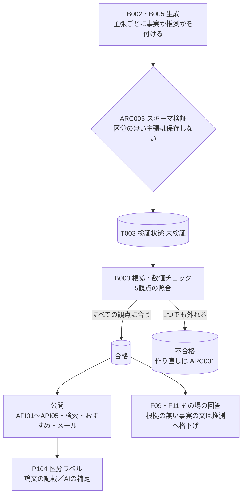
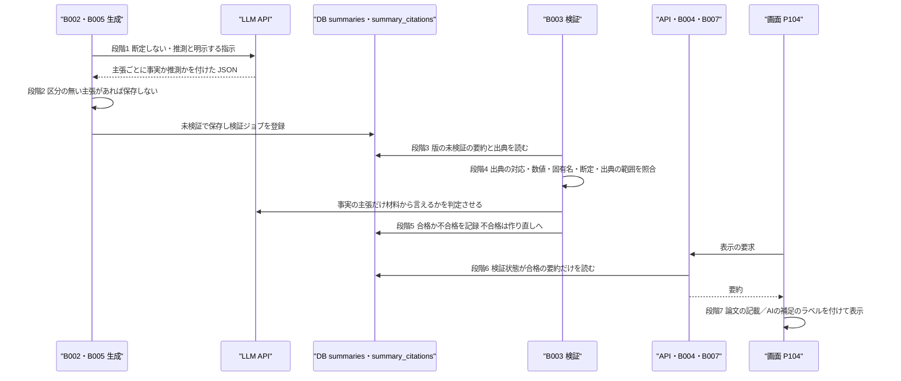

方式（共通基盤）: ARC004 LLM出力検証方式（事実と推測の区別） ／ 実体 13ファイル（定義元の資料3・実現先の設計書10） ／ 影響範囲 20件

# 方式設計書 — ARC004 LLM出力検証方式（事実と推測の区別）

| 項目 | 内容 |
| :--- | :--- |
| 方式ID | ARC004（上流 `docs/基本設計書_概要.md` §11.1 で採番済み。本書で新規採番した ID はありません） |
| 名称 | LLM出力検証方式（事実と推測の区別） |
| 更新日 | 2026-10-27 |
| インプット | (a) `source/`（全6ファイル227行。ARC004 に関わる行は `source/03_システム構成.md:25,60`、`source/02_機能要求定義.md:47`、`source/01_企画概要.md:33-35`、`source/04_収益化とロードマップ.md:48`）／(b) `docs/基本設計書_概要.md` §2 EX02、§4（F04・F09・F11、B003）、§6（T003）、§11.1・§11.2、付録 Q19／実現先の設計書 `docs/db/DB.T003`・`T004.DB物理設計.md`、`docs/detail/be/BE.F04`・`F09`・`F11`・`F14.BE詳細設計.md`、`docs/detail/batch/BT.B003`・`B009.バッチ詳細設計.md`、`docs/detail/fe/FE.P104`・`P105.FE詳細設計.md`、関連先の BE F02・F03・F05・F07・F08・F10・F15・F17・F19、バッチ B002・B004・B005・B007・B011、画面基本設計 P104・P105／(c) `legacy/`／前単位の方式設計 `docs/arch/方式.ARC001`〜`ARC003.方式設計.md` |
| 既存資料の突合 | `legacy/` は空ディレクトリ（ファイル0件）で、突合する既存設計・業務資料はありません。本書の既存版（`docs/arch/方式.ARC004.方式設計.md`）も無く、今回が初版です。引き継ぐ ID は上流で採番済みのもの（ARC001〜ARC004・ARC006・ARC009、F02〜F05・F07〜F11・F14・F15・F17・F19、B002〜B005・B007・B009・B011、T003・T004、API01〜API05、P104・P105、EX02、Q19・Q29）だけです |
| 対象システムの性質 | `source/` は企画・初期設計の資料（Markdown）で、プログラムのソースコードはありません。資料が定めているのは「スキーマ検証」「根拠・数値チェック」「原文を超えた断定を避ける」「事実と推測を区別する」という方針までで、照合の方法と閾値はどこにも定義されていません。BE.F04 §4 No.13 と BT.B003 §6 No.9 は「具体的な方法と閾値は ARC004 の方式設計書で確定する」としているため、**本書で照合の方法と閾値を定めます**（すべて※推測。付録B No.1） |

---

## 1. 機構の概要

* **解決している課題**:
  * **原文を超えた断定**: LLM は材料に書かれていないことを、もっともらしく言い切ることがあります。利用者は日本語の要約を読んで原文を読まずに済ませるため、断定が誤っていると研究の中身を取り違えたまま広めてしまいます（`source/02_機能要求定義.md:47`「要約には原文を超えた断定を避ける検証工程を設ける」）。
  * **数値・固有名の取り違え**: 実験結果の数値・比較対象・ベンチマーク名は要約の価値の中心ですが（`source/01_企画概要.md:34`）、LLM は桁や小数点、手法名を取り違えることがあります。誤った数値は事実として伝わると訂正が難しくなります（`source/03_システム構成.md:25`「根拠・数値チェック」）。
  * **事実と推測の混同**: 要約には、論文に書かれた事実と、AIが補った解釈（応用の見込みや研究の意義づけ）が混ざります。区別が無いと利用者はどちらも論文の主張だと受け取ります（`source/01_企画概要.md:33`「研究で実証された事実とAIの推測を明確に区別する」、`source/03_システム構成.md:60`）。
  * **誤りの公開**: 検証の前の要約を画面・検索・メールに出すと、検証で見つかるはずの誤りが利用者に届きます。
  * **品質が測れない**: 要約の誤り率は検証指標に挙がっています（`source/04_収益化とロードマップ.md:48`）。検証の結果を記録しないと、モデルを選ぶ根拠も、指示文を直す根拠も得られません。
* **設計方針**（資料から読み取れる範囲。推測は※推測と明記）:
  1. **主張ごとに事実か推測かを持たせる**: 要約の主張は必ず「論文の記載（`paper`）」か「AIの推測（`ai_inference`）」の区分を持ちます（ARC003 の `basis`）。区分が無い主張は保存しません（BE.F04 §4 No.10 手順4）。
  2. **事実の主張だけを厳しく照合する**: 断定の照合は事実と区分された主張だけにかけます。推測と区分された主張は、推測として表示されるため断定の照合から外します（BE.F04 §4 No.13 手順4）。
  3. **検証は生成と別の工程にする**: 要約は未検証で保存し、別のジョブ（B003）が材料と突き合わせて合否を記録します。生成と検証を分けると、検証だけをやり直したり、検証の規則を変えて再検証したりできます（上流 §4 B003、T003 §4.3 (8)）。
  4. **合格したものだけを公開する**: 画面・API・検索・おすすめ・メールは、検証に合格した要約だけを使います。未検証・不合格は読み出しの条件で一律に除きます（上流 §6 T003「合格したものだけを公開する」）。
  5. **その場で作る回答は、不合格にせず推測に格下げする**: AIチャット（F09）と複数論文比較（F11）は利用者を待たせて回答するため、根拠の無い「事実」の文を見つけたら回答全体を捨てず、その文を推測に変えて返します（BE.F09・BE.F11。※推測: 下流の判断）。
  6. **画面は区分を目で見て分かるように出す**: 事実と推測を色分けしたラベルで出し、区分の分からない主張は推測として扱います（FE P104 getClaimBasisLabel）。
* **位置づけ**: 要約の生成（B002・B005）と公開（B004・API）の間に入る関門です。上流 §11.2 の相関では「ARC003 → ARC004」（スキーマの主張単位と区分が検証の前提）、「ARC004 → ARC002」（検証に合格したものだけが段階を進む）です。

---

## 2. 実体の構成

本方式は1つのプログラムではなく、資料3ファイルの方針を、生成時の区分の必須化、検証ジョブの照合、検証状態の列、読み出しの条件、表示のラベル、その場の回答の格下げで分担して実現しています。

| # | パス | 種別 | 役割 | 備考 |
| :--- | :--- | :--- | :--- | :--- |
| 1 | `source/03_システム構成.md` | 定義元（資料） | 収集フローの「根拠・数値チェック」の工程（:25）と、LLM 出力のスキーマ検証と事実・推測の区別（:60） | 上流 §11.1 の実体 |
| 2 | `source/02_機能要求定義.md` | 定義元（資料） | 原文を超えた断定を避ける検証工程を設ける（:47） | 上流 §11.1 の実体 |
| 3 | `source/01_企画概要.md` | 定義元（資料） | 事実とAIの推測を明確に区別する（:33）、数値・比較対象・ベンチマーク名を保持する（:34） | 上流 §11.1 の実体 |
| 4 | `docs/db/DB.T003.DB物理設計.md` | 実現先（DB物理設計） | 検証状態（`validation_status`）の3値と遷移、合格したものだけを公開対象とする決まり | 上流の適用範囲 T003.validation_status |
| 5 | `docs/db/DB.T004.DB物理設計.md` | 実現先（DB物理設計） | 照合に使う出典参照（主張ID・章・ページ）の形の制約 | ※上流未定義: 上流 §11.1 の適用範囲に T004 の記載が無い |
| 6 | `docs/detail/be/BE.F04.BE詳細設計.md` | 実現先（BE詳細設計） | 生成時の指示（断定しない・推測と明示する）、区分の必須化、根拠・数値チェック（check_grounding）、検証結果の記録 | 上流の適用範囲 F04 |
| 7 | `docs/detail/batch/BT.B003.バッチ詳細設計.md` | 実現先（バッチ詳細設計） | 未検証の要約の5観点の照合とスキーマの再確認、合否の記録、合否に応じた後続ジョブ | 上流の適用範囲 B003 |
| 8 | `docs/detail/be/BE.F09.BE詳細設計.md` | 実現先（BE詳細設計） | AIチャットの回答の検証と、根拠の無い事実の文の推測への格下げ。材料を合格済みの要約に限る | 上流の適用範囲 F09 |
| 9 | `docs/detail/be/BE.F11.BE詳細設計.md` | 実現先（BE詳細設計） | 複数論文比較の結果の検証、数値の照合、根拠の無い事実の文の推測への格下げ | 上流の適用範囲 F11 |
| 10 | `docs/detail/be/BE.F14.BE詳細設計.md` | 実現先（BE詳細設計） | コード解説の各記述に事実か推測かを持たせ、事実とされたファイル名の実在を確かめる | ※上流要確認: 上流の適用範囲に F14 の記載が無い |
| 11 | `docs/detail/batch/BT.B009.バッチ詳細設計.md` | 実現先（バッチ詳細設計） | F14 のコード解説の検証を実行するバッチ | ※上流要確認: 上流の適用範囲に B009 の記載が無い |
| 12 | `docs/detail/fe/FE.P104.FE詳細設計.md` | 実現先（FE詳細設計） | 主張ごとの区分を「論文の記載」「AIの補足（推測）」のラベルで出し、区分の分からない主張は推測として出す | ※上流要確認: 上流の適用範囲に画面の記載が無い |
| 13 | `docs/detail/fe/FE.P105.FE詳細設計.md` | 実現先（FE詳細設計） | 日本語全文の先頭に AI 翻訳である旨を必ず添え、原文を正とする | ※上流要確認: 上流の適用範囲に P105・全文翻訳の記載が無い |

* **命名規則・配置規則**（新規追加時に従うべき規則）:
  * 要約の検証ロジックはワーカーの `worker/summary/checker.py`（照合）と `worker/summary/schema.py`（区分の必須化を含むスキーマ）に置きます（BE.F04 §1）。その場の回答の検証は機能ごとに `lib/{機能}/…-validator.ts` に置きます（BE.F09 `lib/chat/answer-validator.ts`、BE.F11 `lib/compare/result-validator.ts`）。
  * 事実か推測かの区分の値は、要約・回答・コード解説のすべてで「事実（論文・材料に書かれたこと）」と「推測（AIの補い）」の2値にそろえます（要約の値は `paper`・`ai_inference`。ARC003）。
  * 公開側の読み出しは、要約を結合するすべての問い合わせに「検証状態が合格」の条件を入れます（`validation_status = 'passed'`）。
* **全数**: 13件（定義元の資料3件＋実現先の設計書10件。実現先の内訳は DB物理設計2件・BE詳細設計4件・バッチ詳細設計2件・FE詳細設計2件）。根拠: 定義元は上流 §11.1 ARC004 行の「実体」列に挙がった3ファイルと一致します（誤り率の指標 `source/04_収益化とロードマップ.md:48` は F19 の行として §6 で扱います）。実現先は、全47本の確定済み設計書を「利用する方式」の ARC004 の記述と本文で1本ずつ調べて振り分けました。
  * **実現先（10本）**: 検証の規則・区分・状態・表示の規則を自ら定めるもの。ARC004 行を持つ BE F04・F09・F11・F14、バッチ B003・B009、FE P104・P105 の8本と、ARC004 行は持たないが検証状態と出典参照の形を定める DB物理設計 T003・T004 の2本です。
  * **影響範囲だけで扱うもの（14本）**: ARC004 行を持つが、合格したものだけを読む、または区分を必須にして未検証で保存する、のどちらかの形で実現先の規則に従うだけのもの。BE F02・F03・F05・F07・F08・F10・F15・F17・F19、バッチ B002・B004・B005・B007・B011。§6 に行があります。
  * **対象外（23本）**: 上記以外。DB物理設計 T001・T002・T005〜T010（8本）、BE詳細設計 F01・F06・F12・F13・F16・F18（6本）、バッチ詳細設計 B001・B006・B008・B010（4本）、FE詳細設計 P101〜P103・P106・P107（5本。P101〜P103 は API が合格済みの要約だけを返すことに依存するだけで、区分を表示しない）。

**構成要素ロースター**（本方式を構成する規則・照合・状態・読み出しの条件・表示・その場の検証の全数）

ID 列には、上流または実現先の設計書で付いている識別子（関数名と手順番号・データアクセスID・列名・制約名・画面部品ID・指標ID）をそのまま書きます。本書で新しく番号を付けた要素はありません。

| # | ID（既存の識別子） | 名称 | 種別 | 概要 | 定義元 | 定義状況 | 詳細の所在 |
| :--- | :--- | :--- | :--- | :--- | :--- | :--- | :--- |
| 1 | build_prompt 手順2（BE.F04 No.8） | 生成時の指示 | 指示文の規則 | 材料に書かれていないことを事実として断定しない、推測は推測と明示する、数値とベンチマーク名を原文の表記のまま残す、を LLM に指示する | F04 | 詳細 | §3 段階1 |
| 2 | validate_schema 手順4（BE.F04 No.10） | 区分の必須化 | 検証規則 | 主張ごとに事実か推測かの区分があるかを確かめ、無ければスキーマ不一致として保存しない | F04 | 詳細 | §3 段階2、ARC003 |
| 3 | T003.validation_status | 検証状態 | 状態の列 | 未検証（`pending`）・合格（`passed`）・不合格（`failed`）の3値。未検証から合格か不合格へ一度だけ移り、以後は変わらない | T003 | 詳細 | §4 検証状態 |
| 4 | ck_summaries_validation_status | 検証状態の値の制約 | CHECK 制約 | 検証状態を3値に限る | T003 | 簡易 | §4 検証状態 |
| 5 | validate_summary（BE.F04 No.12） | 検証ジョブの本処理（B003） | 関数 | 版の未検証の要約を全件読み、材料を用意して照合し、合否を記録して後続ジョブを登録する | F04・BT.B003 | 詳細 | §3 段階3〜5 |
| 6 | check_grounding（BE.F04 No.13） | 根拠・数値チェック | 関数 | 1件の要約を次の5観点で照合し、1つでも外れたら不合格とし、理由をログに残す | F04・BT.B003 | 詳細 | §3 段階4、§4 照合の方法と閾値 |
| 7 | check_grounding 手順1 | 出典の対応 | 照合の観点 | 事実の主張に出典参照があり、出典参照の主張IDが要約本文に実在するかを確かめる | F04（本書で閾値を確定。※推測） | 詳細 | §4 照合の方法と閾値 |
| 8 | check_grounding 手順2 | 数値の照合 | 照合の観点 | 要約の数値を表記の揺れをそろえて取り出し、材料に同じ数値があるかを確かめる | F04（本書で閾値を確定。※推測） | 詳細 | §4 照合の方法と閾値 |
| 9 | check_grounding 手順3 | 固有名の照合 | 照合の観点 | ベンチマーク名・データセット名・比較対象の手法名が材料に出てくるかを確かめる | F04（本書で閾値を確定。※推測） | 詳細 | §4 照合の方法と閾値 |
| 10 | check_grounding 手順4 | 断定の照合 | 照合の観点 | 事実の主張について、材料だけから言えるかを LLM に判定させ、言えないものがあれば不合格にする | F04（本書で判定の形を確定。※推測） | 詳細 | §4 照合の方法と閾値 |
| 11 | check_grounding 手順5 | 出典の範囲 | 照合の観点 | 本文由来なら出典ページが本文のページ数の範囲内か、Abstract のみなら出典が「Abstract」でページが空かを確かめる | F04・T004 | 詳細 | §4 照合の方法と閾値 |
| 12 | mark_validation_result（DA011・BE.F04） | 検証結果の記録 | 関数 | 未検証の要約だけを合格か不合格に書き換える。0件更新なら他のワーカーが記録済みとして扱う | F04 | 詳細 | §3 段階5 |
| 13 | DA003・DA004（BE.F05） | 要約取得の合格条件 | データアクセス | 論文詳細の日本語タイトルと要約を、検証に合格したものだけから選ぶ | F05（※上流要確認） | 詳細 | §3 段階6 |
| 14 | DA002（BE.F02） | 日付別一覧の合格条件 | データアクセス | 一覧に結ぶ30秒要約を合格したものに限る | F02（※上流要確認） | 簡易 | §3 段階6 |
| 15 | DA001（BE.F03） | 自由検索の合格条件 | データアクセス | 検索結果に結ぶ30秒要約を合格したものに限る | F03（※上流要確認） | 簡易 | §3 段階6 |
| 16 | DA005・DA006（BE.F08） | おすすめの合格条件 | データアクセス | おすすめに添える要約を合格したものに限る | F08（※上流要確認） | 簡易 | §3 段階6 |
| 17 | DA006（BE.F07） | ブックマーク一覧の合格条件 | データアクセス | 日本語タイトルを合格した要約からだけ取る | F07（※上流要確認） | 簡易 | §3 段階6 |
| 18 | DA002（BE.F15） | 閲覧履歴一覧の合格条件 | データアクセス | 日本語タイトルを合格した要約からだけ取る | F15（※上流要確認） | 簡易 | §3 段階6 |
| 19 | DA003（BE.F10） | ダイジェストの合格条件 | データアクセス | メールに載せる30秒要約を合格したものに限る（B007 が実行） | F10・B007（※上流要確認） | 簡易 | §3 段階6 |
| 20 | DA013（BE.F04 exists_passed） | 公開反映の合格条件 | データアクセス | 合格した要約がある版についてだけ、検索インデックス更新・Embedding 生成を始める（B004・B011） | F04・B004・B011 | 詳細 | §3 段階6 |
| 21 | deriveDepthState（BE.F17） | 処理状況の合格判定 | 関数 | 合格した要約があるときだけ「公開済み」とし、未検証は「検証中」、不合格で作り直しが無ければ「処理に失敗」と返す | F17（※上流要確認） | 詳細 | §3 段階6、ARC002 |
| 22 | getClaimBasisLabel（FE P104） | 区分ラベル | 関数 | 事実は「論文の記載」（緑）、推測は「AIの補足（推測）」（紫）のラベルにし、区分の分からない主張は推測と同じに扱う（P104 H29） | FE P104 | 詳細 | §3 段階7 |
| 23 | C13 FullTextSection（FE P105） | AI 翻訳の注記 | 画面部品 | 日本語全文を出すときは先頭に AI 翻訳である旨（H23）を必ず添え、原文（H15）を正とする | FE P105（※上流要確認） | 簡易 | §3 段階7 |
| 24 | validateChatAnswer（BE.F09） | チャット回答の検証 | 関数 | 回答の形を確かめ、事実の文の主張IDが材料の出典参照にあるかを確かめる。無い主張IDは外し、残らない事実の文は推測に変える。推測の文の主張IDは外す | F09 | 詳細 | §3 段階8 |
| 25 | answerQuestion 手順7（BE.F09） | チャットの再生成の上限 | 関数の規則 | 形が合わなければ、受信から55秒の締め切りと送信最大2回の範囲で1回だけ再生成し、それでも合わなければ 502 を返して利用回数を消費させない | F09 | 詳細 | §3 段階8 |
| 26 | DA004・DA005（BE.F09） | チャットの材料の合格条件 | データアクセス | 回答の材料にする要約を合格したものに限る | F09 | 簡易 | §3 段階8 |
| 27 | validateCompareResult（BE.F11） | 比較結果の検証 | 関数 | 形と6観点を確かめ、事実の文の論文参照と数値を照合し、根拠の無い文・数値が材料に無い文を推測に変える | F11 | 詳細 | §3 段階8、§4 照合の方法と閾値 |
| 28 | comparePapers 手順6（BE.F11） | 比較の再生成の上限 | 関数の規則 | 形が合わなければ、受信から55秒の締め切りと送信最大2回の範囲で1回だけ再生成し、それでも合わなければ 502 を返す | F11 | 詳細 | §3 段階8 |
| 29 | build_code_explanation_prompt（BE.F14 FN10） | コード解説の指示 | 指示文の規則 | README とファイル構成に無いことを事実として書かない、各記述に事実か推測かを付ける、を指示する | F14（※上流要確認） | 詳細 | §3 段階9 |
| 30 | validate_code_explanation（BE.F14 FN11） | コード解説の検証 | 関数 | 各記述の区分の有無と、事実とされたファイル名が材料のファイル一覧に実在するかを確かめ、外れたら不合格にする | F14（※上流要確認） | 詳細 | §3 段階9 |
| 31 | M09（BE.F19 DA008） | 要約の誤り率 | 監視指標 | 検証で不合格になった要約を、検証済みの要約（合格と不合格）で割った割合を、生成モデルと要約の種類ごとに出す | F19 | 詳細 | §7 |

**総件数: 31件**（指示文の規則2件、検証規則1件、状態の列1件、CHECK 制約1件、関数・関数の規則10件、照合の観点5件、データアクセス9件、画面部品1件、監視指標1件。定義状況は詳細22件・簡易9件）。**全数である根拠**: 実現先10本（§2 #4〜#13）と影響範囲だけで扱う14本の「利用する方式」の ARC004 行が根拠に挙げている処理・条件と、本文中の「検証」「合格」「事実」「推測」「根拠」「数値」を含む記述を全件拾い、本方式の決まり（区分の付与・照合・状態・公開の条件・表示・格下げ・誤り率）を担うものを数えました。スキーマの形そのもの（ARC003）、不合格の後の作り直しと回数の上限（`count_failed_attempts`・`SUMMARY_MAX_REGENERATIONS`。ARC001）、表示する要約の選び方（ARC001）は他の方式の要素として除き、§3 に呼び出し関係だけを書きます。
**定義状況の判定**（completeness 3-1）: 分岐・状態の変更・非自明な業務ルールのいずれかを含むものを「詳細」としました。「合格したものだけを読む」という同じ条件を入れるだけのデータアクセス（#14〜#19・#26）、値の範囲を限る制約（#4）、固定の注記を出す画面部品（#23）は「簡易」です。

---

## 3. ライフサイクル（登録・読込・選択）

本方式には起動時に読み込む定義ファイルはありません。要約は**生成されるたびに**未検証で保存され、**検証ジョブが動くたびに**合否が記録され、**表示の要求ごとに**合格したものだけが読まれます。その場で作る回答（F09・F11）は**利用者の依頼ごとに**生成と検証が1回の要求の中で行われます。

| 段階 | 契機 | 処理 | 実装（ファイル:行） |
| :--- | :--- | :--- | :--- |
| 1 生成時の指示 | B002・B005 が深さごとに要約を作るとき | 材料に書かれていないことを事実として断定しない、推測は推測と明示する、数値とベンチマーク名を原文の表記のまま残す、主張ごとに主張IDと出典を付ける、を指示します。材料は指示と区切って渡し、材料の中の文を指示として扱わせません | `docs/detail/be/BE.F04.BE詳細設計.md:375`、`source/01_企画概要.md:33-35`、`source/03_システム構成.md:60` |
| 2 区分の必須化 | LLM の出力を保存する前 | 主張ごとに事実か推測かの区分があるかを確かめ、無ければスキーマ不一致として作り直します（最大2回。ARC003）。区分の無い主張は DB に入りません。未検証で保存し、同じトランザクションで検証ジョブ（B003）を登録します | `docs/detail/be/BE.F04.BE詳細設計.md:377`、`docs/detail/batch/BT.B002.バッチ詳細設計.md:560`、`docs/detail/batch/BT.B005.バッチ詳細設計.md:619` |
| 3 検証の準備 | B003 のジョブが動いたとき | 版の未検証の要約を全件と、その出典参照を読みます。10分解説があれば本文PDFを取り直して材料にします（本文の保存先が無いため）。Abstract の要約は版の Abstract が材料です。外部への呼び出しはトランザクションの外で行います | `docs/detail/be/BE.F04.BE詳細設計.md:379` |
| 4 照合 | 段階3の後、要約1件ごと | スキーマを再確認したうえで（ARC003）、5観点（出典の対応・数値・固有名・断定・出典の範囲）を順に照合し、1つでも外れたら不合格とします。理由の一覧は INFO ログに残します（理由を保存する列は無い）。照合の方法と閾値は §4 のとおりです | `docs/detail/be/BE.F04.BE詳細設計.md:380`、`docs/detail/batch/BT.B003.バッチ詳細設計.md:306,612` |
| 5 合否の記録 | 版の今回の対象すべての照合が終わったとき | 1つのトランザクションで、要約ごとに未検証から合格か不合格へ書き換えます。未検証以外の行は書き換えません。合格が1件でもあれば公開反映（B004）を、作り直してよい不合格があれば B002 か B005 を登録します（作り直しの上限は ARC001）。通信の失敗で照合が途中で止まったときは、1件も記録せずに取り消し、ジョブの再試行で全件やり直します | `docs/detail/be/BE.F04.BE詳細設計.md:194,379,381`、`docs/detail/batch/BT.B003.バッチ詳細設計.md:388-400` |
| 6 公開の条件 | 画面・API・ジョブが要約を読むたび | 要約を読むすべての経路で、検証状態が合格のものだけを対象にします（論文詳細・一覧・検索・おすすめ・ブックマーク・閲覧履歴・ダイジェストメール・公開反映・処理状況） | `docs/detail/be/BE.F05.BE詳細設計.md:513`、`BE.F02.BE詳細設計.md:400`、`BE.F03.BE詳細設計.md:414`、`BE.F08.BE詳細設計.md:559`、`BE.F07.BE詳細設計.md:517`、`BE.F15.BE詳細設計.md:385`、`BE.F10.BE詳細設計.md:451`、`BE.F17.BE詳細設計.md:311`、`docs/detail/batch/BT.B004.バッチ詳細設計.md:441`、`BT.B007.バッチ詳細設計.md:648`、`BT.B011.バッチ詳細設計.md:468` |
| 7 区分の表示 | P104 が要約を描くとき。P105 が日本語全文を出すとき | 主張ごとに「論文の記載」（緑）か「AIの補足（推測）」（紫）のラベルを先頭に付けます。区分の分からない主張は推測と同じラベルにし、事実として見せません。日本語全文には AI 翻訳である旨を先頭に添えます | `docs/detail/fe/FE.P104.FE詳細設計.md:353,458`、`docs/detail/fe/FE.P105.FE詳細設計.md:117,358` |
| 8 その場の回答の検証 | AIチャット（F09）・複数論文比較（F11）の依頼ごと | 材料は合格した要約だけにします。LLM の回答の形を確かめ、合わなければ受信から55秒・送信最大2回の範囲で1回だけ再生成し、それでも合わなければ 502 を返して利用回数を消費させません。形が合えば、事実の文の根拠（F09 は材料の出典参照の主張ID、F11 は指定した論文の参照と数値）を確かめ、根拠の無い事実の文は推測に変えます。推測の文からは根拠の参照を外します | `docs/detail/be/BE.F09.BE詳細設計.md:203,212,362,416`、`docs/detail/be/BE.F11.BE詳細設計.md:388,444` |
| 9 コード解説の検証 | B009 が公式実装のコード解説を作るとき | 各記述に事実か推測かを付けさせ、事実とされたファイル名が材料のファイル一覧に実在するかを確かめます。外れたら不合格として作り直させます | `docs/detail/be/BE.F14.BE詳細設計.md:327-328,394`、`docs/detail/batch/BT.B009.バッチ詳細設計.md:646` |

* **読込順序**（関門の順番と優先関係）:

| 順 | 関門 | 外れたときの扱い | 優先関係 |
| :--- | :--- | :--- | :--- |
| 1 | 生成時の指示（段階1） | — （指示は保証にならない） | 後の関門の代わりにならない |
| 2 | 区分の必須化（段階2・ARC003） | 保存しない。作り直し | 区分の無い主張は以後の照合に届かない |
| 3 | 照合（段階4） | 要約1件を不合格 | 5観点は同じ重みで、1つでも外れたら不合格。観点の間に優先は無い |
| 4 | 公開の条件（段階6） | 読み出しから除く | 段階5で合格になったものだけが通る。読む側の判断で例外を作らない |
| 5 | 区分の表示（段階7） | 区分の分からない主張は推測として出す | 段階2を通った前提で、壊れた値に耐える |

  その場の回答（段階8）は、照合で外れても回答全体を捨てず、文を推測に変えるだけです。要約（段階4）とは扱いが違います。
* **選択規則**（どの主張・どの要約が照合と公開の対象になるか）:
  * **断定の照合の対象**: 事実（`paper`）と区分された主張だけです。推測（`ai_inference`）の主張は、画面で推測として表示されるため対象にしません。
  * **数値・固有名の照合の対象**: 事実と推測の両方の主張です（※推測）。推測の主張でも、材料に無い数値を出すと利用者が論文の数値と取り違えるためです。
  * **公開の対象**: 検証状態が合格の要約だけです。同じ版・深さに合格が複数あるときの選び方は ARC001 に従います。
  * **その場の回答の格下げ**: 事実の文の根拠が材料に無いとき（F09: 主張IDが材料の出典参照に無い、F11: 論文参照が指定外、または数値が参照先の材料に現れない）は、その文を推測に変えます。
* **失効・再読込**:

| 契機 | 起きること | 根拠 |
| :--- | :--- | :--- |
| 照合の規則・閾値を変えた | 変更後に検証する未検証の要約から新しい規則が効きます。**合格済みの要約は再検証されません**（B003 は未検証の要約だけを読むため）。合格済みに新しい規則を当てるには、作り直しの運用が要ります（ARC001 §5 手順B） | `docs/detail/be/BE.F04.BE詳細設計.md:379`、`docs/db/DB.T003.DB物理設計.md:360` |
| 検証状態が決まった | 合格・不合格から他の値へは戻しません。誤りを後から見つけた合格済みの要約を取り下げる手段はありません（付録B No.5） | `docs/detail/be/BE.F04.BE詳細設計.md:194` |
| 断定の照合の通信が失敗した | 版の今回の検証を1件も記録せずに取り消し、ジョブの再試行（ARC006）で全件やり直します | `docs/detail/be/BE.F04.BE詳細設計.md:379` |

---

## 4. インターフェース・データ構造

* **検証状態**（T003 `validation_status`）:

| 値 | 意味 | 移る条件 | 公開 | 根拠 |
| :--- | :--- | :--- | :--- | :--- |
| `pending`（未検証） | スキーマ検証には通ったが、根拠・数値チェックが終わっていない | 生成時の初期値 | しない | `docs/db/DB.T003.DB物理設計.md:359` |
| `passed`（合格） | 根拠・数値チェックの5観点すべてに合った | B003 が未検証から移す。以後変わらない | する | `docs/db/DB.T003.DB物理設計.md:360` |
| `failed`（不合格） | 5観点のどれかが外れた、またはスキーマの再確認で合わなかった、または10分解説の材料（本文PDF）を取得できない | B003 が未検証から移す。以後変わらない。行は誤り率の集計のため残す | しない | `docs/db/DB.T003.DB物理設計.md:258-260`、`docs/detail/batch/BT.B003.バッチ詳細設計.md:399` |

* **照合の方法と閾値**（BE.F04 §4 No.13・BT.B003 §6 No.9 が本書に委ねた内容。すべて※推測）:

| 観点 | 対象 | 方法 | 合格の条件 | 外れたときの理由（ログ） |
| :--- | :--- | :--- | :--- | :--- |
| 出典の対応 | 事実の主張すべてと、出典参照すべて | 事実の主張に出典参照が1件以上あるか、出典参照の主張IDが要約本文に実在するかを数える | 事実の主張で出典の無いものが0件、要約本文に無い主張IDを指す出典参照が0件 | 出典の無い事実の主張ID、存在しない主張ID |
| 数値の照合 | 事実・推測の主張の本文 | 本文と材料の両方を同じ規則で正規化する（全角の数字・記号を半角に、数字の間の桁区切りのカンマを除く、「％」「パーセント」を「%」に）。本文から arXiv ID の形の文字列と出典の章番号を除いたうえで、小数点を含む数、直後に「%」「ポイント」「倍」が続く数、2桁以上の整数を取り出す。ただし直後に「年」が続く4桁の数は除く | 取り出した数値がすべて材料に同じ文字列で現れる。1桁の整数は照合しない（材料が英語の数詞〈例: three〉で書くことが多く、取り違えの影響も小さいため） | 材料に無い数値と、それを含む主張ID |
| 固有名の照合 | 事実・推測の主張の本文 | 本文から英字で始まる語のうち、大文字か数字を含むもの（例 `ImageNet`・`GPT-4`・`BERT`）を固有名として取り出す | 取り出した固有名がすべて、大文字小文字を区別せずに材料に現れる | 材料に無い固有名と、それを含む主張ID |
| 断定の照合 | 事実の主張だけ | 主張ごとに、材料と主張の本文を渡して「この主張は材料だけから言えるか」を LLM に判定させる。応答は「言える／言えない」と理由の JSON とする。1回の呼び出しのタイムアウトは60秒。モデルは要約の生成と同じもの（`LLM_MODEL_ID`） | 判定が「言えない」の主張が0件 | 「言えない」と判定された主張IDと、判定の理由 |
| 出典の範囲 | 出典参照すべて | 解析範囲が本文取得済みなら出典ページを本文PDFのページ数と比べ、Abstract のみなら章とページを確かめる | 本文取得済み: ページが1以上かつ本文のページ数以下（空も可）。Abstract のみ: 章が「Abstract」でページが空 | 範囲外のページ、Abstract の要約に付いたページ |

  * 断定の判定の応答が JSON として読めない、または「言える／言えない」以外のときは、判定できなかったものとして通信の失敗と同じに扱い、ジョブの再試行に回します（不合格にはしない。判定の不具合で要約を捨てないため。※推測）。
  * **出典の対応の食い違い**（※上流要確認）: BE.F04 §4 No.13 手順1 は「主張がすべて出典参照を持つ」としていますが、推測の主張は材料に根拠を持たない前提です（ARC003 §4、BE.F09 validateChatAnswer 手順4「推測の文は出典を持たない」）。本書は**事実の主張にだけ出典を必須**とし、BE.F04 の改版を求めます（付録B No.2）。
* **その場の回答の検証**（F09・F11）:

| 項目 | AIチャット（F09） | 複数論文比較（F11） |
| :--- | :--- | :--- |
| 回答の形 | 文の配列。各文は本文・事実か推測かの区分・主張IDの配列を持つ。文が1件以上、本文が空でない、合計2,000文字以内 | 書き出し・6観点・統合要約の文の配列。各文は本文・区分・論文参照の配列を持つ。6観点がそろい、書き出し400文字以内、合計4,000文字以内 |
| 事実の文の根拠 | 主張IDが材料の出典参照にあること | 論文参照が指定した arXiv ID のどれかであること。数値が参照先の論文の材料（英語の Abstract と要約本文）に同じ文字列で現れること（小数点を含む数、直後に「%」「ポイント」「倍」が続く数、4桁以上の整数。年と3桁以下の整数は除く） |
| 根拠が無いとき | 文を推測に変え、主張IDを外す | 文を推測に変え、論文参照を外す |
| 形が合わないとき | 1回だけ再生成。2回目も合わなければ 502 `ANSWER_VALIDATION_FAILED` | 1回だけ再生成。2回目も合わなければ 502 `COMPARE_VALIDATION_FAILED` |
| 時間の上限 | 受信から55秒、送信は通信再試行と再生成を合わせて最大2回 | 同じ規則 |
| 根拠 | `docs/detail/be/BE.F09.BE詳細設計.md:203,212,362` | `docs/detail/be/BE.F11.BE詳細設計.md:388` |

  数値の照合の対象は、要約（B003）と比較（F11）で違います。比較は複数の論文の材料と照らすため、取り違えの影響が小さい3桁以下の整数を外しています。要約は1つの論文の材料と照らすため、2桁以上の整数を対象にします（※推測）。
* **機構の入出力**:

| 方向 | 呼び出し元 | 渡すもの | 返るもの | 実現先 |
| :--- | :--- | :--- | :--- | :--- |
| 照合 | B003（validate_summary） | 要約1件（深さ・本文・解析範囲）、出典参照の配列、材料（Abstract か本文の章ごとのテキスト） | 合格か、不合格と理由の一覧 | BE.F04 check_grounding |
| 記録 | B003 | 要約ID、合格か不合格 | 書き換えられたか（0件なら記録済み） | BE.F04 mark_validation_result |
| 公開の条件 | 要約を読むすべての経路 | — | 検証状態が合格の要約だけ | §3 段階6 の各データアクセス |
| その場の検証 | F09・F11 | LLM の回答、材料 | 検証済みの回答（根拠の無い事実の文は推測に変えたもの） | BE.F09 validateChatAnswer、BE.F11 validateCompareResult |

* **設定項目**: **該当なし**。照合の閾値・断定の判定のタイムアウト（60秒）・その場の回答の締め切り（55秒）と再生成の回数（1回）は、いずれも設定値ではなくコードに固定されています。断定の判定に使うモデルは要約の生成と同じ `LLM_MODEL_ID` で、本方式専用の設定ではありません（BE.F04 §2 IF04）。閾値を設定値にするかは付録B No.1 とあわせて決めます。

---

## 5. 拡張・変更手順

**手順A: 照合の観点を1つ追加する**（例: 比較の向き〈上回った・下回った〉の照合）

1. **観点を決める**: 何を誤りとみなすか、対象（事実の主張だけか、推測も含むか）、合格の条件、理由として残す内容を、§4「照合の方法と閾値」の表の1行として決めます。
2. **実装する**: `worker/summary/checker.py` の check_grounding に観点を加えます。5観点と同じく、1つでも外れたら不合格です。LLM を使う観点なら、通信の失敗と判定の不具合を不合格にせず再試行に回します。
3. **その場の回答にも当てるかを決める**: F09・F11 に当てる場合は、不合格ではなく「推測に格下げ」の形で validateChatAnswer・validateCompareResult に加えます。
4. **誤り率への影響を見積もる**: 観点を加えると不合格が増え、作り直し（ARC001）と LLM の費用が増えます。staging で過去の要約に当てて不合格の割合を確かめてから本番に出します（※推測）。
5. **反映のタイミング**: ワーカーの再デプロイ後に検証する未検証の要約から効きます。合格済みの要約には効きません（§3 失効・再読込）。
6. **文書を更新する**: 本書 §2 構成要素ロースター・§4、BE.F04 §4 No.13、BT.B003 を改版します。

**手順B: 要約を読む経路を1つ追加する**（例: 新しい画面・API・メール）

1. 要約を結合する問い合わせに、検証状態が合格の条件を必ず入れます（`validation_status = 'passed'`）。
2. 主張を表示する場合は、区分のラベルを付け、区分の分からない主張は推測として出します。
3. 本書 §2 構成要素ロースター（データアクセス）と §6 に行を加えます。

---

## 6. 影響範囲

| 影響先（機能/画面/工程） | どう効くか | 変更時のリスク |
| :--- | :--- | :--- |
| F04／B002 Abstractベース日本語要約生成 | 主張ごとの区分を必須にし、未検証で保存して検証ジョブを登録する | 区分を任意にすると、区分の無い主張が事実として表示されうる |
| F04／B005 本文解析・詳細解説生成 | 同じく区分を必須にし、未検証で保存する | 区分を任意にすると、区分の無い10分解説の主張が事実として表示されうる。10分解説は本文が材料のため、検証でも本文を取り直す（段階3） |
| F04／B003 要約の根拠・数値チェック | 5観点の照合と合否の記録を行う本方式の中核 | 閾値を緩めると誤りが公開され、厳しくすると不合格と作り直しの費用が増える |
| F05／API04 要約取得（※上流要確認: 上流の適用範囲に F05 の記載が無い） | 合格した要約だけを返し、主張ごとの区分を応答に残す | 合格の条件を外すと未検証の要約が論文詳細に出る |
| F02／API01（※上流要確認） | 一覧の30秒要約を合格したものに限る | 条件の漏れで未検証の要約が一覧に出る |
| F03／API02（※上流要確認） | 検索結果の30秒要約を合格したものに限る | 同じく未検証の要約が検索結果に出る |
| F08／API05（※上流要確認） | おすすめの要約を合格したものに限る | 同じく未検証の要約がおすすめに出る |
| F07 ブックマーク（※上流要確認） | 日本語タイトルを合格した要約からだけ取る | 不合格の要約のタイトルが一覧に出る |
| F15 閲覧履歴（※上流要確認） | 日本語タイトルを合格した要約からだけ取る | 不合格の要約のタイトルが履歴に出る |
| F10／B007 通知・ダイジェスト（※上流要確認） | メールに載せる30秒要約を合格したものに限る | メールは送った後に取り消せないため、未検証の要約が出ると訂正できない |
| F17 処理状況の確認（※上流要確認） | 合格した要約があるときだけ「公開済み」と返す | 判定を変えると、未検証の要約を公開済みと見せる |
| B004 公開反映（※上流要確認） | 合格した要約がある版についてだけ後続（検索・Embedding）を始める | 条件を外すと、未検証の要約が検索やおすすめに広がる |
| B011 検索インデックス更新（※上流要確認） | 合格した要約がある版だけを検索の対象に加える | 同じく未検証の要約が検索で見つかる |
| F09 AIチャット | 材料を合格した要約に限り、根拠の無い事実の文を推測に変える | 格下げをやめると、材料に無いことを事実として回答する |
| F11 複数論文比較 | 材料を合格した要約に限り、論文参照と数値を照合して根拠の無い事実の文を推測に変える | 数値の照合の対象を変えると、論文どうしの数値の取り違えが事実として出る |
| F14／B009 GitHub公式実装の関連付け（※上流要確認） | コード解説の各記述に事実か推測かを持たせ、事実のファイル名の実在を確かめる | 実在の確認をやめると、存在しないファイルを事実として見せる |
| F19 コスト監視・利用状況分析（※上流要確認） | 要約の誤り率（M09）を生成モデルと要約の種類ごとに出す | 検証状態の値や不合格の行を残す決まりを変えると、誤り率が数えられなくなる |
| P104 論文詳細 | 主張ごとに「論文の記載」「AIの補足（推測）」のラベルを出す | 区分の分からない主張を事実として出すと、推測が論文の主張に見える |
| P105 Appendix（※上流要確認） | 日本語全文に AI 翻訳である旨を添え、原文を正とする | 注記を外すと、AI 翻訳が原文と同じ確かさに見える |
| T003 summaries | 検証状態の3値と、合格・不合格から戻らない遷移を持つ | 値を増やす・戻せるようにすると、公開の条件と誤り率の数え方の両方を改める必要がある |

**総件数: 20件**（機能・バッチ・API の行17件、画面の行2件、テーブルの行1件、うち上流 §11.1 の適用範囲に無いもの14件）。**根拠**: 上流 §11.1 ARC004 の適用範囲（F04・F09・F11／B003／T003.validation_status）の全要素を行にし（F04 は B002・B003・B005 の行に含める）、加えて §2 の実現先と「影響範囲だけで扱う」とした14本が属する機能・バッチ・画面を加えました。上流に無い14件（F05・F02・F03・F08・F07・F15・F10／B007・F17・B004・B011・F14／B009・F19・P104・P105）は※上流要確認として、上流 §11.1 の適用範囲への追記を求めます。

---

## 7. 制約・注意事項

* **性能・容量**:
  * 断定の照合は事実の主張1件ごとに LLM を呼ぶため、要約1件あたり数回の呼び出しになり、検証にも LLM の費用がかかります（※推測: BT.B003 §5 性能は1件約20秒）。検証の並列数は `default` キューの並列数（ARC002）で抑えます。
  * 10分解説の検証では本文PDFを取り直すため、arXiv への問い合わせが増えます（ARC007 の間隔制限の対象）。
* **失敗時の挙動**:
  * 断定の照合の通信が失敗したときは、版の今回の検証を1件も記録せずに取り消し、ジョブの再試行で全件やり直します。不合格にはしません。
  * 10分解説の本文PDFが取れないときは、恒久的な失敗（版が無い・テキストが取れない）なら10分解説を不合格に、一時的な失敗なら未検証のまま残します。30秒・3分要約の検証は止めません（ARC002）。
  * その場の回答で形が2回とも合わないときは 502 を返し、利用回数を消費させません（BE.F09・BE.F11）。
* **効き目の監視**: 要約の誤り率は F19 の M09（不合格÷検証済み）で、生成モデルと要約の種類ごとに出します（`docs/detail/be/BE.F19.BE詳細設計.md:341,404`）。利用者からの誤りの報告を集める手段は上流に無く（上流 Q37）、検証をすり抜けた誤りは数えられません。
* **既知の制約**:
  * **不合格の理由を保存しない**: 理由はログだけに残り、DB に列がありません。理由ごとの集計や、作り直しの指示文に理由を渡すことができません（BE.F04 §0 確認事項 No.6、付録B No.4）。
  * **合格済みの取り下げができない**: 公開後に誤りが見つかっても、検証状態を戻す手段がありません（付録B No.5）。
  * **断定の照合を LLM が行う**: 判定する LLM 自身が誤ることがあり、照合は誤りを減らす仕組みであって無くす仕組みではありません。このため画面では事実と推測を分けて出し、出典を添えて原文に当たれるようにしています（ARC009）。
  * **出典の対応の規則の食い違い**: BE.F04 は全主張に出典を求め、本書・ARC003・BE.F09 は事実の主張だけに求めています（§4、付録B No.2）。

---

## 付録A. ソース突合トレーサビリティ

| 記述箇所 | 根拠ソース（パス:行） |
| :--- | :--- |
| §0 実体・影響範囲の件数 | §2 表（13件）、§6 表（20件） |
| §1 原文を超えた断定 | `source/02_機能要求定義.md:47` |
| §1 数値・固有名の取り違え | `source/01_企画概要.md:34`、`source/03_システム構成.md:25` |
| §1 事実と推測の混同 | `source/01_企画概要.md:33`、`source/03_システム構成.md:60` |
| §1 品質が測れない（誤り率） | `source/04_収益化とロードマップ.md:48` |
| §1 EX02（不合格の扱い） | `docs/基本設計書_概要.md:494-510` |
| §1 位置づけ（方式の相関） | `docs/基本設計書_概要.md:1310-1326` |
| §2 定義元の資料3件 | `docs/基本設計書_概要.md:1294`（ARC004 行の実体） |
| §2 実現先の ARC004 行 | `docs/detail/be/BE.F04.BE詳細設計.md:468`、`BE.F09.BE詳細設計.md:416`、`BE.F11.BE詳細設計.md:444`、`BE.F14.BE詳細設計.md:394`、`docs/detail/batch/BT.B003.バッチ詳細設計.md:612`、`BT.B009.バッチ詳細設計.md:646`、`docs/detail/fe/FE.P104.FE詳細設計.md:458`、`FE.P105.FE詳細設計.md:358` |
| §2 #1・#2 生成時の指示・区分の必須化 | `docs/detail/be/BE.F04.BE詳細設計.md:375,377` |
| §2 #3・#4 検証状態 | `docs/db/DB.T003.DB物理設計.md:201,255-260,359-360` |
| §2 #5〜#12 検証ジョブ・照合・記録 | `docs/detail/be/BE.F04.BE詳細設計.md:174,194,379-381`、`docs/detail/batch/BT.B003.バッチ詳細設計.md:30,306,599` |
| §2 #13〜#21 公開の条件 | §3 段階6 の実装列に記載 |
| §2 #22・#23 表示 | `docs/detail/fe/FE.P104.FE詳細設計.md:353`、`docs/detail/fe/FE.P105.FE詳細設計.md:117` |
| §2 #24〜#28 その場の回答 | `docs/detail/be/BE.F09.BE詳細設計.md:203,212,362`、`docs/detail/be/BE.F11.BE詳細設計.md:388` |
| §2 #29・#30 コード解説 | `docs/detail/be/BE.F14.BE詳細設計.md:327-328` |
| §2 #31 M09 | `docs/detail/be/BE.F19.BE詳細設計.md:341,404` |
| §4 照合の方法と閾値（委ねられた根拠） | `docs/detail/be/BE.F04.BE詳細設計.md:380`（手順6の後の※推測）、`docs/detail/batch/BT.B003.バッチ詳細設計.md:599` |
| §4 出典の対応の食い違い | `docs/detail/be/BE.F04.BE詳細設計.md:380`、`docs/detail/be/BE.F09.BE詳細設計.md:362` |
| §6 画面への影響 | `docs/screens/画面.P104.画面基本設計.md:258`、`docs/screens/画面.P105.画面基本設計.md:226` |
| §7 Q37（誤りの報告手段） | `docs/基本設計書_概要.md:1379` |

---

## 付録B. 未確定事項（※推測の一覧）

| No. | 区分 | 内容 | 本書での扱い | 確認先 |
| :--- | :--- | :--- | :--- | :--- |
| 1 | ※推測 | 照合の方法と閾値（数値の取り出し方・固有名の判定・断定の判定の応答の形）。資料にも上流にも無く、BE.F04・BT.B003 が本書に委ねている | §4 の表のとおり本書で確定 | 顧客・運用（過去の要約での試行） |
| 2 | ※上流要確認 | 出典参照を全主張に求めるか、事実の主張だけに求めるか（BE.F04 No.13 手順1 と BE.F09・ARC003 の食い違い） | 事実の主張だけに求める。BE.F04 の改版を求める | BE.F04 の改版 |
| 3 | ※推測 | 数値・固有名の照合を推測の主張にもかけるか | かける | 顧客 |
| 4 | ※上流未定義 | 不合格の理由を DB に保存するか | ログだけに残す現状を記載 | 顧客・T003 の改版（BE.F04 §0 No.6） |
| 5 | ※上流未定義 | 公開後に誤りが見つかった合格済みの要約を取り下げる手段 | 手段が無いことを制約として記載 | 顧客・上流 §6 T003 |
| 6 | ※推測 | 断定の判定に要約の生成と同じモデルを使うか、別のモデルを使うか | 同じ `LLM_MODEL_ID` を使う | 上流 Q29 |
| 7 | ※推測 | 断定の判定が読めないときに不合格にせず再試行に回す扱い | 再試行に回す | 顧客 |
| 8 | ※上流要確認 | 上流 §11.1 ARC004 の適用範囲に、F05・F02・F03・F08・F07・F15・F10・B007・F17・B004・B011・F14・B009・F19・P104・P105・T004 が無い | §2・§6 に※上流未定義・※上流要確認として加えた | 上流 §11.1 の改版 |
| 9 | ※上流未定義 | 利用者が要約の誤りを報告する手段（検証をすり抜けた誤りの把握） | 手段が無いことを制約として記載 | 上流 Q37 |
