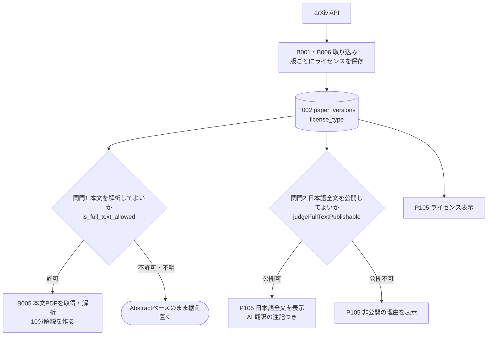
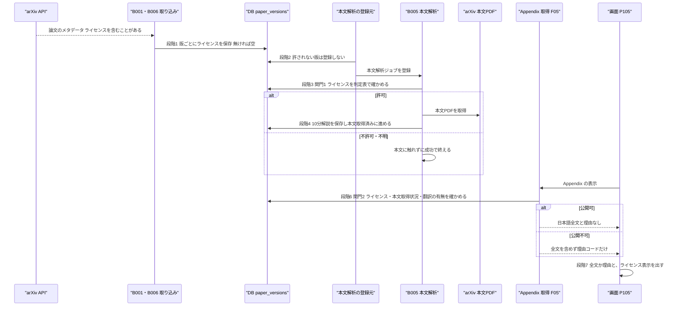

方式（共通基盤）: ARC005 ライセンス・権利ゲート ／ 実体 9ファイル（定義元の資料3・実現先の設計書6） ／ 影響範囲 10件

# 方式設計書 — ARC005 ライセンス・権利ゲート

| 項目 | 内容 |
| :--- | :--- |
| 方式ID | ARC005（上流 `docs/基本設計書_概要.md` §11.1 で採番済み。本書で新規採番した ID はありません） |
| 名称 | ライセンス・権利ゲート |
| 更新日 | 2026-10-27 |
| インプット | (a) `source/`（全6ファイル227行。ARC005 に関わる行は `source/03_システム構成.md:29-30,59`、`source/02_機能要求定義.md:49-50`、`source/01_企画概要.md:28`、`source/04_収益化とロードマップ.md:4-5,38`、`source/README.md:12`）／(b) `docs/基本設計書_概要.md` §2（BF02・EX03）、§4（F04・F05、B005）、§6（T002）、§11.1・§11.2、付録 Q09・Q13・Q23／実現先の設計書 `docs/db/DB.T002.DB物理設計.md`、`docs/detail/be/BE.F01`・`F04`・`F05.BE詳細設計.md`、`docs/detail/batch/BT.B005.バッチ詳細設計.md`、`docs/detail/fe/FE.P105.FE詳細設計.md`、関連先の `BT.B001`・`B003`・`B006`、`BE.F17`、`FE.P104`、画面基本設計 P104・P105／(c) `legacy/`／前単位の方式設計 `docs/arch/方式.ARC001`〜`ARC004.方式設計.md` |
| 既存資料の突合 | `legacy/` は空ディレクトリ（ファイル0件）で、突合する既存設計・業務資料はありません。本書の既存版（`docs/arch/方式.ARC005.方式設計.md`）も無く、今回が初版です。引き継ぐ ID は上流で採番済みのもの（ARC001〜ARC005・ARC008・ARC009、F01・F04・F05・F17、B001・B003・B005・B006、T002、API04、P104・P105、BF02・EX03、Q09・Q13・Q23）だけです |
| 対象システムの性質 | `source/` は企画・初期設計の資料（Markdown）で、プログラムのソースコードはありません。資料が定めているのは「本文の利用条件を確認してから解析する」「権利の確認なしに全文翻訳を一般公開しない」という方針までで、どのライセンスなら許すかの判定表は資料にありません。判定表は DB物理設計 T002 §6 が「案」として置き、BE.F04・BE.F05 がそれに従っています。権利に関わる判断のため、本書でも判定表は※推測として扱い、運用前の顧客確認を前提とします（付録B No.1） |

---

## 1. 機構の概要

* **解決している課題**:
  * **権利の侵害**: arXiv の論文は著者が選んだライセンスで配布されており、本文を翻訳して公開することや、改変（翻訳を含む）を許さないものがあります。権利を確かめずに日本語全文を一般公開すると、著作権の侵害になりえます（`source/03_システム構成.md:59`「利用可能な権利の確認なしに全文翻訳を一般公開しない」、`source/02_機能要求定義.md:50`）。
  * **本文の無断利用**: 本文PDFを取得して LLM で解析し、10分解説を作ることも、ライセンスによっては許されていない可能性があります。資料は収集フローで「本文の利用条件を確認」してから本文解析へ進むとしています（`source/03_システム構成.md:29-30`）。
  * **外部の条件違反でサービスが止まる**: 外部APIのライセンス条件を守ることは非機能要件に挙がっています（`source/02_機能要求定義.md:49`）。違反が見つかれば、論文の取得そのものができなくなるおそれがあります（※推測）。
  * **有料プランとの関係**: 本サービスには有料プラン（Pro）があるため（`source/04_収益化とロードマップ.md:4-5`）、非営利に限るライセンスの論文を扱ってよいかが別の論点になります。
* **設計方針**（資料から読み取れる範囲。推測は※推測と明記）:
  1. **ライセンスは論文の版ごとに持つ**: 著者は新しい版で別のライセンスを選べるため、論文単位ではなく版単位で持ち、判定は対象の版のライセンスで行います（T002 §4.3 (5)、上流 §6 T002）。
  2. **arXiv の値をそのまま持つ**: ライセンスは arXiv が返す URL のまま保存し、独自のコードに置き換えません。値が増えたときに変換表の更新漏れで誤判定するのを避けるためです（※推測: T002 §4.3 (5) の判断）。
  3. **分からないものは許さない**: ライセンスが空（不明）の版、判定表に無い値の版は、本文解析も全文翻訳公開もしません（上流 EX03「許可なしまたは不明」）。誤って許すより、誤って止める方を選びます。
  4. **2つの関門を別々に置く**: 本文を解析してよいか（B005 が本文PDFを取得する前）と、日本語全文を公開してよいか（Appendix の応答を作るとき）を、別の関門として判定します。解析は許されても翻訳の公開は許されない場合があるためです（※推測: T002 §6 の判定表で解析と公開の扱いが分かれる）。
  5. **判定はサーバで行い、画面は判定し直さない**: 公開してよいかの判断はサーバだけが行い、許されない論文の全文は応答に含めません。画面はサーバが全文を返したかと理由だけで表示を切り替えます（BE.F05 FN10、FE P105 getFullTextView）。
  6. **DB でも最低限を止める**: ライセンスが不明のまま「本文取得済み」になる誤りだけは、DB の制約で止めます（`ck_paper_versions_full_text_requires_license`）。どのライセンスなら許すかはアプリ側で判断します（T002 §4.3 (4)）。
* **位置づけ**: 本文を使う処理（B005 の本文解析、B003 の本文の取り直し）と、本文に由来するものを見せる処理（Appendix の日本語全文、P104 の10分解説、P105）の手前に置く関門です。上流 §11.2 の相関では「ARC002 → ARC005」（詳細版に進む前にライセンスを確かめる）です。

---

## 2. 実体の構成

本方式は1つのプログラムではなく、資料3ファイルの方針を、版ごとのライセンスの列と制約、取り込み時の保存、2つの関門の判定、画面での表示で分担して実現しています。

| # | パス | 種別 | 役割 | 備考 |
| :--- | :--- | :--- | :--- | :--- |
| 1 | `source/03_システム構成.md` | 定義元（資料） | 収集フローで本文の利用条件を確認してから本文解析へ進む（:29-30）。権利の確認なしに全文翻訳を一般公開しない（:59） | 上流 §11.1 の実体 |
| 2 | `source/02_機能要求定義.md` | 定義元（資料） | 論文本文の翻訳公開はライセンス・許諾が確認できたものに限定する（:50）。外部APIのライセンス条件を守る（:49） | 上流 §11.1 の実体（:49 は ARC007 と共有） |
| 3 | `source/01_企画概要.md` | 定義元（資料） | Appendix で「許諾に応じた日本語全文」を出す（:28） | 上流 §11.1 の実体 |
| 4 | `docs/db/DB.T002.DB物理設計.md` | 実現先（DB物理設計） | 版ごとのライセンス種別（`license_type`）、空を「不明＝許可しない」とする決まり、ライセンス不明の版を本文取得済みにさせない制約、ライセンスの値ごとの扱いの判定表（案） | 上流の適用範囲 T002.license_type |
| 5 | `docs/detail/be/BE.F01.BE詳細設計.md` | 実現先（BE詳細設計） | 収集時に arXiv の応答から版ごとのライセンスを保存する（DA006。取れないときは空） | ※上流未定義: 上流 §11.1 の適用範囲に F01 の記載が無い |
| 6 | `docs/detail/be/BE.F04.BE詳細設計.md` | 実現先（BE詳細設計） | 関門1。本文PDFを取得する前に、版のライセンスで本文の解析が許されるかを判定する（is_full_text_allowed）。許されなければ本文に触れずに成功で終える | 上流の適用範囲 F04 |
| 7 | `docs/detail/batch/BT.B005.バッチ詳細設計.md` | 実現先（バッチ詳細設計） | 関門1を通った版だけ本文を解析する。本文解析ジョブの登録元に、許されない版を登録しないよう求める（登録の受け口 No.3） | 上流の適用範囲 B005 |
| 8 | `docs/detail/be/BE.F05.BE詳細設計.md` | 実現先（BE詳細設計） | 関門2。Appendix の応答を作るとき、ライセンス・本文取得状況・翻訳の有無・機能の提供状況から日本語全文を公開してよいかと理由を決め（judgeFullTextPublishable）、許されない全文を応答に含めない | 上流の適用範囲 F05 |
| 9 | `docs/detail/fe/FE.P105.FE詳細設計.md` | 実現先（FE詳細設計） | サーバの判定結果だけで日本語全文か非公開の理由かを出し分け、判断の根拠としてライセンス表示を出す | 上流の適用範囲 P105 |

* **命名規則・配置規則**（新規追加時に従うべき規則）:
  * ライセンスの値は `paper_versions.license_type` に arXiv のライセンス URL のまま入れます。判定には必ずこの列を使い、メタデータスナップショットに残った取り込み時点の値は使いません（T002 §4.3 (5)）。
  * 関門1（本文解析）の判定はワーカーの `worker/license/gate.py`、関門2（全文翻訳公開）の判定は `lib/server/papers/appendixService.ts` に置きます（BE.F04 §4 No.18、BE.F05 §4 FN10）。どちらも T002 §6 の判定表を正とします。
  * 全文翻訳を公開しない理由は、`LICENSE_NOT_PERMITTED`・`LICENSE_NEEDS_REVIEW`・`NOT_TRANSLATED`・`NOT_AVAILABLE_YET` の4つの理由コードで返します（BE.F05 §2。コード名は※推測）。
* **全数**: 9件（定義元の資料3件＋実現先の設計書6件。実現先の内訳は DB物理設計1件・BE詳細設計3件・バッチ詳細設計1件・FE詳細設計1件）。根拠: 定義元は上流 §11.1 ARC005 行の「実体」列に挙がった3ファイルと一致します。実現先は、全47本の確定済み設計書を「利用する方式」の ARC005 の記述と本文で1本ずつ調べて振り分けました。
  * **実現先（6本）**: ライセンスを保存する・判定する・判定結果で出し分けるもの。ARC005 行を持つ BE F01・F04・F05、バッチ B005、FE P105 の5本と、ARC005 行は持たないがライセンスの列と判定表を定める DB物理設計 T002 の1本です。
  * **影響範囲だけで扱うもの（5本）**: ARC005 行を持つか ARC005 に言及するが、判定を行わず結果に従うだけのもの。バッチ B001・B006（F01 の書き込みでライセンスを保存する）、B003（関門1を通った版だけ本文を取り直す）、FE P104（10分解説が無いときに理由を出す）、BE F17（10分解説の「本文未取得のため対象外」の判定でライセンスの結果に依存する）。§6 に行があります。
  * **対象外（36本）**: 上記以外。DB物理設計 T001・T003〜T010（9本）、BE詳細設計 F02・F03・F06〜F16・F18・F19（15本）、バッチ詳細設計 B002・B004・B007〜B011（7本）、FE詳細設計 P101〜P103・P106・P107（5本）。

**構成要素ロースター**（本方式を構成するライセンスの値・判定表・制約・判定・理由・表示の全数）

ID 列には、上流または実現先の設計書で付いている識別子（列名・制約名・関数名・データアクセスID・理由コード・画面項目ID）をそのまま書きます。本書で新しく番号を付けた要素はありません。

| # | ID（既存の識別子） | 名称 | 種別 | 概要 | 定義元 | 定義状況 | 詳細の所在 |
| :--- | :--- | :--- | :--- | :--- | :--- | :--- | :--- |
| 1 | T002.license_type | ライセンス種別 | 列 | 版ごとに arXiv が付けた利用許諾の URL を持つ。空はライセンス不明で、本文の利用は許可されていないものとして扱う。空の版にあとから値が入ることはあるが、入った値は変えない | 上流 §6 T002 | 詳細 | §4 ライセンスの値、`docs/db/DB.T002.DB物理設計.md` §4.3 (5) |
| 2 | license_type の判定表（T002 §6） | ライセンスの判定表 | 判定表 | ライセンスの値ごとに、本文解析と全文翻訳公開を許すかを決める表（7行）。表に無い値は許さない | T002（案。※推測） | 詳細 | §4 判定表 |
| 3 | ck_paper_versions_full_text_requires_license | 本文取得済みの前提の制約 | CHECK 制約 | ライセンス種別が空の版を「本文取得済み」にできないようにする | T002 | 詳細 | §3 段階4、`docs/db/DB.T002.DB物理設計.md` §4.4 |
| 4 | T002.content_status | 本文取得状況 | 列 | 関門1を通って本文が解析された版だけが「本文取得済み」になる。関門2は本文取得済みでない版の全文を公開しない | 上流 §6 T002 | 詳細 | §3 段階4・段階6、ARC002 |
| 5 | DA006（BE.F01） | 論文の版の追加（ライセンスの保存） | データアクセス | 版を追加するとき、arXiv の応答に含まれるライセンスを保存する。含まれなければ空のまま保存する | F01 | 詳細 | §3 段階1、`docs/detail/be/BE.F01.BE詳細設計.md` §2・§3 |
| 6 | 登録の受け口 No.3（BT.B005） | 本文解析の登録前の絞り込み | 業務ルール | 本文解析ジョブの登録元は、ライセンスで本文の解析が許されない版を登録しない。登録されても関門1で止まるため誤りにはならない | BT.B005（※推測） | 詳細 | §3 段階2 |
| 7 | is_full_text_allowed（BE.F04 No.18） | 関門1 本文解析の可否 | 関数 | ライセンスが空なら許さない。判定表で CC BY・CC BY-SA・CC0 なら許し、arXiv への配布許諾だけのもの・CC BY-NC-SA・CC BY-NC-ND・表に無い値は許さない | F04（判定表は※推測） | 詳細 | §3 段階3、§4 判定表、`docs/detail/be/BE.F04.BE詳細設計.md` §4 No.18 |
| 8 | analyze_full_text 手順2（BE.F04 No.17） | 不許可のときの扱い | 関数の規則 | 関門1で許されなければ、本文を取得せず、本文取得状況も変えず、INFO ログを残してジョブを成功にする。再試行しても結果が変わらず失敗キューを増やすだけのため失敗にしない | F04 | 詳細 | §3 段階3 |
| 9 | mark_full_text（DA014・BE.F04） | 本文取得状況の更新 | 関数 | 関門1を通って10分解説を保存したときだけ、版を本文取得済みに進める | F04 | 詳細 | §3 段階4、ARC002 |
| 10 | validate_summary 手順4（BE.F04 No.12） | 検証での本文の取り直し | 関数の規則 | 本文を取り直すのは10分解説がある版だけ（関門1を通った版）に限る。取り直した本文は照合に使うだけで、保存も公開もしない | F04・BT.B003 | 詳細 | §3 段階5 |
| 11 | judgeFullTextPublishable（BE.F05 FN10） | 関門2 全文翻訳公開の可否 | 関数 | 機能が未提供なら「未提供」、ライセンスが空なら「許諾なし」、CC BY・CC BY-SA・CC0 以外は「要確認」か「許諾なし」、本文取得済みでないか翻訳が無ければ「未翻訳」とし、すべてを通ったときだけ公開可とする | F05（判定表は※推測） | 詳細 | §3 段階6、§4 判定表、`docs/detail/be/BE.F05.BE詳細設計.md` §4 FN10 |
| 12 | LICENSE_NOT_PERMITTED | 許諾なし | 理由コード | ライセンスが翻訳の公開を許さない、またはライセンスが不明 | F05（※推測） | 簡易 | §4 理由コード |
| 13 | LICENSE_NEEDS_REVIEW | 要確認 | 理由コード | 非営利条件付きのライセンス（CC BY-NC-SA 4.0）で、有料プランのある本サービスで公開してよいかの確認が済んでいない | F05（※推測） | 簡易 | §4 理由コード |
| 14 | NOT_TRANSLATED | 未翻訳 | 理由コード | ライセンス上は公開できるが、本文が未取得、または日本語全文の翻訳がまだ無い | F05（※推測） | 簡易 | §4 理由コード |
| 15 | NOT_AVAILABLE_YET | 未提供 | 理由コード | 全文翻訳の機能が Phase 3 の提供前で、どの論文でも全文を返さない | F05（※推測） | 簡易 | §4 理由コード |
| 16 | 全文翻訳の機能フラグ（BE.F05 FN10 手順1） | 全文翻訳の提供状況 | 設定値 | 全文翻訳の機能を提供しているかを切り替える。提供前はすべての論文で「未提供」を返す（名前は未定義） | F05（※推測・※上流未定義） | 詳細 | §4 設定項目 |
| 17 | DA008（BE.F05） | Appendix の中身取得 | データアクセス | 日本語全文の本文は、関門2で公開可と判定したときだけ読む。公開できない全文をアプリのメモリにも載せないため | F05（保存先は※上流未定義） | 詳細 | §3 段階6 |
| 18 | formatLicenseLabel（FE P105） | ライセンス表示 | 関数 | ライセンス種別を利用者向けの名称にして、原文の区画に判断の根拠として出す（H16） | FE P105 | 簡易 | §3 段階7 |
| 19 | getFullTextView（FE P105） | 全文と理由の出し分け | 関数 | サーバが全文を返したかと理由だけで、日本語全文（H22・H23）か非公開の理由（H24）を出す。画面側で公開の可否を判断し直さない | FE P105 | 詳細 | §3 段階7 |

**総件数: 19件**（列2件、判定表1件、CHECK 制約1件、データアクセス2件、業務ルール1件、関数・関数の規則7件（画面の関数2件を含む）、理由コード4件、設定値1件。定義状況は詳細14件・簡易5件）。**全数である根拠**: 実現先6本（§2 #4〜#9）と影響範囲だけで扱う5本の「利用する方式」の ARC005 行が根拠に挙げている列・制約・関数・データアクセスと、本文中の「ライセンス」「許諾」「権利」「本文の利用」を含む記述を全件拾い、本方式の決まり（ライセンスの保存・判定表・関門1・関門2・不許可の扱い・理由・表示）を担うものを数えました。日本語全文に AI 翻訳である旨を添える注記（P105 H23）は ARC004、10分解説が無いときの「本文未取得のため10分解説なし」の応答（`DEEP_SUMMARY_UNAVAILABLE`、P104 H34）は ARC002 の要素として除き、§6 で関係だけを書きます。
**定義状況の判定**（completeness 3-1）: 分岐・状態の変更・非自明な業務ルールのいずれかを含むものを「詳細」としました。値の意味を表すだけの理由コード（#12〜#15）と、名称に変換するだけの表示（#18）は「簡易」です。

---

## 3. ライフサイクル（登録・読込・選択）

本方式には起動時に読み込む定義ファイルはありません。ライセンスは**論文の版を取り込むとき**に保存され、関門1は**本文解析ジョブが動くたび**、関門2は**Appendix の表示の要求ごと**に判定されます。

| 段階 | 契機 | 処理 | 実装（ファイル:行） |
| :--- | :--- | :--- | :--- |
| 1 ライセンスの保存 | 収集（B001）・オンデマンド同期（B006）が論文の新しい版を取り込むとき | arXiv の応答に含まれるライセンスの URL を、版の行にそのまま保存します。応答に含まれなければ空のまま保存します（※推測: arXiv API の検索応答にライセンスが含まれないことがある）。取り込み時点の値はメタデータスナップショットにも残りますが、判定には使いません | `docs/detail/be/BE.F01.BE詳細設計.md:128,161,402`、`docs/db/DB.T002.DB物理設計.md:217,230-236` |
| 1a ライセンスの補完 | 空の版について、本文解析の前（※推測） | 空の版にあとからライセンスが取得できた場合に限り値を入れます。一度入れた値は変えません（arXiv のライセンスは版ごとに決まり、公開後に変わらないため）。**補完する手段と契機は未定義です**（※上流要確認。付録B No.2） | `docs/db/DB.T002.DB物理設計.md:234`、`docs/detail/be/BE.F01.BE詳細設計.md:390` |
| 2 登録前の絞り込み | 人気論文の判定・利用者のリクエスト（ARC002）が本文解析ジョブを登録するとき | 登録元は、ライセンスで本文の解析が許されない版を登録しません。空振りのジョブで本文解析のキューを埋めないためです。登録されても関門1で止まるため、誤りにはなりません | `docs/detail/batch/BT.B005.バッチ詳細設計.md:344` |
| 3 関門1 本文解析の可否 | B005 のジョブが動いたとき。本文PDFを取得する前 | 版のライセンスを判定表で確かめます。空なら許さず、CC BY・CC BY-SA・CC0 なら許し、それ以外（arXiv への配布許諾だけのもの・CC BY-NC-SA・CC BY-NC-ND・表に無い値）は許しません。許さないときは、本文を取得せず、本文取得状況も変えず、INFO ログを残してジョブを成功にします（Abstractベースのまま据え置き。上流 EX03） | `docs/detail/be/BE.F04.BE詳細設計.md:384,385`、`docs/detail/batch/BT.B005.バッチ詳細設計.md:620`、`docs/基本設計書_概要.md:512-523` |
| 4 本文取得済みへの更新 | 関門1を通って10分解説を保存したとき | 同じトランザクションで版を本文取得済みに進めます。ライセンスが空の版は、DB の制約により本文取得済みにできません | `docs/detail/be/BE.F04.BE詳細設計.md:356,384`、`docs/db/DB.T002.DB物理設計.md:227,248,381-382` |
| 5 検証での本文の取り直し | B003 が10分解説を検証するとき | 本文の保存先が無いため本文PDFを取り直しますが、それは10分解説がある版（関門1を通った版）だけです。取り直した本文は照合に使うだけで、保存も公開もしません | `docs/detail/be/BE.F04.BE詳細設計.md:379`、`docs/detail/batch/BT.B003.バッチ詳細設計.md:613` |
| 6 関門2 全文翻訳公開の可否 | Appendix の中身の取得の要求ごと | 次の順で判定し、最初に外れた理由を返します。(1) 全文翻訳の機能が未提供なら「未提供」、(2) ライセンスが空なら「許諾なし」、(3) CC BY 4.0・CC BY-SA 4.0・CC0 のどれでもなければ、CC BY-NC-SA 4.0 は「要確認」、それ以外は「許諾なし」、(4) 本文取得済みでないか翻訳が無ければ「未翻訳」。すべてを通ったときだけ公開可とし、日本語全文の本文を読みます。公開できないときは全文を読まず、応答の全文は空にして理由コードだけを入れます | `docs/detail/be/BE.F05.BE詳細設計.md:93,140-143,289-297,313,345,458,514` |
| 7 表示 | P105 が Appendix を描くとき | サーバが全文を返したか（公開可か）と理由だけで、日本語全文（AI 翻訳の注記つき）か非公開の理由を出します。画面側で公開の可否を判断し直しません。原文の区画にライセンスを利用者向けの名称で出し、判断の根拠を示します | `docs/detail/fe/FE.P105.FE詳細設計.md:99,117,235,354`、`docs/screens/画面.P105.画面基本設計.md:222` |

* **読込順序**（2つの関門の関係と優先）:

| 順 | 関門 | 判定の材料 | 外れたときの扱い | 後の関門との関係 |
| :--- | :--- | :--- | :--- | :--- |
| 1 | 関門1 本文解析の可否（段階3） | ライセンス | 本文を取得せず、Abstractベースのまま据え置く | 関門1で止まった版は本文取得済みにならないため、関門2も必ず「未翻訳」か「許諾なし」で止まる |
| 2 | 関門2 全文翻訳公開の可否（段階6） | 機能の提供状況・ライセンス・本文取得状況・翻訳の有無 | 全文を応答に含めず、理由コードを返す | 関門1を通っても、関門2で止まることがある（解析は許すが翻訳の公開は許さない値が判定表に入った場合。現在の判定表では、解析を許す3つの値は公開も許す） |

  上書きの規則: ライセンスの値は一度入ったら変えないため、判定結果が後から変わるのは「空だった版に値が補完された」ときだけです。
* **選択規則**（判定表。T002 §6 の案。※推測・権利の扱いは要確認）:

| ライセンスの値 | 意味 | 関門1 本文解析 | 関門2 全文翻訳公開 | 関門2 の理由コード |
| :--- | :--- | :--- | :--- | :--- |
| （空） | ライセンス不明 | 許さない | 許さない | LICENSE_NOT_PERMITTED |
| `http://arxiv.org/licenses/nonexclusive-distrib/1.0/` | arXiv への配布許諾だけ。第三者による翻訳の公開は許されていないものとして扱う | 許さない（解析してよいかは顧客確認まで保留） | 許さない | LICENSE_NOT_PERMITTED |
| `http://creativecommons.org/licenses/by/4.0/` | CC BY。出典を示せば翻訳の公開も許される | 許す | 許す | — |
| `http://creativecommons.org/licenses/by-sa/4.0/` | CC BY-SA。翻訳を同じライセンスで公開する条件 | 許す | 許す | — |
| `http://creativecommons.org/licenses/by-nc-sa/4.0/` | CC BY-NC-SA。非営利の条件があり、有料プランのある本サービスで扱ってよいかは確認が要る | 許さない（顧客確認まで） | 許さない | LICENSE_NEEDS_REVIEW |
| `http://creativecommons.org/licenses/by-nc-nd/4.0/` | CC BY-NC-ND。翻訳（改変）が許されない | 許さない | 許さない | LICENSE_NOT_PERMITTED |
| `http://creativecommons.org/publicdomain/zero/1.0/` | CC0。権利が放棄されている | 許す | 許す | — |
| 上記以外の値 | 旧版の CC ライセンスや、arXiv が将来加える値 | 許さない | 許さない | LICENSE_NOT_PERMITTED |

  判定は URL の完全一致で行います（※推測）。版番号違いの CC ライセンス（例: CC BY 3.0）も「上記以外の値」として許しません。許す値を増やすときは §5 の手順で判定表を改めます。
* **失効・再読込**:

| 契機 | 起きること | 根拠 |
| :--- | :--- | :--- |
| 空だった版にライセンスが補完された | 次に本文解析ジョブが登録されたときから関門1を通りうるようになります。自動で本文解析が始まることはありません（ARC002 の起動契機が要る） | `docs/db/DB.T002.DB物理設計.md:234` |
| 新しい版が出た | 新しい版は自分のライセンスで判定されます。前の版のライセンスや判定結果は引き継ぎません | `docs/db/DB.T002.DB物理設計.md:236` |
| 判定表を改めた | ワーカーと API を再デプロイした後の判定から効きます。すでに本文取得済みの版や、すでに公開した全文を取り下げる処理はありません（付録B No.4） | — |
| 全文翻訳の機能を提供開始した | 機能フラグを切り替えると、関門2の「未提供」が外れ、ライセンスと翻訳の有無で判定されるようになります | `docs/detail/be/BE.F05.BE詳細設計.md:458` |

---

## 4. インターフェース・データ構造

* **ライセンスの値**（T002 `license_type`）:

| 項目 | 内容 | 根拠 |
| :--- | :--- | :--- |
| 型 | 64文字までの文字列（arXiv の最も長いライセンス URL が52文字） | `docs/db/DB.T002.DB物理設計.md:191,194` |
| 必須 | 任意（空を許す）。空はライセンス不明を表す | `docs/db/DB.T002.DB物理設計.md:191` |
| 値 | arXiv が返すライセンスの URL をそのまま入れる。独自のコードに置き換えない | `docs/db/DB.T002.DB物理設計.md:232` |
| 書き換え | 空の版に限り、あとから値を入れてよい。入った値は変えない | `docs/db/DB.T002.DB物理設計.md:234` |
| 単位 | 版ごと（著者は版ごとに別のライセンスを選べる） | `docs/db/DB.T002.DB物理設計.md:236` |

* **判定表**: §3 選択規則の表のとおりです（8行。T002 §6 の7行に「上記以外の値」を含めた全数）。
* **理由コード**（関門2が「公開不可」のとき Appendix の応答に入れる値。HTTP は 200 のまま）:

| 理由コード | 意味 | 判定の順 | 画面の出し方 |
| :--- | :--- | :--- | :--- |
| NOT_AVAILABLE_YET | 全文翻訳の機能が Phase 3 の提供前 | 1 | 非公開の理由（H24） |
| LICENSE_NOT_PERMITTED | ライセンスが翻訳の公開を許さない、またはライセンスが不明 | 2・3 | 非公開の理由（H24） |
| LICENSE_NEEDS_REVIEW | 非営利条件付きで、有料プランのある本サービスで公開してよいかの確認が済んでいない | 3 | 非公開の理由（H24） |
| NOT_TRANSLATED | ライセンス上は公開できるが、本文が未取得か翻訳が無い | 4 | 非公開の理由（H24） |

  公開可のときは理由が空（`null`）で、全文の章の並びが入ります。公開不可のときは全文の章の並びは必ず空です（BE.F05 §2 Appendix）。
* **機構の入出力**:

| 方向 | 呼び出し元 | 渡すもの | 返るもの | 実現先 |
| :--- | :--- | :--- | :--- | :--- |
| ライセンスの保存 | B001・B006 | 版の情報と arXiv のライセンス URL（無ければ空） | — | BE.F01 DA006 |
| 関門1 | B005（analyze_full_text） | 版のライセンス（空を含む） | 許すか許さないか | BE.F04 is_full_text_allowed |
| 関門2 | Appendix の中身の取得（F05） | 版のライセンス、本文取得状況、翻訳の有無 | 公開してよいかと理由コード | BE.F05 judgeFullTextPublishable |
| 表示 | P105 | Appendix の応答（公開可否・理由・ライセンス） | 全文か理由、ライセンス表示 | FE P105 getFullTextView・formatLicenseLabel |

* **設定項目**:

| 設定項目 | 種別 | 既定値 | 意味 | 変えたときの影響 | 根拠 |
| :--- | :--- | :--- | :--- | :--- | :--- |
| 全文翻訳の機能フラグ（名前は未定義） | 設定値（API） | 未提供（※推測: Phase 3 まで） | 全文翻訳の機能を提供しているか | 提供にすると、判定表で許された論文のうち本文取得済みで翻訳がある論文の全文が公開される。判定表の顧客確認より前に切り替えてはならない（※推測） | `docs/detail/be/BE.F05.BE詳細設計.md:458` |

**総件数: 1件**。根拠: §2 構成要素ロースターの種別「設定値」1件と一致します。判定表は設定値ではなく、ワーカーと API のコードに固定されています（※推測）。

---

## 5. 拡張・変更手順

**手順A: 判定表に値を1つ加える・扱いを変える**（例: CC BY 3.0 を許す、arXiv への配布許諾だけの論文の本文解析を許す）

1. **権利の確認**: 追加・変更する値について、本文解析と全文翻訳公開のそれぞれが許されるかを顧客（権利の判断者）に確認し、結果を記録します。判定表は権利に関わるため、確認なしに変えてはいけません（BE.F04 No.18 ※推測、上流 Q13）。
2. **判定表を改める**: DB物理設計 T002 §6 の判定表の行を改め、本書 §3 選択規則の表も同じに改めます。
3. **2か所の判定を同時に改める**: 関門1（`worker/license/gate.py` の is_full_text_allowed）と関門2（`lib/server/papers/appendixService.ts` の judgeFullTextPublishable）の両方を改めます。片方だけ改めると、解析と公開の判定が食い違います（§7 既知の制約）。
4. **理由コードを確かめる**: 関門2で新しい扱い（例: 新しい「要確認」）が要るなら、理由コードと P105 の非公開の理由（H24）の文言を加えます。
5. **既存の版への反映を決める**: 判定表を緩めた場合、すでに取り込まれた該当ライセンスの版は自動では本文解析されません。対象の版を本文解析の対象として登録する運用（ARC002 の起動契機。1日の上限の中で）を行います。判定表を厳しくした場合は、すでに本文取得済みの版・公開済みの全文の扱い（取り下げるか）を決めます（付録B No.4）。
6. **反映のタイミング**: ワーカーと API を同時にデプロイします。
7. **文書を更新する**: 本書 §2・§3・§4、T002 §6、BE.F04 No.18、BE.F05 FN10、FE P105（H24 の文言）を改版します。

**手順B: 本文に由来する新しい表示を加える**（例: 図表の日本語訳）

1. その表示が本文を使うなら、関門1を通った版（本文取得済み）だけで作ります。
2. その表示が本文の翻訳を公開するものなら、関門2と同じ判定を通します。新しい判定を書かず、judgeFullTextPublishable を使います。
3. 画面は判定し直さず、サーバの判定結果だけで出し分けます。

---

## 6. 影響範囲

| 影響先（機能/画面/工程） | どう効くか | 変更時のリスク |
| :--- | :--- | :--- |
| F01／B001 論文メタデータ収集（※上流未定義: 上流の適用範囲に F01・B001 の記載が無い） | 版ごとにライセンスを保存する（取れなければ空） | ライセンスを取り損ねると、その版は不明として扱われ、本文解析も全文翻訳公開もされない |
| B006 arXivオンデマンド同期（※上流未定義） | F01 と同じ書き込みでライセンスを保存する | 同じく、取り損ねると本文を使えない |
| F04／B005 本文解析・詳細解説生成 | 関門1。本文PDFを取得する前にライセンスを確かめ、許されなければ本文に触れずに終える | 関門1を外すと、権利の確認なしに本文を取得・解析することになる |
| B003 要約の根拠・数値チェック（※上流未定義） | 本文を取り直すのは関門1を通った版だけで、保存・公開しない | 取り直した本文を保存するように変えると、本文の保管という新しい権利の論点が生じる |
| F05／Appendix 取得 | 関門2。日本語全文を公開してよいかを判定し、許されない全文を応答に含めない | 判定を画面側に移すと、許されない全文が応答に含まれて利用者の端末に届く |
| F05／API04 要約取得（※上流要確認: 上流の適用範囲は F05 全体） | 関門1で止まった版には10分解説が無く、「本文未取得のため10分解説なし」を返す（ARC002） | 関門1の結果と本文取得状況が食い違うと、10分解説の案内が誤る |
| F17 処理状況の確認（※上流要確認） | 本文未取得で本文解析も予定されていない10分解説を「対象外」と返す | ライセンスで止まった版と、まだ登録されていない版の区別がつかない（どちらも対象外） |
| P104 論文詳細（※上流要確認: 上流の適用範囲は P105） | 10分解説が無いとき、本文を取得していない旨を出す（H34） | ライセンスで止まった理由を出し分けていないため、利用者は待てば出ると誤解しうる（付録B No.6） |
| P105 Appendix | 日本語全文か非公開の理由を出し、ライセンス表示で根拠を示す。数式解説・参考文献も本文由来のため関門1を通った版にだけ作られ、無いときは本文取得状況に応じた理由を出す（ARC002） | 理由コードを増やすと H24 の文言の切り替えも改める必要がある |
| T002 paper_versions | 版ごとのライセンスと、ライセンス不明の版を本文取得済みにさせない制約を持つ | 制約を外すと、ライセンス不明のまま本文取得済みになり、関門2の判定材料が崩れる |

**総件数: 10件**（機能・バッチ・API の行7件、画面の行2件、テーブルの行1件、うち上流 §11.1 の適用範囲に無いもの5件）。**根拠**: 上流 §11.1 ARC005 の適用範囲（F04・F05／B005／T002.license_type／P105）の全要素を行にし（F04 は B005 の行、F05 は Appendix 取得と API04 の行）、加えて §2 で「影響範囲だけで扱う」とした B001・B006・B003・P104・F17 を加えました。上流に無い5件（F01／B001・B006・B003・F17・P104）は※上流未定義または※上流要確認として、上流 §11.1 の適用範囲への追記を求めます。

---

## 7. 制約・注意事項

* **性能・容量**: 判定は版1件のライセンスを判定表と照らすだけで、DB の追加の問い合わせはありません。日本語全文は論文1本分の長文になるため、公開できないときは読みません（BE.F05 DA008）。
* **失敗時の挙動**:
  * 関門1で許されないときは、ジョブを失敗にせず成功で終えます。再試行しても結果が変わらず、失敗キューを無駄に増やすためです（BE.F04 No.17）。
  * 関門2の判定は例外を投げず、公開可否と理由を返すだけです（BE.F05 FN10）。
* **既知の制約**:
  * **ライセンスの取得手段が未定義**: arXiv API の検索応答にライセンスが含まれない場合（※推測）、版は空のまま保存され、補う手段も契機も決まっていません。空の版は本文を一切使えないため、補完が決まらない限り、多くの論文で10分解説と全文翻訳が作られません（付録B No.2）。
  * **大半の論文で本文を使えない見込み**: arXiv で最も多いのは「arXiv への配布許諾だけ」のライセンスで（※推測）、現在の判定表ではこの値の本文解析も全文翻訳公開も許しません。顧客確認の結果によって、詳細版（ARC002）の対象の数が大きく変わります（付録B No.1）。
  * **判定表が2か所にある**: 関門1（Python のワーカー）と関門2（TypeScript の API）が、同じ判定表をそれぞれのコードに持ちます。片方だけ改めると判定が食い違うため、判定表を1か所（例: 設定ファイルや DB の表）にまとめるかを決める必要があります（※推測。付録B No.3）。
  * **取り下げの手段が無い**: 判定表を厳しくした後や、ライセンスの誤りが分かった後に、本文取得済みの版や公開済みの全文を取り下げる処理はありません（付録B No.4）。
  * **全文翻訳と数式解説・参考文献の保存先が未定義**: 日本語全文・数式解説・参考文献を保存するテーブルが上流 §6 に無く、全文翻訳を作るジョブも定義されていません（上流 Q23。BE.F05 DA008）。関門2の「翻訳の有無」を判定する材料も、保存先が決まるまで定まりません（付録B No.5）。

---

## 付録A. ソース突合トレーサビリティ

| 記述箇所 | 根拠ソース（パス:行） |
| :--- | :--- |
| §0 実体・影響範囲の件数 | §2 表（9件）、§6 表（10件） |
| §1 権利の侵害・翻訳公開の限定 | `source/03_システム構成.md:59`、`source/02_機能要求定義.md:50` |
| §1 本文の利用条件の確認 | `source/03_システム構成.md:29-30` |
| §1 外部のライセンス条件 | `source/02_機能要求定義.md:49`、`source/README.md:12` |
| §1 許諾に応じた日本語全文 | `source/01_企画概要.md:28` |
| §1 有料プランとの関係 | `source/04_収益化とロードマップ.md:4-5` |
| §1 BF02・EX03 | `docs/基本設計書_概要.md:182-209,512-523` |
| §1 位置づけ（方式の相関） | `docs/基本設計書_概要.md:1310-1326` |
| §2 定義元の資料3件 | `docs/基本設計書_概要.md:1295`（ARC005 行の実体） |
| §2 実現先・影響範囲の ARC005 行 | `docs/detail/be/BE.F01.BE詳細設計.md:402`、`BE.F04.BE詳細設計.md:469`、`BE.F05.BE詳細設計.md:514`、`docs/detail/batch/BT.B001.バッチ詳細設計.md:628`、`BT.B003.バッチ詳細設計.md:613`、`BT.B005.バッチ詳細設計.md:620`、`BT.B006.バッチ詳細設計.md:612`、`docs/detail/fe/FE.P104.FE詳細設計.md:460`、`FE.P105.FE詳細設計.md:354`、`docs/detail/be/BE.F17.BE詳細設計.md:149` |
| §2 #1〜#4 ライセンス・判定表・制約・本文取得状況 | `docs/db/DB.T002.DB物理設計.md:177,190-191,227,230-236,248,330-341,381-382` |
| §2 #5 ライセンスの保存 | `docs/detail/be/BE.F01.BE詳細設計.md:128,161` |
| §2 #6 登録前の絞り込み | `docs/detail/batch/BT.B005.バッチ詳細設計.md:344` |
| §2 #7〜#10 関門1と本文の扱い | `docs/detail/be/BE.F04.BE詳細設計.md:356,379,384,385` |
| §2 #11〜#17 関門2・理由コード・機能フラグ | `docs/detail/be/BE.F05.BE詳細設計.md:140-143,297,313,345,440,458` |
| §2 #18・#19 表示 | `docs/detail/fe/FE.P105.FE詳細設計.md:99,102,117,235` |
| §3 段階1a ライセンスの補完が未定義 | `docs/detail/be/BE.F01.BE詳細設計.md:390`、`docs/db/DB.T002.DB物理設計.md:234` |
| §3 選択規則（判定表） | `docs/db/DB.T002.DB物理設計.md:330-341` |
| §6 画面への影響 | `docs/screens/画面.P104.画面基本設計.md:260`、`docs/screens/画面.P105.画面基本設計.md:222` |
| §7 保存先が未定義 | `docs/detail/be/BE.F05.BE詳細設計.md:329,345` |

---

## 付録B. 未確定事項（※推測の一覧）

| No. | 区分 | 内容 | 本書での扱い | 確認先 |
| :--- | :--- | :--- | :--- | :--- |
| 1 | ※推測 | 判定表の各行（とくに arXiv への配布許諾だけのライセンスで本文を解析してよいか、CC BY-NC-SA を有料プランのある本サービスで扱ってよいか） | T002 §6 の案のとおり、確認まで許さない | 顧客（権利の判断者）・上流 Q13 |
| 2 | ※上流要確認 | arXiv API の応答にライセンスが含まれない場合の取得手段と、空の版を補う契機 | 未定義のまま、空の版は本文を使えないと記載 | 上流 Q13・BE.F01 §6 No.4 |
| 3 | ※推測 | 判定表を関門1（ワーカー）と関門2（API）の2か所に持つか、1か所にまとめるか | 2か所にある現状と、同時に改める手順を記載 | 下流（BE.F04・BE.F05）の改版 |
| 4 | ※上流未定義 | 判定表を厳しくした後や誤りが分かった後に、本文取得済みの版・公開済みの全文を取り下げる手段 | 手段が無いことを制約として記載 | 顧客・上流 §6 |
| 5 | ※上流未定義 | 日本語全文・数式解説・参考文献の保存先と、全文翻訳を作るジョブ | 未定義のため、関門2の「翻訳の有無」の材料も未確定と記載 | 上流 Q23 |
| 6 | ※上流要確認 | P104 で10分解説が無い理由を「ライセンスで止まった」と「まだ解析していない」に分けて出すか | 現状は区別しないと記載 | P104・BE.F05・BE.F17 |
| 7 | ※推測 | 全文翻訳の機能フラグの名前と、提供開始の判断 | 名前は未定義、判定表の確認より前に切り替えないと記載 | 顧客・BE.F05 |
| 8 | ※推測 | 判定を URL の完全一致で行い、版番号違いの CC ライセンスを許さない扱い | 完全一致とする | 顧客 |
| 9 | ※上流要確認 | 上流 §11.1 ARC005 の適用範囲に、F01・B001・B006・B003・F17・P104 が無い | §6 に※上流未定義・※上流要確認として加えた | 上流 §11.1 の改版 |
