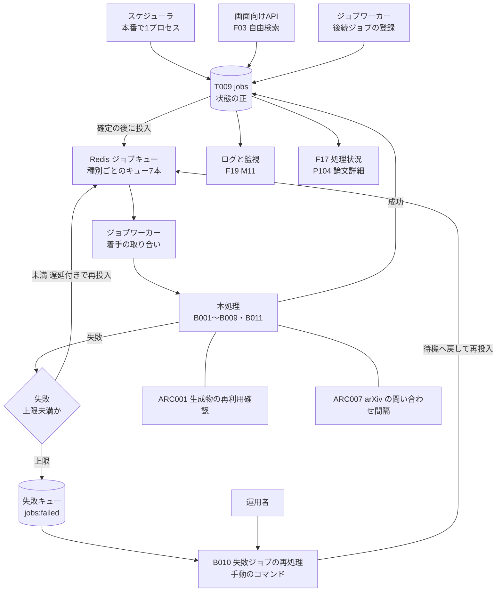
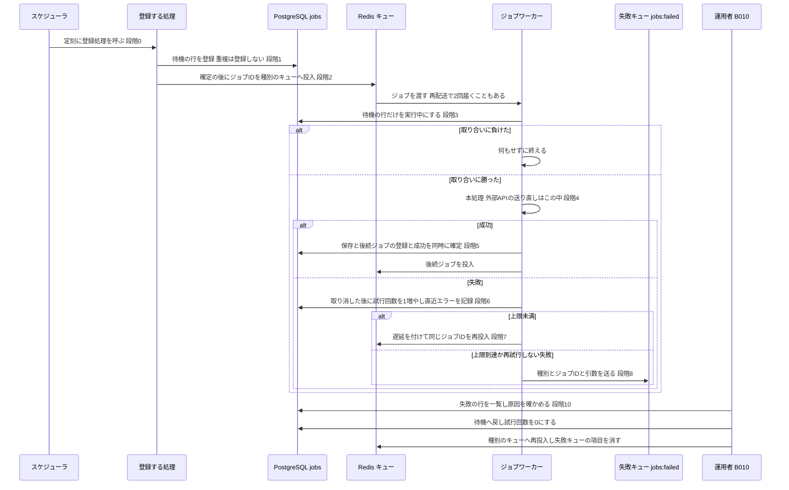

方式（共通基盤）: ARC006 ジョブ実行基盤（キュー・リトライ・失敗キュー・監視） ／ 実体 21ファイル（定義元の資料2・実現先の設計書19） ／ 影響範囲 23件

# 方式設計書 — ARC006 ジョブ実行基盤（キュー・リトライ・失敗キュー・監視）

| 項目 | 内容 |
| :--- | :--- |
| 方式ID | ARC006（上流 `docs/基本設計書_概要.md` §11.1 で採番済み。本書で新しく採番した ID はありません） |
| 名称 | ジョブ実行基盤（キュー・リトライ・失敗キュー・監視） |
| 更新日 | 2026-10-27 |
| インプット | (a) `source/`（全6ファイル227行。ARC006 に関わる行は `source/03_システム構成.md:11,16,19-32,43`、`source/02_機能要求定義.md:46,49,57,58`、`source/04_収益化とロードマップ.md:22,41,44`）／(b) `docs/基本設計書_概要.md` §2（EX01・EX04）、§4（バッチ処理設計 B001〜B011・バッチ共通の方針）、§6（T009・CRUD図）、§8・§9（環境変数 `REDIS_URL`）、§10（運用監視）、§11.1・§11.2、付録 Q02・Q05・Q19・Q24・Q33・Q35・Q36／実現先の設計書 `docs/db/DB.T009.DB物理設計.md`、`docs/detail/be/BE.F01`・`F03`・`F04`・`F10`・`F14`・`F17`・`F19.BE詳細設計.md`、`docs/detail/batch/BT.B001`〜`B011.バッチ詳細設計.md`／影響範囲の確認に使った設計書 `docs/db/DB.T002.DB物理設計.md`、`docs/detail/be/BE.F15.BE詳細設計.md`、`docs/detail/fe/FE.P104.FE詳細設計.md`／(c) `legacy/` |
| 既存資料の突合 | `legacy/` は空ディレクトリ（ファイル0件）で、突合する既存設計・業務資料はありません。本書の既存版（`docs/arch/方式.ARC006.方式設計.md`）も無く、今回が初版です。引き継ぐ記述は無く、引き継ぐ ID は上流で採番済みのもの（ARC001・ARC002・ARC006・ARC007、B001〜B011、T002・T009、F01・F03・F04・F10・F14・F15・F17・F19、P104、EX01・EX04、Q02・Q05・Q19・Q24・Q33・Q35・Q36）と、下流の設計書で付けられた関数番号・データアクセス番号（F04-BE No.1〜5・DA001〜DA004、F01-BE DA001・DA007〜DA009、F14-BE FN13 ほか）だけです |
| 対象システムの性質 | `source/` は企画・初期設計の資料（Markdown）で、プログラムのソースコードはありません。本書は資料の記述を一次情報とし、資料に無い実現方法は、確定済みの下流設計書（DB物理設計・BE詳細設計・バッチ詳細設計）が定めた内容を「実現先」として引用します。下流設計書の※推測は本書でも※推測のまま扱います。下流設計書の多くが「ジョブ共通部分の正は ARC006 の方式設計書」としているため（`docs/detail/batch/BT.B001.バッチ詳細設計.md:329`、`docs/detail/be/BE.F01.BE詳細設計.md:298`、`docs/detail/batch/BT.B010.バッチ詳細設計.md:124`）、下流どうしで食い違う箇所は、本書で全件を挙げて扱いを決めるか、決められないものを付録Bに残します |

---

## 1. 機構の概要

* **解決している課題**: 本システムの収集・要約・検証・公開・本文解析は、すべて画面とは別に裏で動く処理（ジョブ）です。画面を開くたびに LLM を呼ばない方針のため（`source/02_機能要求定義.md:45`）、ジョブが止まると新しい論文の要約がいつまでも公開されません。この仕組みが無いと、次の4つが起きます。
  1. **失敗で処理が止まる**: arXiv・LLM・GitHub・メール送信といった外部サービスは、一時的に応答しないことがあります。失敗したジョブを誰も再実行しなければ、その論文の要約は作られないままになります（`source/02_機能要求定義.md:46`「リトライ」、上流 EX01）。
  2. **同じ処理が二重に走る**: 収集が同じ版を2回見つけたとき、再試行と再処理が重なったとき、ジョブキューが同じジョブを別のワーカーへもう一度渡したときに、同じ要約を2回作ります。LLM の費用がそのぶん余計にかかり（主要コストの1・2位。`source/04_収益化とロードマップ.md:19-20`）、MVP の完了基準「同一論文を重複処理せず」も満たせません（`source/02_機能要求定義.md:46`「重複排除」・`:57`）。
  3. **失敗が消える**: 上限まで再試行しても直らなかったジョブを捨てると、何が失敗したのか、原因を取り除いた後にどれをやり直せばよいのかが分からなくなります（`source/02_機能要求定義.md:46`「失敗キュー」、上流 B010）。
  4. **止まっていることに誰も気づかない**: 失敗や滞留を監視しなければ、運用者が気づくのは利用者が「要約が出ない」と感じた後です。新着から速報公開までの時間は検証指標でもあります（`source/02_機能要求定義.md:46`「監視」、`source/04_収益化とロードマップ.md:44`）。あわせて、失敗しても画面全体を落とさず処理状況を確認できることが MVP の完了基準です（`source/02_機能要求定義.md:58`）。
* **設計方針**（資料から読み取れる範囲。推測は※推測と明記）:
  1. **ジョブの実行は Redis と Celery または RQ のジョブキューに任せる**（`source/03_システム構成.md:11`）。どちらを使うかは未定です（上流 Q02）。本書は両方で成り立つ書き方にし、片方にしか無い設定は「Celery の場合」「RQ の場合」と分けて書きます。
  2. **ジョブの状態は DB の `jobs` テーブルに残す**（`source/03_システム構成.md:43`）。ジョブキューの中身は消えたり再配送されたりするため、「いま何が待機・実行中・成功・失敗か」の正は `jobs` の行に置きます（DB物理設計 T009 §4）。画面の処理状況（F17）も運用の監視（F19）も `jobs` を読み、ジョブキューを直接は読みません（`docs/detail/be/BE.F17.BE詳細設計.md:97`）。
  3. **ジョブキューは「少なくとも1回は届ける」ものとして扱い、二重実行は DB で止める**（※推測: 下流の設計判断）。Celery・RQ はワーカーの停止や確認応答の遅れで同じジョブをもう一度渡すことがあるため、着手の前に「状態が待機の行だけを実行中に変える」更新を行い、取り合いに勝った1つのワーカーだけが処理します（T009 §4.3 (4)「実行の取り合い」）。登録の重複は一意索引で止めます。
  4. **すべてのジョブにリトライ・重複排除・失敗キュー・監視を備える**（`source/02_機能要求定義.md:46`、上流 §4 バッチ共通の方針）。種別ごとに決めてよいのは、使うキュー・並列数・タイムアウト・再試行しない失敗の種類・監視のしきい値だけで、状態の遷移と記録の仕方は全種別で共通にします。
  5. **重いジョブと軽いジョブはキューを分ける**（※推測: 下流の設計判断）。1件に数分かかる本文解析や、収集直後に数百〜千件まとめて入る要約生成の後ろに、速報の公開や検索した利用者が待つ同期が並ばないようにします（`docs/detail/batch/BT.B002.バッチ詳細設計.md:317`、`BT.B005.バッチ詳細設計.md:355`、`BT.B006.バッチ詳細設計.md:355`）。
  6. **上限に達したジョブの再処理は、運用者が原因を確かめてから手で行う**（上流 B010・Q36 の仮置き）。原因を取り除かずに自動で再実行すると、同じ失敗を繰り返して外部 API の費用と制限を無駄に使うためです（`docs/detail/batch/BT.B010.バッチ詳細設計.md:289`）。
* **位置づけ**: 上流 §11.2 の相関では「ARC006 → B001〜B011 バッチ・ジョブ」で、ARC006 はすべてのバッチの下に敷かれた土台です。ARC001（生成物キャッシュ・重複排除）と ARC007（外部APIアクセス制御）は ARC006 の上に乗ります（「ARC001 → ARC006」「ARC007 → ARC006」）。責務の境目は次のとおりです。
  * ARC006 が受け持つ: ジョブの登録・投入・着手の取り合い・成功と失敗の記録・再試行・失敗キュー・再処理・ジョブの監視。
  * ARC001 が受け持つ: 同じ論文の同じ要約をもう一度作らないかの判断（生成物の再利用確認）。ARC006 の一意索引は「同じジョブを二重に待たせない」までで、「作り直す必要があるか」は判断しません。
  * ARC007 が受け持つ: arXiv への問い合わせ間隔（`ARXIV_REQUEST_INTERVAL_SEC`）。ARC006 の再試行の間隔とは別の決まりです。
  * ARC002 が受け持つ: 本文解析（B005）をいつ登録するか（人気論文・リクエスト）。ARC006 は登録された後の実行だけを受け持ちます。

---

## 2. 実体の構成

本方式は1つのプログラムではありません。資料の2か所で定められた決まりを、DB の `jobs` テーブル、ワーカー側の共通処理、各バッチの設定で分担して実現しています。下表の「定義元」は決まりを定めた資料、「実現先」はその決まりを具体化した確定済みの設計書です。

| # | パス | 種別 | 役割 | 備考 |
| :--- | :--- | :--- | :--- | :--- |
| 1 | `source/03_システム構成.md` | 定義元（資料） | ジョブ管理に Redis と Celery または RQ を使うこと（:11）、ジョブの状態を `jobs`（paper_version_id, job_type, status, attempts, last_error）に残すこと（:43）、ジョブで動かす収集・日本語化の流れ（:19-32）、Python ワーカーを別にホスティングすること（:16）を定める | 上流 §11.1 の実体 |
| 2 | `source/02_機能要求定義.md` | 定義元（資料） | バッチにリトライ・重複排除・失敗キュー・監視を備えること（:46）、外部 API のレート制限を守ること（:49）、同一論文を重複処理しないこと（:57）、失敗時も処理状況を確認できること（:58）を定める | 上流 §11.1 の実体 |
| 3 | `docs/db/DB.T009.DB物理設計.md` | 実現先（DB物理設計） | 状態の正である `jobs` の列・状態4値・種別9値・状態遷移、重複を止める一意索引、失敗の抽出索引、行単位アクセス制御を定める | 本方式の土台 |
| 4 | `docs/detail/be/BE.F04.BE詳細設計.md` | 実現先（BE詳細設計） | ジョブ共通の実行枠 `JobRunner.run` と、着手・成功・失敗・登録の4つの共通処理（No.1〜5、DA001〜DA004）、ジョブ共通の方針（§5）を定める。B002〜B005・B008・B009・B011 が使う系統（本書では「系統A」と呼ぶ） | 系統A の定義元 |
| 5 | `docs/detail/be/BE.F01.BE詳細設計.md` | 実現先（BE詳細設計） | ジョブ共通処理 `job_state.py`（`dispatch_job`・`mark_job_succeeded`・`record_job_failure`・`sanitize_error`）と、収集ジョブ・要約ジョブの登録（DA001・DA007）を定める。B001・B006 が使う系統（本書では「系統B」と呼ぶ） | 系統B の定義元 |
| 6 | `docs/detail/be/BE.F03.BE詳細設計.md` | 実現先（BE詳細設計） | 画面向けAPI側から同期ジョブ（B006）を登録する処理と、Redis の重複防止キー・登録回数の上限を定める（:360） | 投入と確定の順序が他と逆（§7） |
| 7 | `docs/detail/be/BE.F10.BE詳細設計.md` | 実現先（BE詳細設計） | `jobs` に行を作らない配信ジョブ（B007）の、配信日ごとの排他と、ジョブ全体の失敗だけを失敗キューへ入れる決まりを定める（:385,401-407） | — |
| 8 | `docs/detail/be/BE.F14.BE詳細設計.md` | 実現先（BE詳細設計） | GitHub のレート制限で、試行回数を増やさずにジョブを延期する処理（FN13 `defer_for_rate_limit`）と、その分岐を共通の実行枠へ加えることを定める（:392） | — |
| 9 | `docs/detail/be/BE.F17.BE詳細設計.md` | 実現先（BE詳細設計） | `jobs` の状態を版・種別ごとの最新1件で読み、利用者向けの処理状況へ変換する（:191,263） | 上流の適用範囲 F17 |
| 10 | `docs/detail/be/BE.F19.BE詳細設計.md` | 実現先（BE詳細設計） | ジョブの種別・状態ごとの件数と失敗の傾向を集計する指標 M11（:343） | ※上流未定義（適用範囲に F19 が無い） |
| 11 | `docs/detail/batch/BT.B001.バッチ詳細設計.md` | 実現先（バッチ詳細設計） | 定期実行のスケジュール定義（`worker/schedule.py`）、版を持たない収集ジョブの排他（アドバイザリロック）、系統B の使い方、監視項目7件 | — |
| 12 | `docs/detail/batch/BT.B002.バッチ詳細設計.md` | 実現先（バッチ詳細設計） | キュー `summarize`・並列数8、系統A の使い方、着手前の DB 障害の再配送の設定（:283）、監視項目7件 | — |
| 13 | `docs/detail/batch/BT.B003.バッチ詳細設計.md` | 実現先（バッチ詳細設計） | キュー `default`・並列数4、種別ごとの投入先の振り分け（:302）、監視項目7件 | — |
| 14 | `docs/detail/batch/BT.B004.バッチ詳細設計.md` | 実現先（バッチ詳細設計） | キュー `default` の共用、後続ジョブ（B011・B008）の登録、監視項目4件 | — |
| 15 | `docs/detail/batch/BT.B005.バッチ詳細設計.md` | 実現先（バッチ詳細設計） | キュー `fulltext`・並列数2、再試行しない失敗の種類、監視項目6件 | — |
| 16 | `docs/detail/batch/BT.B006.バッチ詳細設計.md` | 実現先（バッチ詳細設計） | キュー `sync_on_demand`・並列数1、登録側の確定を待つ読み直し、失敗キューへ引数を残す決まり、監視項目7件 | — |
| 17 | `docs/detail/batch/BT.B007.バッチ詳細設計.md` | 実現先（バッチ詳細設計） | キュー `notification`、`jobs` を使わない場合の試行回数の引き継ぎ（メッセージの `attempt`）、Redis の排他、監視項目6件 | — |
| 18 | `docs/detail/batch/BT.B008.バッチ詳細設計.md` | 実現先（バッチ詳細設計） | キュー `embedding`・並列数2、一括登録（バックフィル）、監視項目5件 | — |
| 19 | `docs/detail/batch/BT.B009.バッチ詳細設計.md` | 実現先（バッチ詳細設計） | キュー `github`・並列数1、登録処理の定期実行と日付の排他、レート制限による延期、監視項目6件 | — |
| 20 | `docs/detail/batch/BT.B010.バッチ詳細設計.md` | 実現先（バッチ詳細設計） | 失敗キューの形（Redis のリスト `jobs:failed`）、再投入の行き先の対応表、再処理のコマンドと引数、止まったジョブ・投入漏れの手動回収 | 失敗キューの定義元 |
| 21 | `docs/detail/batch/BT.B011.バッチ詳細設計.md` | 実現先（バッチ詳細設計） | キュー `default` の確定、タイムアウトの soft・hard の区別、監視項目5件 | — |

* **命名規則・配置規則**（新規追加時に従うべき規則）:
  * ジョブ種別のコードは英小文字のスネークケースで、処理の内容を動詞から書きます（`summarize_abstract`、`link_github`）。上流 §4 のバッチIDと1対1にします（T009 §6）。
  * キュー名は英小文字で、処理の性質を表す名前にします（`summarize`・`fulltext`・`embedding`・`github`・`notification`）。専用のキューを持たない軽いジョブは `default` に入れます。B006 だけはジョブ種別のコードと同じ名前です（`sync_on_demand`）。
  * スケジュールの定義は `worker/schedule.py` の1ファイルに集め、定義名は「処理名-周期」のケバブケースにします（`collect-metadata-daily`）。スケジューラのプロセスを1つにするためです（`docs/detail/batch/BT.B009.バッチ詳細設計.md:353`）。
  * Redis の排他・制御のキーは「処理名:用途:{区別する値}」にします（`digest_delivery:lock:{配信日}`）。
  * 並列数の設定値は「キュー名_WORKER_CONCURRENCY」にします（`SUMMARY_WORKER_CONCURRENCY`）。
  * ジョブの本処理は `worker/jobs/{種別}.py` に置き、共通処理は系統A が `worker/jobs/runner.py` と `worker/repositories/job_repository.py`、系統B が `worker/jobs/job_state.py` です。新しいジョブは系統A を使います（※推測: 系統A の方が使う種別が多く、延期の分岐も持つため。付録B No.1）。
* **全数**: 21件（定義元の資料2件＋実現先の設計書19件。実現先の内訳は DB物理設計1件・BE詳細設計7件・バッチ詳細設計11件）。根拠: 定義元は上流 §11.1 ARC006 行の「実体」列に挙がった2ファイル（`source/03_システム構成.md:11,43`、`source/02_機能要求定義.md:46,58`）と一致します。`source/04_収益化とロードマップ.md:22`（ジョブキュー・監視のコスト）と `:41`（コスト監視）も ARC006 に触れますが、仕組みの決まりではなくコストと監視の対象の記述のため、定義元に数えていません。実現先は、全47本の確定済み設計書（`docs/db/` 10本・`docs/detail/be/` 19本・`docs/detail/batch/` 11本・`docs/detail/fe/` 7本）を1本ずつ調べ、ARC006 を「利用する方式」に挙げ、かつジョブの登録・実行・記録・再処理・監視の決まりを自ら定めているものを数えました。47本の振り分けは次のとおりです。
  * 実現先（19本）: 上表 #3〜#21。
  * 影響範囲だけ（3本）: `DB.T002`（版を消すときにジョブの行が残っていると拒否される。T002:327）、`BE.F15`（閲覧記録の削除ジョブを ARC006 に従わせる案があるが、ジョブ自体が※上流未定義で確定していない。F15:328,389）、`FE.P104`（F17 の処理状況を表示する。直接は使わないと明記。P104:452）。§6 に行があります。
  * 対象外（25本）: `DB.T001`・`T003`〜`T008`・`T010`（8本。ARC006 への言及なし）、`BE.F02`・`F05`〜`F09`・`F11`〜`F13`・`F16`・`F18`（11本。ジョブを登録も実行もしないと明記、または言及なし）、`FE.P101`〜`P103`・`P105`〜`P107`（6本。BE とバッチの責務で直接使わないと明記、または言及なし）。

* **構成要素ロースター**（本方式を形づくる要素の全数。ID は下流の設計書で付いた名前をそのまま使い、本書では採番しません）:

| # | 種別 | 名称（既存の識別子） | 概要 | 定義状況 | 詳細の所在 |
| :--- | :--- | :--- | :--- | :--- | :--- |
| 1 | キュー | `default` | 1件が短い検証（B003）・公開反映（B004）・検索インデックス更新（B011）が共用するキュー。B001 もここに入れる仮置き（※推測） | 詳細 | §4 キュー一覧 |
| 2 | キュー | `summarize` | 要約生成（B002）専用。収集直後にまとめて入る要約ジョブが検証・公開を遅らせないように分けた | 詳細 | §4 キュー一覧 |
| 3 | キュー | `fulltext` | 本文解析（B005）専用。1件に数分かかる処理が速報の公開を遅らせないように分けた | 詳細 | §4 キュー一覧 |
| 4 | キュー | `sync_on_demand` | オンデマンド同期（B006）専用。検索した利用者が待つ間に取り込みを終えるため、重いジョブの後ろに並ばせない | 詳細 | §4 キュー一覧 |
| 5 | キュー | `embedding` | 論文Embedding生成（B008）専用。一括登録で数万件入っても新着の公開を遅らせない | 詳細 | §4 キュー一覧 |
| 6 | キュー | `github` | GitHub関連付け（B009）専用。GitHub のレート制限に合わせて並列数を1に絞る | 詳細 | §4 キュー一覧 |
| 7 | キュー | `notification` | 通知・ダイジェスト配信（B007）専用。要約ジョブの山に配信が埋もれないようにする | 詳細 | §4 キュー一覧 |
| 8 | 失敗キュー | `jobs:failed`（Redis のリスト。※推測） | 上限まで再試行しても直らなかったジョブを、再投入に要る引数とともに残す場所。B010 が読む | 詳細 | §3 段階8、§4 失敗キューの項目 |
| 9 | スケジュール定義 | `collect-metadata-daily` | 毎日 02:00 UTC に論文メタデータ収集（B001）の登録処理を呼ぶ | 詳細 | §4 スケジュール一覧 |
| 10 | スケジュール定義 | `digest-delivery-daily` | 毎日 03:00 UTC に通知・ダイジェスト配信（B007）を投入する | 詳細 | §4 スケジュール一覧 |
| 11 | スケジュール定義 | `link-github-enqueue-daily` | 毎日 04:00 UTC に GitHub関連付け（B009）の登録処理を呼ぶ | 詳細 | §4 スケジュール一覧 |
| 12 | 実行環境の決まり | スケジューラのプロセス（Celery beat または rq-scheduler） | 本番環境でだけ1プロセス動かす。2つ動くと同じ時刻にジョブが2つできるため | 詳細 | §3 段階0 |
| 13 | テーブル | `jobs`（T009） | ジョブ1回を1行で記録し、状態・試行回数・直近エラーを持つ。状態の正 | 詳細 | `docs/db/DB.T009.DB物理設計.md` §4 |
| 14 | 区分値 | `jobs.status` の4値（`pending`・`running`・`succeeded`・`failed`） | 待機・実行中・成功・失敗。移り方は §4 状態遷移の6行だけで、値は CHECK 制約で4つに限る（`ck_jobs_status`） | 詳細 | §4 状態遷移、T009 §6 |
| 15 | 区分値 | `jobs.job_type` の9値 | B001〜B006・B008・B009・B011 の処理種別（`ck_jobs_job_type`）。B007・B010 は含めない | 詳細 | §4 キュー一覧、T009 §6 |
| 16 | 一意索引 | `uq_jobs_active_per_version` | 同じ版・同じ種別のジョブを、待機中と実行中を合わせて1件までにする | 詳細 | §3 選択規則、T009 §5.2 |
| 17 | 索引 | `idx_jobs_failed` | 失敗の行だけを種別ごと・古い順に引く。B010 と監視が使う | 詳細 | T009 §5.2 |
| 18 | 索引 | `idx_jobs_paper_version_id_job_type` | 版・種別ごとの最新のジョブを引く。F17 の処理状況が使う | 簡易 | T009 §5.2 |
| 19 | CHECK 制約 | `ck_jobs_version_required` | 収集とオンデマンド同期以外のジョブには版を必ず入れさせる。版の無いジョブは一意索引が効かないため | 詳細 | T009 §4.3 (2) |
| 20 | 共通処理（系統A） | `run`（`worker/jobs/runner.py` JobRunner。F04-BE No.1） | 着手・本処理の呼び出し・失敗の記録・再投入・失敗キューへの送付をまとめた実行枠 | 詳細 | §3 段階3〜8、`docs/detail/be/BE.F04.BE詳細設計.md:368` |
| 21 | 共通処理（系統A） | `claim`（`worker/repositories/job_repository.py`。F04-BE No.2・DA001） | 待機の行だけを実行中に変え、取り合いに勝ったときだけジョブの内容を返す | 詳細 | §3 段階3、BE.F04:369 |
| 22 | 共通処理（系統A） | `mark_succeeded`（F04-BE No.3・DA002） | 本処理の保存と同じトランザクションで、実行中の行を成功にする。0件なら保存ごと取り消す | 詳細 | §3 段階5、BE.F04:370 |
| 23 | 共通処理（系統A） | `mark_failed_or_retry`（F04-BE No.4・DA003） | 試行回数を1増やし直近エラーを記録して、上限未満なら待機、上限なら失敗にする | 詳細 | §3 段階6、BE.F04:371 |
| 24 | 共通処理（系統A） | `enqueue`（F04-BE No.5・DA004） | 後続ジョブを重複なく登録し、確定の後に種別のキューへ投入する | 詳細 | §3 段階1・2、BE.F04:372 |
| 25 | 共通処理（系統A） | `defer_for_rate_limit`（F14-BE FN13・DA008） | GitHub のレート制限のとき、試行回数を増やさずに解除予定時刻まで延期する。1日24回を超えたら失敗の記録へ切り替える | 詳細 | §3 段階7、`docs/detail/batch/BT.B009.バッチ詳細設計.md:332` |
| 26 | 共通処理（系統B） | `dispatch_job`（`worker/jobs/job_state.py`） | ジョブIDと引数をキューへ投入する。遅延の秒数を指定できる | 詳細 | §3 段階2、BT.B001:344 |
| 27 | 共通処理（系統B） | `mark_job_succeeded` | 実行中の行（排他を取れずに省いたときは待機の行）を成功にする。0件なら WARN ログだけ出す | 詳細 | §3 段階5、BT.B001:345 |
| 28 | 共通処理（系統B） | `record_job_failure` | 試行回数を1増やし、上限未満なら遅延付きで再投入、上限なら失敗キューへ引数ごと送る | 詳細 | §3 段階6〜8、BT.B001:346 |
| 29 | 共通処理（系統B） | `sanitize_error` | 直近エラーから APIキー・認証付きURL を取り除き、2,000文字で切る。B006 は検索語も伏せる | 詳細 | §4 直近エラーの書き方、BT.B001:347 |
| 30 | 運用コマンド | `python -m worker.ops.reprocess_failed`（B010） | 失敗ジョブの一覧・再処理、止まったジョブの回復、投入漏れの投入し直しを運用者が行う | 詳細 | §3 段階10、`docs/detail/batch/BT.B010.バッチ詳細設計.md` |
| 31 | 対応表 | `resolve_route`（`worker/jobs/routes.py`） | 種別から再投入先のキュー・処理・引数を決める10行の表 | 詳細 | §4 キュー一覧、BT.B010:264-279 |
| 32 | 排他 | PostgreSQL のアドバイザリロック（`hashtext('collect_metadata')`） | 版を持たず一意索引が効かない収集ジョブを、同時に1つだけ動かす | 詳細 | §3 段階3a、BT.B001:181 |
| 33 | 排他 | `digest_delivery:lock:{配信日}`（Redis、有効期限40分） | 同じ配信日の配信を1回だけにする | 詳細 | §3 段階3a、BT.B007:338 |
| 34 | 排他 | `link_github_enqueue:lock:{日付}`（Redis、有効期限30分） | GitHub関連付けの登録処理を1日1回にする | 詳細 | §3 段階3a、BT.B009:390-398 |
| 35 | 排他 | `reprocess:lock`（Redis、有効期限30分） | 再処理のコマンドを同時に1つだけ動かす | 詳細 | §3 段階10、BT.B010:254 |
| 36 | 登録の抑止 | `sync_on_demand:dedupe:{検索語}:{カテゴリ}`（Redis、有効期限10分） | 同じ検索条件の同期ジョブを10分に1回までにする | 詳細 | §3 段階1、BE.F03:360 |
| 37 | 登録の抑止 | `sync_on_demand:rate:{年月日時分}`（Redis、有効期限120秒） | 同期ジョブの登録を全体で1分あたり30回までにする | 詳細 | §3 段階1、BE.F03:360 |
| 38 | 延期の回数 | GitHub の延期回数（Redis。キー名は BT.B009 で未定） | 同じジョブのその日の延期回数を数え、24回を超えたら延期をやめる | 簡易 | BT.B009:332 |
| 39 | 設定値 | `JOB_MAX_ATTEMPTS` | 試行回数の上限。全種別で共用（※推測: 3） | 詳細 | §4 設定項目 |
| 40 | 設定値 | `REDIS_URL` | ジョブキュー・排他・失敗キューの接続先 | 簡易 | §4 設定項目 |
| 41 | 設定値 | `SUMMARY_WORKER_CONCURRENCY` | `summarize` キューの全ワーカー合計の並列数（※推測: 8） | 簡易 | §4 設定項目 |
| 42 | 設定値 | `DEFAULT_WORKER_CONCURRENCY` | `default` キューの並列数（※推測: 4） | 簡易 | §4 設定項目 |
| 43 | 設定値 | `FULLTEXT_WORKER_CONCURRENCY` | `fulltext` キューの並列数（※推測: 2） | 簡易 | §4 設定項目 |
| 44 | 設定値 | `EMBEDDING_WORKER_CONCURRENCY` | `embedding` キューの並列数（※推測: 2） | 簡易 | §4 設定項目 |
| 45 | 設定値 | `GITHUB_WORKER_CONCURRENCY` | `github` キューの並列数（※推測: 1） | 簡易 | §4 設定項目 |
| 46 | 設定値 | `REPROCESS_MAX_PER_RUN` | 再処理で1回に戻すジョブの上限（※推測: 1,000） | 簡易 | §4 設定項目 |
| 47 | ワーカー設定 | 再配送の設定（Celery: `acks_late=True` と `task_acks_on_failure_or_timeout=False`／RQ: 失敗ジョブの登録簿からの再投入） | 着手の前に DB が落ちたジョブを、ジョブキューにもう一度届けさせる | 詳細 | §3 段階3、BT.B002:283 |
| 48 | 定数 | 再試行の遅延（系統A: 1分・5分／系統B と B007: 5分・15分） | 失敗の後、次に試すまであける時間。外部サービスの回復を待つ | 詳細 | §4 再試行の判定表 |
| 49 | 定数 | ジョブのタイムアウト（種別ごと） | 1回の実行の上限時間。超えたらジョブキューが止め、再試行できる失敗として扱う | 詳細 | §4 キュー一覧 |
| 50 | ログの決まり | 共通のログ項目（ジョブID・ジョブ種別・版ID・試行回数・例外の種類。構造化 JSON） | 全種別のログを同じ項目で検索・集計できるようにする | 簡易 | §4 ログと監視 |
| 51 | 監視の型 | 失敗の検出 | 状態が失敗の行を `idx_jobs_failed` で数え、しきい値を超えたら知らせる | 詳細 | §4 ログと監視 |
| 52 | 監視の型 | 滞留の検出 | キューの長さ（または締め時刻までの完了ログの有無）で、処理が追いついていないことを見つける | 詳細 | §4 ログと監視 |
| 53 | 監視の型 | 投入・記録の失敗の検出 | 「ジョブキューへの投入に失敗」「状態を記録できなかった」の ERROR ログを1件でも見つけたら知らせる | 詳細 | §4 ログと監視、§7 |
| 54 | 監視の型 | 止まったジョブの検出 | 待機・実行中のまま進まないジョブを、ログと締め時刻の残件で見つける（`jobs` に日時の列が無いため DB だけでは見つけられない） | 詳細 | §7、付録B No.3 |
| 55 | 状態の変換 | `deriveDepthState`（F17。`web/lib/server/processing/processingStatusService.ts`） | 生成・検証のジョブの状態から、要約の深さごとの処理状況（生成中・検証中・失敗）を決める | 詳細 | §4 状態遷移、BE.F17:263 |
| 56 | 集計 | M11 ジョブの失敗の傾向（F19 DA009） | 種別・状態ごとの件数、試行回数の合計、一度でも失敗したジョブの件数を集計する | 簡易 | BE.F19:343 |

**総件数: 56件**（キュー7件・失敗キュー1件・スケジュール定義3件・実行環境の決まり1件・テーブル1件・区分値2件・索引と制約4件・共通処理10件（系統A 6件・系統B 4件）・運用コマンドと対応表2件・排他4件・登録の抑止2件・延期の回数1件・設定値8件・ワーカー設定1件・定数2件・ログの決まり1件・監視の型4件・状態の変換1件・集計1件。定義状況は詳細45件・簡易11件）。**全数である根拠**: 実現先の設計書19本（§2 #3〜#21）から、「ARC006」「キュー」「リトライ」「再試行」「失敗キュー」「排他」「監視」「`JOB_MAX_ATTEMPTS`」「`_WORKER_CONCURRENCY`」を含む記述を全件拾い、ジョブの登録・投入・着手・記録・再試行・失敗キュー・再処理・監視のどれかを担うものを数えました。キューは各バッチ設計書 §5 のワーカーの配置に書かれたキュー名の重複を除いた7件で、B010 の行き先の対応表（BT.B010:264-279）のキュー列とも一致します。次のものは他の方式または各バッチの責務として除いています: arXiv の問い合わせ間隔 `ARXIV_REQUEST_INTERVAL_SEC` と Redis に置く最後の問い合わせ時刻は ARC007、生成物の再利用確認と作り直しの上限 `SUMMARY_MAX_REGENERATIONS` は ARC001・ARC004、本文解析の1日の上限 `FULLTEXT_DAILY_LIMIT` は ARC002、`EMBEDDING_ENABLED`・`NOTIFICATION_ENABLED`・`ARXIV_ON_DEMAND_ENABLED` は各機能の提供の切り替え、メールの送信並列数 `MAIL_SEND_CONCURRENCY` と同期の待ち上限 `SYNC_ON_DEMAND_MAX_WAIT_SEC` は各バッチの業務の設定、各バッチ固有の監視しきい値（全63項目）は各バッチ設計書 §5 監視項目一覧の責務です（監視の型 #51〜#54 にどう当てはまるかは §4 に書きます）。外部 API 呼び出しの中での送り直し（LLM の2秒・4秒・8秒）は、ジョブの再試行とは別に各クライアントが行うもので、§4 再試行の判定表で関係だけを示します。
**定義状況の判定**（completeness 3-1）: 分岐がある（3-1 の1）・状態を変える（同2）・失敗時の扱いが自明でない（同5）・性能上の注意がある（同6）のどれかに当たるものを「詳細」としました。索引 #18 は F17 の読み出しの性能のためだけのもの、#38 は回数を数えるだけ、設定値 #40〜#46 は値を1つ持つだけ、#50 は項目の並び、#56 は件数を数えるだけの集計で、いずれも分岐・状態の変更を含まないため「簡易」です（並列数 #41〜#45 は性能に効きますが、値の決め方は §4 キュー一覧に「詳細」として書いています）。

---

## 3. ライフサイクル（登録・読込・選択）

* **時系列**: 起動から再処理までを、系統A（F04-BE の実行枠）の流れで示します。系統B と B007 の違いは下の段階表の「実装」列に書きます。

| 段階 | 契機 | 処理 | 実装（ファイル:行） |
| :--- | :--- | :--- | :--- |
| 0 起動 | ワーカーとスケジューラのプロセスを起動したとき | ワーカーは自分が受け持つキューを購読します。並列数は「全ワーカーの合計」で数えるため、ワーカーのプロセスを増やすときは各プロセスの並列数を割り振り直します（※推測）。スケジューラは本番環境でだけ1プロセス動かし、staging・development では定期実行せず手動の起動で試します。スケジューラが2つ動いても、段階3a の排他で同じ処理は1回しか走りません | `docs/detail/batch/BT.B001.バッチ詳細設計.md:367-374`、`BT.B007.バッチ詳細設計.md:370`、`BT.B002.バッチ詳細設計.md:319` |
| 1 登録 | 4種類（定刻・前のジョブの完了・利用者の操作・運用者の操作）。種別ごとの契機は §4 キュー一覧 | `jobs` に待機の行を1行追加します。版を持つジョブは、同じ版・同じ種別の待機中か実行中の行があれば一意索引に当たり、何もせずに登録をやめます（`ON CONFLICT … DO NOTHING`）。後続ジョブの登録は前のジョブの保存と同じトランザクションに入れ、保存だけ確定して後続が登録されない状態を作りません。版を持たない収集（B001）は定刻ごとに必ず1行作り、オンデマンド同期（B006）は Redis の重複防止キー（10分）と登録回数の上限（1分30回）で登録を抑えます。B009 の登録処理は、待機中・実行中・失敗のジョブがある版を対象から外します | `docs/detail/be/BE.F04.BE詳細設計.md:189,228-235`、`docs/detail/be/BE.F01.BE詳細設計.md:157,162`、`docs/detail/be/BE.F03.BE詳細設計.md:360`、`docs/detail/batch/BT.B009.バッチ詳細設計.md:182-188` |
| 2 投入 | 登録のトランザクションを確定した直後 | 登録できた行のジョブIDだけを、種別のキューへ入れます。確定の前に入れると、ワーカーがまだ見えない行を探して着手に失敗するためです。投入に失敗しても DB の確定は取り消さず、行は待機のまま残して ERROR ログを出します（拾い直しは段階10の手動）。例外として、画面向けAPI（F03）は B006 を確定の前に投入するため、B006 は行が見えないときに1秒間隔で最大3回読み直し、それでも無ければメッセージを捨てます | `docs/detail/be/BE.F04.BE詳細設計.md:372`、`docs/detail/batch/BT.B001.バッチ詳細設計.md:180`、`docs/detail/batch/BT.B006.バッチ詳細設計.md:22,325` |
| 3 着手（取り合い） | ワーカーがキューからジョブを受け取ったとき | 状態が待機の行だけを実行中に変える更新を単独で確定し、1行変えられたときだけ本処理へ進みます。0行なら他のワーカーが実行中か完了済みなので、INFO ログを残して終えます。着手の更新そのものが DB 障害で失敗したときは、系統A は例外をジョブキューへ返して再配送に任せ（#47 の設定が要る）、系統B は待機のまま残します（B001 は翌日の定期実行が直近3日分で取り戻す） | `docs/detail/be/BE.F04.BE詳細設計.md:186,200-207,368-369`、`docs/detail/batch/BT.B002.バッチ詳細設計.md:283`、`docs/detail/batch/BT.B001.バッチ詳細設計.md:337,543`、`docs/detail/batch/BT.B006.バッチ詳細設計.md:524` |
| 3a 排他 | `jobs` の一意索引が効かないジョブの着手時 | 版を持たない収集（B001）は PostgreSQL のアドバイザリロック、`jobs` に行を持たない配信（B007）は Redis の `digest_delivery:lock:{配信日}`、B009 の登録処理は `link_github_enqueue:lock:{日付}` を取り、取れなければ処理を省いて成功にします。アドバイザリロックはセッション単位のため、トランザクションごとに接続を付け替えるプーラーを通さず直接接続で取ります | `docs/detail/batch/BT.B001.バッチ詳細設計.md:180-181,201,390-398`、`docs/detail/batch/BT.B007.バッチ詳細設計.md:338,407-412`、`docs/detail/batch/BT.B009.バッチ詳細設計.md:390-398` |
| 4 本処理 | 着手に勝ったとき | 種別ごとの本処理を呼びます。外部 API の一時的な失敗は、本処理の中で短い間隔の送り直しを行います（LLM: 2秒・4秒・8秒で最大3回、GitHub・メール: 1秒・2秒・4秒で最大3回）。arXiv はジョブの中で送り直さず、ジョブの再試行に任せます（短時間に問い合わせを重ねないため。ARC007）。タイムアウト（§4 キュー一覧）を超えたらジョブキューが止め、再試行できる失敗として段階6へ進みます | `docs/detail/be/BE.F04.BE詳細設計.md:133-134`、`docs/detail/batch/BT.B009.バッチ詳細設計.md:127-128`、`docs/detail/batch/BT.B007.バッチ詳細設計.md:120`、`docs/detail/batch/BT.B001.バッチ詳細設計.md:440,557` |
| 5 成功の記録 | 本処理が例外なく終わったとき | 本処理の保存・後続ジョブの登録と同じトランザクションで、実行中の行を成功にします。保存と成功を同時に確定するのは、保存したのにジョブが待機へ戻って同じ要約を二重に作る状態を防ぐためです。更新が0件（他のワーカーが状態を変えた）なら、系統A は保存ごと取り消し（`JobStateConflict`）、系統B は WARN ログだけ出します。成功はそれ以降変わりません | `docs/detail/be/BE.F04.BE詳細設計.md:187,209-215,370`、`docs/detail/batch/BT.B001.バッチ詳細設計.md:345` |
| 6 失敗の記録 | 本処理が例外を上げたとき、またはタイムアウト | 本処理のトランザクションを取り消してから、別の短いトランザクションで、試行回数を1増やし、直近エラー（認証情報を取り除き2,000文字で切ったもの）を書き、上限未満なら待機、上限以上なら失敗にします。再試行しても結果が変わらない失敗（§4 再試行の判定表）は、試行回数によらず失敗にします | `docs/detail/be/BE.F04.BE詳細設計.md:188,217-226,371`、`docs/detail/batch/BT.B001.バッチ詳細設計.md:290-300,346` |
| 7 再試行 | 段階6で待機に戻ったとき | 同じジョブIDを、遅延（系統A: 1回目の失敗の後1分・2回目の後5分、系統B と B007: 5分・15分）を付けて同じキューへ再投入します。新しい行は作りません。B009 のレート制限は例外で、試行回数を増やさずに解除予定時刻＋60秒まで延期します（1日24回まで） | `docs/detail/be/BE.F04.BE詳細設計.md:368`、`docs/detail/batch/BT.B002.バッチ詳細設計.md:490`、`docs/detail/batch/BT.B001.バッチ詳細設計.md:559`、`docs/detail/batch/BT.B009.バッチ詳細設計.md:332,566` |
| 8 失敗キュー | 段階6で失敗になったとき | 失敗キュー（Redis のリスト `jobs:failed`）に、種別・ジョブID・再投入に要る引数・送った日時を1件の JSON として入れ、ERROR ログを出します。`jobs` の行は失敗のまま残り、失敗の正はこの行です。失敗キューは、`jobs` に列の無い引数（B001 の取得期間、B006 の検索語）と、`jobs` に行の無い B007 の引数を運ぶためにあります | `docs/detail/batch/BT.B010.バッチ詳細設計.md:124-133`、`docs/detail/batch/BT.B001.バッチ詳細設計.md:346`、`docs/detail/batch/BT.B006.バッチ詳細設計.md:333`、`docs/detail/batch/BT.B007.バッチ詳細設計.md:338` |
| 9 監視と表示 | 常時（ログの出力のたび、監視の締め時刻、画面の表示時） | 各段階のログを監視の型（§4 ログと監視）に当てはめて知らせます。画面（P104）は F17 が `jobs` の最新の状態を読んで「生成中」「検証中」「処理に失敗」を出し、直近エラー・試行回数・ジョブIDは利用者へ返しません。運用者は F19 の M11 で種別・状態ごとの件数を確かめます | `docs/detail/be/BE.F17.BE詳細設計.md:116,191,263,293`、`docs/detail/be/BE.F19.BE詳細設計.md:343` |
| 10 再処理 | 運用者が原因を取り除いた後に手でコマンドを実行したとき | 失敗の行を一覧し（`--list`）、試し実行で確かめてから（`--execute` なし）、待機に戻して試行回数を0にし、種別のキューへ再投入して失敗キューの項目を消します。同じ版・同じ種別の別のジョブが待機中か実行中なら、一意索引に当たるため戻さず「重複のため戻さなかった」と示します。実行中のまま止まったジョブ（`--recover-running`）と、待機のまま投入されなかったジョブ（`--requeue-pending`）も、ログで確かめたジョブIDを指定して回復します | `docs/detail/batch/BT.B010.バッチ詳細設計.md:109-122,177-199,254,287,311` |
| 11 失効 | — | 成功・失敗で終わった行は消さずに残します（片付けの規則は未定。T009 §9 No.4）。成功の行は変わらず、失敗の行は段階10で待機に戻るまで失敗のままです。失敗キューの項目は段階10で再投入したとき、または B007 の配信日が過ぎていたときに消します | `docs/db/DB.T009.DB物理設計.md:38,167,429`、`docs/detail/batch/BT.B010.バッチ詳細設計.md:259,475` |

* **読込順序**（同じ処理が二重に走るのを、どの層がどの順で止めるか。先の層で止まれば後の層は働きません）:

| 順 | 層 | 止めるもの | 効く対象 | 実装 |
| :--- | :--- | :--- | :--- | :--- |
| 1 | 登録前の抑止 | 同じ条件の登録そのもの | B006（重複防止キー・登録回数の上限）、B009 の登録処理（待機・実行中・失敗のジョブがある版を外す）、スケジューラ（本番で1つ） | BE.F03:360、BT.B009:182-188、BT.B001:373 |
| 2 | 一意索引 | 同じ版・同じ種別の2件目の待機・実行中の行 | 版を持つ7種別（B002〜B005・B008・B009・B011） | `uq_jobs_active_per_version`（T009 §5.2） |
| 3 | 排他 | 同じ処理の同時実行 | 版を持たない B001、`jobs` に行の無い B007、B009 の登録処理、B010 | #32〜#35 |
| 4 | 着手の取り合い | 再配送で2回届いた同じジョブの2回目 | `jobs` に行のある全9種別 | `claim`・F01-BE DA003（状態が待機の行だけを更新） |
| 5 | 生成物の再利用確認 | すでに合格・検証待ちの要約がある場合の LLM 呼び出し | B002・B005（ARC001 の責務） | `docs/arch/方式.ARC001.方式設計.md` 段階4 |
| 6 | 成功の記録の条件 | 他のワーカーが状態を変えた後の保存 | 系統A の全種別 | `mark_succeeded` の0件判定と `JobStateConflict` |

* **選択規則**（実行時に、どのキュー・どの扱いが選ばれるか）:
  1. **キューの選択**: 投入するキューはジョブ種別だけで決まります（§4 キュー一覧の対応）。登録した処理が後続ジョブの種別を見て振り分けます（BT.B003:302）。再処理（B010）も同じ対応表 `resolve_route` を使うため、キューを変えるときは登録側と対応表の両方を直します（§5）。
  2. **再試行か失敗かの選択**: 次の順で判定し、最初に当てはまったものに決めます（§4 再試行の判定表に全件）。
     1. 再試行しても結果が変わらない失敗（版が無い、HTTP 429 を除く 4xx、PDF でない応答）なら、試行回数によらず失敗。
     2. B009 のレート制限で、その日の延期が24回以下なら延期（試行回数は増やさない）。
     3. 失敗の後の試行回数（1増やした後）が `JOB_MAX_ATTEMPTS` 以上なら失敗。
     4. それ以外は待機に戻して遅延付きで再投入。
  3. **待機の行の選択**: DB の待機の行を探して実行する処理はありません。何を実行するかはジョブキューに入った順で決まり、DB は「その行がまだ待機か」を確かめるだけです（T009 §5.1「待機の抽出はジョブキュー（Redis）が担う」）。
  4. **処理状況の選択**（F17）: 版・種別ごとに、ジョブIDの最も大きい（最も新しい）行を処理状況として使います。古い失敗の行が残っていても、新しい行が待機・実行中なら「生成中」「検証中」を出します（BE.F17:191）。

---

## 4. インターフェース・データ構造

* **状態の記録（`jobs` の1行）**: ジョブID・論文バージョンID（収集とオンデマンド同期では空）・ジョブ種別・状態・試行回数・直近エラーの6列です。列の定義の正は `docs/db/DB.T009.DB物理設計.md` §4 で、本書は使い方だけを書きます。登録日時・開始日時・終了日時の列はありません（§7 の制約の原因）。
* **状態遷移**（4状態・6行。T009 §6 の状態遷移に書かれた5つの移り方（T009 は「4方向」と数えている。`docs/db/DB.T009.DB物理設計.md:332`）に、B010 だけが行う「実行中 → 待機（回復）」の1行を加えたもの。この6行以外の移り方はしません）:

| 遷移 | 意味（いつ起きるか） | 誰が起こすか | 更新の条件（裏付け） |
| :--- | :--- | :--- | :--- |
| 待機 → 実行中 | ワーカーが着手の取り合いに勝ったとき | ジョブワーカー（段階3） | 状態が待機の行だけを変える（`status = 'pending'` を条件にした UPDATE） |
| 実行中 → 成功 | 本処理が例外なく終わり、保存と同時に確定したとき。以後は変わらない | ジョブワーカー（段階5） | 状態が実行中の行だけを変える（`status = 'running'`） |
| 実行中 → 待機 | 失敗し、1増やした試行回数がまだ上限に届かないとき | ジョブワーカー（段階6） | 実行中の行だけ。試行回数＋1が上限未満（`attempts + 1 < JOB_MAX_ATTEMPTS`） |
| 実行中 → 失敗 | 失敗し、試行回数が上限に届いたとき、または再試行しない失敗のとき | ジョブワーカー（段階6） | 実行中の行だけ。試行回数＋1が上限以上、または再試行しない失敗 |
| 失敗 → 待機 | 運用者が原因を取り除いて再処理したとき。試行回数は0に戻る | B010（段階10） | 状態が失敗の行だけ。同じ版・同じ種別の待機・実行中の行があれば一意索引に当たって戻さない |
| 実行中 → 待機（回復） | ワーカーが止まって実行中のまま残った行を、運用者が回復したとき。試行回数は変えず、直近エラーに回復した旨を書く | B010 `--recover-running`（段階10） | 運用者がログで確かめたジョブIDの、実行中の行だけ |

  上の表の最後の行（回復）は、T009 §6 の状態遷移に無い、B010 だけが行う操作です（※上流未定義。T009 §6 は「実行中のまま止まった場合に待機へ戻す方法は決められない」としていて、B010 が運用者の判断による手動の回復として補っています。BT.B010:190-199）。

* **利用者向けの処理状況への変換**（F17 `deriveDepthState`。要約の深さごとに上から順に判定）: その深さに合格の要約があれば「公開済み」。生成のジョブが待機か実行中なら「生成中」。検証のジョブが待機か実行中、または検証待ちの要約があれば「検証中」。生成か検証のジョブが失敗なら「処理に失敗」（B010 の再処理を待つ状態）。それ以外は「未処理」または本文が無いことによる「対象外」です（`docs/detail/be/BE.F17.BE詳細設計.md:263`）。利用者へは直近エラー・試行回数・ジョブIDを返しません（同:116,293）。

* **キュー一覧**（ジョブ種別とキュー・並列数・タイムアウト・登録の契機の対応。全10行は B010 の対応表 `resolve_route` と一致）:

| No | ジョブ種別（`jobs.job_type`） | バッチID | キュー | 並列数（全ワーカー合計） | タイムアウト | 登録の契機 | 版 | 根拠 |
| :--- | :--- | :--- | :--- | :--- | :--- | :--- | :--- | :--- |
| 1 | `collect_metadata` | B001 | `default`（※推測。BT.B001 はキュー名を定めておらず、B010 が仮置き） | 定めなし（排他で同時に1つ） | 60分 | 毎日 02:00 UTC の定刻、手動の期間指定、B010 | 持たない | BT.B001:353-358,440、BT.B010:268 |
| 2 | `summarize_abstract` | B002 | `summarize` | 8（`SUMMARY_WORKER_CONCURRENCY`） | 10分 | B001・B006 が新しい版を保存したとき、B003 が作り直しを決めたとき | 持つ | BT.B002:302-306,317,319,373 |
| 3 | `validate_summary` | B003 | `default` | 4（`DEFAULT_WORKER_CONCURRENCY`。B004・B011 と共用） | 10分 | B002・B005 が要約を保存したとき、B003 が確定後に未検証の残りを見つけたとき | 持つ | BT.B003:319-323,334,336,407 |
| 4 | `publish_summary` | B004 | `default` | 4（`DEFAULT_WORKER_CONCURRENCY`。B003・B004・B011 の合計） | 1分 | B003 が合格を記録したとき | 持つ | BT.B004:218-220,231,279 |
| 5 | `analyze_full_text` | B005 | `fulltext` | 2（`FULLTEXT_WORKER_CONCURRENCY`） | 15分 | 人気論文の判定・利用者のリクエスト（登録の主体は※上流未定義。Q13）、B003 が作り直しを決めたとき | 持つ | BT.B005:327-333,355,357,413 |
| 6 | `sync_on_demand` | B006 | `sync_on_demand` | 1 | 2分 | 自由検索で自前DBに無い論文が必要になったとき（F03） | 持たない | BT.B006:342,355-356,412 |
| 7 | `generate_embedding` | B008 | `embedding` | 2（`EMBEDDING_WORKER_CONCURRENCY`） | 3分 | B004 が公開反映を終えたとき（`EMBEDDING_ENABLED` が有効な場合）、手動の一括登録 | 持つ | BT.B008:323-328,339,341,394 |
| 8 | `link_github` | B009 | `github` | 1（`GITHUB_WORKER_CONCURRENCY`） | 15分（登録処理は5分） | 毎日 04:00 UTC の登録処理、手動 | 持つ | BT.B009:341-344,379-386,442-443 |
| 9 | `update_search_index` | B011 | `default` | 4（`DEFAULT_WORKER_CONCURRENCY`。B003・B004・B011 の合計） | 1分（soft）・90秒（hard） | B004 が公開反映を終えたとき | 持つ | BT.B011:237-243,252-254,301,395 |
| 10 | `digest_delivery`（jobs の種別ではない。※上流未定義） | B007 | `notification` | 1（配信日の排他） | 30分 | 毎日 03:00 UTC の定刻、手動の再実行 | `jobs` に行を持たない | BT.B007:350-355,398-399,459 |

  **総件数: 10行**（`jobs` の種別9値＋`jobs` を使わない B007）。上流 §4 バッチ処理設計の11件のうち、B010 自身を除く10件と1対1で対応します。B010 はキューを持たず、運用者がワーカーのホストで実行するコマンドです（BT.B010:27,34。上流 §4 の区分「非同期ジョブ」との違いは付録B No.8）。タイムアウトに soft と hard の区別を設けたのは B011 だけで、他は「超えたらジョブキューが止める」1つの値です（付録B No.6）。

* **スケジュール一覧**（`worker/schedule.py`。すべて UTC で定義。夏時間で実行時刻がずれないようにするため）:

| No | 定義名 | 呼び出す処理 | 時刻（cron 式） | 理由 | 根拠 |
| :--- | :--- | :--- | :--- | :--- | :--- |
| 1 | `collect-metadata-daily` | `worker.jobs.scheduler.enqueue_collect_metadata`（収集ジョブの行を登録して投入するだけ） | 毎日 02:00 UTC（`0 2 * * *`） | arXiv の新着公開から1時間以上あけて取り込むため | BT.B001:367-372 |
| 2 | `digest-delivery-daily` | `worker.jobs.digest_delivery.run_digest_delivery`（`notification` キューへ投入） | 毎日 03:00 UTC（`0 3 * * *`） | 収集から公開反映までの標準ケースが 02:45 UTC に終わるのを待ち、その日の新着に検証済みの要約を添えて送るため | BT.B007:365-369 |
| 3 | `link-github-enqueue-daily` | `worker.jobs.link_github_enqueue.enqueue_link_github_jobs`（対象の版ごとに B009 を登録して投入） | 毎日 04:00 UTC（`0 4 * * *`） | 新しい論文の取り込みと公開が済んだ後に探すため（※推測） | BT.B009:349-356 |

  **総件数: 3件**。根拠: 11本のバッチ詳細設計書の §5 スケジュール定義のうち「該当なし」でないものです（B001・B007・B009）。スケジューラは重い処理を自分で動かさず、登録と投入だけを行います。

* **再試行の判定表**（段階6の判定。「再試行しない失敗」は試行回数によらず失敗にするもの）:

| バッチ | 系統 | 試行回数の上限 | 再試行の遅延 | 再試行しない失敗 | ジョブの中での送り直し | 根拠 |
| :--- | :--- | :--- | :--- | :--- | :--- | :--- |
| B001 | B | `JOB_MAX_ATTEMPTS`（3） | 5分・15分 | HTTP 429 を除く 400〜499、取得期間の指定誤り | しない（arXiv） | BT.B001:557-560 |
| B002 | A | `JOB_MAX_ATTEMPTS`（3） | 1分・5分 | 版が無い（`PaperVersionNotFound`）だけ。LLM の恒久的な失敗も上限まで再試行する | LLM 2秒・4秒・8秒で最大3回、スキーマ不一致の作り直し最大2回 | BT.B002:486-491 |
| B003 | A | `JOB_MAX_ATTEMPTS`（3） | 1分・5分 | 版が無い。PDF の取得・解析の失敗は10分解説の不合格として扱い、ジョブの失敗にしない | LLM 2秒・4秒・8秒で最大3回、判定の依頼し直し2回 | BT.B003:530-536 |
| B004 | A | `JOB_MAX_ATTEMPTS`（3） | 1分・5分 | なし | なし | BT.B004:375-377 |
| B005 | A | `JOB_MAX_ATTEMPTS`（3） | 1分・5分 | 版が無い、PDF が HTTP 404・PDF でない応答・大きさの上限超え、PDF からテキストが取れない | LLM 2秒・4秒・8秒で最大3回、作り直し最大2回、PDF はしない | BT.B005:533-539 |
| B006 | B | `JOB_MAX_ATTEMPTS`（3） | 5分・15分 | HTTP 429 を除く 400〜499、検索語の欠落 | しない（arXiv） | BT.B006:536-539 |
| B007 | jobs なし | `JOB_MAX_ATTEMPTS`（3。試行回数はメッセージの `attempt` で引き継ぐ） | 5分・15分 | 宛先不正、送信拒否、提供開始前、排他を取れない | メール 1秒・2秒・4秒で最大3回 | BT.B007:573-576 |
| B008 | A | `JOB_MAX_ATTEMPTS`（3） | 1分・5分 | HTTP 400・401・403、次元数の不一致、原題か Abstract が空 | 2秒・4秒・8秒で最大3回 | BT.B008:513-514 |
| B009 | A | `JOB_MAX_ATTEMPTS`（3） | 1分・5分（レート制限は延期） | HTTP 401、版が無い、トークン未設定 | GitHub 1秒・2秒・4秒で最大3回、LLM 2秒・4秒・8秒で最大3回 | BT.B009:558-569 |
| B011 | A | `JOB_MAX_ATTEMPTS`（3） | 1分・5分 | なし | なし | BT.B011:401-409 |

  **総件数: 10行**（B010 は再試行しないため除く。BT.B010:443-451）。上限が3回のとき、遅延は1回目と2回目の失敗の後の2つしか使われません。F04-BE が挙げる3段階目の15分（BE.F04:368）と F01-BE が挙げる3段階目の45分（BE.F01:315）は、上限を4回以上に上げたときにだけ使われる値です。
  * **ジョブの中での送り直しとジョブの再試行の関係**: 外部 API の一時的な失敗は、まずジョブの中で数秒の間隔で送り直し、それでも失敗したら例外を上げてジョブの再試行（分単位の間隔）に任せます。最悪の場合、LLM の呼び出しは「ジョブの中の3回」×「ジョブの試行3回」で同じ版について最大9回の通信になります（※推測）。

* **失敗キューの項目**（Redis のリスト `jobs:failed` に1件1つの JSON。※推測・※上流未定義。B010 が仮置きした形を本書で正とします）:

| No | 項目 | 型 | 必須 | 入れる値 | 何のためか |
| :--- | :--- | :--- | :--- | :--- | :--- |
| 1 | `jobType` | 文字列 | ○ | `jobs` の種別のコード。B007 は `digest_delivery` | 再投入するキューと処理を決める（`resolve_route`） |
| 2 | `jobId` | 整数または null | — | `jobs` のジョブID。B007 は null | `jobs` の失敗の行と結びつける |
| 3 | `args` | オブジェクト | — | 再投入に要る引数。B001: 取得期間、B006: `jobId`・`q`・`category`、B007: `run_at`・`delivery_date`、それ以外: 無し | `jobs` に列の無い引数を再処理まで運ぶ |
| 4 | `failedAt` | 文字列（ISO 8601、UTC） | ○ | 失敗キューへ送った日時 | `jobs` に失敗日時の列が無いため、一覧を古い順に並べ、B007 の配信日の判定に使う |

  **総件数: 4項目**（BT.B010:124-133 と同じ）。BT.B011:409 は「ジョブIDと版ID」を入れるとしていますが、版IDは `jobs` の行から引けるため本書の4項目には含めません（B011 側の記述の修正を求めます。付録B No.2）。同じジョブIDの項目が複数あれば、B010 は新しいものを使い、形の違う項目は WARN ログを出して飛ばします（BT.B010:261）。

* **直近エラーの書き方**: エラーの種類と要約を書き、APIキー・認証付きURLを取り除き、2,000文字で切ります。長いスタックトレースは `jobs` に入れずアプリのログへ出します（T009 §4.3 (6)、BT.B001:347、BT.B002:286）。B006 は検索語も伏せます（BT.B006:334）。失敗するたびに上書きし、成功しても消しません。

* **ログと監視**:
  * **共通のログ項目**: 1行ごとに構造化 JSON で、ジョブID・ジョブ種別・版ID・試行回数・例外の種類を出します（BE.F04 §6、BT.B001:499-511）。失敗のログは、上限未満なら WARN、上限到達なら ERROR です。「ジョブキューへの投入に失敗」「状態を記録できなかった」は ERROR です（F04-BE は投入失敗を WARN としていましたが、バッチ詳細設計で ERROR に上げています。BT.B002:550。§7）。
  * **監視の型**（各バッチの監視項目は、この4つの型のどれかに当てはまります。しきい値は各バッチの責務で、すべて※推測。監視の手段と通知先は上流 Q35 で未定）:

| 型 | 何を見つけるか | 見方 | 各バッチでのしきい値（※推測） |
| :--- | :--- | :--- | :--- |
| 失敗の検出（#51） | 上限まで再試行しても直らなかったジョブ | 状態が失敗の行を種別ごとに数える（`idx_jobs_failed`） | 1件でも通知: B001・B002・B003・B004・B005・B007・B011／1時間に3件超: B006／1日10件超: B008・B009 |
| 滞留の検出（#52） | 処理が追いつかずキューに溜まっている | キューの長さ、または締め時刻までの完了ログの有無 | B001: 05:30 UTC までに成功ログが無い／B002: `summarize` に 04:30 UTC で1件以上／B003・B004・B011: `default` に 05:15 UTC で1件以上／B005: `fulltext` が1時間続けて20件以上／B006: 待ち5分超かキュー50件超／B007: 05:00 UTC までに終了ログが無い／B008: 05:30 UTC に待機・実行中が残る／B009: 登録処理の終了ログが 04:30 UTC までに無い |
| 投入・記録の失敗の検出（#53） | 待機のまま投入されなかった行、実行中のまま記録できなかった行 | ERROR ログ「投入に失敗」「状態を記録できなかった」 | 全バッチで1件でも通知 |
| 止まったジョブの検出（#54） | 待機・実行中のまま進まない行 | ログと締め時刻の残件（`jobs` に日時の列が無いため、DB の行だけでは見つけられない） | B001・B006 は監視項目に挙げ、他は #52・#53 で代わりに見つける |

  B010 は、失敗が種別ごとに50件を超える・3日間減らない、再処理の後にまた失敗した、止まったジョブの回復が1週間に5件を超える、の3つを監視します（BT.B010:413-419）。各バッチの監視項目の全件（合計63項目）は各バッチ設計書 §5 監視項目一覧が正です。

* **機構の入出力**:

| 方向 | 相手 | 渡すもの | 形 | 根拠 |
| :--- | :--- | :--- | :--- | :--- |
| 入力 | 登録する処理（スケジューラ・前のジョブ・F03・B010） | 版ID（または無し）とジョブ種別 | `jobs` への INSERT | BE.F04:228-235、BE.F01:157 |
| 入力 | 登録する処理 → キュー | ジョブID。B001 は取得期間、B006 は `{jobId, q, category, requestedAt}`、B007 は `{run_at, delivery_date, attempt}` を加える | Redis のメッセージ | BT.B006:140-145、BT.B007:127-129 |
| 出力 | 本処理 | ジョブの内容（ジョブID・版ID・種別・試行回数） | `claim` の戻り値 | BE.F04:369 |
| 出力 | F17・F19・運用者 | 状態・試行回数・直近エラー | `jobs` の行 | BE.F17:191、BE.F19:343 |
| 出力 | B010 | 失敗したジョブの種別・ID・引数・日時 | 失敗キューの JSON | BT.B010:124-133 |

  **総件数: 5行**。

* **設定項目**（全項目）:

| No | 名前 | 種別 | 既定値 | 意味 | 変えたときの効き方 | 根拠 |
| :--- | :--- | :--- | :--- | :--- | :--- | :--- |
| 1 | `JOB_MAX_ATTEMPTS` | 環境変数（※上流未定義） | 3（※推測。上流 Q19） | 試行回数の上限。全種別で共用し、B007 もメッセージの `attempt` と比べる | ワーカーの再起動後に、次に失敗したジョブから効く。上げると、使われていない3段階目の遅延が使われ始める | BE.F04:188、BT.B001:600、BT.B007:573 |
| 2 | `REDIS_URL` | 環境変数（上流 §9） | — | ジョブキュー・排他・失敗キュー・延期回数の接続先 | 変えると、旧 Redis に残ったジョブと失敗キューの項目は読まれなくなる | 上流 §9（概要:1230） |
| 3 | `SUMMARY_WORKER_CONCURRENCY` | 環境変数（※上流未定義） | 8（※推測） | `summarize` の並列数 | 上げると LLM の呼び出し量が増え、提供元の制限（HTTP 429）に当たりやすくなる | BT.B002:319,534 |
| 4 | `DEFAULT_WORKER_CONCURRENCY` | 環境変数（※上流未定義） | 4（※推測） | `default` の並列数（B001・B003・B004・B011 の合計） | B003 の LLM 呼び出し量に効く | BT.B003:336、BT.B004:233、BT.B011:254 |
| 5 | `FULLTEXT_WORKER_CONCURRENCY` | 環境変数（※上流未定義） | 2（※推測） | `fulltext` の並列数 | 本文解析の費用と arXiv への問い合わせ量に効く | BT.B005:357 |
| 6 | `EMBEDDING_WORKER_CONCURRENCY` | 環境変数（※上流未定義） | 2（※推測） | `embedding` の並列数 | 一括登録の所要時間に効く | BT.B008:341 |
| 7 | `GITHUB_WORKER_CONCURRENCY` | 環境変数（※上流未定義） | 1（※推測） | `github` の並列数 | 上げると GitHub のレート制限に当たり延期が増える | BT.B009:381-386 |
| 8 | `REPROCESS_MAX_PER_RUN` | 環境変数（※上流未定義） | 1,000（※推測） | 再処理で1回に戻すジョブの上限 | 下げると障害の後の戻しを段階的にできる | BT.B010:122,483-492 |

  **総件数: 8件**（構成要素ロースター #39〜#46 と一致）。再試行の遅延・タイムアウト・排他の有効期限・延期の上限24回は、設定値ではなくプログラムの中の定数です（BT.B002:536、BT.B009:621、BT.B010:483-492）。並列数の設定値を持たないキュー（`sync_on_demand`・`notification`）は、ワーカーのプロセス数と排他で並列数を1に固定しています。

---

## 5. 拡張・変更手順

**新しいジョブ種別を1件追加する手順**（例: BE.F15 の閲覧記録の削除ジョブを正式に加える場合）:

1. **上流にバッチIDを採番してもらう**: `docs/基本設計書_概要.md` §4 バッチ処理設計に「B」＋3桁の続き番号で行を加えます（本書や下流で仮の番号を付けない）。あわせて §11.1 ARC006 の適用範囲に加えます。
2. **`jobs` に行を持つかを決める**: 状態を画面に出す・再処理の対象にするなら `jobs` に行を持たせます。利用者単位の処理で版に結びつかないものは、B007 と同じく `jobs` を使わず、試行回数をメッセージで引き継ぐ形にします。
3. **種別のコードを加える**（`jobs` に行を持つ場合）: `docs/db/DB.T009.DB物理設計.md` §6 に英小文字スネークケースのコードを加え、CHECK 制約 `ck_jobs_job_type` を作り直すマイグレーションを書きます。版を持たない種別なら `ck_jobs_version_required` の例外にも加え、一意索引が効かないぶん、段階3a の排他を用意します。
4. **キューを決める**: 1件が短い処理は `default`、重い・数が多い・利用者が待つ処理は専用のキューを作ります。専用のキューを作るときは、並列数の設定値（`{キュー名}_WORKER_CONCURRENCY`）を加え、そのキューを購読するワーカーを起動設定に加えます。
5. **本処理を系統A の実行枠に載せる**: `worker/jobs/{種別}.py` に本処理を書き、`JobRunner.run` から呼ばれるようにします。本処理は保存・後続ジョブの登録（`enqueue`）・成功の記録（`mark_succeeded`）を1つのトランザクションで確定します。
6. **再試行しない失敗を決める**: 再試行しても結果が変わらない例外（入力が無い、認証が恒久的に通らない）を列挙し、`force_fail` で失敗にします。外部 API の送り直しはジョブの中で数秒単位にとどめ、分単位の待ちはジョブの再試行に任せます。
7. **タイムアウトを決める**: 外部呼び出しのタイムアウト×送り直しの回数に余裕を加えた値にし、バッチ詳細設計書 §5 に書きます。
8. **登録する処理を書く**: 登録は `ON CONFLICT … DO NOTHING` で重複を止め、確定の後に投入します（確定の前に投入しない）。定期実行なら `worker/schedule.py` に UTC の cron 式で定義を加えます（定義名は「処理名-周期」）。
9. **再処理の対応表に加える**: `worker/jobs/routes.py` の `resolve_route` に、種別・キュー・処理・引数の行を加えます。`jobs` に列の無い引数が要るなら、失敗キューの `args` に入れるものを決めます（本書 §4 失敗キューの項目と BT.B010 §2 を更新）。
10. **ログと監視を加える**: 共通のログ項目を出し、§4 の監視の型4つそれぞれのしきい値をバッチ詳細設計書 §5 に書きます。
11. **画面に状態を出すなら**: F17 の `deriveDepthState` に種別の扱いを加えます。出さないなら変更は不要です。
12. **反映**: マイグレーション（手順3）を先に適用し、次にワーカー（手順4〜9）、最後にスケジューラ（手順8）の順で再起動します。逆にすると、CHECK 制約に無い種別の登録が失敗します。

**キューを変える手順**: 登録する処理の投入先（BT.B003:302 の振り分け）、`resolve_route` の対応表、ワーカーの購読設定の3か所を同時に直します。1か所だけ変えると、再処理したジョブが誰も購読しないキューに入ります。移す前に旧キューに残ったジョブは、旧キューを購読したまま流しきってから購読をやめます。

**試行回数の上限を変える手順**: `JOB_MAX_ATTEMPTS` を変えてワーカーを再起動します。上げるときは、3段階目以降の遅延（系統A は15分、系統B は45分）が使われ始めることと、LLM の最大の通信回数が増えることを確かめます。すでに失敗の行は変わらないため、戻すなら B010 で再処理します。

---

## 6. 影響範囲

| 影響先（機能/画面/工程） | どう効くか | 変更時のリスク |
| :--- | :--- | :--- |
| B001 論文メタデータ収集 | 定刻の登録、アドバイザリロックの排他、系統B の記録と再試行（5分・15分）、失敗キューへ取得期間を残す | 排他を外すと収集が二重に走り arXiv の推奨間隔を破る（ARC007）。キュー名が未確定のため、B010 の行き先と食い違うと再処理したジョブが実行されない |
| B002 Abstractベース日本語要約生成 | `summarize` キュー、系統A の取り合い・成功の同時確定・再試行（1分・5分） | 成功の同時確定を崩すと、保存した要約を再試行で二重に作り LLM の費用が増える |
| B003 要約の根拠・数値チェック | `default` キュー、後続ジョブの種別ごとの振り分け、確定後の登録し直し | 振り分けを誤ると要約生成が `default` に入り、検証・公開が遅れる |
| B004 公開反映 | `default` キュー、B011・B008 の登録 | 後続の登録が抜けると、検索と推薦から論文が見つからない |
| B005 本文解析・詳細解説生成 | `fulltext` キュー、再試行しない失敗の範囲 | 再試行しない失敗の範囲を広げすぎると、一時的な PDF 取得の失敗で10分解説が作られない |
| B006 arXivオンデマンド同期 | `sync_on_demand` キュー、確定前の投入に対する読み直し、失敗キューへ検索語の引数を残す | 読み直しを外すと、登録直後のメッセージを捨てて検索結果に論文が入らない |
| B007 通知・ダイジェスト配信 | `jobs` を使わず、配信日の排他・メッセージの試行回数・失敗キューで再試行と再処理を行う | 排他の有効期限をタイムアウト（30分）より短くすると、同じ日に2通届く |
| B008 論文Embedding生成 | `embedding` キュー、一括登録 | 一括登録を `default` に入れると、新着の公開が数時間遅れる |
| B009 GitHub公式実装の関連付け | `github` キュー、日付の排他、レート制限の延期 | 延期の分岐を共通の実行枠から外すと、レート制限のたびに試行回数を使い切って失敗が溜まる |
| B010 失敗ジョブの再処理 | 失敗キューの形と行き先の対応表に依存する。止まったジョブ・投入漏れの回収を担う | 失敗キューの形を変えると、B010 が項目を飛ばして再処理できない |
| B011 検索インデックス更新 | `default` キュー、soft・hard のタイムアウト | — |
| T009 jobs | 状態の正。状態遷移・一意索引・失敗の索引 | 種別を加えるときに CHECK 制約を直さないと登録が失敗する。一意索引の条件を変えると、登録側の `ON CONFLICT` の条件と合わずに SQL がエラーになる |
| F17 処理状況の確認 | `jobs` の状態を利用者向けの処理状況へ変換する（上流の適用範囲） | 状態の値や遷移を変えると、画面に「処理に失敗」が出なくなる、または出続ける |
| P104 論文詳細（※上流未定義） | F17 を通じて要約欄に処理状況を出す | F17 と同じ |
| F01 新着論文取得（※上流未定義） | 系統B の共通処理の定義元。収集ジョブ・要約ジョブの登録 | 系統B を変えると B001・B006 の両方に効く |
| F03 自由検索（※上流未定義） | B006 の登録、Redis の重複防止キーと登録回数の上限 | 上限を外すと、検索のたびに arXiv への同期が走る |
| F04 日本語構造化要約（※上流未定義） | 系統A の共通処理の定義元 | 系統A を変えると B002〜B005・B008・B009・B011 の7バッチに効く |
| F10 通知・ダイジェスト（※上流未定義） | B007 の排他と失敗キューの決まり | B007 と同じ |
| F14 GitHub関連付け（※上流未定義） | 延期の処理（FN13）と B009 の登録 | B009 と同じ |
| F19 コスト監視・利用状況分析（※上流未定義） | M11 で種別・状態ごとの件数と失敗の傾向を集計する | `jobs` の行を片付ける規則を入れると、累計の件数が変わる |
| F15 閲覧履歴（※上流要確認） | 閲覧記録の削除ジョブを ARC006 に従わせる案がある。ジョブ自体が上流に無く確定していない | 正式に加えるときは §5 の手順で種別とバッチIDを決める |
| T002 paper_versions（※上流未定義） | ジョブの行が残っている版は削除できない（外部キーの削除時の拒否） | 版を消す運用作業が、ジョブの行に止められる |
| 運用（上流 §10 運用監視） | 監視の型4つと、B010 による手動の再処理・回復 | 監視の手段と通知先が未定（Q35）のため、通知が届かないと失敗に気づけない |

**総件数: 23件**（バッチ11件・テーブル2件・機能8件・画面1件・運用1件。うち上流の適用範囲に無いもの9件）。**根拠**: 上流 §11.1 ARC006 の適用範囲（B001〜B011／T009／F17）の全13要素を行にし、加えて §2 の実現先・影響範囲の振り分けで「実現先」または「影響範囲だけ」とした設計書のうち、適用範囲に無い機能・画面・テーブル（F01・F03・F04・F10・F14・F19・F15・P104・T002）と、上流 §10 の運用監視を加えました。上流に無い9件のうち、ARC006 の仕組みを自ら定めている F01・F03・F04・F10・F14・F19 と、影響を受けるだけの P104・T002 は※上流未定義、ジョブ自体が未確定の F15 は※上流要確認として、上流 §11.1 の適用範囲への追記を求めます（運用は上流 §10 にあるため※印を付けていません）。

---

## 7. 制約・注意事項

* **性能・容量**:
  * `jobs` の行は消さないため増え続けます（※推測: 1日数千行、1年で百万行超。T009 §4 想定件数）。待機・実行中の行だけを持つ一意索引と、失敗の行だけを持つ索引は小さいままですが、F19 の M11 は期間の条件を持たず全件を数えるため、行数とともに遅くなります（BE.F19:140,289-296）。片付けの規則は未定です（付録B No.4）。
  * 収集の直後に数百〜千件の要約ジョブがまとめて入ります。`summarize` の並列数8で LLM の提供元の制限に当たるかは、提供元が決まるまで分かりません（上流 Q29）。
* **失敗時の挙動**:
  * **Redis が止まったとき**: 登録はできますが投入できず、行は待機のまま残ります（ERROR ログ）。失敗キューと排他も使えなくなります。Redis に永続化の設定が無い場合、再起動で待機中のメッセージと失敗キューの項目が消えます。`jobs` の失敗の行は残るため、B010 で `jobs` から再処理できますが、B001 の取得期間・B006 の検索語・B007 の引数は失われます（※推測）。
  * **DB が止まったとき**: 着手の前なら、系統A は再配送で、系統B は翌日の定期実行で取り戻します。失敗の記録そのものが失敗すると、行は実行中のまま残ります（段階10の `--recover-running` で回復）。
  * **ジョブキューの再配送**: Celery では `acks_late=True` と `task_acks_on_failure_or_timeout=False` の両方を設定しないと、着手前の DB 障害でジョブが失われます。RQ では、失敗ジョブの登録簿から再投入する仕組みを別に用意する必要があります（BT.B002:283。Celery と RQ のどちらにするかは上流 Q02）。
* **既知の制約**:
  1. **止まったジョブ・投入漏れを自動で回収できない**: `jobs` に登録日時・開始日時の列が無いため、「何分以上待機・実行中のまま」を DB で判定できません（T009 §9 No.1）。BE.F04:42,371 と BE.F14:357,385-386 は「回収は ARC006 で決める」としていました。本書の決定は、**現時点では自動の回収を設けず、ERROR ログ（監視の型 #53）で見つけた行を B010 の `--recover-running`・`--requeue-pending` で運用者が回復する**ことです（BT.B010:117-118 の設計を採る）。日時の列を加えた場合に、一定時間を過ぎた行を自動で戻す処理を加えるかは付録B No.3 で確認します。
  2. **共通処理が2系統ある**: 系統A（F04-BE: `runner.py`・`job_repository.py`）と系統B（F01-BE: `job_state.py`）は、同じ状態遷移を実現していますが、次の点が違います。どちらも ARC006 の「すべてのジョブにリトライ・重複排除・失敗キュー・監視」は満たしています。
     * 再試行の遅延: A は1分・5分、B は5分・15分。
     * 再試行しない失敗の渡し方: A は上限に「今の試行回数＋1」を渡し、B は真偽値を渡す。
     * 成功の記録が0件のとき: A は保存ごと取り消し、B は WARN ログだけ。
     * 着手前の DB 障害: A は再配送、B は待機のまま残す。
     * 再投入の主体: A は `run`、B は `record_job_failure` の中。
     * 着手の条件: B006 だけ種別も条件に入れる（BT.B006:213）。
     本書では新しいジョブに系統A を使うことにし（§2 命名規則）、既存の B001・B006 を系統A に寄せるかは付録B No.1 で確認します。
  3. **B006 だけ投入が確定の前**: F03 が確定の前に投入するため、B006 は読み直しで吸収しています（BE.F03:217,403）。他はすべて確定の後に投入します。
  4. **投入失敗のログレベルの食い違い**: F04-BE（BE.F04:433）と F14-BE（BE.F14:357）は WARN、バッチ詳細設計（BT.B002:550、BT.B009:539）は ERROR です。投入失敗は待機のまま誰にも実行されない行を残すため、本書は **ERROR を正**とし、F04-BE・F14-BE の記述の修正を求めます。
  5. **スケジュール定義の置き場所の食い違い**: バッチ詳細設計は `worker/schedule.py`、F10-BE は `worker/scheduler/schedule.py` としています（BT.B007:34）。すべての定期実行を1つのスケジューラに登録するため、本書は `worker/schedule.py` を正とします。
  6. **再試行しない失敗の扱いの食い違い**: LLM の認証失敗は、B002・B005 では上限まで再試行し、B008 では HTTP 401・403 をすぐ失敗にします。B003 の中でも、PDF の解析失敗を「失敗にする」とする行（BT.B003:310）と「不合格として扱い失敗にしない」とする行（BT.B003:298,536）があります（付録B No.5）。
  7. **失敗のしきい値がばらばら**: 失敗の検出は、1件でも通知するバッチと、1日10件超で通知するバッチがあります（§4 監視の型）。どれも※推測で、監視の手段・通知先（Q35）とあわせて決める必要があります。
  8. **古い「未作成」の参照**: 一部の下流設計書に、作成済みの設計書を「未作成」とする参照が残っています（BT.B005:424 の B006、BT.B010:268 の B011 ほか）。本書の記述には影響しません。

---

## 付録A. ソース突合トレーサビリティ

| 記述箇所 | 根拠ソース（パス:行） |
| :--- | :--- |
| §1 課題1〜4、設計方針4（リトライ・重複排除・失敗キュー・監視） | `source/02_機能要求定義.md:46`、`docs/基本設計書_概要.md:757,1205,1257` |
| §1 課題2（費用・MVP完了基準） | `source/04_収益化とロードマップ.md:19-20`、`source/02_機能要求定義.md:57` |
| §1 課題4（処理状況・速報公開までの時間） | `source/02_機能要求定義.md:58`、`source/04_収益化とロードマップ.md:44` |
| §1 設計方針1（Redis と Celery/RQ） | `source/03_システム構成.md:11`、`docs/基本設計書_概要.md:1344`（Q02） |
| §1 設計方針2（状態を jobs に残す） | `source/03_システム構成.md:43`、`docs/db/DB.T009.DB物理設計.md:164`、`docs/detail/be/BE.F17.BE詳細設計.md:97` |
| §1 設計方針3（取り合い・一意索引） | `docs/db/DB.T009.DB物理設計.md:217-218` |
| §1 設計方針5（キューの分割） | `docs/detail/batch/BT.B002.バッチ詳細設計.md:317`、`BT.B005.バッチ詳細設計.md:355`、`BT.B006.バッチ詳細設計.md:355`、`BT.B008.バッチ詳細設計.md:339` |
| §1 設計方針6（手動の再処理） | `docs/基本設計書_概要.md:752,1378`、`docs/detail/batch/BT.B010.バッチ詳細設計.md:289` |
| §1 位置づけ（相関） | `docs/基本設計書_概要.md:1296,1308,1322-1324` |
| §2 実体 #1・#2 | `docs/基本設計書_概要.md:1296` |
| §2 ロースター #1〜#7、§4 キュー一覧 | `docs/detail/batch/BT.B010.バッチ詳細設計.md:264-279`、`BT.B002:317,319`、`BT.B003:334,336`、`BT.B005:355,357`、`BT.B006:355-356`、`BT.B007:398-399`、`BT.B008:339,341`、`BT.B009:379-386`、`BT.B011:252-254` |
| §2 ロースター #8、§4 失敗キューの項目 | `docs/detail/batch/BT.B010.バッチ詳細設計.md:124-133,261` |
| §2 ロースター #9〜#12、§4 スケジュール一覧 | `docs/detail/batch/BT.B001.バッチ詳細設計.md:367-374`、`BT.B007.バッチ詳細設計.md:365-370`、`BT.B009.バッチ詳細設計.md:349-356` |
| §2 ロースター #13〜#19 | `docs/db/DB.T009.DB物理設計.md:171-182,233-250,285-299,311-332` |
| §2 ロースター #20〜#24 | `docs/detail/be/BE.F04.BE詳細設計.md:335-339,368-372` |
| §2 ロースター #25 | `docs/detail/batch/BT.B009.バッチ詳細設計.md:332` |
| §2 ロースター #26〜#29 | `docs/detail/batch/BT.B001.バッチ詳細設計.md:37,324-327,344-347`、`docs/detail/be/BE.F01.BE詳細設計.md:34,293-298` |
| §2 ロースター #30・#31 | `docs/detail/batch/BT.B010.バッチ詳細設計.md:34,37-47,109-122,264-279` |
| §2 ロースター #32〜#35 | `docs/detail/batch/BT.B001.バッチ詳細設計.md:181`、`BT.B007.バッチ詳細設計.md:338`、`BT.B009.バッチ詳細設計.md:390-398`、`BT.B010.バッチ詳細設計.md:254` |
| §2 ロースター #36・#37 | `docs/detail/be/BE.F03.BE詳細設計.md:360` |
| §2 ロースター #39〜#46、§4 設定項目 | `docs/detail/batch/BT.B001.バッチ詳細設計.md:593-600`、`BT.B002:528-534`、`BT.B003:575-583`、`BT.B005:578-590`、`BT.B008:551-559`、`BT.B009:603-621`、`BT.B010:483-492`、`docs/基本設計書_概要.md:1230` |
| §2 ロースター #47、§7 再配送 | `docs/detail/batch/BT.B002.バッチ詳細設計.md:283`、`BT.B011.バッチ詳細設計.md:226` |
| §2 ロースター #51〜#54、§4 監視の型 | `docs/detail/batch/BT.B001.バッチ詳細設計.md:499-525`、`BT.B002:433-457`、`BT.B003:470-496`、`BT.B004:329-348`、`BT.B005:470-498`、`BT.B006:472-500`、`BT.B007:515-540`、`BT.B008:456-478`、`BT.B009:498-526`、`BT.B010:413-419`、`BT.B011:353-377` |
| §2 ロースター #55、§4 処理状況への変換 | `docs/detail/be/BE.F17.BE詳細設計.md:116,191,225-231,263,293` |
| §2 ロースター #56 | `docs/detail/be/BE.F19.BE詳細設計.md:140,289-296,343` |
| §2 全数（47本の振り分け） | `docs/db/DB.T002.DB物理設計.md:327`、`docs/detail/be/BE.F15.BE詳細設計.md:328,389`、`docs/detail/fe/FE.P104.FE詳細設計.md:452`、`docs/detail/be/BE.F02.BE詳細設計.md:404`、`BE.F05:519`、`BE.F08:563`、`BE.F09:421`、`BE.F11:449`、`BE.F16:372` |
| §3 段階1・2 | `docs/detail/be/BE.F04.BE詳細設計.md:189,228-235,372`、`docs/detail/be/BE.F01.BE詳細設計.md:157,162,313`、`docs/detail/batch/BT.B001.バッチ詳細設計.md:180`、`BT.B006.バッチ詳細設計.md:22,325` |
| §3 段階3・3a | `docs/detail/be/BE.F04.BE詳細設計.md:186,200-207`、`docs/detail/batch/BT.B001.バッチ詳細設計.md:180-181,337,390-398,543`、`BT.B006:213,524` |
| §3 段階4 | `docs/detail/be/BE.F04.BE詳細設計.md:133-134`、`docs/detail/batch/BT.B001.バッチ詳細設計.md:440,557` |
| §3 段階5・6、§4 状態遷移 | `docs/detail/be/BE.F04.BE詳細設計.md:187-188,209-226,370-371,450-455`、`docs/detail/batch/BT.B001.バッチ詳細設計.md:286-300,345-346`、`docs/db/DB.T009.DB物理設計.md:216,326-332` |
| §3 段階7、§4 再試行の判定表 | `docs/detail/batch/BT.B001.バッチ詳細設計.md:557-560`、`BT.B002:486-491`、`BT.B003:530-536`、`BT.B004:375-377`、`BT.B005:533-539`、`BT.B006:536-539`、`BT.B007:573-576`、`BT.B008:513-514`、`BT.B009:558-569`、`BT.B011:401-409`、`docs/detail/be/BE.F04.BE詳細設計.md:368`、`BE.F01:315` |
| §3 段階8 | `docs/detail/batch/BT.B001.バッチ詳細設計.md:346`、`BT.B006:333`、`BT.B007:338,602`、`docs/detail/be/BE.F10.BE詳細設計.md:401-407`、`docs/基本設計書_概要.md:474-493`（EX01） |
| §3 段階10、§4 回復の遷移 | `docs/detail/batch/BT.B010.バッチ詳細設計.md:109-122,177-199,254,287,311,443-451,475` |
| §3 段階11 | `docs/db/DB.T009.DB物理設計.md:38,167,429` |
| §3 選択規則3 | `docs/db/DB.T009.DB物理設計.md:297` |
| §4 直近エラーの書き方 | `docs/db/DB.T009.DB物理設計.md:228-231`、`docs/detail/batch/BT.B001.バッチ詳細設計.md:347`、`BT.B002:286`、`BT.B006:334` |
| §6 影響範囲（適用範囲） | `docs/基本設計書_概要.md:1296` |
| §7 制約1（止まったジョブ） | `docs/db/DB.T009.DB物理設計.md:37,332,426`、`docs/detail/be/BE.F04.BE詳細設計.md:42,371`、`docs/detail/be/BE.F14.BE詳細設計.md:357,385-386`、`docs/detail/batch/BT.B010.バッチ詳細設計.md:117-118` |
| §7 制約3〜6 | `docs/detail/be/BE.F03.BE詳細設計.md:217,403`、`BE.F04:433`、`BE.F14:357`、`docs/detail/batch/BT.B002.バッチ詳細設計.md:550`、`BT.B009:539`、`BT.B007:34`、`BT.B003:298,310,536`、`BT.B008:514` |

## 付録B. 未確定事項（※推測の一覧）

| No | 事項 | 本書での仮置き | 影響 | 上流の確認事項 |
| :--- | :--- | :--- | :--- | :--- |
| 1 | 共通処理の2系統（系統A `runner.py`・系統B `job_state.py`）を1つにまとめるか。まとめる場合、再試行の遅延（1分・5分か5分・15分か）と着手前の DB 障害の扱い（再配送か待機のまま残すか）をどちらにそろえるか | 既存は2系統のまま。新しいジョブは系統A を使う | B001・B006 の再試行の間隔と、着手前の障害からの戻り方 | Q19（間隔）、—（※上流未定義） |
| 2 | 失敗キューの実体を Redis のリスト `jobs:failed` とし、項目を4つ（種別・ジョブID・引数・日時）とするか。B011 が入れるとした版IDを外してよいか | `jobs:failed`、4項目 | B010 の読み込み | Q02、—（※上流未定義） |
| 3 | `jobs` に登録日時・開始日時・終了日時の列を加え、一定時間を過ぎた待機・実行中の行を自動で戻す処理を加えるか | 列を加えず、ERROR ログと B010 の手動回復で扱う | 止まったジョブ・投入漏れに気づくまでの時間 | Q19・Q36、T009 §9 No.1 |
| 4 | 終わった `jobs` の行と失敗キューの項目をいつまで残すか | 消さない | 行数の増加と F19 M11 の速さ | —（※上流未定義。T009 §9 No.4） |
| 5 | 再試行しない失敗の範囲（LLM の認証失敗をすぐ失敗にするか、B003 の PDF 解析失敗の扱い） | 各バッチ設計書のまま（B002・B005 は上限まで再試行、B008 はすぐ失敗） | 恒久的な失敗で試行回数を使い切るまでの時間と費用 | Q19 |
| 6 | タイムアウトに soft と hard の区別を全種別で設けるか | B011 だけ区別し、他は1つの値 | タイムアウトで止められたときに後片付けができるか | Q02 |
| 7 | 試行回数の上限 `JOB_MAX_ATTEMPTS` の値と、全種別で共用してよいか。並列数・再処理の上限の環境変数を上流 §9 に加えるか | 3回、全種別で共用。環境変数8件は※上流未定義のまま | すべてのジョブの再試行の回数 | Q19・Q33 |
| 8 | B010 を上流 §4 の区分「非同期ジョブ」のままにするか、運用者が実行するコマンドに改めるか | コマンド（`jobs` に行を持たない） | 上流 §4 の記述 | Q36（※上流要確認） |
| 9 | B001 を投入するキューの名前 | `default`（B010 の仮置き） | 再処理の行き先 | —（※上流未定義） |
| 10 | 監視の手段・通知先と、監視の型ごとのしきい値をそろえるか | 各バッチ設計書のしきい値のまま（すべて※推測） | 失敗に気づくまでの時間 | Q35 |
| 11 | Celery と RQ のどちらを使うか。RQ の場合の再配送の仕組み | 両方で成り立つ書き方 | 再配送の設定（#47）とスケジューラ | Q02 |
| 12 | 上流 §11.1 ARC006 の適用範囲に F01・F03・F04・F10・F14・F19・P104・T002 を加えるか。F15 の削除ジョブを正式なバッチにするか | 本書 §6 では※上流未定義・※上流要確認として扱う | 上流と下流の対応 | —（※上流要確認） |
| 13 | 運営者がジョブの処理状況を確認する管理画面を設けるか | 設けない。DB・ログ・F19 の集計コマンドで確認する | 運用者の確認の手間 | Q05 |
