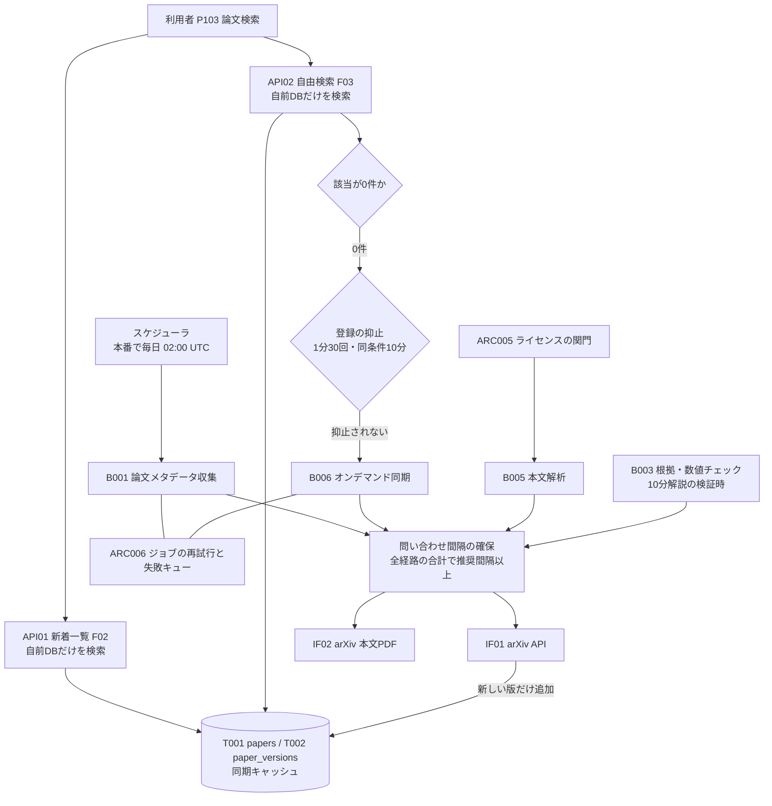
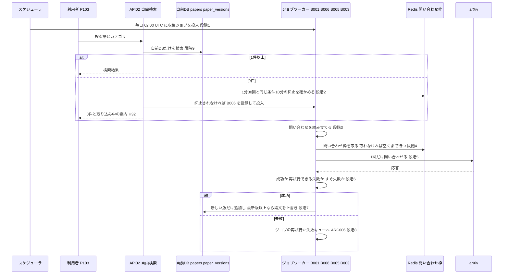

方式（共通基盤）: ARC007 外部APIアクセス制御（レート制限遵守・同期キャッシュ） ／ 実体 11ファイル（定義元の資料2・実現先の設計書9） ／ 影響範囲 16件

# 方式設計書 — ARC007 外部APIアクセス制御（レート制限遵守・同期キャッシュ）

| 項目 | 内容 |
| :--- | :--- |
| 方式ID | ARC007（上流 `docs/基本設計書_概要.md` §11.1 で採番済み。本書で新しく採番した ID はありません） |
| 名称 | 外部APIアクセス制御（レート制限遵守・同期キャッシュ） |
| 更新日 | 2026-10-27 |
| インプット | (a) `source/`（全6ファイル227行。ARC007 に関わる行は `source/03_システム構成.md:21-23,29-30,57`、`source/02_機能要求定義.md:6,8,35,49`）／(b) `docs/基本設計書_概要.md` §2（BF04・EX01）、§4（F01・F03、B001・B005・B006、バッチ共通の方針）、§7（IF01・IF02、API01・API02）、§8（外部APIの規約違反・遮断への対策）、§9（環境変数 `ARXIV_REQUEST_INTERVAL_SEC`・`REDIS_URL`）、§11.1・§11.2、付録 Q02・Q10・Q18・Q19・Q23・Q33・Q35／実現先の設計書 `docs/db/DB.T001`・`T002.DB物理設計.md`、`docs/detail/be/BE.F01`・`F03`・`F04.BE詳細設計.md`、`docs/detail/batch/BT.B001`・`B003`・`B005`・`B006.バッチ詳細設計.md`／影響範囲の確認に使った設計書 `docs/detail/be/BE.F02`・`F12`・`F14.BE詳細設計.md`、`docs/detail/batch/BT.B009.バッチ詳細設計.md`、`docs/screens/画面.P103.画面基本設計.md`、`docs/detail/fe/FE.P103.FE詳細設計.md`、同じ工程で作成した `docs/arch/方式.ARC006.方式設計.md`／(c) `legacy/` |
| 既存資料の突合 | `legacy/` は空ディレクトリ（ファイル0件）で、突合する既存設計・業務資料はありません。本書の既存版（`docs/arch/方式.ARC007.方式設計.md`）も無く、今回が初版です。引き継ぐ記述は無く、引き継ぐ ID は上流で採番済みのもの（ARC001・ARC005・ARC006・ARC007、B001・B003・B005・B006・B009、F01〜F04・F12・F14、T001・T002、IF01・IF02・IF08、API01・API02、P103、BF04・EX01、Q02・Q10・Q18・Q19・Q23・Q33・Q35）と、下流の設計書で付けられた番号（F01-BE DA004・DA006、F04-BE No.19、P103 H31・H32、ARC006 のロースター番号 #4・#9・#32・#36・#37）だけです |
| 対象システムの性質 | `source/` は企画・初期設計の資料（Markdown）で、プログラムのソースコードはありません。本書は資料の記述を一次情報とし、資料に無い実現方法は、確定済みの下流設計書が定めた内容を「実現先」として引用します。下流設計書の※推測は本書でも※推測のまま扱います。下流の設計書が「ARC007 の方式設計書で確定する」と先送りした事項（`docs/detail/batch/BT.B005.バッチ詳細設計.md:608`）は、本書 §3 段階4で扱いを決めます |

---

## 1. 機構の概要

* **解決している課題**: 本システムは論文のデータをすべて arXiv から得ています（メタデータは arXiv API、本文は arXiv の PDF。上流 IF01・IF02）。この仕組みが無いと、次の3つが起きます。
  1. **arXiv から遮断される**: arXiv は API の利用規約で問い合わせの間隔を求めています（`source/03_システム構成.md:57`「利用規約・推奨間隔を遵守」、`source/02_機能要求定義.md:49`「外部APIのレート制限…を守る」）。間隔を守らずに問い合わせると、アクセス過多の応答（HTTP 429）を受けたり接続を断られたりし、新着の収集そのものが止まります。収集が止まると、要約・検索・推薦のすべてに新しい論文が入りません（上流 §8「外部APIの規約違反・遮断」）。
  2. **画面が arXiv の応答を待つ**: 検索のたびに arXiv へ問い合わせると、画面の応答が arXiv の速さと混み具合に左右され、利用者が増えるほど問い合わせも増えて 1 の遮断を招きます（`source/02_機能要求定義.md:35`「初期は自前DBを検索し、必要時のみarXiv APIと同期」）。
  3. **自前DBに無い論文を探せない**: 定期収集の対象外の分野や古い論文は、自前DBを検索しても見つかりません。arXiv への問い合わせを一切しないと、利用者はその論文に辿り着けません（`source/02_機能要求定義.md:35`「必要時のみ…同期」）。
* **設計方針**（資料から読み取れる範囲。推測は※推測と明記）:
  1. **arXiv への問い合わせは、前回から推奨間隔以上あけてから行う**（`source/03_システム構成.md:57`）。間隔は設定値 `ARXIV_REQUEST_INTERVAL_SEC` で持ちます（上流 §9。※推測: 3秒）。
  2. **定期同期した結果を自前DBに置き、それをキャッシュとして使う**（`source/03_システム構成.md:57`「定期同期してキャッシュする」）。ここでいうキャッシュは、arXiv の応答をそのまま一時保存するものではなく、論文（`papers`）と版（`paper_versions`）のテーブルそのものです。有効期限は無く、定期収集が直近3日分を毎日取り直すことで最新に保ちます（※推測。BT.B001:338）。
  3. **画面向けAPIは自前DBだけを読み、arXiv を呼ばない**（`source/02_機能要求定義.md:35`）。自前DBに該当が無いときだけ、サーバがジョブ（B006）を登録して裏で取り込み、利用者には後で検索し直してもらいます。画面は arXiv の応答を待ちません。
  4. **arXiv への問い合わせはジョブワーカーの中だけで行う**（※推測: 下流の設計判断）。問い合わせの経路を4つ（B001・B006・B005・B003）に限り、間隔の管理を1か所に集められるようにします。
  5. **一時的な失敗は、ジョブの中で問い合わせを重ねず、ジョブの再試行（分単位の遅延）に任せる**（上流 EX01「推奨間隔以上あけて再試行」、※推測: 下流の設計判断）。アクセス過多の応答を受けた直後に問い合わせを続けると、遮断を長引かせるためです（BT.B001:559）。
* **位置づけ**: 上流 §11.2 の相関では「ARC007 → ARC006」で、ARC007 は ARC006 ジョブ実行基盤の上に乗り、arXiv へ問い合わせるジョブの「問い合わせ方」を決めます。責務の境目は次のとおりです。
  * ARC007 が受け持つ: arXiv への問い合わせの経路・間隔・応答の判定・自前DBへの同期と、画面向けAPIが arXiv を呼ばない決まり、オンデマンド同期の発動条件と抑止。
  * ARC006 が受け持つ: ジョブの登録・投入・再試行の遅延・失敗キュー。ARC007 は「ジョブの中で送り直さない」ことと「再試行できる失敗の種類」を決め、遅延の値は ARC006 に従います（`docs/arch/方式.ARC006.方式設計.md` §4 再試行の判定表）。
  * ARC005 が受け持つ: 本文PDFを取りに行ってよい論文かどうか（ライセンスの関門）。ARC007 は、関門を通った後の取りに行き方だけを決めます。
  * ARC001 が受け持つ: 同じ版の要約がすでにあれば作らない判断（本文PDFを取りに行く前に確かめるため、arXiv への問い合わせも減ります）と、検索APIの応答の共有キャッシュ（`Cache-Control`）。

---

## 2. 実体の構成

本方式は1つのプログラムではありません。資料の2か所で定められた決まりを、arXiv へ問い合わせる4つのジョブ、その手前の画面向けAPI、自前DBの一意制約で分担して実現しています。下表の「定義元」は決まりを定めた資料、「実現先」はその決まりを具体化した確定済みの設計書です。

| # | パス | 種別 | 役割 | 備考 |
| :--- | :--- | :--- | :--- | :--- |
| 1 | `source/03_システム構成.md` | 定義元（資料） | arXiv API の利用規約・推奨間隔を守り、定期同期してキャッシュすること（:57）、収集の流れ「arXiv API / メタデータ取得 → arXiv ID＋バージョンで重複判定 → 保存」（:21-23）、本文の取得は利用条件を確かめてから行うこと（:29-30）を定める | 上流 §11.1 の実体 |
| 2 | `source/02_機能要求定義.md` | 定義元（資料） | 初期は自前DBを検索し、必要時のみ arXiv API と同期すること（:35）、外部APIのレート制限を守ること（:49）、新着論文を arXiv API から定期収集すること（:6） | 上流 §11.1 の実体 |
| 3 | `docs/detail/batch/BT.B001.バッチ詳細設計.md` | 実現先（バッチ詳細設計） | 定期収集の問い合わせ（カテゴリ・取得期間・1ページの件数・ページ送り）、間隔の待ち、応答の判定、本番だけの定期実行、同期キャッシュへの書き込み（DA004・DA006）、監視項目 | 経路 P1 |
| 4 | `docs/detail/batch/BT.B006.バッチ詳細設計.md` | 実現先（バッチ詳細設計） | オンデマンド同期の問い合わせ（検索語の整形・取得件数の上限）、並列数1、提供の切り替え、滞留したジョブの見送り、HTTP 429 の監視 | 経路 P2 |
| 5 | `docs/detail/batch/BT.B005.バッチ詳細設計.md` | 実現先（バッチ詳細設計） | 本文PDFの取得（版番号付きのURL・大きさの上限・ワーカー間で共有する問い合わせ時刻）。間隔の管理を ARC007 で揃えるよう求めている（:608） | 経路 P3 |
| 6 | `docs/detail/batch/BT.B003.バッチ詳細設計.md` | 実現先（バッチ詳細設計） | 10分解説の検証のための本文PDFの取り直し（ワーカー間で共有する問い合わせ時刻） | 経路 P4。※上流未定義（上流の適用範囲に B003 が無い） |
| 7 | `docs/detail/be/BE.F01.BE詳細設計.md` | 実現先（BE詳細設計） | arXiv API のクライアント `ArxivClient.fetch_page` と、取得期間・カテゴリの設定、同期キャッシュへの書き込みの定義元 | B001・B006 が使う |
| 8 | `docs/detail/be/BE.F03.BE詳細設計.md` | 実現先（BE詳細設計） | 自由検索が自前DBだけを検索し、0件のときだけオンデマンド同期を登録する発動条件と、登録の抑止（1分30回・同じ条件10分）、応答の `syncTriggered` | 画面向けAPI側 |
| 9 | `docs/detail/be/BE.F04.BE詳細設計.md` | 実現先（BE詳細設計） | 本文PDFのクライアント `ArxivPdfClient.fetch_pdf`（No.19）と、IF02 の失敗の扱い | B003・B005 が使う。※上流未定義（上流の適用範囲に F04 が無い） |
| 10 | `docs/db/DB.T001.DB物理設計.md` | 実現先（DB物理設計） | 同期キャッシュの鍵の1つ、arXiv ID の一意制約 `uq_papers_arxiv_id` と、取り込んだ版が登録済みの最新版以上のときだけ上書きする規則（:206,250） | ※上流未定義 |
| 11 | `docs/db/DB.T002.DB物理設計.md` | 実現先（DB物理設計） | 同期キャッシュの鍵のもう1つ、論文と版番号の一意制約 `uq_paper_versions_paper_id_version`（:188,208） | ※上流未定義 |

* **命名規則・配置規則**（新規追加時に従うべき規則）:
  * arXiv へ問い合わせるクライアントは `worker/integrations/` に置き、API は `arxiv_client.py`（`ArxivClient`）、本文PDFは `ArxivPdfClient` に集めます。ジョブの本処理から arXiv の URL を直接呼ばず、必ずこの2つを通します。間隔の確保をクライアントの入口1か所に置くためです。
  * arXiv に関わる設定値は `ARXIV_` で始めます（`ARXIV_REQUEST_INTERVAL_SEC`、`ARXIV_CATEGORIES`）。本文PDFに固有のものは `FULLTEXT_` で始めます（`FULLTEXT_MAX_PDF_MB`）。
  * 問い合わせの間隔に関わる Redis のキーは `arxiv:` で始めます（本書 §3 段階4の `arxiv:request_slot`。※推測・※上流未定義）。オンデマンド同期の登録の抑止のキーは `sync_on_demand:` で始めます（ARC006 の命名規則に従う）。
  * 画面のコード（`web/`）からは arXiv の URL を呼びません。原文ページへのリンク（上流 IF03）は利用者のブラウザが開くもので、本方式の対象外です。
* **全数**: 11件（定義元の資料2件＋実現先の設計書9件。実現先の内訳は バッチ詳細設計4件・BE詳細設計3件・DB物理設計2件）。根拠: 定義元は上流 §11.1 ARC007 行の「実体」列に挙がった2ファイル（`source/03_システム構成.md:57`、`source/02_機能要求定義.md:35,49`）と一致します。実現先は、全47本の確定済み設計書（`docs/db/` 10本・`docs/detail/be/` 19本・`docs/detail/batch/` 11本・`docs/detail/fe/` 7本）と画面基本設計書7本を1本ずつ調べ、arXiv への問い合わせ・同期キャッシュの鍵・オンデマンド同期の発動条件のどれかを自ら定めているものを数えました。振り分けは次のとおりです。
  * 実現先（9本）: 上表 #3〜#11。
  * 影響範囲だけ（4本＋画面基本設計1本）: `BE.F02`（新着一覧が arXiv を呼ばないことを ARC007 の適用として明記。F02:401）、`BE.F14`・`BT.B009`（GitHub の回数制限に ARC007 の考え方を当てはめると明記。F14:395、B009:647。※上流要確認）、`FE.P103`・`画面.P103`（取り込み中の案内 H32 を出す。FE.P103:379、画面.P103:195-196,221）。§6 に行があります。
  * 対象外（34本＋画面基本設計6本）: `DB.T003`〜`T010`（8本。arXiv に問い合わせない）、`BE.F05`〜`F13`・`F15`〜`F19`（14本。ARC007 を使わないと明記。F12 は Stripe の再送は自身の方針によると明記。F12:609）、`BT.B002`・`B004`・`B007`・`B008`・`B010`・`B011`（6本。使わないと明記）、`FE.P101`・`P102`・`P104`〜`P107`（6本。使わないと明記）、`画面.P101`・`P102`・`P104`〜`P107`（6本。言及なし）。

* **構成要素ロースター**（本方式を形づくる要素の全数。ID は上流と下流の設計書で付いた名前をそのまま使い、本書では採番しません）:

| # | 種別 | 名称（既存の識別子） | 概要 | 定義状況 | 詳細の所在 |
| :--- | :--- | :--- | :--- | :--- | :--- |
| 1 | 問い合わせの経路 | P1 定期収集（B001 → IF01） | 毎日、収集対象のカテゴリの直近3日分のメタデータをページ送りで全件取る | 詳細 | §3、§4 IF01 の問い合わせ、BT.B001 |
| 2 | 問い合わせの経路 | P2 オンデマンド同期（B006 → IF01） | 自前DBで0件だった検索語で、関連度の高い順に最大5件だけ取る。1ジョブ1回 | 詳細 | §3、§4 IF01 の問い合わせ、BT.B006 |
| 3 | 問い合わせの経路 | P3 本文解析（B005 → IF02） | ライセンスで許され、10分解説がまだ無い版の本文PDFを1件取る | 詳細 | §3、§4 IF02 の問い合わせ、BT.B005 |
| 4 | 問い合わせの経路 | P4 10分解説の検証（B003 → IF02）（※上流未定義） | 未検証の10分解説がある版の本文PDFを取り直す。本文のテキストを保存する場所が無いため | 詳細 | §3、BT.B003:107 |
| 5 | クライアント | `ArxivClient.fetch_page`（`worker/integrations/arxiv_client.py`） | arXiv API への1回の問い合わせ。間隔の確保・タイムアウト・応答の判定を受け持つ。P1・P2 が使う | 詳細 | §3 段階4〜6、BT.B001:340、BT.B006:327 |
| 6 | 関数 | `iter_entries`（`worker/jobs/collect_metadata.py`） | P1 のページ送り。全件に達するか空のページが返るまで続け、3万件を超える期間は1日ずつに分ける | 詳細 | §4 IF01 の問い合わせ、BT.B001:339 |
| 7 | 関数 | `build_arxiv_query`（`worker/jobs/sync_on_demand.py`） | P2 の検索語の整形。記号を取り除き最大8語にし、残らなければ問い合わせない | 詳細 | §4 IF01 の問い合わせ、BT.B006:326 |
| 8 | クライアント | `ArxivPdfClient.fetch_pdf`（F04-BE No.19） | 本文PDFへの1回の問い合わせ。P3・P4 が使う | 詳細 | §3 段階4〜6、BE.F04:386、BT.B005:318 |
| 9 | 間隔の管理（現状） | プロセスの中の前回の問い合わせ時刻（P1・P2） | ワーカーのプロセスの中だけで前回時刻を持ち、間隔に満たなければ待つ | 詳細 | §3 段階4、BT.B001:340、BT.B006:327 |
| 10 | 間隔の管理（現状） | Redis に置く最後の問い合わせ時刻（P3・P4。キー名は未定） | ワーカー間で前回時刻を共有して待つ。原子的な書き方は未定 | 詳細 | §3 段階4、BT.B005:318、BT.B003:309 |
| 11 | 間隔の管理（本書で定める） | 問い合わせ枠 `arxiv:request_slot`（Redis。※推測・※上流未定義） | 全経路・全ワーカーの合計で、問い合わせの開始を推奨間隔に1回までにする | 詳細 | §3 段階4、§4 Redis のキー |
| 12 | 排他 | 収集のアドバイザリロック（ARC006 #32） | P1 を同時に1つだけにする。現状は P1 の間隔の管理がこれに頼っている | 詳細 | `docs/arch/方式.ARC006.方式設計.md` §3 段階3a |
| 13 | 並列の制限 | キュー `sync_on_demand` の並列数1（ARC006 #4） | P2 を同時に1つだけにする。現状は P2 の間隔の管理がこれに頼っている | 詳細 | BT.B006:355-356 |
| 14 | 発動条件 | 自前DBで0件のときだけ同期を登録する（F03 `requestOnDemandSync` の呼び出し条件。上流 Q10 の仮置き） | 検索で1件でも見つかれば arXiv に問い合わせない | 詳細 | §3 選択規則、BE.F03:214 |
| 15 | 登録の抑止 | `sync_on_demand:rate:{年月日時分}`（ARC006 #37） | 同期の登録を全体で1分あたり30回までにする | 詳細 | §4 Redis のキー、BE.F03:360 |
| 16 | 登録の抑止 | `sync_on_demand:dedupe:{検索語}:{カテゴリ}`（ARC006 #36） | 同じ検索条件の同期を10分に1回までにする | 詳細 | §4 Redis のキー、BE.F03:360 |
| 17 | 応答項目 | API02 の `syncTriggered` | 今回の検索で同期を登録したかを画面へ返す真偽値 | 簡易 | BE.F03:166,191 |
| 18 | 画面表示 | P103 H32 取り込み中の案内 | 0件で同期を登録したときだけ、「見つかりませんでした」（H31）の代わりに出す固定文言 | 簡易 | 画面.P103:116 |
| 19 | 同期キャッシュ | 論文の追加または最新版での上書き（F01-BE DA004） | 未登録なら追加、登録済みなら取り込んだ版が最新版以上で中身が違うときだけ上書きする | 詳細 | §3 読込順序、BT.B001:183 |
| 20 | 同期キャッシュ | 論文の版の追加（F01-BE DA006） | 論文と版番号の組がまだ無ければ追加し、あれば何もしない。新しい版のときだけ要約ジョブを登録する | 詳細 | §3 読込順序、BT.B001:184-185 |
| 21 | 一意制約 | `uq_papers_arxiv_id`（T001） | 同じ arXiv ID の論文を2行にしない。P1 と P2 が同時に書いても重複しない最後の防壁 | 詳細 | DB.T001:206,250 |
| 22 | 一意制約 | `uq_paper_versions_paper_id_version`（T002） | 同じ論文の同じ版を2行にしない。新しい版かどうかの判定の鍵 | 詳細 | DB.T002:188,208 |
| 23 | 決まり | 画面向けAPIは arXiv を呼ばない（API01・API02） | 新着一覧と自由検索は自前DBだけを読む。arXiv への問い合わせはジョブワーカーだけが行う | 詳細 | §3 選択規則、BE.F02:401、BE.F03:409 |
| 24 | スケジュール | `collect-metadata-daily`（ARC006 #9。本番だけで有効） | 毎日 02:00 UTC に P1 を起動する。本番以外で定期実行しないのは、環境ごとに間隔の管理が分かれないようにするため | 詳細 | BT.B001:367-374 |
| 25 | 判定表 | arXiv の応答の判定（再試行できる失敗・すぐ失敗にする失敗） | 応答ごとに、成功・再試行できる失敗・再試行しても直らない失敗のどれかに分ける | 詳細 | §4 応答の判定表 |
| 26 | 設定値 | `ARXIV_REQUEST_INTERVAL_SEC` | 問い合わせの間隔（秒）。全経路で共用（※推測: 3） | 詳細 | §4 設定項目 |
| 27 | 設定値 | `ARXIV_CATEGORIES`（※上流未定義） | P1 で収集するカテゴリの一覧 | 簡易 | §4 設定項目 |
| 28 | 設定値 | `ARXIV_LOOKBACK_DAYS`（※上流未定義） | P1 が毎日取り直す日数（※推測: 3） | 簡易 | §4 設定項目 |
| 29 | 設定値 | `ARXIV_ON_DEMAND_ENABLED`（※上流未定義） | P2 を行う環境かどうか（本番は真、それ以外は偽） | 詳細 | §4 設定項目 |
| 30 | 設定値 | `ARXIV_ON_DEMAND_MAX_RESULTS`（※上流未定義） | P2 の1回で取る件数（※推測: 5） | 簡易 | §4 設定項目 |
| 31 | 設定値 | `SYNC_ON_DEMAND_MAX_WAIT_SEC`（※上流未定義） | 登録から長く待たされた P2 を見送る秒数（※推測: 1,800） | 簡易 | §4 設定項目 |
| 32 | 設定値 | `FULLTEXT_MAX_PDF_MB`（※上流未定義） | P3 で受け取る本文PDFの大きさの上限（※推測: 50） | 簡易 | §4 設定項目 |
| 33 | 定数 | 問い合わせのタイムアウト（API 30秒・本文PDF 60秒） | 1回の問い合わせを待つ上限 | 簡易 | §4 IF01・IF02 の問い合わせ |
| 34 | 定数 | 1ページの件数200件・期間を分けるしきい値3万件 | P1 のページ送りの単位と、1回の期間で取りきれないときの分け方 | 簡易 | §4 IF01 の問い合わせ |
| 35 | 監視 | P1 の取得件数0件が平日に2日続く・所要時間30分超（B001 監視 No.3・No.5） | 規約違反による遮断や問い合わせ条件の誤りを、失敗にならない形でも見つける | 詳細 | §4 監視、BT.B001:517-525 |
| 36 | 監視 | P2 の HTTP 429 が1日に1件でも（B006 監視 No.6） | アクセス過多の応答を受けたことを即日知らせ、間隔と並列数を見直させる | 詳細 | §4 監視、BT.B006:493-500 |
| 37 | ログ | 同期の登録が回数上限で抑止された INFO ログ（F03） | 抑止が頻発していることを監視で見つける | 簡易 | BE.F03:388 |

**総件数: 37件**（問い合わせの経路4件・クライアントと関数4件・間隔の管理3件・排他と並列の制限2件・発動条件1件・登録の抑止2件・応答項目1件・画面表示1件・同期キャッシュ2件・一意制約2件・決まり1件・スケジュール1件・判定表1件・設定値7件・定数2件・監視2件・ログ1件。定義状況は詳細27件・簡易10件）。**全数である根拠**: 実現先の設計書9本（§2 #3〜#11）と、影響範囲の F02・F03・P103 から、「ARC007」「arXiv」「ARXIV_」「問い合わせ間隔」「推奨間隔」「429」「syncTriggered」を含む記述を全件拾い、arXiv への問い合わせの経路・間隔・応答の判定・同期キャッシュ・オンデマンド同期の発動と抑止のどれかを担うものを数えました。経路は、arXiv の URL（`export.arxiv.org/api/query` と `arxiv.org/pdf/`）を呼ぶ処理を全設計書から探した4件です。次のものは他の方式の責務として除いています: ジョブの再試行の遅延・試行回数の上限・失敗キューは ARC006、本文PDFを取ってよいかの判定 `is_full_text_allowed` は ARC005、要約の再利用確認と検索APIの `Cache-Control` は ARC001、本文解析の1日の上限 `FULLTEXT_DAILY_LIMIT` は ARC002。GitHub（IF08）・LLM（IF04）・メール（IF09）・Stripe（IF06）の回数制限への対応は、上流の ARC007 の適用範囲（IF01・IF02）の外で、それぞれの機能の設計書が受け持ちます（GitHub は F14・B009 が ARC007 の考え方を当てはめると明記しているため §6 に挙げます）。
**定義状況の判定**（completeness 3-1）: 分岐がある（3-1 の1）・状態を変える（同2）・失敗時の扱いが自明でない（同5）・業務上の判断を含む（同7）のどれかに当たるものを「詳細」としました。#17・#18 は値や文言を返すだけ、#27・#28・#30〜#32 は値を1つ持つだけ、#33・#34 は固定の数、#37 はログを1行出すだけで、いずれも分岐・状態の変更を含まないため「簡易」です。#26 と #29 は、変えると全経路の問い合わせ量や本番の動きが変わる（3-1 の1・7）ため「詳細」です。

---

## 3. ライフサイクル（登録・読込・選択）

* **時系列**: 起動から、問い合わせ・自前DBへの同期・画面での読み出しまでを示します。

| 段階 | 契機 | 処理 | 実装（ファイル:行） |
| :--- | :--- | :--- | :--- |
| 0 起動 | ワーカーとスケジューラのプロセスを起動したとき | 設定値（§4 設定項目）を環境変数から読みます。スケジューラは本番でだけ P1 を定期実行し、staging・development では手動の期間指定でだけ動かします。P2 は `ARXIV_ON_DEMAND_ENABLED` が偽の環境では問い合わせずに成功で終えます。P3・P4 はどの環境でも動き、staging・development では登録する版を少数に絞って負荷を抑えます（※推測） | `docs/detail/batch/BT.B001.バッチ詳細設計.md:374`、`docs/detail/batch/BT.B006.バッチ詳細設計.md:324,584`、`docs/detail/batch/BT.B005.バッチ詳細設計.md:358` |
| 1 契機 | 4つ。P1: 毎日 02:00 UTC の定刻（arXiv の新着公開から1時間以上あける）。P2: 自由検索が自前DBで0件だったとき。P3: 本文解析ジョブが登録されたとき（人気論文・リクエスト。ARC002）。P4: 未検証の10分解説の検証ジョブが動いたとき | 問い合わせはどの経路もジョブワーカーの中で行い、画面向けAPIは問い合わせません | `docs/detail/batch/BT.B001.バッチ詳細設計.md:367-372`、`docs/detail/be/BE.F03.BE詳細設計.md:214`、`docs/detail/batch/BT.B005.バッチ詳細設計.md:327-333`、`docs/detail/batch/BT.B003.バッチ詳細設計.md:107` |
| 2 登録の抑止 | P2 の登録の直前（画面向けAPIの中） | 登録回数を分単位で数え、1分に30回を超えたら登録しません。次に、検索語を小文字にしたものとカテゴリの組で重複防止キーを10分の有効期限付きで作り、すでにあれば登録しません。どちらで抑止しても検索自体は成功（HTTP 200）で、`syncTriggered` を偽で返します。回数上限で抑止したときだけ INFO ログを出します | `docs/detail/be/BE.F03.BE詳細設計.md:215-217,360,388` |
| 3 問い合わせの組み立て | ジョブが着手したとき | P1: 収集対象のカテゴリのどれかに属し、最終更新日時が直近3日に入る論文を、最終更新の古い順に1ページ200件で求めます。P2: 検索語から英字・数字・ハイフン・ピリオド以外を取り除き、最大8語を「すべて含む」条件にし、関連度の高い順に最大5件を求めます。語が残らない（日本語だけの検索）ときは問い合わせずに終えます。P3: ライセンスの関門（ARC005）と要約の再利用確認（ARC001）を通った版だけ、版番号付きの URL を作ります。P4: 未検証の10分解説がある版だけ、版番号付きの URL を作ります | `docs/detail/batch/BT.B001.バッチ詳細設計.md:121,338-339`、`docs/detail/batch/BT.B006.バッチ詳細設計.md:136,326`、`docs/detail/batch/BT.B005.バッチ詳細設計.md:316`、`docs/detail/batch/BT.B003.バッチ詳細設計.md:107` |
| 4 間隔の確保 | 問い合わせの直前（クライアントの入口） | **現状（下流の設計）**: P1・P2 はワーカーのプロセスの中だけで前回時刻を持ち、P3・P4 は Redis に置いた最後の問い合わせ時刻を見て待ちます。P1 は収集の排他、P2 は並列数1で同時に1つだけ動くため、それぞれの中では間隔が守られますが、P1・P2・P3/P4 の3者が同時に問い合わせると、合計では間隔を下回ります。**本書の決定（※推測・※上流未定義）**: 4経路すべてで、Redis の問い合わせ枠 `arxiv:request_slot` を、間隔の秒数を有効期限にして「無ければ作る」で取ります。取れたワーカーだけが問い合わせ、取れなければ残りの有効期限だけ待って取り直します。これで全経路・全ワーカーの合計で、問い合わせの開始が間隔に1回までになります。Redis に接続できないときは問い合わせず、再試行できる失敗として段階8へ進みます（間隔を守れない状態で問い合わせないため） | 現状: `docs/detail/batch/BT.B001.バッチ詳細設計.md:340`、`docs/detail/batch/BT.B006.バッチ詳細設計.md:327,357`、`docs/detail/batch/BT.B005.バッチ詳細設計.md:318`、`docs/detail/batch/BT.B003.バッチ詳細設計.md:309`。決定の根拠: `docs/detail/batch/BT.B005.バッチ詳細設計.md:608`、`docs/detail/batch/BT.B001.バッチ詳細設計.md:618`、`docs/detail/batch/BT.B006.バッチ詳細設計.md:600` |
| 5 問い合わせ | 枠を取れたとき | 1回だけ問い合わせます。待つ上限は API 30秒、本文PDF 60秒です。P3 は受け取る大きさが `FULLTEXT_MAX_PDF_MB` を超えた時点で受け取りをやめます。P1 は次のページの問い合わせも段階4から繰り返し、ページごとに枠を取ります | `docs/detail/batch/BT.B001.バッチ詳細設計.md:121,339-340`、`docs/detail/batch/BT.B006.バッチ詳細設計.md:136`、`docs/detail/batch/BT.B005.バッチ詳細設計.md:123,318` |
| 6 応答の判定 | 応答を受けたとき、またはタイムアウト | §4 応答の判定表で、成功・再試行できる失敗・すぐ失敗にする失敗に分けます。ジョブの中では問い合わせを重ねません（送り直さない）。HTTP 429 の応答に待ち時間の指示（Retry-After）があればログに併記します | `docs/detail/batch/BT.B001.バッチ詳細設計.md:536-537`、`docs/detail/batch/BT.B006.バッチ詳細設計.md:519,536`、`docs/detail/batch/BT.B005.バッチ詳細設計.md:513,535,539` |
| 7 同期キャッシュへの書き込み | P1・P2 の成功時 | 論文は、arXiv ID が未登録なら追加し、登録済みなら取り込んだ版番号が最新版以上で中身が違うときだけ上書きします。版は、論文と版番号の組が無ければ追加し、あれば何もしません。新しく追加できた版だけに要約ジョブを登録します（ARC001・ARC006）。P1 と P2 が同じ論文を同時に書いても、一意制約で重複しません。P3・P4 の本文は保存しません（P3 は本文取得状況だけを進める） | `docs/detail/batch/BT.B001.バッチ詳細設計.md:183-185,452`、`docs/detail/batch/BT.B006.バッチ詳細設計.md:401`、`docs/db/DB.T001.DB物理設計.md:206`、`docs/db/DB.T002.DB物理設計.md:208` |
| 8 失敗時 | 段階4・6で失敗になったとき | ジョブの再試行に任せます。遅延は ARC006 に従い、IF01（P1・P2）は5分・15分、IF02（P3）は1分・5分です。すぐ失敗にする失敗は試行回数によらず失敗キューへ送ります（P1 は取得期間、P2 は検索語を引数として残す） | `docs/detail/batch/BT.B001.バッチ詳細設計.md:559`、`docs/detail/batch/BT.B006.バッチ詳細設計.md:333,538`、`docs/detail/batch/BT.B005.バッチ詳細設計.md:306`、`docs/arch/方式.ARC006.方式設計.md` §4 再試行の判定表 |
| 9 読み出し | 利用者が新着一覧・検索を開いたとき | API01・API02 は自前DBだけを読みます。API02 は0件で同期を登録したとき `syncTriggered` を真で返し、画面は H31 の代わりに H32「arXiv から該当する論文を取り込んでいます。しばらくしてから、もう一度検索してください」を出します。画面は取り込みの完了を待たず、自動で検索し直しません（完了を画面に知らせる手段が上流 §7 に無いため） | `docs/detail/be/BE.F02.BE詳細設計.md:401`、`docs/detail/be/BE.F03.BE詳細設計.md:166,191,409`、`docs/screens/画面.P103.画面基本設計.md:116,195-196`、`docs/detail/fe/FE.P103.FE詳細設計.md:289,379` |
| 10 失効・再同期 | 時間の経過 | 自前DBの論文・版に有効期限はありません。P1 が毎日直近3日分を取り直すため、3日以内に更新された論文は翌日までに新しい版が入ります。それより前に更新され P1 の対象外だった論文は、P2 で検索されたときに入ります。重複防止キーは10分、登録回数のキーは120秒で消えます。登録から `SYNC_ON_DEMAND_MAX_WAIT_SEC` を過ぎた P2 は、利用者がもう待っていないものとして問い合わせずに見送ります | `docs/detail/batch/BT.B001.バッチ詳細設計.md:338`、`docs/detail/be/BE.F03.BE詳細設計.md:360`、`docs/detail/batch/BT.B006.バッチ詳細設計.md:324,586` |
| 11 監視 | ログの出力のたび、監視の締め時刻 | P1 の取得件数0件の連続・所要時間、P2 の HTTP 429、F03 の回数上限の抑止を見ます（§4 監視） | `docs/detail/batch/BT.B001.バッチ詳細設計.md:508,517-525`、`docs/detail/batch/BT.B006.バッチ詳細設計.md:493-500`、`docs/detail/be/BE.F03.BE詳細設計.md:388` |

* **読込順序**（同じ論文を P1 と P2 が取り込んだとき、どちらの内容が残るか）:

| 順 | 書き込み | 先に入ったものと後から来たものの関係 | 規則 |
| :--- | :--- | :--- | :--- |
| 1 | 論文（`papers`）の追加 | 先に追加した方の行が残り、後から来た方は上書きの判定へ進む | arXiv ID の一意制約（`uq_papers_arxiv_id`） |
| 2 | 論文の上書き | 後から来た版番号が登録済みの最新版以上で、原題・Abstract・著者・カテゴリ・更新日時・最新版のどれかが違うときだけ上書きする。古い版を後から取り込んでも、新しい版の内容を古い内容で戻さない | 版番号の比較を上書きの条件に入れる（DA004） |
| 3 | 論文で上書きしない列 | 投稿日時・原文URL・arXiv ID は最初に入った値のまま | DA004 |
| 4 | 版（`paper_versions`）の追加 | 先に追加した方の行が残り、後から来た方は何もしない。版の取得時点のメタデータは最初に取り込んだときのもの | 論文と版番号の一意制約（`uq_paper_versions_paper_id_version`、DA006） |
| 5 | 要約ジョブの登録 | 版を新しく追加できた側だけが登録する | DA007（ARC001・ARC006） |

* **選択規則**（いつ arXiv に問い合わせ、いつ自前DBを使うか）:
  1. **画面向けAPI**: 常に自前DBを使います。arXiv に問い合わせることはありません（#23）。
  2. **自由検索で同期を起こすか**: 次の順で判定し、すべてを満たすときだけ P2 を登録します。
     1. 自前DBの検索結果が0件である（上流 Q10 の仮置き）。
     2. この1分の登録回数が30回以下である。
     3. 同じ検索語（小文字）とカテゴリの組を10分以内に登録していない。
  3. **P2 が実際に問い合わせるか**: 次のどれかに当たれば問い合わせずに成功で終えます。
     1. `ARXIV_ON_DEMAND_ENABLED` が偽（本番以外）。
     2. 検索語を整形した結果、語が1つも残らない。
     3. 登録から `SYNC_ON_DEMAND_MAX_WAIT_SEC` を過ぎている。
  4. **本文PDFを取りに行くか**: P3 はライセンスで許され（ARC005）、10分解説の再利用ができない（ARC001）ときだけ、P4 は未検証の10分解説があるときだけ取りに行きます。
  5. **どのワーカーが問い合わせるか**: 段階4の問い合わせ枠を先に取れたワーカーです。経路による優先はありません（※推測。P2 は利用者が待っているため優先したい場合は付録B No.2）。

---

## 4. インターフェース・データ構造

* **IF01 arXiv API の問い合わせ**（P1・P2）:

| 項目 | P1 定期収集（B001） | P2 オンデマンド同期（B006） | 根拠 |
| :--- | :--- | :--- | :--- |
| URL | `https://export.arxiv.org/api/query`（※推測） | `https://export.arxiv.org/api/query`（※推測） | BT.B001:121、BT.B006:136 |
| 条件 | 収集対象のカテゴリのどれかに属し、最終更新日時が取得期間に入る論文（`(cat:A OR cat:B …) AND lastUpdatedDate:[開始 TO 終了]`） | 整形した各語をすべて含み、カテゴリの指定があればそのカテゴリに属する論文（`all:語1 AND all:語2 … AND cat:X`） | BT.B001:121、BT.B006:136,326 |
| 並び順 | 最終更新日時の古い順（`sortBy=lastUpdatedDate&sortOrder=ascending`） | 関連度の高い順（`sortBy=relevance&sortOrder=descending`） | BT.B001:121、BT.B006:136 |
| 件数 | 1ページ200件（※推測）。全件に達するまでページを送る。全件が3万件を超える期間は1日ずつに分ける | `ARXIV_ON_DEMAND_MAX_RESULTS`（※推測: 5）件だけ。ページは送らない | BT.B001:339、BT.B006:136 |
| 1ジョブの問い合わせ回数 | ページ数ぶん（直近3日の標準で数回） | 1回 | BT.B001:339、BT.B006:136 |
| タイムアウト | 30秒（※推測） | 30秒（※推測） | BT.B001:340、BT.B006:327 |
| 応答 | Atom 形式の XML | Atom 形式の XML | BT.B001:121、BT.B006:136 |
| 識別のヘッダー | 定めなし（付録B No.3） | 定めなし（付録B No.3） | — |

  **総件数: 8項目**（問い合わせを再現するのに要る項目を1項目1行で挙げたもの）。

* **IF02 本文PDFの問い合わせ**（P3・P4）: URL は版番号付きの `https://arxiv.org/pdf/{arXiv ID}v{版番号}`（※推測）で、要約した版と本文を一致させます。タイムアウトは60秒です。P3 は受け取る大きさが `FULLTEXT_MAX_PDF_MB` を超えたら受け取りをやめ、PDF でない応答とともにすぐ失敗にします。P4（BT.B003）と F04-BE の `fetch_pdf` には大きさと形式の確認がありません（§7、付録B No.5）。（BT.B005:123,318、BT.B003:123,309、BE.F04:134,386）

* **応答の判定表**（段階6。上から順に当てはめる）:

| No | 応答 | 判定 | 理由 | 経路 | 根拠 |
| :--- | :--- | :--- | :--- | :--- | :--- |
| 1 | HTTP 200 で、解釈できる XML（P1・P2）または PDF（P3・P4） | 成功 | — | 全経路 | BT.B001:121、BT.B005:318 |
| 2 | 接続の失敗・タイムアウト | 再試行できる失敗 | 一時的な障害で、時間をおけば直る | 全経路 | BT.B001:536、BT.B005:535 |
| 3 | HTTP 5xx | 再試行できる失敗 | arXiv 側の一時的な障害 | 全経路 | BT.B001:536、BT.B005:535 |
| 4 | HTTP 429（アクセス過多） | 再試行できる失敗。ジョブの中では問い合わせを重ねず、分単位の遅延の後に再実行する | 直後に問い合わせると遮断が長引く | 全経路 | BT.B001:536,559、BT.B006:536 |
| 5 | HTTP 200 だが XML を解釈できない、または全件数に満たないのに空のページ | 再試行できる失敗 | arXiv 側の一時的な不整合（※推測） | P1・P2（空のページは P1 だけ） | BT.B001:121,536 |
| 6 | HTTP 404（版が無い） | すぐ失敗 | 何度取りに行っても同じ結果になる | P3（P4 は10分解説の不合格として扱い、ジョブは失敗にしない） | BT.B005:513,539、BT.B003:305 |
| 7 | PDF でない応答、大きさの上限超え | すぐ失敗 | 何度取りに行っても同じ結果になる | P3 | BT.B005:123,539 |
| 8 | HTTP 429 を除く 400〜499 | すぐ失敗 | 問い合わせ条件の誤りで、運用者が設定を直すまで直らない | P1・P2 | BT.B001:537、BT.B006:519 |

  **総件数: 8行**。上流 EX01 はワーカーが推奨間隔をあけて自分で再試行する図ですが、下流の設計はジョブごと遅延付きで再投入する形で実現しています（「推奨間隔以上あける」は遅延が満たす。`docs/基本設計書_概要.md:474-493`）。

* **Redis のキー**（本方式が使うもの）:

| No | キー | 有効期限 | 作り方 | 何のためか | 根拠 |
| :--- | :--- | :--- | :--- | :--- | :--- |
| 1 | `arxiv:request_slot`（※推測・※上流未定義。本書で定める） | `ARXIV_REQUEST_INTERVAL_SEC` の秒数 | 無ければ作る（作れたワーカーだけが問い合わせる） | 全経路・全ワーカーの合計で、問い合わせの開始を間隔に1回までにする | 本書 §3 段階4 |
| 2 | `sync_on_demand:rate:{年月日時分}` | 120秒 | 1増やす | 同期の登録を全体で1分30回までにする | BE.F03:360 |
| 3 | `sync_on_demand:dedupe:{検索語}:{カテゴリ}` | 600秒 | 無ければ作る | 同じ検索条件の同期を10分に1回までにする | BE.F03:360 |

  **総件数: 3件**。BT.B005・BT.B003 の「Redis に置く最後の問い合わせ時刻」（キー名は未定）は、No.1 に置き換えます（付録B No.1）。

* **機構の入出力**:

| 方向 | 相手 | 渡すもの | 形 | 根拠 |
| :--- | :--- | :--- | :--- | :--- |
| 入力 | 自由検索（F03） | 検索語・カテゴリ | オンデマンド同期のジョブのメッセージ（`jobId`・`q`・`category`・`requestedAt`） | BT.B006:138-147 |
| 入力 | スケジューラ・運用者 | 取得期間（手動の期間指定のときだけ） | 収集ジョブの引数 | BT.B001:353-358 |
| 出力 | 自前DB | 論文・版のメタデータとライセンス | `papers`・`paper_versions` の行 | BT.B001:183-184 |
| 出力 | 画面（P103） | 同期を登録したか | API02 の応答の `syncTriggered`（真偽値） | BE.F03:166,191 |
| 出力 | 本文解析・検証（B005・B003） | 本文PDF | バイト列（保存しない） | BE.F04:386 |

  **総件数: 5行**。

* **設定項目**（全項目）:

| No | 名前 | 種別 | 既定値 | 意味 | 変えたときの効き方 | 根拠 |
| :--- | :--- | :--- | :--- | :--- | :--- | :--- |
| 1 | `ARXIV_REQUEST_INTERVAL_SEC` | 環境変数（上流 §9） | 3（※推測） | 問い合わせの間隔（秒）。IF01・IF02 の全経路で共用 | ワーカーの再起動後に効く。下げると遮断のおそれが増え、上げると P1 の所要時間と P2 の待ち時間が延びる | 概要:1235、BT.B001:595、BT.B003:580、BT.B005:585、BT.B006:580 |
| 2 | `ARXIV_CATEGORIES` | 環境変数（※上流未定義） | 未定（例 `cs.LG`） | P1 で収集するカテゴリ | 増やすと P1 の問い合わせ回数と要約の費用が増える。外したカテゴリの論文は P2 でだけ入る | BT.B001:339,598 |
| 3 | `ARXIV_LOOKBACK_DAYS` | 環境変数（※上流未定義） | 3（※推測） | P1 が毎日取り直す日数 | 減らすと取りこぼした日を取り戻せる日数が減る。増やすと問い合わせ回数が増える | BT.B001:338,599 |
| 4 | `ARXIV_ON_DEMAND_ENABLED` | 環境変数（※上流未定義） | 本番は真、それ以外は偽 | P2 を行う環境かどうか | 偽にすると、0件の検索で同期が起きず、自前DBに無い論文は見つからないままになる | BT.B006:584 |
| 5 | `ARXIV_ON_DEMAND_MAX_RESULTS` | 環境変数（※上流未定義） | 5（※推測） | P2 の1回で取る件数 | 増やすと新しい版が増え、要約の費用が増える | BT.B006:585 |
| 6 | `SYNC_ON_DEMAND_MAX_WAIT_SEC` | 環境変数（※上流未定義） | 1,800（※推測） | 登録から長く待たされた P2 を見送る秒数 | 短くすると、混雑時に利用者の検索の取り込みが見送られやすくなる | BT.B006:586 |
| 7 | `FULLTEXT_MAX_PDF_MB` | 環境変数（※上流未定義） | 50（※推測） | P3 で受け取る本文PDFの大きさの上限 | 下げると大きな論文の10分解説が作られない | BT.B005:588 |

  **総件数: 7件**（構成要素ロースター #26〜#32 と一致）。タイムアウト（30秒・60秒）、1ページの件数200件、期間を分けるしきい値3万件、検索語の上限8語、登録の抑止の1分30回・10分は、設定値ではなくプログラムの中の定数です（BT.B006:588、BT.B005:592、BE.F03:360）。`REDIS_URL` は ARC006 の設定項目で、本方式は問い合わせ枠と登録の抑止のキーに使います。

* **監視**（しきい値はすべて※推測。監視の手段・通知先は上流 Q35 で未定）:

| No | 何を見つけるか | 見方 | しきい値 | 根拠 |
| :--- | :--- | :--- | :--- | :--- |
| 1 | 遮断や問い合わせ条件の誤りで、失敗にならずに論文が入らない | P1 の成功ログの取得件数 | 平日に2日続けて0件 | BT.B001:521 |
| 2 | 問い合わせが遅い・多すぎる | P1 の所要時間 | 30分を超える（間隔の見直しを促す） | BT.B001:523 |
| 3 | アクセス過多の応答を受けた | P2 の失敗ログの HTTP 429 | 1日に1件でも（間隔・並列数・P1 との同時アクセスを見直す） | BT.B006:499 |
| 4 | 同期の登録が回数上限で抑止されている | F03 の INFO ログ | 頻発（回数は未定） | BE.F03:388 |

  **総件数: 4行**。P1 の成功ログには問い合わせの回数が入り、間隔の見直しに使います（BT.B001:508）。P3・P4 には arXiv に固有の監視項目が無く、ジョブの失敗として ARC006 の監視の型で見つけます（付録B No.6）。

---

## 5. 拡張・変更手順

**arXiv へ問い合わせる経路を1つ追加する手順**（例: 本文PDFを別のジョブでも使う場合）:

1. **上流に確認する**: 新しい経路を持つジョブのバッチIDを上流 §4 で採番してもらい、§11.1 ARC007 の適用範囲に加えます。
2. **クライアントを通す**: arXiv の URL を直接呼ばず、API なら `ArxivClient.fetch_page`、本文PDFなら `ArxivPdfClient.fetch_pdf` を使います。新しい種類の問い合わせ（arXiv の別の窓口）が要るときは、`worker/integrations/arxiv_client.py` にクライアントを加え、入口で段階4の問い合わせ枠を取るようにします。
3. **ジョブワーカーの中で呼ぶ**: 画面向けAPI（`web/`）からは呼びません。利用者の操作が契機なら、P2 と同じく画面向けAPIがジョブを登録し、登録の抑止（回数上限と重複防止キー）を付けます。
4. **応答の判定を当てはめる**: §4 応答の判定表に沿って、再試行できる失敗とすぐ失敗にする失敗を分けます。ジョブの中で送り直す処理は書きません。
5. **問い合わせ量を見積もる**: 1日の問い合わせ回数×間隔が、他の経路と合わせて1日の中に収まるかを確かめます（P1 の所要時間の監視 No.2 に効く）。
6. **本番以外での動きを決める**: 定期的に問い合わせるなら本番だけで有効にし、利用者の操作で問い合わせるなら `ARXIV_ON_DEMAND_ENABLED` と同じ形の切り替えを設けます。
7. **取り込んだ内容を自前DBへ書くなら**: §3 読込順序の規則（一意制約・版番号の比較）に従い、DA004・DA006 を使います。
8. **監視を加える**: 取得件数・HTTP 429 の件数をログに出し、§4 監視と同じ形の項目をバッチ詳細設計書 §5 に加えます。
9. **反映**: ワーカーを再起動します。問い合わせ枠のキーは全経路で共有するため、追加した経路の分だけ他の経路の待ち時間が延びることを、P1 の所要時間で確かめます。

**問い合わせの間隔を変える手順**: `ARXIV_REQUEST_INTERVAL_SEC` を変え、すべてのワーカーを再起動します。一部だけ再起動すると、古い間隔のワーカーが枠の有効期限を古い秒数で作るため、切り替わるまで間隔がそろいません。

**収集するカテゴリを変える手順**: `ARXIV_CATEGORIES` を変えてスケジューラとワーカーを再起動します。加えたカテゴリの過去分は P1 の取得期間（3日）には入らないため、手動の期間指定実行（`python -m worker.jobs.scheduler --from … --to …`）で取り込みます（BT.B001:353-358）。

---

## 6. 影響範囲

| 影響先（機能/画面/工程） | どう効くか | 変更時のリスク |
| :--- | :--- | :--- |
| B001 論文メタデータ収集 | P1。問い合わせの組み立て・間隔の確保・応答の判定・同期キャッシュへの書き込み | 間隔や取得期間を誤ると、遮断されて新着が入らない、または取りこぼした日を取り戻せない |
| B005 本文解析・詳細解説生成 | P3。本文PDFの取得と、大きさ・形式の確認 | 間隔の確保を外すと、本文解析が並列2で arXiv へ集中する |
| B006 arXivオンデマンド同期 | P2。検索語の整形・件数の上限・提供の切り替え・見送り | 検索語の整形を緩めると、利用者の入力で問い合わせの構文が変わる。件数を増やすと要約の費用が増える |
| F01 新着論文取得 | arXiv API のクライアントと同期キャッシュへの書き込みの定義元 | クライアントを変えると P1・P2 の両方に効く |
| F03 自由検索 | 自前DBだけを検索し、0件のときだけ同期を登録する。登録の抑止 | 発動条件を緩める（1件以上でも同期する）と、検索のたびに arXiv への問い合わせが増える |
| IF01 arXiv API | 本方式で問い合わせの間隔と応答の扱いを決める | 規約の変更（間隔・識別の求め）に追随しないと遮断される |
| IF02 arXiv 本文PDF | 本方式で問い合わせの間隔と大きさの上限を決める | IF01 と同じ間隔の対象から外すと、合計で間隔を下回る |
| B003 要約の根拠・数値チェック（※上流未定義） | P4。10分解説の検証のたびに本文PDFを取り直す | 本文のテキストを保存する場所ができない限り、検証のたびに arXiv への問い合わせが増える |
| F04 日本語構造化要約（※上流未定義） | 本文PDFのクライアント `fetch_pdf` の定義元 | `fetch_pdf` に大きさの確認を加えないと、P4 で大きな PDF を受け取ってしまう |
| F02 日付・カテゴリ検索（※上流未定義） | 新着一覧は自前DBだけを読み、arXiv を呼ばない | 一覧で arXiv を呼ぶように変えると、閲覧数に比例して問い合わせが増える |
| P103 論文検索（※上流未定義） | 同期を登録したとき H32 を出し、自動では検索し直さない | 自動で検索し直す（ポーリング）ようにすると、API02 への問い合わせが増える。arXiv へは増えない |
| T001 papers（※上流未定義） | 同期キャッシュの論文の行と、arXiv ID の一意制約 | 一意制約を外すと、P1 と P2 が同時に書いたときに同じ論文が2行になる |
| T002 paper_versions（※上流未定義） | 同期キャッシュの版の行と、論文と版番号の一意制約 | 一意制約を外すと、同じ版の要約を二重に作る |
| F14 GitHub関連付け（※上流要確認） | GitHub の回数制限に ARC007 の考え方（間隔・件数の上限・制限時の延期）を当てはめている | 上流が ARC007 を arXiv に限るなら、F14 の §7 の記述を改める |
| B009 GitHub公式実装の関連付け（※上流要確認） | F14 と同じく、GitHub の回数制限に ARC007 の考え方を当てはめている | F14 と同じ |
| 運用（上流 §10 運用監視） | §4 監視の4項目 | 監視の通知先が未定（Q35）のため、遮断に気づくのが遅れる |

**総件数: 16件**（バッチ5件・機能5件・外部連携2件・画面1件・テーブル2件・運用1件。うち上流の適用範囲に無いもの8件）。**根拠**: 上流 §11.1 ARC007 の適用範囲（B001・B005・B006／F01・F03／IF01・IF02）の全7要素を行にし、加えて §2 の振り分けで実現先または影響範囲だけとした設計書のうち、適用範囲に無いもの（B003・F04・F02・P103・T001・T002・F14・B009）と、上流 §10 の運用監視を加えました。上流に無い8件のうち、ARC007 の仕組みを自ら担う B003・F04・T001・T002 と、ARC007 の決まりに従って動く F02・P103 は※上流未定義、ARC007 を arXiv 以外へ当てはめている F14・B009 は※上流要確認として、上流 §11.1 の適用範囲への追記または判断を求めます（運用は上流 §10 にあるため※印を付けていません）。

---

## 7. 制約・注意事項

* **性能・容量**:
  * 問い合わせは全経路の合計で間隔に1回までのため、1日の問い合わせ回数の上限は「86,400秒÷間隔」（間隔3秒で28,800回）です（※推測）。P1 は直近3日分で数回〜十数回、P2 は1件約8秒（間隔3秒＋応答5秒）で1分に約7件まで処理できます（BT.B006:463）。
  * 同期の登録の上限（1分30回）は、P2 の処理能力（1分約7件）を上回ります。混雑時は登録から30分を過ぎた P2 を見送るため、利用者が H32 を見て検索し直しても見つからないことがあります（BT.B006:600）。
  * 段階4の決定により、P1 が動いている 02:00〜05:30 UTC ごろは、P2・P3・P4 の問い合わせが P1 と枠を取り合って待ち時間が延びます（※推測）。
* **失敗時の挙動**:
  * **arXiv に遮断されたとき**: P1・P2 は HTTP 429 か接続の失敗として再試行できる失敗になり、5分・15分の遅延で計3回まで試した後に失敗キューへ入ります。P1 が失敗しても、翌日の P1 が直近3日分を取り直すため、2日以内に回復すれば取りこぼしはありません。
  * **Redis が止まったとき**: 段階4の決定により、問い合わせ枠を取れないため問い合わせず、再試行できる失敗になります。P2 の登録の抑止も効かなくなりますが、画面向けAPIは Redis の失敗で登録をやめ（1秒で諦める）、検索自体は成功で返します（BE.F03:109,387）。
* **既知の制約**:
  1. **間隔の管理が3つに分かれている**: 下流の設計では、P1 と P2 はそれぞれのプロセスの中、P3・P4 は Redis で間隔を管理しており、3者が同時に問い合わせると合計で間隔を下回ります（BT.B001:618、BT.B006:357、BT.B005:608）。本書 §3 段階4で全経路共通の問い合わせ枠に揃えることを決めました。下流の設計書（BT.B001・BT.B006・BT.B003・BT.B005 の `fetch_page`・`fetch_pdf` の手順1、F01-BE・F04-BE）の改訂が要ります（付録B No.1）。
  2. **Retry-After を守っていない**: HTTP 429 の待ち時間の指示はログに書くだけで、再試行の遅延には使っていません。IF01 の遅延（5分・15分）は通常の指示より長いと見込まれますが（※推測）、IF02 の遅延（1分・5分）は指示より短いことがあり得ます（付録B No.4）。
  3. **arXiv に名乗るヘッダーが無い**: 問い合わせの識別（User-Agent・連絡先）がどの設計書にも定められていません。arXiv の規約が識別を求めている場合に満たせません（※推測。付録B No.3）。
  4. **本文PDFの確認が経路で違う**: 大きさの上限と PDF でない応答の確認は P3（BT.B005）だけにあり、P4（BT.B003）と F04-BE の `fetch_pdf` にはありません（付録B No.5）。
  5. **本番以外での問い合わせ**: P1 は本番だけ、P2 は切り替えで本番だけですが、P3・P4 はどの環境でも arXiv に問い合わせます。staging・development の問い合わせも同じ arXiv への問い合わせとして数えられ、問い合わせ枠を共有しない別の Redis を使う環境では、環境ごとに間隔が分かれます（※推測。付録B No.7）。
  6. **重複防止の間の見え方**: 同じ検索条件を10分以内にもう一度検索すると、同期は動いているのに `syncTriggered` が偽になり、画面は H32 ではなく H31「見つかりませんでした」を出します。検索APIの応答は配信網で60秒共有されるため（ARC001）、別の利用者に H32 の応答がそのまま返ることもあります（BE.F03:200、FE.P103:379。付録B No.8）。
  7. **上流 EX01 との形の違い**: 上流 EX01 はワーカーが自分で間隔をあけて再試行する図ですが、下流はジョブごと遅延付きで再投入します。「推奨間隔以上あけて再試行する」という意図は満たしています（`docs/基本設計書_概要.md:474-493`）。

---

## 付録A. ソース突合トレーサビリティ

| 記述箇所 | 根拠ソース（パス:行） |
| :--- | :--- |
| §1 課題1、設計方針1（推奨間隔・レート制限） | `source/03_システム構成.md:57`、`source/02_機能要求定義.md:49`、`docs/基本設計書_概要.md:1199,1235` |
| §1 課題2・3、設計方針3（自前DBを先に検索） | `source/02_機能要求定義.md:35`、`docs/基本設計書_概要.md:704,1132` |
| §1 設計方針2（定期同期してキャッシュ） | `source/03_システム構成.md:21-23,57`、`docs/基本設計書_概要.md:1019`（IF01 の備考） |
| §1 設計方針5（ジョブの中で送り直さない） | `docs/基本設計書_概要.md:474-493`（EX01）、`docs/detail/batch/BT.B001.バッチ詳細設計.md:536,559` |
| §1 位置づけ（相関） | `docs/基本設計書_概要.md:1297,1309,1323`、`docs/arch/方式.ARC006.方式設計.md` §1 位置づけ |
| §2 実体 #1・#2 | `docs/基本設計書_概要.md:1297` |
| §2 全数（振り分け） | `docs/detail/be/BE.F02.BE詳細設計.md:401`、`docs/detail/be/BE.F14.BE詳細設計.md:395`、`docs/detail/batch/BT.B009.バッチ詳細設計.md:647`、`docs/detail/fe/FE.P103.FE詳細設計.md:379`、`docs/screens/画面.P103.画面基本設計.md:195-196,221`、`docs/detail/be/BE.F12.BE詳細設計.md:609` |
| §2 ロースター #1〜#4（経路） | `docs/detail/batch/BT.B001.バッチ詳細設計.md:121`、`BT.B006.バッチ詳細設計.md:136`、`BT.B005.バッチ詳細設計.md:123,316`、`BT.B003.バッチ詳細設計.md:107,123` |
| §2 ロースター #5〜#8（クライアントと関数） | `docs/detail/batch/BT.B001.バッチ詳細設計.md:339-340`、`BT.B006.バッチ詳細設計.md:326-327`、`docs/detail/be/BE.F04.BE詳細設計.md:386` |
| §2 ロースター #9・#10、§3 段階4（現状） | `docs/detail/batch/BT.B001.バッチ詳細設計.md:340`、`BT.B006.バッチ詳細設計.md:327,357`、`BT.B005.バッチ詳細設計.md:318`、`BT.B003.バッチ詳細設計.md:309` |
| §2 ロースター #11、§3 段階4（決定の根拠） | `docs/detail/batch/BT.B005.バッチ詳細設計.md:608`、`BT.B001.バッチ詳細設計.md:618`、`BT.B006.バッチ詳細設計.md:600` |
| §2 ロースター #12・#13 | `docs/detail/batch/BT.B001.バッチ詳細設計.md:181`、`BT.B006.バッチ詳細設計.md:355-356` |
| §2 ロースター #14〜#17、§3 段階2・選択規則2 | `docs/detail/be/BE.F03.BE詳細設計.md:166,191,214-217,360,388`、`docs/基本設計書_概要.md:1352`（Q10） |
| §2 ロースター #18、§3 段階9 | `docs/screens/画面.P103.画面基本設計.md:116,195-196`、`docs/detail/fe/FE.P103.FE詳細設計.md:289,379` |
| §2 ロースター #19〜#22、§3 段階7・読込順序 | `docs/detail/batch/BT.B001.バッチ詳細設計.md:183-185,452`、`BT.B006.バッチ詳細設計.md:401`、`docs/db/DB.T001.DB物理設計.md:206,250`、`docs/db/DB.T002.DB物理設計.md:188,208` |
| §2 ロースター #23 | `docs/detail/be/BE.F02.BE詳細設計.md:401`、`docs/detail/be/BE.F03.BE詳細設計.md:409` |
| §2 ロースター #24、§3 段階0・1 | `docs/detail/batch/BT.B001.バッチ詳細設計.md:367-374`、`docs/基本設計書_概要.md:1360`（Q18） |
| §2 ロースター #25、§4 応答の判定表 | `docs/detail/batch/BT.B001.バッチ詳細設計.md:121,536-537`、`BT.B006.バッチ詳細設計.md:519,536`、`BT.B005.バッチ詳細設計.md:123,513,535,539`、`BT.B003.バッチ詳細設計.md:305` |
| §2 ロースター #26〜#32、§4 設定項目 | `docs/基本設計書_概要.md:1235`、`docs/detail/batch/BT.B001.バッチ詳細設計.md:338-339,595-599`、`BT.B003.バッチ詳細設計.md:580`、`BT.B005.バッチ詳細設計.md:585,588`、`BT.B006.バッチ詳細設計.md:580,584-586` |
| §2 ロースター #33・#34、§4 IF01・IF02 の問い合わせ | `docs/detail/batch/BT.B001.バッチ詳細設計.md:121,339-340`、`BT.B006.バッチ詳細設計.md:136,588`、`BT.B005.バッチ詳細設計.md:123,318,592`、`docs/detail/be/BE.F04.BE詳細設計.md:134,386` |
| §2 ロースター #35〜#37、§4 監視 | `docs/detail/batch/BT.B001.バッチ詳細設計.md:508,517-525`、`BT.B006.バッチ詳細設計.md:493-500`、`docs/detail/be/BE.F03.BE詳細設計.md:388` |
| §3 段階0（環境） | `docs/detail/batch/BT.B001.バッチ詳細設計.md:374`、`BT.B006.バッチ詳細設計.md:324,584`、`BT.B005.バッチ詳細設計.md:358` |
| §3 段階8 | `docs/detail/batch/BT.B001.バッチ詳細設計.md:559`、`BT.B006.バッチ詳細設計.md:333,538`、`BT.B005.バッチ詳細設計.md:306` |
| §3 段階10 | `docs/detail/batch/BT.B001.バッチ詳細設計.md:338`、`BT.B006.バッチ詳細設計.md:324,586` |
| §7 性能 | `docs/detail/batch/BT.B006.バッチ詳細設計.md:463,600` |
| §7 Redis 停止時の画面向けAPI | `docs/detail/be/BE.F03.BE詳細設計.md:109,387` |
| §7 制約6（重複防止と共有キャッシュ） | `docs/detail/be/BE.F03.BE詳細設計.md:200`、`docs/detail/fe/FE.P103.FE詳細設計.md:379` |

## 付録B. 未確定事項（※推測の一覧）

| No | 事項 | 本書での仮置き | 影響 | 上流の確認事項 |
| :--- | :--- | :--- | :--- | :--- |
| 1 | 全経路共通の問い合わせ枠 `arxiv:request_slot` で間隔を管理する方式を採るか。採る場合、下流の BT.B001・BT.B003・BT.B005・BT.B006、F01-BE・F04-BE のクライアントの手順を改訂する | 採る（本書 §3 段階4） | 合計で推奨間隔を守れるか | Q02・Q10、—（※上流未定義） |
| 2 | 利用者が待っている P2 を、P1・P3・P4 より先に問い合わせさせるか | 優先しない（先に枠を取ったワーカーが問い合わせる） | 02:00〜05:30 UTC の検索の取り込みの待ち時間 | Q10 |
| 3 | arXiv への問い合わせに、サービス名と連絡先を名乗るヘッダーを付けるか | 定めなし | arXiv の規約の識別の求めを満たせるか | Q02、—（※上流未定義） |
| 4 | HTTP 429 の待ち時間の指示（Retry-After）を再試行の遅延の下限に使うか | ログに書くだけ | 本文PDFの再試行（1分後）が指示より早くなるおそれ | Q19 |
| 5 | P4（BT.B003）と F04-BE の `fetch_pdf` にも、大きさの上限と PDF の形式の確認を入れるか。P4 の本文の取り直しをやめるため、本文のテキストの保存先を設けるか | 確認は P3 だけ。保存先は無い | 大きな PDF でのメモリ不足、検証のたびの問い合わせ | Q23 |
| 6 | P3・P4 に arXiv に固有の監視（HTTP 429 の件数）を設けるか | 設けない（ジョブの失敗として見る） | 本文PDFでの遮断に気づくまでの時間 | Q35 |
| 7 | 本番以外の環境で P3・P4 の問い合わせを止める切り替えを設けるか。環境ごとに別の Redis を使う場合の間隔の管理 | 切り替えは無い。登録する版を少数に絞る | 本番と本番以外の合計の問い合わせ量 | Q02・Q34 |
| 8 | 同じ検索条件を10分以内に再検索したとき、同期中であることを画面に示すか（`syncTriggered` を真で返すか、別の値を設けるか） | 偽で返し、H31 を出す | 利用者に「見つからない」と誤解させる | Q10 |
| 9 | 同期の登録の上限（1分30回）を、P2 の処理能力（1分約7件）に合わせて下げるか | 下げず、30分を過ぎたものを見送る | 混雑時の取り込みの見送り | Q19 |
| 10 | 間隔の値（3秒）、P2 の取得件数（5件）、P1 の取得期間（3日）・カテゴリの値。設定値6件（`ARXIV_CATEGORIES` ほか）を上流 §9 に加えるか | §4 設定項目のとおり | 問い合わせ量と取りこぼし | Q18・Q19・Q33 |
| 11 | ARC007 を arXiv 以外の外部API（GitHub IF08）にも当てはめるか | F14・B009 は当てはめていると明記。本書の対象は IF01・IF02 だけ | 上流の適用範囲と下流の記述の対応 | —（※上流要確認） |
| 12 | 上流 §11.1 ARC007 の適用範囲に B003・F04・F02・P103・T001・T002 を加えるか | 本書 §6 では※上流未定義として扱う | 上流と下流の対応 | —（※上流要確認） |
