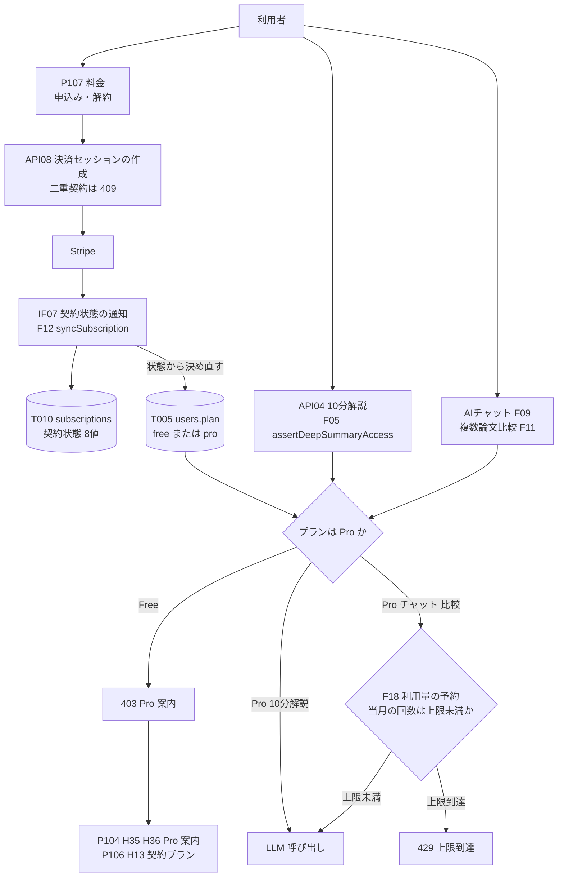
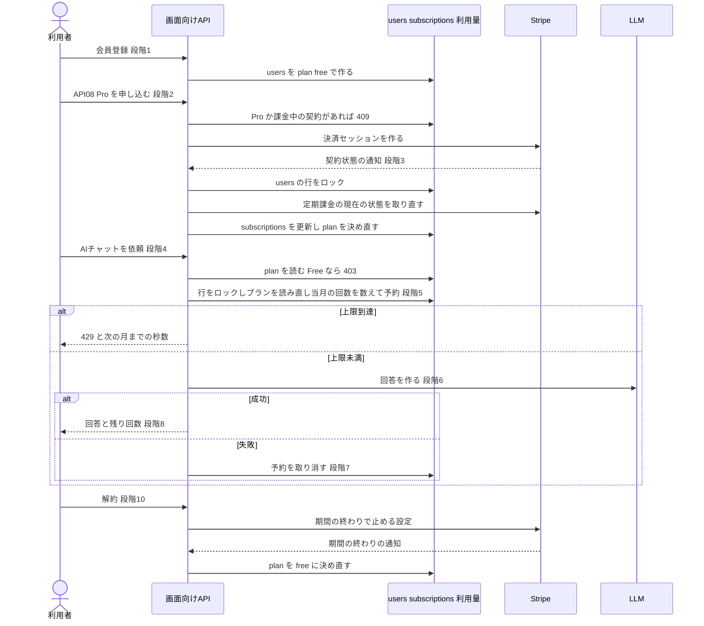

方式（共通基盤）: ARC008 プラン別機能制御・利用量上限 ／ 実体 17ファイル（定義元の資料1・実現先の設計書16） ／ 影響範囲 17件

# 方式設計書 — ARC008 プラン別機能制御・利用量上限

| 項目 | 内容 |
| :--- | :--- |
| 方式ID | ARC008（上流 `docs/基本設計書_概要.md` §11.1 で採番済み。本書で新しく採番した ID はありません） |
| 名称 | プラン別機能制御・利用量上限 |
| 更新日 | 2026-10-27 |
| インプット | (a) `source/`（全6ファイル227行。ARC008 に関わる行は `source/04_収益化とロードマップ.md:4-5,8,19-21,28,41,47`、`source/03_システム構成.md:15,39,44,54`、`source/02_機能要求定義.md:14,16,17`）／(b) `docs/基本設計書_概要.md` §2（BF09・BF11・BF12・BF13・EX06・EX07）、§4（F09〜F12・F18、エラー応答）、§6（T005・T010・CRUD図）、§7（API04・API08、IF06・IF07）、§8（認証・認可、Pro機能の不正利用）、§11.1・§11.2、付録 Q09・Q14・Q15・Q23・Q27・Q28・Q33／実現先の設計書 `docs/db/DB.T005`・`T010.DB物理設計.md`、`docs/detail/be/BE.F05`・`F06`・`F09`・`F10`・`F11`・`F12`・`F18.BE詳細設計.md`、`docs/detail/batch/BT.B007.バッチ詳細設計.md`、`docs/screens/画面.P104`・`P106`・`P107.画面基本設計.md`、`docs/detail/fe/FE.P104`・`P106`・`P107.FE詳細設計.md`／影響範囲の確認に使った設計書 `docs/detail/be/BE.F16`・`F19.BE詳細設計.md`／(c) `legacy/` |
| 既存資料の突合 | `legacy/` は空ディレクトリ（ファイル0件）で、突合する既存設計・業務資料はありません。本書の既存版（`docs/arch/方式.ARC008.方式設計.md`）も無く、今回が初版です。引き継ぐ記述は無く、引き継ぐ ID は上流で採番済みのもの（ARC001・ARC008・ARC010、F04〜F06・F09〜F12・F16・F18・F19、B007、T005・T010、API04・API08、IF06・IF07、P104・P106・P107、BF09・BF11〜BF13・EX06・EX07、Q09・Q14・Q15・Q23・Q27・Q28・Q33）と、下流の設計書で付けられた番号（F18-BE DA001〜DA004、F12-BE DA003〜DA005、F05-BE FN07・DA006、F09-BE DA001・DA002、画面の項目ID H13・H15・H16・H20・H22・H24・H35・H36・H55）だけです |
| 対象システムの性質 | `source/` は企画・初期設計の資料（Markdown）で、プログラムのソースコードはありません。本書は資料の記述を一次情報とし、資料に無い実現方法は、確定済みの下流設計書が定めた内容を「実現先」として引用します。下流設計書の※推測は本書でも※推測のまま扱います。下流どうしで食い違う箇所は、本書で扱いを決めるか、決められないものを付録Bに残します |

---

## 1. 機構の概要

* **解決している課題**: 本サービスは Free と Pro（月額980円・仮）の2つのプランで収益を得ます（`source/04_収益化とロードマップ.md:4-5`）。この仕組みが無いと、次の3つが起きます。
  1. **原価が売上を上回る**: AIチャットと複数論文比較は、利用者が依頼するたびにその場で LLM を呼ぶ機能で、利用者ごとの従量課金が主要コストに挙がっています（`source/04_収益化とロードマップ.md:21`）。回数に上限が無いと、1人の Pro 会員が月額980円を超える LLM 費用を使えてしまいます（`source/04_収益化とロードマップ.md:28`「Proの高コスト機能には利用量上限を設ける」、`:47`「1ユーザーあたりの粗利益」）。
  2. **有料の価値が無くなる**: Pro だけの機能（専門的な詳細解説・AIチャット・複数論文比較・カスタム通知）を Free でも使えると、Pro に申し込む理由が無くなります（`source/04_収益化とロードマップ.md:4-5`）。
  3. **画面だけで制限すると破られる**: 画面のボタンを隠すだけでは、API を直接呼ばれれば Pro 機能が使えてしまいます。プランと利用量は API 側で確かめる必要があります（上流 §8「Pro機能の不正利用」）。
* **設計方針**（資料から読み取れる範囲。推測は※推測と明記）:
  1. **プランの判定には `users.plan` だけを使う**（上流 §6 T005「Pro限定機能の利用可否に使う」、§8）。値は Free と Pro の2つです。契約の詳細（Stripe の状態）は `subscriptions` に持ちますが、要求のたびの判定には使いません（BE.F09:356）。
  2. **`users.plan` を書き換えるのは課金の通知の同期処理だけ**（上流 BF12「subscriptions を作成し users の plan を Pro に更新」）。Stripe からの通知を受けたら、Stripe に契約の現在の状態を問い合わせ直し、その状態から Pro か Free かを決め直します。利用者が自分のプランを書き換える手段は持たせません（※推測: 下流の設計判断。BE.F12:225,587、DB.T005:343-350）。
  3. **判定と制限はサーバ側の API で行い、画面はその結果を表示するだけにする**（上流 §8）。画面のプラン表示は案内のためで、制御には使いません（FE.P104:461、FE.P107:455）。
  4. **利用量は、LLM を呼ぶ前に1回分を予約して数える**（上流 EX07「当期の利用量を確認…上限到達を通知しLLMを呼ばない」、※推測: 下流の設計判断）。予約は利用者の行をロックしたうえで「当期の回数を数えて、上限未満なら1件追加」を1つのトランザクションで行い、同時に依頼が来ても上限を超えないようにします。結果を返せなかったときだけ予約を取り消します（BE.F18:114-115,150）。
  5. **設定が壊れていたら、使わせない側に倒す**（※推測）。上限値の設定が正しい整数でなければ上限0として扱います。費用が無制限にかかる側には倒しません（BE.F18:227）。
* **位置づけ**: 上流 §11.2 の相関では ARC008 は「F09・F11・F12・F18 の Pro関連機能」に効きます。画面向けAPIのうち、Pro 限定にしうる機能の入口すべて（API04 の10分解説、AIチャット、複数論文比較）と、課金（API08 と Stripe の通知）に効きます。責務の境目は次のとおりです。
  * ARC008 が受け持つ: プランの保存と書き換えの規則、機能ごとのプランの要否、利用量の数え方と上限、拒否したときの応答、画面の案内の出し分け。
  * ARC010 が受け持つ: 退会時の利用量の記録の削除（利用量テーブルの行は利用者の削除に合わせて消える。BE.F18:121-132）。
  * ARC001 が受け持つ: 10分解説を Pro 限定にしたときの応答のキャッシュ（利用者ごとに変わるため共有しない。BE.F05:243）。

  上の図で、10分解説は事前に作った要約を読むだけで、要求のたびに LLM を呼びません（「LLM 呼び出し」への矢印は、AIチャット・比較の場合だけ実際の呼び出しになる）。10分解説には利用量の上限がありません（BE.F05:129）。

---

## 2. 実体の構成

本方式は1つのプログラムではありません。資料の1か所で定められた決まりを、DB の2テーブル、課金の同期処理、3つの判定の入口、利用量の予約、画面の案内で分担して実現しています。下表の「定義元」は決まりを定めた資料、「実現先」はその決まりを具体化した確定済みの設計書です。

| # | パス | 種別 | 役割 | 備考 |
| :--- | :--- | :--- | :--- | :--- |
| 1 | `source/04_収益化とロードマップ.md` | 定義元（資料） | Free と Pro で使える機能（:4-5）、Pro の高コスト機能に利用量上限を設けること（:28）、Phase 4 の Stripe 連携・プラン管理・従量制限（:41）を定める | 上流 §11.1 の実体 |
| 2 | `docs/db/DB.T005.DB物理設計.md` | 実現先（DB物理設計） | プランの正 `users.plan`（2値・初期値 free）と、利用者が自分のプランを書き換えられない行単位アクセス制御 | 上流の適用範囲 T005 |
| 3 | `docs/db/DB.T010.DB物理設計.md` | 実現先（DB物理設計） | 契約状態8値と、それぞれのプランへの対応。課金中の契約を1人1件にする一意索引 | 上流の適用範囲 T010 |
| 4 | `docs/detail/be/BE.F12.BE詳細設計.md` | 実現先（BE詳細設計） | `users.plan` を書き換える唯一の処理（通知の同期・プランの決め直し）、申込み（API08）の二重契約の拒否、解約を期間の終わりで反映する決まり | 上流の適用範囲 F12・API08 |
| 5 | `docs/detail/be/BE.F18.BE詳細設計.md` | 実現先（BE詳細設計） | 利用量の予約・取消・上限値・集計期間・保存先テーブルの案 | 上流の適用範囲 F18。本方式の中心 |
| 6 | `docs/detail/be/BE.F09.BE詳細設計.md` | 実現先（BE詳細設計） | AIチャットの入口でのプランの判定（`assertProPlan`）と、予約・取消の呼び出し、403・429 の応答 | 上流の適用範囲 F09 |
| 7 | `docs/detail/be/BE.F11.BE詳細設計.md` | 実現先（BE詳細設計） | 複数論文比較の入口で、F09 と同じ判定と予約を行う | 上流の適用範囲 F11 |
| 8 | `docs/detail/be/BE.F05.BE詳細設計.md` | 実現先（BE詳細設計） | API04 の10分解説を Pro 限定にする判定（FN07）と、その切り替え | API04 の実装。※上流未定義（上流の適用範囲に F05 が無い） |
| 9 | `docs/detail/be/BE.F06.BE詳細設計.md` | 実現先（BE詳細設計） | 会員登録のときに利用者の行をプラン free で作る。画面にプランを返す `GET /api/me` | ※上流未定義（上流の適用範囲に F06 が無い） |
| 10 | `docs/detail/be/BE.F10.BE詳細設計.md` | 実現先（BE詳細設計） | 通知の配信対象を読むときにプランも読み、Pro の「カスタム通知」の分岐を置く位置を用意する（中身は未定義） | 上流の適用範囲 F10 |
| 11 | `docs/detail/batch/BT.B007.バッチ詳細設計.md` | 実現先（バッチ詳細設計） | F10 の配信バッチ。プランを読むが、今は Free と Pro に同じ内容を送る | ※上流未定義（上流の適用範囲に B007 が無い） |
| 12 | `docs/screens/画面.P107.画面基本設計.md` | 実現先（画面基本設計） | Free と Pro の機能の比較（H15・H20）、利用量上限の注記（H22）、申込み・解約と契約状態による出し分け（H16・H24〜H28） | ※上流未定義（上流の適用範囲に P107 が無い） |
| 13 | `docs/detail/fe/FE.P107.FE詳細設計.md` | 実現先（FE詳細設計） | 機能の一覧 `PLAN_CATALOG` と表示の出し分け `resolvePlanView`、申込みの 409 の扱い | P107 の実装 |
| 14 | `docs/screens/画面.P104.画面基本設計.md` | 実現先（画面基本設計） | API04 の 403 を受けて Pro 案内（H35・H36）を出す | ※上流未定義（上流の適用範囲に P104 が無い） |
| 15 | `docs/detail/fe/FE.P104.FE詳細設計.md` | 実現先（FE詳細設計） | 403 の理由で Pro 案内を出し分ける（`fetchPaperSummary` 手順5、C14 の `proRequired`） | P104 の実装 |
| 16 | `docs/screens/画面.P106.画面基本設計.md` | 実現先（画面基本設計） | 契約プランの表示（H13）、料金画面への導線（H15）、退会時の Pro 解約の注記（H55） | ※上流未定義（上流の適用範囲に P106 が無い） |
| 17 | `docs/detail/fe/FE.P106.FE詳細設計.md` | 実現先（FE詳細設計） | プランの表示名の変換（`formatPlanLabel`）と退会の確認の文言の出し分け | P106 の実装 |

* **命名規則・配置規則**（新規追加時に従うべき規則）:
  * プランのコードは英小文字の `free`・`pro` です（DB.T005 `ck_users_plan`）。画面の表示名は「Free」「Pro」に変換します（FE.P106 `formatPlanLabel`）。
  * 利用量を数える機能の区分は、英小文字スネークケースの機能名にします（`ai_chat`・`paper_compare`）。上限値の環境変数は `USAGE_LIMIT_{区分の大文字}` にします（`USAGE_LIMIT_AI_CHAT`）。
  * 利用量の処理は `web/lib/usage/` に置きます（`usageService.ts`・`usageLimits.ts`・`usagePeriod.ts`・`usageRepository.ts`）。プランの判定の入口は各機能のサービスの手前に置きます（AIチャット・比較は `lib/chat/plan-guard.ts` を共用、10分解説は `lib/server/papers/summaryService.ts`）。
  * 契約状態からプランへの対応は `lib/billing/planRules.ts` の1か所に置きます（`isProStatus`・`PRO_STATUSES`）。
  * 拒否の応答のエラーコードは、プランが足りないとき `PRO_REQUIRED`、利用量の上限に達したとき `USAGE_LIMIT_EXCEEDED` です（本書 §4 エラー応答で決める）。
* **全数**: 17件（定義元の資料1件＋実現先の設計書16件。実現先の内訳は DB物理設計2件・BE詳細設計7件・バッチ詳細設計1件・画面基本設計3件・FE詳細設計3件）。根拠: 定義元は上流 §11.1 ARC008 行の「実体」列に挙がった1ファイル（`source/04_収益化とロードマップ.md:4-5,28,41`）と一致します。実現先は、全47本の確定済み設計書（`docs/db/` 10本・`docs/detail/be/` 19本・`docs/detail/batch/` 11本・`docs/detail/fe/` 7本）と画面基本設計書7本を1本ずつ調べ、ARC008 を「利用する方式」に挙げ、かつプランの保存・書き換え・判定・利用量・案内の表示のどれかを自ら定めているものを数えました。振り分けは次のとおりです。
  * 実現先（13本＋画面基本設計3本）: 上表 #2〜#17。
  * 影響範囲だけ（2本）: `BE.F16`（退会で Pro の定期課金を解約する。判定はプランではなく契約状態で行うと明記。F16:372）、`BE.F19`（プランを集計に使うだけで、機能の利用は制御しないと明記。F19:408）。§6 に行があります。
  * 対象外（32本＋画面基本設計4本）: `DB.T001`〜`T004`・`T006`〜`T009`（8本。プランを持たない）、`BE.F01`〜`F04`・`F07`・`F08`・`F13`〜`F15`・`F17`（10本。プランによる出し分けが無いと明記）、`BT.B001`〜`B006`・`B008`〜`B011`（10本。使わないと明記）、`FE.P101`〜`P103`・`P105`（4本。プランで変わる機能が無いと明記）、`画面.P101`〜`P103`・`P105`（4本。言及なし）。

* **構成要素ロースター**（本方式を形づくる要素の全数。ID は上流と下流の設計書で付いた名前をそのまま使い、本書では採番しません）:

| # | 種別 | 名称（既存の識別子） | 概要 | 定義状況 | 詳細の所在 |
| :--- | :--- | :--- | :--- | :--- | :--- |
| 1 | 列 | `users.plan`（T005） | 利用者のプラン。判定の正。初期値 free | 詳細 | §4 プランと契約状態、DB.T005:186,202 |
| 2 | CHECK 制約 | `ck_users_plan` | プランを free・pro の2値に限る | 簡易 | DB.T005:219 |
| 3 | 行単位アクセス制御 | `users_select_own`（読み取りだけのポリシー） | 利用者は自分の行を読めるが、プランを書き換えるポリシーは無い | 詳細 | DB.T005:343-350 |
| 4 | 列 | `subscriptions.status`（T010。8値・`ck_subscriptions_status`） | Stripe の定期課金の状態をそのまま持つ。プランを決め直す材料 | 詳細 | §4 プランと契約状態、DB.T010:192,236 |
| 5 | 一意索引 | `uq_subscriptions_user_billing` | 課金中の5状態の契約を1人1件までにする。二重課金の最後の防壁 | 詳細 | DB.T010:204,235 |
| 6 | 対応表 | `isProStatus`・`PRO_STATUSES`（`lib/billing/planRules.ts`） | 契約状態のうち試用中・有効・支払い遅延を Pro にする対応の1か所 | 詳細 | §4 プランと契約状態、BE.F12:525 |
| 7 | 処理 | `syncSubscription`（`lib/billing/webhookService.ts`） | Stripe の通知を受けて、利用者の行をロックし、Stripe から状態を取り直し、契約を更新し、プランを決め直す | 詳細 | §3 段階3、BE.F12:392-394 |
| 8 | データアクセス | F12-BE DA005 プランの決め直し | 対象の利用者に Pro の状態の契約が1件でもあれば pro、無ければ free に書き換える | 詳細 | §3 段階3、BE.F12:394 |
| 9 | 通知の種類 | Stripe の通知4種（`checkout.session.completed`・`customer.subscription.created`・`.updated`・`.deleted`） | プランを決め直すきっかけ。通知の中の状態は信じず取り直す | 詳細 | BE.F12:240-246 |
| 10 | 判定 | API08 の二重契約の拒否（409 `ALREADY_SUBSCRIBED`・`SUBSCRIPTION_NEEDS_ATTENTION`） | すでに Pro か課金中の契約があれば、新しい決済セッションを作らない | 詳細 | §4 エラー応答、BE.F12:210,217-218 |
| 11 | 決まり | 解約は期間の終わりで反映 | 解約の操作では Stripe に「期間の終わりで止める」を入れるだけで、プランは期間の終わりの通知で free に戻る | 詳細 | §3 段階10、BE.F12:30 |
| 12 | 処理 | 会員登録時の利用者の行の作成（F06） | 利用者の行をプラン free で作る。行が無い会員は Free と同じに扱う | 詳細 | §3 段階1、BE.F06:456,513 |
| 13 | 判定の入口 | `assertDeepSummaryAccess`（F05 FN07） | 10分解説を Pro 限定にする設定が有効なとき、ゲストと Free に 403 を返す | 詳細 | §3 段階4、BE.F05:455 |
| 14 | 設定値 | 10分解説を Pro 限定にする切り替え（名前は未定） | 上流 Q09 が決まるまでの切り替え。既定は無効（※推測） | 詳細 | §4 設定項目、BE.F05:455 |
| 15 | 判定の入口 | `assertProPlan`（`lib/chat/plan-guard.ts`。F09・F11 で共用） | AIチャット・比較の前にプランを読み、Pro でなければ 403。契約が無ければ WARN ログだけ | 詳細 | §3 段階4、BE.F09:356 |
| 16 | データアクセス | F09-BE DA001 `findUserPlan` | 利用者のプランを1件読む。リクエスト1回につき1回 | 簡易 | BE.F09:237,245-249 |
| 17 | データアクセス | F09-BE DA002 `findBillingSubscription` | 契約中（試用中・有効・支払い遅延）の定期課金を読む。判定には使わない | 簡易 | BE.F09:238,251-259 |
| 18 | 分岐の位置 | 通知の配信対象のプランの読み込み（F10 FN02・DA001、B007） | 配信対象者を読むときにプランも読む。カスタム通知の中身が未定義のため分岐は空 | 詳細 | §7 制約4、BE.F10:92,450、BT.B007:647 |
| 19 | テーブル | `{利用量テーブル}`（※上流未定義。上流 Q23） | 予約1件を1行で持つ。列は ID・利用者ID・機能の区分・集計期間の開始日・予約日時・取消日時 | 詳細 | §4 利用量の記録、BE.F18:121-132 |
| 20 | 索引 | 利用者ID・機能の区分・集計期間の開始日の部分索引（取消日時が空の行だけ） | 当期の使用回数を速く数える | 簡易 | BE.F18:132 |
| 21 | 処理 | `reserveUsage`（`web/lib/usage/usageService.ts`） | 1つのトランザクションで、利用者の行のロック・プランの読み直し・当期の回数の集計・予約の追加を行う | 詳細 | §3 段階5、BE.F18:208,225 |
| 22 | 処理 | `releaseUsage` | 結果を返せなかったときに予約を取り消す。二度呼んでも回数は減りすぎない | 詳細 | §3 段階7、BE.F18:209,226 |
| 23 | 処理 | `resolveUsageLimit`（`usageLimits.ts`） | 機能の区分から上限値を決める。設定が正しくなければ0 | 詳細 | §4 設定項目、BE.F18:227 |
| 24 | 処理 | `currentUsagePeriod`（`usagePeriod.ts`） | 日本時間の暦月で、当期の開始日と次の期の開始までの秒数を出す | 詳細 | §4 利用量の記録、BE.F18:228 |
| 25 | データアクセス | F18-BE DA001 `lockMemberForUsage` | 利用者の行に更新のためのロックを付けてプランを読む。待ちは3秒まで | 詳細 | §3 段階5、BE.F18:150 |
| 26 | データアクセス | F18-BE DA002 `countActiveUsage` | 当期の、取り消されていない予約の件数を数える | 詳細 | BE.F18:151 |
| 27 | データアクセス | F18-BE DA003 `insertUsageReservation` | 予約を1行追加して予約番号を返す | 詳細 | BE.F18:152 |
| 28 | データアクセス | F18-BE DA004 `releaseUsageReservation` | 取消日時が空の予約にだけ取消日時を入れる | 詳細 | BE.F18:153 |
| 29 | 設定値 | `USAGE_LIMIT_AI_CHAT`（※上流未定義） | AIチャットの1か月の上限回数（※推測: 100） | 簡易 | §4 設定項目 |
| 30 | 設定値 | `USAGE_LIMIT_PAPER_COMPARE`（※上流未定義） | 複数論文比較の1か月の上限回数（※推測: 20） | 簡易 | §4 設定項目 |
| 31 | 設定値 | `STRIPE_PRICE_ID_PRO`（※上流未定義） | Pro の料金を指す Stripe の価格ID。未設定なら申込みは 500 | 簡易 | §4 設定項目、BE.F12:32 |
| 32 | エラー応答 | 403 `PRO_REQUIRED`（F09・F11・F18） | プランが Pro でないときの拒否 | 詳細 | §4 エラー応答 |
| 33 | エラー応答 | 403 `PRO_PLAN_REQUIRED`（F05） | 10分解説で Pro でないときの拒否。#32 と名前が違う | 詳細 | §4 エラー応答、§7 制約1 |
| 34 | エラー応答 | 429 `USAGE_LIMIT_EXCEEDED`（`Retry-After` 付き） | 当期の上限に達したときの拒否。次の期の開始までの秒数を返す | 詳細 | §4 エラー応答、BE.F18:114 |
| 35 | 応答項目 | `usage.remaining`（F09・F11 の成功時の応答） | 今回の分を差し引いた当期の残り回数 | 簡易 | BE.F09:176,188 |
| 36 | 画面表示 | P104 H35・H36 Pro 案内（FE.P104 C14 の `proRequired`） | API04 の 403 を受けて「10分解説は Pro プランでご利用いただけます」と料金画面への導線を出す | 詳細 | 画面.P104:131-132、FE.P104:124,349 |
| 37 | 画面表示 | P106 H13 契約プラン・H55 退会時の解約の注記 | プランの表示と、Pro なら退会で定期課金も解約される旨 | 簡易 | 画面.P106:116,158 |
| 38 | 画面の定数 | `PLAN_CATALOG`（FE.P107）と H15・H20 の機能比較 | Free と Pro で使える機能の一覧。提供前の機能には「準備中」を付ける | 詳細 | §4 機能とプランの対応、FE.P107:320 |
| 39 | 画面表示 | P107 H22 利用量上限の注記 | 「AIチャット・比較は1か月あたりの利用回数に上限があります」 | 簡易 | 画面.P107:120 |
| 40 | 画面の処理 | `resolvePlanView`（FE.P107） | ゲスト・Free・Pro・取得失敗で、カードの下端と契約の節の表示を出し分ける | 詳細 | FE.P107:358、画面.P107:224-227 |
| 41 | API | `GET /api/me` のプラン（F06。※上流未定義） | 画面のヘッダーとマイページにプランを返す。表示だけに使う | 簡易 | FE.P104:373、FE.P106:412 |
| 42 | ログ | 403・429 の INFO ログ、LLM のトークン数の INFO ログ | 拒否の頻度と、F19 の原価の監視の材料 | 簡易 | §4 ログ、BE.F09:361,383,385 |

**総件数: 42件**（プランと契約の保存・書き換え12件（#1〜#12）・判定の入口と読み込み6件（#13〜#18）・利用量10件（#19〜#28）・設定値3件・エラー応答と応答項目4件・画面6件（#36〜#41。API 1件を含む）・ログ1件。定義状況は詳細30件・簡易12件）。**全数である根拠**: 実現先の設計書16本（§2 #2〜#17）から、「ARC008」「plan」「プラン」「Pro」「利用量」「上限」「PRO_REQUIRED」「USAGE_LIMIT」を含む記述を全件拾い、プランの保存・書き換え・判定、利用量の予約と数え方、拒否の応答、案内の表示のどれかを担うものを数えました。次のものは他の方式または各機能の責務として除いています: Stripe との通信の詳細（`STRIPE_SECRET_KEY`・`STRIPE_WEBHOOK_SECRET`・署名検証）は F12 と IF06・IF07、退会時の利用量の記録の削除は ARC010、応答のキャッシュの指定は ARC001、AIチャット・比較の LLM のモデル（`LLM_CHAT_MODEL_ID`・`LLM_COMPARE_MODEL_ID`）は F09・F11、通知の提供の切り替え `NOTIFICATION_ENABLED` は F10。
**定義状況の判定**（completeness 3-1）: 分岐がある（3-1 の1）・状態を変える（同2）・複数テーブルにまたがる（同3）・失敗時の扱いが自明でない（同5）・業務上の判断を含む（同7）のどれかに当たるものを「詳細」としました。#2 は2値の制約、#16・#17 はキー1つで読むだけ、#20 は性能のための索引、#29〜#31 は値を1つ持つだけ、#35・#37・#39・#41 は値や文言を表示するだけ、#42 はログを出すだけで、いずれも分岐・状態の変更を含まないため「簡易」です。

---

## 3. ライフサイクル（登録・読込・選択）

* **時系列**: 会員登録から Pro への切り替え、Pro 機能の利用、解約までを示します。

| 段階 | 契機 | 処理 | 実装（ファイル:行） |
| :--- | :--- | :--- | :--- |
| 0 起動 | 画面向けAPIの起動 | 上限値（`USAGE_LIMIT_AI_CHAT`・`USAGE_LIMIT_PAPER_COMPARE`）、10分解説を Pro 限定にする切り替え、Pro の価格ID（`STRIPE_PRICE_ID_PRO`）を環境変数から読みます。上限値は要求のたびに `resolveUsageLimit` が読み、正しい整数でなければ0として ERROR ログを出します | `docs/detail/be/BE.F18.BE詳細設計.md:227`、`docs/detail/be/BE.F05.BE詳細設計.md:455`、`docs/detail/be/BE.F12.BE詳細設計.md:32` |
| 1 会員登録 | 利用者が初めてログインしたとき | 利用者の行をプラン free で作ります。行がまだ無い会員が Pro 機能を求めたときは、Free と同じに扱って 403 にします | `docs/detail/be/BE.F06.BE詳細設計.md:456,513`、`docs/detail/be/BE.F09.BE詳細設計.md:199,356`、`docs/基本設計書_概要.md:297` |
| 2 申込み | 料金画面（P107）で「Pro に申し込む」を押したとき（API08） | すでに Pro か、試用中・有効・支払い遅延の契約があれば 409 `ALREADY_SUBSCRIBED`、未払い・一時停止の契約が残っていれば 409 `SUBSCRIPTION_NEEDS_ATTENTION` を返し、決済セッションを作りません。それ以外は Stripe の決済画面の URL を返します。この時点ではプランは変わりません | `docs/detail/be/BE.F12.BE詳細設計.md:210,217-218`、`docs/screens/画面.P107.画面基本設計.md:153` |
| 3 プランの決め直し | Stripe から契約状態の通知（4種）が届いたとき | 1つのトランザクションで、利用者の行をロックし（待ち5秒・全体30秒で打ち切り）、Stripe API で定期課金の現在の状態を取り直し、`subscriptions` を追加または更新し、その利用者に Pro にする状態（試用中・有効・支払い遅延）の契約が1件でもあれば pro、無ければ free にプランを書き換えます。通知の中の状態は使いません（届く順番が前後しても、最後に書いた状態が Stripe の現在の状態と一致するようにするため） | `docs/detail/be/BE.F12.BE詳細設計.md:225,240-246,392-394,449-465,587` |
| 4 プランの判定 | Pro 限定にしうる機能が求められたとき | 10分解説（API04）: 切り替えが有効で、深さが10分解説のとき、ゲストまたは Free なら 403 `PRO_PLAN_REQUIRED`。AIチャット・比較: `assertProPlan` がプランを読み、Pro でなければ 403 `PRO_REQUIRED`。Pro なのに契約が見つからなければ WARN ログを残して続けます。通知（F10・B007）: プランを読むだけで分岐はありません | `docs/detail/be/BE.F05.BE詳細設計.md:135,455`、`docs/detail/be/BE.F09.BE詳細設計.md:356,384`、`docs/detail/be/BE.F11.BE詳細設計.md:382`、`docs/detail/batch/BT.B007.バッチ詳細設計.md:647` |
| 5 利用量の予約 | AIチャット・比較で、段階4を通ったとき | 1つのトランザクションで、利用者の行にロックを付けてプランを読み直し（段階4の後で Free に戻った人を通さない）、当期の取り消されていない予約を数え、上限値未満なら予約を1行追加して予約番号と残り回数を返します。上限以上なら 429 `USAGE_LIMIT_EXCEEDED` と次の期の開始までの秒数を返します。ロックの待ちは3秒、文は5秒で打ち切ります。同じ利用者の依頼はロックで1件ずつ順に数えるため、同時に来ても上限を超えません | `docs/detail/be/BE.F18.BE詳細設計.md:114,150-153,225` |
| 6 実行 | 予約が確定した後 | LLM を呼びます。ロックは予約の確定で外れており、LLM の応答を待つ間は持ちません | `docs/detail/be/BE.F18.BE詳細設計.md:150,258` |
| 7 取消 | 結果を返せなかったとき（404・502・500） | 予約を取り消します（取消日時を入れる）。取消日時が空の予約だけを対象にするため、二度呼んでも回数が減りすぎません。取消に失敗した予約は消費として残り、ERROR ログの予約番号で運用者が取り消します。成功したときは確定の処理を呼ばず、予約がそのまま消費になります | `docs/detail/be/BE.F18.BE詳細設計.md:29,115,153,226`、`docs/detail/be/BE.F09.BE詳細設計.md:200-203` |
| 8 応答 | 成功したとき | 結果とあわせて当期の残り回数（`usage.remaining`）を返します。LLM のトークン数を INFO ログに出し、F19 の原価の監視に使います | `docs/detail/be/BE.F09.BE詳細設計.md:176,188,361` |
| 9 画面の案内 | 画面を開いたとき、403・409 を受けたとき | P104: API04 の 403 で Pro 案内（H35・H36）。P106: 契約プラン（H13）と、Pro なら退会で定期課金も解約される注記（H55）。P107: ゲスト・Free・Pro で「無料で会員登録」「現在のプラン」「Pro に申し込む」と契約の節を出し分け、利用量上限を注記（H22）。画面のプラン表示は案内だけで、制御には使いません | `docs/screens/画面.P104.画面基本設計.md:131-132,152`、`docs/screens/画面.P106.画面基本設計.md:116,158`、`docs/screens/画面.P107.画面基本設計.md:120,224-227`、`docs/detail/fe/FE.P104.FE詳細設計.md:349,461` |
| 10 解約 | 料金画面で「解約する」を押したとき | Stripe に「期間の終わりで止める」設定だけを入れます。プランはその期間の終わりまで Pro のままで、期間の終わりに届く通知で段階3が走り free に戻ります。退会（F16）のときは、契約状態を見て定期課金を解約します | `docs/detail/be/BE.F12.BE詳細設計.md:30,246`、`docs/detail/be/BE.F16.BE詳細設計.md:372` |
| 11 期の切り替え・失効 | 日本時間の毎月1日0時 | 回数を0に戻す処理はありません。数えるときの条件（当期の開始日）が変わるため、自然に新しい期の回数になります。古い期の予約の行は消しません。退会で利用者の行が消えると、利用量の行も外部キーの連鎖で消えます | `docs/detail/be/BE.F18.BE詳細設計.md:25,32,121-132,234` |
| 12 ログ | 拒否・失敗のたび | 403・429 は INFO、プランと契約の食い違いは WARN、ロックの待ち時間切れ・設定の誤り・取消の失敗は ERROR です | `docs/detail/be/BE.F18.BE詳細設計.md:244-253`、`docs/detail/be/BE.F09.BE詳細設計.md:383-385` |

* **読込順序**（プランの値がどこから来て、どれが勝つか）:

| 順 | 情報源 | 扱い | 根拠 |
| :--- | :--- | :--- | :--- |
| 1 | Stripe API の定期課金の現在の状態 | 段階3で取り直し、これを正として `subscriptions` に書く。通知の中の状態より優先する | BE.F12:225,587 |
| 2 | `subscriptions.status` | 段階3で、Pro にする状態の契約が1件でもあるかの判定に使う。要求のたびの判定には使わない | BE.F12:394 |
| 3 | `users.plan` | 要求のたびの判定に使う唯一の値。段階3の結果だけで書き換わる | DB.T005:202,205、BE.F09:356 |
| 4 | 予約のときのロック付きの読み直し | 段階4と段階5の間にプランが変わった場合は、段階5の値が勝つ | BE.F18:150 |
| 5 | 画面のプラン表示（`GET /api/me`） | 表示だけに使い、判定には使わない。申込み直後は通知の遅れで Free のまま見えることがある | 画面.P106:113、FE.P104:461 |

* **選択規則**:
  1. **機能ごとにプランが要るか**: §4 機能とプランの対応の表で決まります。表に無い機能はプランを確かめません（Free と Pro で同じ）。
  2. **契約状態からプランへ**: §4 プランと契約状態の表の8行で決まります。表に無い状態が届いたら例外にして 500 を返し、プランを変えません（BE.F12:525,584）。
  3. **上限値の選択**: 機能の区分が `ai_chat` なら `USAGE_LIMIT_AI_CHAT`、`paper_compare` なら `USAGE_LIMIT_PAPER_COMPARE` です。
  4. **拒否の順**: 未ログイン（401）→ プランが Pro でない（403）→ 利用量の上限（429）の順に判定します。403 の利用者に 429 は返しません。

---

## 4. インターフェース・データ構造

* **機能とプランの対応**（上流 §8 と `source/04_収益化とロードマップ.md:4-5` を、各機能の設計で実現した結果）:

| No | 機能（ID） | 入口 | Free | Pro | 利用量の上限 | 拒否の応答 | 根拠 |
| :--- | :--- | :--- | :--- | :--- | :--- | :--- | :--- |
| 1 | 10分解説（F05・API04 の `depth=deep`） | `assertDeepSummaryAccess` | 切り替えが無効なら使える。有効ならゲストと Free は使えない（上流 Q09 の決定待ち） | 使える | なし | 403 `PRO_PLAN_REQUIRED` | BE.F05:135,455 |
| 2 | AIチャット（F09） | `assertProPlan` → `reserveUsage` | 使えない | 上限付きで使える | `USAGE_LIMIT_AI_CHAT`／1か月 | 403 `PRO_REQUIRED`、429 `USAGE_LIMIT_EXCEEDED` | BE.F09:199,201、BE.F18:227 |
| 3 | 複数論文比較（F11） | `assertProPlan` → `reserveUsage` | 使えない | 上限付きで使える | `USAGE_LIMIT_PAPER_COMPARE`／1か月 | 403 `PRO_REQUIRED`、429 `USAGE_LIMIT_EXCEEDED` | BE.F11:235,237 |
| 4 | カスタム通知（F10・B007） | 配信対象の読み込み（プランを読むだけ） | 通常のダイジェスト | 中身が未定義のため、Free と同じダイジェスト | なし | なし | BE.F10:92,450、BT.B007:647 |
| 5 | Pro の申込み（F12・API08） | API08 | 申し込める | 申し込めない | なし | 409 `ALREADY_SUBSCRIBED` | BE.F12:210,562 |
| 6 | 新着検索・自由検索・30秒要約・3分要約・基本推薦・ブックマーク・閲覧履歴（F02・F03・F05・F07・F08・F15） | なし | 使える | 使える | なし | なし | `source/04_収益化とロードマップ.md:4`、BE.F02:404、BE.F03:418、BE.F07:521、BE.F08:563、BE.F15:389 |

  **総件数: 6行**（Pro 限定の4機能（上流 §8 の「専門的な詳細解説・AIチャット・複数論文比較・カスタム通知」）と申込み、プランを問わない機能の1行）。

* **プランと契約状態**（`subscriptions.status` の8値と、段階3で決まるプラン）:

| No | 契約状態 | 意味 | プラン | 課金中の5状態（1人1件まで）に入るか | 根拠 |
| :--- | :--- | :--- | :--- | :--- | :--- |
| 1 | `trialing` | 試用中。本サービスは試用期間を設けないが、値が届いたら Pro にする | pro | 入る | DB.T010:309 |
| 2 | `active` | 有効 | pro | 入る | DB.T010:310 |
| 3 | `past_due` | 支払い遅延。Stripe が支払いを自動で再試行している間は Pro のまま（※推測・上流 Q28） | pro | 入る | DB.T010:224,311 |
| 4 | `unpaid` | 未払い。再試行がすべて失敗した | free | 入る | DB.T010:312 |
| 5 | `paused` | 一時停止 | free | 入る | DB.T010:314 |
| 6 | `incomplete` | 最初の支払いが済んでいない（上流 EX06「plan は Free のまま」） | free | 入らない | DB.T010:225,307 |
| 7 | `incomplete_expired` | 最初の支払いが期限切れ | free | 入らない | DB.T010:308 |
| 8 | `canceled` | 解約済み | free | 入らない | DB.T010:313 |

  **総件数: 8行**（`ck_subscriptions_status` が許す値と一致）。

* **利用量の記録**（`{利用量テーブル}`。※上流未定義・上流 Q23。予約1件が1行）:

| No | 列 | 型の案 | 意味 |
| :--- | :--- | :--- | :--- |
| 1 | `id` | UUID（主キー） | 予約番号。取消のときに使う |
| 2 | `user_id` | UUID（`users` への外部キー。利用者を消すと連鎖して消える） | 誰の利用か |
| 3 | `feature` | `ai_chat` または `paper_compare` | どの機能の利用か |
| 4 | `period_start` | DATE（日本時間の月初） | どの期の利用か。数えるときの条件 |
| 5 | `reserved_at` | TIMESTAMPTZ | 予約した日時 |
| 6 | `released_at` | TIMESTAMPTZ（空を許す） | 取り消した日時。空なら消費として数える |

  **総件数: 6列**（BE.F18:121-132 の案と一致）。数える単位は「依頼の回数」で、トークン数ではありません（トークン数はログに出すだけ。BE.F18:26）。集計期間は日本時間の暦月で、請求期間には合わせません（契約テーブルに請求期間の列が無いため。BE.F18:25）。

* **エラー応答**（本方式の拒否と、その表記の決定）:

| No | 状態コード | エラーコード | いつ返すか | 画面の扱い | 根拠 |
| :--- | :--- | :--- | :--- | :--- | :--- |
| 1 | 403 | `PRO_REQUIRED` | AIチャット・比較で、プランが Pro でないとき（行が無い会員を含む） | Pro 案内と料金画面への導線（F09・F11 の画面は未設計） | BE.F09:199、BE.F11:235、BE.F18:114 |
| 2 | 403 | `PRO_PLAN_REQUIRED` | 10分解説で、切り替えが有効かつゲストか Free のとき | P104 の H35・H36 | BE.F05:135、FE.P104:437 |
| 3 | 429 | `USAGE_LIMIT_EXCEEDED` | 当期の上限に達したとき。`Retry-After` に次の期の開始までの秒数（切り上げ） | 未設計（画面に 429 の扱いが無い。§7 制約3） | BE.F18:114,248、BE.F09:190-191 |
| 4 | 409 | `ALREADY_SUBSCRIBED` | 申込みで、すでに Pro か課金中の契約があるとき | 「すでに Pro プランをご契約中です。」を出して契約を取り直す | BE.F12:210,562、画面.P107:153 |
| 5 | 409 | `SUBSCRIPTION_NEEDS_ATTENTION` | 申込みで、未払い・一時停止の契約が残っているとき | 失敗のダイアログ（※上流未定義） | BE.F12:217-218、FE.P107:363 |

  **総件数: 5行**。応答の本文は `{"status":"error","error":{"code","message"}}` です（BE.F09:191）。No.1 と No.2 は同じ「プランが足りない」を別の名前で返しています。本書は **`PRO_REQUIRED` に揃えることを決めます**（※推測。使う設計書が3本（F09・F11・F18）と多く、No.2 を使うのは F05 と FE.P104 だけのため）。F05-BE と FE.P104 の記述の修正を求めます（付録B No.1）。

* **機構の入出力**:

| 方向 | 相手 | 渡すもの | 形 | 根拠 |
| :--- | :--- | :--- | :--- | :--- |
| 入力 | Stripe | 契約状態の通知（4種）と、取り直した定期課金の状態 | Webhook と Stripe API の応答 | BE.F12:240-246 |
| 入力 | F09・F11 | 利用者ID・機能の区分 | `reserveUsage` の引数 | BE.F18:114 |
| 出力 | F09・F11 | 予約番号と残り回数、または 403・429 | `reserveUsage` の戻り値か例外 | BE.F18:114 |
| 出力 | 画面 | プラン（free・pro） | `GET /api/me` の応答（※上流未定義） | FE.P104:373、FE.P106:412 |
| 出力 | F19 | トークン数（INFO ログ）、プラン（集計の軸） | ログと `users.plan` | BE.F09:361、BE.F19:408 |

  **総件数: 5行**。

* **設定項目**（全項目）:

| No | 名前 | 種別 | 既定値 | 意味 | 変えたときの効き方 | 根拠 |
| :--- | :--- | :--- | :--- | :--- | :--- | :--- |
| 1 | `USAGE_LIMIT_AI_CHAT` | 環境変数（※上流未定義） | 100（※推測。上流 Q14） | AIチャットの1か月の上限回数 | 次の依頼から効く（要求のたびに読む）。下げると、すでに超えている人は次の月まで使えない | BE.F18:24,33,227 |
| 2 | `USAGE_LIMIT_PAPER_COMPARE` | 環境変数（※上流未定義） | 20（※推測。上流 Q14） | 複数論文比較の1か月の上限回数 | No.1 と同じ形で効く | BE.F18:24,33,227 |
| 3 | 10分解説を Pro 限定にする切り替え（名前は未定） | 環境変数（※推測・※上流未定義） | 無効 | 有効にすると、ゲストと Free は10分解説を見られない | 画面向けAPIの再起動後に効く。P107 の機能の一覧（`PLAN_CATALOG`）と P104 の案内は連動しないため、あわせて直す（§7 制約2） | BE.F05:455 |
| 4 | `STRIPE_PRICE_ID_PRO` | 環境変数（※上流未定義） | — | Pro の料金を指す Stripe の価格ID | 変えると新しい申込みから新しい価格になる。既存の契約は変わらない（※推測） | BE.F12:32,59,527 |

  **総件数: 4件**（構成要素ロースター #14・#29〜#31 と一致）。予約のロックの待ち3秒・文の打ち切り5秒、同期処理の待ち5秒・30秒、集計期間（日本時間の暦月）は設定値ではなくプログラムの中の定数です（BE.F18:150、BE.F12:392）。

* **ログ**: 403・429 は INFO、プランと契約の食い違いは WARN、ロックの待ち時間切れ・設定の誤り・取消の失敗・DB 障害は ERROR です（BE.F18:244-253、BE.F09:383-385）。F18 は利用者IDをログに出さず、F09・F11 は 403・429 の INFO に利用者IDを出しています（付録B No.6）。

---

## 5. 拡張・変更手順

**機能を1つ Pro 限定にする手順**（例: 新しい LLM 機能を Pro 限定・利用量上限付きで加える場合）:

1. **上流に確認する**: 機能IDを上流 §4 で採番してもらい、上流 §8 の Pro 限定の一覧と、§11.1 ARC008 の適用範囲に加えます。
2. **入口に判定を置く**: 機能のサービスを呼ぶ前に `assertProPlan`（`lib/chat/plan-guard.ts`）を呼び、Pro でなければ 403 `PRO_REQUIRED` を返します。画面だけで隠す形にはしません。
3. **LLM を呼ぶなら利用量を数える**: 機能の区分を英小文字スネークケースで決め（例 `paper_summary_qa`）、`{利用量テーブル}` の `feature` の値と、`resolveUsageLimit` の対応に加えます。上限値の環境変数 `USAGE_LIMIT_{区分の大文字}` を加え、既定値を決めます（未設定なら0で使えなくなる）。
4. **呼び出しの順を守る**: `assertProPlan` → `reserveUsage` → LLM → 成功なら応答（`usage.remaining` を含める）、失敗なら `releaseUsage` の順にします。予約の前に LLM を呼ばないこと。
5. **拒否の応答を揃える**: 403 は `PRO_REQUIRED`、429 は `USAGE_LIMIT_EXCEEDED` と `Retry-After` を返します。
6. **画面を直す**: P107 の機能の一覧（`PLAN_CATALOG`、H20）に機能を加え、提供前なら「準備中」を付けます。上限があるなら H22 の注記の対象に加えます。入口の画面に、403 の Pro 案内と 429 の上限到達の案内を置きます。
7. **ログと監視**: トークン数を INFO ログに出し、F19 の原価の集計に入るようにします。
8. **反映**: 環境変数を設定してから画面向けAPIを再起動します。逆にすると、上限値が未設定のまま上限0として扱われ、Pro 会員も使えなくなります。

**上限値を変える手順**: 環境変数を変えて画面向けAPIを再起動します（要求のたびに読むため、次の依頼から効く）。P107 H22 の注記は回数を出していないため、変更は要りません。

**Pro にする契約状態を変える手順**（例: 支払い遅延を Free にする）: `lib/billing/planRules.ts` の `PRO_STATUSES` と、F12-BE DA005 の SQL の状態の一覧を同時に直します（2か所が食い違うと、判定とプランの決め直しがずれる）。すでに支払い遅延の利用者のプランは、次の通知が来るまで変わらないため、必要なら全利用者の決め直しを手で流します（※推測）。

---

## 6. 影響範囲

| 影響先（機能/画面/工程） | どう効くか | 変更時のリスク |
| :--- | :--- | :--- |
| F09 AIチャット | Pro の判定と利用量の予約・取消を通ってから LLM を呼ぶ | 判定か予約を外すと、Free でも使え、回数の上限も効かなくなり、LLM の費用が売上を上回る |
| F10 通知・ダイジェスト | 配信対象を読むときにプランを読む。カスタム通知の分岐の位置だけがある | カスタム通知を定義したときに分岐を入れないと、Pro の特典が提供されない |
| F11 複数論文比較 | F09 と同じ判定と予約（区分は `paper_compare`） | F09 と同じ |
| F12 課金 | `users.plan` を書き換える唯一の処理、二重契約の拒否、解約の反映 | 契約状態の対応を誤ると、支払っていない人が Pro になる、または支払った人が Free のままになる |
| F18 Pro機能の利用量制限 | 利用量の予約・取消・上限値・集計期間 | ロックを外すと、同時の依頼で上限を超える。集計期間を変えると、その月の残り回数が変わる |
| API04 要約取得 | 10分解説の Pro 限定（切り替えで有効） | 切り替えを有効にすると、ゲストと Free は10分解説を見られない。P107 の一覧と P104 の案内を同時に直さないと説明と動きが食い違う |
| API08 決済セッションの作成 | 二重契約の拒否 | 拒否を外すと、同じ利用者に2つの定期課金ができ二重に請求される |
| T005 users | プランの正。利用者は書き換えられない | 行単位アクセス制御に更新のポリシーを加えると、利用者が自分を Pro にできる |
| T010 subscriptions | 契約状態の8値と、課金中の契約を1人1件にする一意索引 | 状態の値を加えるときに対応表を直さないと、通知の同期が 500 で止まる |
| F05 論文詳細・Appendix（※上流未定義） | API04 の10分解説の判定（FN07）を実装する | エラーコードを `PRO_PLAN_REQUIRED` のままにすると、他の機能と名前が揃わない |
| F06 認証・プロフィール（※上流未定義） | 利用者の行を free で作り、画面にプランを返す | 行を作らない経路があると、その会員はずっと Free 扱いになる |
| B007 通知・ダイジェスト配信（※上流未定義） | プランを読むが、Free と Pro に同じ内容を送る | F10 と同じ |
| P104 論文詳細（※上流未定義） | 403 で Pro 案内（H35・H36）を出す | エラーコードを変えると、案内が出ずエラー表示になる |
| P106 マイページ（※上流未定義） | 契約プランの表示と、退会時の Pro 解約の注記 | 表示はプランで出し分けるが、退会時の解約は契約状態で判定するため、支払い遅延の後に Free に戻った人の注記がずれうる |
| P107 料金（※上流未定義） | 機能の比較・上限の注記・申込みと解約・契約状態による出し分け | 機能の一覧は画面の定数のため、API 側のプランの要否を変えたら画面も直す |
| F16 退会・個人データ削除（※上流未定義） | 退会のとき、契約状態を見て Pro の定期課金を解約する | 解約を忘れると、退会後も請求が続く |
| F19 コスト監視・利用状況分析（※上流未定義） | プランを集計の軸に使い、トークン数のログで1利用者あたりの粗利益を見る | トークン数のログを出さない機能を加えると、原価が過小に見える |

**総件数: 17件**（機能9件（F05・F06・F09〜F12・F16・F18・F19）・API 2件・テーブル2件・バッチ1件・画面3件。うち上流の適用範囲に無いもの8件）。**根拠**: 上流 §11.1 ARC008 の適用範囲（F09・F10・F11・F12・F18／API04・API08／T005・T010）の全9要素を行にし、加えて §2 の振り分けで実現先または影響範囲だけとした設計書のうち、適用範囲に無いもの（F05・F06・B007・P104・P106・P107・F16・F19）を加えました。上流に無い8件はいずれも※上流未定義として、上流 §11.1 の適用範囲への追記を求めます。

---

## 7. 制約・注意事項

* **性能・容量**:
  * 利用量の予約は、利用者の行のロックの下で行います。課金の通知の同期（F12。Stripe の呼び出しの間、最長で約20秒）と退会（F16）も同じ行をロックするため、その間に来た AIチャット・比較の依頼は、ロックの待ち3秒で打ち切られて 500 になります（BE.F18:250）。
  * 予約の行は消さないため増え続けます。Pro 会員1人あたり月に最大120行（上限の合計）で、数えるときは部分索引で当期の行だけを読みます（※推測）。
* **失敗時の挙動**:
  * **LLM の失敗**: 予約を取り消し、回数は減りません。取消そのものに失敗した予約は消費として残ります（期限切れの仕組みは無い。BE.F18:29）。
  * **上限値の設定の誤り**: 上限0として扱い、Pro 会員も使えなくなります。ERROR ログで気づけるようにしています。
  * **通知の遅れ**: 申込みの直後は、通知が届くまでプランが Free のままです。画面は「申込み完了」の案内（P106 H10）で、反映に時間がかかることを伝えます（画面.P106:113）。
* **既知の制約**:
  1. **403 のエラーコードが2つある**: 10分解説は `PRO_PLAN_REQUIRED`、AIチャット・比較は `PRO_REQUIRED` です。本書 §4 で `PRO_REQUIRED` に揃えることを決めました（付録B No.1）。
  2. **10分解説の扱いが画面と連動しない**: 10分解説を Pro 限定にするかは上流 Q09 の決定待ちで、API 側は環境変数の切り替え、P107 の機能の一覧は画面の定数（`PLAN_CATALOG`）、P104 の案内は 403 を受けたときだけ出ます。決定したら3か所を同時に直す必要があります（画面.P107:232、BE.F05:455）。
  3. **AIチャット・比較の画面が無い**: F09・F11 の入口の画面（上流 BF09・BF11 では「P104 ※推測」）は設計されておらず、429 の上限到達の案内と残り回数の表示を出す画面がありません。P107 にも当月の利用量の表示はありません（取得する API が無いため。画面.P107:233、画面.P104:241）。
  4. **カスタム通知の中身が無い**: Pro の特典に挙がっていますが（`source/04_収益化とロードマップ.md:5`）、中身が未定義のため、F10・B007 は Free と Pro に同じダイジェストを送っています（BE.F10:92、BT.B007:633）。
  5. **予約の期限切れの食い違い**: F09・F11 は「取消に失敗した予約は F18 側の期限切れで消える」としていますが、F18 は期限切れを設けません。F18 を正とし、F09・F11 の記述の修正を求めます（BE.F18:29）。
  6. **集計期間の食い違い**: F09・F11・T010 は契約の情報を集計期間の基準に使う想定ですが、F18 は日本時間の暦月で数えます。F18 を正とします（BE.F18:25,28）。
  7. **ゲストへの 403**: 上流は「Pro限定機能へのFree利用者のアクセスは 403」としていますが（`docs/基本設計書_概要.md:734`）、10分解説はゲストにも 403 を返します（未ログインの 401 ではない）。10分解説はログインせずに読める API のため、ゲストに Pro 案内を出す意図です（※推測。※上流要確認。BE.F05:135）。

---

## 付録A. ソース突合トレーサビリティ

| 記述箇所 | 根拠ソース（パス:行） |
| :--- | :--- |
| §1 課題1（原価） | `source/04_収益化とロードマップ.md:21,28,47` |
| §1 課題2（Free と Pro の機能） | `source/04_収益化とロードマップ.md:4-5`、`docs/基本設計書_概要.md:1184` |
| §1 課題3（サーバ側で確かめる） | `docs/基本設計書_概要.md:1192` |
| §1 設計方針1・2（プランの正と書き換え） | `docs/基本設計書_概要.md:968,1009`（T005・T010）、`docs/基本設計書_概要.md:410-428`（BF12）、`docs/detail/be/BE.F12.BE詳細設計.md:225,587`、`docs/db/DB.T005.DB物理設計.md:202,343-350` |
| §1 設計方針4（予約して数える） | `docs/基本設計書_概要.md:567-578`（EX07）、`docs/detail/be/BE.F18.BE詳細設計.md:114-115,150` |
| §1 位置づけ（相関） | `docs/基本設計書_概要.md:1298,1316-1320` |
| §2 実体 #1 | `docs/基本設計書_概要.md:1298` |
| §2 全数（振り分け） | `docs/detail/be/BE.F16.BE詳細設計.md:372`、`docs/detail/be/BE.F19.BE詳細設計.md:408`、`docs/detail/be/BE.F01.BE詳細設計.md:406`、`docs/detail/be/BE.F02.BE詳細設計.md:404`、`docs/detail/be/BE.F03.BE詳細設計.md:418`、`docs/detail/be/BE.F04.BE詳細設計.md:474`、`docs/detail/fe/FE.P101.FE詳細設計.md:391` |
| §2 ロースター #1〜#5 | `docs/db/DB.T005.DB物理設計.md:186,202,219,343-350`、`docs/db/DB.T010.DB物理設計.md:192,204,235-236` |
| §2 ロースター #6〜#11、§3 段階2・3・10 | `docs/detail/be/BE.F12.BE詳細設計.md:30,32,210,217-218,225,240-246,392-394,449-465,525` |
| §2 ロースター #12、§3 段階1 | `docs/detail/be/BE.F06.BE詳細設計.md:456,513`、`docs/基本設計書_概要.md:297` |
| §2 ロースター #13・#14、§4 機能 No.1 | `docs/detail/be/BE.F05.BE詳細設計.md:129,135,243,455` |
| §2 ロースター #15〜#17、§3 段階4 | `docs/detail/be/BE.F09.BE詳細設計.md:199,237-238,245-259,356,384`、`docs/detail/be/BE.F11.BE詳細設計.md:235,382` |
| §2 ロースター #18、§4 機能 No.4 | `docs/detail/be/BE.F10.BE詳細設計.md:92,450`、`docs/detail/batch/BT.B007.バッチ詳細設計.md:633,647` |
| §2 ロースター #19〜#28、§3 段階5〜7・11、§4 利用量の記録 | `docs/detail/be/BE.F18.BE詳細設計.md:24-33,114-115,121-132,138-141,150-153,208-215,225-228,234,258` |
| §2 ロースター #29〜#31、§4 設定項目 | `docs/detail/be/BE.F18.BE詳細設計.md:24,33,227`、`docs/detail/be/BE.F05.BE詳細設計.md:455`、`docs/detail/be/BE.F12.BE詳細設計.md:32,59,527` |
| §2 ロースター #32〜#35、§4 エラー応答 | `docs/detail/be/BE.F09.BE詳細設計.md:176,188,190-191,199,201`、`docs/detail/be/BE.F11.BE詳細設計.md:235,237`、`docs/detail/be/BE.F05.BE詳細設計.md:135`、`docs/detail/be/BE.F12.BE詳細設計.md:562`、`docs/detail/fe/FE.P104.FE詳細設計.md:437`、`docs/detail/fe/FE.P107.FE詳細設計.md:363`、`docs/基本設計書_概要.md:734` |
| §2 ロースター #36〜#41、§3 段階9 | `docs/screens/画面.P104.画面基本設計.md:131-132,152`、`docs/detail/fe/FE.P104.FE詳細設計.md:124,349,373,461`、`docs/screens/画面.P106.画面基本設計.md:113,116,158`、`docs/detail/fe/FE.P106.FE詳細設計.md:412,467`、`docs/screens/画面.P107.画面基本設計.md:120,153,224-227`、`docs/detail/fe/FE.P107.FE詳細設計.md:320,358,455` |
| §2 ロースター #42、§4 ログ | `docs/detail/be/BE.F09.BE詳細設計.md:361,383-385`、`docs/detail/be/BE.F18.BE詳細設計.md:244-253` |
| §4 プランと契約状態 | `docs/db/DB.T010.DB物理設計.md:224-225,307-314` |
| §7 制約2・3 | `docs/screens/画面.P107.画面基本設計.md:232-233`、`docs/screens/画面.P104.画面基本設計.md:241` |
| §7 性能（ロックの競合） | `docs/detail/be/BE.F18.BE詳細設計.md:250` |

## 付録B. 未確定事項（※推測の一覧）

| No | 事項 | 本書での仮置き | 影響 | 上流の確認事項 |
| :--- | :--- | :--- | :--- | :--- |
| 1 | 403 のエラーコードを `PRO_REQUIRED` に揃えるか（F05-BE・FE.P104 の `PRO_PLAN_REQUIRED` を改める） | 揃える（本書 §4） | 画面の案内の出し分け | —（※上流未定義） |
| 2 | 10分解説（deep）を Pro 限定にするか。限定にする場合の切り替えの環境変数名と、P107・P104 との連動 | 切り替えは既定で無効 | Free 会員の体験と Pro の価値 | Q09 |
| 3 | 利用量の上限値と集計期間 | AIチャット100回・比較20回、日本時間の暦月 | 原価と Pro 会員の満足 | Q14 |
| 4 | 利用量の記録の保存先テーブルの名前と列 | §4 利用量の記録の6列の案 | DB物理設計の追加 | Q23 |
| 5 | 支払い遅延（`past_due`）の間を Pro のままにするか | Pro のまま | 支払われない期間の LLM 費用 | Q28 |
| 6 | ログに利用者IDを出すか（F18 は出さず、F09・F11 は出す） | 各設計書のまま | 個人データの扱い（ARC010） | —（※上流未定義） |
| 7 | AIチャット・比較の入口の画面と、429 の上限到達・残り回数の表示を設けるか。当月の利用量を返す API を設けるか | 画面も API も無い | 利用者が上限に気づけない | Q04・Q27 |
| 8 | カスタム通知の中身 | Free と Pro に同じダイジェスト | Pro の特典の1つが提供されない | Q15 |
| 9 | 10分解説でゲストに 401 ではなく 403 を返してよいか | 403（Pro 案内） | 上流 §4 エラー応答の記述 | —（※上流要確認） |
| 10 | 秒単位の連打を断るレート制限を設けるか（設ける場合は 429 とし、上限到達とエラーコードを分ける） | 設けない | 短時間の集中による費用 | Q14 |
| 11 | 上流 §11.1 ARC008 の適用範囲に F05・F06・B007・P104・P106・P107・F16・F19 を加えるか | 本書 §6 では※上流未定義として扱う | 上流と下流の対応 | —（※上流要確認） |
| 12 | `USAGE_LIMIT_AI_CHAT`・`USAGE_LIMIT_PAPER_COMPARE`・10分解説の切り替え・`STRIPE_PRICE_ID_PRO` の環境変数4件を上流 §9 に加えるか | 本書 §4 のとおり | 環境の構築手順 | Q33 |
