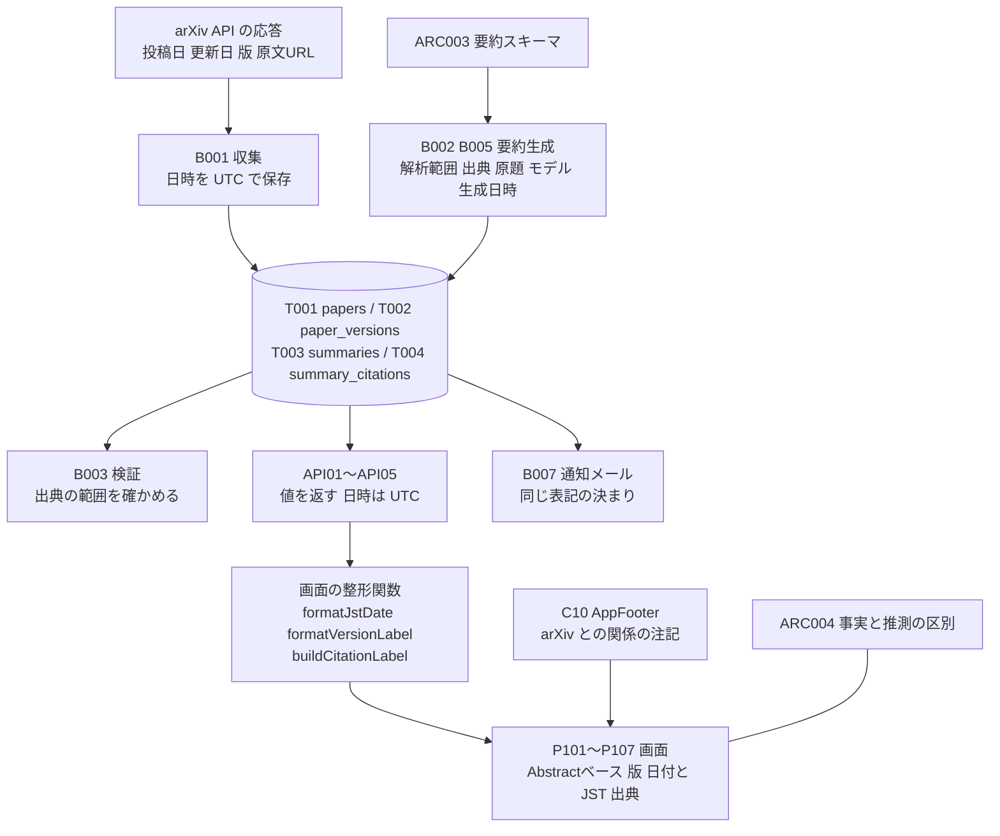
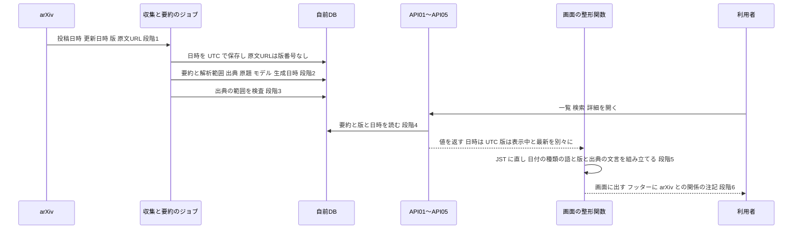

方式（共通基盤）: ARC009 表示・編集ポリシー（出典・版・日付・ブランド表記） ／ 実体 37ファイル（定義元の資料3・実現先の設計書34） ／ 影響範囲 30件

# 方式設計書 — ARC009 表示・編集ポリシー（出典・版・日付・ブランド表記）

| 項目 | 内容 |
| :--- | :--- |
| 方式ID | ARC009（上流 `docs/基本設計書_概要.md` §11.1 で採番済み。本書で新しく採番した ID はありません） |
| 名称 | 表示・編集ポリシー（出典・版・日付・ブランド表記） |
| 更新日 | 2026-10-27 |
| インプット | (a) `source/`（全6ファイル227行。ARC009 に関わる行は `source/01_企画概要.md:32-37`、`source/02_機能要求定義.md:23,28-29,32`、`source/03_システム構成.md:61`、`source/05_ネーミング候補.md:4-6,11`）／(b) `docs/基本設計書_概要.md` §1（用語集 :102-117）、§3（表示上の共通ルール :684-690）、§4（日付の扱い :735、バッチ共通の方針 :757）、§6（T001〜T004）、§7（API01〜API05 :1127-1152）、§8（ブランドの誤認 :1201）、§11.1・§11.2、付録 Q01・Q11・Q29／実現先の設計書 `docs/db/DB.T001`〜`T004.DB物理設計.md`、`docs/detail/be/BE.F02`〜`F05`・`F07`〜`F13`・`F15.BE詳細設計.md`、`docs/detail/batch/BT.B002`・`B003`・`B005`・`B007.バッチ詳細設計.md`、`docs/screens/画面.P101`〜`P107.画面基本設計.md`、`docs/detail/fe/FE.P101`〜`P107.FE詳細設計.md`／境目の確認に使った方式設計書 `docs/arch/方式.ARC003`・`ARC004`・`ARC005.方式設計.md`／(c) `legacy/` |
| 既存資料の突合 | `legacy/` は空ディレクトリ（ファイル0件）で、突合する既存設計・業務資料はありません。本書の既存版（`docs/arch/方式.ARC009.方式設計.md`）も無く、今回が初版です。引き継ぐ ID は上流で採番済みのもの（ARC003〜ARC005・ARC009、P101〜P107、API01〜API05、F01〜F19、B001〜B007、T001〜T004、IF03、Q01・Q11・Q29）と、下流の画面設計書・FE詳細設計書で付けられた項目ID・部品ID（H14・H15・H18・H30・H32、C02・C04・C08・C10・C13 ほか）だけです |
| 対象システムの性質 | `source/` は企画・初期設計の資料（Markdown）で、プログラムのソースコードはありません。本書は資料の記述を一次情報とし、資料に無い実現方法は、確定済みの下流設計書が定めた内容を「実現先」として引用します。表示の文言は、下流の画面設計書でほぼすべて※推測です。下流どうしで食い違う箇所は、本書で扱いを決めるか、決められないものを付録Bに残します |

---

## 1. 機構の概要

* **解決している課題**: 本サービスは AI が作った日本語の要約を、論文の内容として利用者に見せます。この仕組みが無いと、利用者は次の5つを取り違えます。
  1. **要約の確からしさ**: 本文を読まず Abstract だけで作った要約を、本文まで読んだ要約と同じ重みで受け取ってしまいます（`source/01_企画概要.md:36`「Abstractのみ取得した場合は「Abstractベース」と明示する」）。
  2. **どの版の内容か**: arXiv の論文は v1・v2 と改訂されます。古い版の要約を、最新の論文の内容と思い込みます（`source/01_企画概要.md:37`「論文の改訂版（v1・v2）を区別する」）。
  3. **いつの論文か**: arXiv の論文には投稿日・更新日・新着公開日の3つの日付があり、さらに米国の時刻と日本の時刻で日付がずれます。どの日付かが分からないと、「今日の新着」を誤って理解します（`source/02_機能要求定義.md:32`）。
  4. **何を根拠にした記述か**: 要約の主張が原文のどこに書いてあるかが分からないと、利用者は確かめようがなく、AI の誤りをそのまま信じます（`source/01_企画概要.md:35`「出典の章・ページ・URLを示せるようにする」）。
  5. **誰が運営しているか**: arXiv の名前と論文を扱うため、本サービスを arXiv の公式サービスだと誤解されると、arXiv との関係を損ない、利用者の信頼を誤った相手に向けさせます（`source/03_システム構成.md:61`「arXivと自サービスの関係を誤認させない表記にする」）。
* **設計方針**（資料から読み取れる範囲。推測は※推測と明記）:
  1. **表記の決まりを7つに分け、全画面で同じ形にそろえる**（上流 §3「表示上の共通ルール（全画面で守る。詳細は §11 ARC009）」）。7つは §2 構成要素ロースター #1〜#7 です。
  2. **表示に要る値は、作るときに必ず記録する**（※推測: 下流の設計判断）。要約を作るジョブは、解析範囲・主張ごとの出典・原題・モデル・生成日時・対象の版を必ず保存し、画面が後から推測で埋めなくて済むようにします（`source/02_機能要求定義.md:23,28-29`、BE.F04:472）。
  3. **API は値を返し、文言と日本時間への変換は画面が行う**（※推測: 下流の設計判断。BE.F05:125）。API は日時を UTC で返し、どの日付かとどの版かを別々の項目で返します。画面は共通の整形関数で日本時間（JST）に直し、「（JST）」を添えます。
  4. **arXiv との関係の注記は、全画面のフッターに常に出す**（上流 §3 レイアウト構造 :690 ※推測）。文言は全画面で1つです。
  5. **事実と推測の区別（ARC004）と、AI 翻訳の注記（ARC005）は別の方式に任せる**。上流 §3 は同じ共通ルールに並べていますが、本書は「出どころと時点の表記」を受け持ち、「内容の確からしさの判定」は受け持ちません（上流 :684「事実と推測の区別は ARC004」）。
* **位置づけ**: 上流 §11.2 の相関では「ARC003 → ARC009 → P101〜P107 画面」で、要約スキーマ（ARC003）が持たせた項目を、どう見せるかを決めます。保存（T001〜T004）から API（API01〜API05）、画面（P101〜P107）、通知メール（B007）までの表示の出口すべてに効きます。

---

## 2. 実体の構成

本方式は1つのプログラムではありません。資料の3か所で定められた表記の決まりを、要約を作るジョブ（値の記録）、4つのテーブル（値の保存）、画面向けAPI（値の受け渡し）、画面の整形関数と共通部品（文言と表示）で分担して実現しています。下表の「定義元」は決まりを定めた資料、「実現先」はその決まりを具体化した確定済みの設計書です。

| # | パス | 種別 | 役割 | 備考 |
| :--- | :--- | :--- | :--- | :--- |
| 1 | `source/01_企画概要.md` | 定義元（資料） | 編集方針（:32-37）: 事実と推測の区別、数値・比較対象の保持、出典の章・ページ・URL、Abstractベースの明示、版の区別 | 上流 §11.1 の実体 |
| 2 | `source/02_機能要求定義.md` | 定義元（資料） | 投稿日・更新日・新着公開日の意味とタイムゾーンを UI 上で区別すること（:32）、要約に原題・解析範囲・出典・処理日時・モデル・対象版を保存すること（:23,28-29） | 上流 §11.1 の実体 |
| 3 | `source/03_システム構成.md` | 定義元（資料） | arXiv と自サービスの関係を誤認させない表記にすること（:61） | 上流 §11.1 の実体 |
| 4 | `docs/db/DB.T001.DB物理設計.md` | 実現先（DB物理設計） | 投稿日時・更新日時を UTC で保存し、最新版の番号と版番号なしの原文URLを持つ。新着公開日の列が無いことを※上流要確認とする（:229-232,242-243） | ※上流未定義（上流の適用範囲に T001 が無い） |
| 5 | `docs/db/DB.T002.DB物理設計.md` | 実現先（DB物理設計） | 版番号と本文取得状況を持つ（:188,190,223,323） | ※上流未定義 |
| 6 | `docs/db/DB.T003.DB物理設計.md` | 実現先（DB物理設計） | 解析範囲・モデル・生成日時を持ち、「Abstractベース」の表示に使うと定める（:198-200,249） | ※上流未定義 |
| 7 | `docs/db/DB.T004.DB物理設計.md` | 実現先（DB物理設計） | 主張ごとの出典（章・ページ・版番号付きURL）を持つ（:184-187,211,217-220） | ※上流未定義 |
| 8 | `docs/detail/be/BE.F02.BE詳細設計.md` | 実現先（BE詳細設計） | API01（新着一覧）が、絞り込みの日付の種類とタイムゾーン、表示する版、解析範囲を返す（:108,164,402） | 上流の適用範囲 API01 |
| 9 | `docs/detail/be/BE.F03.BE詳細設計.md` | 実現先（BE詳細設計） | API02（自由検索）が、要約の版・最新版・解析範囲・投稿日時・更新日時を別々に返す（:182-188,415） | 上流の適用範囲 API02 |
| 10 | `docs/detail/be/BE.F04.BE詳細設計.md` | 実現先（BE詳細設計） | 要約を作るときに、解析範囲を材料どおりに記録し、出典を必ず保存し、原題を併記させる（:27,149-150,375,472） | ※上流未定義 |
| 11 | `docs/detail/be/BE.F05.BE詳細設計.md` | 実現先（BE詳細設計） | API03（論文詳細）が表示中の版と最新版を分けて返し、API04（要約）が解析範囲・出典・生成日時・モデルを返す。日時はすべて UTC（:125,168-178,217-242,516） | 上流の適用範囲 API03・API04 |
| 12 | `docs/detail/be/BE.F07.BE詳細設計.md` | 実現先（BE詳細設計） | ブックマーク一覧が最新版の番号と保存日時（UTC）を返す（:518） | ※上流未定義 |
| 13 | `docs/detail/be/BE.F08.BE詳細設計.md` | 実現先（BE詳細設計） | API05（おすすめ）が版・投稿日時・更新日時・解析範囲を返す（:192-201,560） | 上流の適用範囲 API05 |
| 14 | `docs/detail/be/BE.F09.BE詳細設計.md` | 実現先（BE詳細設計） | AIチャットの応答に版・解析範囲・文ごとの出典を付ける（:151-164,418） | ※上流要確認（F09 自身が適用範囲外と明記） |
| 15 | `docs/detail/be/BE.F10.BE詳細設計.md` | 実現先（BE詳細設計） | 通知メールに Abstractベース・版・投稿日・原文リンク・arXiv の注記を入れる（:452） | ※上流未定義 |
| 16 | `docs/detail/be/BE.F11.BE詳細設計.md` | 実現先（BE詳細設計） | 複数論文比較の応答に、論文ごとの版・解析範囲とモデル・生成日時を付ける（:152-155,202-203,446） | ※上流要確認 |
| 17 | `docs/detail/be/BE.F12.BE詳細設計.md` | 実現先（BE詳細設計） | 次回更新日・ご利用期限を UTC で返す（:606） | ※上流未定義 |
| 18 | `docs/detail/be/BE.F13.BE詳細設計.md` | 実現先（BE詳細設計） | トレンドの集計で日付の種類（投稿日）とタイムゾーンを返す（:100,137,354） | ※上流要確認 |
| 19 | `docs/detail/be/BE.F15.BE詳細設計.md` | 実現先（BE詳細設計） | 閲覧履歴の閲覧日時を UTC で返す（:168,386） | ※上流未定義 |
| 20 | `docs/detail/batch/BT.B002.バッチ詳細設計.md` | 実現先（バッチ詳細設計） | Abstract からの要約で、出典の章を「Abstract」・ページを空・URL を版番号付きに固定し、原題の併記を指示する（:124-131,562） | ※上流未定義 |
| 21 | `docs/detail/batch/BT.B003.バッチ詳細設計.md` | 実現先（バッチ詳細設計） | 出典の範囲（Abstract の要約は章が Abstract、本文の要約はページが論文のページ数の中）を確かめる（:306,616） | ※上流未定義 |
| 22 | `docs/detail/batch/BT.B005.バッチ詳細設計.md` | 実現先（バッチ詳細設計） | 本文からの10分解説で、出典の章・ページを付けさせ、解析範囲を本文取得済みにする（:132-139,623） | ※上流未定義 |
| 23 | `docs/detail/batch/BT.B007.バッチ詳細設計.md` | 実現先（バッチ詳細設計） | 通知メールの表記（Abstractベース・カテゴリ・投稿日・版・arXiv の注記）（:141-145,649） | ※上流要確認 |
| 24 | `docs/screens/画面.P101.画面基本設計.md` | 実現先（画面基本設計） | ホームの論文カードの版（H17）・日付（H18）・Abstractベース（H19）・基準日の注記（H25）・フッターの注記（H32）（:107-122,214） | 上流の適用範囲 P101 |
| 25 | `docs/screens/画面.P102.画面基本設計.md` | 実現先（画面基本設計） | 新着一覧の日付の種類とタイムゾーンの注記（H11）と論文カード（H19〜H21）・フッター（H29）（:95,103-113,214） | 上流の適用範囲 P102 |
| 26 | `docs/screens/画面.P103.画面基本設計.md` | 実現先（画面基本設計） | 検索結果の論文カード（H22〜H24。日付に「投稿日」を付ける）・フッター（H33）（:106-117,220） | 上流の適用範囲 P103 |
| 27 | `docs/screens/画面.P104.画面基本設計.md` | 実現先（画面基本設計） | 論文詳細の版と新しい版の注記（H14・H15）、投稿日・更新日（H16・H17）、解析範囲（H18）、原文リンク（H20）、出典（H30）、処理日時・モデル・対象の版（H31〜H33）、フッター（H46）（:110-142,256） | 上流の適用範囲 P104 |
| 28 | `docs/screens/画面.P105.画面基本設計.md` | 実現先（画面基本設計） | Appendix の版（H14）、原文リンク（H15）、数式解説の出典（H17）、フッター（H30）（:107-124,223） | 上流の適用範囲 P105 |
| 29 | `docs/screens/画面.P106.画面基本設計.md` | 実現先（画面基本設計） | マイページの版（H31。最新版）と、会員登録日・保存日・閲覧日時のタイムゾーン（H14・H32・H38）、フッター（H58）（:117-161,298） | 上流の適用範囲 P106 |
| 30 | `docs/screens/画面.P107.画面基本設計.md` | 実現先（画面基本設計） | 料金の次回更新日・ご利用期限のタイムゾーン（H27）、フッター（H42）（:125,140,253） | 上流の適用範囲 P107 |
| 31 | `docs/detail/fe/FE.P101.FE詳細設計.md` | 実現先（FE詳細設計） | 共通の整形関数 `formatJstDate`・`formatBaseDateNote`、論文カード C08、フッター C10、ヘッダー C02 の定義元（:31,91,99,285-315,395） | P101 の実装 |
| 32 | `docs/detail/fe/FE.P102.FE詳細設計.md` | 実現先（FE詳細設計） | 日付の種類の注記 `formatDateBasisNote`（:242,268,349） | P102 の実装 |
| 33 | `docs/detail/fe/FE.P103.FE詳細設計.md` | 実現先（FE詳細設計） | 論文カードに日付の種類の語を付ける `dateLabel`（:102,288,378） | P103 の実装 |
| 34 | `docs/detail/fe/FE.P104.FE詳細設計.md` | 実現先（FE詳細設計） | `formatVersionLabel`・`formatJstDateTime`・`buildCitationLabel`・`toSafeExternalUrl` と、詳細の部品 C04・C13 の定義元（:106,120-123,310-316,353-357,456） | P104 の実装 |
| 35 | `docs/detail/fe/FE.P105.FE詳細設計.md` | 実現先（FE詳細設計） | 数式の出典 `formatFormulaSource`、参考文献のリンク `getReferenceLink`（:114,236,272-274,355） | P105 の実装 |
| 36 | `docs/detail/fe/FE.P106.FE詳細設計.md` | 実現先（FE詳細設計） | マイページの一覧の版を最新版にする `mapPaperListItem`（:440,511,637） | P106 の実装 |
| 37 | `docs/detail/fe/FE.P107.FE詳細設計.md` | 実現先（FE詳細設計） | 次回更新日を JST に直して出す（:125,456） | P107 の実装 |

* **命名規則・配置規則**（新規追加時に従うべき規則）:
  * 日時の整形は `web/lib/format/display.ts` の関数を使います。日付は `formatJstDate`（`YYYY-MM-DD（JST）`）、日時は `formatJstDateTime`（`YYYY-MM-DD HH:mm（JST）`）です。画面ごとに独自の書式を作りません。
  * 版・出典・外部リンクの整形は `web/lib/paperDetail/summaryView.ts` の関数を使います（`formatVersionLabel`・`buildCitationLabel`・`toSafeExternalUrl`）。
  * arXiv との関係の注記は共通フッター C10（`web/components/layout/AppFooter.tsx`）だけが出します。画面ごとに注記を書きません。サービス名は共通ヘッダー C02（`web/components/layout/AppHeader.tsx`）が出します。
  * API の日時の項目名は `〜At`（`submittedAt`・`updatedAt`・`generatedAt`）とし、値は UTC の ISO 8601（`Z` 付き）にします（本書 §4 で決める）。
  * 版の数字は「v」＋版番号（`v2`）で表します。
* **全数**: 37件（定義元の資料3件＋実現先の設計書34件。実現先の内訳は DB物理設計4件・BE詳細設計12件・バッチ詳細設計4件・画面基本設計7件・FE詳細設計7件）。根拠: 定義元は上流 §11.1 ARC009 行の「実体」列に挙がった3ファイル（`source/01_企画概要.md:32-37`、`source/02_機能要求定義.md:32`、`source/03_システム構成.md:61`）と一致します。実現先は、全47本の確定済み設計書（`docs/db/` 10本・`docs/detail/be/` 19本・`docs/detail/batch/` 11本・`docs/detail/fe/` 7本）と画面基本設計書7本を1本ずつ調べ、ARC009 を「利用する方式」に挙げ、かつ表記に要る値の記録・保存・受け渡し・表示のどれかを自ら定めているものを数えました。振り分けは次のとおりです。
  * 実現先（27本＋画面基本設計7本）: 上表 #4〜#37。
  * 影響範囲だけ（2本）: `BE.F01`・`BT.B001`（ARC009 を使わないと明記しているが、投稿日時・更新日時を UTC で保存し、原文URLを保存する。表記の元になる値を作る。F01:101,126-127,406、B001:341,632）。§6 に行があります。
  * 対象外（18本）: `DB.T005`〜`T010`（6本。表記に関わる列が無い）、`BE.F06`・`F14`・`F16`〜`F19`（6本。使わないと明記。F06:516、F14:397、F16:372、F17:314、F18:280、F19:408）、`BT.B004`・`B006`・`B008`〜`B011`（6本。使わないと明記）。

* **構成要素ロースター**（本方式を形づくる要素の全数。ID は上流と下流の設計書で付いた名前をそのまま使い、本書では採番しません）:

| # | 種別 | 名称（既存の識別子） | 概要 | 定義状況 | 詳細の所在 |
| :--- | :--- | :--- | :--- | :--- | :--- |
| 1 | 表記の決まり | Abstractベースの明示 | Abstract だけで作った要約には「Abstractベース」と出す | 詳細 | §4 表記の決まり No.1 |
| 2 | 表記の決まり | 版の明示 | 表示している要約がどの版を対象にしたかを「vN」で出し、最新版より古ければ注記する | 詳細 | §4 表記の決まり No.2 |
| 3 | 表記の決まり | 3種類の日付とタイムゾーンの区別 | どの日付かの語と「（JST）」を添えて出す | 詳細 | §4 表記の決まり No.3 |
| 4 | 表記の決まり | 出典の明示 | 主張ごとに原文の章・ページへの出典を出し、原文へのリンクを置く | 詳細 | §4 表記の決まり No.4 |
| 5 | 表記の決まり | arXiv との関係を誤解させない | 全画面のフッターとメールの末尾に注記を出す | 詳細 | §4 表記の決まり No.5 |
| 6 | 表記の決まり | 原題の併記 | 日本語タイトルには原題を併記する | 詳細 | §4 表記の決まり No.6 |
| 7 | 表記の決まり | 処理日時・モデル・対象の版の明示 | 論文詳細で要約ごとに、いつ・どのモデルで・どの版から作ったかを出す | 詳細 | §4 表記の決まり No.7 |
| 8 | 列 | `papers.submitted_at`（T001） | v1 の投稿日時。UTC で保存 | 詳細 | DB.T001:191,229,231 |
| 9 | 列 | `papers.updated_at`（T001） | 最新版が公開された日時。UTC で保存。v1 だけの論文の値は※推測（投稿日時と同じ） | 詳細 | DB.T001:192,230 |
| 10 | 列 | `papers.latest_version`（T001） | 最新版の番号 | 簡易 | DB.T001:193 |
| 11 | 列 | `papers.original_url`（T001） | 版番号なしの原文URL。常に最新版を開く | 詳細 | DB.T001:194,242-243 |
| 12 | 列 | `paper_versions.version`・`content_status`（T002） | 版番号と本文取得状況（Abstractのみ・本文取得済み） | 詳細 | DB.T002:188,190,223 |
| 13 | 列 | `summaries.source_scope`（T003） | 要約の解析範囲（`abstract_only`・`full_text`）。「Abstractベース」の表示の正 | 詳細 | DB.T003:200,249 |
| 14 | 列 | `summaries.model_id`・`generated_at`（T003） | 要約を作ったモデルと日時 | 簡易 | DB.T003:198-199 |
| 15 | テーブル | `summary_citations`（T004） | 主張ごとの出典の章・ページ・版番号付きURL。Abstract の要約は章が「Abstract」でページが空 | 詳細 | DB.T004:184-187,211,217-220 |
| 16 | 未定義の値 | 新着公開日（※上流要確認） | 3つ目の日付。保存する列が無く、どの API も返さない | 詳細 | §7 制約1、DB.T001:232 |
| 17 | 記録の決まり | B002 の出典の固定値 | Abstract の要約では、出典の章を「Abstract」、ページを空、URL を版番号付きにコードで決める | 詳細 | BT.B002:128-131 |
| 18 | 記録の決まり | B005 の出典 | 10分解説では LLM に章・ページを付けさせ、論文のページ数の中にあるかを確かめる | 詳細 | BT.B005:132-139 |
| 19 | 検査 | B003 の出典の範囲の検査 | 解析範囲と出典の章・ページが合っているかを確かめる | 詳細 | BT.B003:306,616 |
| 20 | 記録の決まり | 原題の併記の指示（F04 `build_prompt`） | 要約の指示文で原題を併記させる | 簡易 | BE.F04:149,375 |
| 21 | API 項目 | `sourceScope`（API01・API02・API04・API05） | 解析範囲。要約が未公開なら空 | 詳細 | BE.F02:178、BE.F03:188、BE.F05:222,240、BE.F08:201 |
| 22 | API 項目 | 表示する版（`displayVersion`・`summaryVersion`・`displayedVersion`・`version`） | 要約の対象の版。項目名が API ごとに違う | 詳細 | §7 制約4 |
| 23 | API 項目 | `latestVersion` | 最新版の番号。表示する版と比べて新しい版の注記に使う | 簡易 | BE.F02:134、BE.F03:184、BE.F05:168 |
| 24 | API 項目 | `submittedAt`・`updatedAt` | 投稿日時と更新日時。改訂が無ければ `updatedAt` は空 | 詳細 | §4 日付、BE.F03:182-183、BE.F05:177 |
| 25 | API 項目 | `dateBasis`・`timeZone`（API01） | 絞り込みと表示に使った日付の種類（今は投稿日）とタイムゾーン | 詳細 | BE.F02:121,164,165 |
| 26 | API 項目 | `citations`（API04） | 主張IDごとの章・ページ・URL | 詳細 | BE.F05:231-232,241 |
| 27 | API 項目 | `originalUrl`（API03） | 原文ページの URL | 簡易 | BE.F05:106,111,170 |
| 28 | API 項目 | `generatedAt`・`modelId`（API04） | 要約の生成日時とモデル | 簡易 | BE.F05:234-235,242 |
| 29 | 整形関数 | `formatJstDate`（`web/lib/format/display.ts`） | 日時を日本時間の `YYYY-MM-DD（JST）` にする。読めなければ「日付不明」 | 詳細 | FE.P101:313 |
| 30 | 整形関数 | `formatJstDateTime` | 日時を `YYYY-MM-DD HH:mm（JST）` にする | 簡易 | FE.P104:316 |
| 31 | 整形関数 | `formatBaseDateNote`（P101） | 基準日の注記「{日付の種類} {日付}（JST）に投稿された／公開された論文」 | 詳細 | FE.P101:315 |
| 32 | 整形関数 | `formatDateBasisNote`（P102） | 日付の注記「日付は{日付の種類}・日本時間（JST）で表示しています」 | 詳細 | FE.P102:268 |
| 33 | 整形関数 | `formatVersionLabel`（`web/lib/paperDetail/summaryView.ts`） | 「表示中 vN / 最新 vM」と、古い版のときの注記を組み立てる | 詳細 | FE.P104:313,357 |
| 34 | 整形関数 | `buildCitationLabel` | 「出典 §章 p.ページ」「出典 Abstract」「出典」を組み立てる | 詳細 | FE.P104:310,354 |
| 35 | 整形関数 | `toSafeExternalUrl` | http・https 以外の URL を捨て、arXiv の http を https に上げる | 詳細 | FE.P104:312,356 |
| 36 | 整形関数 | `formatFormulaSource`（P105） | 数式解説の出典「出典: 原文 §章 p.ページ」を組み立てる | 簡易 | FE.P105:236,274 |
| 37 | 部品 | C08 PaperCard（`web/components/paper/PaperCard.tsx`） | 一覧の論文カードで版・日付・Abstractベースを出す（P101〜P103） | 詳細 | FE.P101:143、画面.P101:107-111 |
| 38 | 部品 | C04 PaperMetaHeader（P104） | 論文詳細の版・新しい版の注記・投稿日・更新日・解析範囲を出す | 詳細 | FE.P104:120 |
| 39 | 部品 | C13 SummaryGenerationInfo（P104） | 処理日時・生成モデル・対象の版を出す | 簡易 | FE.P104:106、画面.P104:125-127 |
| 40 | 部品 | C10 AppFooter（`web/components/layout/AppFooter.tsx`） | arXiv との関係の注記を全画面で出す | 詳細 | FE.P101:31,99、画面.P101:122 |
| 41 | 部品 | C02 AppHeader（`web/components/layout/AppHeader.tsx`） | サービス名を出す。正式名称が未定のため仮表記（上流 Q01） | 簡易 | FE.P101:91、画面.P101:91 |
| 42 | メールの表記 | 通知メールの表記（B007） | Abstractベース・カテゴリ・投稿日・版を付記し、末尾に arXiv との関係の注記を入れる | 詳細 | BT.B007:141-145 |

**総件数: 42件**（表記の決まり7件・保存の列とテーブル8件（#8〜#15）・未定義の値1件・記録と検査の決まり4件（#17〜#20）・API 項目8件（#21〜#28）・整形関数8件（#29〜#36）・部品5件（#37〜#41）・メールの表記1件。定義状況は詳細32件・簡易10件）。**全数である根拠**: 表記の決まり7件は、上流 §3 表示上の共通ルール（:684-689）のうち ARC004 の「事実と推測の区別」を除く4項目（Abstractベース・版・3種類の日付・arXiv との関係）に、資料 `source/01_企画概要.md:35`（出典）と `source/02_機能要求定義.md:23,29`（原題の併記、処理日時・モデル・対象版）を加えたものです。それ以外の要素は、実現先の設計書34本から「ARC009」「Abstractベース」「版」「JST」「タイムゾーン」「投稿日」「出典」「arXiv との関係」を含む記述を全件拾い、7つの決まりのどれかの値を記録・保存・受け渡し・表示するものを数えました。次のものは他の方式の責務として除いています: 主張ごとの「論文の記載」「AIの補足（推測）」のラベル（`getClaimBasisLabel`）は ARC004、Appendix の AI 翻訳の注記（P105 H23）とライセンスの表示（`formatLicenseLabel`）は ARC005、要約 JSON の項目の形は ARC003。
**定義状況の判定**（completeness 3-1）: 分岐がある（3-1 の1）・複数の対象にまたがる（同3）・業務上の判断を含む（同7）のどれかに当たるものを「詳細」としました。#10・#14・#23・#27・#28 は値をそのまま持つか返すだけ、#20 は指示文の1項目、#30・#36 は決まった形に並べるだけ、#39・#41 は値を出すだけで、分岐を含まないため「簡易」です。

---

## 3. ライフサイクル（登録・読込・選択）

* **時系列**: 表記に要る値が、arXiv から取り込まれて画面に出るまでを示します。

| 段階 | 契機 | 処理 | 実装（ファイル:行） |
| :--- | :--- | :--- | :--- |
| 1 取り込み | 論文メタデータ収集（B001）が新しい版を保存したとき | arXiv の応答の投稿日時（v1 の投稿日時）と更新日時（最新版の公開日時）を UTC に直して保存し、最新版の番号と原文URL（版番号なし）を保存します。新着公開日は保存しません（列が無い） | `docs/detail/be/BE.F01.BE詳細設計.md:101,126-127`、`docs/detail/batch/BT.B001.バッチ詳細設計.md:341`、`docs/db/DB.T001.DB物理設計.md:229-232,242` |
| 2 要約の記録 | 要約を作るジョブ（B002・B005）が保存するとき | 解析範囲を材料どおりに記録し（Abstract なら `abstract_only`、本文なら `full_text`）、主張ごとの出典を必ず保存し、原題を併記させ、モデルと生成日時を記録します。Abstract の要約の出典は、章「Abstract」・ページ空・版番号付きURLをコードで決めます。10分解説の出典は LLM に章とページを付けさせます | `docs/detail/be/BE.F04.BE詳細設計.md:149-150,375,472`、`docs/detail/batch/BT.B002.バッチ詳細設計.md:124-131`、`docs/detail/batch/BT.B005.バッチ詳細設計.md:132-139` |
| 3 出典の検査 | 検証ジョブ（B003）のとき | 出典の範囲を確かめます。Abstract の要約は章が Abstract でページが空、本文の要約はページが論文のページ数の中にあること。外れたら不合格で、公開されません（ARC004） | `docs/detail/batch/BT.B003.バッチ詳細設計.md:306,616` |
| 4 API の応答 | 利用者が一覧・検索・詳細・おすすめを開いたとき | 表示する版（要約の対象の版）と最新版を別々の項目で返し、解析範囲・投稿日時・更新日時（改訂が無ければ空）・出典・生成日時・モデルを返します。日時は UTC の ISO 8601（`Z` 付き）で返します。API01 だけは絞り込みに使った日付の種類（今は投稿日）とタイムゾーンも返します | `docs/detail/be/BE.F05.BE詳細設計.md:125,168-178,217-242`、`docs/detail/be/BE.F02.BE詳細設計.md:108,121,164`、`docs/detail/be/BE.F03.BE詳細設計.md:182-188` |
| 5 整形 | 画面が応答を受けたとき | 日時を `formatJstDate`・`formatJstDateTime` で日本時間に直して「（JST）」を添えます。版は `formatVersionLabel` で「vN」と新しい版の注記にし、出典は `buildCitationLabel` で「出典 §章 p.ページ」にし、外部リンクは `toSafeExternalUrl` で安全なものだけにします | `docs/detail/fe/FE.P101.FE詳細設計.md:313`、`docs/detail/fe/FE.P104.FE詳細設計.md:310-316,354-357` |
| 6 表示 | 画面の描画時 | 一覧のカード（C08）に版・日付・Abstractベースを、論文詳細（C04・C13）に版・新しい版の注記・投稿日・更新日・解析範囲・処理日時・モデル・対象の版・出典を出します。フッター（C10）に arXiv との関係の注記を常に出します | `docs/screens/画面.P101.画面基本設計.md:107-122`、`docs/screens/画面.P104.画面基本設計.md:110-142` |
| 7 メール | 通知・ダイジェスト配信（B007）のとき | 同じ決まりで、Abstractベース・カテゴリ・投稿日・版を付記し、末尾に arXiv との関係の注記を入れます（日付の書式とタイムゾーンは未定） | `docs/detail/batch/BT.B007.バッチ詳細設計.md:141-145` |
| 8 失効・切り替え | 新しい版が取り込まれたとき | 最新版の番号が上がり、原文URL は最新版を開くようになります。新しい版の要約が公開されるまでは、表示する版（古い版）と最新版がずれ、論文詳細は「この要約は vN を対象にしています。arXiv には新しい版 vM があります。」（H15）を出します。出典の URL は版番号付きのため、新しい版が出ても要約した版の同じ場所を開きます | `docs/screens/画面.P104.画面基本設計.md:111`、`docs/db/DB.T004.DB物理設計.md:217-218`、`docs/detail/be/BE.F02.BE詳細設計.md:306` |

* **読込順序**（表示の値が複数の場所にあるとき、どれを使うか）:

| No | 表示 | 使う値（勝つもの） | 使わない値 | 理由 | 根拠 |
| :--- | :--- | :--- | :--- | :--- | :--- |
| 1 | 版 | 表示している要約の対象の版 | 最新版の番号（注記の比較にだけ使う） | 要約の中身と版を一致させる | BE.F02:306、BE.F05:178,453 |
| 2 | Abstractベース | 要約の解析範囲（`summaries.source_scope`） | 版の本文取得状況（`content_status`） | ラベルは「この要約が何から作られたか」を示すため（本書で決める。§7 制約5） | DB.T003:249、FE.P104:347 |
| 3 | 日付の表示 | API の UTC の日時を画面で JST に直したもの | API が返す文字列の見た目 | どの API でも同じ日付にするため | FE.P101:313 |
| 4 | 出典のリンク | 出典の版番号付きURL | 原文URL（版番号なし） | 要約した版の同じ場所を開くため | DB.T004:217-218 |
| 5 | 原文へのリンク | 原文URL（版番号なし） | 出典のURL | 利用者が最新の論文を開けるようにするため | DB.T001:242 |

* **選択規則**:
  1. **どの日付を出すか**: 一覧のカードは投稿日、論文詳細は投稿日と更新日、処理日時は論文詳細の要約ごと、新着一覧の絞り込みは投稿日（上流 Q11 で新着公開日に決まれば切り替える）です。新着公開日は、保存する列が無いため今はどこにも出しません（§7 制約1）。
  2. **「Abstractベース」を出すか**: 一覧のカードは解析範囲が Abstract のみのときだけ出し、本文取得済みのときは何も出しません。論文詳細は常に「Abstractベース」か「本文取得済み」を出します。要約が未公開なら、カードは「速報版・要約処理中」を出します（画面.P101:109-111、画面.P104:114）。
  3. **新しい版の注記を出すか**: 表示する版が最新版より古いときだけ出します。同じなら「v N（最新）」だけです（画面.P104:110-111）。
  4. **出典の文言**: 章が「Abstract」なら「出典 Abstract」、章とページがあれば「出典 §章 p.ページ」、どちらかだけならあるものだけ、どちらも無ければ「出典」です（FE.P104:354）。出典の無い主張（AI の補足）には出しません。
  5. **外部リンク**: http・https の URL だけを出し、新しいタブで開きます（`rel="noopener noreferrer"`）。安全な URL が無ければリンクを出しません（FE.P104:121,356）。

---

## 4. インターフェース・データ構造

* **表記の決まり**（7件。全画面と通知メールで守る）:

| No | 決まり | 文言・書式 | 出す場所 | 出す条件 | 根拠 |
| :--- | :--- | :--- | :--- | :--- | :--- |
| 1 | Abstractベースの明示 | 「Abstractベース」。論文詳細では「Abstractベース」か「本文取得済み」 | P101〜P103 のカード（H19・H21・H24）、P104 H18、メール | カードは解析範囲が Abstract のみのとき。詳細は常に | `source/01_企画概要.md:36`、画面.P101:109、画面.P104:114、BT.B007:141 |
| 2 | 版の明示 | 「vN」。詳細は「表示中 vN / 最新 vM」（同じなら「v N（最新）」）と、古いときの注記「この要約は vN を対象にしています。arXiv には新しい版 vM があります。」 | P101〜P103 のカード、P104 H14・H15・H33、P105 H14、P106 H31、メール | 常に。注記は表示する版が最新より古いときだけ | `source/01_企画概要.md:37`、画面.P104:110-111 |
| 3 | 3種類の日付とタイムゾーンの区別 | 日付は `YYYY-MM-DD（JST）`、日時は `YYYY-MM-DD HH:mm（JST）`。日付の前に種類の語（「投稿日」「更新日」）を付ける。新着一覧には「日付は{種類}・日本時間（JST）で表示しています」の注記 | P101〜P104・P106・P107 の日付、P102 H11、P101 H25 | 日付を出すすべての場所 | `source/02_機能要求定義.md:32`、`docs/基本設計書_概要.md:117,735`、画面.P102:95 |
| 4 | 出典の明示 | 主張の末尾に「出典 §章 p.ページ」（Abstract の要約は「出典 Abstract」）。数式解説は「出典: 原文 §章 p.ページ」。原文へのリンク「arXiv で原文を開く ↗」 | P104 H20・H30、P105 H15・H17、メールの原文リンク | 出典のある主張だけ。原文リンクは安全な URL があるとき | `source/01_企画概要.md:35`、画面.P104:116,126、画面.P105:109,111 |
| 5 | arXiv との関係を誤解させない | 「本サービスはarXivが運営するものではありません。論文の原文と権利は各著者およびarXivに帰属します。」（※推測） | 全画面のフッター（P101 H32、P102 H29、P103 H33、P104 H46、P105 H30、P106 H58、P107 H42）、メールの末尾 | 常に | `source/03_システム構成.md:61`、画面.P101:122、BT.B007:145 |
| 6 | 原題の併記 | 日本語タイトルと原題を並べて出す | P101〜P104 のカードと詳細 | 日本語タイトルを出すすべての場所 | `source/02_機能要求定義.md:23`、BE.F04:149 |
| 7 | 処理日時・モデル・対象の版の明示 | 「処理日時 YYYY-MM-DD HH:mm（JST）」「生成モデル {モデル名}」「対象の版 vN」 | P104 H31〜H33 | 要約ごとに常に | `source/02_機能要求定義.md:29`、画面.P104:125-127 |

  **総件数: 7件**（構成要素ロースター #1〜#7 と一致）。文言はすべて下流の画面設計書の※推測で、顧客の確認が要ります（付録B No.8）。

* **日付の意味**（3種類。上流 §1 用語集 :117）:

| No | 日付 | 意味 | 保存先 | API の項目 | 画面での語 | 根拠 |
| :--- | :--- | :--- | :--- | :--- | :--- | :--- |
| 1 | 投稿日 | v1 が arXiv へ投稿された日時。版が増えても変わらない | `papers.submitted_at`（UTC） | `submittedAt` | 「投稿日」 | DB.T001:229、BE.F01:126 |
| 2 | 更新日 | 最新版が arXiv で公開された日時。改訂が無ければ API は空を返す | `papers.updated_at`（UTC） | `updatedAt` | 「更新日」 | DB.T001:230、BE.F05:177 |
| 3 | 新着公開日 | arXiv の新着リストに載った日（※上流要確認） | なし | なし | 「新着公開日（arXivでの公開日）」 | DB.T001:232、画面.P102:95 |

  **総件数: 3行**。タイムゾーンは、保存と API は UTC、画面の表示は日本時間（JST）で、表示には必ず「（JST）」を添えます（上流 Q11 の決定待ちの※推測）。

* **API が返す表記の項目**（API01〜API05）:

| API | 表示する版 | 最新版 | 解析範囲 | 日時 | 出典 | 生成日時・モデル | 根拠 |
| :--- | :--- | :--- | :--- | :--- | :--- | :--- | :--- |
| API01 新着一覧（F02） | `displayVersion` | `latestVersion` | `sourceScope` | `submittedAt`（日本時間の `+09:00`）、`dateBasis`・`timeZone` | — | — | BE.F02:133-135,164-178,338 |
| API02 自由検索（F03） | `summaryVersion`（要約が未公開なら空） | `latestVersion` | `sourceScope` | `submittedAt`・`updatedAt`（UTC） | — | — | BE.F03:182-188 |
| API03 論文詳細（F05） | `displayedVersion` | `latestVersion` | `contentStatus`（版の本文取得状況） | `submittedAt`・`updatedAt`（UTC） | — | — | BE.F05:168-178 |
| API04 要約（F05） | `version` | — | `sourceScope` | — | `citations` | `generatedAt`・`modelId` | BE.F05:217-242 |
| API05 おすすめ（F08） | `version`（最新版だけ） | — | `sourceScope` | `submittedAt`・`updatedAt`（UTC） | — | — | BE.F08:192-201 |

  **総件数: 5行**（上流の適用範囲 API01〜API05 と一致）。API01 だけ日時を日本時間で返し、表示する版の項目名が5つの API で4通りに分かれています（§7 制約3・4）。本書は **日時は UTC の ISO 8601（`Z` 付き）で返すことを正とします**（※推測。5本の API のうち4本と、画面の整形関数が UTC を前提にしているため。BE.F05:125、FE.P101:313）。

* **出典の構造**（T004 と API04）: 主張ID（`claimId`）・章（`sourceSection`）・ページ（`sourcePage`）・URL（`sourceUrl`）の4項目です。Abstract の要約は章が「Abstract」でページが空です。URL は版番号付き（`https://arxiv.org/abs/{arXiv ID}v{版番号}`）で、http・https だけを許します。1つの主張に出典は1件です（DB.T004:184-187,205,211,217-219、BE.F05:231-232）。

* **機構の入出力**:

| 方向 | 相手 | 渡すもの | 形 | 根拠 |
| :--- | :--- | :--- | :--- | :--- |
| 入力 | arXiv（B001） | 投稿日時・更新日時・版・原文の ID | Atom の応答 | BE.F01:121,126-127 |
| 入力 | 要約を作るジョブ（B002・B005） | 解析範囲・出典・原題・モデル・生成日時 | `summaries`・`summary_citations` の行 | BT.B002:124-131、BT.B005:132-139 |
| 出力 | 画面（P101〜P107） | §4 API が返す表記の項目 | API01〜API05 の応答 | 上表 |
| 出力 | 利用者 | §4 表記の決まりの文言 | 画面とメール | 上表 |

  **総件数: 4行**。

* **設定項目**: **該当なし**。根拠: 表記の文言は画面の固定文言、日付の書式とタイムゾーンは整形関数の中の定数で、切り替える設定値はどの設計書にもありません。サービス名は上流 Q01 の決定待ちの仮表記です（画面.P101:91）。

---

## 5. 拡張・変更手順

**表記の決まりを1つ追加する手順**（例: 「AI が生成した要約です」のラベルを一覧のカードにも出す場合）:

1. **上流に確認する**: 決まりを上流 §3 表示上の共通ルールに加えてもらいます。内容の確からしさ（事実と推測）に関わる決まりなら ARC004、権利に関わる決まりなら ARC005 の方式設計書で扱います。
2. **値が保存されているかを確かめる**: 表示に要る値が T001〜T004 にあるかを確かめます。無ければ、要約を作るジョブ（B002・B005）で記録するようにし、DB物理設計に列を加えます。画面で推測して埋めません。
3. **API で返す**: API01〜API05 の応答に項目を加えます。日時なら UTC の ISO 8601（`Z` 付き）、項目名は camelCase にします。
4. **整形関数を置く**: 文言を組み立てる処理は `web/lib/format/display.ts`（日時）か `web/lib/paperDetail/summaryView.ts`（版・出典）に置き、画面ごとに書かないようにします。
5. **部品で出す**: 一覧は C08 PaperCard、詳細は C04・C13、全画面は C10 AppFooter に加えます。
6. **全画面の画面設計書を直す**: P101〜P107 の項目一覧に項目IDを足し、「利用する方式」の ARC009 行を更新します。
7. **メールも直す**: 通知メール（B007）にも出すかを決め、出すなら BT.B007 §2 の本文の構成に加えます。
8. **本書を更新する**: §4 表記の決まりに1行加え、構成要素ロースターに追加した列・項目・関数・部品を加えます。

**3つ目の日付（新着公開日）を出す手順**（上流 Q11 で決まった場合）: `papers` に新着公開日の列を加え（DB.T001 §9）、収集（B001）で値を決める方法を定め、API01 の `dateBasis` を `announced` に変え、P102 H11 の注記と P101 H25 の基準日の注記を切り替えます。

**サービス名が決まったとき**: C02 AppHeader、各画面のページタイトル（「サービス名」の仮表記）、通知メールの件名と送り主を同時に直します（画面.P101:91、画面.P106:104、BT.B007:138-140）。

---

## 6. 影響範囲

| 影響先（機能/画面/工程） | どう効くか | 変更時のリスク |
| :--- | :--- | :--- |
| P101 ホーム | カードの版・日付・Abstractベース、基準日の注記、フッター | 日付の種類の語を付けないままだと、投稿日か新着公開日かが分からない |
| P102 新着論文 | 日付の種類とタイムゾーンの注記、カード、フッター | 注記の日付の種類（新着公開日）と API の絞り込み（投稿日）が食い違っている |
| P103 論文検索 | カード（日付に「投稿日」の語）、フッター | — |
| P104 論文詳細 | 版と新しい版の注記、投稿日・更新日、解析範囲、出典、原文リンク、処理日時・モデル・対象の版、フッター | 版の注記を外すと、古い版の要約を最新の内容と取り違える |
| P105 Appendix | 版、原文リンク、数式解説の出典、フッター | — |
| P106 マイページ | 一覧の版（最新版）、日付のタイムゾーン、フッター | 一覧の版は要約の対象の版ではなく最新版のため、P104 の版と食い違って見えることがある |
| P107 料金 | 次回更新日・ご利用期限のタイムゾーン、フッター | — |
| API01 論文一覧取得（F02） | 表示する版・解析範囲・日付の種類・タイムゾーンを返す | 日時を日本時間で返しているため、他の API と書式が揃わない |
| API02 自由検索（F03） | 要約の版・最新版・解析範囲・日時を返す | — |
| API03 論文詳細（F05） | 表示中の版と最新版、日時、原文URL を返す | 解析範囲の代わりに本文取得状況を返すため、詳細の「Abstractベース」がずれうる |
| API04 要約取得（F05） | 解析範囲・出典・生成日時・モデルを返す | 出典を返さなくすると、主張の確かめようが無くなる |
| API05 おすすめ取得（F08） | 版・解析範囲・日時を返す | 版が最新版だけのため、表示する要約の版とずれうる |
| F04 日本語構造化要約（※上流未定義） | 解析範囲・出典・原題・モデル・生成日時の記録 | 記録をやめると、画面の表記が埋められない |
| B002 Abstractベース日本語要約生成（※上流未定義） | 出典の固定値（章 Abstract・ページ空・版番号付きURL） | 出典の URL を版番号なしにすると、新しい版で別の内容を開く |
| B003 要約の根拠・数値チェック（※上流未定義） | 出典の範囲の検査 | 検査を外すと、存在しないページを出典として出す |
| B005 本文解析・詳細解説生成（※上流未定義） | 10分解説の出典の章・ページ | — |
| F10 通知・ダイジェスト（※上流未定義） | メールの表記の決まり | — |
| B007 通知・ダイジェスト配信（※上流要確認） | メールの Abstractベース・投稿日・版・arXiv の注記 | 日付の書式とタイムゾーンが未定のため、画面と違う日付に見えるおそれ |
| F07 ブックマーク（※上流未定義） | 保存日時（UTC）と最新版の番号を返す | — |
| F09 AIチャット（※上流要確認） | 回答に版・解析範囲・文ごとの出典を付ける | 項目名が snake_case で、他の API と揃わない |
| F11 複数論文比較（※上流要確認） | 論文ごとの版・解析範囲、モデル・生成日時 | F09 と同じ |
| F12 課金（※上流未定義） | 次回更新日・ご利用期限を UTC で返す | — |
| F13 トレンド可視化（※上流要確認） | 日付の種類とタイムゾーンを返す | 生成日時を日本時間で返しており、書式が揃わない |
| F15 閲覧履歴（※上流未定義） | 閲覧日時を UTC で返す | — |
| T001 papers（※上流未定義） | 投稿日時・更新日時（UTC）・最新版・原文URL | 新着公開日の列が無い |
| T002 paper_versions（※上流未定義） | 版番号と本文取得状況 | — |
| T003 summaries（※上流未定義） | 解析範囲・モデル・生成日時 | 解析範囲を空にすると「Abstractベース」を出せない |
| T004 summary_citations（※上流未定義） | 出典の章・ページ・版番号付きURL | — |
| F01 新着論文取得（※上流未定義） | 投稿日時・更新日時を UTC で保存し、原文URLを保存する | 原文URLの作り方（版番号の外し方・https への揃え方）が定められていない |
| B001 論文メタデータ収集（※上流未定義） | F01 の保存を実行する | F01 と同じ |

**総件数: 30件**（画面7件・API 5件・機能9件（F01・F04・F07・F09〜F13・F15）・バッチ5件（B001・B002・B003・B005・B007）・テーブル4件。うち上流の適用範囲に無いもの18件）。**根拠**: 上流 §11.1 ARC009 の適用範囲（P101〜P107 全画面／API01〜API05）の全12要素を行にし、加えて §2 の振り分けで実現先または影響範囲だけとした設計書のうち、適用範囲に無いもの（F04・B002・B003・B005・F10・B007・F07・F09・F11・F12・F13・F15・T001〜T004・F01・B001）を加えました。上流に無い18件のうち、F09・F11・F13・B007 は自身が「上流の適用範囲外だが当てはめる」と明記しているため※上流要確認、それ以外は※上流未定義として、上流 §11.1 の適用範囲への追記を求めます。

---

## 7. 制約・注意事項

* **性能・容量**: 本方式は文言と書式の決まりで、性能・容量の上限はありません。日本時間への変換は画面の中で行い、API の負荷を増やしません。
* **失敗時の挙動**: 日時が読めなければ「日付不明」、版の数字の不整合（表示する版が最新版より新しい）なら「vN」だけ、安全な URL が無ければリンクを出さない、出典の値が無ければ「出典」だけを出します（FE.P101:313、FE.P104:313,354,356）。表記が欠けても画面は落としません。
* **既知の制約**:
  1. **新着公開日を出せない**: 3種類の日付のうち新着公開日は、保存する列も API の項目もありません。新着一覧は投稿日で絞り込み、P102 の注記は「新着公開日」と書いているため、注記と実際の絞り込みが食い違います（DB.T001:232、BE.F02:108、画面.P102:95）。上流 Q11 の決定が要ります（付録B No.1）。
  2. **日付の種類の語の有無**: P103・P104 は日付の前に「投稿日」を付けますが、P101 H18 と P102 H20 は日付だけです（FE.P103:102）。上流 §4 の「投稿日・更新日・新着公開日を区別」に従い、**本書は全画面で種類の語を付けることを正とします**（※推測）。P101・P102 の画面設計書の修正を求めます（付録B No.2）。
  3. **日時の書式の食い違い**: API01（F02）とトレンド（F13）は日本時間（`+09:00`）で、他の API は UTC（`Z`）で返します。画面は必ず日本時間に直すため表示は揃いますが、本書 §4 で UTC を正としたため、F02・F13 の記述の修正を求めます（BE.F02:338、BE.F13:155）。
  4. **表示する版の項目名が揃っていない**: `displayVersion`（API01）、`summaryVersion`（API02）、`displayedVersion`（API03）、`version`（API04・API05）、`paper_version`（F09・F11）と分かれています。意味も、API05 とメール（B007）は最新版だけで、要約の対象の版と一致しないことがあります（BE.F08:192、BT.B007:142）。項目名の統一と API05 の版の選び方は付録B No.3 で確認します。
  5. **「Abstractベース」の元の値の食い違い**: 一覧のカードは要約の解析範囲（`sourceScope`）、論文詳細の H18 は版の本文取得状況（`contentStatus`）で決めています。本文取得済みの版で、表示している要約が Abstract から作られたもの（3分要約）だと、詳細は「本文取得済み」と出てしまいます。本書 §3 読込順序 No.2 で要約の解析範囲を正としました（FE.P104:347、付録B No.4）。
  6. **更新日の扱い**: 改訂の無い論文の更新日は、DB の説明では投稿日と同じ値、API では空です。FE.P104 は空のとき投稿日を「更新日」として出すため、改訂があったように見えます（DB.T001:230、BE.F05:177、FE.P104:120。付録B No.5）。
  7. **注記の文言の置き場所**: arXiv との関係の注記は全画面で同じ文言ですが、文言を1か所に持つ定数がありません（画面設計書の固定文言として各画面に書かれている）。P101 と P102 の日付の注記も、関数が2つあり文言が違います（FE.P101:315、FE.P102:268。付録B No.6）。
  8. **原文URLの作り方が定められていない**: arXiv の応答の ID は `http://arxiv.org/abs/…vN` の形ですが、保存する原文URLは版番号なしの https を想定しています。版番号の外し方と https への揃え方が F01・B001 に書かれていません（BE.F01:121、DB.T001:242。付録B No.7）。

---

## 付録A. ソース突合トレーサビリティ

| 記述箇所 | 根拠ソース（パス:行） |
| :--- | :--- |
| §1 課題1〜5、§4 表記の決まり | `source/01_企画概要.md:32-37`、`source/02_機能要求定義.md:23,28-29,32`、`source/03_システム構成.md:61` |
| §1 設計方針1（全画面で揃える） | `docs/基本設計書_概要.md:684-690` |
| §1 設計方針3（UTC で返し画面で JST に直す） | `docs/detail/be/BE.F05.BE詳細設計.md:125`、`docs/基本設計書_概要.md:757` |
| §1 設計方針5（ARC004・ARC005 との境目） | `docs/基本設計書_概要.md:684`、`docs/screens/画面.P105.画面基本設計.md:117` |
| §1 位置づけ（相関） | `docs/基本設計書_概要.md:1299,1315,1329-1330` |
| §2 実体 #1〜#3 | `docs/基本設計書_概要.md:1299` |
| §2 全数（振り分け） | `docs/detail/be/BE.F01.BE詳細設計.md:406`、`docs/detail/batch/BT.B001.バッチ詳細設計.md:632`、`docs/detail/be/BE.F06.BE詳細設計.md:516`、`BE.F14:397`、`BE.F16:372`、`BE.F17:314`、`BE.F18:280`、`BE.F19:408`、`docs/detail/batch/BT.B004.バッチ詳細設計.md:444`、`BT.B006:617` |
| §2 ロースター #8〜#16、§4 日付の意味 | `docs/db/DB.T001.DB物理設計.md:191-194,229-232,242-243`、`docs/db/DB.T002.DB物理設計.md:188,190,223`、`docs/db/DB.T003.DB物理設計.md:198-200,249`、`docs/db/DB.T004.DB物理設計.md:184-187,211,217-220` |
| §2 ロースター #17〜#20、§3 段階2・3 | `docs/detail/batch/BT.B002.バッチ詳細設計.md:124-131`、`BT.B005.バッチ詳細設計.md:132-139`、`BT.B003.バッチ詳細設計.md:306,616`、`docs/detail/be/BE.F04.BE詳細設計.md:149-150,375,472` |
| §2 ロースター #21〜#28、§4 API が返す表記の項目 | `docs/detail/be/BE.F02.BE詳細設計.md:108,121,133-135,164-178,338`、`BE.F03:182-188`、`BE.F05:106,111,125,168-178,217-242`、`BE.F08:192-201` |
| §2 ロースター #29〜#36、§3 段階5・選択規則 | `docs/detail/fe/FE.P101.FE詳細設計.md:313,315`、`FE.P102:268`、`FE.P104:310-316,347,353-357`、`FE.P105:236,274` |
| §2 ロースター #37〜#41、§3 段階6 | `docs/detail/fe/FE.P101.FE詳細設計.md:31,91,99,143`、`FE.P104:106,120-123`、`docs/screens/画面.P101.画面基本設計.md:91,107-122`、`画面.P104:110-142` |
| §2 ロースター #42、§3 段階7 | `docs/detail/batch/BT.B007.バッチ詳細設計.md:138-145,649` |
| §3 段階1 | `docs/detail/be/BE.F01.BE詳細設計.md:101,121,126-127`、`docs/detail/batch/BT.B001.バッチ詳細設計.md:341` |
| §3 段階8 | `docs/screens/画面.P104.画面基本設計.md:111`、`docs/detail/be/BE.F02.BE詳細設計.md:306` |
| §4 表記の決まり No.5（全画面のフッター） | `docs/screens/画面.P101.画面基本設計.md:122`、`画面.P102:113`、`画面.P103:117`、`画面.P104:142`、`画面.P105:124`、`画面.P106:161`、`画面.P107:140` |
| §7 制約1〜8 | `docs/screens/画面.P102.画面基本設計.md:95`、`docs/detail/fe/FE.P103.FE詳細設計.md:102`、`docs/detail/be/BE.F13.BE詳細設計.md:155`、`docs/detail/be/BE.F08.BE詳細設計.md:192`、`docs/detail/fe/FE.P104.FE詳細設計.md:120,347`、`docs/detail/fe/FE.P101.FE詳細設計.md:315`、`docs/detail/fe/FE.P102.FE詳細設計.md:268`、`docs/detail/be/BE.F01.BE詳細設計.md:121` |

## 付録B. 未確定事項（※推測の一覧）

| No | 事項 | 本書での仮置き | 影響 | 上流の確認事項 |
| :--- | :--- | :--- | :--- | :--- |
| 1 | 新着一覧の絞り込みに使う日付と、新着公開日を保存するか。表示のタイムゾーン | 投稿日で絞り込み、表示は JST。新着公開日は保存しない | P102 の注記と絞り込みの食い違い | Q11 |
| 2 | 全画面で日付の前に種類の語（「投稿日」）を付けるか | 付ける（本書 §7 制約2） | P101 H18・P102 H20 の改修 | Q11 |
| 3 | 表示する版の項目名を揃えるか。API05 とメールで要約の対象の版を出すか | 項目名は各 API のまま。API05・メールは最新版 | 一覧と詳細で版が違って見える | —（※上流未定義） |
| 4 | 論文詳細の「Abstractベース」を要約の解析範囲で決めるか | 要約の解析範囲を正とする（本書 §3） | FE.P104 の改修 | —（※上流未定義） |
| 5 | 改訂の無い論文で更新日をどう出すか（出さない／投稿日と同じ／「改訂なし」） | API は空。画面の扱いは未定 | 改訂があったように見える | Q11 |
| 6 | arXiv との関係の注記と日付の注記の文言を、1か所の定数に置くか | 置かない（各画面の固定文言） | 文言を変えるときに直し漏れが出る | —（※上流未定義） |
| 7 | 原文URLの作り方（版番号の外し方、https への揃え方） | 未定 | 原文リンクが http や特定の版を開く | —（※上流未定義） |
| 8 | 表記の文言（Abstractベース・新しい版の注記・arXiv との関係の注記・出典の形） | 下流の画面設計書の※推測の文言 | 利用者に見える文言そのもの | —（※上流未定義） |
| 9 | 正式なサービス名 | 仮表記 | ヘッダー・ページタイトル・メールの件名 | Q01 |
| 10 | 生成モデルとして画面に出す名前（モデルIDそのままか、表示名か）と、モデルIDの記録元（LLM の応答か設定値か） | モデルIDをそのまま出す | 利用者に見える文言 | Q29 |
| 11 | 一覧のカードにも AI が作った要約である旨を出すか | 出さない（論文詳細だけ処理日時とモデルを出す） | 一覧だけを見る利用者の誤解 | —（※上流未定義） |
| 12 | 通知メールの日付の書式とタイムゾーン | 未定 | 画面とメールで日付が違って見える | Q15 |
| 13 | 上流 §11.1 ARC009 の適用範囲に F04・B002・B003・B005・F10・B007・F07・F09・F11・F12・F13・F15・T001〜T004・F01・B001 を加えるか | 本書 §6 では※上流未定義・※上流要確認として扱う | 上流と下流の対応 | —（※上流要確認） |
