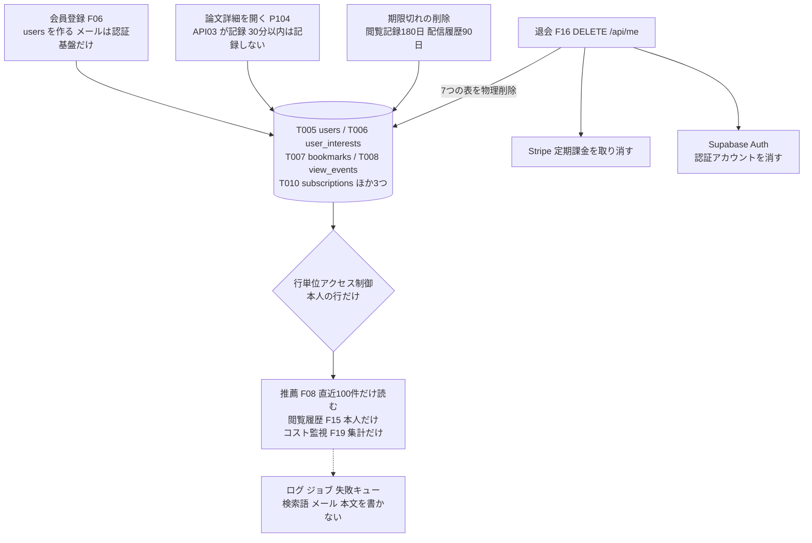
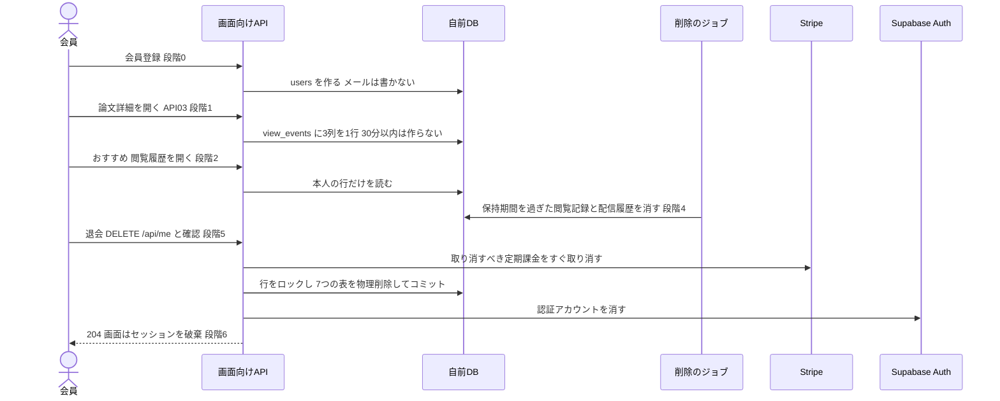

方式（共通基盤）: ARC010 個人データ最小化・削除方針 ／ 実体 30ファイル（定義元の資料2・実現先の設計書28） ／ 影響範囲 27件

# 方式設計書 — ARC010 個人データ最小化・削除方針

| 項目 | 内容 |
| :--- | :--- |
| 方式ID | ARC010（上流 `docs/基本設計書_概要.md` §11.1 で採番済み。本書で新しく採番した ID はありません） |
| 名称 | 個人データ最小化・削除方針 |
| 更新日 | 2026-10-27 |
| インプット | (a) `source/`（全6ファイル227行。ARC010 に関わる行は `source/02_機能要求定義.md:48`、`source/03_システム構成.md:39-42,44`、`source/01_企画概要.md:29`）／(b) `docs/基本設計書_概要.md` §2（BF05・BF13）、§4（F08・F15・F16）、§6（T005〜T008・T010・CRUD図 :907-908）、§8（個人の行動データの過剰保持 :1200、他人のデータの閲覧 :1191）、§10（バックアップ :1256）、§11.1・§11.2、付録 Q17・Q25・Q27・Q32・Q35／実現先の設計書 `docs/db/DB.T005`〜`T008`・`T010.DB物理設計.md`、`docs/detail/be/BE.F03`・`F05`〜`F12`・`F15`・`F16`・`F18`・`F19.BE詳細設計.md`、`docs/detail/batch/BT.B006`・`B007.バッチ詳細設計.md`、`docs/screens/画面.P101`・`P103`・`P104`・`P106.画面基本設計.md`、`docs/detail/fe/FE.P101`・`P103`・`P104`・`P106.FE詳細設計.md`／影響範囲の確認に使った設計書 `docs/detail/batch/BT.B002`・`B010.バッチ詳細設計.md`、`docs/detail/fe/FE.P105.FE詳細設計.md`、`docs/screens/画面.P105.画面基本設計.md`、同じ工程で作成した `docs/arch/方式.ARC006`・`ARC008.方式設計.md`／(c) `legacy/` |
| 既存資料の突合 | `legacy/` は空ディレクトリ（ファイル0件）で、突合する既存設計・業務資料はありません。本書の既存版（`docs/arch/方式.ARC010.方式設計.md`）も無く、今回が初版です。引き継ぐ ID は上流で採番済みのもの（ARC006・ARC008・ARC010、F03・F05〜F12・F15・F16・F18・F19、B002・B006・B007・B010、T005〜T008・T010、P101・P103〜P106、BF05・BF13、IF05・IF06、Q17・Q25・Q27・Q32・Q35）と、下流の設計書で付けられた番号（F16-BE DA001〜DA009、F15-BE DA003、B007 DA001、P106 の H45・H46・H55〜H57・E14・E15）だけです |
| 対象システムの性質 | `source/` は企画・初期設計の資料（Markdown）で、プログラムのソースコードはありません。本書は資料の記述を一次情報とし、資料に無い実現方法は、確定済みの下流設計書が定めた内容を「実現先」として引用します。保持期間の値はすべて下流の※推測で、上流 Q25 の決定待ちです |

---

## 1. 機構の概要

* **解決している課題**: 本サービスは推薦と閲覧履歴のために、会員がどの論文を開いたかを記録します（`source/01_企画概要.md:29`、`source/03_システム構成.md:42`）。この仕組みが無いと、次の4つが起きます。
  1. **行動データを集めすぎる**: 開いた論文・時刻・端末・滞在時間を無制限に残すと、利用者の研究の関心や所属が推し量れるほどの記録がたまり、漏えいしたときの被害が大きくなります（`source/02_機能要求定義.md:48`「個人の行動ログは必要最小限にし」、上流 §8「個人の行動データの過剰保持」）。
  2. **退会しても消えない**: 退会した後も閲覧記録・関心分野・契約が残ると、本人の意思に反してデータを持ち続けることになります（`source/02_機能要求定義.md:48`「退会・削除に対応する」）。
  3. **運用の記録から漏れる**: テーブルから消しても、ログ・ジョブの記録・失敗キューに検索語やメールアドレスが残っていれば、同じ情報が別の場所に残ります（※推測: 下流の設計判断。BT.B006:572、BT.B007:602）。
  4. **他人に見られる**: 本人以外が閲覧履歴やブックマークを読めると、行動データが漏れます（上流 §8「他人のデータの閲覧・改ざん」）。
* **設計方針**（資料から読み取れる範囲。推測は※推測と明記）:
  1. **閲覧の記録は「誰が・どの論文を・いつ」の3つだけにする**（`source/03_システム構成.md:42`「`view_events`: user_id, paper_id, viewed_at（プライバシーに配慮）」）。滞在時間・要約の深さ・端末・IPアドレスは持ちません。記録するのはログイン中に論文詳細を開いたときだけで、短時間の開き直しは記録しません（DB.T008:165,215）。
  2. **保持期間を過ぎた行動データは毎日消す**（※推測: 下流の設計判断。上流 Q25 は未定）。閲覧記録は180日、通知の配信履歴は90日を仮置きにしています。
  3. **退会では論理削除ではなく物理削除し、認証アカウントまで消す**（上流 BF13）。Pro の定期課金を先に取り消し、利用者に紐づく行をすべて1つのトランザクションで消してから、認証アカウントを消します（BE.F16:162-165）。
  4. **ログ・ジョブ・失敗キューに、行動や本文を残さない**（※推測: 下流の設計判断）。検索語・メールアドレス・メール本文・AIチャットの質問と回答・「利用者と論文の組」は、運用の記録に書きません。
  5. **本人の行だけを読めるようにする**（上流 §8 :1185,1191）。利用者に紐づくテーブルは行単位アクセス制御で本人の行に限り、サーバ側の処理（サービスロール）だけがそれを超えて読み書きします。
* **位置づけ**: 上流 §11.2 の相関では「ARC010 → F06・F07・F08・F15・F16 の会員機能」に効きます。会員の行動を記録する入口（論文詳細の取得 API03）、行動データを使う処理（推薦 F08・コスト監視 F19）、削除する出口（退会 F16・期限切れの削除）、運用の記録（ログ・ジョブ・失敗キュー）のすべてに効きます。責務の境目は次のとおりです。
  * ARC010 が受け持つ: 何を記録してよいか、いつまで残すか、退会で何を消すか、運用の記録に何を書かないか、誰が読めるか。
  * ARC006 が受け持つ: 期限切れの削除ジョブの起動・再試行・監視（本書は削除の中身だけを決める）。
  * ARC008 が受け持つ: 退会のときに Pro の定期課金を取り消すかの判定の材料（契約状態）。本書は「取り消してから消す」の順序だけを決めます。

  上の図の「ほか3つ」は、上流 §6 に無い通知設定・配信履歴・利用量のテーブルです（※上流未定義。§4 個人データの所在）。

---

## 2. 実体の構成

本方式は1つのプログラムではありません。資料の2か所で定められた決まりを、利用者に紐づくテーブルの制約、閲覧の記録と期限切れの削除、退会の処理、各機能・バッチの運用の記録の決まりで分担して実現しています。下表の「定義元」は決まりを定めた資料、「実現先」はその決まりを具体化した確定済みの設計書です。

| # | パス | 種別 | 役割 | 備考 |
| :--- | :--- | :--- | :--- | :--- |
| 1 | `source/02_機能要求定義.md` | 定義元（資料） | 個人の行動ログは必要最小限にし、退会・削除に対応する（:48） | 上流 §11.1 の実体 |
| 2 | `source/03_システム構成.md` | 定義元（資料） | 閲覧イベントは利用者・論文・日時の3つでプライバシーに配慮する（:42）。利用者に紐づくテーブル（:39-41,44） | 上流 §11.1 の実体 |
| 3 | `docs/db/DB.T005.DB物理設計.md` | 実現先（DB物理設計） | 利用者の行に個人情報（メール）を持たない。物理削除。認証アカウントが消えたら一緒に消える外部キー（:35,167,225,336-341） | 上流の適用範囲 T005 |
| 4 | `docs/db/DB.T006.DB物理設計.md` | 実現先（DB物理設計） | 関心分野。利用者の削除で一緒に消え、本人だけが読み書きできる（:183,196,341-363） | 上流の適用範囲 T006 |
| 5 | `docs/db/DB.T007.DB物理設計.md` | 実現先（DB物理設計） | ブックマーク。利用者の削除で一緒に消え、本人だけが読み・追加・削除できる（:186,233,337-351） | 上流の適用範囲 T007 |
| 6 | `docs/db/DB.T008.DB物理設計.md` | 実現先（DB物理設計） | 閲覧イベントの3列、30分以内の記録を止めるトリガー、180日の保持、本人だけが読める（:165,215-218,258,333-401） | 上流の適用範囲 T008 |
| 7 | `docs/db/DB.T010.DB物理設計.md` | 実現先（DB物理設計） | 契約。退会まで残し、退会では Stripe で取り消してから消す。ブラウザからは読めない（:38,206,380,411） | 上流の適用範囲 T010 |
| 8 | `docs/detail/be/BE.F16.BE詳細設計.md` | 実現先（BE詳細設計） | 退会の処理の全体（定期課金の取り消し、7つの表の物理削除、認証アカウントの削除、途中で失敗したときの扱い） | 上流の適用範囲 F16。本方式の中心 |
| 9 | `docs/detail/be/BE.F15.BE詳細設計.md` | 実現先（BE詳細設計） | 閲覧の記録（`recordViewEvent`）、閲覧履歴の一覧、期限切れの削除（`purge_expired_view_events`） | 上流の適用範囲 F15 |
| 10 | `docs/detail/be/BE.F08.BE詳細設計.md` | 実現先（BE詳細設計） | 推薦で読む行動データを直近100件に限り、記録もログもしない（:225,252-254,471） | 上流の適用範囲 F08 |
| 11 | `docs/detail/be/BE.F05.BE詳細設計.md` | 実現先（BE詳細設計） | 論文詳細（API03）の中で閲覧を1回だけ記録する（:517） | ※上流未定義（上流の適用範囲に F05 が無い） |
| 12 | `docs/detail/be/BE.F03.BE詳細設計.md` | 実現先（BE詳細設計） | 検索語を保存もログもしない（:116,385,416） | ※上流要確認 |
| 13 | `docs/detail/be/BE.F06.BE詳細設計.md` | 実現先（BE詳細設計） | メールアドレスを DB とログに写さない。関心分野は利用者の削除で消える（:185,505,514） | ※上流未定義 |
| 14 | `docs/detail/be/BE.F07.BE詳細設計.md` | 実現先（BE詳細設計） | ブックマークの一覧を記録せず、ログに利用者IDと論文IDを出さない（:264,459,475,519） | ※上流未定義 |
| 15 | `docs/detail/be/BE.F09.BE詳細設計.md` | 実現先（BE詳細設計） | AIチャットの質問・回答を保存もログもしない。会話の履歴はサーバに持たない（:141,215,377,419） | ※上流要確認 |
| 16 | `docs/detail/be/BE.F10.BE詳細設計.md` | 実現先（BE詳細設計） | 通知設定と配信履歴の持ち方。配信履歴にメールアドレスと本文を持たない（:89,93,231,419,453） | ※上流要確認 |
| 17 | `docs/detail/be/BE.F11.BE詳細設計.md` | 実現先（BE詳細設計） | 複数論文比較で F09 と同じく本文を保存もログもしない（:251,447） | ※上流要確認 |
| 18 | `docs/detail/be/BE.F12.BE詳細設計.md` | 実現先（BE詳細設計） | カード情報を扱わず、Stripe の ID を応答に返さない。退会済みの利用者の通知では契約を取り消す（:266,534,607） | ※上流未定義 |
| 19 | `docs/detail/be/BE.F18.BE詳細設計.md` | 実現先（BE詳細設計） | 利用量の記録を F16 の削除範囲に加える提案。ログに利用者IDを出さない（:30,32,244,278） | ※上流要確認 |
| 20 | `docs/detail/be/BE.F19.BE詳細設計.md` | 実現先（BE詳細設計） | 行動データを集計だけで使い、利用者IDと論文の組を出さない（:32,39,372,406） | ※上流要確認 |
| 21 | `docs/detail/batch/BT.B006.バッチ詳細設計.md` | 実現先（バッチ詳細設計） | 検索語を利用者に結びつけずに受け取り、ジョブ・ログ・直近エラーに本文を残さない（:195,334,472,572,615） | ※上流要確認 |
| 22 | `docs/detail/batch/BT.B007.バッチ詳細設計.md` | 実現先（バッチ詳細設計） | 配信履歴の90日の保持と削除、ログ・失敗キューにメールと本文を残さない（:175-176,515,602,618,650） | ※上流要確認 |
| 23 | `docs/screens/画面.P104.画面基本設計.md` | 実現先（画面基本設計） | ログイン中に論文詳細を開いたときだけ記録する。画面は記録用の API を呼ばない（:151,237,263） | ※上流未定義 |
| 24 | `docs/detail/fe/FE.P104.FE詳細設計.md` | 実現先（FE詳細設計） | 記録はサーバが API03 の中で行い、ブラウザに閲覧の痕跡を残さない（:211,215,347,463） | P104 の実装 |
| 25 | `docs/screens/画面.P106.画面基本設計.md` | 実現先（画面基本設計） | 閲覧履歴の表示と退会の画面（H35〜H39、H45・H46・H55〜H57、E14・E15）（:138-160,185-186,299） | 上流の適用範囲（F15・F16 の画面） |
| 26 | `docs/detail/fe/FE.P106.FE詳細設計.md` | 実現先（FE詳細設計） | 退会の依頼（`deleteAccount`）とセッションの破棄（`withdrawAndLeave`）（:450-451,516-517,638） | P106 の実装 |
| 27 | `docs/screens/画面.P101.画面基本設計.md` | 実現先（画面基本設計） | カードを表示しただけでは閲覧を記録しない（:201,218） | ※上流未定義 |
| 28 | `docs/detail/fe/FE.P101.FE詳細設計.md` | 実現先（FE詳細設計） | ブラウザに残すのは Supabase のセッション Cookie だけ（:194,399） | P101 の実装 |
| 29 | `docs/screens/画面.P103.画面基本設計.md` | 実現先（画面基本設計） | 検索語を利用者に紐づけて保存しない（:204,225） | ※上流要確認 |
| 30 | `docs/detail/fe/FE.P103.FE詳細設計.md` | 実現先（FE詳細設計） | 検索語をブラウザの保存領域に置かず、URL にだけ持つ（:144,166,383） | P103 の実装 |

* **命名規則・配置規則**（新規追加時に従うべき規則）:
  * 利用者に紐づくテーブルは、利用者IDを `user_id`（UUID）で持ち、`users.user_id` への外部キーに「一緒に削除」（ON DELETE CASCADE）を付けます（DB.T005:234-241）。行単位アクセス制御は `{テーブル}_select_own` のように本人の行だけを許すポリシー名にします。
  * 期限切れの削除の処理は `purge_{対象}` と名付け、1回あたり5,000行ずつ、0行になるまで繰り返します（BE.F15:212、BT.B007:176）。
  * 退会の削除は `web/lib/server/withdrawal/withdrawalRepository.ts` に `delete{対象}` の関数として加えます（BE.F16:281-297）。
  * ログに出す利用者の識別は、利用者IDだけにします。論文ID・検索語・メールアドレス・本文と同じ行に並べません（本書 §4 運用の記録の決まりで決める）。
* **全数**: 30件（定義元の資料2件＋実現先の設計書28件。実現先の内訳は DB物理設計5件・BE詳細設計13件・バッチ詳細設計2件・画面基本設計4件・FE詳細設計4件）。根拠: 定義元は上流 §11.1 ARC010 行の「実体」列に挙がった2ファイル（`source/02_機能要求定義.md:48`、`source/03_システム構成.md:42`）と一致します。実現先は、全47本の確定済み設計書（`docs/db/` 10本・`docs/detail/be/` 19本・`docs/detail/batch/` 11本・`docs/detail/fe/` 7本）と画面基本設計書7本を1本ずつ調べ、ARC010 を「利用する方式」に挙げるか本文で当てはめ、かつ記録・保持・削除・運用の記録・読み出しのどれかの決まりを自ら定めているものを数えました。振り分けは次のとおりです。
  * 実現先（24本＋画面基本設計4本）: 上表 #3〜#30。
  * 影響範囲だけ（3本＋画面基本設計1本）: `BT.B002`（LLM へ個人の情報を送らないことを確かめている。B002:522）、`BT.B010`（失敗キューの一覧で検索語を出さない。B010:481）、`FE.P105`・`画面.P105`（Appendix は記録しないと書くが、API03 を呼ぶため記録される。FE.P105:283,296、画面.P105:207）。§6 に行があります。
  * 対象外（20本＋画面基本設計2本）: `DB.T001`〜`T004`・`T009`（5本。利用者に紐づく列が無い）、`BE.F01`・`F02`・`F04`・`F13`・`F14`・`F17`（6本。使わないと明記）、`BT.B001`・`B003`・`B004`・`B005`・`B008`・`B009`・`B011`（7本。使わないと明記）、`FE.P102`・`P107`（2本。使わないと明記）、`画面.P102`・`P107`（2本。言及だけか言及なし）。

* **構成要素ロースター**（本方式を形づくる要素の全数。ID は上流と下流の設計書で付いた名前をそのまま使い、本書では採番しません）:

| # | 種別 | 名称（既存の識別子） | 概要 | 定義状況 | 詳細の所在 |
| :--- | :--- | :--- | :--- | :--- | :--- |
| 1 | 決まり | 記録を最小限にする | 行動データは「誰が・どの論文を・いつ」だけを、ログイン中に論文詳細を開いたときだけ記録する | 詳細 | §4 決まり No.1 |
| 2 | 決まり | 保持期間を過ぎたら消す | 閲覧記録と配信履歴は保持期間を過ぎたら毎日消す | 詳細 | §4 決まり No.2 |
| 3 | 決まり | 退会で消す | 利用者に紐づく行をすべて物理削除し、認証アカウントも消す | 詳細 | §4 決まり No.3 |
| 4 | 決まり | 運用の記録に行動と本文を残さない | ログ・ジョブ・失敗キューに検索語・メール・本文・利用者と論文の組を書かない | 詳細 | §4 決まり No.4 |
| 5 | 決まり | 本人だけが読める | 利用者に紐づくテーブルは本人の行だけを読み書きできる | 詳細 | §4 決まり No.5 |
| 6 | 決まり | 外へ渡す個人の情報を限る | LLM・arXiv には個人の情報を送らず、Stripe には決済に要るものだけを渡す | 詳細 | §4 決まり No.6 |
| 7 | テーブル | `users`（T005） | プランと登録日時だけを持つ。メールアドレスは持たない | 詳細 | §4 個人データの所在 No.1 |
| 8 | テーブル | `user_interests`（T006） | 関心分野 | 簡易 | §4 個人データの所在 No.2 |
| 9 | テーブル | `bookmarks`（T007） | ブックマーク | 簡易 | §4 個人データの所在 No.3 |
| 10 | テーブル | `view_events`（T008） | 閲覧イベント。3列だけ | 詳細 | §4 個人データの所在 No.4 |
| 11 | テーブル | `subscriptions`（T010） | 契約。退会まで残す | 詳細 | §4 個人データの所在 No.5 |
| 12 | テーブル | `{通知設定テーブル}`（※上流未定義） | 通知の受け取りの設定 | 簡易 | §4 個人データの所在 No.6 |
| 13 | テーブル | `{配信履歴テーブル}`（※上流未定義） | 配信の結果。メールアドレスと本文は持たない | 詳細 | §4 個人データの所在 No.7 |
| 14 | テーブル | `{利用量テーブル}`（※上流未定義） | Pro 機能の利用の予約。どの機能をいつ使ったか | 詳細 | §4 個人データの所在 No.8、§7 制約1 |
| 15 | 外部 | Supabase Auth の認証アカウント（`auth.users`） | メールアドレスとログインの情報。本システムの DB の外 | 詳細 | §4 個人データの所在 No.9 |
| 16 | 外部 | Stripe の顧客情報 | 決済の顧客とメールアドレス。退会しても残す（上流 Q17 の確認待ち） | 詳細 | §4 個人データの所在 No.10 |
| 17 | 処理 | `recordViewEvent`（F15。API03 の中で呼ぶ） | ログイン中に論文詳細を開いたとき1行だけ記録する。失敗しても論文詳細は返す | 詳細 | §3 段階1、BE.F15:26,210 |
| 18 | トリガー | `trg_view_events_before_insert`（T008） | 同じ利用者が同じ論文を30分以内に記録済みなら行を作らず、閲覧日時を DB の時刻に固定する | 詳細 | DB.T008:215,333-358 |
| 19 | 行単位アクセス制御 | 本人の行だけのポリシー（`users_select_own`・`view_events_select_own`・`view_events_insert_own` ほか） | 利用者に紐づく行を本人だけに見せる。閲覧イベントの削除と更新のポリシーは無い | 詳細 | DB.T005:346-351、DB.T006:341-363、DB.T007:337-351、DB.T008:382-401 |
| 20 | 外部キー | 「一緒に削除」（T006〜T008・T010 の `user_id`、T005 → `auth.users`） | 利用者か認証アカウントが消えたら紐づく行も消える。退会の明示的な削除の後ろの備え | 詳細 | DB.T005:225,238、DB.T008:239,318-325 |
| 21 | 処理 | `purge_expired_view_events`（F15 DA003。`worker/jobs/view_events_retention.py`。※上流未定義） | 閲覧日時が保持期間より前の行を、1日1回5,000行ずつ消す | 詳細 | §3 段階4、BE.F15:212,284-295,328 |
| 22 | 処理 | `purge_delivery_history`（B007 DA001。※上流未定義） | 配信日が保持日数より前の配信履歴を5,000行ずつ消す。利用者ごとの最新の成功の行は残す | 詳細 | §3 段階4、BT.B007:176,300-312 |
| 23 | 設定値 | `DIGEST_HISTORY_RETENTION_DAYS`（※上流未定義） | 配信履歴の保持日数（※推測: 90） | 簡易 | §4 設定項目 |
| 24 | 設定値 | 閲覧イベントの保持日数（名前は未定。※上流未定義） | 閲覧イベントの保持日数（※推測: 180。上流 Q25） | 詳細 | §4 設定項目、§7 制約3 |
| 25 | API | `DELETE /api/me`（F16。※上流未定義・上流 Q27） | 退会の受け口。Bearer トークンだけで本人を確かめ、本文 `{"confirm": true}` を求める | 詳細 | §3 段階5、BE.F16:127-148 |
| 26 | 処理 | `cancelBillingSubscriptions`（F16） | 取り消すべき契約を読み、Stripe 側ですぐに取り消す。失敗したら何も消さずに 502 | 詳細 | §3 段階5、BE.F16:162,206-210 |
| 27 | 処理 | `deletePersonalData`（F16 DA002〜DA009） | 1つのトランザクションで、利用者の行をロックし、7つの表を決まった順に物理削除する | 詳細 | §3 段階5、§4 退会の削除順序、BE.F16:163-164 |
| 28 | 処理 | `deleteAuthAccount`（F16。`authAdminGateway.ts`） | コミットの後に Supabase の管理用 API で認証アカウントを消す。存在しなければ成功 | 詳細 | §3 段階5、BE.F16:165,312 |
| 29 | エラー応答 | 500 `WITHDRAWAL_INCOMPLETE` | 個人データは消えたが認証アカウントが残ったとき。もう一度退会すれば完了する | 詳細 | §4 退会のエラー応答、BE.F16:29,321,342 |
| 30 | 画面 | P106 退会の説明・確認（H45・H46・H55〜H57、E14・E15） | 消えるデータを説明し、確認の後に退会を依頼する | 簡易 | 画面.P106:148-160,185-186 |
| 31 | 画面の処理 | `deleteAccount`・`withdrawAndLeave`（FE.P106） | 退会を依頼し、成功したらこのブラウザのセッションを破棄してホームへ戻す | 簡易 | FE.P106:450-451,516-517 |
| 32 | 運用の記録の決まり | `sanitize_error` の検索語の伏せ字（B006） | 直近エラーに入る arXiv の URL の検索語を伏せる | 詳細 | BT.B006:334 |
| 33 | 運用の記録の決まり | 失敗キューの一覧で検索語を出さない（B010） | 失敗キューに残る検索語を、再処理の一覧に表示しない | 簡易 | BT.B010:481 |
| 34 | 運用の記録の決まり | 配信のログ・失敗キューにメールと本文を入れない（B007・F10） | 失敗キューには配信日と試行回数だけを入れる | 簡易 | BT.B007:515,602、BE.F10:419,432 |
| 35 | 運用の記録の決まり | AIチャット・比較の質問と回答を保存もログもしない（F09・F11） | 会話の履歴はブラウザが毎回送り、サーバには残さない | 簡易 | BE.F09:141,215,377、BE.F11:251 |
| 36 | 運用の記録の決まり | 検索語を保存もログもしない（F03） | 検索語は利用者に紐づけない | 簡易 | BE.F03:116,385 |
| 37 | 読み出しの決まり | 推薦は閲覧記録とブックマークの直近100件だけを読む（F08） | 推薦に使う行動データの量を限る | 簡易 | BE.F08:252-254 |
| 38 | 読み出しの決まり | 監視は集計だけを出す（F19） | 利用者IDと論文の組を出さない | 簡易 | BE.F19:39,372,387 |
| 39 | 画面の決まり | ブラウザに閲覧の痕跡を残さない | 保存するのは Supabase のセッション Cookie だけ。検索語は URL にだけ持つ | 簡易 | FE.P101:194、FE.P103:166、FE.P104:211 |
| 40 | 画面の決まり | 一覧の表示では記録しない（P101〜P103） | カードを表示しただけでは閲覧を記録しない | 簡易 | 画面.P101:201、画面.P103:204 |

**総件数: 40件**（決まり6件・個人データの置き場所10件（#7〜#16）・記録と読み出しの制御4件（#17〜#20）・期限切れの削除と保持日数4件（#21〜#24）・退会7件（#25〜#31）・運用の記録の決まり5件（#32〜#36）・読み出しの決まり2件・画面の決まり2件。定義状況は詳細26件・簡易14件）。**全数である根拠**: 決まり6件は、資料の2行（`source/02_機能要求定義.md:48`、`source/03_システム構成.md:42`）と上流 §8 の2行（:1191 他人のデータの閲覧、:1200 個人の行動データの過剰保持）を、実現先の設計書が実際に分けて実装している単位でまとめたものです。置き場所10件は、上流 §6 の利用者に紐づくテーブル（T005〜T008・T010）に、下流で※上流未定義として加わったテーブル3件と、DB の外にある認証基盤と Stripe を加えたものです。それ以外の要素は、実現先の設計書28本から「ARC010」「退会」「物理削除」「保持期間」「ログに…残さない」「本人の行」を含む記述を全件拾い、6つの決まりのどれかを実現するものを数えました。ジョブの起動・再試行（ARC006）と、契約を取り消すかの判定（ARC008）は除いています。
**定義状況の判定**（completeness 3-1）: 状態を変える（3-1 の2）・複数のテーブルや外部サービスにまたがる（同3）・失敗時の扱いが自明でない（同5）・業務上の判断を含む（同7）のどれかに当たるものを「詳細」としました。#8・#9・#12 は利用者の削除で一緒に消えるだけのテーブル、#23 は値を1つ持つだけ、#30・#31 は画面の表示と依頼だけ、#33〜#40 は「書かない・出さない・読む量を限る」という1つの決まりを守るだけで、分岐を含まないため「簡易」です。

---

## 3. ライフサイクル（登録・読込・選択）

* **時系列**: 会員登録から、記録・利用・期限切れの削除・退会までを示します。

| 段階 | 契機 | 処理 | 実装（ファイル:行） |
| :--- | :--- | :--- | :--- |
| 0 会員登録 | 利用者が初めてログインしたとき | 利用者の行をプランと登録日時だけで作ります。メールアドレスは Supabase Auth にだけ置き、DB にもログにも写しません | `docs/detail/be/BE.F06.BE詳細設計.md:185,505`、`docs/db/DB.T005.DB物理設計.md:167` |
| 1 記録 | ログイン中に論文詳細（API03）を開いたとき | 利用者ID・論文ID・閲覧日時の3つを1行記録します。同じ論文を30分以内に記録済みなら DB のトリガーが行を作りません。記録は独立したトランザクションで、失敗しても論文詳細は返し、ログに利用者と論文の組を残しません。一覧の表示・要約の取得（API04）・未ログインでは記録しません | `docs/detail/be/BE.F15.BE詳細設計.md:26,210,325,354-356`、`docs/db/DB.T008.DB物理設計.md:165,215-217,333-358`、`docs/screens/画面.P101.画面基本設計.md:201` |
| 2 利用 | 推薦・閲覧履歴・監視の集計のとき | 推薦は閲覧記録とブックマークの直近100件だけを読み、何も記録しません。閲覧履歴は本人の利用者IDで絞り、同じ論文は最後の1件にまとめ、応答を共有キャッシュに残しません。監視は集計だけを出します | `docs/detail/be/BE.F08.BE詳細設計.md:228,252-254,471`、`docs/detail/be/BE.F15.BE詳細設計.md:133,145,186`、`docs/detail/be/BE.F19.BE詳細設計.md:39,372` |
| 3 運用の記録 | ログ・ジョブ・失敗キューに書くとき | §4 運用の記録の決まりに従います。検索語は伏せ字にし、メールアドレス・メール本文・AIチャットの質問と回答は書きません | `docs/detail/batch/BT.B006.バッチ詳細設計.md:334,472,572`、`docs/detail/batch/BT.B007.バッチ詳細設計.md:515,602`、`docs/detail/be/BE.F09.BE詳細設計.md:377` |
| 4 期限切れの削除 | 1日1回（※推測: 深夜）と、配信バッチの実行時 | 閲覧イベントは閲覧日時が保持期間（※推測: 180日）より前の行を、配信履歴は配信日が保持日数（※推測: 90日）より前の行を、5,000行ずつ0行になるまで消します。配信履歴は利用者ごとの最新の成功の行だけ残します（次の配信の「前回配信日時」に使うため）。ジョブの起動・再試行・監視は ARC006 に従います | `docs/detail/be/BE.F15.BE詳細設計.md:212,284-295,328`、`docs/detail/batch/BT.B007.バッチ詳細設計.md:176,300-312`、`docs/db/DB.T008.DB物理設計.md:218` |
| 5 退会 | 会員がマイページ（P106）で退会を確認したとき | §4 退会の削除順序のとおりです。Bearer トークンだけで本人を確かめ、本文の確認（`{"confirm": true}`）を求めます。取り消すべき定期課金をトランザクションの外で Stripe 側ですぐ取り消し（失敗したら何も消さずに 502）、1つのトランザクションで利用者の行をロックして7つの表を物理削除し、コミットの後に認証アカウントを消します | `docs/detail/be/BE.F16.BE詳細設計.md:132,145,159-167,309-312` |
| 6 退会の後 | 退会の応答の後 | 画面はセッションを破棄してホームへ戻ります。トークンは次の確認で無効になります（認証基盤への問い合わせで確かめるため）。認証アカウントを消せなかったときは、個人データは消えたまま 500 `WITHDRAWAL_INCOMPLETE` を返し、もう一度退会すれば完了します。Stripe の顧客情報と、バックアップの中の削除前のデータは残ります（§7） | `docs/detail/fe/FE.P106.FE詳細設計.md:516`、`docs/detail/be/BE.F06.BE詳細設計.md:457`、`docs/detail/be/BE.F16.BE詳細設計.md:29,165,353` |
| 7 外への送信 | LLM・arXiv・Stripe を呼ぶとき | LLM には論文の原題と Abstract（と本文）だけを送り、個人の情報を送りません。arXiv には検索語から作った問い合わせ条件だけを送ります。Stripe には決済に要るメールアドレスを渡します | `docs/detail/batch/BT.B002.バッチ詳細設計.md:522`、`docs/detail/batch/BT.B006.バッチ詳細設計.md:572`、`docs/detail/be/BE.F12.BE詳細設計.md:534` |

* **読込順序**（退会のとき、どの削除の手段が先に効くか）:

| 順 | 手段 | 消すもの | 失敗したとき | 根拠 |
| :--- | :--- | :--- | :--- | :--- |
| 1 | Stripe の定期課金の即時取り消し | 課金（データではなく、退会後の請求を止める） | 何も消さずに 502 で終える | BE.F16:162,206-210 |
| 2 | 明示的な物理削除（DA003〜DA009） | 7つの表の本人の行。件数をログに残す | トランザクションごと取り消し、何も消えない | BE.F16:164,225-273 |
| 3 | 外部キーの「一緒に削除」 | 明示的な削除の後で別のタブが作り直した子の行 | — | BE.F16:197,351 |
| 4 | 認証アカウントの削除 | Supabase Auth のメールアドレスとログイン情報 | 個人データは消えたまま 500。もう一度退会で完了 | BE.F16:165,312 |
| 5 | 認証アカウントからの「一緒に削除」（Supabase 環境だけ） | 退会の途中で作り直された利用者の行 | — | DB.T005:225,338-341、BE.F16:32 |

* **選択規則**:
  1. **閲覧を記録するか**: ログイン中で、論文詳細（API03）の取得で、同じ論文の直近30分の記録が無いときだけ記録します。
  2. **ログに何を出すか**: 利用者IDは、ERROR と業務の拒否（403・429）のログにだけ出してよく、論文ID・検索語・メールアドレス・本文と同じ行には出しません（本書で決める。§7 制約2）。
  3. **退会で取り消す契約**: 課金中（試用中・有効・支払い遅延・未払い・一時停止）と、最初の支払い待ち（`incomplete`）の契約です（BE.F16:162）。
  4. **保持期間で消さないもの**: 配信履歴の利用者ごとの最新の成功の行、関心分野・ブックマーク・契約・利用者（退会まで残す）、利用量の記録（保持期間が無い。§7 制約3）。

---

## 4. インターフェース・データ構造

* **決まり**（6件）:

| No | 決まり | 内容 | 守る場所 | 根拠 |
| :--- | :--- | :--- | :--- | :--- |
| 1 | 記録を最小限にする | 閲覧イベントは利用者ID・論文ID・閲覧日時の3列だけ。ログイン中に論文詳細を開いたときだけ、30分以内の開き直しは記録しない | T008、F15 `recordViewEvent`、F05 API03 | `source/03_システム構成.md:42`、DB.T008:165,215 |
| 2 | 保持期間を過ぎたら消す | 閲覧イベントは180日、配信履歴は90日（いずれも※推測）。毎日消す | F15 `purge_expired_view_events`、B007 `purge_delivery_history` | `source/02_機能要求定義.md:48`、DB.T008:218、BT.B007:176 |
| 3 | 退会で消す | 7つの表を物理削除し、認証アカウントを消す。定期課金は先に取り消す | F16 | `source/02_機能要求定義.md:48`、`docs/基本設計書_概要.md:431-450` |
| 4 | 運用の記録に行動と本文を残さない | 下表「運用の記録の決まり」 | 全機能・全バッチ | BT.B006:572、BT.B007:602、BE.F15:354-356 |
| 5 | 本人だけが読める | 利用者に紐づくテーブルは本人の行だけ。サーバ側の処理（サービスロール）だけが超えて読み書きする | T005〜T008・T010 の行単位アクセス制御 | `docs/基本設計書_概要.md:1185,1191` |
| 6 | 外へ渡す個人の情報を限る | LLM・arXiv へは個人の情報を送らない。Stripe へは決済に要るメールアドレスだけ | B002・B006・F12 | BT.B002:522、BT.B006:572、BE.F12:534 |

  **総件数: 6件**（構成要素ロースター #1〜#6 と一致）。

* **個人データの所在**（利用者に紐づくデータの置き場所の全数）:

| No | 置き場所 | 持つもの | 保持期間 | 退会で | 読める人 | 根拠 |
| :--- | :--- | :--- | :--- | :--- | :--- | :--- |
| 1 | `users`（T005） | 利用者ID・プラン・登録日時 | 退会まで | DA007 で物理削除 | 本人（読み取りだけ） | DB.T005:35,167,346-351 |
| 2 | `user_interests`（T006） | 関心分野と重み | 退会まで | DA005 で物理削除 | 本人（読み書き） | DB.T006:183,341-363 |
| 3 | `bookmarks`（T007） | 保存した論文と日時 | 退会まで | DA004 で物理削除 | 本人（読み・追加・削除） | DB.T007:186,337-351 |
| 4 | `view_events`（T008） | 利用者ID・論文ID・閲覧日時 | 180日（※推測。上流 Q25） | DA003 で物理削除 | 本人（読み取り・記録だけ。削除はできない） | DB.T008:165,218,382-401 |
| 5 | `subscriptions`（T010） | Stripe の顧客ID・定期課金ID・契約状態 | 退会まで（解約済みも残す） | Stripe で取り消してから DA006 で物理削除 | サーバだけ（ブラウザからは読めない） | DB.T010:38,206,380 |
| 6 | `{通知設定テーブル}`（※上流未定義） | 通知の受け取りの設定 | 退会まで | DA008 で物理削除 | 本人 | BE.F10:89、BE.F16:164 |
| 7 | `{配信履歴テーブル}`（※上流未定義） | 利用者ID・配信日・結果・件数（メールと本文は持たない） | 90日（※推測。最新の成功の行は残す） | DA009 で物理削除 | サーバだけ | BE.F10:231、BT.B007:175-176 |
| 8 | `{利用量テーブル}`（※上流未定義） | 利用者ID・機能・予約日時・取消日時 | 定めなし（消さない） | 外部キーの「一緒に削除」の案だけ。F16 の削除に無い | サーバだけ | BE.F18:30,32,121-130 |
| 9 | Supabase Auth（`auth.users`） | メールアドレス・ログインの情報 | 退会まで | `deleteAuthAccount` で削除 | 認証基盤 | BE.F06:185、BE.F16:165 |
| 10 | Stripe の顧客 | 決済の顧客とメールアドレス | 定めなし | 残す（上流 Q17 の確認待ち） | Stripe | BE.F16:25、BE.F12:534、DB.T010:411 |

  **総件数: 10件**（構成要素ロースター #7〜#16 と一致）。このほかに、ログ・ジョブ（`jobs`）・失敗キュー（`jobs:failed`）・DB のバックアップ・ホスティングのアクセスログにも個人の情報が入りえます。前の3つは下表「運用の記録の決まり」で入れないようにし、後の2つは §7 制約4・5 で扱います。

* **退会の削除順序**（F16 の手順。上流 BF13 の順に、下流で加わった表を挟んだもの）:

| 順 | 処理 | 対象 | トランザクション | 根拠 |
| :--- | :--- | :--- | :--- | :--- |
| 1 | トークンと本文の確認 | Bearer トークン、`{"confirm": true}` | — | BE.F16:160-161 |
| 2 | 取り消すべき契約を読み、Stripe 側ですぐ取り消す（DA001） | 定期課金 | 外 | BE.F16:162 |
| 3 | 利用者の行をロックし、取り消し漏れが無いか読み直す（DA002・DA001） | `users` | 内（文の打ち切り15秒・ロック待ち10秒） | BE.F16:163,212-223 |
| 4 | 閲覧イベントを削除（DA003） | `view_events` | 内 | BE.F16:164 |
| 5 | ブックマークを削除（DA004） | `bookmarks` | 内 | BE.F16:164 |
| 6 | 関心分野を削除（DA005） | `user_interests` | 内 | BE.F16:164 |
| 7 | 通知設定を削除（DA008。表ができるまでは0件） | `{通知設定テーブル}` | 内 | BE.F16:164,296 |
| 8 | 配信履歴を削除（DA009。表ができるまでは0件） | `{配信履歴テーブル}` | 内 | BE.F16:164,297 |
| 9 | 契約を削除（DA006） | `subscriptions` | 内 | BE.F16:164 |
| 10 | 利用者を削除（DA007）し、コミット | `users` | 内 | BE.F16:164 |
| 11 | 認証アカウントを削除 | `auth.users` | 外（タイムアウト10秒、1回だけやり直す） | BE.F16:165 |

  **総件数: 11行**。消す表は、上流 BF13 の5つ（view_events・bookmarks・user_interests・subscriptions・users）に、下流の通知設定・配信履歴の2つを加えた7つです。利用量の記録はまだ入っていません（§7 制約1）。

* **退会のエラー応答**: 400 `INVALID_BODY`（確認の本文が無い）、401 `UNAUTHORIZED`、500 `AUTH_UNAVAILABLE`・`INTERNAL_ERROR`（ロック待ちの打ち切りを含む）・`WITHDRAWAL_INCOMPLETE`（データは消えたが認証アカウントが残った）、502 `STRIPE_UNAVAILABLE`（何も消していない）の6つです。成功は 204 で、応答は共有キャッシュに残しません（BE.F16:133-134,151-157,333-343）。

* **運用の記録の決まり**（ログ・ジョブ・失敗キューに書かないもの）:

| No | 書かないもの | 理由 | 守っている設計書 | 根拠 |
| :--- | :--- | :--- | :--- | :--- |
| 1 | 利用者IDと論文IDの組 | 誰がどの論文を開いたかは閲覧イベントそのもので、ログに残すと保持期間と退会の削除が効かない | F15・F07・F16 | BE.F15:354-356、BE.F07:475、BE.F16:309 |
| 2 | 検索語の本文 | 利用者の関心が直接わかる入力のため | F03・B006・B010 | BE.F03:116,385、BT.B006:334,472、BT.B010:481 |
| 3 | メールアドレス・メール本文 | 個人を直接特定できるため | F06・F10・B007 | BE.F06:185、BT.B007:515,602 |
| 4 | AIチャット・比較の質問と回答 | 利用者の関心と入力そのもののため | F09・F11 | BE.F09:377、BE.F11:251 |
| 5 | 関心分野の内容 | 利用者の関心が直接わかるため | F06・F08 | BE.F06:466、BE.F08:471 |

  **総件数: 5行**。利用者IDだけを ERROR と業務の拒否のログに出すことは許します（選択規則2。退会の途中失敗の運用者の対応に要るため。BE.F16:331,342）。

* **設定項目**（全項目）:

| No | 名前 | 種別 | 既定値 | 意味 | 変えたときの効き方 | 根拠 |
| :--- | :--- | :--- | :--- | :--- | :--- | :--- |
| 1 | 閲覧イベントの保持日数（名前は未定） | 設定値（※上流未定義） | 180（※推測。上流 Q25） | この日数より前の閲覧イベントを消す | 次の削除のジョブから効く。短くすると推薦と監視の材料が減る | BE.F15:27,284、DB.T008:218 |
| 2 | `DIGEST_HISTORY_RETENTION_DAYS` | 環境変数（※上流未定義） | 90（※推測） | この日数より前の配信履歴を消す（最新の成功の行は残す） | 次の配信バッチから効く | BT.B007:618 |

  **総件数: 2件**（構成要素ロースター #23・#24 と一致）。30分の記録の抑止はトリガーの中の定数、削除の5,000行ずつ・30分のタイムアウトはジョブの中の定数です（DB.T008:347、BE.F15:212,338）。DB.T008 の運用の文は180日を直接書いており、設定値と二重になっています（§7 制約3）。

---

## 5. 拡張・変更手順

**利用者に紐づくテーブルを1つ追加する手順**（例: AIチャットの履歴を保存することにした場合）:

1. **上流に確認する**: 上流 §6 にテーブルを加え、ARC010 の適用範囲に加えてもらいます。持つ必要があるかを先に問い、持たずに済むなら持ちません（決まり No.1）。
2. **列を最小限にする**: 利用者ID（`user_id`）と、機能に要る列だけを持ちます。メールアドレスは持たず、本文が要るなら保持期間を決めます。
3. **外部キーと行単位アクセス制御を付ける**: `users.user_id` への外部キーに「一緒に削除」を付け、本人の行だけを許すポリシーを作ります。
4. **退会の削除に加える**: `withdrawalRepository.ts` に `delete{対象}` を加え、F16 の削除のトランザクションの中、`subscriptions` と `users` の前に置きます。削除した件数をログに出します（利用者IDは出さない）。
5. **保持期間を決める**: 行動の記録なら保持日数の設定値を加え、`purge_{対象}` の削除のジョブを ARC006 の手順で加えます（1回5,000行ずつ）。
6. **運用の記録を確かめる**: その表の内容をログ・ジョブ・失敗キューに書かないことを、機能の設計書の §6 に書きます。
7. **画面の退会の説明を直す**: P106 H45 の「退会すると…が削除され」に加えます。
8. **本書を更新する**: §4 個人データの所在・退会の削除順序に行を加えます。

**保持期間を変える手順**: 閲覧イベントは設定値を変え、DB.T008 の運用の文も同じ値にそろえます。配信履歴は `DIGEST_HISTORY_RETENTION_DAYS` を変えます。短くした場合、次の削除のジョブで一度に多くの行が消えるため、5,000行ずつの繰り返しで負荷を分けます。

---

## 6. 影響範囲

| 影響先（機能/画面/工程） | どう効くか | 変更時のリスク |
| :--- | :--- | :--- |
| F15 閲覧履歴 | 記録の3列・30分の抑止・期限切れの削除・本人だけの一覧 | 列を増やすと、行動データが増え漏えい時の被害が大きくなる |
| F16 退会・個人データ削除 | 退会の削除順序・物理削除・認証アカウントの削除 | 削除する表を漏らすと、退会後もデータが残る |
| F08 レコメンド | 直近100件だけを読み、記録しない | 読む件数を増やすと、古い行動まで推薦に使う |
| T005 users | メールを持たず、物理削除 | 列を足すときにメールを写すと、認証基盤の外に個人情報が増える |
| T006 user_interests | 一緒に削除・本人だけ | — |
| T007 bookmarks | 一緒に削除・本人だけ | — |
| T008 view_events | 3列・30分の抑止・180日・削除できない本人のポリシー | トリガーを外すと、再読み込みのたびに行が増える |
| T010 subscriptions | 退会まで残し、Stripe で取り消してから消す | 取り消す前に消すと、退会後も請求が続く |
| F05 論文詳細・Appendix（※上流未定義） | API03 の中で記録する | Appendix（P105）も API03 を呼ぶため記録される（§7 制約6） |
| F03 自由検索（※上流要確認） | 検索語を保存もログもしない | 検索語をログに出すと、利用者の関心が運用の記録に残る |
| F06 認証・プロフィール（※上流未定義） | メールを DB とログに写さない | — |
| F07 ブックマーク（※上流未定義） | 一覧の表示を記録せず、ログに利用者と論文の組を出さない | — |
| F09 AIチャット（※上流要確認） | 質問と回答を保存もログもしない | 会話の履歴を保存するなら §5 の手順が要る |
| F10 通知・ダイジェスト（※上流要確認） | 通知設定・配信履歴の持ち方 | — |
| F11 複数論文比較（※上流要確認） | F09 と同じ | F09 と同じ |
| F12 課金（※上流未定義） | Stripe にメールを渡す。退会済みの利用者の通知で契約を取り消す | — |
| F18 Pro機能の利用量制限（※上流要確認） | 利用量の記録を退会の削除に加える提案 | 加えないと、退会後も利用の記録が残る |
| F19 コスト監視・利用状況分析（※上流要確認） | 集計だけを出す | 保持期間を短くすると、集計の期間が短くなる |
| B002 Abstractベース日本語要約生成（※上流未定義） | LLM へ個人の情報を送らない | — |
| B006 arXivオンデマンド同期（※上流要確認） | 検索語を伏せ字にし、運用の記録に残さない | 失敗キューには検索語が残る（§7 制約2） |
| B007 通知・ダイジェスト配信（※上流要確認） | 配信履歴の90日の削除、メールと本文を残さない | — |
| B010 失敗ジョブの再処理（※上流未定義） | 一覧で検索語を出さない | — |
| P101 ホーム（※上流未定義） | カードの表示では記録しない | — |
| P103 論文検索（※上流要確認） | 検索語を保存しない（URL には持つ） | 検索語が URL とアクセスログに残る（§7 制約5） |
| P104 論文詳細（※上流未定義） | 開いたときにサーバが記録する | — |
| P105 Appendix（※上流未定義） | API03 を呼ぶため記録される | 画面設計書の「記録しない」と食い違う |
| P106 マイページ（※上流未定義） | 閲覧履歴の表示と退会 | 退会の説明（H45）に通知設定・配信履歴が書かれていない |

**総件数: 27件**（機能13件（F03・F05〜F12・F15・F16・F18・F19。F08 を含む）・テーブル5件・バッチ4件（B002・B006・B007・B010）・画面5件（P101・P103〜P106）。うち上流の適用範囲に無いもの19件）。**根拠**: 上流 §11.1 ARC010 の適用範囲（F15・F16・F08／T005〜T008・T010）の全8要素を行にし、加えて §2 の振り分けで実現先または影響範囲だけとした設計書のうち、適用範囲に無いもの（F03・F05・F06・F07・F09・F10・F11・F12・F18・F19・B002・B006・B007・B010・P101・P103・P104・P105・P106）を加えました。上流に無い19件のうち、自身が「上流の適用範囲外だが当てはめる」と明記している F03・F09・F10・F11・F18・F19・B006・B007・P103 は※上流要確認、それ以外は※上流未定義として、上流 §11.1 の適用範囲への追記を求めます。

---

## 7. 制約・注意事項

* **性能・容量**:
  * 閲覧イベントは、30分の抑止と180日の保持で増え方を抑えます。期限切れの削除は5,000行ずつで、1回の削除が長いロックを持たないようにしています（BE.F15:212）。
  * 退会は Stripe・DB・認証基盤を順に呼ぶため、画面向けAPIの実行時間の上限を60秒以上にする必要があります（BE.F16:345）。
* **失敗時の挙動**: 退会は「何も消えていない」か「データは消えたが認証アカウントが残った」のどちらかでしか止まらず、もう一度退会すれば完了するように作られています。Stripe で取り消した定期課金は元に戻しません（BE.F16:29,310,331）。
* **既知の制約**:
  1. **退会で消す範囲が設計書ごとに違う**: 上流 BF13 と CRUD図は5つの表、F16 は7つ（通知設定・配信履歴を追加）、F18 は利用量の記録も加えるよう提案、P106 の説明文（H45）は「関心分野・ブックマーク・閲覧履歴・契約情報」だけです。**本書は F16 の7つに利用量の記録を加えた8つを正とします**（※推測。利用量の記録はどの機能をいつ使ったかを示す行動データのため）。F16 への DA の追加と、上流 BF13・CRUD図・P106 H45 の更新を求めます（BE.F16:164、BE.F18:30、画面.P106:148、付録B No.1）。
  2. **ログに利用者IDを出すかが揃っていない**: F15・F07・F16・F18・F12 は出さず、F06 の共通のエラー応答・F08・F09・F11・F10・B007 は出しています。F09・F11 は利用者IDと論文IDを同じ行に出しています（BE.F06:466、BE.F09:402、BE.F11:430）。**本書は「利用者IDだけは ERROR と業務の拒否のログに出してよいが、論文ID・検索語・メール・本文と同じ行には出さない」を正とします**（※推測）。F09・F11 のログの修正を求めます。また B006 の失敗キューには検索語（`q`）がそのまま残ります（再処理に要るため。BT.B006:147,333）。失敗キューの保持期間は定められていません（付録B No.2）。
  3. **保持期間が未定で、持ち方も揃っていない**: 閲覧イベントの180日・配信履歴の90日はどちらも※推測で、上流 Q25 は閲覧イベントだけを扱っています。閲覧イベントの保持日数は設定値の名前が無く、DB.T008 の運用の文は180日を直接書いています。利用量の記録には保持期間がありません。2つの削除のジョブは上流 §5 のバッチ一覧に無く、バッチIDもありません（BE.F15:328、BT.B007:176、BE.F18:32。付録B No.3・No.4）。
  4. **バックアップに残る**: DB の日次バックアップには、退会後も保存期間の間だけ削除前のデータが残ります。バックアップから戻したときに退会済みの利用者を戻さない手順はありません（BE.F16:353、上流 Q35。付録B No.5）。
  5. **検索語が URL とアクセスログに残る**: 検索語は画面の URL と API02 の問い合わせ文字列に入ります。ホスティングのアクセスログ（F19 が未ログインの閲覧数に使う想定）に検索語が残るため、「検索語をログに残さない」という F03 の決まりがアクセスログには届きません（FE.P103:144,304、BE.F19:32。付録B No.6）。
  6. **記録の契機の食い違い**: 上流 BF05 の図は「要約の取得の後に記録」、画面.P104 E01 も「要約の取得を受けて記録」としていますが、BE.F05・F15 は論文詳細（API03）の中で記録します。Appendix（P105）も API03 を呼ぶため、画面.P105 の「Appendix では記録しない」と食い違います。**本書は API03 で記録することを正とします**（BE.F15:26）。P105 で記録しないなら、API03 に「記録しない」指定を加えるかを確認します（FE.P105:283,296。付録B No.7）。
  7. **利用者が閲覧履歴を消せない**: 閲覧イベントには本人の削除のポリシーも API もありません。関心分野とブックマークは本人が消せます（DB.T008:258、BE.F15:30。付録B No.8）。
  8. **Stripe の顧客情報**: 退会しても Stripe の顧客とメールアドレスは残ります。上流 Q17 の仮置きは「利用者に紐づくテーブルの行をすべて削除」で、Stripe 側の扱いは確認待ちです（BE.F16:25、DB.T010:411。付録B No.9）。

---

## 付録A. ソース突合トレーサビリティ

| 記述箇所 | 根拠ソース（パス:行） |
| :--- | :--- |
| §1 課題1・2、設計方針1・3 | `source/02_機能要求定義.md:48`、`source/03_システム構成.md:42`、`docs/基本設計書_概要.md:1200` |
| §1 課題4、設計方針5 | `docs/基本設計書_概要.md:1185,1191` |
| §1 位置づけ（相関） | `docs/基本設計書_概要.md:1300,1317,1332` |
| §2 実体 #1・#2 | `docs/基本設計書_概要.md:1300` |
| §2 全数（振り分け） | `docs/detail/batch/BT.B002.バッチ詳細設計.md:522`、`docs/detail/batch/BT.B010.バッチ詳細設計.md:481`、`docs/detail/fe/FE.P105.FE詳細設計.md:283,296`、`docs/screens/画面.P105.画面基本設計.md:207`、`docs/detail/fe/FE.P102.FE詳細設計.md:345`、`docs/detail/fe/FE.P107.FE詳細設計.md:458` |
| §2 ロースター #7〜#16、§4 個人データの所在 | `docs/db/DB.T005.DB物理設計.md:35,167`、`DB.T006:183`、`DB.T007:186`、`DB.T008:165,218`、`DB.T010:38,206,380,411`、`docs/detail/be/BE.F10.BE詳細設計.md:89,231`、`docs/detail/be/BE.F18.BE詳細設計.md:30,32,121-130`、`docs/detail/be/BE.F06.BE詳細設計.md:185`、`docs/detail/be/BE.F12.BE詳細設計.md:534` |
| §2 ロースター #17〜#20、§3 段階1 | `docs/detail/be/BE.F15.BE詳細設計.md:26,210,325,354-356`、`docs/db/DB.T008.DB物理設計.md:215-217,239,318-325,333-358,382-401`、`docs/db/DB.T005.DB物理設計.md:225,238,346-351`、`DB.T006:341-363`、`DB.T007:337-351` |
| §2 ロースター #21〜#24、§3 段階4、§4 設定項目 | `docs/detail/be/BE.F15.BE詳細設計.md:27,212,284-295,328,338`、`docs/detail/batch/BT.B007.バッチ詳細設計.md:176,300-312,618`、`docs/db/DB.T008.DB物理設計.md:218,347` |
| §2 ロースター #25〜#31、§3 段階5・6、§4 退会の削除順序・エラー応答 | `docs/detail/be/BE.F16.BE詳細設計.md:29,127-167,206-223,225-273,296-297,309-312,331-345`、`docs/screens/画面.P106.画面基本設計.md:148-160,185-186`、`docs/detail/fe/FE.P106.FE詳細設計.md:450-451,516-517` |
| §2 ロースター #32〜#38、§4 運用の記録の決まり | `docs/detail/batch/BT.B006.バッチ詳細設計.md:334,472,572`、`BT.B010:481`、`BT.B007:515,602`、`docs/detail/be/BE.F09.BE詳細設計.md:141,215,377`、`BE.F11:251`、`BE.F03:116,385`、`BE.F08:252-254,471`、`BE.F19:39,372,387`、`BE.F07:475`、`BE.F06:466` |
| §2 ロースター #39・#40 | `docs/detail/fe/FE.P101.FE詳細設計.md:194`、`FE.P103:166`、`FE.P104:211`、`docs/screens/画面.P101.画面基本設計.md:201`、`画面.P103:204` |
| §3 段階7 | `docs/detail/batch/BT.B002.バッチ詳細設計.md:522`、`docs/detail/batch/BT.B006.バッチ詳細設計.md:572`、`docs/detail/be/BE.F12.BE詳細設計.md:534` |
| §4 退会の削除順序（上流との対応） | `docs/基本設計書_概要.md:431-450,908` |
| §7 制約2 | `docs/detail/be/BE.F09.BE詳細設計.md:402`、`docs/detail/be/BE.F11.BE詳細設計.md:430`、`docs/detail/batch/BT.B006.バッチ詳細設計.md:147,333` |
| §7 制約4〜6 | `docs/detail/be/BE.F16.BE詳細設計.md:353`、`docs/基本設計書_概要.md:277,1256`、`docs/detail/fe/FE.P103.FE詳細設計.md:144,304`、`docs/detail/be/BE.F19.BE詳細設計.md:32`、`docs/screens/画面.P104.画面基本設計.md:151` |

## 付録B. 未確定事項（※推測の一覧）

| No | 事項 | 本書での仮置き | 影響 | 上流の確認事項 |
| :--- | :--- | :--- | :--- | :--- |
| 1 | 退会で消す範囲に、通知設定・配信履歴・利用量の記録を加えるか（上流 BF13・CRUD図・P106 H45 の更新） | 8つの表（F16 の7つ＋利用量） | 退会後に残るデータ | Q17 |
| 2 | ログに利用者IDを出す範囲と、失敗キュー（検索語を含む）の保持期間 | 利用者IDだけは ERROR と業務の拒否に出してよい。失敗キューの保持期間は未定 | 運用の記録に残る個人の情報 | Q35 |
| 3 | 閲覧イベントの保持期間 | 180日 | 推薦・閲覧履歴・監視の材料の期間 | Q25 |
| 4 | 配信履歴と利用量の記録の保持期間。2つの削除のジョブにバッチIDを付けるか | 配信履歴90日、利用量は消さない。バッチIDは無い | 行動データの量 | Q25（閲覧イベントだけ）、—（※上流未定義） |
| 5 | バックアップの保存期間と、戻したときに退会済みの利用者を戻さない手順 | 定めなし | 退会後もデータが残る期間 | Q35 |
| 6 | 検索語を URL に入れてよいか。ホスティングのアクセスログの保持と伏せ方 | URL に入れる。アクセスログは未定 | 検索語がアクセスログに残る | —（※上流未定義） |
| 7 | 閲覧の記録の契機（API03 か要約の取得か）と、Appendix で記録するか | API03 で記録。Appendix も記録される | 閲覧数の数え方、画面設計書との食い違い | —（※上流要確認） |
| 8 | 利用者が自分の閲覧履歴を消せるようにするか | 消せない | 本人の管理の手段 | —（※上流未定義） |
| 9 | Stripe の顧客情報を退会で消すか | 残す | Stripe に残るメールアドレス | Q17 |
| 10 | 上流 §11.1 ARC010 の適用範囲に F03・F05〜F07・F09〜F12・F18・F19・B002・B006・B007・B010・P101・P103〜P106 を加えるか | 本書 §6 では※上流未定義・※上流要確認として扱う | 上流と下流の対応 | —（※上流要確認） |
