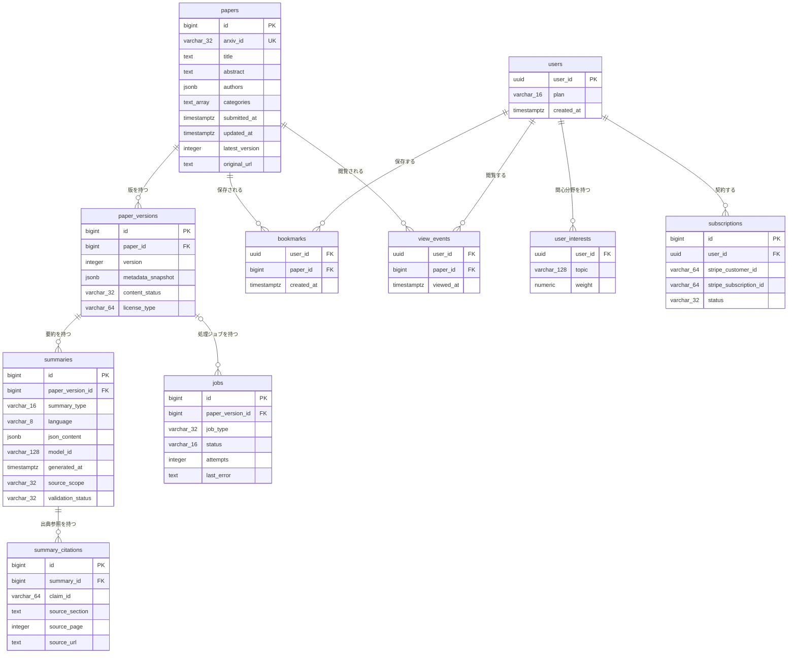

# DB物理設計書 — T001 論文（`papers`）

| 項目 | 内容 |
| :--- | :--- |
| 文書名 | DB物理設計書 T001 論文（`papers`） |
| 対象システム | Kaine personal pj — arXiv日本語研究ダイジェスト Webアプリ |
| 対象テーブル | T001 論文（`papers`）1テーブル |
| 版 | 1.1（第1回セルフレビュー `docs/reviews/db_T001_review_applied.md` の Major 3件・Minor 2件を反映） |
| 作成日 / 更新日 | 2026-10-26 / 2026-10-26 |
| 作成方法 | creating-db-physical-design v1.6.0 準拠。上流の確定設計書と `source/` の企画資料から作成 |
| インプット | (b) `docs/基本設計書_概要.md` §6（テーブル一覧 T001、論理テーブル定義「T001 papers（論文）」、概念ER図、CRUD図）、§4（機能・バッチ）、§7（API01〜API07）、§8、付録 Q11・Q21・Q22／(a) `source/03_システム構成.md:8,22,35,47-50,57`、`source/02_機能要求定義.md:6-8,32-35`、`source/01_企画概要.md:37`／(c) `legacy/`（空。突合結果は下記） |

## 前提: インプットの性質と突合結果

* **既存版**: `docs/db/DB.T001.DB物理設計.md` の旧版はありません（`docs/db/` 自体が無く、本書が初版です）。このため消さずに残すべき既存記述はありません。
* **source/（挙動の正）**: `source/` には企画・初期設計案のMarkdownが6ファイルあるだけです。`schema.rb`、マイグレーション、SQL、ORM定義は1つもありません（`source/` の全ファイル6件を確認済み）。`papers` について資料にあるのは列名の並び1行だけです（`source/03_システム構成.md:35`: arxiv_id, title, abstract, authors, categories, submitted_at, updated_at, latest_version, original_url）。**型・桁・NOT NULL・初期値・制約・インデックスはすべて資料に無いため、本書の物理定義はすべて※推測**です。上流の論理テーブル定義（`docs/基本設計書_概要.md` §6「T001 papers（論文）」）に書かれた型・制約の案を正として引き継ぎ、そのうえで物理的な詳細（CHECK制約・インデックス・DDL）を本書で加えています。
* **legacy/（既存設計）**: `legacy/` は空ディレクトリです（ファイル0件）。突合する既存仕様・非機能の記述はありません。
* **上流との対応**: カラム10件は上流の論理テーブル定義の10行と1対1で一致します（列名・順序とも同じ）。上流の論理定義に無い列は追加していません。
* **ファイル名**: 上流の関連文書一覧はDB物理設計書の格納先を `docs/db/DB.{物理名}.DB物理設計.md` としています（`docs/基本設計書_概要.md` §10 関連文書一覧）。本書は作業指示に従って `docs/db/DB.T001.DB物理設計.md`（テーブルIDでの命名）に置いています。※上流要確認: 命名をテーブルIDと物理名のどちらにそろえるか。

---

## 1. データベース概要

* **対象RDBMS**: PostgreSQL（Supabase 上のマネージドDB）。製品は上流 §1 技術スタックで確定です（`source/03_システム構成.md:8`）。バージョンは未定義のため、PostgreSQL 15 以上を前提にします（※推測。上流 Q02）。本書のDDLは PostgreSQL 15 以上の標準機能だけを使います。
* **文字コード / 照合順序**: UTF8 / Supabase の既定照合順序（※推測: 資料に定義なし）。`papers` は英語の原文テキストを持つテーブルで、日本語の並べ替えは行いません。
* **命名規則**:
  * テーブル名・カラム名: 英小文字のスネークケース。テーブル名は複数形です（`papers`。上流 §6 の物理名をそのまま使います）。
  * 制約名・インデックス名（※推測: 資料に定義なし）: 主キーは `pk_{テーブル}`、一意制約は `uq_{テーブル}_{列}`、外部キーは `fk_{子テーブル}_{列}`、CHECK制約は `ck_{テーブル}_{意味}`、インデックスは `idx_{テーブル}_{列または用途}`。
* **共通カラム規約**: 上流 §6 にはシステム共通の監査列（作成日時・更新日時・論理削除フラグ）の規約がありません。本テーブルには上流の論理定義にある10列だけを置きます。
  * 注意: `papers.updated_at` は「レコードを更新した日時」ではなく、**arXiv上で論文が最後に改訂された日時**です（上流 §6 T001）。一般的な監査列の `updated_at` と同じ名前で意味が違うため、他テーブルで監査列を設ける場合に取り違えが起こりえます。※上流要確認: 監査列（取込日時・レコード更新日時）を設けるかと、その列名。
  * 論理削除: 採用しません（※推測）。arXivの論文は公開後に消えず、取り下げも新しい版として公開されるため、行を消す業務がありません。

---

## 2. 物理テーブル一覧

本書が設計するのは T001 だけです。T001 と外部キーでつながるテーブル、つながらないテーブルの区別を示すため、上流 §6 テーブル一覧の全件を載せています。

| No | 概要書ID | 論理名 | 物理名 | ドメイン | 概要 | 本書での扱い | 定義状況 | 詳細の所在 |
| :--- | :--- | :--- | :--- | :--- | :--- | :--- | :--- | :--- |
| 1 | T001 | 論文 | papers | 論文 | arXiv論文1本につき1行。原題・Abstract・著者・カテゴリ・投稿日時・改訂日時・最新版番号・原文URLを持つ | **設計対象** | 詳細 | 本書 §4〜§7 |
| 2 | T002 | 論文バージョン | paper_versions | 論文 | 論文の版（v1/v2…）ごとに1行。取得時点のメタデータ、本文の取得状況、ライセンス種別を持つ | 関連（`papers.id` を外部キーで参照する子テーブル） | 詳細 | `docs/db/DB.T002.DB物理設計.md` |
| 3 | T003 | 要約 | summaries | 要約 | 論文の版ごと・要約の深さごとの日本語要約JSON | 対象外（T002 経由の間接的な関係のみ） | 詳細 | `docs/db/DB.T003.DB物理設計.md`（未作成） |
| 4 | T004 | 要約出典参照 | summary_citations | 要約 | 要約内の主張ごとに原文の章・ページ・URLを結びつける | 対象外（T003 経由の間接的な関係のみ） | 詳細 | `docs/db/DB.T004.DB物理設計.md`（未作成） |
| 5 | T005 | 利用者 | users | 利用者 | 会員1人につき1行。プランと登録日時を持つ | 対象外（T007・T008 経由の間接的な関係のみ） | 詳細 | `docs/db/DB.T005.DB物理設計.md`（未作成） |
| 6 | T006 | 利用者関心分野 | user_interests | 利用者 | 利用者が登録した関心トピックとその重み | 対象外（外部キーでの関係なし。トピックがカテゴリ名と一致する場合に推薦で突き合わせる） | 詳細 | `docs/db/DB.T006.DB物理設計.md`（未作成） |
| 7 | T007 | ブックマーク | bookmarks | 利用者 | 利用者が保存した論文 | 関連（`papers.id` を外部キーで参照する子テーブル） | 詳細 | `docs/db/DB.T007.DB物理設計.md`（未作成） |
| 8 | T008 | 閲覧イベント | view_events | 利用者 | 利用者が論文を開いた記録 | 関連（`papers.id` を外部キーで参照する子テーブル） | 詳細 | `docs/db/DB.T008.DB物理設計.md`（未作成） |
| 9 | T009 | ジョブ | jobs | 運用 | 論文の版ごとの処理ジョブの種類・状態・試行回数・直近エラー | 対象外（T002 経由の間接的な関係のみ） | 詳細 | `docs/db/DB.T009.DB物理設計.md`（未作成） |
| 10 | T010 | サブスクリプション | subscriptions | 課金 | 利用者とStripeの顧客・定期課金を結びつけ、契約状態を持つ | 対象外（関係なし） | 詳細 | `docs/db/DB.T010.DB物理設計.md`（未作成） |

**総件数: 10件（本書の設計対象1件・外部キーで直接つながる関連3件・対象外6件）。全数である根拠**: `docs/基本設計書_概要.md` §6 テーブル一覧の T001〜T010 の全10行と1対1で対応します（上流の総件数10件と一致）。概要書ID・論理名・物理名・ドメイン（上流の「分類」列）・定義状況は上流の値をそのまま引き継ぎ、本書では新規採番していません。T002〜T010 の物理定義は各テーブルのDB物理設計書の責務です。T002 は `docs/db/DB.T002.DB物理設計.md` で作成済み、T003〜T010 は未作成です（詳細の所在の「未作成」）。

---

## 3. ER図（物理エンティティ関連図）

§2 の全10テーブルと、上流 §6 概念ER図の全10リレーションを描いています。`papers` は §4 の物理定義どおりに全列を載せています。他の9テーブルは上流 §6 概念ER図の属性を全部そのまま写したもので（上流の論理テーブル定義の列とも一致）、物理的な確定は各テーブルのDB物理設計書で行います。



* **リレーション数**: 全10本（上流 §6 概念ER図の10本と一致）。このうち `papers` に関わるものは3本で、§4.5 外部キー一覧の3件と1対1で対応します。`papers` から他テーブルを参照する外部キーはありません（`papers` は親側だけです）。
* **多重度の意味**: 論文1本に対し、版・ブックマーク・閲覧イベントはそれぞれ0件以上です。取り込んだ直後の論文は、版の登録前であれば版が0件になりえます（※推測: B001 が papers と paper_versions を同じトランザクションで書く場合は1件以上になる）。

---

## 4. テーブル詳細定義

### テーブル名: 論文 (`papers`)
* **概要**: arXivに公開された論文1本につき1行を持ちます。版（v1/v2…）をまたいで同じ論文を1つにまとめる親テーブルで、画面の新着一覧・検索・論文詳細が最初に引く表です。値はarXivから取得した**最新版のメタデータ**で、版ごとの違いは子テーブル `paper_versions` の取得時点のメタデータに残します（上流 §6 T001・T002、`source/03_システム構成.md:35-36`）。
* **対応ドメイン**: 論文（上流 §6 テーブル一覧の分類）
* **概要書ID**: T001
* **想定件数**（※推測）: arXivの新規投稿は月に2万件を超える規模です。全カテゴリを収集すると年に約25万〜30万行増えます。収集するカテゴリの範囲は資料に無く（上流 Q18 と関連）、件数は範囲で大きく変わります。数十万〜数百万行を前提にインデックスを設計しています。

#### 4.1 カラム一覧（ロースター）

| No | ID | カラム論理名 | カラム物理名 | 概要 | 定義状況 | 詳細の所在 |
| :--- | :--- | :--- | :--- | :--- | :--- | :--- |
| 1 | T001.id | 論文ID | id | 本システム内で論文を一意に識別する連番 | 簡易 | §4.2 |
| 2 | T001.arxiv_id | arXiv ID | arxiv_id | arXivが論文ごとに付ける識別子（版番号なし）。業務キーで、重複判定とURLに使う | 詳細 | §4.3 (1) |
| 3 | T001.title | タイトル | title | 最新版の英語の原題 | 詳細 | §4.3 (2) |
| 4 | T001.abstract | Abstract | abstract | 最新版の英語の概要文。MVPの要約の材料 | 詳細 | §4.3 (2) |
| 5 | T001.authors | 著者 | authors | 最新版の著者名の並び | 詳細 | §4.3 (3) |
| 6 | T001.categories | カテゴリ | categories | arXivの分野分類の並び | 詳細 | §4.3 (4) |
| 7 | T001.submitted_at | 投稿日時 | submitted_at | arXivへの初回投稿（v1）の日時 | 詳細 | §4.3 (5) |
| 8 | T001.updated_at | 更新日時 | updated_at | arXiv上で最新版が公開された日時 | 詳細 | §4.3 (5) |
| 9 | T001.latest_version | 最新版 | latest_version | arXiv上の最新の版番号 | 詳細 | §4.3 (6) |
| 10 | T001.original_url | 原文URL | original_url | arXivの論文ページへのリンク | 詳細 | §4.3 (7) |

**総件数: 10件（詳細9件・簡易1件）。全数である根拠**: 上流 `docs/基本設計書_概要.md` §6「T001 papers（論文）」の論理テーブル定義の全10行と1対1で対応します。資料の列名（`source/03_システム構成.md:35` の9列）に、上流が主キーとして加えた `id` を足した10列です。ID列は上流のテーブルID「T001」に物理名をつないだもので、新しい番号は振っていません。
**定義状況の判定**（completeness 3-1）: `id` は採番されるだけで業務上の判断を含まないため「簡易」です。他の9列は、いずれも値の決め方・形式・日付の意味について本書で決めた業務ルールを含む（3-1 の7「非自明な業務ルール」）ため「詳細」です。このうち title・abstract・authors・categories・updated_at・latest_version の6列は、B001・B006 が新しい版を見つけたときに書き換える列でもあります（3-1 の2「状態を変える」）。arxiv_id・submitted_at・original_url の3列は一度登録したら書き換えません（§4.3 (1)(5)(7)）。

#### 4.2 カラム定義

| カラム論理名 | カラム物理名 | データ型 | PK | FK | 必須 (NN) | デフォルト値 / 制約 | 備考 |
| :--- | :--- | :--- | :--- | :--- | :--- | :--- | :--- |
| 論文ID | id | BIGINT | ○ | - | ○ | GENERATED ALWAYS AS IDENTITY（※推測） | 資料に列が無く、上流が追加した列です。`paper_versions`・`bookmarks`・`view_events` が論文を指すために使います（上流 §6 T001、Q22） |
| arXiv ID | arxiv_id | VARCHAR(32)（※推測） | - | - | ○ | UNIQUE（`uq_papers_arxiv_id`）。新形式「年月4桁.連番4〜5桁」か旧形式「分野/年月連番7桁」のどちらかで、版番号の接尾辞を含まないこと（`ck_papers_arxiv_id_format`）（※推測） | 業務キーです。画面URLとAPIの `{arxivId}` はこの値で論文を引きます（上流 §6 T001、API03・API04・API07） |
| タイトル | title | TEXT（※推測） | - | - | ○ | - | 英語の原題です。日本語タイトルは要約（`summaries`）の側に持ちます（上流 §6 T001・T003） |
| Abstract | abstract | TEXT（※推測） | - | - | ○ | - | 全文検索インデックス `idx_papers_fulltext` の対象です（§5） |
| 著者 | authors | JSONB（※推測） | - | - | ○ | 著者名の文字列を1件以上並べた配列であり、文字列以外の要素を含まないこと（`ck_papers_authors_array`）（※推測） | 著者検索に使います（上流 §6 T001、F03） |
| カテゴリ | categories | TEXT[]（※推測） | - | - | ○ | 1件以上の要素を持つこと（`ck_papers_categories_not_empty`）（※推測） | 先頭要素をarXivの主カテゴリとして扱います（※推測）。カテゴリ絞り込み（F02・API01）と推薦（F08）に使います |
| 投稿日時 | submitted_at | TIMESTAMPTZ（※推測） | - | - | ○ | - | 新着一覧の並び順と日付絞り込みに使います（上流 §6 T001、API01） |
| 更新日時 | updated_at | TIMESTAMPTZ（※推測） | - | - | -（任意） | 値があるときは投稿日時より前にならないこと（`ck_papers_updated_after_submitted`）（※推測） | レコードの更新日時ではありません（§1 共通カラム規約の注意） |
| 最新版 | latest_version | INTEGER（※推測） | - | - | ○ | 1以上（`ck_papers_latest_version_positive`）（※推測） | 新しい版が出たかの判定に使います（上流 §6 T001、B001） |
| 原文URL | original_url | TEXT（※推測） | - | - | ○ | - | 原文リンク（F05・P105）として画面に出します。MVP完了基準「arXivの原文リンクが開ける」に対応します（`source/02_機能要求定義.md:56`） |

* **必須の判定**: `updated_at` 以外の9列を必須としています。これは上流 §6 T001 の論理定義（`updated_at` だけが「任意」）をそのまま引き継いだものです（※推測。上流 Q22 で確認待ち）。
* **型を `TEXT` にした理由**（※推測）: 原題・Abstract・URLは arXiv 側の長さで決まり、本システムでは長さを制御できません。`VARCHAR(n)` で切り詰めると取り込みが失敗するため、上流の案どおり長さ上限のない `TEXT` にします。arXiv ID だけは形式が決まっているので `VARCHAR(32)` で上限をかけます。

#### 4.3 カラム詳細（定義状況＝詳細の9列）

ロースターは §4.1 です。本節では定義状況が「詳細」の9列について、値の決め方と業務ルールを書きます。

**(1) T001.arxiv_id — arXiv ID**
* **値の決め方**: arXiv APIが返す識別子から、末尾の版番号（例: `2401.12345v2` の `v2`）を取り除いた値を入れます（※推測）。版番号は `latest_version` と子テーブル `paper_versions.version` が持ちます。版番号を含めたまま入れると、同じ論文の v1 と v2 が別の論文として2行になり、重複判定（ARC001）が成り立たなくなるため、形式をCHECK制約で強制します。
* **形式**（※推測）: 2007年4月以降の新形式「年月4桁.連番4〜5桁」（例: `2401.12345`）と、それより前の旧形式「分野名（小区分つきのこともある）/年月連番7桁」（例: `hep-th/9901001`、`math.GT/0309136`）の2種類です（`ck_papers_arxiv_id_format`。正規表現は §7 DDL）。
* **一意性**: 同じarXiv IDの行は1つだけです（`uq_papers_arxiv_id`）。B001・B006 はこの一意制約を使って「未登録なら追加、登録済みなら更新」の1文で書き込みます（※推測）。登録済みの場合の更新には、取り込んだ版番号が登録済みの最新版以上であるという条件を必ず付けます。条件を付けないと、古い版の取得結果で最新の内容を戻してしまいます（`INSERT … ON CONFLICT (arxiv_id) DO UPDATE SET … WHERE EXCLUDED.latest_version >= papers.latest_version`）。これにより、同じ論文を並行して取り込んでも行が2つにならないことをDBで保証します（上流 BF01「arXiv IDとバージョンで既存か判定」、`source/03_システム構成.md:22`）。
* **変更**: 一度登録したarXiv IDは変えません。画面URL（P104 `/papers/{arxivId}` ※推測）とブックマークAPI（API06・API07）のキーなので、変えるとリンクが切れます。

**(2) T001.title / T001.abstract — タイトル・Abstract**
* **値の決め方**: arXivが返す最新版の原題とAbstractを、加工せずにそのまま入れます（※推測: 前後の空白と改行の整形のみ行う）。
* **更新ルール**（※推測）: 取り込んだ版番号が現在の `latest_version` 以上のときだけ上書きします。この条件は (1) の1文の書き込みの更新条件として実装し、アプリ側で読んでから比べる方式にはしません（読んでから書くまでの間に別のジョブが書き込むと、比較が古くなるため）。古い版の情報が後から届いても（オンデマンド同期 B006 と定期収集 B001 の処理順が前後した場合や、失敗ジョブの再処理 B010 で古い取得結果を書き戻した場合）、新しい内容を古い内容で戻さないためです。版ごとの原題・Abstractは `paper_versions.metadata_snapshot` に残るため、ここで上書きしても版の履歴は失われません（上流 §6 T002）。
* **表示上の注意**: 外部から来たテキストで、LaTeX記法やHTMLに見える文字列を含むことがあります。DBでは加工せずに保存し、画面の側で無害化して表示します（上流 §8 セキュリティ対策「XSS」）。
* **検索**: 原題とAbstractを合わせた英語全文検索の対象です（§5 `idx_papers_fulltext`）。全文検索をPostgreSQLで行うかは未定のため、このインデックスは仮置きです（上流 Q21）。

**(3) T001.authors — 著者**
* **構造**（※推測）: 著者名の文字列を、論文に記載された順番で並べたJSON配列です（例: `["Alice Smith", "Bob Lee"]`）。arXivが返す著者の順番は筆頭著者を判断する材料になるため、並べ替えずに保存します。著者の所属・連絡先・識別子（ORCID）は持ちません（上流の論理定義が「著者名の並び」としているため）。
* **制約**: JSON配列であること、要素が1件以上あること、要素がすべて文字列であることをCHECK制約で保証します（`ck_papers_authors_array`）。著者を名前と所属の組のような別の形で入れる取り込みの誤りを、この制約で止めます。著者が0人の論文はarXivに存在しないため、0件は取り込み処理の誤りとみなして登録を止めます。
* **検索**: 著者名の完全一致での絞り込み（「この著者の論文」）は `idx_papers_authors` で高速化します。著者名の部分一致・あいまい検索をどう実現するかは検索方式（上流 Q21）とあわせて決めます。
* **更新ルール**: (2) と同じく、取り込んだ版が最新以上のときだけ上書きします。

**(4) T001.categories — カテゴリ**
* **構造**（※推測）: arXivの分野分類（例: `cs.LG`、`stat.ML`）の文字列配列です。arXivが返す順番のまま保存し、**先頭の要素を主カテゴリ**として扱います。
* **制約**: 要素が1件以上あることをCHECK制約で保証します（`ck_papers_categories_not_empty`）。arXivの論文には必ず主カテゴリが1つあるためです。
* **使い方**: 新着一覧のカテゴリ絞り込み（API01 の `category`）と自由検索の絞り込み（API02 の `category`）は「指定したカテゴリを含む論文」を探す条件になります（`categories @> ARRAY['cs.LG']`）。この条件を `idx_papers_categories` で高速化します。推薦（F08）では利用者の関心トピック（`user_interests.topic`）がカテゴリ名と一致するかを突き合わせます。
* **取りうる値**: arXivの分類体系に従います。値の一覧は本システムでは持たず、入力値の妥当性はAPIの入力チェックで確かめます（上流 §4 入力チェック ※推測）。

**(5) T001.submitted_at / T001.updated_at — 投稿日時・更新日時**
* **意味の違い**（上流 §1 用語集「投稿日 / 更新日 / 新着公開日」、`source/02_機能要求定義.md:32`）:
  * `submitted_at` は v1 がarXivへ投稿された日時で、版が増えても変わりません。
  * `updated_at` は最新版が公開された日時で、新しい版を取り込むたびに進みます。v1しか無い論文では、arXiv APIは投稿日時と同じ値を返します（※推測）。arXivから値が取れない場合に限り空を許します（上流 §6 T001 の「任意」）。
* **タイムゾーン**: どちらもタイムゾーン付きの日時型で、UTCの時刻として保存します。画面での表示タイムゾーンは未定です（上流 Q11。※推測: 日本時間に変換して表示し、その旨を画面に明記）。
* **新着公開日**: 画面で区別するよう求められている3つ目の日付「新着公開日」（arXivの新着リストに載った日）を保存する列は、上流の論理定義にありません。新着一覧の絞り込みにどの日付を使うかも未定です（上流 Q11）。※上流要確認: 新着公開日を保存する列を `papers` に設けるか。本書では、上流の確定どおり列を追加せず、新着一覧は `submitted_at` で並べる前提でインデックスを設計しています。
* **整合ルール**: `updated_at` に値があるときは、`submitted_at` より前にならないことをCHECK制約で保証します（`ck_papers_updated_after_submitted`）（※推測）。

**(6) T001.latest_version — 最新版**
* **意味**: arXiv上で公開されている最新の版番号です（v3 なら 3）。本システムが取り込み済みの版の最大値とは限りません。arXivには v3 まであっても、本システムが v3 だけを取り込んだ場合、`paper_versions` には v3 の1行しかありません（※推測）。
* **使い方**: B001・B006 は、取り込んだメタデータの版番号がこの値より大きいときに「新しい版が出た」と判断し、`paper_versions` に新しい版を追加して要約ジョブ（B002）を登録します（上流 BF01、§4 B001）。同じ版番号であれば処理をスキップし、生成済みの要約を使い回します（ARC001）。
* **更新ルール**: 値は増えるだけで、減らしません（※推測）。古い版の情報を後から受け取っても、この値は下げません（(2) と同じ理由）。
* **制約**: 1以上（`ck_papers_latest_version_positive`）。arXivの版番号は1から始まるためです。

**(7) T001.original_url — 原文URL**
* **値の決め方**（※推測）: arXivの論文ページのURLを、版番号を付けない形（例: `https://arxiv.org/abs/2401.12345`）で入れます。版番号なしのURLは常に最新版を表示するため、新しい版が出てもこの値を書き換えずに済みます。特定の版へのリンクが必要な場合は、画面側でarXiv IDと版番号から組み立てます。
* **表示上の注意**: arXivと本サービスの関係を誤認させない表記で原文リンクを出します（上流 ARC009、`source/03_システム構成.md:61`）。

#### 4.4 制約一覧（ロースター）

| No | ID（制約名） | 種別 | 対象カラム | 概要 | 定義状況 | 詳細の所在 |
| :--- | :--- | :--- | :--- | :--- | :--- | :--- |
| 1 | pk_papers | PRIMARY KEY | id | 論文を連番で一意に識別する | 簡易 | §4.2 |
| 2 | uq_papers_arxiv_id | UNIQUE | arxiv_id | 同じarXiv IDの論文を2行登録させない。取り込みの重複排除の最後の防壁 | 詳細 | §4.3 (1) |
| 3 | ck_papers_arxiv_id_format | CHECK | arxiv_id | arXiv IDが新形式か旧形式のどちらかで、版番号を含まないことを保証する（※推測） | 詳細 | §4.3 (1) |
| 4 | ck_papers_authors_array | CHECK | authors | 著者が文字列だけを要素に持つJSON配列で、1人以上いることを保証する（※推測） | 詳細 | §4.3 (3) |
| 5 | ck_papers_categories_not_empty | CHECK | categories | カテゴリが1件以上あることを保証する（※推測） | 詳細 | §4.3 (4) |
| 6 | ck_papers_updated_after_submitted | CHECK | submitted_at, updated_at | 最新版の公開日時が初回投稿日時より前にならないことを保証する（※推測） | 詳細 | §4.3 (5) |
| 7 | ck_papers_latest_version_positive | CHECK | latest_version | 版番号が1以上であることを保証する（※推測） | 詳細 | §4.3 (6) |
| 8 | NOT NULL（id） | NOT NULL | id | 主キーなので空を許さない（主キー制約に含まれる） | 簡易 | §4.2 |
| 9 | NOT NULL（arxiv_id） | NOT NULL | arxiv_id | 業務キーなので空を許さない | 簡易 | §4.2 |
| 10 | NOT NULL（title） | NOT NULL | title | 一覧と詳細に必ず原題を出すため空を許さない | 簡易 | §4.2 |
| 11 | NOT NULL（abstract） | NOT NULL | abstract | MVPの要約の材料なので空を許さない | 簡易 | §4.2 |
| 12 | NOT NULL（authors） | NOT NULL | authors | 著者は必ずいるため空を許さない | 簡易 | §4.2 |
| 13 | NOT NULL（categories） | NOT NULL | categories | 主カテゴリは必ずあるため空を許さない | 簡易 | §4.2 |
| 14 | NOT NULL（submitted_at） | NOT NULL | submitted_at | 新着一覧の並び順に使うため空を許さない | 簡易 | §4.2 |
| 15 | NOT NULL（latest_version） | NOT NULL | latest_version | 新しい版の判定に使うため空を許さない | 簡易 | §4.2 |
| 16 | NOT NULL（original_url） | NOT NULL | original_url | 原文リンクを必ず出すため空を許さない | 簡易 | §4.2 |

**総件数: 16件（PRIMARY KEY 1件・UNIQUE 1件・CHECK 5件・NOT NULL 9件）。外部キー制約は `papers` 側に0件です（§4.5）。DEFAULT は `id` の自動採番1件だけで、§4.2 に記載しています。全数である根拠**: §7 DDL の `CREATE TABLE papers` に書いた制約をすべて数えたものです。NOT NULL の9件は、§4.2 で必須を「○」とした9列と一致します。PRIMARY KEY・UNIQUE は上流 §6 T001 の「PK」「一意」と一致し、CHECK 5件は本書で追加した※推測です。
**定義状況の判定**: 業務上の判断を含む制約（重複排除・形式・値の範囲）は3-1 の7に当たるため「詳細」、空を許さないだけの制約は判断を含まないため「簡易」としました。

#### 4.5 外部キー（FKリレーション）一覧（ロースター）

`papers` は親テーブルで、自身は他テーブルを参照しません（参照する外部キー: 0件）。`papers.id` を参照する子テーブル側の外部キーは次の3件です。

| No | ID（制約名 ※推測） | 子テーブル.列 | 親テーブル.列 | 多重度 | 削除時の動き（推奨 ※推測） | 概要 | 定義状況 | 詳細の所在 |
| :--- | :--- | :--- | :--- | :--- | :--- | :--- | :--- | :--- |
| 1 | fk_paper_versions_paper_id | paper_versions.paper_id（T002） | papers.id | 論文1 : 版0以上 | 削除を拒否（RESTRICT） | 版がどの論文のものかを示す | 詳細 | `docs/db/DB.T002.DB物理設計.md` |
| 2 | fk_bookmarks_paper_id | bookmarks.paper_id（T007） | papers.id | 論文1 : ブックマーク0以上 | 削除を拒否（RESTRICT） | 利用者が保存した論文を示す | 詳細 | `docs/db/DB.T007.DB物理設計.md`（未作成） |
| 3 | fk_view_events_paper_id | view_events.paper_id（T008） | papers.id | 論文1 : 閲覧イベント0以上 | 削除を拒否（RESTRICT） | 利用者が閲覧した論文を示す | 詳細 | `docs/db/DB.T008.DB物理設計.md`（未作成） |

**総件数: 3件。全数である根拠**: 上流 §6 の論理テーブル定義で「FK→papers.id」と書かれている列が、T002 `paper_id`・T007 `paper_id`・T008 `paper_id` の3列だけであることを、T001〜T010 の全定義を見て確認しました。上流 §6 概念ER図で `papers` から出る3本のリレーションとも一致します。
**削除時の動きを「拒否」とする理由**（※推測）: 論文は業務上消さない（§1 論理削除）ため、論文を消すのは誤操作か特別な運用作業だけです。子の行を巻き添えで消すと、生成費用のかかった要約（T002 から T003 へ続く）や利用者のブックマークを失うので、子の行が残っているうちは論文を消せないようにします。外部キー制約そのものは子テーブル側のDDLに書くため、**最終的な決定は各子テーブルのDB物理設計書の責務**です（※上流未定義: 上流 §6 に削除時の動きの定義はありません）。
**定義状況の判定**: 3件とも複数テーブルにまたがり（3-1 の3）、削除時の扱いが自明でない（3-1 の5）ため「詳細」です。

#### 4.6 本テーブルを操作する機能・バッチ（ロースター）

| No | ID | 名称 | 操作（C/R/U/D） | 本テーブルに対する内容 | 定義状況 | 詳細の所在 |
| :--- | :--- | :--- | :--- | :--- | :--- | :--- |
| 1 | F01 | 新着論文取得（B001 論文メタデータ収集） | CRU | 新着論文を追加し、新しい版が出た論文の最新メタデータを上書きする（§4.3 の更新ルール） | 詳細 | `docs/detail/be/BE.F01.BE詳細設計.md`、`docs/detail/batch/BT.B001.バッチ詳細設計.md`（未作成） |
| 2 | F02 | 日付・カテゴリ検索（API01） | R | 投稿日時とカテゴリで絞り込み、投稿日時の新しい順に並べて読む | 詳細 | `docs/detail/be/BE.F02.BE詳細設計.md`（未作成） |
| 3 | F03 | 自由検索（API02、B006 arXivオンデマンド同期） | R（上流CRUD図）。B006 は CU ※上流要確認 | 原題・Abstract・著者・カテゴリで検索する。自前DBに無いときは B006 が論文を追加する | 詳細 | `docs/detail/be/BE.F03.BE詳細設計.md`、`docs/detail/batch/BT.B006.バッチ詳細設計.md`（未作成） |
| 4 | F04 | 日本語構造化要約 | R | 要約の材料として原題・Abstractを読む | 詳細 | `docs/detail/be/BE.F04.BE詳細設計.md`（未作成） |
| 5 | F05 | 論文詳細・Appendix（API03・API04） | R | arXiv IDで1行を読み、原題・著者・日付・最新版・原文URLを返す | 詳細 | `docs/detail/be/BE.F05.BE詳細設計.md`（未作成） |
| 6 | F07 | ブックマーク（API06・API07） | R | APIで受け取ったarXiv IDを論文IDに変換するために読む ※推測 | 詳細 | `docs/detail/be/BE.F07.BE詳細設計.md`（未作成） |
| 7 | F08 | レコメンド（API05） | R | カテゴリと投稿日時（新しさ）で候補を読む | 詳細 | `docs/detail/be/BE.F08.BE詳細設計.md`（未作成） |
| 8 | F09 | AIチャット | R | 質問対象の論文の情報を読む | 詳細 | `docs/detail/be/BE.F09.BE詳細設計.md`（未作成） |
| 9 | F10 | 通知・ダイジェスト（B007） | R | 関心カテゴリに一致する新着論文を読む | 詳細 | `docs/detail/be/BE.F10.BE詳細設計.md`（未作成） |
| 10 | F11 | 複数論文比較 | R | 比較対象の複数論文の情報を読む | 詳細 | `docs/detail/be/BE.F11.BE詳細設計.md`（未作成） |
| 11 | F13 | トレンド可視化 | R | カテゴリと投稿日時で論文数の推移を集計する | 簡易 | -（未作成） |
| 12 | F14 | GitHub関連付け（B009） | R | 関連付けの対象論文を読む | 詳細 | `docs/detail/be/BE.F14.BE詳細設計.md`（未作成） |
| 13 | F15 | 閲覧履歴 | R | 閲覧した論文の原題を表示するために読む | 詳細 | `docs/detail/be/BE.F15.BE詳細設計.md`（未作成） |
| 14 | F17 | 処理状況の確認 | R | 処理状況を出す論文を読む | 簡易 | -（未作成） |
| 15 | F19 | コスト監視・利用状況分析 | R | 論文あたりの生成コストを集計するために読む | 簡易 | -（未作成） |
| 16 | B011 | 検索インデックス更新 | R | 公開反映が済んだ論文を検索インデックスへ加えるために読む | 詳細 | `docs/detail/batch/BT.B011.バッチ詳細設計.md`（未作成） |

**総件数: 16件。全数である根拠**: 上流 §6 CRUD図の全21行（F01〜F19、B010、B011）のうち、`papers` 列が「-」でない行を数えたものです（F06・F12・F16・F18・B010 の5行は `papers` を操作しないため除外）。定義状況と詳細の所在は上流 §4 機能一覧・バッチ処理設計の値を引き継いでいます。本テーブルを削除（D）する機能はありません。
**※上流要確認**: 上流 CRUD図は F03 の `papers` を「R」としていますが、F03 から起動される B006（arXivオンデマンド同期）は自前DBに無い論文を取り込む処理なので、`papers` を追加・更新（C・U）するはずです（上流 §4 B006「arXiv APIから該当論文を取り込む」）。CRUD図にB006の行を加えるか、F03 の欄を「CRU」とするかの確認が必要です。

---

## 5. インデックス設計

#### 5.1 インデックス一覧（ロースター）

| No | ID（インデックス名） | 対象カラム | 種別 | 概要 | 定義状況 | 詳細の所在 |
| :--- | :--- | :--- | :--- | :--- | :--- | :--- |
| 1 | pk_papers | id | B-Tree（UNIQUE） | 主キー制約で自動的に作られる | 簡易 | §4.4 |
| 2 | uq_papers_arxiv_id | arxiv_id | B-Tree（UNIQUE） | 一意制約で自動的に作られる。arXiv IDでの1件取得と重複判定に使う | 詳細 | §5.2 |
| 3 | idx_papers_submitted_at | submitted_at DESC, id DESC | B-Tree | 新着一覧の並び順と日付絞り込み | 詳細 | §5.2 |
| 4 | idx_papers_updated_at | updated_at DESC | B-Tree（部分: 値がある行のみ） | 改訂日での絞り込み・並べ替え | 詳細 | §5.2 |
| 5 | idx_papers_categories | categories | GIN | カテゴリを含む論文の絞り込み | 詳細 | §5.2 |
| 6 | idx_papers_authors | authors | GIN（jsonb_path_ops） | 著者名の完全一致での絞り込み | 詳細 | §5.2 |
| 7 | idx_papers_fulltext | 原題とAbstractを合わせた英語全文 | GIN（式インデックス） | キーワード検索 | 詳細 | §5.2 |

**総件数: 7件（主キー・一意制約で自動的に作られるもの2件、明示的に作るもの5件）。全数である根拠**: §7 DDL で `papers` に作られるインデックスをすべて数えたものです（`CREATE INDEX` 5文と、主キー・一意制約による自動作成2件）。資料にはインデックスの定義が無いため、7件ともその要否と形は本書の※推測です。
**定義状況の判定**: 主キーのインデックスは自動作成で判断を含まないため「簡易」、他の6件は使う検索条件と性能上の判断を含む（3-1 の6）ため「詳細」です。

#### 5.2 インデックス定義（主キーを除く）

| 対象テーブル物理名 | インデックス名 | 対象カラム | 種別 | 目的・理由 |
| :--- | :--- | :--- | :--- | :--- |
| papers | uq_papers_arxiv_id | arxiv_id | B-Tree（UNIQUE） | 論文詳細・要約・ブックマークのAPIはarXiv IDで論文を1件引くため、その検索を速くする（API03・API04・API06・API07）。あわせて取り込み時の重複判定を一意制約として保証し、「未登録なら追加・登録済みなら更新」の書き込みの衝突判定に使う（※推測） |
| papers | idx_papers_submitted_at | submitted_at DESC, id DESC | B-Tree | 新着一覧（API01）は投稿日時の新しい順に並べて先頭から読むため、並べ替えをせずに取り出せるようにする。指定日の論文だけを取り出す日付の範囲指定にも使う。投稿日時が同じ論文の並びを毎回同じにし、ページ送りで重複・抜けが起きないよう論文IDを2番目の列にする（※推測。絞り込みに使う日付は上流 Q11 で確定待ち） |
| papers | idx_papers_updated_at | updated_at DESC（値がある行のみ） | B-Tree（部分インデックス） | 「最近改訂された論文」を探す場合と、新着一覧の絞り込み日付を更新日にする場合（上流 Q11）に備える。値の無い行は検索対象にならないため索引に含めず、大きさを抑える（※推測。Q11 で更新日を使わないと決まれば削除してよい） |
| papers | idx_papers_categories | categories | GIN | カテゴリでの絞り込みは「論文のカテゴリの並びに指定のカテゴリが含まれるか」という条件になり、B-Treeでは速くできないため、配列の要素ごとに引ける転置索引を使う。新着一覧（API01）・自由検索（API02）・通知（B007）・推薦（F08）が共通して使う（※推測） |
| papers | idx_papers_authors | authors | GIN（jsonb_path_ops） | 「この著者の論文」を探すとき、著者の並びに指定の著者名が含まれるかを調べる条件を速くする。含まれるかどうかの判定だけに使うため、より小さく作れる演算子クラスを選ぶ（※推測。部分一致の著者検索は上流 Q21 で方式を決める） |
| papers | idx_papers_fulltext | 原題とAbstractを英語の語幹単位に分解した検索用の値（`to_tsvector('english', title || ' ' || abstract)`） | GIN（式インデックス） | 自由検索（API02）のキーワード検索を全件走査せずに行う。原題とAbstractが英語のため英語の語幹処理を使う。検索側のSQLがインデックスと同じ式を書かないと使われない点に注意する（※推測。検索インデックスの実体は上流 Q21 で未定。別の検索エンジンを採用する場合は作らない） |

---

## 6. コード定義（区分値・ステータス定義）

**該当なし**。`papers` には、本システムが値の一覧を定めて管理する区分値・ステータスの列がありません。根拠: §4.1 の全10列を確認し、取りうる値が固定の列（Enum）は0件でした。上流 付録 Q24 の区分値の確認対象（content_status・summary_type・source_scope・validation_status・jobs.status・subscriptions.status）にも `papers` の列は含まれていません。

参考として、値の体系が外部で決まっている列を示します（本システムで値の一覧は持ちません）。

| 対象テーブル | 対象カラム | 設定値 | 意味・遷移条件 |
| :--- | :--- | :--- | :--- |
| papers | categories | arXivの分類体系の値（例: `cs.LG`） | arXivが論文ごとに付ける分野分類。先頭が主カテゴリ。新しい版の取り込み時にarXiv側の値で置き換わる（§4.3 (4)。※推測） |
| papers | latest_version | 1以上の整数 | arXiv上の最新の版番号。新しい版を取り込むと増え、減ることはない（§4.3 (6)。※推測） |

---

## 7. DDL (データ定義言語)

`papers` の全定義です。PostgreSQL 15 以上でそのまま実行できます（※推測: 型・制約・インデックスはすべて本書の設計案）。`papers.id` を参照する外部キー制約（§4.5 の3件）は子テーブル側の `CREATE TABLE` に書くため、`paper_versions`・`bookmarks`・`view_events` のDB物理設計書のDDLで定義します。子テーブルが外部キーを張れるよう、本DDLを先に実行してください。

```sql
-- =========================================================
-- T001 論文 (papers)
-- =========================================================
CREATE TABLE papers (
    id              BIGINT       GENERATED ALWAYS AS IDENTITY,
    arxiv_id        VARCHAR(32)  NOT NULL,
    title           TEXT         NOT NULL,
    abstract        TEXT         NOT NULL,
    authors         JSONB        NOT NULL,
    categories      TEXT[]       NOT NULL,
    submitted_at    TIMESTAMPTZ  NOT NULL,
    updated_at      TIMESTAMPTZ,
    latest_version  INTEGER      NOT NULL,
    original_url    TEXT         NOT NULL,

    CONSTRAINT pk_papers PRIMARY KEY (id),
    CONSTRAINT uq_papers_arxiv_id UNIQUE (arxiv_id),

    -- 新形式「年月4桁.連番4〜5桁」か旧形式「分野(.小区分)/年月連番7桁」。版番号の接尾辞は含めない
    CONSTRAINT ck_papers_arxiv_id_format CHECK (
        arxiv_id ~ '^([0-9]{4}\.[0-9]{4,5}|[a-z]+(-[a-z]+)*(\.[A-Z]{2})?/[0-9]{7})$'
    ),
    -- 著者は著者名の文字列だけを要素に持つ、1人以上のJSON配列
    CONSTRAINT ck_papers_authors_array CHECK (
        CASE WHEN jsonb_typeof(authors) = 'array'
             THEN jsonb_array_length(authors) >= 1
                  AND NOT jsonb_path_exists(authors, '$[*] ? (@.type() != "string")')
             ELSE false
        END
    ),
    -- カテゴリは1件以上
    CONSTRAINT ck_papers_categories_not_empty CHECK (cardinality(categories) >= 1),
    -- 最新版の公開日時は初回投稿日時より前にならない
    CONSTRAINT ck_papers_updated_after_submitted CHECK (
        updated_at IS NULL OR updated_at >= submitted_at
    ),
    -- 版番号は1から始まる
    CONSTRAINT ck_papers_latest_version_positive CHECK (latest_version >= 1)
);

-- インデックス
CREATE INDEX idx_papers_submitted_at
    ON papers USING btree (submitted_at DESC, id DESC);

CREATE INDEX idx_papers_updated_at
    ON papers USING btree (updated_at DESC)
    WHERE updated_at IS NOT NULL;

CREATE INDEX idx_papers_categories
    ON papers USING gin (categories);

CREATE INDEX idx_papers_authors
    ON papers USING gin (authors jsonb_path_ops);

CREATE INDEX idx_papers_fulltext
    ON papers USING gin (to_tsvector('english', title || ' ' || abstract));

-- コメント
COMMENT ON TABLE  papers                IS 'T001 論文: arXiv論文1本につき1行。最新版のメタデータを持つ';
COMMENT ON COLUMN papers.id             IS '論文ID（本システム内の連番）';
COMMENT ON COLUMN papers.arxiv_id       IS 'arXiv ID（版番号なし。業務キー）';
COMMENT ON COLUMN papers.title          IS 'タイトル（最新版の英語の原題）';
COMMENT ON COLUMN papers.abstract       IS 'Abstract（最新版の英語の概要文）';
COMMENT ON COLUMN papers.authors        IS '著者（著者名の文字列を記載順に並べたJSON配列）';
COMMENT ON COLUMN papers.categories     IS 'カテゴリ（arXivの分野分類。先頭が主カテゴリ）';
COMMENT ON COLUMN papers.submitted_at   IS '投稿日時（v1の投稿日時。UTC）';
COMMENT ON COLUMN papers.updated_at     IS '更新日時（arXiv上で最新版が公開された日時。レコード更新日時ではない）';
COMMENT ON COLUMN papers.latest_version IS '最新版（arXiv上の最新の版番号）';
COMMENT ON COLUMN papers.original_url   IS '原文URL（版番号なしのarXiv論文ページ）';
```

**行単位アクセス制御（Supabase 環境のみ ※推測）**: 上流 §8 は利用者データに Row Level Security を使う案を示しています（上流 Q32）。`papers` は誰でも読める公開データなので、ログインの有無にかかわらず読み取りだけを許可し、書き込みは Row Level Security を通らないサーバ側のサービスロール（ジョブワーカー）だけに限ります。次の文は Supabase の既定ロール（`anon`・`authenticated`）がある環境でだけ実行できます。

```sql
ALTER TABLE papers ENABLE ROW LEVEL SECURITY;

CREATE POLICY papers_select_public
    ON papers
    FOR SELECT
    TO anon, authenticated
    USING (true);
```

---

## 8. マイグレーション計画（該当する場合のみ）

**該当なし（新規構築）**。根拠: 既存のDB・スキーマ・マイグレーションはありません（`source/` にスキーマ定義が無く、`legacy/` は空。上流 §10「システム移行計画: 該当なし」）。

初回構築の手順（※推測）:

| No | 対象テーブル | 変更種別 | 変更内容 | 影響範囲 | 備考 |
| :--- | :--- | :--- | :--- | :--- | :--- |
| 1 | papers | テーブル新規作成 | §7 DDL の `CREATE TABLE papers`、インデックス5件、コメントを実行する | なし（新規） | 子テーブル（`paper_versions`・`bookmarks`・`view_events`）より先に実行する。マイグレーションの置き場所とツールは未定（※推測: Supabase のマイグレーション機能を使う。上流 Q34） |
| 2 | papers | 権限設定 | §7 の行単位アクセス制御を有効にし、読み取りポリシーを作る | 画面・APIからの読み取り | Supabase 環境のみ（※推測。上流 Q32） |

---

## 9. 確認事項（※推測・※上流要確認の集約）

| No | 区分 | 確認事項 | 本書での仮置き | 関連箇所 | 上流の確認事項 |
| :--- | :--- | :--- | :--- | :--- | :--- |
| 1 | 型・制約 | 全列の型・桁・必須・一意制約・CHECK制約 | §4.2・§4.4 のとおり | §4 | Q22 |
| 2 | 日付 | 新着一覧の絞り込みに使う日付と、表示タイムゾーン。新着公開日を保存する列を設けるか（※上流要確認） | 投稿日時で並べ、列は追加しない | §4.3 (5)、§5 | Q11 |
| 3 | 検索 | 検索インデックスの実体（PostgreSQL の全文検索か別エンジンか）、著者の部分一致検索の方式 | PostgreSQL の全文検索インデックスを仮置き | §5 | Q21 |
| 4 | 監査列 | 取込日時・レコード更新日時の監査列を設けるか、その列名（※上流要確認）。通知（B007）が「前回の配信後に取り込まれた論文」を選ぶには取込日時が要る可能性がある。オンデマンド同期（B006）で古い論文を後から取り込むと、投稿日時では新着かどうか判定できないため | 設けない | §1 | Q22 |
| 5 | 外部キー | 子テーブルから `papers` を参照する外部キーの削除時の動き（※上流未定義） | 削除を拒否 | §4.5 | — |
| 6 | CRUD | B006 による `papers` の追加・更新を上流 CRUD図に反映するか（※上流要確認） | B006 は追加・更新する前提 | §4.6 | — |
| 7 | 文書名 | DB物理設計書のファイル名をテーブルIDと物理名のどちらにそろえるか（※上流要確認） | テーブルID（作業指示に従う） | 前提 | — |
| 8 | 規模 | 収集するカテゴリの範囲と想定件数 | 全カテゴリ・年に約25万〜30万行 | §4 想定件数 | Q18 |
| 9 | RDBMS | PostgreSQL のバージョン | 15 以上 | §1 | Q02 |

---

## 出力前チェックリスト（自己検証）

- [x] §2 物理テーブル一覧に、基本設計書（概要）§6テーブル一覧の全10行を列挙した
- [x] §2 の「概要書ID」が上流のテーブルID T001〜T010 と1対1で対応している
- [x] §3 ER図に §2 の全10テーブルをエンティティとして描いた
- [x] §3 ER図のリレーションが §4.5 の外部キー3件を表現している（`papers` に関わる3本。全体は上流の10本）
- [x] §3 ER図の `papers` のエンティティ名・PK・列が §4.2 と一致している
- [x] §3 のMermaid記法が規約どおり（型はアンダースコア区切り・括弧なし、リレーション記号の前後にスペース）
- [x] §4 全10列のカラム定義（PK/FK/NN/デフォルト）を網羅した
- [x] §5 インデックスを業務キー・日付・検索条件に設計した（ステータス列は無い）
- [x] §6 区分値が無いことを根拠つきで明記した
- [x] §7 DDL を出力した（CREATE TABLE・CHECK・CREATE INDEX。外部キーは子テーブル側の責務と明記）
- [x] 推測箇所に「※推測」を明記した
