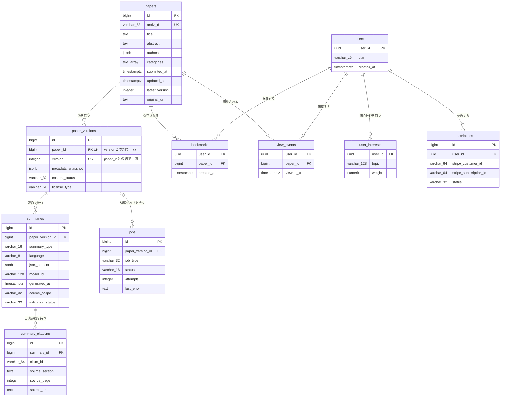

# DB物理設計書 — T002 論文バージョン（`paper_versions`）

| 項目 | 内容 |
| :--- | :--- |
| 文書名 | DB物理設計書 T002 論文バージョン（`paper_versions`） |
| 対象システム | Kaine personal pj — arXiv日本語研究ダイジェスト Webアプリ |
| 対象テーブル | T002 論文バージョン（`paper_versions`）1テーブル |
| 版 | 1.1（第1回セルフレビュー `docs/reviews/db_T002_review_applied.md` の Major 1件・Minor 2件を反映） |
| 作成日 / 更新日 | 2026-10-26 / 2026-10-26 |
| 作成方法 | creating-db-physical-design v1.6.0 準拠。上流の確定設計書と `source/` の企画資料から作成。親テーブルの設計 `docs/db/DB.T001.DB物理設計.md`（版1.1）の規約・判断を引き継ぐ |
| インプット | (b) `docs/基本設計書_概要.md` §6（テーブル一覧 T002、論理テーブル定義「T002 paper_versions（論文バージョン）」、概念ER図、CRUD図）、§2（BF01・BF02・EX03）、§4（機能・バッチ）、§7（IF01・IF02・API03）、§11（ARC001・ARC002・ARC005）、付録 Q13・Q22・Q24／(a) `source/03_システム構成.md:22,29-30,36,59`、`source/02_機能要求定義.md:27,29,50`、`source/01_企画概要.md:28,37`／(c) `legacy/`（空。突合結果は下記） |

## 前提: インプットの性質と突合結果

* **既存版**: `docs/db/DB.T002.DB物理設計.md` の旧版はありません（本書が初版です）。消さずに残すべき既存記述はありません。
* **source/（挙動の正）**: `source/` は企画・初期設計案のMarkdown 6ファイルだけで、`schema.rb`・マイグレーション・SQL・ORM定義はありません（T001 作成時に全6ファイルを確認済み。以後の変更なし）。`paper_versions` について資料にあるのは列名の並び1行だけです（`source/03_システム構成.md:36`: paper_id, version, metadata_snapshot, content_status, license_type）。**型・桁・NOT NULL・初期値・制約・インデックス・区分値はすべて資料に無いため、本書の物理定義はすべて※推測**です。上流の論理テーブル定義（`docs/基本設計書_概要.md` §6「T002 paper_versions（論文バージョン）」）の型・制約の案を正として引き継ぎ、物理的な詳細（CHECK制約・区分値・インデックス・DDL）を本書で加えています。
* **legacy/（既存設計）**: `legacy/` は空ディレクトリです（ファイル0件）。突合する既存仕様・非機能の記述はありません。
* **上流との対応**: カラム6件は上流の論理テーブル定義の6行と1対1で一致します（列名・順序とも同じ）。上流の論理定義に無い列は追加していません。
* **親テーブルとの対応**: 親テーブル `papers` の設計（`docs/db/DB.T001.DB物理設計.md` §4.5）で、`paper_versions.paper_id` の外部キーは「削除を拒否」を推奨とし、最終決定を本書の責務としていました。本書はこれを確定します（§4.5）。
* **ファイル名**: T001 と同じく、作業指示に従いテーブルIDで命名しています（上流 §10 は `DB.{物理名}` 形式。※上流要確認。T001 §9 No.7 と同じ事項）。

---

## 1. データベース概要

T001（`docs/db/DB.T001.DB物理設計.md` §1）と同じ規約を使います。本書で読むだけで分かるよう、内容を次に書きます。

* **対象RDBMS**: PostgreSQL（Supabase 上のマネージドDB）。製品は上流 §1 で確定です（`source/03_システム構成.md:8`）。バージョンは未定義のため、PostgreSQL 15 以上を前提にします（※推測。上流 Q02）。
* **文字コード / 照合順序**: UTF8 / Supabase の既定照合順序（※推測: 資料に定義なし）。
* **命名規則**:
  * テーブル名・カラム名: 英小文字のスネークケース。テーブル名は複数形です（`paper_versions`。上流 §6 の物理名をそのまま使います）。
  * 制約名・インデックス名（※推測）: 主キー `pk_{テーブル}`、一意制約 `uq_{テーブル}_{列}`、外部キー `fk_{子テーブル}_{列}`、CHECK制約 `ck_{テーブル}_{意味}`、インデックス `idx_{テーブル}_{列または用途}`。
* **共通カラム規約**: 上流 §6 にはシステム共通の監査列（作成日時・更新日時・論理削除フラグ）の規約がありません。本テーブルには上流の論理定義にある6列だけを置きます。※上流要確認: 版を取り込んだ日時を列として持つか（T001 §9 No.4 と同じ事項）。本書では、取り込んだ日時を取得時点のメタデータの中に記録する案とします（§4.3 (3)）。
* **論理削除**: 採用しません（※推測）。arXivの版は公開後に消えず、取り下げも新しい版として公開されるため、版の行を消す業務がありません。

---

## 2. 物理テーブル一覧

本書が設計するのは T002 だけです。外部キーでつながるテーブルを区別するため、上流 §6 テーブル一覧の全件を載せています。

| No | 概要書ID | 論理名 | 物理名 | ドメイン | 概要 | 本書での扱い | 定義状況 | 詳細の所在 |
| :--- | :--- | :--- | :--- | :--- | :--- | :--- | :--- | :--- |
| 1 | T001 | 論文 | papers | 論文 | arXiv論文1本につき1行。最新版のメタデータを持つ | 関連（本テーブルが外部キーで参照する親テーブル） | 詳細 | `docs/db/DB.T001.DB物理設計.md` |
| 2 | T002 | 論文バージョン | paper_versions | 論文 | 論文の版（v1/v2…）ごとに1行。取得時点のメタデータ、本文の取得状況、ライセンス種別を持つ | **設計対象** | 詳細 | 本書 §4〜§7 |
| 3 | T003 | 要約 | summaries | 要約 | 論文の版ごと・要約の深さごとの日本語要約JSON | 関連（本テーブルを外部キーで参照する子テーブル） | 詳細 | `docs/db/DB.T003.DB物理設計.md`（未作成） |
| 4 | T004 | 要約出典参照 | summary_citations | 要約 | 要約内の主張ごとに原文の章・ページ・URLを結びつける | 対象外（T003 経由の間接的な関係のみ） | 詳細 | `docs/db/DB.T004.DB物理設計.md`（未作成） |
| 5 | T005 | 利用者 | users | 利用者 | 会員1人につき1行。プランと登録日時を持つ | 対象外（関係なし） | 詳細 | `docs/db/DB.T005.DB物理設計.md`（未作成） |
| 6 | T006 | 利用者関心分野 | user_interests | 利用者 | 利用者が登録した関心トピックとその重み | 対象外（関係なし） | 詳細 | `docs/db/DB.T006.DB物理設計.md`（未作成） |
| 7 | T007 | ブックマーク | bookmarks | 利用者 | 利用者が保存した論文 | 対象外（T001 経由の間接的な関係のみ） | 詳細 | `docs/db/DB.T007.DB物理設計.md`（未作成） |
| 8 | T008 | 閲覧イベント | view_events | 利用者 | 利用者が論文を開いた記録 | 対象外（T001 経由の間接的な関係のみ） | 詳細 | `docs/db/DB.T008.DB物理設計.md`（未作成） |
| 9 | T009 | ジョブ | jobs | 運用 | 論文の版ごとの処理ジョブの種類・状態・試行回数・直近エラー | 関連（本テーブルを外部キーで参照する子テーブル。参照は任意） | 詳細 | `docs/db/DB.T009.DB物理設計.md`（未作成） |
| 10 | T010 | サブスクリプション | subscriptions | 課金 | 利用者とStripeの顧客・定期課金を結びつけ、契約状態を持つ | 対象外（関係なし） | 詳細 | `docs/db/DB.T010.DB物理設計.md`（未作成） |

**総件数: 10件（本書の設計対象1件・外部キーで直接つながる関連3件・対象外6件）。全数である根拠**: `docs/基本設計書_概要.md` §6 テーブル一覧の T001〜T010 の全10行と1対1で対応します（上流の総件数10件と一致）。概要書ID・論理名・物理名・ドメイン（上流の「分類」列）・定義状況は上流の値をそのまま引き継ぎ、新規採番していません。T001 は作成済み、T003〜T010 の物理定義は各テーブルのDB物理設計書の責務で未作成です。

---

## 3. ER図（物理エンティティ関連図）

§2 の全10テーブルと、上流 §6 概念ER図の全10リレーションを描いています。`paper_versions` は §4 の物理定義どおり、`papers` は T001 の物理定義どおりに全列を載せています。他の8テーブルは上流 §6 概念ER図の属性を全部そのまま写したもので、物理的な確定は各テーブルのDB物理設計書で行います。



* **リレーション数**: 全10本（上流 §6 概念ER図の10本と一致）。このうち `paper_versions` に関わるものは3本（親 `papers` から1本、子 `summaries`・`jobs` へ2本）で、§4.5 外部キー一覧の3件と1対1で対応します。
* **多重度の意味**:
  * 論文1本に対し、版は0件以上です（T001 §3 と同じ。※推測: B001 が論文と版を同じトランザクションで書けば、取り込み後は1件以上になる）。
  * 版1つに対し、要約は0件以上です。要約が生成される前と、検証に不合格で作り直す前は0件です。
  * ジョブは版を持たないことがあります（`|o`）。収集（B001）とオンデマンド同期（B006）は版が決まる前に動くためです（上流 §6 T009）。

---

## 4. テーブル詳細定義

### テーブル名: 論文バージョン (`paper_versions`)
* **概要**: arXiv上の論文の版（v1・v2…）ごとに1行を持ちます。版を取り込んだ時点のメタデータを残し、本文を取得・解析済みかとライセンス種別を版ごとに管理します。要約（`summaries`）と処理ジョブ（`jobs`）は版を単位に作られ、この表を参照します。同じ版を二度処理しないための重複判定（ARC001）と、権利を確認していない本文を使わないための判定（ARC005）の拠り所になる表です（上流 §6 T002、§11 ARC001・ARC005、`source/03_システム構成.md:22,36`）。
* **対応ドメイン**: 論文（上流 §6 テーブル一覧の分類）
* **概要書ID**: T002
* **想定件数**（※推測）: 論文1本あたり平均1.3〜1.5版と見込み、`papers` の行数の1.3〜1.5倍です（T001 の想定は年に約25万〜30万行の増加）。古い版をさかのぼって取り込むかは未定のため、取り込み範囲で件数が変わります。

#### 4.1 カラム一覧（ロースター）

| No | ID | カラム論理名 | カラム物理名 | 概要 | 定義状況 | 詳細の所在 |
| :--- | :--- | :--- | :--- | :--- | :--- | :--- |
| 1 | T002.id | 論文バージョンID | id | 本システム内で版を一意に識別する連番 | 簡易 | §4.2 |
| 2 | T002.paper_id | 論文ID | paper_id | どの論文の版かを示す。親テーブル `papers` への参照 | 詳細 | §4.3 (1) |
| 3 | T002.version | 版番号 | version | arXivの版番号（v2 なら 2）。論文IDとの組で一意 | 詳細 | §4.3 (2) |
| 4 | T002.metadata_snapshot | メタデータスナップショット | metadata_snapshot | その版を取り込んだ時点のarXivのメタデータ | 詳細 | §4.3 (3) |
| 5 | T002.content_status | 本文取得状況 | content_status | 本文を取得・解析済みか、Abstractだけか | 詳細 | §4.3 (4) |
| 6 | T002.license_type | ライセンス種別 | license_type | その版の利用許諾。本文解析と全文翻訳公開の可否を決める | 詳細 | §4.3 (5) |

**総件数: 6件（詳細5件・簡易1件）。全数である根拠**: 上流 `docs/基本設計書_概要.md` §6「T002 paper_versions（論文バージョン）」の論理テーブル定義の全6行と1対1で対応します。資料の列名（`source/03_システム構成.md:36` の5列）に、上流が主キーとして加えた `id` を足した6列です。ID列は上流のテーブルID「T002」に物理名をつないだもので、新しい番号は振っていません。
**定義状況の判定**（completeness 3-1）: `id` は採番されるだけで業務上の判断を含まないため「簡易」です。`paper_id` は他テーブルにまたがる（3-1 の3）ため「詳細」です。`version` は重複判定の業務ルールを含む（3-1 の7）ため「詳細」です。`metadata_snapshot` は実行時に構造が決まるJSON（3-1 の4）のため「詳細」です。`content_status` は本文解析で書き換わり（3-1 の2）、値によって10分解説の可否が分かれる（3-1 の1）ため「詳細」です。`license_type` は値によって本文解析と全文翻訳公開の可否が分かれる（3-1 の1・7）ため「詳細」です。

#### 4.2 カラム定義

| カラム論理名 | カラム物理名 | データ型 | PK | FK | 必須 (NN) | デフォルト値 / 制約 | 備考 |
| :--- | :--- | :--- | :--- | :--- | :--- | :--- | :--- |
| 論文バージョンID | id | BIGINT | ○ | - | ○ | GENERATED ALWAYS AS IDENTITY（※推測） | 資料に列が無く、上流が追加した列です。`summaries` と `jobs` が版を指すために使います（上流 §6 T002、Q22） |
| 論文ID | paper_id | BIGINT | - | ○（`papers.id`） | ○ | 参照先の論文に版が残っている間は論文を削除できない（`fk_paper_versions_paper_id`、ON DELETE RESTRICT）（※推測） | 論文の行の追加・更新と同じトランザクションで書きます。論文だけが入って版が無い状態を作らないためです（§4.3 (1)） |
| 版番号 | version | INTEGER（※推測） | - | - | ○ | 1以上（`ck_paper_versions_version_positive`）。同じ論文の中で同じ版番号は1行だけ（`uq_paper_versions_paper_id_version`）（※推測） | 重複処理を防ぐ鍵です（上流 §6 T002、ARC001） |
| メタデータスナップショット | metadata_snapshot | JSONB（※推測） | - | - | ○ | JSONのオブジェクト形式であること（`ck_paper_versions_snapshot_object`）（※推測） | 一度書いたら変更しません（§4.3 (3)） |
| 本文取得状況 | content_status | VARCHAR(32)（※推測） | - | - | ○ | DEFAULT `'abstract_only'`。値は `abstract_only`・`full_text` の2つだけ（`ck_paper_versions_content_status`）。本文取得済みにできるのはライセンス種別が分かっている版だけ（`ck_paper_versions_full_text_requires_license`）（※推測） | 値の意味と遷移は §6 |
| ライセンス種別 | license_type | VARCHAR(64)（※推測） | - | - | -（任意） | - | 空はライセンス不明を表し、本文の利用は許可されていないものとして扱います（§4.3 (5)、上流 EX03） |

* **必須の判定**: `license_type` 以外の5列を必須としています。上流 §6 T002 の論理定義（`license_type` だけが「任意」）をそのまま引き継いだものです（※推測。上流 Q22 で確認待ち）。
* **型の判断**（※推測）: 上流の型案をそのまま使います。`license_type` の `VARCHAR(64)` は、arXivがライセンスを示すURL（最も長い `http://arxiv.org/licenses/nonexclusive-distrib/1.0/` で52文字）が収まる長さです。

#### 4.3 カラム詳細（定義状況＝詳細の5列）

ロースターは §4.1 です。本節では定義状況が「詳細」の5列について、値の決め方と業務ルールを書きます。

**(1) T002.paper_id — 論文ID**
* **意味**: この版がどの論文のものかを示します。親テーブル `papers` の論文IDです。
* **書き込み**: 収集（B001）とオンデマンド同期（B006）が、論文の行を追加または更新した直後に、同じトランザクションで版の行を追加します（※推測）。論文だけが入って版が無い状態を作らないためです。
* **削除時の動き**: 論文を消そうとしたとき、その論文の版が1つでも残っていれば削除を拒否します（ON DELETE RESTRICT）。版の下には生成費用のかかった要約がぶら下がるため、論文を消した巻き添えで失わないようにします。T001 §4.5 で推奨とした方針を本書で確定します（※推測・※上流未定義: 上流 §6 に削除時の動きの定義はありません）。
* **インデックス**: 論文IDから版を引く検索（論文詳細 API03 が表示する版を探す処理と、収集 B001 が既にある版を確かめる処理）は、一意制約 `uq_paper_versions_paper_id_version` のインデックスが先頭の列で受け持ちます。外部キー用の単独のインデックスは作りません（§5）。

**(2) T002.version — 版番号**
* **意味**: arXivの版番号です（`2401.12345v2` なら 2）。arXiv IDから取り除いた版番号の接尾辞をここに入れます（T001 §4.3 (1)）。
* **重複判定**: 同じ論文の同じ版番号は1行だけです（`uq_paper_versions_paper_id_version`）。収集（B001）は、取り込もうとした版がすでにあれば何もせず、生成済みの要約を使い回します（上流 BF01「登録済みの同じ版」、ARC001）。この判定は、一意制約に当たったら何もしない1文の書き込み（`INSERT … ON CONFLICT (paper_id, version) DO NOTHING`）で行い、並行して取り込んでも行が2つにならないことをDBで保証します（※推測）。新しく行が入ったときだけ要約ジョブ（B002）を登録します。
* **親との関係**: 版番号は親の最新版（`papers.latest_version`）以下になります（※推測）。テーブルをまたぐためCHECK制約では書けず、取り込み処理で守ります。取り込み範囲によっては途中の版が抜けることがあり（arXivに v3 まであっても v3 だけを取り込んだ場合）、版番号が1から連続している保証はありません（T001 §4.3 (6)）。
* **最新版の行の引き方**: 論文詳細（API03）で表示する版は、親の最新版番号と一致する行です（`paper_id` と `version = papers.latest_version` の組）。最新版の行がまだ無いとき（最新版の取り込みが失敗した直後）は、版番号が最も大きい行を表示します（※推測）。

**(3) T002.metadata_snapshot — メタデータスナップショット**
* **意味**: その版を取り込んだ時点で、arXivから受け取ったメタデータを丸ごと保存します。親の `papers` は最新版の値で上書きされるため、版ごとの原題・Abstract・著者の違いはこの列にだけ残ります（T001 §4.3 (2)）。
* **構造**（※推測）: JSONのオブジェクトです（`ck_paper_versions_snapshot_object`）。少なくとも次のキーを持たせます。キーの最終的な一覧は収集バッチの設計（`docs/detail/batch/BT.B001.バッチ詳細設計.md`、未作成）で確定します。
  * その版の原題・Abstract・著者・カテゴリ（`papers` と同じ形）
  * その版がarXivで公開された日時
  * 取り込み時点で受け取ったライセンスの値（受け取れなければ空）。取り込み時の記録として残すだけで、本文の利用可否の判断には使いません（判断に使う正の値は `license_type`。§4.3 (5)）
  * 取り込んだ日時と、取り込んだ処理（定期収集 B001 か、オンデマンド同期 B006 か）
* **更新**: 一度書いたら変更しません（※推測）。取り込み時点の記録だからです。arXiv側で同じ版のメタデータが直された場合も、上書きせずに元の記録を残します。
* **検索**: この列の中身で検索する画面・APIはないため、インデックスは作りません（§5）。

**(4) T002.content_status — 本文取得状況**
* **意味**: その版について、本文PDFを取得・解析済みか、Abstractだけしか持っていないかを示します。10分解説（deep）を作れるかどうかと、画面で「Abstractベース」と表示するかどうかの判断に使います（上流 §6 T002、ARC002、`source/02_機能要求定義.md:27`）。
* **値**（※推測。上流 Q24 で確認待ち）: `abstract_only`（Abstractのみ）と `full_text`（本文取得済み）の2値です。上流 §6 T002 が例として挙げた「Abstractのみ」「本文取得済み」をそのまま値にしています。各値の意味と遷移条件は §6 に書きます。
* **初期値**: 版を取り込んだ時点では本文を読んでいないため、`abstract_only` で作ります（DEFAULT）。
* **書き換え**: 本文解析（B005）が本文の取得・解析に成功し、10分解説を保存したときだけ `full_text` に進めます（上流 BF02「paper_versions の本文取得状況を更新」）。ライセンスで本文の利用が許可されていない、または不明な版は書き換えません（上流 EX03「content_status を据え置く」）。`full_text` から `abstract_only` へは戻しません（※推測）。
* **ライセンスとの整合**: `full_text` にできるのは、ライセンス種別が分かっている版だけです（`ck_paper_versions_full_text_requires_license`）。どのライセンスなら本文を使ってよいかの判定（ARC005）はアプリ側で行い、DBでは「ライセンス不明のまま本文取得済みになる」誤りだけを止めます。
* **要約側との関係**: 要約の解析範囲（`summaries.source_scope`）は要約1件ごとの材料の範囲で、本列は版としての本文の取得状況です。本文を取得したあとも、Abstractだけで作った30秒要約は解析範囲が「Abstractのみ」のまま残ります（上流 §6 T003）。

**(5) T002.license_type — ライセンス種別**
* **意味**: その版にarXivが付けた利用許諾です。本文PDFを取得して解析してよいか（B005）、Appendixで日本語全文を公開してよいか（F05・P105）を決めます（上流 ARC005、`source/03_システム構成.md:29-30,59`、`source/02_機能要求定義.md:50`）。
* **値の決め方**（※推測）: arXivが返すライセンスのURLを、そのまま入れます（例: `http://creativecommons.org/licenses/by/4.0/`）。本システムで独自のコードに置き換えないのは、arXivの値が増えたときに変換表の更新漏れで誤判定するのを避けるためです。現在arXivで選べる値と、本システムでの扱いの案は §6 に書きます。
* **空のとき**: ライセンスが取得できなかった版は空にします（上流 §6 T002 の「任意」）。空の版は「本文の利用が許可されていない」ものとして扱い、本文解析も全文翻訳公開もしません（上流 EX03「許可なしまたは不明」）。
* **書き換え**: 空の版に、あとからライセンスが取得できた場合に限り値を入れます（※推測: arXiv APIの検索結果にライセンスが含まれない場合、本文解析の前に別の手段で取得する）。一度入れた値は変えません。arXivのライセンスは版ごとに決まり、公開後に変わらないためです。
* **正となる値**: 本文解析（B005）と全文翻訳公開（F05）の可否は、必ずこの列の値で判断します。メタデータスナップショットにも取り込み時点のライセンスの値が残りますが、あとからこの列を埋めた場合はスナップショット側が空のまま残り、値が食い違います。スナップショットは変更しない記録であるため（§4.3 (3)）、食い違いは正常な状態とし、判断には使いません。
* **版ごとに持つ理由**: 著者は新しい版で別のライセンスを選べるため、論文単位ではなく版単位で持ちます。本文解析と全文翻訳公開の可否は、対象の版のライセンスで判断します。

#### 4.4 制約一覧（ロースター）

| No | ID（制約名） | 種別 | 対象カラム | 概要 | 定義状況 | 詳細の所在 |
| :--- | :--- | :--- | :--- | :--- | :--- | :--- |
| 1 | pk_paper_versions | PRIMARY KEY | id | 版を連番で一意に識別する | 簡易 | §4.2 |
| 2 | uq_paper_versions_paper_id_version | UNIQUE | paper_id, version | 同じ論文の同じ版を2行登録させない。重複処理を防ぐ最後の防壁 | 詳細 | §4.3 (2) |
| 3 | fk_paper_versions_paper_id | FOREIGN KEY | paper_id → papers.id | 実在する論文の版だけを登録させ、版が残る論文の削除を拒否する | 詳細 | §4.3 (1)・§4.5 |
| 4 | ck_paper_versions_version_positive | CHECK | version | 版番号が1以上であることを保証する（※推測） | 詳細 | §4.3 (2) |
| 5 | ck_paper_versions_snapshot_object | CHECK | metadata_snapshot | メタデータがJSONのオブジェクトであることを保証する（※推測） | 詳細 | §4.3 (3) |
| 6 | ck_paper_versions_content_status | CHECK | content_status | 本文取得状況が決められた2値のどちらかであることを保証する（※推測） | 詳細 | §4.3 (4)・§6 |
| 7 | ck_paper_versions_full_text_requires_license | CHECK | content_status, license_type | ライセンス不明の版が本文取得済みにならないことを保証する（※推測） | 詳細 | §4.3 (4) |
| 8 | NOT NULL（id） | NOT NULL | id | 主キーなので空を許さない（主キー制約に含まれる） | 簡易 | §4.2 |
| 9 | NOT NULL（paper_id） | NOT NULL | paper_id | どの論文の版か分からない行を作らない | 簡易 | §4.2 |
| 10 | NOT NULL（version） | NOT NULL | version | 重複判定の鍵なので空を許さない | 簡易 | §4.2 |
| 11 | NOT NULL（metadata_snapshot） | NOT NULL | metadata_snapshot | 取り込み時点の記録は必ず残す | 簡易 | §4.2 |
| 12 | NOT NULL（content_status） | NOT NULL | content_status | 状態が分からない版を作らない（初期値で必ず埋まる） | 簡易 | §4.2 |
| 13 | DEFAULT（content_status） | DEFAULT | content_status | 取り込んだ時点はAbstractのみの状態で作る | 簡易 | §4.3 (4) |

**総件数: 13件（PRIMARY KEY 1件・UNIQUE 1件・FOREIGN KEY 1件・CHECK 4件・NOT NULL 5件・DEFAULT 1件）。`id` の自動採番は §4.2 に記載しています。全数である根拠**: §7 DDL の `CREATE TABLE paper_versions` に書いた制約をすべて数えたものです（CONSTRAINT 句7件、NOT NULL 4句＋主キー由来1件、DEFAULT 1句）。NOT NULL の5件は §4.2 で必須を「○」とした5列と一致します。PRIMARY KEY・UNIQUE・FOREIGN KEY は上流 §6 T002 の「PK」「paper_id との組で一意」「FK→papers.id」と一致し、CHECK 4件と DEFAULT は本書で追加した※推測です。
**定義状況の判定**: 業務上の判断を含む制約（重複排除・参照整合性・値の範囲・状態とライセンスの整合）は3-1 の3・7に当たるため「詳細」、空を許さないだけの制約と初期値は判断を含まないため「簡易」としました。

#### 4.5 外部キー（FKリレーション）一覧（ロースター）

| No | ID（制約名） | 向き | 子テーブル.列 | 親テーブル.列 | 多重度 | 削除時の動き | 概要 | 定義状況 | 詳細の所在 |
| :--- | :--- | :--- | :--- | :--- | :--- | :--- | :--- | :--- | :--- |
| 1 | fk_paper_versions_paper_id | 本テーブルが参照する | paper_versions.paper_id（T002） | papers.id（T001） | 論文1 : 版0以上 | 削除を拒否（RESTRICT）。本書で確定（※推測） | 版がどの論文のものかを示す | 詳細 | 本書 §4.3 (1)、§7 |
| 2 | fk_summaries_paper_version_id（※推測） | 本テーブルを参照される | summaries.paper_version_id（T003） | paper_versions.id | 版1 : 要約0以上 | 削除を拒否（RESTRICT）を推奨（※推測） | 要約がどの版を要約したかを示す | 詳細 | `docs/db/DB.T003.DB物理設計.md`（未作成） |
| 3 | fk_jobs_paper_version_id（※推測） | 本テーブルを参照される | jobs.paper_version_id（T009。空を許す） | paper_versions.id | 版0または1 : ジョブ0以上 | 削除を拒否（RESTRICT）を推奨（※推測） | ジョブがどの版の処理かを示す。版が決まる前のジョブは空 | 詳細 | `docs/db/DB.T009.DB物理設計.md`（未作成） |

**総件数: 3件（参照する1件・参照される2件）。全数である根拠**: 上流 §6 の論理テーブル定義 T001〜T010 の全定義のうち、`paper_versions` に関わる外部キーは、T002 自身の「FK→papers.id」（`paper_id`）と、「FK→paper_versions.id」と書かれた T003 `paper_version_id`・T009 `paper_version_id` の3列だけです。上流 §6 概念ER図で `paper_versions` につながる3本のリレーションとも一致します。
**参照される側の削除時の動きを「拒否」とする理由**（※推測）: 版の行は業務上消さない（§1 論理削除）ため、版を消すのは誤操作か特別な運用作業だけです。要約は生成費用がかかり、ジョブは失敗の原因調査に使う記録なので、巻き添えで消さないようにします。外部キー制約そのものは子テーブル側のDDLに書くため、No.2・No.3 の**最終的な決定は T003・T009 のDB物理設計書の責務**です（※上流未定義: 上流 §6 に削除時の動きの定義はありません）。
**定義状況の判定**: 3件とも複数テーブルにまたがり（3-1 の3）、削除時の扱いが自明でない（3-1 の5）ため「詳細」です。

#### 4.6 本テーブルを操作する機能・バッチ（ロースター）

| No | ID | 名称 | 操作（C/R/U/D） | 本テーブルに対する内容 | 定義状況 | 詳細の所在 |
| :--- | :--- | :--- | :--- | :--- | :--- | :--- |
| 1 | F01 | 新着論文取得（B001 論文メタデータ収集） | CR | 新しい版を見つけたら、取り込み時点のメタデータとライセンスを付けて版を追加する。既にある版は追加せずに読むだけ（§4.3 (2)） | 詳細 | `docs/detail/be/BE.F01.BE詳細設計.md`、`docs/detail/batch/BT.B001.バッチ詳細設計.md`（未作成） |
| 2 | F02 | 日付・カテゴリ検索（API01） | R | 一覧に出す論文の版を読み、要約の有無と結びつける | 詳細 | `docs/detail/be/BE.F02.BE詳細設計.md`（未作成） |
| 3 | F03 | 自由検索（API02、B006 arXivオンデマンド同期） | R（上流CRUD図）。B006 は C ※上流要確認 | 検索結果の論文の版を読む。自前DBに無い論文は B006 が版を追加する | 詳細 | `docs/detail/be/BE.F03.BE詳細設計.md`、`docs/detail/batch/BT.B006.バッチ詳細設計.md`（未作成） |
| 4 | F04 | 日本語構造化要約（B002・B003・B005） | RU | 要約の対象の版を読む。本文解析（B005）が成功したら本文取得状況を「本文取得済み」に進め、空のライセンスを埋める（§4.3 (4)(5)） | 詳細 | `docs/detail/be/BE.F04.BE詳細設計.md`、`docs/detail/batch/BT.B005.バッチ詳細設計.md`（未作成） |
| 5 | F05 | 論文詳細・Appendix（API03・API04） | R | 表示中の版・ライセンス種別・本文取得状況を読み、全文翻訳を公開してよいかを判断する | 詳細 | `docs/detail/be/BE.F05.BE詳細設計.md`（未作成） |
| 6 | F09 | AIチャット | R | 質問対象の版を読む | 詳細 | `docs/detail/be/BE.F09.BE詳細設計.md`（未作成） |
| 7 | F11 | 複数論文比較 | R | 比較対象の各論文の版を読む | 詳細 | `docs/detail/be/BE.F11.BE詳細設計.md`（未作成） |
| 8 | F14 | GitHub関連付け（B009） | R | 関連付けの対象の版を読む | 詳細 | `docs/detail/be/BE.F14.BE詳細設計.md`（未作成） |
| 9 | F17 | 処理状況の確認 | R | 版ごとの本文取得状況を読み、処理状況として出す | 簡易 | -（未作成） |
| 10 | B011 | 検索インデックス更新 | R | 公開反映が済んだ版を読み、検索インデックスへ加える | 詳細 | `docs/detail/batch/BT.B011.バッチ詳細設計.md`（未作成） |

**総件数: 10件。全数である根拠**: 上流 §6 CRUD図の全21行（F01〜F19、B010、B011）のうち、`paper_versions` 列が「-」でない行を数えたものです（F06・F07・F08・F10・F12・F13・F15・F16・F18・F19・B010 の11行は `paper_versions` を操作しないため除外）。定義状況と詳細の所在は上流 §4 機能一覧・バッチ処理設計の値を引き継いでいます。本テーブルを削除（D）する機能はありません。
**※上流要確認**: 上流 CRUD図は F03 の `paper_versions` を「R」としていますが、F03 から起動される B006（arXivオンデマンド同期）は自前DBに無い論文を取り込むため、版も追加（C）するはずです。T001 §4.6 で挙げた `papers` の事項と同じ食い違いです。

---

## 5. インデックス設計

#### 5.1 インデックス一覧（ロースター）

| No | ID（インデックス名） | 対象カラム | 種別 | 概要 | 定義状況 | 詳細の所在 |
| :--- | :--- | :--- | :--- | :--- | :--- | :--- |
| 1 | pk_paper_versions | id | B-Tree（UNIQUE） | 主キー制約で自動的に作られる。要約・ジョブから版を引く結合に使う | 簡易 | §4.4 |
| 2 | uq_paper_versions_paper_id_version | paper_id, version | B-Tree（UNIQUE） | 一意制約で自動的に作られる。論文から版を引く検索と、外部キーの結合を受け持つ | 詳細 | §5.2 |

**総件数: 2件（いずれも制約で自動的に作られるもの。明示的に作るものは0件）。全数である根拠**: §7 DDL で `paper_versions` に作られるインデックスをすべて数えたものです（`CREATE INDEX` 文は0文、主キー・一意制約による自動作成2件）。
**作らないと判断したもの**（※推測）:
* `paper_id` 単独のインデックス: 一意制約のインデックスの先頭列が `paper_id` なので、論文IDだけでの検索と、親の削除時に子を探す検査にもそのまま使えます。二重に作ると書き込みが遅くなるだけです。
* `content_status` のインデックス: 値が2種類しかなく、本文取得状況だけで版を大量に抜き出す処理がありません。本文解析の対象は人気論文とリクエストで決まり（上流 B005、Q13）、ジョブ（`jobs`）を起点に版を1件ずつ引くため、主キーで足ります。本文取得済みの版を一覧する処理が設計された時点で、部分インデックス（本文取得済みの行だけ）を検討します。
* `license_type`・`metadata_snapshot` のインデックス: どちらも検索条件に使う画面・API・バッチがありません。
**定義状況の判定**: 主キーのインデックスは自動作成で判断を含まないため「簡易」、一意制約のインデックスは外部キーの結合と検索を兼ねさせる判断を含む（3-1 の6）ため「詳細」です。

#### 5.2 インデックス定義（主キーを除く）

| 対象テーブル物理名 | インデックス名 | 対象カラム | 種別 | 目的・理由 |
| :--- | :--- | :--- | :--- | :--- |
| paper_versions | uq_paper_versions_paper_id_version | paper_id, version | B-Tree（UNIQUE） | 収集時に「この論文のこの版はもうあるか」を調べる重複判定と、その一意性の保証に使う（ARC001）。論文詳細（API03）が最新版の行を引くときも、論文IDと版番号の組で1件を引く。論文IDを先頭の列にしているため、論文IDだけでの検索と、親の論文を削除しようとしたときの子の存在確認（外部キー）にも使える（※推測） |

---

## 6. コード定義（区分値・ステータス定義）

本テーブルで値の一覧を本システムが定める列は `content_status` の1列です（§4.1 の全6列を確認）。`license_type` は値をarXivが決めるため本システムでは固定しませんが、本文の利用可否を決める重要な列なので、現在arXivで選べる値と扱いの案を参考として載せます。

**content_status（本文取得状況）**（※推測。上流 Q24 で確認待ち）

| 対象テーブル | 対象カラム | 設定値 | 意味・遷移条件 |
| :--- | :--- | :--- | :--- |
| paper_versions | content_status | abstract_only | Abstractのみ。版を取り込んだ時点の初期値。本文をまだ取得していないか、ライセンスで本文の利用が許されないため取得しない状態。この状態の版で作れる要約はAbstractベースの30秒要約・3分要約だけで、画面には「Abstractベース」と表示する（上流 ARC002・ARC009） |
| paper_versions | content_status | full_text | 本文取得済み。ライセンスで本文の利用が許される版について、本文解析（B005）が本文PDFの取得・解析と10分解説の保存に成功したときに `abstract_only` から移る。ライセンス種別が空の版はこの状態にできない（`ck_paper_versions_full_text_requires_license`）。一度この状態になったら戻らない |

* **値の総件数: 2件。全数である根拠**: 上流 §6 T002 が例示した2つの状態（「Abstractのみ」「本文取得済み」）だけを値にし、§7 DDL の CHECK 制約 `ck_paper_versions_content_status` が許す値と一致させています。
* **状態遷移**: `abstract_only` → `full_text` の一方向だけです。本文解析が失敗したときは状態を変えず、失敗はジョブ（`jobs`）の状態と直近エラーに残します（上流 ARC006）。
* **※上流要確認**: 「本文の取得を試みたが、ライセンスで許可されていなかった」版と、「まだ試みていない」版は、どちらも `abstract_only` で区別できません。区別が必要な場合は値を増やすか、判定結果をジョブ側に残すかを決める必要があります（上流 Q24）。

**license_type（ライセンス種別）— 参考: arXivで選べる値と本システムでの扱いの案**（※推測。権利の扱いは要確認）

| 対象テーブル | 対象カラム | 設定値 | 意味・遷移条件 |
| :--- | :--- | :--- | :--- |
| paper_versions | license_type | （空） | ライセンス不明。本文解析も全文翻訳公開もしない（上流 EX03） |
| paper_versions | license_type | http://arxiv.org/licenses/nonexclusive-distrib/1.0/ | arXivへの配布許諾だけ。第三者による翻訳の公開は許されていないものとして、全文翻訳を公開しない。本文を解析して要約に使ってよいかは確認が必要 |
| paper_versions | license_type | http://creativecommons.org/licenses/by/4.0/ | CC BY。出典を示せば翻訳の公開も許される。本文解析・全文翻訳公開の対象にできる |
| paper_versions | license_type | http://creativecommons.org/licenses/by-sa/4.0/ | CC BY-SA。翻訳を同じライセンスで公開する条件で、本文解析・全文翻訳公開の対象にできる |
| paper_versions | license_type | http://creativecommons.org/licenses/by-nc-sa/4.0/ | CC BY-NC-SA。非営利の条件があり、有料プランのあるサービスで全文翻訳を公開してよいかは確認が必要 |
| paper_versions | license_type | http://creativecommons.org/licenses/by-nc-nd/4.0/ | CC BY-NC-ND。翻訳（改変）が許されないため、全文翻訳を公開しない |
| paper_versions | license_type | http://creativecommons.org/publicdomain/zero/1.0/ | CC0。権利が放棄されており、本文解析・全文翻訳公開の対象にできる |
| paper_versions | license_type | 上記以外の値 | 旧版のCCライセンスや、arXivが将来加える値。判定表に無い値は、許可されていないものとして扱う |

* 上の判定は権利に関わるため、運用前に顧客の確認が必要です（上流 ARC005・Q13。※推測）。判定はアプリ側の判定表で行い、DBのCHECK制約では値を縛りません。arXivが値を増やしても取り込みを止めないためです。

---

## 7. DDL (データ定義言語)

`paper_versions` の全定義です。PostgreSQL 15 以上でそのまま実行できます（※推測: 型・制約はすべて本書の設計案）。親テーブル `papers` を参照するため、`docs/db/DB.T001.DB物理設計.md` §7 のDDLを先に実行してください。本テーブルを参照する外部キー（§4.5 No.2・No.3）は、`summaries`・`jobs` のDB物理設計書のDDLで定義します。

```sql
-- =========================================================
-- T002 論文バージョン (paper_versions)
-- 前提: T001 papers が作成済みであること
-- =========================================================
CREATE TABLE paper_versions (
    id                 BIGINT       GENERATED ALWAYS AS IDENTITY,
    paper_id           BIGINT       NOT NULL,
    version            INTEGER      NOT NULL,
    metadata_snapshot  JSONB        NOT NULL,
    content_status     VARCHAR(32)  NOT NULL DEFAULT 'abstract_only',
    license_type       VARCHAR(64),

    CONSTRAINT pk_paper_versions PRIMARY KEY (id),
    CONSTRAINT uq_paper_versions_paper_id_version UNIQUE (paper_id, version),
    CONSTRAINT fk_paper_versions_paper_id
        FOREIGN KEY (paper_id) REFERENCES papers (id)
        ON DELETE RESTRICT,

    -- 版番号は1から始まる
    CONSTRAINT ck_paper_versions_version_positive CHECK (version >= 1),
    -- 取り込み時点のメタデータはJSONのオブジェクト
    CONSTRAINT ck_paper_versions_snapshot_object CHECK (
        jsonb_typeof(metadata_snapshot) = 'object'
    ),
    -- 本文取得状況は「Abstractのみ」「本文取得済み」の2値
    CONSTRAINT ck_paper_versions_content_status CHECK (
        content_status IN ('abstract_only', 'full_text')
    ),
    -- ライセンス不明の版は本文取得済みにできない
    CONSTRAINT ck_paper_versions_full_text_requires_license CHECK (
        content_status = 'abstract_only' OR license_type IS NOT NULL
    )
);

-- インデックス: 主キーと一意制約で自動作成される2件のみ（§5）。明示的な CREATE INDEX は無し

-- コメント
COMMENT ON TABLE  paper_versions                   IS 'T002 論文バージョン: 論文の版ごとに1行。取り込み時点のメタデータ・本文取得状況・ライセンス種別を持つ';
COMMENT ON COLUMN paper_versions.id                IS '論文バージョンID（本システム内の連番）';
COMMENT ON COLUMN paper_versions.paper_id          IS '論文ID（papers.id）';
COMMENT ON COLUMN paper_versions.version           IS '版番号（arXivの v の後の数字。論文IDとの組で一意）';
COMMENT ON COLUMN paper_versions.metadata_snapshot IS 'メタデータスナップショット（取り込み時点のarXivメタデータ。変更しない）';
COMMENT ON COLUMN paper_versions.content_status    IS '本文取得状況（abstract_only=Abstractのみ / full_text=本文取得済み）';
COMMENT ON COLUMN paper_versions.license_type      IS 'ライセンス種別（arXivのライセンスURL。空は不明で本文利用不可として扱う）';
```

**行単位アクセス制御（Supabase 環境のみ ※推測）**: T001 と同じく、版の情報は誰でも読める公開データなので、読み取りだけを許可します。書き込みは Row Level Security を通らないサーバ側のサービスロール（ジョブワーカー）だけに限ります。次の文は Supabase の既定ロール（`anon`・`authenticated`）がある環境でだけ実行できます。

```sql
ALTER TABLE paper_versions ENABLE ROW LEVEL SECURITY;

CREATE POLICY paper_versions_select_public
    ON paper_versions
    FOR SELECT
    TO anon, authenticated
    USING (true);
```

---

## 8. マイグレーション計画（該当する場合のみ）

**該当なし（新規構築）**。根拠: 既存のDB・スキーマ・マイグレーションはありません（`source/` にスキーマ定義が無く、`legacy/` は空。上流 §10「システム移行計画: 該当なし」）。

初回構築の手順（※推測）:

| No | 対象テーブル | 変更種別 | 変更内容 | 影響範囲 | 備考 |
| :--- | :--- | :--- | :--- | :--- | :--- |
| 1 | paper_versions | テーブル新規作成 | §7 DDL の `CREATE TABLE paper_versions` とコメントを実行する | なし（新規） | T001 `papers` の作成後、T003 `summaries`・T009 `jobs` の作成前に実行する。マイグレーションの置き場所とツールは未定（※推測: Supabase のマイグレーション機能。上流 Q34） |
| 2 | paper_versions | 権限設定 | §7 の行単位アクセス制御を有効にし、読み取りポリシーを作る | 画面・APIからの読み取り | Supabase 環境のみ（※推測。上流 Q32） |

---

## 9. 確認事項（※推測・※上流要確認の集約）

| No | 区分 | 確認事項 | 本書での仮置き | 関連箇所 | 上流の確認事項 |
| :--- | :--- | :--- | :--- | :--- | :--- |
| 1 | 型・制約 | 全列の型・桁・必須・一意制約・CHECK制約 | §4.2・§4.4 のとおり | §4 | Q22 |
| 2 | 区分値 | `content_status` の取りうる値。「試みたが許可されなかった」状態を区別するか（※上流要確認） | `abstract_only`・`full_text` の2値 | §4.3 (4)、§6 | Q24 |
| 3 | 権利 | ライセンスごとの本文解析・全文翻訳公開の可否（特に arXiv 配布許諾と非営利条件付きCC） | §6 の判定案 | §4.3 (5)、§6 | Q13（ARC005） |
| 4 | 取得 | ライセンスの取得手段（arXiv APIの検索結果に含まれない場合の取得方法） | 本文解析の前に別の手段で取得して空を埋める | §4.3 (5) | Q02 |
| 5 | 監査列 | 版を取り込んだ日時を列として持つか（※上流要確認） | メタデータスナップショットの中に記録 | §1、§4.3 (3) | Q22 |
| 6 | 外部キー | 子テーブル（要約・ジョブ）から版を参照する外部キーの削除時の動き（※上流未定義） | 削除を拒否 | §4.5 | — |
| 7 | CRUD | B006 による `paper_versions` の追加を上流 CRUD図に反映するか（※上流要確認） | B006 は追加する前提 | §4.6 | — |
| 8 | 取り込み範囲 | 古い版をさかのぼって取り込むか | 取り込んだ時点の最新版だけ | §4 想定件数、§4.3 (2) | Q18 |

---

## 出力前チェックリスト（自己検証）

- [x] §2 物理テーブル一覧に、基本設計書（概要）§6テーブル一覧の全10行を列挙した
- [x] §2 の「概要書ID」が上流のテーブルID T001〜T010 と1対1で対応している
- [x] §3 ER図に §2 の全10テーブルをエンティティとして描いた
- [x] §3 ER図のリレーションが §4.5 の外部キー3件を表現している（`paper_versions` に関わる3本。全体は上流の10本）
- [x] §3 ER図の `paper_versions` のエンティティ名・PK・FK・一意キーが §4.2 と一致している
- [x] §3 のMermaid記法が規約どおり（型はアンダースコア区切り・括弧なし、リレーション記号の前後にスペース）
- [x] §4 全6列のカラム定義（PK/FK/NN/デフォルト）を網羅した
- [x] §5 外部キー・業務キーのインデックスを設計し、ステータス列に作らない理由を明記した
- [x] §6 区分値 `content_status` の業務的意味と遷移条件を定義した
- [x] §7 DDL を出力した（CREATE TABLE・FOREIGN KEY・CHECK。明示的なインデックスが無いことも明記）
- [x] 推測箇所に「※推測」を明記した
