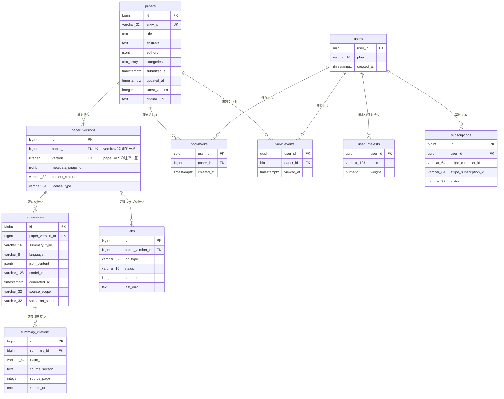

# DB物理設計書 — T003 要約（`summaries`）

| 項目 | 内容 |
| :--- | :--- |
| 文書名 | DB物理設計書 T003 要約（`summaries`） |
| 対象システム | Kaine personal pj — arXiv日本語研究ダイジェスト Webアプリ |
| 対象テーブル | T003 要約（`summaries`）1テーブル |
| 版 | 1.1（第1回セルフレビュー `docs/reviews/db_T003_review_applied.md` の Major 2件・Minor 1件を反映） |
| 作成日 / 更新日 | 2026-10-26 / 2026-10-26 |
| 作成方法 | creating-db-physical-design v1.6.0 準拠。上流の確定設計書と `source/` の企画資料から作成。親テーブルの設計 `docs/db/DB.T002.DB物理設計.md`（版1.1）・`docs/db/DB.T001.DB物理設計.md`（版1.1）の規約・判断を引き継ぐ |
| インプット | (b) `docs/基本設計書_概要.md` §6（テーブル一覧 T003、論理テーブル定義「T003 summaries（要約）」、概念ER図、CRUD図）、§1 用語集、§2（BF01・BF02・BF05・EX02）、§4（B002〜B005・オンライン処理設計）、§7（API04）、§9（LLM_MODEL_ID）、§10（バックアップ・運用監視）、§11（ARC001〜ARC004）、付録 Q09・Q19・Q20・Q22・Q24／(a) `source/03_システム構成.md:24-26,37,50,58,60`、`source/02_機能要求定義.md:9,21-29,45,47`、`source/01_企画概要.md:33-36`、`source/04_収益化とロードマップ.md:27,47`／(c) `legacy/`（空。突合結果は下記） |

## 前提: インプットの性質と突合結果

* **既存版**: `docs/db/DB.T003.DB物理設計.md` の旧版はありません（本書が初版です）。消さずに残すべき既存記述はありません。
* **source/（挙動の正）**: `source/` は企画・初期設計案のMarkdown 6ファイルだけで、`schema.rb`・マイグレーション・SQL・ORM定義はありません（T001 作成時に全6ファイルを確認済み。本単位の作業開始時にもファイル数6件で変更なしを確認）。`summaries` について資料にあるのは列名の並び1行（`source/03_システム構成.md:37`: paper_version_id, summary_type, language, json_content, model_id, generated_at, source_scope, validation_status）と、要約に保存する内容の箇条書き（`source/02_機能要求定義.md:21-29`）だけです。**型・桁・NOT NULL・初期値・制約・インデックス・区分値はすべて資料に無いため、本書の物理定義はすべて※推測**です。上流の論理テーブル定義（`docs/基本設計書_概要.md` §6「T003 summaries（要約）」）の型・制約・値の案を正として引き継ぎ、物理的な詳細（CHECK制約・区分値のコード・インデックス・DDL）を本書で加えています。
* **legacy/（既存設計）**: `legacy/` は空ディレクトリです（ファイル0件）。突合する既存仕様・非機能の記述はありません。
* **上流との対応**: カラム9件は上流の論理テーブル定義の9行と1対1で一致します（列名・順序とも同じ）。上流の論理定義に無い列は追加していません。
* **親テーブルとの対応**: 親テーブル `paper_versions` の設計（`docs/db/DB.T002.DB物理設計.md` §4.5 No.2）で、`summaries.paper_version_id` の外部キーは「削除を拒否」を推奨とし、最終決定を本書の責務としていました。本書はこれを確定します（§4.5）。解析範囲の値は、T002 の本文取得状況と同じコード（`abstract_only`・`full_text`）にそろえています（§6）。
* **上流の記述どうしの食い違い**（いずれも※上流要確認。§9 に集約）:
  * 上流 BF01 の図は「B003 で検証した後に summaries を保存」と描いていますが、上流 §4 では要約生成（B002）と検証（B003）は別のジョブで、検証状態には「未検証」の値があります（上流 §6 T003）。別ジョブの間で要約を受け渡すには、B002 が「未検証」で保存し、B003 が検証結果で書き換える必要があります。本書はこの順序で設計しています（§4.3 (8)）。
  * 上流 B003 は「生成された要約をスキーマで検証し、根拠・数値チェックを行う」としていますが、上流 EX02 は「スキーマ不一致なら再生成」としており、スキーマに合わない出力は保存せずに作り直す流れです。本書では、スキーマ検証は生成側（B002・B005）が保存の前に行い、B003 は保存済みの要約の根拠・数値チェックを行う、と担当を分けています（§4.3 (4)(8)）。
  * 上流 B004（公開反映）は「検証に合格した要約を公開用データとして確定」するとしていますが、`summaries` には公開済みかを表す列がありません。本書では「検証に合格した要約は公開対象」とし、B004 が `summaries` の列を書き換えない前提で設計しています（§4.3 (8)）。
* **ファイル名**: T001・T002 と同じく、作業指示に従いテーブルIDで命名しています（上流 §10 は `DB.{物理名}` 形式。※上流要確認。T001 §9 No.7 と同じ事項）。

---

## 1. データベース概要

T001（`docs/db/DB.T001.DB物理設計.md` §1）・T002 と同じ規約を使います。本書で読むだけで分かるよう、内容を次に書きます。

* **対象RDBMS**: PostgreSQL（Supabase 上のマネージドDB）。製品は上流 §1 で確定です（`source/03_システム構成.md:8`）。バージョンは未定義のため、PostgreSQL 15 以上を前提にします（※推測。上流 Q02）。
* **文字コード / 照合順序**: UTF8 / Supabase の既定照合順序（※推測: 資料に定義なし）。要約本文は日本語を含みますが、要約本文で並べ替える処理はありません。
* **命名規則**:
  * テーブル名・カラム名: 英小文字のスネークケース。テーブル名は複数形です（`summaries`。上流 §6 の物理名をそのまま使います）。
  * 制約名・インデックス名（※推測）: 主キー `pk_{テーブル}`、一意制約 `uq_{テーブル}_{列}`、外部キー `fk_{子テーブル}_{列}`、CHECK制約 `ck_{テーブル}_{意味}`、インデックス `idx_{テーブル}_{列または用途}`。
* **共通カラム規約**: 上流 §6 にはシステム共通の監査列（作成日時・更新日時・論理削除フラグ）の規約がありません。本テーブルには上流の論理定義にある9列だけを置きます。要約を作った日時は生成日時（`generated_at`）が持ちます。検証状態を書き換えた日時を持つ列はありません（※上流要確認: 検証日時を持つか。§9 No.5）。
* **論理削除**: 採用しません（※推測）。不合格になった要約も消さずに残し、要約の誤り率の集計（上流 §10 運用監視、`source/04_収益化とロードマップ.md:47`）と原因調査に使います。

---

## 2. 物理テーブル一覧

本書が設計するのは T003 だけです。外部キーでつながるテーブルを区別するため、上流 §6 テーブル一覧の全件を載せています。

| No | 概要書ID | 論理名 | 物理名 | ドメイン | 概要 | 本書での扱い | 定義状況 | 詳細の所在 |
| :--- | :--- | :--- | :--- | :--- | :--- | :--- | :--- | :--- |
| 1 | T001 | 論文 | papers | 論文 | arXiv論文1本につき1行。最新版のメタデータを持つ | 対象外（T002 経由の間接的な関係のみ） | 詳細 | `docs/db/DB.T001.DB物理設計.md` |
| 2 | T002 | 論文バージョン | paper_versions | 論文 | 論文の版（v1/v2…）ごとに1行。取得時点のメタデータ、本文の取得状況、ライセンス種別を持つ | 関連（本テーブルが外部キーで参照する親テーブル） | 詳細 | `docs/db/DB.T002.DB物理設計.md` |
| 3 | T003 | 要約 | summaries | 要約 | 論文の版ごと・要約の深さごとの日本語要約JSON。生成モデル、生成日時、解析範囲、検証結果を持つ | **設計対象** | 詳細 | 本書 §4〜§7 |
| 4 | T004 | 要約出典参照 | summary_citations | 要約 | 要約内の主張ごとに原文の章・ページ・URLを結びつける | 関連（本テーブルを外部キーで参照する子テーブル） | 詳細 | `docs/db/DB.T004.DB物理設計.md`（未作成） |
| 5 | T005 | 利用者 | users | 利用者 | 会員1人につき1行。プランと登録日時を持つ | 対象外（関係なし） | 詳細 | `docs/db/DB.T005.DB物理設計.md`（未作成） |
| 6 | T006 | 利用者関心分野 | user_interests | 利用者 | 利用者が登録した関心トピックとその重み | 対象外（関係なし） | 詳細 | `docs/db/DB.T006.DB物理設計.md`（未作成） |
| 7 | T007 | ブックマーク | bookmarks | 利用者 | 利用者が保存した論文 | 対象外（関係なし） | 詳細 | `docs/db/DB.T007.DB物理設計.md`（未作成） |
| 8 | T008 | 閲覧イベント | view_events | 利用者 | 利用者が論文を開いた記録 | 対象外（関係なし） | 詳細 | `docs/db/DB.T008.DB物理設計.md`（未作成） |
| 9 | T009 | ジョブ | jobs | 運用 | 論文の版ごとの処理ジョブの種類・状態・試行回数・直近エラー | 対象外（T002 経由の間接的な関係のみ） | 詳細 | `docs/db/DB.T009.DB物理設計.md`（未作成） |
| 10 | T010 | サブスクリプション | subscriptions | 課金 | 利用者とStripeの顧客・定期課金を結びつけ、契約状態を持つ | 対象外（関係なし） | 詳細 | `docs/db/DB.T010.DB物理設計.md`（未作成） |

**総件数: 10件（本書の設計対象1件・外部キーで直接つながる関連2件・対象外7件）。全数である根拠**: `docs/基本設計書_概要.md` §6 テーブル一覧の T001〜T010 の全10行と1対1で対応します（上流の総件数10件と一致）。概要書ID・論理名・物理名・ドメイン（上流の「分類」列）・定義状況は上流の値をそのまま引き継ぎ、新規採番していません。T001・T002 は作成済み、T004〜T010 の物理定義は各テーブルのDB物理設計書の責務で未作成です。

---

## 3. ER図（物理エンティティ関連図）

§2 の全10テーブルと、上流 §6 概念ER図の全10リレーションを描いています。`summaries` は §4 の物理定義どおり、`papers`・`paper_versions` は T001・T002 の物理定義どおりに全列を載せています。他の7テーブルは上流 §6 概念ER図の属性を全部そのまま写したもので、物理的な確定は各テーブルのDB物理設計書で行います。



* **リレーション数**: 全10本（上流 §6 概念ER図の10本と一致）。このうち `summaries` に関わるものは2本（親 `paper_versions` から1本、子 `summary_citations` へ1本）で、§4.5 外部キー一覧の2件と1対1で対応します。
* **多重度の意味**:
  * 版1つに対し、要約は0件以上です。要約の深さ（30秒・3分・10分）ごとに作られ、検証に不合格になって作り直した場合は、同じ深さの要約が版の下に複数残ります（§4.3 (8)）。
  * 要約1件に対し、出典参照は0件以上です。要約の中の主張ごとに1件で、主張が無い要約や、出典を付けられない要約では0件になりえます（※推測）。

---

## 4. テーブル詳細定義

### テーブル名: 要約 (`summaries`)
* **概要**: 論文の版ごと・要約の深さごとに、LLMが作った日本語の構造化要約を1行ずつ持ちます。要約の本文（JSON）に加えて、どのモデルでいつ作ったか、Abstractと本文のどちらを材料にしたか、根拠・数値チェックに合格したかを記録します。画面は事前に作って検証に合格した要約だけを表示し、画面を開くたびにLLMを呼びません（上流 §6 T003、§11 ARC001〜ARC004、`source/02_機能要求定義.md:21-29,45`）。
* **対応ドメイン**: 要約（上流 §6 テーブル一覧の分類）
* **概要書ID**: T003
* **想定件数**（※推測）: 版1つにつき、30秒要約と3分要約の2件をAbstractから作ります（上流 B002）。10分解説は本文解析の対象になった人気論文・リクエストされた論文だけです（上流 B005）。不合格による作り直しを含めると、版の行数の2〜3倍程度です（T002 の想定は `papers` の1.3〜1.5倍）。モデルを変えて全件を作り直す運用をすると、その回数分だけ増えます。
* **保護の重要度**: 要約はarXivから取り直して再生成できますが、LLMの費用がかかるため、バックアップの対象にします（上流 §10 バックアップ・リカバリ方針。※推測）。

#### 4.1 カラム一覧（ロースター）

| No | ID | カラム論理名 | カラム物理名 | 概要 | 定義状況 | 詳細の所在 |
| :--- | :--- | :--- | :--- | :--- | :--- | :--- |
| 1 | T003.id | 要約ID | id | 本システム内で要約を一意に識別する連番 | 簡易 | §4.2 |
| 2 | T003.paper_version_id | 論文バージョンID | paper_version_id | どの論文の版を要約したかを示す。親テーブル `paper_versions` への参照 | 詳細 | §4.3 (1) |
| 3 | T003.summary_type | 要約種別 | summary_type | 30秒要約・3分要約・10分解説のどれかを示す | 詳細 | §4.3 (2) |
| 4 | T003.language | 言語 | language | 要約の言語 | 詳細 | §4.3 (3) |
| 5 | T003.json_content | 要約本文 | json_content | 日本語タイトル・結論・課題・手法・結果・限界・応用・主張を項目ごとに持つ構造化要約 | 詳細 | §4.3 (4) |
| 6 | T003.model_id | 生成モデル | model_id | 要約を作ったLLMのモデル | 詳細 | §4.3 (5) |
| 7 | T003.generated_at | 生成日時 | generated_at | 要約を作った日時 | 詳細 | §4.3 (6) |
| 8 | T003.source_scope | 解析範囲 | source_scope | 要約の材料がAbstractだけか、本文まで含むか | 詳細 | §4.3 (7) |
| 9 | T003.validation_status | 検証状態 | validation_status | 根拠・数値チェックの結果。合格した要約だけを公開する | 詳細 | §4.3 (8) |

**総件数: 9件（詳細8件・簡易1件）。全数である根拠**: 上流 `docs/基本設計書_概要.md` §6「T003 summaries（要約）」の論理テーブル定義の全9行と1対1で対応します。資料の列名（`source/03_システム構成.md:37` の8列）に、上流が主キーとして加えた `id` を足した9列です。ID列は上流のテーブルID「T003」に物理名をつないだもので、新しい番号は振っていません。
**定義状況の判定**（completeness 3-1）: `id` は採番されるだけで業務上の判断を含まないため「簡易」です。他の8列は次の理由で「詳細」です。`paper_version_id` は他テーブルにまたがります（3-1 の3）。`summary_type`・`source_scope` は値によって要約の作り方と公開の可否が分かれます（3-1 の1）。`language` は初期値と形式の業務ルールがあります（3-1 の7）。`json_content` は実行時に構造が決まるJSONです（3-1 の4）。`model_id`・`generated_at` は品質追跡と表示する要約の選び方の業務ルールを含みます（3-1 の7）。`validation_status` は検証で書き換わり（3-1 の2）、値によって公開の可否が分かれます（3-1 の1）。

#### 4.2 カラム定義

| カラム論理名 | カラム物理名 | データ型 | PK | FK | 必須 (NN) | デフォルト値 / 制約 | 備考 |
| :--- | :--- | :--- | :--- | :--- | :--- | :--- | :--- |
| 要約ID | id | BIGINT | ○ | - | ○ | GENERATED ALWAYS AS IDENTITY（※推測） | 資料に列が無く、上流が追加した列です。`summary_citations` が要約を指すために使います（上流 §6 T003、Q22） |
| 論文バージョンID | paper_version_id | BIGINT | - | ○（`paper_versions.id`） | ○ | 参照先の版に要約が残っている間は版を削除できない（`fk_summaries_paper_version_id`、ON DELETE RESTRICT）（※推測） | 版ごとに要約を作り、使い回します（ARC001） |
| 要約種別 | summary_type | VARCHAR(16)（※推測） | - | - | ○ | 値は `short`・`standard`・`deep` の3つだけ（`ck_summaries_summary_type`）（※推測） | APIの要約の深さ（API04 の `depth`）と同じ値です。値の意味は §6 |
| 言語 | language | VARCHAR(8)（※推測） | - | - | ○ | DEFAULT `'ja'`。英小文字2文字の言語コードか、それに地域コードを付けた形（例 `ja`、`en-US`）であること（`ck_summaries_language_format`）（※推測） | 表記を揃えるのは、要約の使い回しの確認で同じ言語を同じ値として比べるためです（§4.3 (3)） |
| 要約本文 | json_content | JSONB（※推測） | - | - | ○ | JSONのオブジェクト形式であること（`ck_summaries_json_object`）（※推測） | 項目の構成は要約スキーマ（ARC003）に従います（§4.3 (4)） |
| 生成モデル | model_id | VARCHAR(128)（※推測） | - | - | ○ | - | 要約を作ったワーカーの設定値をそのまま記録します（上流 §9 環境変数 LLM_MODEL_ID） |
| 生成日時 | generated_at | TIMESTAMPTZ（※推測） | - | - | ○ | DEFAULT CURRENT_TIMESTAMP（※推測） | 同じ深さの合格した要約が複数あるとき、最も新しいものを表示します（§4.3 (6)） |
| 解析範囲 | source_scope | VARCHAR(32)（※推測） | - | - | ○ | 値は `abstract_only`・`full_text` の2つだけ（`ck_summaries_source_scope`）。10分解説は本文を材料にした場合だけ作れる（`ck_summaries_deep_requires_full_text`）（※推測） | 画面の「Abstractベース」表示に使います（ARC009）。値の意味は §6 |
| 検証状態 | validation_status | VARCHAR(32)（※推測） | - | - | ○ | DEFAULT `'pending'`。値は `pending`・`passed`・`failed` の3つだけ（`ck_summaries_validation_status`）（※推測） | 合格した要約だけを画面・APIに出します（ARC004）。値の意味と遷移は §6 |

* **必須の判定**: 全9列を必須としています。上流 §6 T003 の論理定義で9列とも「必須」であることをそのまま引き継いだものです（※推測。上流 Q22 で確認待ち）。
* **一意制約を設けない理由**（※推測）: 同じ版・同じ深さ・同じ言語の要約は、不合格による作り直しや、モデルを変えた作り直しで複数行になります。不合格の行も誤り率の集計のために残すため、組み合わせで一意にはできません。どれを表示するかは §4.3 (6) の選び方で決めます。

#### 4.3 カラム詳細（定義状況＝詳細の8列）

ロースターは §4.1 です。本節では定義状況が「詳細」の8列について、値の決め方と業務ルールを書きます。

**(1) T003.paper_version_id — 論文バージョンID**
* **意味**: どの論文の、どの版を要約したかを示します。論文の新しい版が出たら、その版について要約を作り直します（上流 BF01、ARC001）。古い版の要約は消さずに残ります。
* **使い回し**: 同じ版・同じ深さ・同じ言語・同じ解析範囲で合格した要約がすでにあれば、要約を作らずにそれを使います。画面を開くたびにLLMを呼ばないためです（ARC001「論文ID＋バージョン＋解析方式」、`source/04_収益化とロードマップ.md:27`、`source/02_機能要求定義.md:45`）。この確認は `idx_summaries_lookup` で行います（§5）。
* **削除時の動き**: 版を消そうとしたとき、その版の要約が1件でも残っていれば削除を拒否します（ON DELETE RESTRICT）。T002 §4.5 No.2 で推奨とした方針を本書で確定します（※推測・※上流未定義: 上流 §6 に削除時の動きの定義はありません）。
* **表示する版**: 論文詳細（API04）は、論文の最新版（`papers.latest_version`）の行の要約を返します。最新版について、指定された深さの合格した要約が無いときは、上流 API04 の確定どおり「該当なし（404）」を返します（上流 §7 API04 エラー時）。新しい版が出た直後に、前の版の要約を版が違う旨を付けて出す案もありますが、上流の確定と異なるため本書では採らず、提案として §9 No.6 に挙げています（※上流要確認）。

**(2) T003.summary_type — 要約種別**
* **意味**: 30秒要約・3分要約・10分解説のどれかを示します。値は API04 の要約の深さ（`depth`）の値と同じです（上流 §1 用語集、`source/03_システム構成.md:50`）。
* **作り方の違い**（上流 B002・B005、ARC002）: 30秒要約と3分要約は、版を取り込むたびにAbstractから作ります。10分解説は、本文の利用が許される版のうち人気論文・リクエストされた論文だけについて、本文から作ります。各値の意味は §6 に書きます。
* **公開の範囲**: 10分解説を有料プラン（Pro）だけに見せるかは未定です（上流 Q09）。見せる範囲の判定はAPI側で行い、DBの制約では縛りません。

**(3) T003.language — 言語**
* **意味**: 要約を書いた言語です。初期は日本語の要約だけを作るため、初期値を `ja` にしています（上流 §6 T003「初期値 ja」）。
* **形式**（※推測）: 英小文字2文字の言語コードか、それにハイフンと英大文字2文字の地域コードを付けた形です（`ck_summaries_language_format`）。表記の揺れ（`JA`・`japanese`）があると、使い回しの確認（(1)）で同じ言語と判定できなくなるためです。

**(4) T003.json_content — 要約本文**
* **意味**: LLMが作った構造化要約です。画面の要約表示、根拠・数値チェック、出典参照の結びつけを、項目を決めた形で機械的に扱えるよう、自由な文章ではなくJSONで持ちます（上流 ARC003、`source/02_機能要求定義.md:9,21-29`）。
* **構造**（※推測）: JSONのオブジェクトです（`ck_summaries_json_object`）。項目の最終的な定義は要約スキーマの方式設計書（`docs/arch/方式.ARC003.方式設計.md`、未作成）が持ちます。資料から決まっている項目は次のとおりです。
  * 日本語タイトルと原題（原題を併記するため）（`source/02_機能要求定義.md:23`）
  * 結論・課題・手法・結果・限界・応用の各項目（`source/02_機能要求定義.md:9`）。30秒要約は結論が中心、3分要約は背景・手法・主要結果・限界、10分解説は技術的な詳細・数式・比較実験です（`:24-26`）
  * 要約に含まれる主張の一覧。主張ごとに主張IDを持ち、出典参照（`summary_citations.claim_id`）がこのIDで主張を指します（上流 §6 T004）
  * 主張ごとの「研究で実証された事実」か「AIによる推測」かの区別（`source/01_企画概要.md:33`、上流 ARC004）
  * 数値・比較対象・ベンチマーク名（なるべく原文の表記のまま。`source/01_企画概要.md:34`）
* **検証との関係**（※推測・※上流要確認）: スキーマ検証は、要約生成（B002・B005）がLLMの出力を受け取った直後、保存の前に行います。スキーマに合わない出力は保存せずに作り直します（上流 EX02「スキーマ不一致 → 再生成」）。このため、保存されている要約本文は未検証の行も含めて要約スキーマに合っている前提で読めます。上流 B003 はスキーマ検証も担当に含めていますが、本書では B003 の担当を根拠・数値チェックとし、保存前のスキーマ検証を生成側へ移しています（§9 No.4）。DBの制約では、JSONのオブジェクトであることだけを確かめます。
* **更新**: 一度保存した要約本文は書き換えません（※推測）。内容を直すときは新しい行として作り直します。どのモデルが何を出力したかの記録を残し、誤り率を正しく数えるためです。
* **検索**: 要約本文の中身で検索する画面・APIは上流に定義がないため、インデックスは作りません（※推測。日本語の要約で検索するかは上流 Q21 の検索方式とあわせて決める）。

**(5) T003.model_id — 生成モデル**
* **意味**: 要約を作ったLLMのモデル名です。ワーカーに設定したモデル名（上流 §9 の環境変数 LLM_MODEL_ID）を、要約を作った時点の値でそのまま記録します。
* **使い方**: モデルごとの要約の誤り率を比べる品質追跡と、モデルを変えたときにどの要約を作り直すかの判断に使います（上流 §6 T003）。使うLLMの提供元とモデルは未定です（上流 Q29）。
* **長さ**: 提供元の名前とモデル名をつないだ表記（例「提供元/モデル名-日付」）でも収まるよう、上流の案どおり128文字にしています（※推測）。

**(6) T003.generated_at — 生成日時**
* **意味**: LLMが要約を出力した日時です。資料の「処理日時」に当たり、API04 の応答に含めます（`source/02_機能要求定義.md:29`）。
* **初期値**: 行を作った時刻を入れます（DEFAULT CURRENT_TIMESTAMP。※推測）。要約生成のジョブは出力を受け取った直後に保存するため、保存時刻を生成日時とみなします。
* **表示する要約の選び方**（※推測）: 同じ版・同じ深さ・同じ言語で検証に合格した要約が複数あるときは、生成日時が最も新しいものを表示します。モデルを変えて作り直した場合に、新しい要約へ自然に切り替わるようにするためです。解析範囲が違う要約が両方ある場合（本文取得後に3分要約を本文から作り直した場合）も、同じく最も新しいものを表示します。
* **集計**: 一定期間に作った要約の件数・誤り率・費用の集計（上流 F19、§10 運用監視）で、期間の絞り込みに使います（`idx_summaries_generated_at`）。

**(7) T003.source_scope — 解析範囲**
* **意味**: 要約の材料が、Abstractだけか、本文まで含むかを示します。Abstractだけで作った要約は、画面に「Abstractベース」と表示します（上流 §1 用語集、ARC009、`source/01_企画概要.md:36`、`source/02_機能要求定義.md:27`）。
* **値**: `abstract_only`（Abstractのみ）と `full_text`（本文取得済み）の2値です。T002 の本文取得状況（`paper_versions.content_status`）と同じコードにそろえ、版の状態と要約の材料を同じ言葉で比べられるようにしています。各値の意味は §6 に書きます。
* **10分解説との関係**: 10分解説は本文を材料にしたときだけ作れます（`ck_summaries_deep_requires_full_text`）。Abstractだけから技術的詳細・数式・比較実験を書くと、原文を超えた断定になりやすいためです（`source/02_機能要求定義.md:26`）。
* **版の状態との関係**: 解析範囲が `full_text` の要約は、本文の利用が許可された版についてだけ作ります（上流 ARC005）。テーブルをまたぐためCHECK制約では書けず、本文解析（B005）が版のライセンスを確認してから作ることで守ります（T002 §4.3 (5)）。
* **版の本文取得状況との違い**: 版の本文取得状況が `full_text` になったあとも、Abstractから作った30秒要約の解析範囲は `abstract_only` のまま残ります（T002 §4.3 (4)）。

**(8) T003.validation_status — 検証状態**
* **意味**: 要約が根拠・数値チェックに合格したかを示します（スキーマ検証は保存前に済んでいます。§4.3 (4)）。合格した要約だけを画面・APIに出します。原文を超えた断定や、数値の取り違えを利用者に見せないためです（上流 ARC004、`source/02_機能要求定義.md:47`、`source/03_システム構成.md:25,60`）。
* **値**（上流 §6 T003 の「未検証・合格・不合格」。コードは※推測）: `pending`（未検証）・`passed`（合格）・`failed`（不合格）の3値です。各値の意味と遷移条件は §6 に書きます。
* **書き込みの順序**（※推測・※上流要確認）: 要約生成（B002・B005）がスキーマ検証に通った要約を `pending` で保存し、根拠・数値チェック（B003）が `passed` か `failed` に書き換えます。B003 が保存済みの要約にスキーマとの不一致を見つけた場合（スキーマを改訂した後の再検証で起こりうる）は、その要約を `failed` にして残し、作り直しを要約生成のジョブに戻します。上流 BF01 の図は検証の後に保存するように描いていますが、B002 と B003 は別のジョブなので、受け渡しのために先に保存します（前提の「上流の記述どうしの食い違い」）。
* **公開反映（B004）との関係**（※上流要確認）: `summaries` に公開済みを表す列は無いため、本書では `passed` を「公開対象」とみなします。B004 は `summaries` の列を書き換えず、合格した要約を画面のAPIから返せる状態にする処理（検索インデックス更新 B011 の起動や、画面用の事前生成データの更新）を受け持つものとします。公開と合格を分けて管理する必要があれば、公開日時の列を加えるかを上流で決める必要があります（§9 No.3）。
* **不合格の後**: 不合格の要約は書き換えずに残し、作り直した要約を新しい行として保存します（上流 EX02「不合格で保存し公開しない」）。作り直す回数の上限は未定です（上流 Q19）。

#### 4.4 制約一覧（ロースター）

| No | ID（制約名） | 種別 | 対象カラム | 概要 | 定義状況 | 詳細の所在 |
| :--- | :--- | :--- | :--- | :--- | :--- | :--- |
| 1 | pk_summaries | PRIMARY KEY | id | 要約を連番で一意に識別する | 簡易 | §4.2 |
| 2 | fk_summaries_paper_version_id | FOREIGN KEY | paper_version_id → paper_versions.id | 実在する版の要約だけを登録させ、要約が残る版の削除を拒否する | 詳細 | §4.3 (1)・§4.5 |
| 3 | ck_summaries_summary_type | CHECK | summary_type | 要約種別が決められた3値のどれかであることを保証する（※推測） | 詳細 | §4.3 (2)・§6 |
| 4 | ck_summaries_language_format | CHECK | language | 言語が決められた言語コードの形であることを保証する（※推測） | 詳細 | §4.3 (3) |
| 5 | ck_summaries_json_object | CHECK | json_content | 要約本文がJSONのオブジェクトであることを保証する（※推測） | 詳細 | §4.3 (4) |
| 6 | ck_summaries_source_scope | CHECK | source_scope | 解析範囲が決められた2値のどちらかであることを保証する（※推測） | 詳細 | §4.3 (7)・§6 |
| 7 | ck_summaries_deep_requires_full_text | CHECK | summary_type, source_scope | 10分解説が本文を材料にしたときだけ作られることを保証する（※推測） | 詳細 | §4.3 (7) |
| 8 | ck_summaries_validation_status | CHECK | validation_status | 検証状態が決められた3値のどれかであることを保証する（※推測） | 詳細 | §4.3 (8)・§6 |
| 9 | NOT NULL（id） | NOT NULL | id | 主キーなので空を許さない（主キー制約に含まれる） | 簡易 | §4.2 |
| 10 | NOT NULL（paper_version_id） | NOT NULL | paper_version_id | どの版の要約か分からない行を作らない | 簡易 | §4.2 |
| 11 | NOT NULL（summary_type） | NOT NULL | summary_type | 深さの分からない要約を作らない | 簡易 | §4.2 |
| 12 | NOT NULL（language） | NOT NULL | language | 言語の分からない要約を作らない（初期値で必ず埋まる） | 簡易 | §4.2 |
| 13 | NOT NULL（json_content） | NOT NULL | json_content | 本文の無い要約を作らない | 簡易 | §4.2 |
| 14 | NOT NULL（model_id） | NOT NULL | model_id | 品質追跡のため、作ったモデルを必ず記録する | 簡易 | §4.2 |
| 15 | NOT NULL（generated_at） | NOT NULL | generated_at | 表示する要約の選び方に使うため必ず記録する（初期値で必ず埋まる） | 簡易 | §4.2 |
| 16 | NOT NULL（source_scope） | NOT NULL | source_scope | 「Abstractベース」の表示に使うため必ず記録する | 簡易 | §4.2 |
| 17 | NOT NULL（validation_status） | NOT NULL | validation_status | 公開してよいか分からない要約を作らない（初期値で必ず埋まる） | 簡易 | §4.2 |
| 18 | DEFAULT（language） | DEFAULT | language | 初期は日本語の要約だけを作るため `ja` で作る | 簡易 | §4.3 (3) |
| 19 | DEFAULT（generated_at） | DEFAULT | generated_at | 保存した時刻を生成日時として入れる | 簡易 | §4.3 (6) |
| 20 | DEFAULT（validation_status） | DEFAULT | validation_status | 保存した時点は未検証で作る | 簡易 | §4.3 (8) |

**総件数: 20件（PRIMARY KEY 1件・FOREIGN KEY 1件・CHECK 6件・NOT NULL 9件・DEFAULT 3件）。UNIQUE は0件です（理由は §4.2「一意制約を設けない理由」）。`id` の自動採番は §4.2 に記載しています。全数である根拠**: §7 DDL の `CREATE TABLE summaries` に書いた制約をすべて数えたものです（CONSTRAINT 句8件、NOT NULL 8句＋主キー由来1件、DEFAULT 3句）。NOT NULL の9件は §4.2 で必須を「○」とした9列と一致します。PRIMARY KEY・FOREIGN KEY は上流 §6 T003 の「PK」「FK→paper_versions.id」と一致し、CHECK 6件と DEFAULT のうち生成日時・検証状態の2件は本書で追加した※推測です（言語の初期値 `ja` は上流 §6 T003 の案）。
**定義状況の判定**: 業務上の判断を含む制約（参照整合性・値の範囲・深さと材料の整合）は3-1 の3・7に当たるため「詳細」、空を許さないだけの制約と初期値は判断を含まないため「簡易」としました。

#### 4.5 外部キー（FKリレーション）一覧（ロースター）

| No | ID（制約名） | 向き | 子テーブル.列 | 親テーブル.列 | 多重度 | 削除時の動き | 概要 | 定義状況 | 詳細の所在 |
| :--- | :--- | :--- | :--- | :--- | :--- | :--- | :--- | :--- | :--- |
| 1 | fk_summaries_paper_version_id | 本テーブルが参照する | summaries.paper_version_id（T003） | paper_versions.id（T002） | 版1 : 要約0以上 | 削除を拒否（RESTRICT）。本書で確定（※推測） | 要約がどの版を要約したかを示す | 詳細 | 本書 §4.3 (1)、§7 |
| 2 | fk_summary_citations_summary_id（※推測） | 本テーブルを参照される | summary_citations.summary_id（T004） | summaries.id | 要約1 : 出典参照0以上 | 要約と一緒に削除（CASCADE）を推奨（※推測） | 出典参照がどの要約の主張の根拠かを示す | 詳細 | `docs/db/DB.T004.DB物理設計.md`（未作成） |

**総件数: 2件（参照する1件・参照される1件）。全数である根拠**: 上流 §6 の論理テーブル定義 T001〜T010 の全定義のうち、`summaries` に関わる外部キーは、T003 自身の「FK→paper_versions.id」（`paper_version_id`）と、「FK→summaries.id」と書かれた T004 `summary_id` の2列だけです。上流 §6 概念ER図で `summaries` につながる2本のリレーションとも一致します。
**参照される側（No.2）を「一緒に削除」とする理由**（※推測）: 出典参照は要約の中の主張の根拠で、要約が無ければ意味を持ちません。要約は業務上消しませんが（§1 論理削除）、運用で誤って作られた要約を消す場合に、出典参照だけが残らないようにします。版や論文の削除を拒否している（No.1、T001・T002 §4.5）のと違い、要約より下には費用のかかる生成物や利用者のデータがありません。外部キー制約そのものは子テーブル側のDDLに書くため、**最終的な決定は T004 のDB物理設計書の責務**です（※上流未定義: 上流 §6 に削除時の動きの定義はありません）。
**定義状況の判定**: 2件とも複数テーブルにまたがり（3-1 の3）、削除時の扱いが自明でない（3-1 の5）ため「詳細」です。

#### 4.6 本テーブルを操作する機能・バッチ（ロースター）

| No | ID | 名称 | 操作（C/R/U/D） | 本テーブルに対する内容 | 定義状況 | 詳細の所在 |
| :--- | :--- | :--- | :--- | :--- | :--- | :--- |
| 1 | F02 | 日付・カテゴリ検索（API01） | R | 一覧に出す論文の、合格した30秒要約と日本語タイトルを読む。無ければ速報版として原題を出す（上流 BF03） | 詳細 | `docs/detail/be/BE.F02.BE詳細設計.md`（未作成） |
| 2 | F03 | 自由検索（API02） | R | 検索結果の論文の、合格した30秒要約を読む | 詳細 | `docs/detail/be/BE.F03.BE詳細設計.md`（未作成） |
| 3 | F04 | 日本語構造化要約（B002・B003・B005） | CRU | B002 が30秒要約・3分要約を、B005 が10分解説を未検証で追加する。B003 が検証状態を合格か不合格に書き換える。作る前に合格した要約があるかを読む（§4.3 (1)(8)） | 詳細 | `docs/detail/be/BE.F04.BE詳細設計.md`、`docs/detail/batch/BT.B002.バッチ詳細設計.md`・`BT.B003.バッチ詳細設計.md`・`BT.B005.バッチ詳細設計.md`（未作成） |
| 4 | F05 | 論文詳細・Appendix（API04） | R | 指定された深さの、合格した最新の要約を読む（§4.3 (6)） | 詳細 | `docs/detail/be/BE.F05.BE詳細設計.md`（未作成） |
| 5 | F08 | レコメンド（API05） | R | おすすめ論文に添える30秒要約を読む | 詳細 | `docs/detail/be/BE.F08.BE詳細設計.md`（未作成） |
| 6 | F09 | AIチャット | R | 質問に答える材料として、対象論文の要約を読む | 詳細 | `docs/detail/be/BE.F09.BE詳細設計.md`（未作成） |
| 7 | F10 | 通知・ダイジェスト（B007） | R | 配信する新着論文に添える30秒要約を読む | 詳細 | `docs/detail/be/BE.F10.BE詳細設計.md`（未作成） |
| 8 | F11 | 複数論文比較 | R | 比較対象の各論文の要約を読む | 詳細 | `docs/detail/be/BE.F11.BE詳細設計.md`（未作成） |
| 9 | F17 | 処理状況の確認 | R | 版ごとに、深さ別の要約が未検証・合格・不合格のどれかを読み、処理状況として出す | 簡易 | -（未作成） |
| 10 | F19 | コスト監視・利用状況分析 | R | 期間・モデルごとに要約の件数と不合格の割合を集計する | 簡易 | -（未作成） |
| 11 | B011 | 検索インデックス更新 | R | 公開対象になった要約の日本語タイトルを読み、検索インデックスへ加える（※推測） | 詳細 | `docs/detail/batch/BT.B011.バッチ詳細設計.md`（未作成） |

**総件数: 11件。全数である根拠**: 上流 §6 CRUD図の全21行（F01〜F19、B010、B011）のうち、`summaries` 列が「-」でない行を数えたものです（F01・F06・F07・F12・F13・F14・F15・F16・F18・B010 の10行は `summaries` を操作しないため除外）。定義状況と詳細の所在は上流 §4 機能一覧・バッチ処理設計の値を引き継いでいます。本テーブルを削除（D）する機能はありません。
**※上流要確認**: 上流 B004（公開反映）は「検証に合格した要約を公開用データとして確定」するとしていますが、CRUD図に B004 の行は無く、`summaries` にも公開を表す列がありません。本書では B004 が `summaries` を書き換えない前提です（§4.3 (8)、§9 No.3）。

---

## 5. インデックス設計

#### 5.1 インデックス一覧（ロースター）

| No | ID（インデックス名） | 対象カラム | 種別 | 概要 | 定義状況 | 詳細の所在 |
| :--- | :--- | :--- | :--- | :--- | :--- | :--- |
| 1 | pk_summaries | id | B-Tree（UNIQUE） | 主キー制約で自動的に作られる。出典参照から要約を引く結合に使う | 簡易 | §4.4 |
| 2 | idx_summaries_lookup | paper_version_id, summary_type, language, generated_at DESC | B-Tree | 版・深さ・言語を指定して最新の要約を引く。外部キーの結合も受け持つ | 詳細 | §5.2 |
| 3 | idx_summaries_generated_at | generated_at | B-Tree | 期間を区切った要約の件数・誤り率の集計 | 詳細 | §5.2 |

**総件数: 3件（主キーで自動的に作られるもの1件、明示的に作るもの2件）。全数である根拠**: §7 DDL で `summaries` に作られるインデックスをすべて数えたものです（`CREATE INDEX` 2文と、主キー制約による自動作成1件）。資料にはインデックスの定義が無いため、要否と形は本書の※推測です。
**作らないと判断したもの**（※推測）:
* `paper_version_id` 単独のインデックス: `idx_summaries_lookup` の先頭列が `paper_version_id` なので、版だけでの検索と、親の版を削除しようとしたときの子の存在確認にもそのまま使えます。
* `validation_status` 単独のインデックス: 値が3種類しかなく、検証状態だけで要約を大量に抜き出す処理がありません。検証（B003）はジョブを起点に要約を1件ずつ引くため、主キーで足ります。合格した要約の絞り込みは、版を指定したうえで `idx_summaries_lookup` で数件に絞ってから行います。
* `json_content`・`model_id`・`source_scope` のインデックス: 検索条件に使う画面・APIがありません。モデル別の集計（F19）は期間で絞ってから行うため、`idx_summaries_generated_at` で足ります。
**定義状況の判定**: 主キーのインデックスは自動作成で判断を含まないため「簡易」、他の2件は検索条件と性能上の判断を含む（3-1 の6）ため「詳細」です。

#### 5.2 インデックス定義（主キーを除く）

| 対象テーブル物理名 | インデックス名 | 対象カラム | 種別 | 目的・理由 |
| :--- | :--- | :--- | :--- | :--- |
| summaries | idx_summaries_lookup | paper_version_id, summary_type, language, generated_at DESC | B-Tree | 論文詳細（API04）・一覧（API01・API02）が「この版の、この深さの、日本語の要約のうち最も新しいもの」を引く検索を、並べ替えなしで行う。要約生成の前に「合格した要約がもうあるか」を確かめる使い回しの確認（ARC001）にも使う。版あたりの要約は数件なので、検証状態の絞り込みはこのインデックスで引いた数件に対して行えば足りる。先頭列が版IDなので、外部キーの結合と、親の版を削除しようとしたときの子の存在確認も受け持つ（※推測） |
| summaries | idx_summaries_generated_at | generated_at | B-Tree | コスト監視・利用状況分析（F19）と運用監視の要約の誤り率（上流 §10）は、日・月といった期間で要約を区切って集計するため、期間の範囲指定を全件走査なしで行えるようにする（※推測） |

---

## 6. コード定義（区分値・ステータス定義）

本テーブルで値の一覧を本システムが定める列は、`summary_type`・`source_scope`・`validation_status` の3列です（§4.1 の全9列を確認。`language` は形式だけを決めており、値の一覧は持ちません）。値のコードは※推測で、上流 Q24 で確認待ちです。

| 対象テーブル | 対象カラム | 設定値 | 意味・遷移条件 |
| :--- | :--- | :--- | :--- |
| summaries | summary_type | short | 30秒要約。結論を中心にした最も短い要約。版を取り込むたびに、要約生成（B002）がAbstractから作る。一覧・おすすめ・通知で論文に添える（上流 §1 用語集、`source/02_機能要求定義.md:24`） |
| summaries | summary_type | standard | 3分要約。研究背景・手法・主要結果・限界をまとめた標準の要約。30秒要約と一緒に B002 がAbstractから作る。論文詳細で深さを指定しないときに表示する（上流 API04「未指定時は standard」、`source/02_機能要求定義.md:25`） |
| summaries | summary_type | deep | 10分解説。技術的な詳細・数式・比較実験の解説。本文の利用が許される版のうち、人気論文・リクエストされた論文についてだけ、本文解析（B005）が本文から作る。解析範囲は必ず本文取得済み（`ck_summaries_deep_requires_full_text`）。有料プラン限定にするかは未定（上流 Q09、`source/02_機能要求定義.md:26`） |
| summaries | source_scope | abstract_only | Abstractのみ。Abstractだけを材料にした要約。画面に「Abstractベース」と表示する。30秒要約・3分要約の通常の値（上流 ARC009、`source/01_企画概要.md:36`） |
| summaries | source_scope | full_text | 本文取得済み。本文PDFを取得・解析した内容を材料にした要約。本文の利用が許可された版についてだけ作る。10分解説は必ずこの値（上流 ARC005、BF02） |
| summaries | validation_status | pending | 未検証。要約生成（B002・B005）が、スキーマ検証に通った要約を保存した直後の初期値。画面・APIには出さない。根拠・数値チェック（B003）が終わると `passed` か `failed` に移る |
| summaries | validation_status | passed | 合格。保存前のスキーマ検証に通り、根拠・数値チェック（B003）にも合格した状態。B003 が `pending` から移す。この状態の要約だけを公開対象とし、画面・APIに出す。以後は変わらない（※推測） |
| summaries | validation_status | failed | 不合格。原文を超えた断定や数値の不一致、または保存後のスキーマ改訂による不一致が見つかった状態。B003 が `pending` から移す。画面・APIには出さず、誤り率の集計と原因調査のために残す。書き換えて合格に戻すことはせず、作り直した要約を新しい行として保存する（上流 EX02） |

* **値の総件数: 8件（要約種別3件・解析範囲2件・検証状態3件）。全数である根拠**: 要約種別は上流 §6 T003 の「short / standard / deep」の3値、解析範囲は上流 §6 T003 の「Abstractのみ」「本文取得済み」の2値、検証状態は上流 §6 T003 の「未検証・合格・不合格」の3値と1対1で対応し、§7 DDL の CHECK 制約が許す値と一致させています。
* **検証状態の遷移**: `pending` → `passed`、または `pending` → `failed` の一方向だけです。`passed` と `failed` から他の値へは移りません（※推測）。検証のジョブが失敗した場合は `pending` のまま残り、失敗キューから再処理（上流 B010）されます。

---

## 7. DDL (データ定義言語)

`summaries` の全定義です。PostgreSQL 15 以上でそのまま実行できます（※推測: 型・制約・インデックスはすべて本書の設計案）。親テーブル `paper_versions` を参照するため、`docs/db/DB.T001.DB物理設計.md` §7 と `docs/db/DB.T002.DB物理設計.md` §7 のDDLを先に実行してください。本テーブルを参照する外部キー（§4.5 No.2）は、`summary_citations` のDB物理設計書のDDLで定義します。

```sql
-- =========================================================
-- T003 要約 (summaries)
-- 前提: T001 papers、T002 paper_versions が作成済みであること
-- =========================================================
CREATE TABLE summaries (
    id                 BIGINT        GENERATED ALWAYS AS IDENTITY,
    paper_version_id   BIGINT        NOT NULL,
    summary_type       VARCHAR(16)   NOT NULL,
    language           VARCHAR(8)    NOT NULL DEFAULT 'ja',
    json_content       JSONB         NOT NULL,
    model_id           VARCHAR(128)  NOT NULL,
    generated_at       TIMESTAMPTZ   NOT NULL DEFAULT CURRENT_TIMESTAMP,
    source_scope       VARCHAR(32)   NOT NULL,
    validation_status  VARCHAR(32)   NOT NULL DEFAULT 'pending',

    CONSTRAINT pk_summaries PRIMARY KEY (id),
    CONSTRAINT fk_summaries_paper_version_id
        FOREIGN KEY (paper_version_id) REFERENCES paper_versions (id)
        ON DELETE RESTRICT,

    -- 要約種別は 30秒要約・3分要約・10分解説 の3値
    CONSTRAINT ck_summaries_summary_type CHECK (
        summary_type IN ('short', 'standard', 'deep')
    ),
    -- 言語は英小文字2文字の言語コード（地域コード付きも可）
    CONSTRAINT ck_summaries_language_format CHECK (
        language ~ '^[a-z]{2}(-[A-Z]{2})?$'
    ),
    -- 要約本文はJSONのオブジェクト
    CONSTRAINT ck_summaries_json_object CHECK (
        jsonb_typeof(json_content) = 'object'
    ),
    -- 解析範囲は「Abstractのみ」「本文取得済み」の2値
    CONSTRAINT ck_summaries_source_scope CHECK (
        source_scope IN ('abstract_only', 'full_text')
    ),
    -- 10分解説は本文を材料にしたときだけ作れる
    CONSTRAINT ck_summaries_deep_requires_full_text CHECK (
        summary_type <> 'deep' OR source_scope = 'full_text'
    ),
    -- 検証状態は 未検証・合格・不合格 の3値
    CONSTRAINT ck_summaries_validation_status CHECK (
        validation_status IN ('pending', 'passed', 'failed')
    )
);

-- インデックス
CREATE INDEX idx_summaries_lookup
    ON summaries USING btree (paper_version_id, summary_type, language, generated_at DESC);

CREATE INDEX idx_summaries_generated_at
    ON summaries USING btree (generated_at);

-- コメント
COMMENT ON TABLE  summaries                   IS 'T003 要約: 論文の版ごと・要約の深さごとの日本語構造化要約。合格したものだけを公開する';
COMMENT ON COLUMN summaries.id                IS '要約ID（本システム内の連番）';
COMMENT ON COLUMN summaries.paper_version_id  IS '論文バージョンID（paper_versions.id）';
COMMENT ON COLUMN summaries.summary_type      IS '要約種別（short=30秒要約 / standard=3分要約 / deep=10分解説）';
COMMENT ON COLUMN summaries.language          IS '言語（言語コード。初期は ja）';
COMMENT ON COLUMN summaries.json_content      IS '要約本文（要約スキーマ ARC003 に従う構造化要約JSON。保存後は変更しない）';
COMMENT ON COLUMN summaries.model_id          IS '生成モデル（要約を作ったLLMのモデル名）';
COMMENT ON COLUMN summaries.generated_at      IS '生成日時（LLMが要約を出力した日時）';
COMMENT ON COLUMN summaries.source_scope      IS '解析範囲（abstract_only=Abstractのみ / full_text=本文取得済み）';
COMMENT ON COLUMN summaries.validation_status IS '検証状態（pending=未検証 / passed=合格 / failed=不合格）';
```

**行単位アクセス制御（Supabase 環境のみ ※推測）**: 合格した要約は誰でも読める公開データなので、合格した行の読み取りだけを許可します。未検証・不合格の要約は、ブラウザから直接読めないようにします。書き込みは Row Level Security を通らないサーバ側のサービスロール（ジョブワーカー）だけに限ります。10分解説を有料プラン限定にする場合（上流 Q09）は、ブラウザから直接読ませずAPIで判定する必要があります。次の文は Supabase の既定ロール（`anon`・`authenticated`）がある環境でだけ実行できます。

```sql
ALTER TABLE summaries ENABLE ROW LEVEL SECURITY;

-- 合格した要約だけを公開する
CREATE POLICY summaries_select_passed
    ON summaries
    FOR SELECT
    TO anon, authenticated
    USING (validation_status = 'passed');
```

---

## 8. マイグレーション計画（該当する場合のみ）

**該当なし（新規構築）**。根拠: 既存のDB・スキーマ・マイグレーションはありません（`source/` にスキーマ定義が無く、`legacy/` は空。上流 §10「システム移行計画: 該当なし」）。

初回構築の手順（※推測）:

| No | 対象テーブル | 変更種別 | 変更内容 | 影響範囲 | 備考 |
| :--- | :--- | :--- | :--- | :--- | :--- |
| 1 | summaries | テーブル新規作成 | §7 DDL の `CREATE TABLE summaries`、インデックス2件、コメントを実行する | なし（新規） | T001 `papers`・T002 `paper_versions` の作成後、T004 `summary_citations` の作成前に実行する。マイグレーションの置き場所とツールは未定（※推測: Supabase のマイグレーション機能。上流 Q34） |
| 2 | summaries | 権限設定 | §7 の行単位アクセス制御を有効にし、合格した要約の読み取りポリシーを作る | 画面・APIからの読み取り | Supabase 環境のみ（※推測。上流 Q32） |

---

## 9. 確認事項（※推測・※上流要確認の集約）

| No | 区分 | 確認事項 | 本書での仮置き | 関連箇所 | 上流の確認事項 |
| :--- | :--- | :--- | :--- | :--- | :--- |
| 1 | 型・制約 | 全列の型・桁・必須・CHECK制約 | §4.2・§4.4 のとおり | §4 | Q22 |
| 2 | 区分値 | 要約種別・解析範囲・検証状態のコード値 | §6 の8値 | §6 | Q24 |
| 3 | 公開 | 公開反映（B004）が `summaries` に何を書くか。合格と公開を分けて管理するか（公開日時の列を設けるか）（※上流要確認） | 合格＝公開対象。B004 は `summaries` を書き換えない | §4.3 (8)、§4.6 | Q20 |
| 4 | 書き込み順・検証の担当 | 要約を検証前に「未検証」で保存してよいか（上流 BF01 の図は検証後に保存）。スキーマ検証を B003 ではなく生成側（B002・B005）が保存前に行ってよいか（※上流要確認） | スキーマ検証は生成側が保存前に行い、通った要約を未検証で保存。B003 は根拠・数値チェックを行い書き換える | 前提、§4.3 (4)(8) | — |
| 5 | 監査列 | 検証した日時を列として持つか（※上流要確認） | 持たない | §1 | Q22 |
| 6 | 表示 | 同じ深さの合格した要約が複数あるときの選び方。新しい版が出た直後で最新版の要約がまだ無いとき、前の版の要約を版が違う旨を付けて出すか（上流 API04 は 404。※上流要確認: 版の取り込みから要約公開までの間、論文詳細に要約が出ない期間ができるため） | 生成日時の最も新しいもの。最新版の要約が無ければ上流どおり 404 | §4.3 (1)(6) | Q11（ARC009） |
| 7 | 公開範囲 | 10分解説を有料プラン限定にするか | 未定。APIで判定する | §4.3 (2)、§7 | Q09 |
| 8 | 作り直し | 不合格のときに作り直す回数の上限 | 未定 | §4.3 (8) | Q19 |
| 9 | 費用 | 要約1件ごとの生成費用（トークン数・金額）を記録するか。F19 の「1論文あたり生成コスト」の集計に要る（※上流要確認） | 記録しない（列が無い） | §4.6 No.10 | Q23 |
| 10 | 外部キー | 子テーブル（出典参照）から要約を参照する外部キーの削除時の動き（※上流未定義） | 要約と一緒に削除 | §4.5 | — |

---

## 出力前チェックリスト（自己検証）

- [x] §2 物理テーブル一覧に、基本設計書（概要）§6テーブル一覧の全10行を列挙した
- [x] §2 の「概要書ID」が上流のテーブルID T001〜T010 と1対1で対応している
- [x] §3 ER図に §2 の全10テーブルをエンティティとして描いた
- [x] §3 ER図のリレーションが §4.5 の外部キー2件を表現している（`summaries` に関わる2本。全体は上流の10本）
- [x] §3 ER図の `summaries` のエンティティ名・PK・FK が §4.2 と一致している
- [x] §3 のMermaid記法が規約どおり（型はアンダースコア区切り・括弧なし、リレーション記号の前後にスペース）
- [x] §4 全9列のカラム定義（PK/FK/NN/デフォルト）を網羅した
- [x] §5 外部キー・検索条件・日付のインデックスを設計し、ステータス列に作らない理由を明記した
- [x] §6 区分値3列・8値の業務的意味と遷移条件を定義した
- [x] §7 DDL を出力した（CREATE TABLE・FOREIGN KEY・CHECK・CREATE INDEX）
- [x] 推測箇所に「※推測」を明記した
