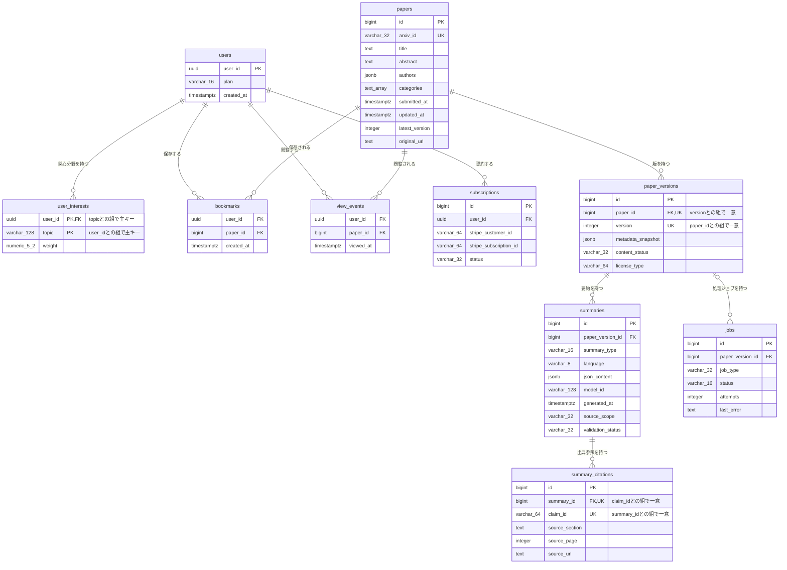

# DB物理設計書 — T006 利用者関心分野（`user_interests`）

| 項目 | 内容 |
| :--- | :--- |
| 文書名 | DB物理設計書 T006 利用者関心分野（`user_interests`） |
| 対象システム | Kaine personal pj — arXiv日本語研究ダイジェスト Webアプリ |
| 対象テーブル | T006 利用者関心分野（`user_interests`）1テーブル |
| 版 | 1.1（第1回セルフレビュー `docs/reviews/db_T006_review_applied.md` の Major 1件を反映。Blocker は0件） |
| 作成日 / 更新日 | 2026-10-26 / 2026-10-26 |
| 作成方法 | creating-db-physical-design v1.6.0 準拠。上流の確定設計書と `source/` の企画資料から作成。`docs/db/DB.T001.DB物理設計.md`〜`DB.T005.DB物理設計.md`（各版1.1）の規約・判断を引き継ぐ |
| インプット | (b) `docs/基本設計書_概要.md` §6（テーブル一覧 T006、論理テーブル定義「T006 user_interests（利用者関心分野）」、概念ER図、CRUD図）、§2（BF06・BF08・BF10・BF13）、§4（F06・F08・F10・F16）、§5 バッチ一覧（B007）、§7（API05 `GET /api/recommendations`、IF09）、§8（認証・認可設計、セキュリティ対策）、§10（バックアップ）、§11（ARC010）、付録 Q15・Q17・Q22・Q27・Q32・Q34／(a) `source/03_システム構成.md:8,10,40`、`source/02_機能要求定義.md:11,13,15,37-42,48`／(c) `legacy/`（空。突合結果は下記） |

## 前提: インプットの性質と突合結果

* **既存版**: `docs/db/DB.T006.DB物理設計.md` の旧版はありません（本書が初版です）。消さずに残すべき既存記述はありません。
* **source/（挙動の正）**: `source/` は企画・初期設計案のMarkdown 6ファイルだけで、`schema.rb`・マイグレーション・SQL・ORM定義はありません（本単位の作業開始時にファイル数6件で、T001〜T005 作成時から変更が無いことを確認）。`user_interests` について資料にあるのは列名の並び1行（`source/03_システム構成.md:40`: user_id, topic, weight）と、関心領域を保存すること（`source/02_機能要求定義.md:11`）、初期の推薦は興味カテゴリ・キーワードと新しさを使うルールベースであること（`:38`）、関心分野の新着論文を通知すること（`:15`）、退会・削除に対応すること（`:48`）だけです。**型・桁・NOT NULL・初期値・制約・インデックスはすべて資料に無いため、本書の物理定義はすべて※推測**です。上流の論理テーブル定義（`docs/基本設計書_概要.md` §6「T006 user_interests（利用者関心分野）」）の型・制約・初期値の案を正として引き継ぎ、物理的な詳細（桁の確定・CHECK制約・削除時の動き・インデックス・行単位アクセス制御・DDL）を本書で加えています。
* **legacy/（既存設計）**: `legacy/` は空ディレクトリです（ファイル0件）。突合する既存仕様・業務意図・非機能の記述はありません。
* **上流との対応**: カラム3件は上流の論理テーブル定義の3行と1対1で一致します（列名・順序とも同じ）。上流の論理定義に無い列は追加していません。主キーは上流の「topic との組でPK」のとおり、利用者IDとトピックの組です（`id` のような代理キーは追加していません）。
* **上流に無い要素**: 外部キーの削除時の動き（利用者と一緒に削除）は上流 §6 に定義がありません（※上流未定義）。T005 設計書 §4.5 No.1 で推奨した方針を、本書で確定させます（§4.5）。
* **ファイル名**: T001〜T005 と同じく、作業指示に従いテーブルIDで命名しています（上流 §10 は `DB.{物理名}` 形式。※上流要確認。T001 §9 No.7 と同じ事項）。

---

## 1. データベース概要

T001（`docs/db/DB.T001.DB物理設計.md` §1）〜T005 と同じ規約を使います。本書で読むだけで分かるよう、内容を次に書きます。

* **対象RDBMS**: PostgreSQL（Supabase 上のマネージドDB）。製品は上流 §1 で確定です（`source/03_システム構成.md:8`）。バージョンは未定義のため、PostgreSQL 15 以上を前提にします（※推測。上流 Q02）。
* **文字コード / 照合順序**: UTF8 / Supabase の既定照合順序（※推測: 資料に定義なし）。トピックの重複判定は照合順序ではなく、保存前のアプリでの正規化で行います（§4.3 (2)）。
* **命名規則**:
  * テーブル名・カラム名: 英小文字のスネークケース。テーブル名は複数形です（`user_interests`。上流 §6 の物理名をそのまま使います）。
  * 制約名・インデックス名（※推測）: 主キー `pk_{テーブル}`、一意制約 `uq_{テーブル}_{列}`、外部キー `fk_{子テーブル}_{列}`、CHECK制約 `ck_{テーブル}_{意味}`、インデックス `idx_{テーブル}_{列または用途}`。
* **共通カラム規約**: 上流 §6 にはシステム共通の監査列（作成日時・更新日時・論理削除フラグ）の規約がありません。本テーブルには上流の論理定義にある3列だけを置き、作成日時・更新日時の列は持ちません。関心分野をいつ登録したかを使う機能が上流に無いためです（※推測。要否は §9 No.5）。
* **論理削除**: 採用しません。利用者が関心分野を外したときと退会したときは、行を物理的に削除します（上流 CRUD図 F06「CRUD」・F16「D」、BF13、`source/02_機能要求定義.md:48`、上流 ARC010）。

---

## 2. 物理テーブル一覧

本書が設計するのは T006 だけです。外部キーでつながるテーブルを区別するため、上流 §6 テーブル一覧の全件を載せています。

| No | 概要書ID | 論理名 | 物理名 | ドメイン | 概要 | 本書での扱い | 定義状況 | 詳細の所在 |
| :--- | :--- | :--- | :--- | :--- | :--- | :--- | :--- | :--- |
| 1 | T001 | 論文 | papers | 論文 | arXiv論文1本につき1行。最新版のメタデータを持つ | 対象外（外部キーでの関係なし。推薦と通知で、トピックを論文のカテゴリ・タイトル・Abstractと突き合わせる） | 詳細 | `docs/db/DB.T001.DB物理設計.md` |
| 2 | T002 | 論文バージョン | paper_versions | 論文 | 論文の版（v1/v2…）ごとに1行。取得時点のメタデータ、本文の取得状況、ライセンス種別を持つ | 対象外（関係なし） | 詳細 | `docs/db/DB.T002.DB物理設計.md` |
| 3 | T003 | 要約 | summaries | 要約 | 論文の版ごと・要約の深さごとの日本語要約JSON | 対象外（関係なし） | 詳細 | `docs/db/DB.T003.DB物理設計.md` |
| 4 | T004 | 要約出典参照 | summary_citations | 要約 | 要約内の主張ごとに原文の章・ページ・URLを結びつける | 対象外（関係なし） | 詳細 | `docs/db/DB.T004.DB物理設計.md` |
| 5 | T005 | 利用者 | users | 利用者 | 会員1人につき1行。プラン（Free/Pro）と登録日時を持つ | 関連（本テーブルが外部キーで参照する親テーブル） | 詳細 | `docs/db/DB.T005.DB物理設計.md` |
| 6 | T006 | 利用者関心分野 | user_interests | 利用者 | 利用者が登録した関心トピックと、その重み | **設計対象** | 詳細 | 本書 §4〜§7 |
| 7 | T007 | ブックマーク | bookmarks | 利用者 | 利用者が保存した論文 | 対象外（関係なし） | 詳細 | `docs/db/DB.T007.DB物理設計.md`（未作成） |
| 8 | T008 | 閲覧イベント | view_events | 利用者 | 利用者が論文を開いた記録。プライバシーに配慮して最小限だけ持つ | 対象外（関係なし） | 詳細 | `docs/db/DB.T008.DB物理設計.md`（未作成） |
| 9 | T009 | ジョブ | jobs | 運用 | 論文の版ごとの処理ジョブの種類・状態・試行回数・直近エラー | 対象外（関係なし） | 詳細 | `docs/db/DB.T009.DB物理設計.md`（未作成） |
| 10 | T010 | サブスクリプション | subscriptions | 課金 | 利用者とStripeの顧客・定期課金を結びつけ、契約状態を持つ | 対象外（関係なし） | 詳細 | `docs/db/DB.T010.DB物理設計.md`（未作成） |

**総件数: 10件（本書の設計対象1件・外部キーで直接つながる関連1件・対象外8件）。全数である根拠**: `docs/基本設計書_概要.md` §6 テーブル一覧の T001〜T010 の全10行と1対1で対応します（上流の総件数10件と一致）。概要書ID・論理名・物理名・ドメイン（上流の「分類」列）・定義状況は上流の値をそのまま引き継ぎ、新規採番していません。T001〜T005 は作成済み、T007〜T010 の物理定義は各テーブルのDB物理設計書の責務で未作成です。

---

## 3. ER図（物理エンティティ関連図）

§2 の全10テーブルと、上流 §6 概念ER図の全10リレーションを描いています。`user_interests` は §4 の物理定義どおりに、複合主キーの2列へ `PK` を付けています。`papers`〜`users` は T001〜T005 の物理定義どおりに全列を載せています。他の4テーブル（T007〜T010）は上流 §6 概念ER図の属性を全部そのまま写したもので、物理的な確定は各テーブルのDB物理設計書で行います。T001〜T005 の設計書の §3 ER図は上流の概念ER図を写しているため `user_interests` の主キーに `PK` が付いていません。本書 §4 の物理定義が正で、各設計書の図は次の改訂時にそろえます（`docs/reviews/db_T006_review_applied.md` Minor-01）。



* **リレーション数**: 全10本（上流 §6 概念ER図の10本と一致）。このうち `user_interests` に関わるものは1本（親 `users` から）で、§4.5 外部キー一覧の No.1 と1対1で対応します。
* **多重度の意味**: 利用者1人に対し、関心分野は0件以上です。会員登録の直後は0件で、マイページ（P106）で登録すると増えます。関心分野が0件の利用者には、おすすめの代わりに新着論文を返します（上流 BF08）。
* **論文との関係**: トピックと論文は外部キーで結びません。トピックは論文のカテゴリ名（`cs.LG` のようなarXivの分類）やキーワードを文字列で持ち、推薦と通知のたびに論文側と文字列で突き合わせます（§4.3 (2)）。このためER図には関係線を描いていません。

---

## 4. テーブル詳細定義

### テーブル名: 利用者関心分野 (`user_interests`)
* **概要**: 利用者が「どの分野・話題の論文を読みたいか」を登録した表です。1行が「1人の利用者の1つの関心トピック」を表し、関心の強さを重みで持ちます。ホームのおすすめ論文（F08）は、この表のトピックと論文のカテゴリ・キーワードの一致と新しさから点数を付けます。関心分野の新着ダイジェスト（F10・B007）は、この表のトピックに一致する新着論文を利用者ごとに集めます。利用者を消すとこの表の行も一緒に消えます（上流 §6 T006、BF06・BF08・BF10、`source/03_システム構成.md:40`、`source/02_機能要求定義.md:11,15,38`）。
* **対応ドメイン**: 利用者（上流 §6 テーブル一覧の分類）
* **概要書ID**: T006
* **想定件数**（※推測）: 上流 §8 の規模の目安（月間アクティブユーザー1,000〜30,000人）で、利用者1人あたり数件〜数十件の関心分野を登録するとして、数千〜百万行未満です。1人あたりの登録件数の上限は資料に無いため、アプリで上限を設けるかは §9 No.3 で確認します。
* **個人情報の扱い**: 関心分野はそれだけで個人を特定する情報ではありませんが、利用者の興味という個人の嗜好を表すデータです。本人以外は読み書きできないようにし（§7 行単位アクセス制御）、退会時には必ず消します（上流 ARC010、§8「他人のデータの閲覧・改ざん」）。
* **保護の重要度**: 利用者が自分で入力した、再生成できないデータのため、バックアップの対象に必ず含めます（上流 §10 バックアップ・リカバリ方針「利用者データ（users・user_interests・bookmarks・subscriptions）は再生成できないため必ず対象にします」）。

#### 4.1 カラム一覧（ロースター）

| No | ID | カラム論理名 | カラム物理名 | 概要 | 定義状況 | 詳細の所在 |
| :--- | :--- | :--- | :--- | :--- | :--- | :--- |
| 1 | T006.user_id | 利用者ID | user_id | 関心分野の持ち主の利用者。トピックとの組で行を一意に決める | 詳細 | §4.3 (1) |
| 2 | T006.topic | トピック | topic | 関心のあるカテゴリまたはキーワード | 詳細 | §4.3 (2) |
| 3 | T006.weight | 重み | weight | 推薦で関心の強さとして使う数値 | 詳細 | §4.3 (3) |

**総件数: 3件（詳細3件・簡易0件）。全数である根拠**: 上流 `docs/基本設計書_概要.md` §6「T006 user_interests（利用者関心分野）」の論理テーブル定義の全3行と1対1で対応し、資料の列名（`source/03_システム構成.md:40` の3列）とも一致します。ID列は上流のテーブルID「T006」に物理名をつないだもので、新しい番号は振っていません。
**定義状況の判定**（completeness 3-1）: `user_id` は利用者テーブルとまたがり（3-1 の3）、退会時の削除が連動する（3-1 の5）ため「詳細」です。`topic` は値の形でカテゴリとキーワードのどちらとして突き合わせるかが分かれ（3-1 の1）、重複の判定に正規化の業務ルールを含む（3-1 の7）ため「詳細」です。`weight` は推薦の点数の計算に使う業務ルールを含む（3-1 の7）ため「詳細」です。

#### 4.2 カラム定義

| カラム論理名 | カラム物理名 | データ型 | PK | FK | 必須 (NN) | デフォルト値 / 制約 | 備考 |
| :--- | :--- | :--- | :--- | :--- | :--- | :--- | :--- |
| 利用者ID | user_id | UUID（※推測） | ○（topic との複合） | ○（users.user_id） | ○ | 自動採番しない。ログイン中の利用者IDを入れる。利用者の行が消えたら一緒に消える（ON DELETE CASCADE）（※推測） | 本人以外の行は読み書きできません（§7 行単位アクセス制御） |
| トピック | topic | VARCHAR(128)（※推測） | ○（user_id との複合） | - | ○ | 空文字や空白だけの値は入れられない（`ck_user_interests_topic_not_blank`: 前後の空白を除いた値が空でないこと）（※推測） | 保存前にアプリが前後の空白を除き、キーワードは小文字にそろえます。同じ関心を二重に登録しないためです（§4.3 (2)） |
| 重み | weight | NUMERIC(5,2)（※推測） | - | - | ○ | DEFAULT 1.00。0より大きい値だけを入れられる（`ck_user_interests_weight_positive`: weight > 0）（※推測） | 関心を弱めたいときは値を下げ、関心が無くなったときは行を削除します（§4.3 (3)） |

* **必須の判定**: 3列とも必須です。上流 §6 T006 の論理定義（利用者IDは「必須」、トピックは「必須」、重みは「必須（※推測: 初期値 1.0）」）をそのまま引き継いだものです（※推測。上流 Q22 で確認待ち）。

#### 4.3 カラム詳細（定義状況＝詳細の3列）

ロースターは §4.1 です。本節では定義状況が「詳細」の3列について、値の決め方と業務ルールを書きます。

**(1) T006.user_id — 利用者ID**
* **値の決め方**: 関心分野を保存したログイン中の利用者の利用者ID（Supabase Auth の利用者IDと同じ値。T005 §4.3 (1)）を入れます。ブラウザから送られた値ではなく、APIがセッションから取り出した値を使います（上流 §7 API05「利用者はセッションから特定する」と同じ考え方。※推測）。
* **親テーブルとの結びつき**: 利用者テーブル（`users.user_id`）を参照する外部キーを付け、存在しない利用者の関心分野を作れないようにします（上流 §6「FK→users.user_id」、§4.5 No.1）。このため、利用者の行（会員登録時に作る。上流 BF06）より先に関心分野は保存できません。
* **退会時の削除**: 利用者の行を消すと、その利用者の関心分野の行もDBが一緒に消します（ON DELETE CASCADE。§4.5 No.1）。退会の処理で本テーブルを個別に消す手順を書き忘れても、関心分野が残らないようにするためです（上流 BF13、F16、ARC010、`source/02_機能要求定義.md:48`）。

**(2) T006.topic — トピック**
* **意味**: 利用者が関心を持つ分野または話題です。上流 F06「関心のあるカテゴリ・キーワードを保存する」のとおり、次の2種類の値を同じ列に持ちます（`source/02_機能要求定義.md:38`「興味カテゴリ・キーワード」）。
  * **カテゴリ**: arXivの分類名です（例: `cs.LG`・`math.AG` のように分野と細分類をピリオドでつないだもの、`hep-th`・`quant-ph` のようにピリオドを含まないもの）。論文の `categories`（T001）に同じ分類名が含まれるかで突き合わせます。
  * **キーワード**: 利用者が自由に入力した語です（例: `diffusion model`）。論文のタイトルと Abstract（T001 の `title`・`abstract`）にその語が含まれるかで突き合わせます（※推測: 突き合わせ方は上流で未定義。F08 のBE詳細設計で確定する）。
* **種類の見分け方**（※推測・※上流要確認）: 上流の論理定義には「カテゴリかキーワードか」を示す列がありません。本書では列を追加せず、値が arXiv の公開する分類名の一覧（分類体系）に含まれていればカテゴリ、含まれていなければキーワードとして扱う案にします。値の形（ピリオドの有無）では判定しません。arXiv には `cs.LG`・`math.AG` のようにピリオドを含む分類名のほか、`hep-th`・`quant-ph`・`gr-qc` のようにピリオドを含まない分類名もあり、形で判定するとこれらをキーワードと取り違えてカテゴリでの突き合わせから外れるためです。論文テーブルの全件を調べて実在を確かめる方法は重いため使いません。分類名の一覧をどこに持つか（アプリの定数か、テーブルか）は §9 No.9 で確認します。分類名と同じ綴りのキーワードを登録したい場合（例: 分類名ではなく語として `hep-th` を探したい）は見分けられないため、種類を示す列を追加するかを §9 No.1 で確認します。
* **重複の防ぎ方**: 主キーが「利用者ID＋トピック」なので、同じ利用者が同じ文字列を2回登録することはできません。ただし文字の大小や前後の空白が違うだけの値（`Transformer` と `transformer `）は別の値として入ってしまうため、保存する前にアプリが次のとおり正規化します（※推測）。
  * 前後の空白を取り除き、続けて並んだ空白を1つにまとめる。
  * 次に、上の「種類の見分け方」でカテゴリかキーワードかを判定する。分類名の一覧とは大小文字を区別せずに照らし合わせ、一致したら一覧の表記（`cs.LG` の大小文字）に直して保存する。小文字化より先に判定するのは、小文字にしてから照らし合わせると `cs.lg` のような一覧に無い表記で保存され、論文のカテゴリとの突き合わせが外れるためです。
  * キーワードと判定した値は英字を小文字にそろえる。
  * 正規化した結果が空になる値は保存しない。DBでも空白だけの値を CHECK 制約で拒否します（`ck_user_interests_topic_not_blank`）。
* **長さ**: 128文字までです（上流 §6「varchar(128)（※推測）」）。arXivの分類名は十数文字以内のため、キーワードの入力上限としての値です。
* **書き換え**: トピックの文字列そのものは書き換えません。主キーの一部のため、別のトピックに変えるときは古い行を消して新しい行を作ります（※推測）。

**(3) T006.weight — 重み**
* **意味**: その関心がどれだけ強いかを表す数値です。推薦（F08）で、論文が一致したトピックの重みを点数に掛け、強い関心に一致した論文ほど上位に出します（上流 §6「推薦で関心の強さとして使う」、`source/02_機能要求定義.md:38`。点数の計算式は F08 のBE詳細設計の責務）。
* **初期値**: 1.00 です（上流 §6「※推測: 初期値 1.0」）。利用者が重みを指定せずにトピックを登録すると、全トピックが同じ強さとして扱われます。
* **値の範囲**（※推測）: 0より大きい値だけを入れられます（`ck_user_interests_weight_positive`）。0以下の重みは「関心が無い」「避けたい」の意味になってしまい、推薦の計算で負の点数が出るのを避けるためです。関心が無くなったトピックは行を削除します。型の桁（整数部3桁・小数部2桁、最大 999.99）は、初期値1.00を基準に強弱を付けるのに足りる幅として決めた仮の値です。
* **誰が決めるか**（※推測・※上流要確認）: 上流 BF06 は「user_interests に topic と weight を保存」としており、利用者が画面（P106）で強さを選べる案です。一方で `source/02_機能要求定義.md:13` は推薦を「関心カテゴリと行動履歴に基づく」としており、閲覧履歴（T008）やブックマーク（T007）から重みをシステムが自動で調整する使い方も考えられます。上流に自動調整の機能（バッチ）は無いため、本書では利用者だけが重みを変える前提にし、§9 No.2 で確認します。
* **通知での扱い**（※推測）: 関心分野の新着ダイジェスト（B007）は、一致するかどうかだけで論文を選び、重みは並び順にだけ使う案です（上流 BF10 に重みの扱いの定義なし）。

#### 4.4 制約一覧（ロースター）

| No | ID（制約名） | 種別 | 対象カラム | 概要 | 定義状況 | 詳細の所在 |
| :--- | :--- | :--- | :--- | :--- | :--- | :--- |
| 1 | pk_user_interests | PRIMARY KEY | user_id, topic | 同じ利用者が同じトピックを二重に登録できないようにし、利用者ごとの関心分野を引く鍵にする | 詳細 | §4.3 (1)・(2) |
| 2 | fk_user_interests_user_id | FOREIGN KEY | user_id → users.user_id | 存在しない利用者の関心分野を作らせない。利用者が消されたら一緒に消す | 詳細 | §4.5 No.1 |
| 3 | ck_user_interests_topic_not_blank | CHECK | topic | 空文字や空白だけのトピックを保存させない（※推測） | 詳細 | §4.3 (2) |
| 4 | ck_user_interests_weight_positive | CHECK | weight | 重みを0より大きい値に限り、推薦で負の点数が出ないようにする（※推測） | 詳細 | §4.3 (3) |
| 5 | NOT NULL（user_id） | NOT NULL | user_id | 主キーの一部なので空を許さない（主キー制約に含まれる） | 簡易 | §4.2 |
| 6 | NOT NULL（topic） | NOT NULL | topic | 主キーの一部なので空を許さない（主キー制約に含まれる） | 簡易 | §4.2 |
| 7 | NOT NULL（weight） | NOT NULL | weight | 重みの分からない関心分野を作らない（初期値で必ず埋まる） | 簡易 | §4.2 |
| 8 | DEFAULT（weight） | DEFAULT | weight | 重みを指定せずに登録したときは 1.00 にする | 簡易 | §4.3 (3) |

**総件数: 8件（PRIMARY KEY 1件・FOREIGN KEY 1件・CHECK 2件・NOT NULL 3件・DEFAULT 1件）。UNIQUE は0件です（主キー以外に一意にすべき列の組がありません）。全数である根拠**: §7 DDL の `CREATE TABLE user_interests` に書いた制約（CONSTRAINT 句4件、NOT NULL 3句（主キーの2列にも明記）、DEFAULT 1句）をすべて数えたものです。NOT NULL の3件は §4.2 で必須を「○」とした3列と一致します。PRIMARY KEY・FOREIGN KEY・重みの初期値は上流 §6 T006 の「topic との組でPK」「FK→users.user_id」「初期値 1.0」と一致し、CHECK 2件と外部キーの削除時の動きは本書で追加した※推測です。
**定義状況の判定**: 複数テーブルにまたがる制約（3-1 の3）と、値の範囲に業務上の判断を含む制約（3-1 の7）は「詳細」、空を許さないだけの制約と初期値は判断を含まないため「簡易」としました。

#### 4.5 外部キー（FKリレーション）一覧（ロースター）

| No | ID（制約名） | 向き | 子テーブル.列 | 親テーブル.列 | 多重度 | 削除時の動き | 概要 | 定義状況 | 詳細の所在 |
| :--- | :--- | :--- | :--- | :--- | :--- | :--- | :--- | :--- | :--- |
| 1 | fk_user_interests_user_id | 本テーブルが参照する | user_interests.user_id（T006） | users.user_id（T005） | 利用者1 : 関心分野0以上 | 利用者と一緒に削除（ON DELETE CASCADE）（※上流未定義） | 関心分野の持ち主を示す。退会で利用者を消すと関心分野も消える | 詳細 | 本書 §4.3 (1)、§7 |

**総件数: 1件（参照する1件・参照される0件）。全数である根拠**: 上流 §6 の論理テーブル定義 T006 で「FK→」と書かれた列は `user_id` の1列だけで、上流 §6 概念ER図で `user_interests` に入るリレーションも `users` からの1本だけです。上流 §6 の論理テーブル定義 T001〜T010 の全定義に `user_interests` を参照する列は無いため、参照される外部キーは0件です。T005 設計書 §4.5 No.1 の行（`fk_user_interests_user_id`）と制約名・向き・多重度が一致します。
**削除時の動きを「一緒に削除」とする理由**: 退会したら、利用者に紐づくデータをすべて消す方針です（上流 BF13、F16、ARC010、`source/02_機能要求定義.md:48`）。関心分野は利用者の嗜好を表す個人データで、消し残すとプライバシーを損なうため、利用者の行を消せばDBが必ず消すようにします。T005 設計書 §4.5 で推奨された方針を本書で確定させたもので、上流 §6 に削除時の動きの定義はありません（※上流未定義）。
**更新時の動き**: 利用者IDは変わらない値（T005 §4.3 (1)）のため、更新時の動きは既定（NO ACTION）のままにします。
**定義状況の判定**: 複数テーブルにまたがり（3-1 の3）、削除時の扱いが自明でない（3-1 の5）ため「詳細」です。

#### 4.6 本テーブルを操作する機能・バッチ（ロースター）

| No | ID | 名称 | 操作（C/R/U/D） | 本テーブルに対する内容 | 定義状況 | 詳細の所在 |
| :--- | :--- | :--- | :--- | :--- | :--- | :--- |
| 1 | F06 | 認証・プロフィール | CRUD | マイページ（P106）で、ログイン中の利用者が自分の関心分野を一覧で読み、トピックを追加し、重みを変え、不要なトピックを削除する（上流 BF06）。保存のAPIは上流で未定義（上流 Q27） | 詳細 | `docs/detail/be/BE.F06.BE詳細設計.md`（未作成） |
| 2 | F08 | レコメンド（API05） | R | ログイン中の利用者の関心分野を全件読み、トピックと論文のカテゴリ・キーワードの一致と重み・新しさで点数を付ける。関心分野が0件なら新着論文を返す（上流 BF08） | 詳細 | `docs/detail/be/BE.F08.BE詳細設計.md`（未作成） |
| 3 | F10 | 通知・ダイジェスト（B007） | R | 通知を希望する利用者ごとに関心分野を読み、前回配信以降の新着論文のうちトピックに一致するものを集める（上流 BF10） | 詳細 | `docs/detail/be/BE.F10.BE詳細設計.md`（未作成）、`docs/detail/batch/BT.B007.バッチ詳細設計.md`（未作成） |
| 4 | F16 | 退会・個人データ削除 | D | 利用者の行を消すと、その利用者の関心分野が外部キーで一緒に消える（§4.5 No.1。上流 BF13） | 詳細 | `docs/detail/be/BE.F16.BE詳細設計.md`（未作成） |

**総件数: 4件。全数である根拠**: 上流 §6 CRUD図の全21行（F01〜F19、B010、B011）のうち、`user_interests` 列が「-」でない行を数えたものです（F06「CRUD」、F08「R」、F10「R」、F16「D」の4行。残りの17行は「-」）。B007 は上流 §5 で F10 の定期実行として定義されており、CRUD図では F10 の行に含まれるため、No.3 にあわせて書いています。定義状況と詳細の所在は上流 §4 機能一覧・§5 バッチ一覧の値を引き継いでいます。
**関心分野の保存の進め方**（F06。※推測）: P106 で関心分野の一覧をまとめて保存する場合は、1つのトランザクションで「画面から外したトピックの行を削除」「新しいトピックの行を追加」「残ったトピックの重みを更新」を行い、途中で失敗しても一部だけが保存された状態にならないようにします。追加は主キーが重なったら重みだけを更新する書き方（`INSERT ... ON CONFLICT (user_id, topic) DO UPDATE SET weight = EXCLUDED.weight`）にし、同じ画面から二重に送信されても行が増えないようにします。

---

## 5. インデックス設計

#### 5.1 インデックス一覧（ロースター）

| No | ID（インデックス名） | 対象カラム | 種別 | 概要 | 定義状況 | 詳細の所在 |
| :--- | :--- | :--- | :--- | :--- | :--- | :--- |
| 1 | pk_user_interests | user_id, topic | B-Tree（UNIQUE） | 主キー制約で自動的に作られる。利用者ごとに関心分野を全件引く検索（F06・F08・B007）と、利用者テーブルからの結合・一緒に削除するときの検索に使う | 簡易 | §4.4 No.1 |
| 2 | idx_user_interests_topic | topic | B-Tree | 新着論文のカテゴリから、そのカテゴリに関心を持つ利用者を逆に引くための索引（※推測） | 詳細 | §5.2 |

**総件数: 2件（主キーで自動的に作られるもの1件、明示的に作るもの1件）。全数である根拠**: §7 DDL で `user_interests` に作られるインデックスをすべて数えたものです（`CREATE INDEX` 文1文、主キー制約による自動作成1件）。
**外部キー列のインデックス**: 外部キーの列 `user_id` は主キーの先頭の列なので、主キーのインデックスで利用者IDによる検索と、利用者を消したときに子の行を探す検索の両方が速くなります。`user_id` だけの別のインデックスは作りません。
**作らないと判断したもの**（※推測）:
* `weight` のインデックス: 重みは利用者の行を引いてから点数の計算に使う値で、重みで絞り込む検索がありません。
* キーワードの部分一致用のインデックス（`topic` の三文字組インデックス）: キーワードの突き合わせは「論文のタイトル・Abstractに、利用者のキーワードが含まれるか」を調べる向きで、検索されるのは論文側です。論文側の全文検索のインデックスは T001 と検索インデックス更新（B011）の責務です。
**定義状況の判定**: 主キーのインデックスは自動作成で判断を含まないため「簡易」、`idx_user_interests_topic` は使う処理の組み立て方に依存する性能上の判断（3-1 の6）を含むため「詳細」です。

#### 5.2 インデックス定義（主キーを除く）

| 対象テーブル物理名 | インデックス名 | 対象カラム | 種別 | 目的・理由 |
| :--- | :--- | :--- | :--- | :--- |
| user_interests | idx_user_interests_topic | topic | B-Tree | 新着ダイジェスト（B007）で、前回配信以降の新着論文のカテゴリを先に集め、そのカテゴリをトピックに持つ利用者を探す処理を速くするための索引です。利用者ごとに全関心分野を読んで論文を探す組み立て方にした場合は使われないため、B007 のバッチ詳細設計で組み立て方を決めたときに要否を見直します（※推測）。カテゴリ別の関心の集計（運用者の利用状況分析）にも使えます |

---

## 6. コード定義（区分値・ステータス定義）

**該当なし**。根拠: 本テーブルの全3列（§4.1）のうち、値の一覧を本システムが定める列はありません。`user_id` は利用者ID、`topic` は利用者が入力する自由な文字列（またはarXivの分類名）、`weight` は数値で、どれも区分値ではありません。

`topic` には「カテゴリ」と「キーワード」の2種類の値が入りますが、種類を表すコードを持つ列はありません（§4.3 (2)）。種類を表す列を追加する場合は、その列の区分値をここに定義します（§9 No.1）。

| 対象テーブル | 対象カラム | 設定値 | 意味・遷移条件 |
| :--- | :--- | :--- | :--- |
| user_interests | —（該当なし） | — | 区分値・ステータスを持つ列はありません |

---

## 7. DDL (データ定義言語)

`user_interests` の全定義です。PostgreSQL 15 以上でそのまま実行できます（※推測: 型・制約はすべて本書の設計案）。利用者テーブル（T005 `users`）を参照するため、`docs/db/DB.T005.DB物理設計.md` §7 の DDL を先に実行してください。

```sql
-- =========================================================
-- T006 利用者関心分野 (user_interests)
-- 前提: T005 users が作成済みであること
-- =========================================================
CREATE TABLE user_interests (
    user_id  UUID          NOT NULL,
    topic    VARCHAR(128)  NOT NULL,
    weight   NUMERIC(5,2)  NOT NULL DEFAULT 1.00,

    CONSTRAINT pk_user_interests PRIMARY KEY (user_id, topic),

    -- 利用者を消したら関心分野も一緒に消す（退会時の個人データ削除）
    CONSTRAINT fk_user_interests_user_id
        FOREIGN KEY (user_id) REFERENCES users (user_id)
        ON DELETE CASCADE,

    -- 空文字・空白だけのトピックは保存しない
    CONSTRAINT ck_user_interests_topic_not_blank CHECK (btrim(topic) <> ''),

    -- 重みは0より大きい値だけ
    CONSTRAINT ck_user_interests_weight_positive CHECK (weight > 0)
);

-- インデックス: 主キーで自動作成される1件に加え、トピックからの逆引き用に1件（§5）
CREATE INDEX idx_user_interests_topic ON user_interests (topic);

-- コメント
COMMENT ON TABLE  user_interests        IS 'T006 利用者関心分野: 利用者1人の関心トピック1つにつき1行。推薦と新着ダイジェストで論文と突き合わせる';
COMMENT ON COLUMN user_interests.user_id IS '利用者ID（users.user_id。利用者を消すと一緒に消える）';
COMMENT ON COLUMN user_interests.topic   IS 'トピック（arXivのカテゴリ名またはキーワード。キーワードは小文字にそろえて保存する）';
COMMENT ON COLUMN user_interests.weight  IS '重み（関心の強さ。初期値1.00、0より大きい値）';
```

**Supabase 環境のみの追加定義（※推測）**: 次の文は Supabase の既定ロール（`authenticated`）と、ログイン中の利用者IDを返す関数 `auth.uid()` がある環境でだけ実行できます。

* **行単位アクセス制御**: ログイン中の利用者が自分の関心分野だけを読み、追加・更新・削除できるようにします（上流 §8「ブックマーク・関心分野・閲覧履歴は本人だけが読み書きできるよう、Supabase の行単位アクセス制御で利用者IDを照合します」、上流 Q32）。他人の利用者IDを指定した追加・更新は拒否されます。利用者（T005）と違い、関心分野は本人が変えてよいデータのため、書き込みも本人に許可します。新着ダイジェスト（B007）と退会処理は、行単位アクセス制御を通らないサーバ側のサービスロールで動きます。

```sql
ALTER TABLE user_interests ENABLE ROW LEVEL SECURITY;

-- 本人の関心分野だけを読める
CREATE POLICY user_interests_select_own
    ON user_interests
    FOR SELECT
    TO authenticated
    USING (user_id = auth.uid());

-- 本人の利用者IDでだけ追加できる
CREATE POLICY user_interests_insert_own
    ON user_interests
    FOR INSERT
    TO authenticated
    WITH CHECK (user_id = auth.uid());

-- 本人の行だけを更新でき、更新後も本人の行のままであること
CREATE POLICY user_interests_update_own
    ON user_interests
    FOR UPDATE
    TO authenticated
    USING (user_id = auth.uid())
    WITH CHECK (user_id = auth.uid());

-- 本人の行だけを削除できる
CREATE POLICY user_interests_delete_own
    ON user_interests
    FOR DELETE
    TO authenticated
    USING (user_id = auth.uid());
```

---

## 8. マイグレーション計画（該当する場合のみ）

**該当なし（新規構築）**。根拠: 既存のDB・スキーマ・マイグレーションはありません（`source/` にスキーマ定義が無く、`legacy/` は空。上流 §10「システム移行計画: 該当なし」）。

初回構築の手順（※推測）:

| No | 対象テーブル | 変更種別 | 変更内容 | 影響範囲 | 備考 |
| :--- | :--- | :--- | :--- | :--- | :--- |
| 1 | user_interests | テーブル新規作成 | §7 DDL の `CREATE TABLE user_interests`・`CREATE INDEX`・コメントを実行する | なし（新規） | T005 `users` の作成後に実行する。マイグレーションの置き場所とツールは未定（※推測: Supabase のマイグレーション機能。上流 Q34） |
| 2 | user_interests | 権限設定 | §7 の Supabase 環境のみの追加定義（行単位アクセス制御と、本人の行の読み取り・追加・更新・削除の4ポリシー）を実行する | マイページでの関心分野の保存、推薦 | Supabase 環境のみ（※推測。上流 Q32） |

---

## 9. 確認事項（※推測・※上流要確認の集約）

| No | 区分 | 確認事項 | 本書での仮置き | 関連箇所 | 上流の確認事項 |
| :--- | :--- | :--- | :--- | :--- | :--- |
| 1 | 列の追加 | トピックが「カテゴリ」か「キーワード」かを示す列を追加するか（※上流要確認） | 列は追加せず、arXiv の分類名の一覧に含まれるかで見分ける | §4.3 (2)、§6 | Q22 |
| 2 | 重み | 重みを利用者が画面で決めるのか、閲覧履歴・ブックマークからシステムが自動で調整するのか（※上流要確認） | 利用者だけが変える。初期値1.00 | §4.3 (3) | Q27 |
| 3 | 件数 | 利用者1人が登録できる関心分野の上限件数 | 上限なし（DBでは制限しない） | §4 想定件数 | — |
| 4 | 型・制約 | 全列の型・桁・必須・CHECK制約（重みの範囲、空白だけのトピックの拒否） | §4.2・§4.4 のとおり | §4 | Q22 |
| 5 | 共通カラム | 関心分野の登録日時・更新日時の列を持つか（通知で「登録後の新着」だけを送る使い方をするか） | 持たない | §1 | Q15 |
| 6 | 外部キー | 利用者を消したときに関心分野を一緒に消すか（※上流未定義） | 一緒に削除（ON DELETE CASCADE） | §4.5 No.1 | Q17 |
| 7 | API | 関心分野を保存するAPI（一括保存か1件ずつか） | 一括保存を1トランザクションで行う | §4.6 | Q27 |
| 8 | インデックス | B007 の組み立て方（トピックから利用者を逆に引くか、利用者ごとに論文を探すか）と、それに伴う `idx_user_interests_topic` の要否 | 逆引き用に作る | §5.2 | Q15 |
| 9 | 分類名の一覧 | トピックをカテゴリと判定するための arXiv の分類名の一覧をどこに持つか（アプリの定数か、分類名のテーブルを設けるか）と、arXiv が分類を追加したときの更新方法（※上流未定義） | アプリの定数として持ち、分類の追加は手作業で反映する | §4.3 (2) | — |

---

## 出力前チェックリスト（自己検証）

- [x] §2 物理テーブル一覧に、基本設計書（概要）§6テーブル一覧の全10行を列挙した
- [x] §2 の「概要書ID」が上流のテーブルID T001〜T010 と1対1で対応している
- [x] §3 ER図に §2 の全10テーブルをエンティティとして描いた
- [x] §3 ER図のリレーションが §4.5 の外部キー1件（`users` → `user_interests`）を表現している（図の10本は上流 §6 概念ER図の全リレーション）
- [x] §3 ER図の `user_interests` のエンティティ名・PK（user_id, topic）・FK（user_id）が §4.2 と一致している
- [x] §3 のMermaid記法が規約どおり（型はアンダースコア区切り・括弧なし、リレーション記号の前後にスペース）
- [x] §4 全3列のカラム定義（PK/FK/NN/デフォルト）を網羅した
- [x] §5 インデックスを外部キー（主キーの先頭列で兼ねる）・検索条件の列に設計し、作らない理由を明記した
- [x] §6 区分値を持つ列が無いことを根拠付きで明記した
- [x] §7 DDL を出力した（CREATE TABLE・FOREIGN KEY・CHECK・CREATE INDEX、Supabase 環境のみの行単位アクセス制御）
- [x] 推測箇所に「※推測」を明記した
